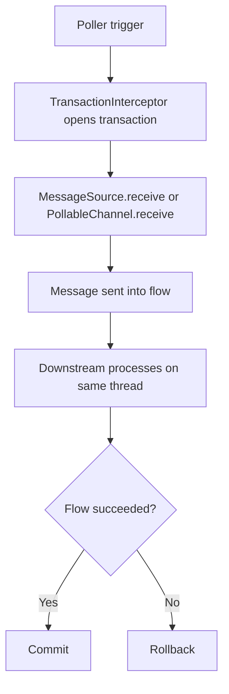
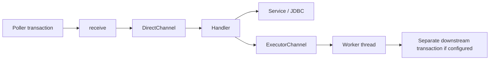

# Transactions in Pollers

A Spring Integration poller does not only decide when a consumer calls `receive()`. It is also the appropriate place to start a transaction for a message flow triggered by a polling schedule. This is especially important when the message source can participate in a transaction: the message retrieval operation and downstream data updates can commit or roll back together.

The core principle is that **the transaction must start before `receive()`**. If `@Transactional` is placed only on a downstream service, the message receive operation has already occurred before that transaction starts. When processing fails, the database may roll back, yet the message has already been removed from the source. This lesson covers the poller transaction boundary, configuration via Java DSL/XML, the effects of channels and executors, and how to test actual rollbacks.

## 1. Why Does a Poller Need Its Own Transaction?

There are several ways to initiate a message flow: calling a gateway, calling `MessageChannel.send()`, receiving a message from an inbound adapter, a scheduler, or a poller. For flows invoked directly from application code, standard Spring transaction mechanisms such as `@Transactional` on a gateway or service method can be used.

A poller differs in that it initiates the flow on a trigger. There is no external business caller opening a transaction before the flow begins. Spring Integration therefore lets you declare a transaction directly on the poller so the transaction opens before the message-retrieval step.



When both the source and the data operations participate in the same transaction manager, a rollback can undo both the message receive and the downstream updates. That is the purpose of a `receive-and-forward` unit of work in a poller.

A transaction does not automatically turn a non-transactional source into a transactional one. For example, a file on a filesystem or an external HTTP API does not automatically revert to its prior state simply because a database rolls back. For those sources, you need transaction synchronization, staging/rename mechanisms, idempotency, or appropriate compensating workflows.

## 2. What Does the Transaction Boundary Wrap?

The poller's transaction advice wraps the polling task (`doPoll`). The transaction starts before the poller calls `receive()` and encompasses sending the message and downstream steps that execute synchronously on the same thread.

| Component | Included in Poller Transaction? | Condition |
| --- | --- | --- |
| `MessageSource.receive()` | Yes | The source uses a resource managed by the transaction manager or has corresponding transaction synchronization. |
| `PollableChannel.receive()` | Invoked inside the transaction | Message removal can roll back only if the channel/store supports transactions. |
| Handler via `DirectChannel` | Possibly | The handler runs synchronously on the same thread and exceptions propagate back across the transaction boundary. |
| Handler behind `ExecutorChannel` | Not automatically | The executor hands processing off to another thread. |
| Handler behind another `QueueChannel` | Not automatically | The message is placed in the queue; the initial poller can commit immediately after enqueueing succeeds. |
| Service with its own `@Transactional` | Has its own transaction or joins the current one | Depends on thread, transaction manager, and propagation. |

Spring's transaction context is normally bound to the current thread. Thus, a flow can traverse multiple endpoints and remain in the same transaction as long as steps continue on the same thread. Crossing an `ExecutorChannel`, another pollable channel, or spawning a new thread does not automatically propagate the transaction context to the new thread.



If the message is successfully handed off to another thread, the poller's transaction can commit even if processing on the worker thread subsequently fails. This is why you should not place an asynchronous boundary between the receive operation and data updates that must roll back together, unless the boundary channel itself provides its own transaction mechanism.

## 3. Configuring Transactions for a Poller with Java DSL

Java DSL provides `Pollers` and `PollerSpec`. The `transactional(transactionManager)` method attaches a `TransactionInterceptor` to the polling task.

Example of a `MessageSource` reading data from a preconfigured source, followed by the flow processing messages on the same thread:

```java
@Configuration
class OrderPollingConfiguration {

    @Bean
    IntegrationFlow orderPollingFlow(
            MessageSource<?> orderSource,
            PlatformTransactionManager transactionManager,
            OrderHandler orderHandler) {

        return IntegrationFlow.from(orderSource, endpoint -> endpoint.poller(
                Pollers.fixedDelay(1000)
                    .maxMessagesPerPoll(5)
                    .transactional(transactionManager)))
            .handle(orderHandler, "process")
            .get();
    }
}
```

In this example:

- `fixedDelay(1000)` polls with a one-second delay interval.
- `maxMessagesPerPoll(5)` limits how many times `MessageSource.receive()` is called in a single poll run.
- `transactional(transactionManager)` uses the injected transaction manager to wrap the polling task.
- The handler runs on the same thread when the flow connects via the default `DirectChannel`. `orderSource` and downstream data operations must participate in that transaction manager if they need to roll back together.

You can call `.transactional()` without arguments when the application has a default transaction manager that Spring Integration can resolve. In applications with multiple transaction managers, pass the manager explicitly to avoid binding the wrong resource.

`PollerSpec.transactional(transactionManager)` uses a `TransactionInterceptor` with `DefaultTransactionAttribute`. If you need custom propagation, isolation, timeout, or rollback rules, build a `TransactionInterceptor` with the appropriate transaction attributes and pass it to the `.transactional(transactionInterceptor)` overload, or configure an advice chain.

## 4. Configuring Transactions with XML

In the XML namespace, place `<transactional/>` inside `<poller>`:

```xml
<int:service-activator id="processOrders"
                       input-channel="ordersQueue"
                       ref="orderHandler"
                       method="process">
    <int:poller fixed-delay="1000"
                max-messages-per-poll="5">
        <int:transactional transaction-manager="transactionManager"
                           propagation="REQUIRED"
                           isolation="READ_COMMITTED"
                           timeout="30"
                           read-only="false"/>
    </int:poller>
</int:service-activator>
```

Common attributes:

| Attribute | Meaning |
| --- | --- |
| `transaction-manager` | Transaction manager managing resources used in the flow. If omitted, Spring Integration defaults to looking up a bean named `transactionManager`. |
| `propagation` | Rule for joining or creating a transaction, e.g. `REQUIRED`, `REQUIRES_NEW`. |
| `isolation` | Transaction isolation level, depending on database/transaction manager. |
| `timeout` | Maximum duration for the transaction, in seconds in the XML example. |
| `read-only` | Marks the transaction read-only; set `false` when the flow updates data. |

If you only need a transaction on the poller, `<transactional/>` is a concise configuration. If multiple AOP advices are needed, XML does not allow declaring both `<transactional/>` and `<advice-chain/>` on the same poller. Instead, declare a `TransactionInterceptor` via `<tx:advice/>` and include it in `<advice-chain/>` alongside the other advices. Advice order determines how they wrap the polling task.

## 5. `maxMessagesPerPoll` and Transaction Size

`maxMessagesPerPoll` specifies how many times the poller calls `receive()` in a single poll run. It is not the row limit returned by a SQL query, nor does it automatically mean each message is processed in an independent transaction.

Because transaction advice wraps the polling task, one execution can hold a transaction open across multiple message receive iterations, depending on `maxMessagesPerPoll` and the consumer type. Consider transaction size when choosing this value.

| Configuration | Meaning | Impact to Consider |
| --- | --- | --- |
| `maxMessagesPerPoll = 1` | One receive per poll run. | Short transactions, easy fault isolation; trigger/transaction overhead may be higher. |
| Positive value greater than 1 | Receives multiple messages consecutively within the same poll task. | Can hold transactions and connections longer; rollback may affect multiple messages in the run. |
| Negative value (typically `-1`) | Continues receiving until `receive()` returns `null`. | Can create long poll runs under continuous backlogs; must be bounded by processing capacity and transaction timeout. |
| Value `0` | Since Spring Integration 5.5, skips `MessageSource.receive()` calls for endpoints supporting this property. | Can be used as a way to pause polling; not a typical batch configuration. |

Default values differ by consumer type. `PollingConsumer` typically defaults to `-1`, whereas `SourcePollingChannelAdapter` typically defaults to `1`. Set `maxMessagesPerPoll` explicitly whenever transaction size matters to the business logic.

For a JDBC inbound channel adapter, distinguish `maxMessagesPerPoll` from `max-rows`: the first controls how many times `receive()`/query executes per poll; the second caps how many rows each query fetches. Setting a large `maxMessagesPerPoll` can cause queries to run back-to-back within the same polling cycle.

## 6. Transactional QueueChannel and MessageStore

A common design mistake is enabling transactions on a poller and assuming messages pulled from any `QueueChannel` will return to the queue on rollback. That is not true for the default `QueueChannel`.

The default `QueueChannel` uses an in-memory queue. When `receive()` retrieves a message, the message is removed from the queue; a JDBC/JPA transaction does not automatically undo a removal from a Java collection. Therefore, if the handler fails after pulling a message from an in-memory `QueueChannel`, the message may be lost even if the database rolls back.

To allow message retrieval to roll back, use a `QueueChannel` backed by a persistent transactional `MessageStore`, such as `JdbcChannelMessageStore`:

```xml
<int:channel id="ordersQueue">
    <int:queue message-store="ordersChannelStore"/>
</int:channel>

<bean id="ordersChannelStore"
      class="org.springframework.integration.jdbc.store.JdbcChannelMessageStore">
    <property name="dataSource" ref="dataSource"/>
    <property name="channelMessageStoreQueryProvider"
              ref="channelMessageStoreQueryProvider"/>
</bean>
```

The poller's transaction manager must manage the same `DataSource` as `JdbcChannelMessageStore` and the business updates that should commit or roll back together. When a message is removed inside a transaction, the removal commits only if the transaction succeeds; upon rollback, the message remains in the store for re-retrieval.

This is how you establish a queue boundary with persistence and transactions. Other channels/stores have their own semantics; verify that a specific implementation supports transactions before relying on rollback.

## 7. JDBC Inbound Adapter Example: Atomic Receive and Mark-as-Processed

A JDBC inbound channel adapter typically runs a `SELECT` query to fetch data, and may then run an `UPDATE` to mark records as picked up. If the poller uses a transaction manager governing the same `DataSource`, both statements can participate in the same transaction.

```xml
<int-jdbc:inbound-channel-adapter id="pendingOrders"
        query="select * from orders where status = 'PENDING'"
        update="update orders set status = 'PROCESSING' where id in (:id)"
        data-source="dataSource"
        channel="ordersForProcessing">
    <int:poller fixed-delay="1000" max-messages-per-poll="1">
        <int:transactional transaction-manager="transactionManager"/>
    </int:poller>
</int-jdbc:inbound-channel-adapter>
```

If downstream connects via `DirectChannel` and the handler updates the same database under the same transaction manager, a downstream failure can roll back both the `SELECT`/`UPDATE` in the receive step. The record returns to its prior state and can be polled again.

This example assumes the query, update, and handler share the same transactional `DataSource`, and that exceptions actually escape the transaction boundary. If the handler catches the exception and returns normally, the transaction interceptor may commit. If the flow crosses to another executor/queue, the poller's transaction may finish before processing completes.

## 8. Transaction Boundaries When a Flow Crosses Channels or Threads

The transaction context is normally bound to a thread. This leads to three important cases:

**DirectChannel:** synchronous send and processing. If a downstream handler throws an unchecked exception and the exception propagates back to the poller, the transaction can roll back.

**ExecutorChannel:** the message is handed to a worker thread. The poller only sees that the handoff succeeded; the initial transaction may commit before the worker finishes. To process inside a transaction on the worker, configure a separate transaction at the worker endpoint.

**Downstream QueueChannel:** the poller sends the message into the queue and ends. The poller's transaction does not automatically extend until another consumer pulls the message. To guarantee durable storage within the same transaction, use a transactional persistent channel/store or a broker with appropriate transaction support.

Do not use `@Transactional` on a downstream service to infer that `receive()` is protected. That annotation only opens a transaction when the service method is invoked through its proxy; if it runs after the poller has already pulled the message, the transaction starts too late to roll back the receive.

## 9. Rollback Rules and Exception Handling

By default, Spring transactions roll back on `RuntimeException` and `Error`. Checked exceptions thrown directly out of a transaction interceptor normally do not trigger rollback by default unless the transaction attribute declares an appropriate rollback rule. However, Spring Integration may wrap handler exceptions in `MessagingException`/`MessageHandlingException` (both runtime exceptions). Therefore, inspect the exception actually received by the transaction interceptor, not only the root exception type in the cause chain.

Scenarios to verify:

- Handler throws `RuntimeException` and it escapes the transaction interceptor: the transaction is marked for rollback by default.
- Handler throws a checked exception: check whether Spring Integration wraps it in a runtime `MessagingException`; if a checked exception passes directly through the interceptor, declare a rollback rule.
- Handler catches the exception and ignores it: the transaction interceptor sees normal completion and typically commits, unless code explicitly marks rollback-only.
- Error flow handles errors asynchronously after the poller has handed off the message: that error does not automatically revert to the poller transaction.
- A transaction joining an existing transaction (`REQUIRED`) can be marked rollback-only by a participant; the caller may see `UnexpectedRollbackException` on commit.

Allow exceptions that require rollback to propagate across the transaction boundary or mark the transaction rollback-only explicitly. Do not swallow exceptions just to avoid error logs if business logic requires the message to be re-received.

## 10. Retries and Advice Ordering

Retries and transactions are often combined to handle transient errors, but advice order changes the transaction scope.

- **Transaction outside retry:** a single transaction wraps all retry attempts. Backoff delays can hold connections/locks longer, and all attempts share that same transaction.
- **Retry outside transaction:** each retry attempt can enter a fresh transaction if the transaction advice opens a transaction per invocation. This is usually preferable when each attempt needs its own rollback, though propagation and advice order must be configured intentionally.

When a poller requires multiple advices, place `TransactionInterceptor` and retry advice in the same advice chain and verify the ordering through tests. Do not assume merely adding two annotations yields a transaction per attempt.

Another option is retrying at the endpoint handler instead of retrying the entire poll task. In that case, decide whether message retrieval stays inside the transaction across retry attempts. If the message source only acknowledges after commit, retries and rollbacks can interact with broker redelivery; avoid creating two unbounded retry layers simultaneously.

## 11. TransactionSynchronizationFactory: Post-Commit/Rollback Actions

Some `MessageSource` implementations read from sources without true transactions, such as files on a filesystem. Spring Integration supports `TransactionSynchronizationFactory` to synchronize ancillary actions with the transaction outcome.

For example, an inbound file adapter can move a file to a success directory after commit and to a failed directory after rollback:

```xml
<int-file:inbound-channel-adapter id="filePoller"
        directory="/data/inbox"
        channel="filesToProcess">
    <int:poller fixed-delay="5000">
        <int:transactional transaction-manager="transactionManager"
                           synchronization-factory="fileSyncFactory"/>
    </int:poller>
</int-file:inbound-channel-adapter>

<int:transaction-synchronization-factory id="fileSyncFactory">
    <int:after-commit expression="payload.renameTo(new java.io.File('/data/success/' + payload.name))"/>
    <int:after-rollback expression="payload.renameTo(new java.io.File('/data/failed/' + payload.name))"/>
</int:transaction-synchronization-factory>
```

These expressions only illustrate the concept; check rename results, filesystem permissions, and error handling for move operations in real applications. Synchronization coordinates when an action executes relative to commit/rollback; it does not turn the filesystem into a transactional resource. If the process crashes between commit and the after-commit action, a recovery or reconciliation mechanism is required.

Spring Integration also provides `PassThroughTransactionSynchronizationFactory` since version 5.0. When a transaction interceptor is present on a poller and no custom factory is configured, this factory is applied to the polling endpoint to bind the polled message to the transaction context. This allows the framework to populate `MessagingException.failedMessage` when an exception occurs after the transaction advice.

## 12. The Transaction Manager Must Manage the Right Resources

A transaction manager only manages the resources supported by its implementation. For example:

| Resource | Typical Transaction Manager | Notes |
| --- | --- | --- |
| JDBC `DataSource` | `DataSourceTransactionManager` or `JdbcTransactionManager` | Store and services must use the right `DataSource`/transaction context. |
| JPA `EntityManagerFactory` | `JpaTransactionManager` | Entity manager and repositories must participate in the same transaction. |
| JMS session | `JmsTransactionManager` | Manages only the corresponding JMS session/connection factory; coordinating with JDBC requires additional design. |
| Multiple resources needing atomic commit | JTA/XA when infrastructure supports it | Complex configuration and overhead; not every resource supports XA. |

If a flow updates JDBC and then publishes a message to another broker, a single JDBC transaction does not make both systems commit atomically. You can use XA when requirements and infrastructure allow, or more commonly the transactional outbox pattern: write business data and an outbox record in the same database transaction, then have a separate publisher forward the outbox to the broker idempotently.

## 13. Testing Poller Transactions

A useful test verifies outcomes on the underlying resources, not merely whether the handler threw an exception.

1. Create a message in a transactional persistent queue or insert a source record in the database.
2. Configure the poller with the transaction manager governing the relevant store and database.
3. Have the handler update a record and then intentionally throw an exception.
4. Wait for the poll attempt to finish and verify the business update rolled back.
5. Verify the message remains in the persistent store or the source record stays in a pollable state.
6. Let the handler succeed and verify the message is removed/marked processed and business data is committed.

If a test uses only an in-memory `QueueChannel`, do not cite the message not returning to the queue as proof of a broken transaction manager: that queue is not a transactional store. Use a JDBC-backed `QueueChannel` or a genuinely transactional message source.

## 14. Diagnosing Common Failures

| Symptom | Possible Cause | Investigation Direction |
| --- | --- | --- |
| Database rolls back but message does not reappear | Source/channel does not support transactions or receive is outside the transaction. | Check whether `receive()` runs inside the poller transaction; check if the store is transactional. |
| Message lost when handler throws exception | Using an in-memory `QueueChannel` or non-transactional source. | Switch to a persistent transactional store or design retry/recovery for the source. |
| Database commits despite downstream error | Exception caught/swallowed, error flow runs asynchronously, or flow crossed a thread boundary. | Check exception propagation, channel topology, and transaction thread. |
| Handler runs with no active transaction | Missing `<transactional/>`/`.transactional()`, wrong transaction manager, or endpoint is not a polling consumer as assumed. | Check channel type, poller metadata, and transaction manager bean. |
| Rollback does not affect repository | Repository uses a different `DataSource`/`EntityManagerFactory` or opens connections outside the transaction. | Compare the poller's resources and transaction manager with the service's. |
| Checked exception does not roll back | Checked exception passes directly through the transaction interceptor; in message flows, exceptions may also be wrapped as runtime `MessagingException`. | Inspect the exception the interceptor actually receives; declare a rollback rule if checked exceptions pass straight through. |
| Poller holds locks/connections too long | Large `maxMessagesPerPoll`, long receive timeout, or slow handler. | Reduce batch size, timeout, and processing time; consider smaller transactions. |
| Messages processed multiple times after restart | Transaction rollback/redelivery gives at-least-once behavior, or result commits out of sync with source. | Design idempotency, unique keys, and outbox/inbox patterns. |
| After-commit action fails | Filesystem/HTTP is outside the transaction or process stops after commit. | Record pending completion state and run reconciliation/retry for the ancillary action. |

During investigation, capture at least the poller ID, poll start/end timestamps, thread name, transaction manager, transaction active/rollback-only flags, message ID, correlation ID, channel/store, root exception, and commit/rollback status. This data pinpoints whether the fault occurred in receive, handler, channel handoff, or transaction manager.

## 15. Poller Transaction Design Checklist

- Does the message source genuinely support transactions or transaction synchronization?
- Does the transaction start before `receive()`?
- Does the transaction manager manage the right `DataSource`, `EntityManagerFactory`, or broker resource?
- Does the downstream flow stay on the same thread through all work that needs to roll back together?
- If using `QueueChannel`, is it in-memory or backed by a persistent transactional `MessageStore`?
- Do `maxMessagesPerPoll`, `receiveTimeout`, and transaction timeout produce overly long transactions?
- Do checked exceptions, retries, and recovery callbacks roll back per policy?
- Are multiple advices present? Has retry/transaction ordering been defined and tested?
- Are after-commit/after-rollback actions or a transactional outbox needed?
- Is the handler idempotent when the broker/source redelivers messages?

## 16. Key Takeaways

- A poller's transaction begins before `receive()`, allowing message retrieval from a transactional source to roll back.
- The transaction context is thread-bound. `DirectChannel` keeps the same thread; `ExecutorChannel` and a downstream pollable channel create different boundaries.
- A transaction does not turn an in-memory `QueueChannel`, files, or HTTP into transactional resources.
- To roll back message retrieval from a `QueueChannel`, use a persistent transactional `MessageStore` and a transaction manager governing that same store.
- `maxMessagesPerPoll` affects how many receives occur in one polling task and can lengthen the transaction.
- Retries, transaction synchronization, broker redelivery, and outbox solve different parts of reliability; design them together rather than assuming one transaction spans every system.

## References

- [Spring Integration Reference — Transaction Support](https://docs.spring.io/spring-integration/reference/transactions.html)
- [Spring Integration Reference — Message Endpoints and Pollers](https://docs.spring.io/spring-integration/reference/endpoint.html)
- [Spring Integration Reference — QueueChannel Configuration](https://docs.spring.io/spring-integration/reference/channel/configuration.html)
- [Spring Integration Reference — JDBC Inbound Channel Adapter: Polling and Transactions](https://docs.spring.io/spring-integration/reference/jdbc/inbound-channel-adapter.html)
- [Spring Integration API — PollerSpec](https://docs.spring.io/spring-integration/api/org/springframework/integration/dsl/PollerSpec.html)
