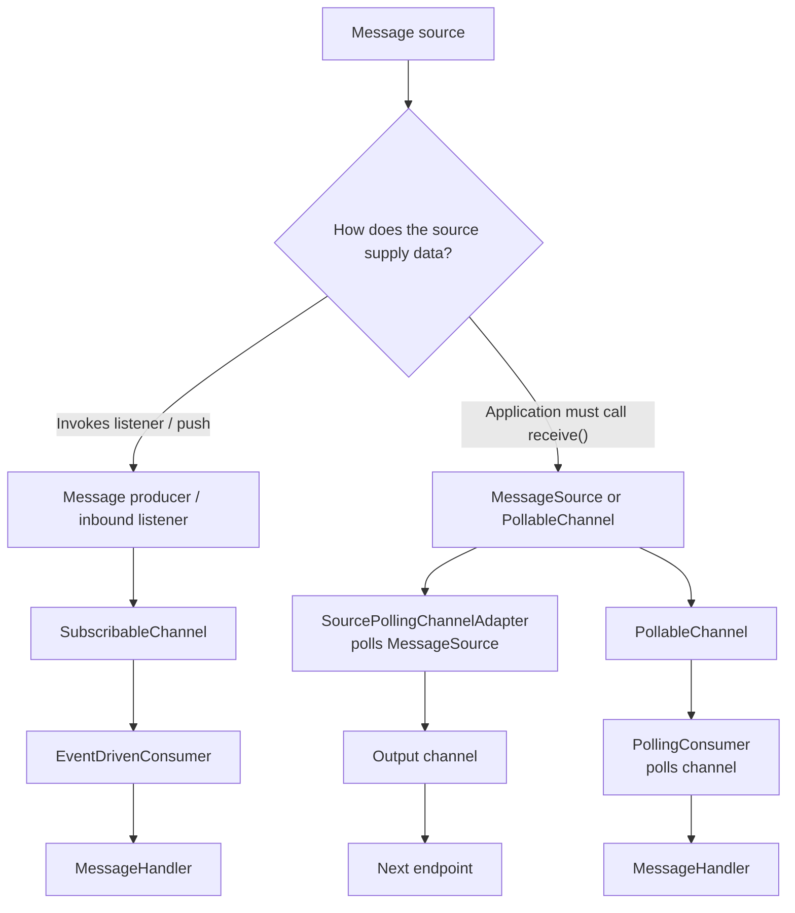
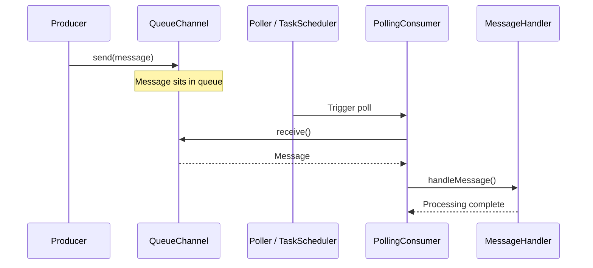
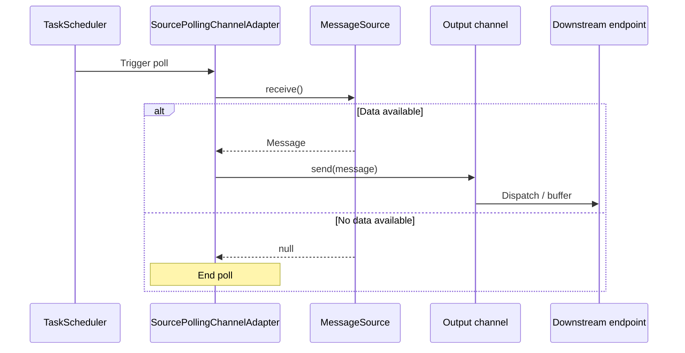

# Choosing Polling vs. Event-Driven Based on Message Source

In Spring Integration, choosing between polling and event-driven begins with how the message source supplies data and what type of channel the endpoint connects to.

- If a handler subscribes to receive messages on a `SubscribableChannel`, Spring Integration creates an `EventDrivenConsumer`. When a producer sends a message, the channel dispatches it to a subscriber.
- If a handler reads messages from a `PollableChannel`, Spring Integration creates a `PollingConsumer`. A poller periodically calls `receive()` to pull messages from the channel.
- If the application has a `MessageSource` that must be queried on a schedule, the inbound adapter is implemented via `SourcePollingChannelAdapter`. The adapter calls the source on a schedule and sends the received message to an output channel.

These three mechanisms are related but address three distinct places in a message flow. Choosing the right mechanism reduces latency, avoids useless polling, controls load, and preserves the semantics of the data source.

## 1. Start from the Message Source's Contract

A message source can either push events proactively when data appears, or return data only when the application calls a read method. This is the first decision.

| How the Source Supplies Data | Examples | Typically Suitable Approach |
|---|---|---|
| Push / callback / listener | Broker invokes a listener on message arrival, socket receives data, webhook calls an endpoint | Event-driven |
| Pull / query / read | Scheduled file reading, database queries, API polling for new records | Polling |
| Both supported | System supports both webhooks and query APIs | Prefer push for low latency; use polling for reconciliation or recovery |
| In-app producer sends directly | Service calls `MessageChannel.send()` | Event-driven via `SubscribableChannel`, or buffering via `PollableChannel` |

A push source typically has a thread or listener container receiving data and forwarding messages into the flow. A pull source does not notify automatically when new data arrives; the application must schedule reads with a poller.

Do not choose polling merely because an endpoint's poller configuration is easy to write. If an external system already offers a reliable callback or listener, event-driven usually avoids empty queries. Conversely, if a source only provides a read API, event-driven cannot fabricate events on its own without an event-emitting mechanism from the source.

## 2. Three Mechanisms to Distinguish

Spring Integration determines the consumer endpoint type based on the channel interface. For inbound adapters, the mechanism depends on whether the adapter provides a `MessageSource` or actively emits messages.



| Component | Where Does It Read Data From? | How Is It Triggered? |
|---|---|---|
| `EventDrivenConsumer` | `SubscribableChannel` | Channel invokes subscriber when a message arrives |
| `PollingConsumer` | `PollableChannel` | Poller calls `receive()` per trigger |
| `SourcePollingChannelAdapter` | `MessageSource` | Poller calls source per trigger then sends message to channel |

A common point of confusion is that `PollingConsumer` and `SourcePollingChannelAdapter` both use a poller, but on two different sides:

- `PollingConsumer` retrieves messages already residing in a buffering-capable channel.
- `SourcePollingChannelAdapter` queries an external data source or service to produce messages, then publishes them to a channel.

## 3. Event-Driven Consumers: Subscribing to a Channel

### 3.1. How It Works

`SubscribableChannel` provides `subscribe(MessageHandler)`. When the endpoint starts, `EventDrivenConsumer` registers the handler with the channel. When a producer sends a message, the channel dispatches it to a subscriber.

Common channels:

- `DirectChannel`: point-to-point; dispatches to one selected subscriber. Processing usually runs synchronously on the thread calling `send()`.
- `PublishSubscribeChannel`: broadcasts a message to multiple subscribers. Without an executor configured, dispatching usually happens synchronously.
- `ExecutorChannel`: still a subscribable channel, but dispatches via a `TaskExecutor`, so handlers can run on another thread.

Therefore, event-driven does not mean asynchronous. It means the consumer is triggered by incoming messages rather than polling a channel on a schedule. Synchronous vs. asynchronous execution depends on the channel and dispatch configuration.

### 3.2. DirectChannel Example

A producer sends orders to a channel. The consumer endpoint receives messages as soon as the channel dispatches them.

```java
@Configuration
@EnableIntegration
public class OrderEventFlowConfiguration {

    @Bean
    public MessageChannel ordersEvents() {
        return new DirectChannel();
    }

    @Bean
    public IntegrationFlow orderEventFlow(OrderService orderService) {
        return IntegrationFlow.from("ordersEvents")
                .handle(orderService, "process")
                .get();
    }
}

@Service
public class OrderService {

    public void process(Order order) {
        // Process the order directly on the dispatch path.
    }
}
```

Producer:

```java
@Component
public class OrderPublisher {

    private final MessageChannel ordersEvents;

    public OrderPublisher(
            @Qualifier("ordersEvents") MessageChannel ordersEvents) {
        this.ordersEvents = ordersEvents;
    }

    public void publish(Order order) {
        this.ordersEvents.send(new GenericMessage<>(order));
    }
}
```

With `DirectChannel`, the `send()` call may wait until the handler completes. If the handler is slow, the producer is slowed down too. If the handler throws an exception on the synchronous dispatch path, the error can propagate back to the caller depending on the configured error-handling mechanism.

### 3.3. ExecutorChannel Example

If dispatching across a thread pool is needed, you can use `ExecutorChannel`:

```java
@Bean
public MessageChannel asyncOrders(
        @Qualifier("integrationExecutor") TaskExecutor executor) {
    return new ExecutorChannel(executor);
}

@Bean
public IntegrationFlow asyncOrderFlow(OrderService orderService) {
    return IntegrationFlow.from("asyncOrders")
            .handle(orderService, "process")
            .get();
}
```

The consumer remains event-driven because the handler subscribes to a `SubscribableChannel`. The executor only changes where and when the handler executes.

When crossing threads, keep in mind:

- Processing order may change if the executor runs multiple tasks concurrently.
- Errors occurring on the worker thread may not be thrown directly back to the thread calling `send()`; configure appropriate error handling.
- Transactions bound to the message-sending thread do not automatically propagate to the executor thread.
- Bound the queue and thread pool to prevent task accumulation when producer rate exceeds processing rate.

### 3.4. When Is Event-Driven Appropriate?

Choose event-driven when:

- The source offers a listener/callback API or the broker supports push delivery.
- Latency from message arrival to processing must be low.
- You want to avoid repeatedly querying the source with empty results.
- The source provides appropriate acknowledgement, redelivery, or retry mechanisms.
- Message rate is controlled through concurrency, broker prefetch, executors, or corresponding backpressure mechanisms.

Event-driven does not automatically guarantee exactly-once delivery, does not automatically bound load, and does not guarantee every message is processed instantaneously. If downstream is slow, explicitly design buffering, concurrency, and retry policies.

## 4. Polling Consumers: Reading Messages from a PollableChannel

### 4.1. How It Works

`PollableChannel` provides `receive()`. Messages sent by producers enter the channel and can be buffered. `PollingConsumer` uses a poller to call `receive()` on a schedule and then hands messages off to the handler.

`QueueChannel` is a common example of `PollableChannel`. It decouples when a producer sends a message from when a consumer processes it.



If the queue is empty, `receive()` can return `null` after the configured wait timeout; the poller ends that poll run and waits for the next trigger. A polling consumer does not require an external source supporting callbacks, because producers have already placed messages into the channel.

### 4.2. QueueChannel and PollingConsumer Example

```java
@Configuration
@EnableIntegration
public class QueueConsumerConfiguration {

    @Bean
    public PollableChannel ordersQueue() {
        return new QueueChannel(500);
    }

    @Bean
    public IntegrationFlow queuedOrderFlow(OrderService orderService) {
        return IntegrationFlow.from(
                        "ordersQueue",
                        endpoint -> endpoint.poller(
                                Pollers.fixedDelay(500)
                                        .maxMessagesPerPoll(10)))
                .handle(orderService, "process")
                .get();
    }
}
```

A producer can send messages without requiring the consumer to process them immediately:

```java
ordersQueue.send(new GenericMessage<>(order));
```

Here:

- `QueueChannel` holds messages in a buffer.
- The poller triggers the consumer on a fixed delay.
- `maxMessagesPerPoll(10)` caps how many messages are fetched in a single poll.
- The handler processes the messages received by the consumer.

Setting a per-poll message limit lets the poller yield to other tasks and prevents one poll from holding a thread too long when the queue always has data.

### 4.3. When Is a Polling Consumer Appropriate?

Choose a polling consumer when producer and consumer need decoupled processing times, or when buffering messages in the application is required:

- One service writes messages to a queue and workers process them on a schedule.
- You need to batch or cap the number of messages processed per run.
- You want to pace the consumer to match downstream capacity.
- You need a buffer between producer bursts and a steady-rate consumer.
- You need to combine a poller with a transaction or advice per receive/process cycle.

A polling consumer does not mean polling an external system. It only polls an internal channel. The producer could be an event-driven listener, a REST endpoint, a service, or another flow.

## 5. SourcePollingChannelAdapter: Polling a MessageSource

### 5.1. How It Differs from PollingConsumer

A `MessageSource<T>` supplies a message when the framework calls `receive()`. When the data source is a file, database, remote API, or a service exposing only a read operation, Spring Integration can wrap that source in a `SourcePollingChannelAdapter`.

This adapter is triggered by a poller. On each poll, it calls the source; if the source returns a message, the adapter sends that message to the flow's output channel. If the source returns `null`, the poll produces no message.



This is inbound polling: the adapter creates messages from a source and pushes them into the flow. A polling consumer works in the opposite direction: it receives messages already placed into a `PollableChannel` by a producer.

### 5.2. MessageSource Example

```java
@Bean
public MessageSource<String> invoiceSource() {
    AtomicInteger sequence = new AtomicInteger();

    return () -> {
        int next = sequence.incrementAndGet();

        if (next > 3) {
            return null;
        }

        return new GenericMessage<>("invoice-" + next);
    };
}

@Bean
public IntegrationFlow invoicePollingFlow(
        MessageSource<String> invoiceSource,
        InvoiceService invoiceService) {

    return IntegrationFlow.from(
                    invoiceSource,
                    endpoint -> endpoint.poller(
                            Pollers.fixedDelay(1000)
                                    .maxMessagesPerPoll(1)))
            .handle(invoiceService, "process")
            .get();
}
```

This example uses an in-memory source to illustrate the `receive()` contract. In real applications, the source can read new files, query unprocessed records, call a remote API, or fetch data from a legacy system.

### 5.3. Annotation Example with @InboundChannelAdapter

You can use annotations to declare a polling source:

```java
@Component
public class InvoiceSource {

    @InboundChannelAdapter(
            channel = "invoices.in",
            poller = @Poller(fixedDelay = "1000"))
    public Message<Invoice> nextInvoice() {
        Invoice invoice = findNextInvoice();

        return invoice == null
                ? null
                : new GenericMessage<>(invoice);
    }
}
```

`@InboundChannelAdapter` creates an inbound polling endpoint. The poller calls the source method on a schedule; the returned value is converted into a message and sent to channel `invoices.in`.

### 5.4. When Is SourcePollingChannelAdapter Appropriate?

Choose source polling when:

- The external system only exposes a read or query API.
- You need to scan directories, check for new files, or read a remote directory.
- You need to query a database using a watermark or unprocessed status.
- You need to call a service periodically to fetch new records.
- You need to rate-limit calls to an external system.
- You need to perform periodic reconciliation.

If the source provides a reliable webhook or listener, you can use event-driven for the primary flow and keep polling for reconciliation, avoiding missed data or recovering after outages.

## 6. How Does Poller Configuration Affect Load?

A poller uses a trigger to determine when polls execute. Common configurations:

| Trigger | Meaning | When Used |
|---|---|---|
| `fixedDelay` | Waits an interval after the previous processing run finishes before running again | Want a rest interval after each run |
| `fixedRate` | Schedules on a fixed time cadence | Want to maintain a steady polling rate |
| `cron` | Runs according to a calendar expression | Hourly/daily sync or business time windows |

Java DSL examples:

```java
Pollers.fixedDelay(1000)
Pollers.fixedRate(1000)
Pollers.cron("0 */5 * * * *")
```

Verify cron syntax and time units against your Spring Integration/Spring Framework version. With fixed delay, the next execution time is calculated after the previous run ends; fixed rate targets a steady clock cadence. If processing takes longer than the scheduled interval, inspect the scheduler and concurrency configuration to understand actual behavior.

### 6.1. maxMessagesPerPoll

`maxMessagesPerPoll` caps how many messages a poller processes in one run:

- Positive value: processes at most the configured number of messages per poll.
- Value `-1`: keeps polling until no messages remain or the source returns `null`.
- Value `0`: in supported versions, can be used to temporarily skip calling the source.

There is an important default difference in current Spring Integration documentation: `PollingConsumer` typically defaults to `-1`, whereas `SourcePollingChannelAdapter` defaults to `1`. The reason is that a source adapter must return to the scheduler frequently to respond to lifecycle events and avoid an infinite loop if the source never returns `null`. When throughput matters, set an explicit limit rather than relying on defaults.

### 6.2. receiveTimeout and Queues

With a `PollableChannel`, the poller calls `receive()`. When the queue is empty, the receive wait duration affects how long the poller thread is held. When many polling endpoints exist, account for scheduler thread count, receive time, and message processing time.

With a capacity-bounded `QueueChannel`, producers may block or fail to send when the queue is full, depending on send timeout. This is a form of backpressure at the producer-channel boundary. If the queue is unbounded, producers can keep pushing messages while consumers fall behind, increasing memory usage.

## 7. Threading: Event-Driven Is Not Asynchronous by Default

This is the single most common misconception when comparing the two models.

| Configuration | How the Handler Is Invoked | Typical Thread Used |
|---|---|---|
| `DirectChannel` + EventDrivenConsumer | Dispatched directly on message send | Thread calling `send()` |
| `PublishSubscribeChannel` without executor | Invokes subscribers on the dispatch path | Usually the sending thread |
| `ExecutorChannel` + EventDrivenConsumer | Submits task to executor | Executor thread |
| `QueueChannel` + PollingConsumer | Poller calls `receive()` then invokes handler | Thread executing the poll |
| `MessageSource` + SourcePollingChannelAdapter | Poller calls source, then publishes message | Poller thread or configured executor |

Event-driven refers to how the consumer is triggered. Polling refers to actively calling receive on a schedule. Either can run on a different thread when an executor or separate dispatch mechanism is configured.

### 7.1. Transaction Boundaries

With a polling endpoint, the poller can be configured with transaction advice to combine the receive operation and synchronous processing into one unit of work, if resources and the transaction manager support it.

With an event-driven endpoint, transactions typically bind to the message-processing path or the transport's listener container. If a channel hands messages off through an executor, a transaction bound to the sending thread does not automatically propagate to the processing thread.

Verify:

- Does the transaction begin at the poller, listener container, or handler?
- Do message retrieval and message processing share the same transaction boundary?
- Is message acknowledgement inside the transaction?
- When the handler fails, does transaction rollback cause the message to be re-received?
- If the flow crosses into an executor, does processing after the thread handoff have its own transaction?

Do not pick polling solely to "have a transaction." Identify the transaction manager, managed resources, and actual commit/rollback points.

### 7.2. Error Handling and Retries

With polling, errors can occur while reading the source, receiving from the channel, or executing the handler. A poller advice chain can use retry, transaction, or skip advice. With event-driven, errors depend on channel dispatch, the handler, and the inbound adapter/broker listener mechanism.

Distinguish handler retries from broker redelivery. A broker redelivering a message after a nack/rollback differs from a handler retrying within the same delivery. Establish who owns retries and avoid stacking uncontrolled retry layers that inflate processing duration or cause duplicate side effects.

## 8. Table for Choosing Polling vs. Event-Driven

| Criterion | Event-Driven | Polling |
|---|---|---|
| Source has callback/listener | Very suitable | Usually unnecessary for the primary path |
| Source has only query/read API | Cannot trigger itself | Suitable |
| Latency | Can be low because processing starts on arrival | Depends on interval and poll duration |
| Idle load when no data | No periodic queries needed | Can produce many empty polls |
| Buffering | Depends on channel or broker | Can use `PollableChannel` to buffer |
| Batching | Depends on adapter/broker | Easy to cap messages per poll |
| Rate limiting | Requires configuring concurrency, executor, or broker | Can tune interval and `maxMessagesPerPoll` |
| Backpressure | Depends on transport/channel/executor | Can bound queue, batch, and poll cadence |
| Transactions | Depends on listener and endpoint | Poller can attach transaction advice |
| Operations | Monitor listeners, subscriptions, broker acks | Monitor triggers, poll duration, messages per poll, and queue depth |

### 8.1. Decision Process

1. Can the source push messages when data appears?
   - Yes: prefer event-driven.
   - No: consider polling.
2. Is the message already inside an internal channel?
   - Yes, and the channel is a `PollableChannel`: use `PollingConsumer`.
   - No, the source is a `MessageSource`: use `SourcePollingChannelAdapter`.
3. Is buffering or batching needed?
   - Yes: consider `QueueChannel` and `PollingConsumer`.
   - No, immediate dispatch is needed: consider `SubscribableChannel`.
4. Must the handler run on a different thread?
   - Yes: configure an executor explicitly.
   - No: `DirectChannel` can be simpler and easier to observe.
5. Are transactions, acknowledgements, retries, or recovery required?
   - Establish actual boundaries before choosing concurrency and pollers.
6. Measure latency, throughput, queue depth, and source load before fine-tuning intervals/concurrency.

## 9. Real-World Scenarios

### 9.1. Broker Pushes Messages When Orders Arrive

A broker has a listener container that invokes a callback when messages arrive. The inbound adapter receives the message and sends it to a `DirectChannel` or `ExecutorChannel`.

Choose event-driven because the broker already provides push delivery. If parallel processing is needed, configure concurrency on the listener container or use an appropriate executor. There is no need to add an internal poller just to keep polling a channel.

### 9.2. Periodic File Scanning

An application needs to read new files in a directory every 10 seconds. The file source does not emit callbacks to the application; the adapter must check the directory on a schedule.

Choose `SourcePollingChannelAdapter`. Manage processed-file state, file locking or renaming, read errors, and reprocessing policies after restarts.

### 9.3. Worker Processing an Internal Queue in Batches

A REST endpoint accepts requests and sends messages into a `QueueChannel`. A worker reads up to 20 messages per poll.

The REST producer can run event-driven at the ingress, while the worker is a polling consumer downstream. Both styles can coexist within one larger flow.

### 9.4. Data Reconciliation with an External System

An external system provides webhooks, but webhooks can be lost during network outages. The primary path uses event-driven to keep latency low; a periodic polling job queries changed records since the last watermark for reconciliation.

This is a hybrid architecture. Event-driven keeps processing fast; polling recovers or detects missed events. Both paths require idempotency so the same record never causes duplicate side effects.

## 10. Runtime Monitoring and Diagnostics

When a consumer does not receive messages, first identify accurately which style the endpoint is running under.

| Symptom | Check | Common Cause |
|---|---|---|
| Event-driven consumer receives no messages | Is the channel a `SubscribableChannel`? Has the endpoint subscribed? | Wrong channel, endpoint not started, or producer sending to another channel |
| Polling consumer receives no messages | Is the channel a `PollableChannel`? Is the poller active? | Missing poller, empty queue, receive timeout, or endpoint not started |
| Source adapter produces no messages | `MessageSource.receive()`, trigger, and source logs | Source returns `null`, wrong query, or poller not running |
| Queue grows continuously | Queue depth, `maxMessagesPerPoll`, handler duration | Consumer throughput lower than producer throughput |
| Many polls return no messages | Interval, source query, watermark | Polling too frequently or source has no new data |
| Event-driven handler runs on sending thread | Channel type | `DirectChannel` dispatches synchronously |
| Messages run concurrently unexpectedly | Executor, concurrency, subscriber count | Executor or listener container allows multiple concurrent tasks |
| Transaction fails to roll back as expected | Thread boundary, poller advice, listener transaction | Transaction does not cover the actual processing work |

Metrics to monitor:

- Messages received and processed over time.
- Average processing time and high percentiles.
- Queue depth and blocked/timed-out send count.
- Poll duration, messages per poll, and empty poll count.
- Active threads, executor queue size, and rejected tasks.
- Retry count, redeliveries, rollbacks, and messages routed to the error channel.

If a poller is slow, measure source call time, receive time, and handler time separately. If event-driven is slow, pinpoint whether time is spent in the listener, channel dispatch, executor queue, or handler.

## 11. Takeaways

- Choose event-driven when the source can push messages or the channel supports subscriptions.
- Choose `PollingConsumer` when a handler must read messages from a `PollableChannel`.
- Choose `SourcePollingChannelAdapter` when the application must actively call `MessageSource.receive()`.
- Both polling consumers and source polling adapters use a poller, yet read from two different kinds of inputs.
- Event-driven does not mean asynchronous: `DirectChannel` typically dispatches on the sending thread; `ExecutorChannel` dispatches via an executor.
- Polling allows tuning interval, batching, and transaction advice, but requires monitoring empty polls and latency.
- Do not let queues grow unbounded when consumers cannot keep up with producers.
- Define transactions, acknowledgements, retries, and idempotency along the true transport and endpoint boundaries.
- Event-driven and polling can be combined in the same application both to reduce latency and to reconcile data.

## References

- [Spring Integration — Poller](https://docs.spring.io/spring-integration/reference/polling-consumer.html)
- [Spring Integration — Message Endpoints](https://docs.spring.io/spring-integration/reference/endpoint.html)
- [Spring Integration — Channel Adapter](https://docs.spring.io/spring-integration/reference/channel-adapter.html)
- [Spring Integration — Message Channels](https://docs.spring.io/spring-integration/reference/channel.html)
- [Spring Integration — Poller Transaction Support](https://docs.spring.io/spring-integration/reference/transactions.html)
