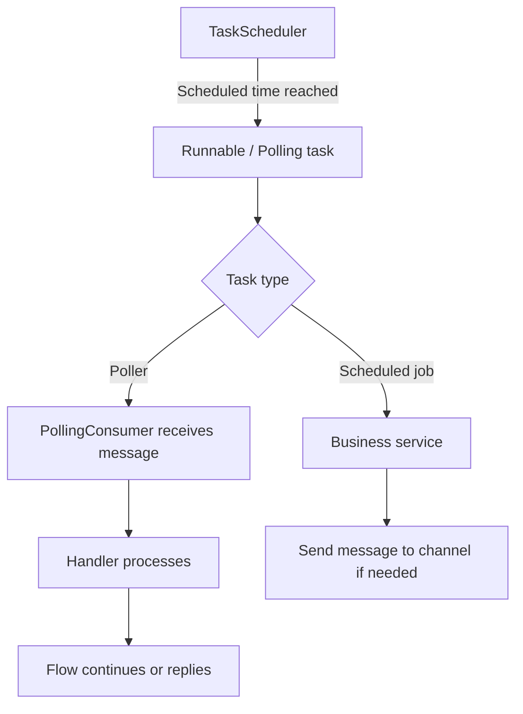

# TaskScheduler and Time-Based Tasks

In Spring Integration, many endpoints need to perform time-based work: reading messages from a queue periodically, fetching data from an external source, running once after a delay, or triggering a flow using a cron expression. `TaskScheduler` provides the scheduling mechanism for these tasks. It decides **when a task is invoked**; channels, endpoints, consumers, and handlers remain responsible for receiving and processing messages.

This lesson belongs to the **Task scheduler** section of the `SPRING_INTEGRATION_RUNTIME` module. This module explores how Spring Integration coordinates message flows across channels, endpoints, consumers, pollers, and executors; while also practicing IntegrationFlow lifecycle management, transactions, retries, message stores, errors, correlation, and diagnosing threading, performance, and runtime state.

## 1. What Is TaskScheduler?

`TaskScheduler` is a Spring Framework abstraction for scheduling `Runnable` execution. Instead of manually creating threads and using a `sleep` loop, the application delegates tasks to the scheduler with an execution time or scheduling rule.

Common schedule types:

- Run once at a specific point in time.
- Run repeatedly at a fixed rate.
- Run again after a delay measured from when the previous execution completed.
- Run on a calendar/cron schedule.
- Run according to a custom `Trigger`, where the next execution time is computed based on the previous execution state.

`TaskScheduler` is neither a message channel nor a handler. It invokes a task at the scheduled time. If that task is a Spring Integration poller, the poller fetches messages from the input channel and passes them to the endpoint/handler. If the task is an independent business job, the job's own code decides whether to call a service or send a message to a channel.



Clearly distinguishing between a scheduler and an executor avoids confusion: the scheduler manages when triggers fire; the executor manages which thread executes the task or which thread pool work is dispatched to.

## 2. Basic Scheduling APIs

`TaskScheduler` has the following primary methods:

| API | Purpose |
|---|---|
| `schedule(Runnable, Instant)` | Run once at a specific time |
| `schedule(Runnable, Trigger)` | Schedule according to rules determined by a Trigger |
| `scheduleAtFixedRate(Runnable, Duration)` | Run periodically at a fixed rate |
| `scheduleWithFixedDelay(Runnable, Duration)` | Run again after a fixed delay from the previous completion |

Depending on the Spring Framework version, some overloads may accept `Date`, `Instant`, or other time units. Choose the API corresponding to your application's framework version.

A simple example:

```java
@Component
public class CacheRefreshJob {

    private final CacheService cacheService;

    public CacheRefreshJob(CacheService cacheService) {
        this.cacheService = cacheService;
    }

    public void refresh() {
        cacheService.refresh();
    }
}
```

You can schedule the job using `TaskScheduler`:

```java
@Configuration
public class SchedulerConfiguration {

    @Bean
    ThreadPoolTaskScheduler taskScheduler() {
        ThreadPoolTaskScheduler scheduler =
            new ThreadPoolTaskScheduler();

        scheduler.setPoolSize(4);
        scheduler.setThreadNamePrefix("app-scheduler-");
        scheduler.setWaitForTasksToCompleteOnShutdown(true);
        scheduler.setAwaitTerminationSeconds(30);

        return scheduler;
    }
}
```

Spring manages the lifecycle of the `ThreadPoolTaskScheduler` bean: the scheduler is initialized when the bean lifecycle requires it and shut down when the context shuts down. You do not need to call `initialize()` or `shutdown()` manually once it is registered as a standard Spring bean.

When an application has multiple groups of tasks with independent requirements, you can declare multiple schedulers with separate names and pools. For example, a scheduler for pollers can be separated from a scheduler for maintenance tasks so that a long-running job does not delay polling schedules.

## 3. How Do Fixed Rate, Fixed Delay, and Cron Differ?

The three commonly used schedule types have different semantics.

| Schedule Type | Reference Point for Next Execution | Suitable For |
|---|---|---|
| **Fixed rate** | Fixed time interval between planned start times | Collecting metrics, periodic synchronization, tasks needing a steady cadence |
| **Fixed delay** | Wait interval measured after the previous execution completes | Polling queues, calling slow services, tasks needing to avoid overlapping buildup |
| **Cron** | Calendar expression over seconds/minutes/hours/days/months/weekdays | Fixed-time reports, end-of-day reconciliation, business schedules |

For example: a task takes 8 seconds to run and has a 5-second period.

- With a 5-second fixed rate, planned start times are 5 seconds apart. If the previous execution has not finished yet, the next run of the same periodic task does not execute concurrently; it is delayed relative to the planned cadence.
- With a 5-second fixed delay, the scheduler waits for the task to finish and then waits another 5 seconds before the next execution. The total interval between two start times is the processing duration plus 5 seconds.
- With cron, the next execution time depends on the schedule expression and trigger policy; it is not simply a fixed delay after task completion.

### 3.1. Fixed Rate

Example using `TaskScheduler`:

```java
taskScheduler.scheduleAtFixedRate(
    () -> metricsService.collect(),
    Duration.ofSeconds(30)
);
```

Fixed rate is suitable when a steady cadence must be maintained. However, if the task frequently runs longer than the period, the schedule will fall behind and other tasks sharing the same pool may be affected.

### 3.2. Fixed Delay

Example:

```java
taskScheduler.scheduleWithFixedDelay(
    () -> cleanupService.removeExpiredRecords(),
    Duration.ofMinutes(5)
);
```

Fixed delay is suitable for tasks that must wait for the previous run to finish. It is also a common choice for pollers when you want to maintain a pause between polls rather than trying to hit a fixed start frequency.

### 3.3. Cron and Time Zones

Spring cron expressions typically have six fields: second, minute, hour, day of month, month, and day of week. For example, `0 0 2 * * *` means running at 02:00:00 every day in the time zone applied to the trigger.

You can explicitly specify the time zone to avoid unexpected schedule shifts when deployment environments use different time zones:

```java
Trigger trigger = new CronTrigger(
    "0 0 2 * * *",
    TimeZone.getTimeZone("Asia/Ho_Chi_Minh")
);

ScheduledFuture<?> future =
    taskScheduler.schedule(
        () -> reconciliationService.run(),
        trigger
    );
```

Be sure to check Spring's cron syntax and do not assume every Unix cron expression uses the same number of fields or rules. For financial or reconciliation tasks, the time zone must be part of the business requirements.

## 4. Triggers and Dynamic Schedules

`Trigger` allows computing the next execution time. `PeriodicTrigger`, `CronTrigger`, and custom triggers are common ways to express those rules.

A trigger is useful when the schedule depends on state or the outcome of the previous run. For example, a task checking a remote API can increase its wait interval when the service fails and decrease it again when connectivity recovers. In that case, you can implement a custom `Trigger` or update the schedule through a task management mechanism.

Conceptual example of a dynamic trigger:

```java
public class AdaptiveTrigger implements Trigger {

    private final BackoffPolicy backoffPolicy;

    public AdaptiveTrigger(BackoffPolicy backoffPolicy) {
        this.backoffPolicy = backoffPolicy;
    }

    @Override
    public Instant nextExecution(TriggerContext context) {
        Duration delay = backoffPolicy.currentDelay();
        return Instant.now().plus(delay);
    }
}
```

This is an illustrative example; an actual implementation needs to clearly define how backoff state is updated, how the clock is handled, and how synchronization works when multiple threads access the policy. You should not use `Instant.now()` directly in every situation if the system needs time-based testing or a replaceable clock. You can inject a `Clock` for deterministic schedule testing.

## 5. TaskScheduler in Spring Integration Pollers

In Spring Integration, a `Poller` is the configuration for a polling endpoint. A pollable endpoint, typically a `PollingConsumer`, uses a poller to receive messages from a `PollableChannel` or invoke a `MessageSource` on a schedule.

A poller typically defines:

- **Trigger:** fixed delay, fixed rate, cron, or custom trigger.
- **maxMessagesPerPoll:** maximum number of messages fetched in a single poll.
- **receiveTimeout:** wait time when receiving messages from a channel that supports timeouts.
- **Advice chain:** advices wrapping the poll/processing execution, such as retry or transaction.
- **TaskExecutor:** optional executor to run polling work according to configuration.
- **Error handling:** how errors during polling or processing are routed to error-handling mechanisms.

Java DSL example reading a queue every second, up to 10 messages per poll:

```java
@Bean
IntegrationFlow orderQueueFlow(OrderService orderService) {
    return IntegrationFlow.from("orders.queue",
            endpoint -> endpoint.poller(
                Pollers.fixedDelay(1000)
                    .maxMessagesPerPoll(10)))
        .handle(orderService, "process")
        .get();
}
```

In this example, the scheduler triggers the polling task at a fixed delay. The polling consumer receives up to 10 messages from `orders.queue` and passes each message through the handler. If the queue is empty, the poll has no messages to process; the poller continues on its schedule.

### 5.1. Poller with MessageSource

An inbound adapter can use a `MessageSource` to fetch data from a source that does not actively push messages. For example, reading pending records one by one from a repository:

```java
@Bean
@InboundChannelAdapter(
    channel = "orders.in",
    poller = @Poller(
        fixedDelay = "1000",
        maxMessagesPerPoll = "10"
    )
)
MessageSource<Order> pendingOrderSource(OrderRepository repository) {
    return () -> {
        Order order = repository.findNextPending();
        return order == null ? null : new GenericMessage<>(order);
    };
}
```

When `MessageSource.receive()` returns a message, the inbound adapter sends it into the `orders.in` channel. If it returns `null`, that poll produces no new message.

This is the data-source polling model. If the external source can push events, a listener/callback-based inbound adapter may be more appropriate and avoid continuous polling.

### 5.2. How Does maxMessagesPerPoll Affect Load?

`maxMessagesPerPoll` limits the number of messages processed in a single poll:

- A positive value limits the maximum number of messages in one pass.
- A negative value can allow continuous polling until no messages remain, depending on the poller and channel type.
- A value of 0 can be used to pause message retrieval while keeping the endpoint in the context.

Do not set the value too high solely to increase throughput. A long-running poll occupies the scheduler thread longer, delaying other polls sharing the same scheduler. Balance batch size, message processing time, desired latency, and thread pool size.

## 6. How Does TaskScheduler Differ from TaskExecutor?

These two abstractions often appear together in a flow but solve two different problems.

| Component | Responsibility | Example |
|---|---|---|
| `TaskScheduler` | Determines when a task is triggered | Trigger a poller every second |
| `TaskExecutor` | Executes or dispatches tasks onto threads | Offload message processing to a worker thread |

With a polling endpoint, the scheduler typically triggers the poll. If no separate executor is configured for the poller, polling and processing work may run on the scheduler thread. When the poller has a task executor, execution is dispatched according to that executor's configuration.

Avoid using a small scheduler pool for long-running processing tasks if those tasks run directly on scheduler threads. A handler taking several seconds can delay other pollers. Separating the scheduler and executor isolates trigger timing from business processing time.

Example configuring a poller with an executor:

```java
@Bean
ThreadPoolTaskExecutor pollerExecutor() {
    ThreadPoolTaskExecutor executor = new ThreadPoolTaskExecutor();
    executor.setCorePoolSize(4);
    executor.setMaxPoolSize(8);
    executor.setQueueCapacity(100);
    executor.setThreadNamePrefix("poller-worker-");
    return executor;
}

@Bean
IntegrationFlow asyncOrderPolling(
        OrderService orderService,
        TaskExecutor pollerExecutor) {

    return IntegrationFlow.from("orders.queue",
            endpoint -> endpoint.poller(
                Pollers.fixedDelay(1000)
                    .taskExecutor(pollerExecutor)
                    .maxMessagesPerPoll(10)))
        .handle(orderService, "process")
        .get();
}
```

When offloading to an executor, re-evaluate transactions, thread-local context, security context, logging MDC, and processing order. Contexts bound to the current thread are not automatically propagated across executor boundaries unless the application configures an appropriate propagation mechanism.

## 7. Transactions, Retries, and Error Handling in Pollers

A poller can combine advice to wrap message reception and processing. Transaction advice is commonly used when fetching a message from a data source and updating business state need to be enclosed within an appropriate transaction.

An example of configuring transaction advice for a poller can use `TransactionInterceptor` or the corresponding Spring Integration helper:

```java
@Bean
IntegrationFlow transactionalPolling(
        OrderService orderService,
        TransactionInterceptor transactionAdvice) {

    return IntegrationFlow.from("orders.queue",
            endpoint -> endpoint.poller(
                Pollers.fixedDelay(1000)
                    .advice(transactionAdvice)
                    .maxMessagesPerPoll(5)))
        .handle(orderService, "process")
        .get();
}
```

The exact transaction scope depends on the channel type, message source, and advice placement in the poller. With an in-memory queue, a database transaction does not automatically restore a dequeued message if the channel does not participate in the same transaction. With a broker, check the transaction/acknowledgment semantics of the adapter and broker.

Retry advice can be used to retry when a handler or downstream call fails. You must choose which exceptions are retried, the retry count, backoff, and final behavior. Do not retry permanent data errors indefinitely; nor should you retry non-idempotent side effects without deduplication mechanisms.

Errors in scheduled tasks can affect subsequent executions depending on the scheduler mechanism and how exceptions are handled. In Spring Integration, distinguish between errors occurring during the poll step, errors receiving messages, and errors inside the handler. Use an appropriate error channel, error handler, or advice to record and handle errors; do not rely on logs as the sole observability mechanism.

## 8. Managing ScheduledFuture and Task Lifecycle

Scheduling methods return a `ScheduledFuture` in many cases. This handle allows canceling the schedule, checking status, or retrieving the result when the task completes according to the API contract.

Example:

```java
ScheduledFuture<?> future =
    taskScheduler.scheduleAtFixedRate(
        () -> reportService.publish(),
        Duration.ofMinutes(1)
    );

// When the schedule is no longer needed:
future.cancel(false);
```

`cancel(false)` prevents future executions without requesting interruption of the currently running execution. `cancel(true)` may request interrupting the running thread; use it only when the task is designed to respond safely to interruption.

When managing dynamic tasks, store handles by business identifier to avoid creating duplicate schedules. When a tenant or resource is deleted, cancel the schedule before releasing dependencies used by the task. If a schedule is created by a Spring bean, tie task cancellation to the bean's lifecycle rather than losing track of the handle.

With poller endpoints, do not create a second schedule to call the same message source if the endpoint already manages a poller. Having two independent schedulers reading the same source can lead to duplicate processing or data contention.

## 9. Pool Size, Threads, and Performance

`ThreadPoolTaskScheduler` is typically backed by a scheduled thread pool. Pool size determines how many independent scheduled tasks can execute concurrently. You should observe:

- Average and p95/p99 execution duration of each scheduled task.
- Number of polls delayed past their expected execution time.
- Number of running tasks and work queue depth in downstream executors.
- Exception, retry, and timeout rates.
- Queue depth of channels or brokers.
- Threads blocked by I/O, locks, or long-running transactions.

Operational principles:

1. Keep scheduler tasks short if the scheduler is shared across multiple pollers.
2. Offload heavy processing to a dedicated executor when the flow model allows.
3. Choose pool size based on tasks that can run concurrently and their blocking characteristics, not solely on endpoint count.
4. Bound executor queues to create backpressure and avoid unbounded memory growth.
5. Set timeouts on I/O calls; an indefinitely blocked task can occupy a scheduler thread for a long time.
6. Use thread name prefixes to identify schedulers and workers in thread dumps.
7. Measure actual latency before increasing pool size; more threads can overload databases or remote services.

If a scheduler has a pool size of 1, one long-running task can block the schedule of another task on the same pool. Increasing pool size can improve parallelism, but it also increases concurrent calls to dependencies. Coordinate concurrency limits across the scheduler, executor, and target systems.

## 10. Shutdown and In-Flight Tasks

When the ApplicationContext stops, the scheduler must stop accepting new schedules and handle in-flight tasks according to the chosen shutdown policy. With `ThreadPoolTaskScheduler`, you can configure waiting for tasks to complete and the maximum wait time, such as `setWaitForTasksToCompleteOnShutdown(true)` and `setAwaitTerminationSeconds(30)`.

Do not assume every scheduled task finishes before the JVM exits. You need to determine:

- Can the task be interrupted, or must it be allowed to finish?
- Does the task write data or publish messages where consistency must be guaranteed?
- If the task is stopped midway, can the next startup rerun safely?
- Are ScheduledFuture handles or endpoint pollers canceled/stopped before dependencies close?

For pollers, graceful shutdown needs to stop the source from receiving new messages, allow in-flight processing to complete within the timeout limit, and then close resources. Transaction/acknowledgment and redelivery mechanisms must be verified separately per adapter.

## 11. Diagnosing Misbehaving Task Schedules

| Symptom | Possible Cause | How to Check |
|---|---|---|
| Poller does not run | Endpoint not started, autoStartup=false, missing poller config, or scheduler not ready | Check endpoint lifecycle and scheduler logs |
| Poller runs slower than period | Long task processing, busy scheduler pool, or blocked threads | Measure task duration, inspect thread dumps and pool size |
| Messages processed in overly large batches | maxMessagesPerPoll is too high or unbounded | Check poller configuration and duration per poll |
| Duplicate processing | Multiple pollers reading the same source, duplicate schedule registration, or non-idempotent processing | Check registrations, lock/claim records, and idempotency keys |
| Cron runs at the wrong time | Default time zone differs from business time zone, or invalid cron expression | Check time zone, six cron fields, and next execution time |
| One poller affects another | Shared scheduler pool with a long-running handler | Separate scheduler/executor or adjust concurrency |
| Repeated errors without message recovery | Retry/transaction/ack mismatch with the receiving source | Check advice chain, transaction manager, and adapter semantics |

Diagnostic steps:

1. Identify whether the task was created by `@Scheduled`, `TaskScheduler` directly, or a Spring Integration poller.
2. Verify that the task/endpoint is registered and started.
3. Check the trigger, time zone, initial delay, and maxMessagesPerPoll.
4. Check whether the scheduler pool has idle threads or all threads are blocked.
5. Check the downstream executor, queue capacity, and handler duration.
6. Check transactions, retries, error channels, and source message state.
7. Check for duplicate schedules or multiple application instances running the same job.

In multi-replica deployments, a scheduled task inside each application instance may run concurrently across all replicas. If business requirements dictate that only one instance executes, you need leader election, a distributed lock, or an appropriate distributed scheduler; a local `ThreadPoolTaskScheduler` does not provide cluster-wide singleton guarantees.

## 12. Choosing the Right Scheduling Mechanism

| Need | Mechanism |
|---|---|
| Periodically read messages from a QueueChannel | Spring Integration poller with TaskScheduler |
| Periodically read data from a repository or source file | MessageSource + inbound channel adapter + poller |
| Run periodic jobs independent of message flows | TaskScheduler or `@Scheduled` |
| Run at calendar times | CronTrigger or cron poller with explicit time zone |
| Re-run after a wait interval from completion | Fixed delay |
| Maintain a periodic start cadence | Fixed rate |
| Next execution time depends on prior state | Custom Trigger |
| Heavy processing or blocking I/O | Scheduler trigger + separate TaskExecutor with concurrency limits |

TaskScheduler coordinates **when** tasks run. In Spring Integration, pollers use that schedule to fetch messages from pollable sources; endpoints and handlers perform the subsequent work. When designing, choose triggers based on their temporal semantics, separate the scheduler from the executor when needed, bound pools/queues, and define transaction, retry, error handling, and shutdown policies. This makes periodic tasks predictable, observable, and operable across the entire message runtime.
