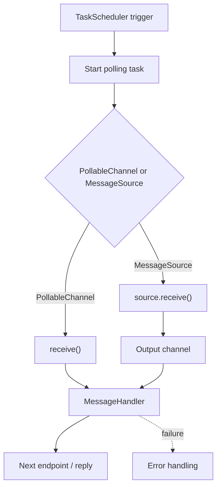

# Poller Scheduler with Thread Pools

In Spring Integration, a polling endpoint needs to be woken up on a schedule to fetch messages from a `PollableChannel` or invoke a `MessageSource`. The component that determines when it wakes up is `TaskScheduler`. When no separate executor is configured for the poller, message reception and handler invocation typically continue running on the scheduler thread. When a `TaskExecutor` is configured, the polling task can be handed off to a dedicated worker pool.

These two pools solve different problems. The scheduler maintains the polling cadence and triggers tasks; the executor provides execution capacity for polling/handlers. Proper configuration allows multiple endpoints to operate without exhausting scheduler threads. A mismatch between submission rate, message receive wait time, and worker capacity can cause the task queue to grow continuously, even when the message queue does not contain much data.

## 1. Where Does the Poller Fit in the Message Runtime?

Spring Integration has two consumer models:

- **Event-driven consumer** registers a handler on a `SubscribableChannel`. When the channel dispatches a message, the handler is invoked; the endpoint does not need a poller.
- **Polling consumer** receives messages from a `PollableChannel` by calling `receive()` on a schedule. The endpoint needs a poller to determine when to perform the next receive attempt.

An inbound channel adapter based on `MessageSource` can also be polled on a schedule. In that case, `SourcePollingChannelAdapter` calls the source and then sends the received message to the output channel. Distinguish this from `PollingConsumer`: one actively pulls messages from a channel, while the other actively polls a source to produce messages.

Polling flow diagram:

If the poller does not have a `TaskExecutor`, the polling task typically runs directly on a thread provided by the scheduler. If an executor is present, the poller can hand the task off to the executor; the handler executes on a worker thread. This is essential to understand before choosing pool sizes.

## 2. Distinguishing TaskScheduler and TaskExecutor

Both abstractions can use thread pools, but their purposes differ.

| Component | Responsibility | Example |
|---|---|---|
| `TaskScheduler` | Schedules and triggers tasks at a specific time or trigger | Run a poller every 500 ms or via cron |
| `TaskExecutor` | Executes submitted tasks | Run receive, handler, or business work on a worker |
| `ThreadPoolTaskScheduler` | Scheduler implementation backed by a thread pool | Thread pool `si-scheduler-` |
| `ThreadPoolTaskExecutor` | Executor implementation with core/max size and task queue | Thread pool `si-worker-` |

When no executor is declared for a poller, the scheduler thread may have to perform all of the following:

1. Wait until the trigger time.
2. Call `receive()` or `MessageSource.receive()`.
3. Wait up to `receiveTimeout` if no message is available yet.
4. Run the handler and synchronous downstream steps.
5. Complete the poll cycle before becoming available for the next scheduler work on that thread.

With short handlers and few pollers, this approach may suffice. With many endpoints or handlers waiting on slow I/O, the scheduler pool is easily saturated. When that happens, triggers for other endpoints can be delayed.

When a dedicated executor is configured, the scheduler can hand off the polling task to the worker pool. The scheduler thread does not have to be held for the entire business processing duration. In return, you must manage the task queue, worker count, and task rejection policy.

### Defaults to Know

In Spring Integration's default configuration, the central scheduler bean is named `taskScheduler` and the default implementation is `ThreadPoolTaskScheduler`. Current Spring Integration documentation describes the default pool as having 10 threads; this default can be adjusted using the global property `spring.integration.taskScheduler.poolSize` or by providing an application-defined `taskScheduler` bean.

When an application uses Spring Boot or custom scheduling configuration, verify the actual scheduler bean in use. Do not infer the pool size solely from a single Boot property or class name; an application-provided bean may override the framework's default configuration.

## 3. Poll Cycle and Parameters Affecting Threads

A poll cycle is not just a single `receive()` call. A poller can receive multiple messages consecutively within the same cycle.

| Parameter | Meaning | Runtime Impact |
|---|---|---|
| `fixedDelay` | Wait time after the previous execution completes before starting the next one | Maintains a pause after each poll cycle |
| `fixedRate` | Trigger cadence at a fixed time interval | Can submit tasks faster than workers finish when using an executor |
| `cron` | Trigger based on a calendar expression | Suitable for time-of-day/calendar-based work |
| `initialDelay` | Wait interval before the first poll | Avoids polling immediately on application startup |
| `maxMessagesPerPoll` | Limits the number of messages received in one poll cycle | Controls cycle duration and backlog drain rate |
| `receiveTimeout` | Time `receive()` waits when no message is available yet | Can keep the poller thread in a waiting state |

The default poller uses a `PeriodicTrigger` with a 1-second fixed delay. The default `receiveTimeout` is 1,000 ms. Check the specific endpoint configuration, as the default value of `maxMessagesPerPoll` depends on the polling endpoint type.

### fixedDelay and fixedRate

`fixedDelay` is appropriate when you want to maintain a pause after the scheduled task completes. When no dedicated executor is configured, the scheduled task encompasses the poll cycle, so if a poll takes 300 ms and the fixed delay is 1,000 ms, the next run starts about 1,000 ms after the previous poll cycle finishes. When the poller hands work off to a separate `TaskExecutor`, the scheduler callback may finish immediately after submission; fixed delay then does not necessarily wait for the worker to finish processing the messages before counting toward the next execution.

`fixedRate` aims for a fixed-interval trigger cadence. When using an executor to offload polling tasks, the scheduler can submit the next task while a worker from the previous task is still processing. If the submit rate exceeds the completion rate, the executor's queue will accumulate.

Do not choose fixed rate simply because you want fast polling. Compare execution time, `receiveTimeout`, `maxMessagesPerPoll`, and concurrent processing capacity.

### maxMessagesPerPoll

For `PollingConsumer`, the default `maxMessagesPerPoll` is typically `-1`, meaning it continues calling `receive()` in the same cycle until the channel has no more messages or a stop condition is met. For `SourcePollingChannelAdapter`, the default is typically 1 message per cycle.

Suppose a poller has a 5-second fixed delay and `maxMessagesPerPoll=20`. If the queue has 100 messages and the handler processes quickly, the poller can take 20 messages, wait for the next trigger, and then take the next 20 messages. A large value drains backlogs faster but can hold a worker longer and make other endpoints wait if they share an executor. With `-1`, a single poll cycle can continue receiving until the channel is empty; if messages are continuously replenished, the worker can be held for a long time with few chances to yield resources to other endpoints.

Since Spring Integration 5.5, for polling endpoints based on `MessageSource`, a value of `0` means skipping the `MessageSource.receive()` call in the poll cycle; this can be used to temporarily pause the endpoint and change the value back later. This is not how you configure "unlimited." Verify the semantics for your exact endpoint type and version.

### receiveTimeout and Long Polling

`receiveTimeout` specifies the wait duration for a single receive attempt. If a poller uses `receiveTimeout=1000`, the thread can be held for up to one second when the queue is empty.

There are two configurations that look similar but produce different behavior:

- 5-second trigger, 50 ms receive timeout: the poller checks infrequently; a message may have to wait nearly 5 seconds to be detected.
- 50 ms trigger, 5-second receive timeout: the thread waits longer for messages and can react quickly when a message arrives, but the thread is held during the wait time.

The second approach is long polling. It is useful when the channel or source genuinely supports a blocking wait with timeout. For non-blocking sources such as certain file scans, increasing `receiveTimeout` does not detect data any faster.

## 4. Configuring the Central Scheduler Pool

You can provide a bean named `taskScheduler` for Spring Integration to use as the central scheduler:

~~~java
@Configuration
@EnableIntegration
class IntegrationSchedulingConfiguration {

    @Bean(name = "taskScheduler")
    ThreadPoolTaskScheduler integrationTaskScheduler() {
        ThreadPoolTaskScheduler scheduler = new ThreadPoolTaskScheduler();
        scheduler.setPoolSize(4);
        scheduler.setThreadNamePrefix("si-scheduler-");
        scheduler.setWaitForTasksToCompleteOnShutdown(true);
        scheduler.setAwaitTerminationSeconds(30);
        return scheduler;
    }
}
~~~

In this example, the scheduler has four threads and a thread name prefix that is easy to identify in logs or thread dumps. `setWaitForTasksToCompleteOnShutdown(true)` instructs the scheduler to wait for scheduled tasks according to its shutdown policy; the wait duration is bounded by the await termination setting and application context shutdown. If the poller hands work off to a separate `TaskExecutor`, the scheduler finishes task submission immediately after handoff; the worker executor still needs its own drain and shutdown policy.

A pool size of 4 is only an illustrative value. If pollers do not have a separate executor, the number of scheduler threads must be sufficient for poll cycles that may run concurrently, including `receive()` wait time and handler duration. If every poller has its own executor, the scheduler is primarily responsible for triggering and submitting tasks, so business execution worker sizing belongs on the executor.

### Global Property

When using the default scheduler created by Spring Integration, you can adjust the thread count using a global property:

~~~properties
spring.integration.taskScheduler.poolSize=10
~~~

If you declare a `taskScheduler` bean yourself, set the pool size on that bean. Do not configure multiple schedulers with the same name simultaneously or assume every endpoint uses one scheduler if some are configured with dedicated schedulers.

## 5. Configuring a Dedicated TaskExecutor for Pollers

For long-running handlers or when there are many polling endpoints, separate the worker pool from the scheduler. Example:

~~~java
@Configuration
class PollerExecutorConfiguration {

    @Bean
    ThreadPoolTaskExecutor pollerExecutor() {
        ThreadPoolTaskExecutor executor = new ThreadPoolTaskExecutor();
        executor.setCorePoolSize(4);
        executor.setMaxPoolSize(8);
        executor.setQueueCapacity(100);
        executor.setThreadNamePrefix("si-poller-worker-");
        executor.setRejectedExecutionHandler(
                new ThreadPoolExecutor.AbortPolicy()
        );
        return executor;
    }
}
~~~

The parameters:

- `corePoolSize` is the core number of workers maintained according to the executor policy.
- `maxPoolSize` is the upper limit when the queue is full and the executor needs to scale up workers.
- `queueCapacity` bounds the number of tasks waiting for a worker.
- `threadNamePrefix` helps identify threads when reading logs and thread dumps.
- The rejection policy decides behavior when neither the pool nor the queue can accept more tasks.

With `ThreadPoolTaskExecutor`, tasks are typically handed to core threads first, then placed into the queue; only when the queue is full does the executor grow threads beyond core size up to max size. If the queue is unbounded, max size rarely takes effect because tasks keep getting queued. An unbounded queue can cause the heap to grow steadily when submission rate exceeds processing rate.

`AbortPolicy` rejects tasks when no more can be accepted and throws `RejectedExecutionException`. `CallerRunsPolicy` can create backpressure by forcing the submitting thread to run the task itself; in a poller, the submitting thread may be the scheduler thread, so this policy can delay other pollers. Choose the rejection policy based on flow semantics and monitor rejected-task errors.

## 6. Wiring a Poller with an Executor Using Java DSL

The following example creates a bounded-capacity queue and configures a poller to execute work through an executor:

~~~java
@Configuration
@EnableIntegration
class OrdersPollingFlow {

    @Bean
    QueueChannel ordersQueue() {
        return new QueueChannel(500);
    }

    @Bean
    IntegrationFlow ordersFlow(
            QueueChannel ordersQueue,
            @Qualifier("pollerExecutor") TaskExecutor pollerExecutor,
            OrderHandler orderHandler
    ) {
        return IntegrationFlow.from(
                        ordersQueue,
                        endpoint -> endpoint.poller(
                                Pollers.fixedDelay(250)
                                        .maxMessagesPerPoll(10)
                                        .receiveTimeout(100)
                                        .taskExecutor(pollerExecutor)
                        )
                )
                .handle(orderHandler, "process")
                .get();
    }
}
~~~

In this flow:

1. `TaskScheduler` triggers the poll at a 250 ms fixed delay.
2. The poller hands the polling task off to `pollerExecutor`.
3. The polling task receives up to 10 messages in one cycle.
4. Each receive call can wait up to 100 ms if the queue is empty.
5. The handler runs on a worker thread belonging to the executor.

Queue capacity 500 and executor queue capacity 100 are two separate queues. The queue channel holds messages waiting for a consumer to retrieve them; the executor queue holds polling tasks waiting for a worker to execute them. When diagnosing a backlog, inspect both.

Configuring a `TaskExecutor` is not always necessary. With very short handlers and few endpoints, letting the poller run directly on the scheduler can be simpler and sufficiently efficient. An executor only provides benefits when work needs thread isolation and the pools are balanced.

## 7. Two Rates to Balance: Scheduler Submit and Executor Complete

When a poller uses an executor, there are two rates to monitor:

- **Submit rate:** the rate at which the scheduler submits polling tasks to the executor.
- **Completion rate:** the rate at which workers finish polling tasks.

If the submit rate remains higher than the completion rate over time, the task queue will grow. Increasing the scheduler pool size does not solve a worker capacity shortage; it can even increase the submit rate and make the task backlog grow faster.

For example, a poller has `fixedRate=50ms`, so the scheduler can submit roughly 20 tasks per second. Suppose there are 20 workers, and each task can block for 5 seconds on `receiveTimeout`. When the queue is empty, maximum completion capacity is only about 4 tasks per second. If the scheduler keeps submitting 20 tasks per second, the task queue grows by about 16 tasks per second even with no new messages. This indicates a mismatch between poller and executor configuration.

### Initial Estimation Formula

You can use Little's Law as a rough initial estimate:

\[
N \approx \lambda \times W
\]

Where:

- `\lambda` is the rate of work to process (tasks/second or messages/second).
- `W` is the average processing time in seconds.
- `N` is the concurrency needed to sustain that rate in steady state.

For example, if you need to process an average of 12 messages/second and each message takes 0.5 seconds, the average concurrent load is approximately 6 messages. A 6-thread pool is a theoretical starting point; in practice, you need headroom for variable processing times, retries, I/O, and downstream limits.

For CPU-bound work, thread count should start near the number of available CPU cores and then be measured in practice. For I/O-bound work, more threads may be needed because workers spend time waiting on I/O, but you must account for connection pool limits, databases, external APIs, and memory.

## 8. Batching and Worker Occupancy Time

`maxMessagesPerPoll` determines the maximum number of messages a polling task processes in one cycle. A large value reduces task-trigger overhead and drains backlogs faster, but a worker can be held for a long time by one batch.

Suppose a single message takes 40 ms on average:

- Batch 1: business processing time is roughly 40 ms.
- Batch 10: roughly 400 ms if processed sequentially.
- Batch 50: roughly 2 seconds if processed sequentially.

This is a simple estimate, excluding receive timeouts, transactions, I/O, and downstream steps. Large batches can increase throughput but raise latency for messages at the end of the batch and reduce opportunities to share workers with other endpoints if using a shared executor.

If multiple endpoints share a pool, bound the batch size and consider a separate pool for endpoints with different workload profiles. A slow file-polling endpoint should not starve workers needed by a critical transaction-queue endpoint.

## 9. Concurrency Changes Ordering and Shared State

When a poller hands tasks off to an executor with multiple workers, multiple polling tasks can run concurrently. That can cause multiple messages to be processed in parallel, depending on the channel, endpoint, and configuration.

Before increasing concurrency, determine:

- Is the handler thread-safe?
- Can two messages with the same aggregate or same business key be processed simultaneously?
- Does the database connection pool have enough connections?
- Do downstream APIs enforce rate limits or concurrent request limits?
- Does the transaction wrap each poll operation or each message according to configuration?
- Are replies and correlation preserved properly when messages complete?
- Is ordering by partition or key required?

Do not assume a `QueueChannel` with multiple workers automatically guarantees completion order matches retrieval order. If business ordering matters, design key-based serialization, partitioning, or appropriate locking rather than merely reducing the interval.

## 10. Transactions and Error Handling on Pollers

Pollers support an AOP advice chain to apply concerns around the polling task, including transactions. In Java DSL, you can configure `transactional()` or add the corresponding advice to `PollerSpec`.

Example:

~~~java
@Bean
IntegrationFlow transactionalOrdersFlow(
        QueueChannel ordersQueue,
        PlatformTransactionManager transactionManager,
        OrderHandler handler
) {
    return IntegrationFlow.from(
                    ordersQueue,
                    endpoint -> endpoint.poller(
                            Pollers.fixedDelay(500)
                                    .maxMessagesPerPoll(5)
                                    .transactional(transactionManager)
                    )
            )
            .handle(handler, "process")
            .get();
}
~~~

Transaction advice is applied around the polling task according to the poller configuration. When the task runs on an executor, the transaction is opened on the worker thread executing the task; a thread-bound transaction from another thread does not automatically follow. If a poll cycle receives multiple messages, the advice may wrap the entire poll operation depending on how the endpoint executes; do not assume a transactional poller configuration always creates a separate transaction per message.

Define transaction boundaries appropriate to the channel and adapter types. With brokers, acknowledgment and transaction semantics also depend on the adapter, broker, and transaction manager. Do not assume side effects in external systems are automatically rolled back.

### Errors from Pollers and Executors

When a poller runs asynchronously, exceptions can occur on a worker thread after the scheduler has finished submitting the task. Consequently, not every error can be propagated back to the scheduler or producer thread.

Spring Integration supports error handling for polling tasks. `PollerSpec` can configure `errorChannel` or `errorHandler` for polling task errors. If providing a custom scheduler, inspect the scheduler's error handler; Spring Integration documentation recommends using `MessagePublishingErrorHandler` when you want scheduler errors converted into an `ErrorMessage` sent to an error channel.

In addition, monitor `RejectedExecutionException` when the executor cannot accept more tasks. Submission rejection errors differ from business errors inside handlers and should be categorized separately.

## 11. Bounded Queues and Backpressure

There are at least three places where work can accumulate:

1. The `QueueChannel` queue holding messages not yet received by a consumer.
2. The `ThreadPoolTaskExecutor` queue holding polling tasks waiting for a worker.
3. The broker/adapter queue or buffer holding messages outside the application process.

These queues have different semantics and counting units. A queue channel might hold 500 messages while the executor queue has only 2 tasks; conversely, the executor queue might contain hundreds of poll tasks while the message queue is empty because workers are waiting on `receiveTimeout`.

Prefer bounded capacity when load can spike. When full, explicitly decide whether the system will:

- Reject the task and emit an alert.
- Run the task on the caller thread to create backpressure, after evaluating the risk of blocking the scheduler.
- Reduce the poll cadence or limit the number of submitted tasks.
- Let the broker retain messages and redeliver them according to adapter mechanics.
- Pause the endpoint or enter a controlled degraded state.

Do not use unbounded queues as a way to mask a worker shortage. A queue only delays when overload becomes visible; it does not increase processing capacity.

## 12. Choosing Pool Size by Workload

There is no single pool size suitable for every system. Measure the workload and set limits based on downstream resources.

| Workload Type | Starting Approach |
|---|---|
| CPU-bound handler | Start near the number of available cores; monitor CPU utilization and throughput |
| Database-waiting handler | Cap concurrency according to connection pool size and database capacity |
| HTTP/RPC-calling handler | Account for wait times, connection limits, rate limits, and target service timeouts |
| Many short pollers | Scheduler pool needs enough capacity so triggers are not delayed; executor can be small or omitted if processing is fast |
| Few pollers with long processing | Use a dedicated executor to decouple scheduler threads from workers |
| Poller with long receive timeout | Factor thread hold time when the queue is empty into required concurrency |

A practical starting baseline:

- Scheduler pool large enough for pollers that may run concurrently if there is no executor.
- Executor core size based on required concurrency and downstream limits.
- Bounded queue capacity to control backlog.
- Moderate `maxMessagesPerPoll` to avoid one task holding a worker for too long.
- Short enough `receiveTimeout` to avoid holding workers unnecessarily, unless long polling is intentional.

Then measure throughput, p95/p99 latency, queue depth, rejections, active threads, and poll delay times. Only increase pool size when there is evidence the bottleneck lies in worker capacity and downstream systems can still handle the load.

## 13. Observing Schedulers and Executors at Runtime

In operations, monitor the scheduler pool and worker pool separately.

| Metric | Meaning | Abnormal Signal |
|---|---|---|
| Scheduler active threads | Number of scheduler threads currently executing tasks | Continuously near full, other pollers are delayed |
| Scheduler task delay | Delay between planned time and actual poll start time | Triggers lag even when the queue has messages |
| Executor active threads | Number of busy workers | Consistently at max may indicate worker shortage or slow downstream |
| Executor queue depth | Number of tasks waiting for workers | Steadily rising indicates submit rate exceeds completion rate |
| Executor rejected tasks | Number of rejected tasks | Pool/queue have hit their limits |
| Message queue depth | Number of messages waiting for consumers | Consumers cannot keep up with producers, or poller is inactive |
| Poll cycle duration | Time for one polling task to finish | Increases due to handler, receive timeout, or downstream I/O |
| Message processing latency | Time from message entry until processing finishes | Increases due to backlog, worker contention, or retries |

You can use thread name prefixes such as `si-scheduler-` and `si-poller-worker-` to read thread dumps. With Spring Boot Actuator and Micrometer configured, executors and schedulers can be bound as metrics; exact metric names depend on the binder and version.

Correlation IDs in logs help connect the time a producer sends, the poller receives, and the handler finishes. Do not log full sensitive payloads solely to debug threads.

### How to Read Thread Dumps

- Many `si-scheduler-` threads in `TIMED_WAITING` inside queue receive: `receiveTimeout` may be holding scheduler threads.
- Scheduler thread running a handler or waiting on I/O: the poller may not have a separate executor or the handler is running synchronously.
- Worker threads all busy waiting on the same dependency: the bottleneck may be the database, HTTP client, or connection pool.
- Executor queue growing while active workers are low: check for tasks blocked on another pool, executor configuration, or task scheduling cadence.
- Low scheduler activity while message queue grows: check whether the poller is running, the endpoint is started, and the trigger is configured properly.

## 14. Common Configuration Pitfalls

| Symptom | Possible Cause | Resolution |
|---|---|---|
| Other pollers are delayed | Scheduler pool too small or long-running handler on scheduler thread | Use an executor for long-running pollers; adjust scheduler pool after measuring |
| Worker queue grows despite no messages | Long `receiveTimeout` and trigger submits tasks too quickly | Balance interval, timeout, and worker count; bound the queue |
| Low CPU but high latency | Workers waiting on I/O or large task queue | Check downstream latency, receive timeout, and executor queue |
| Message backlog rises steadily | Poller pulls slower than producer sends or batch is too small | Measure throughput; adjust batch/concurrency if downstream allows |
| Database connection pool exhausted | Executor concurrency exceeds database capacity | Reduce workers or scale database capacity deliberately |
| RejectedExecutionException | Both workers and queue hit limits | Define backpressure/retry policy and alerting |
| Messages processed out of order concurrently | Multiple workers processing the same channel/key | Design key-based ordering or reduce concurrency at sequential boundaries |
| Scheduler starvation | Too many pollers or receive/handler running on scheduler threads | Separate an executor and reduce unnecessary receive timeouts |

## 15. Checklist for Configuring Pollers with Thread Pools

Before putting a poller into production, verify:

- [ ] Is the input a `PollableChannel`, or is the endpoint polling a `MessageSource`?
- [ ] Is a poller actually needed, or is the channel subscribable so an event-driven consumer can be used?
- [ ] Which scheduler bean is Spring Integration using?
- [ ] Is the scheduler pool size sufficient for the number of pollers and execution time on scheduler threads?
- [ ] Does the handler run long or block on I/O?
- [ ] Does the poller have a dedicated `TaskExecutor` when worker separation is needed?
- [ ] Do `fixedDelay`, `fixedRate`, or cron align with target latency?
- [ ] Does `receiveTimeout` hold threads waiting for too long?
- [ ] Does `maxMessagesPerPoll` keep batch duration reasonable?
- [ ] Does the executor queue have bounded capacity and a defined rejection policy?
- [ ] Is the submit rate balanced with the completion rate?
- [ ] Is worker concurrency within database, broker, and external API limits?
- [ ] Do transaction advice and error channel properly cover the polling task?
- [ ] Are there metrics for active threads, queue depth, rejections, poll duration, and message latency?
- [ ] Does shutdown wait for running tasks with an appropriate policy and timeout?

## References

- [Spring Integration — Configuring the Task Scheduler](https://docs.spring.io/spring-integration/reference/configuration.html) — central scheduler, default pool, and global configuration.
- [Spring Integration — Message Endpoints](https://docs.spring.io/spring-integration/reference/endpoint.html) — polling consumer, trigger, receive timeout, max messages per poll, and TaskExecutor support.
- [Spring Integration — Pollers Java DSL](https://docs.spring.io/spring-integration/reference/dsl/java-pollers.html) — Pollers factory and PollerSpec configuration.
- [Spring Integration — PollerSpec API](https://docs.spring.io/spring-integration/api/org/springframework/integration/dsl/PollerSpec.html) — taskExecutor, receiveTimeout, maxMessagesPerPoll, transactional, and error handling.
- [Spring Framework — Task Execution and Scheduling](https://docs.spring.io/spring-framework/reference/integration/scheduling.html) — TaskExecutor, TaskScheduler, and thread pools.
- [Spring Boot — Task Execution and Scheduling](https://docs.spring.io/spring-boot/reference/features/task-execution-and-scheduling.html) — scheduler/executor auto-configuration and configuration properties.

Pool sizes, default triggers, and how schedulers are created can vary by Spring Integration, Spring Framework, Spring Boot version, and application context configuration. Verify the actual scheduler bean alongside your application's dependency versions before relying on default values.
