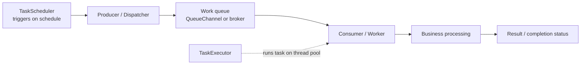
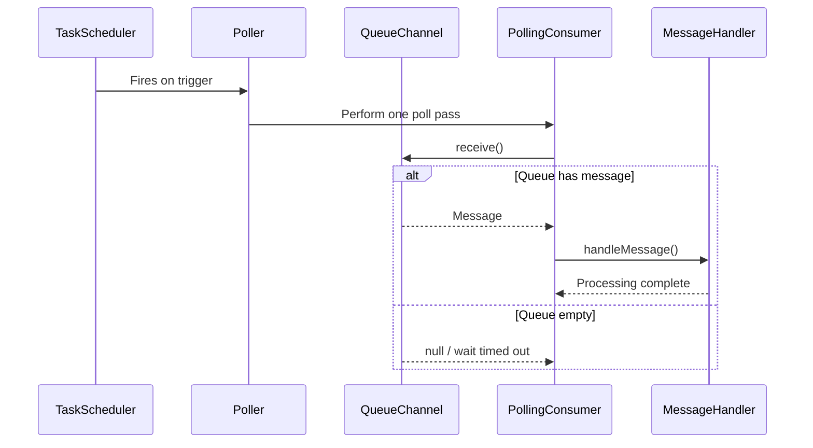
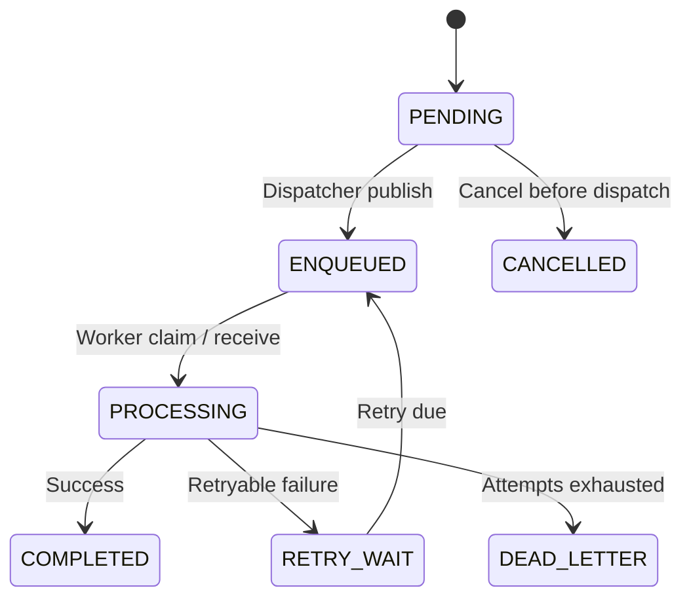

# Do Not Use a Scheduler Instead of a Work-Coordination Queue

`TaskScheduler` and a queue solve two different problems. A scheduler determines **when** a task is triggered. A queue holds **which work items are waiting** and delivers each work item to a consumer for processing. Using a scheduler to establish a polling cadence or emit periodic commands makes sense; using a timer schedule as a holding place for a work backlog typically leads to data loss, difficulty bounding load, and difficult recovery after restarts.

In Spring Integration, a poller uses a scheduler to trigger message reading. The poller itself is not where messages are stored. Messages may reside in a `QueueChannel`, a broker queue, or another data store; the scheduler only produces the timing for consumers to read or for sources to create messages.

A helpful rule of thumb:

- `TaskScheduler`: when to run?
- `TaskExecutor`: which thread to run on, and with what concurrency?
- Queue: which work items are waiting to be processed?
- Poller: when to call `receive()` to pull work from a pollable source or channel?

## 1. Schedulers and Queues Have Different Responsibilities

A scheduler manages the execution schedule of `Runnable` tasks: running once at a specific time, running repeatedly with fixed delay/fixed rate, or running via a trigger/cron. Its API usually returns a `ScheduledFuture` for checking or canceling the schedule.

A queue stores messages/work items not yet picked up by a consumer. Producers can add work to a queue faster than processing speed; consumers pull work gradually according to their capacity. Thus, a queue establishes a boundary between when work is created and when work is processed.

| Aspect | TaskScheduler | Work/message queue |
|---|---|---|
| Primary question | When should a task run? | Which work items are waiting? |
| Managed unit | Schedule and `Runnable` | Message or work item |
| Lifetime | Follows schedule registration and scheduler lifecycle | Until received/processed or expired per policy |
| Consumer coordination | No message-consumer semantics | Has producers and consumers |
| Backlog buffering | Not its primary purpose | Primary responsibility |
| Backpressure | Scheduler threads/pool can become busy or lag schedules | Can bound capacity, reject, block, or throttle producers |
| Retry / redelivery | Must be built manually around the task | Can be supported by the broker or consumer mechanism |
| Acknowledgment | No standard message acknowledgment | Can support ack/commit per channel or broker |
| Restart recovery | In-memory schedules must be re-registered | Durable queues can retain work items across restarts |
| Best suited for | Timers, cron, periodic polling, triggers | Backlogs, bursts, work distribution, workers |

A scheduler may retain information about scheduled runs in its internal scheduling queue. That does not make it a business queue: a scheduled task does not inherently carry a message payload, consumer groups, acknowledgment, dead-letter policies, or work-item recovery like a broker queue.

## 2. Commonly Confused Spring Components

| Component | Role | Should Not Be Treated As |
|---|---|---|
| `TaskScheduler` | Schedules `Runnable` execution by time or trigger | Business work-storage queue |
| `TaskExecutor` | Executes tasks on threads; controls concurrency and thread pools | Durable message broker |
| `Poller` | Uses triggers to invoke consumer/source polling | Message storage |
| `QueueChannel` | Holds messages in a channel for consumers to receive later | Scheduler |
| `DirectChannel` | Dispatches messages directly to subscribers | Buffering queue |
| `ExecutorChannel` | Dispatches messages via a `TaskExecutor` | Durable queue |
| Broker queue | Persists and distributes messages per broker semantics | Timer or cron scheduler |

### 2.1. TaskScheduler: Time-Based Scheduling

Spring provides the `TaskScheduler` abstraction for scheduled tasks. Common schedule forms include:

- `schedule(task, startTime)`: run once at a specific time.
- `schedule(task, trigger)`: let a trigger determine the next execution.
- `scheduleAtFixedRate(task, period)`: run at a fixed cadence.
- `scheduleWithFixedDelay(task, delay)`: wait a delay after the previous execution finishes.

Example:

```java
@Component
public class MaintenanceScheduler {

    @Scheduled(cron = "0 0 2 * * *")
    public void cleanExpiredRecords() {
        // Clean up expired records every day at 02:00.
    }
}
```

The application must enable scheduling with `@EnableScheduling`. A scheduler fits data cleanup, emitting periodic reports, checking external sources, or waking up a dispatcher.

If a task inside the scheduler runs long, exhausts scheduler threads, or makes slow I/O calls, other scheduled runs can be delayed. Configure an appropriate scheduler pool, keep callbacks short, and offload heavy work to an executor or queue.

### 2.2. TaskExecutor: Executing Work

`TaskExecutor` determines which thread a task runs on. For example, `ThreadPoolTaskExecutor` has core/max pool sizes, queue capacity, and a rejection policy.

An executor may have an internal task queue, but that queue exists to dispatch tasks to threads within the process. It does not normally provide the semantics of a durable message queue: it has no built-in acknowledgment, replay across restarts, dead-letter handling, or business contract for work state.

Example:

```java
@Bean
public ThreadPoolTaskExecutor workExecutor() {
    ThreadPoolTaskExecutor executor = new ThreadPoolTaskExecutor();
    executor.setCorePoolSize(4);
    executor.setMaxPoolSize(8);
    executor.setQueueCapacity(200);
    executor.setThreadNamePrefix("work-");
    return executor;
}
```

When the executor queue is full, the outcome depends on the rejection policy. It may reject the task, run the task on the calling thread, or apply another policy. This is in-process execution throttling, not a durable work-item storage mechanism.

### 2.3. Queue: Holding Work Items Waiting for Consumers

In Spring Integration, `QueueChannel` is a `PollableChannel`. Producers send messages to the channel; a `PollingConsumer` uses a poller to call `receive()` to pull messages and pass them to handlers.



A queue provides a place to hold a backlog. If a producer emits 100 work items in a burst while workers process only 10 items per second, the queue can hold the remainder for workers to drain gradually within its capacity and retention policy.

Not every queue is durable. A standard `QueueChannel` holds messages in process memory. To preserve work items across restarts, you need an appropriate persistent message store or a durable broker/database queue.

## 3. Pollers Use a Scheduler Without Replacing a Queue

In Spring Integration, a poller is the mechanism that triggers reading. It is typically tied to one of two scenarios:

1. `PollingConsumer` reads messages from a `PollableChannel`.
2. `SourcePollingChannelAdapter` calls `MessageSource.receive()` to produce messages from a source.



The scheduler provides the timing to run the poller. The queue holds messages. The consumer retrieves messages. The handler performs business logic. If the queue is empty, the poller can finish that pass with no work to process.

With `SourcePollingChannelAdapter`, the poller invokes a `MessageSource`; the source may query a database, read files, or call an API. In that case, the data source itself may store the backlog. The scheduler only controls how often the source is checked.

Therefore, schedulers and queues can work together. For example, a scheduler periodically wakes a dispatcher to fetch due tasks from a database and push them onto a queue; workers pull tasks from the queue. Schedulers and queues complement each other.

## 4. Example: Scheduler Creates Work, QueueChannel Holds It, Worker Processes It

The example below illustrates separation of responsibilities. A periodic task fetches new work and sends it into a queue; a polling consumer retrieves up to 10 messages per pass.

```java
@Configuration
@EnableIntegration
@EnableScheduling
public class WorkQueueConfiguration {

    @Bean
    public PollableChannel workQueue() {
        return new QueueChannel(500);
    }

    @Bean
    public IntegrationFlow workConsumer(WorkService workService) {
        return IntegrationFlow.from(
                        "workQueue",
                        endpoint -> endpoint.poller(
                                Pollers.fixedDelay(200)
                                        .maxMessagesPerPoll(10)))
                .handle(workService, "process")
                .get();
    }
}
```

Scheduled producer:

```java
@Component
public class WorkDispatcher {

    private final MessageChannel workQueue;

    public WorkDispatcher(
            @Qualifier("workQueue") MessageChannel workQueue) {
        this.workQueue = workQueue;
    }

    @Scheduled(fixedDelay = 1000)
    public void enqueueNextWork() {
        WorkItem item = findNextWork();

        if (item == null) {
            return;
        }

        Message<WorkItem> message = MessageBuilder
                .withPayload(item)
                .setHeader("workId", item.id())
                .build();

        boolean accepted = workQueue.send(message, 0);

        if (!accepted) {
            // Queue is full: keep the work at the source and record for retry.
            log.warn("Work queue is full; workId={}", item.id());
        }
    }

    private WorkItem findNextWork() {
        // Illustrative example: read an eligible work item from the source.
        return null;
    }
}
```

Worker:

```java
@Service
public class WorkService {

    public void process(WorkItem item) {
        // Process one work item.
    }
}
```

This example uses `QueueChannel(500)` to demonstrate a bounded-capacity queue. `send(message, 0)` returns immediately if the message cannot be accepted. The application must decide what happens next: keep the work item at the source, retry later, emit an alert, or transition to a state requiring intervention.

This is an architectural illustration, not a complete production dispatcher. If the work source is a database, never mark a record as dispatched before the message has been reliably accepted. When work must not be lost across process restarts, use a transactional outbox, a database claim/lease mechanism, or a durable broker queue instead of relying solely on an in-memory `QueueChannel`.

## 5. Why Not Create a Scheduled Task for Every Work Item?

A tempting implementation is calling `TaskScheduler.schedule()` to create a separate timer whenever work arrives. That can be reasonable for a small number of independent schedules, but becomes hard to manage when every business message turns into its own scheduled task.

Common problems:

- **No clear business backlog:** a scheduled task does not provide pending/claimed/processed states aligned with a work model.
- **Hard to bound consumer load:** the scheduler focuses on when to run; a queue is where backlog depth and pending work counts are easily measured and bounded.
- **Hard to retry and redeliver:** if a task throws an exception or is canceled, the application must manually decide how to recover the work item.
- **Hard to recover across restarts:** in-memory schedules are typically lost when the process stops; they must be persisted and re-registered from a durable source.
- **Poor observability:** counting scheduled futures does not convey backlog age, retry counts, claim state, or dead-letter status.
- **Hard to distribute across workers/nodes:** an in-process scheduler does not inherently provide consumer groups or work distribution across multiple instances.
- **Resource risks:** thousands or millions of individual timers increase scheduling management overhead and complicate shutdown.

If work needs to execute at a future timestamp, store `dueAt` along with work state in a durable store. A scheduler can periodically query due items and push them onto a queue. If the broker supports delayed messages or scheduled delivery, you can use that capability to hold work until the right time.

## 6. Queues Can Be Event-Driven or Polling

Do not equate queues with polling. A queue is about where messages are held and distributed; polling vs. event-driven is about how consumers receive messages.

| Queue/Transport Type | How Consumers Receive | Model |
|---|---|---|
| `QueueChannel` | Poller calls `receive()` | PollingConsumer |
| Broker queue with listener container | Broker/listener pushes messages to listeners | Event-driven |
| Database work table | Workers query/claim due records | Polling or combined notification mechanism |
| Executor queue | Thread pool pulls internal tasks | Task execution, not a durable message queue |

For example, RabbitMQ stores messages in broker queues, yet Spring Integration uses inbound adapters/listener containers to receive messages in an event-driven fashion. The broker queue still serves as the backlog; consumers do not have to poll an internal channel themselves.

Conversely, `QueueChannel` in Spring Integration is typically read by a `PollingConsumer`. It uses polling because the channel implements the `PollableChannel` contract, not because every queue must be polled.

## 7. Choosing QueueChannel, Executor, or Broker Queue?

| Need | Suitable Choice | Notes |
|---|---|---|
| Buffer messages within a single process | `QueueChannel` | Typically in-memory data; not durable across restarts by default |
| Dispatch immediately on the same thread | `DirectChannel` | No queue backlog |
| Hand handler execution off to a thread pool | `ExecutorChannel` | Executor's internal queue is not a durable queue |
| Retain work across restarts | Durable broker queue or persistent work store | Requires ack, retry, dead-letter, and retention policies |
| Multiple instances processing together | Broker queue/consumer group or controlled DB claim | Must define ownership and prevent duplicate processing |
| Run work at a fixed wall-clock time | `TaskScheduler` or `@Scheduled` | Scheduler triggers; a dispatcher still needs somewhere to hold work |
| Run a message after a delay | Delayed message, broker schedule, or Spring Integration Delayer | Define persistence and restart behavior |

### 7.1. QueueChannel for In-Process Buffering

`QueueChannel` is useful when decoupling producers from consumers within the same application. You can set a capacity to bound the backlog. When the queue is full, producers must handle the send result or timeout appropriately.

```java
@Bean
public PollableChannel boundedWorkQueue() {
    return new QueueChannel(1000);
}
```

Bounded capacity keeps memory bounded and forces producers to notice when consumers cannot keep up. Measure queue depth, send wait times, and failed send rates to tune capacity.

### 7.2. Broker Queues for Work Requiring Durability

If work must not be lost when the application restarts, an in-memory queue is usually insufficient. Using a broker queue or persistent store can provide:

- Durable message storage per broker configuration.
- Acknowledgment and redelivery.
- Retries or dead-letter routing.
- Work distribution across multiple consumers.
- Backlog and consumer lag observability.

Durability still depends on broker configuration, persistence, replication, acknowledgments, and retention policies. No queue automatically guarantees exactly-once execution for all external side effects. Workers should still be idempotent since redelivery or retries can deliver a work item more than once.

## 8. Backpressure and Concurrency Limits

A scheduler is not a backpressure mechanism for a work backlog. If the scheduler keeps triggering producers while consumers are slow, work still needs somewhere to sit and a policy when that storage fills up.

With a bounded queue, a producer can:

- Wait briefly to send.
- Reject new work and let the source retry.
- Persist work to a durable store for a dispatcher to send later.
- Throttle work creation or pause the source.

On the consumer side, you can tune:

- Worker/thread count.
- `maxMessagesPerPoll`.
- Average processing duration.
- Batch size.
- Poll interval.
- Executor queue capacity and rejection policy.

A rough calculation: if producers emit an average of 80 work items/second while consumers process 50 items/second, the backlog grows by roughly 30 items/second. A queue only absorbs the difference temporarily; it does not solve a sustained capacity deficit.

Monitor at least:

- Queue depth and age of the oldest message.
- Enqueue and dequeue rates.
- In-flight work item count.
- Success/failure processing rates.
- Retry and dead-letter counts.
- Queue wait time and processing duration.
- Scheduler lag and execution duration per scheduled task.
- Executor active count, pool size, queue size, and rejected tasks.

## 9. Reliability: Schedulers, Queues, and Work State

A work-coordination design usually needs explicit business states. Example:



The scheduler can trigger the dispatcher to find due `PENDING` records. The queue carries work items to workers. Workers update status after processing. In multi-instance systems, claiming work must be atomic or rely on broker acknowledgments to prevent two workers from unintentionally processing the same record.

### 9.1. Transactional Outbox

When business logic creates work and must emit a message, you can write the business change and an outbox record within the same database transaction. A scheduler-triggered dispatcher reads unsent outbox records and publishes them to the broker. Once publication is confirmed, update the outbox status.

This avoids a classic gap: the database commits the work, yet the process crashes before sending the message. Publication may still be repeated if confirmation is uncertain, so consumers still require idempotency.

### 9.2. Retries and Dead-Letter Handling

Do not use timer schedules as an implicit, stateless retry mechanism. Retries must specify:

- Which exceptions are retryable.
- Maximum retry attempts.
- Delay or backoff intervals.
- Whether the work item keeps the same ID/correlation key.
- Where it goes once retries are exhausted.
- Who is authorized to replay dead-letter items.

With a broker, use redelivery and dead-letter policies. With a database queue, store `attempts`, `nextAttemptAt`, and `lastError`. The scheduler only wakes the dispatcher when items become due; retry state remains in the durable data source.

## 10. When a Scheduler Is the Right Choice

Schedulers remain essential, in their proper role:

- Running scheduled cleanup jobs.
- Periodically checking a pull-only source.
- Emitting a business trigger at the top of every hour.
- Waking a dispatcher to push due work into a queue.
- Running reconciliation jobs.
- Checking expired leases and recovering work items abandoned by workers.
- Generating periodic reports or snapshots.

If a scheduled task produces a business job that needs independent processing, the task should publish a message to a queue or write a work item to a persistent store. The scheduler should not become the storage layer for all pending work.

### 10.1. Delayer in Spring Integration

If the requirement is delaying a message inside a flow, Spring Integration provides `Delayer`. A delayer holds a message for a configured duration and then forwards it to the output channel. Its configuration can use a message store and scheduler.

This is a message-processing step with a delay. It fits when delay is part of flow semantics, such as waiting before sending a reminder. When managing large volumes of long-lived business jobs, retries, multi-node claiming, or independent recovery across restarts, you still need a persistent queue/work store and explicit work states.

## 11. Solution Selection Process

1. Does the work need to run at a wall-clock time or on a periodic cadence?
   - Yes: use a scheduler to create triggers.
   - No: do not add a scheduler just to move messages.
2. Are there work items waiting for consumer processing?
   - Yes: place work items into a queue or persistent store.
   - No: a scheduled task can perform short operations directly.
3. Can work be lost if the process restarts?
   - Tolerable to lose: an in-memory queue may suffice.
   - Must not be lost: use a durable broker queue or database/outbox.
4. Are there multiple consumers or multiple nodes?
   - Yes: use claim/ack/consumer-group mechanisms and idempotency.
5. Are delays, retries, or dead-letter handling needed?
   - Yes: model state and retry schedules in the broker/store; use the scheduler only to wake processing when due.
6. Are consumers keeping up with producers?
   - Measure backlog and processing duration; tune concurrency, batching, capacity, or producer rate.

## 12. Key Takeaways

- A scheduler answers "when to run"; a queue answers "which work is waiting."
- Pollers use a scheduler to trigger `receive()`; a poller is not message storage.
- TaskExecutor controls threads and concurrency; an executor's internal queue does not replace a durable work queue.
- `QueueChannel` fits in-process buffering, though it is normally not durable across restarts.
- Broker queues or persistent work stores fit when work must be retained and recovered.
- Queues can be consumed via polling or event-driven models; do not confuse queues with polling.
- A scheduler can trigger a dispatcher; the dispatcher puts work items into a queue for workers to process.
- Use capacity bounds, backpressure, retries, dead-letter handling, and idempotency to coordinate work safely.
- For tasks scheduled at future timestamps, persist due times and state durably; use a scheduler or broker to trigger them at the right time.

## References

- [Spring Framework — Task Execution and Scheduling](https://docs.spring.io/spring-framework/reference/integration/scheduling.html)
- [Spring Integration — Polling Consumer](https://docs.spring.io/spring-integration/reference/polling-consumer.html)
- [Spring Integration — Message Channels](https://docs.spring.io/spring-integration/reference/channel.html)
- [Spring Integration — Channel Adapter](https://docs.spring.io/spring-integration/reference/channel-adapter.html)
- [Spring Integration — Delayer](https://docs.spring.io/spring-integration/reference/dsl/java-delayer.html)
- [Spring Integration — Message Store](https://docs.spring.io/spring-integration/reference/message-store.html)
