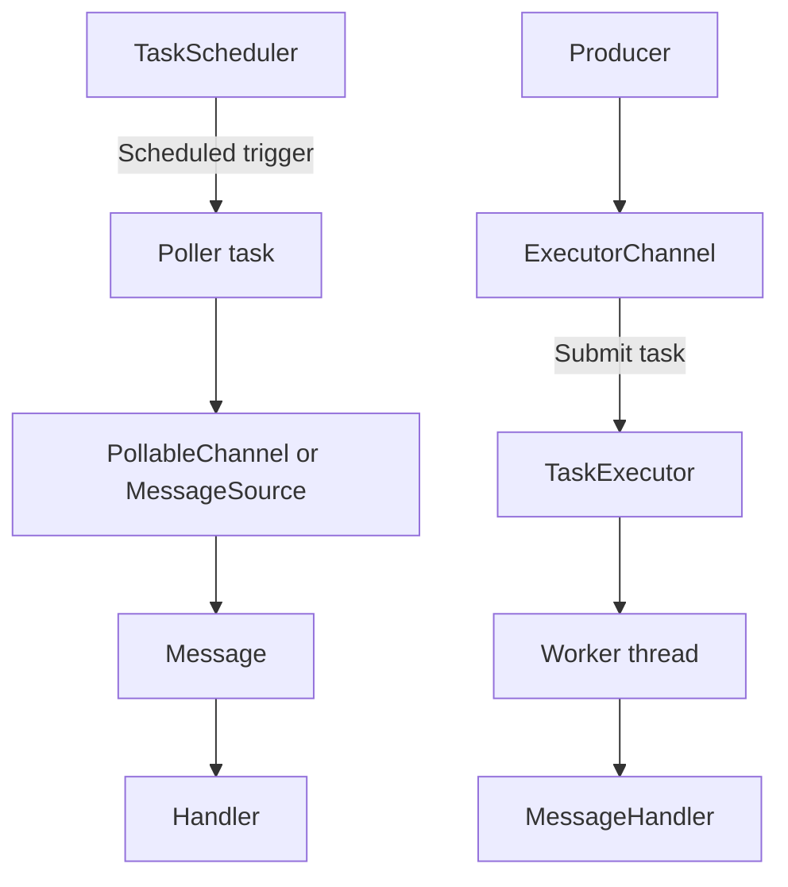
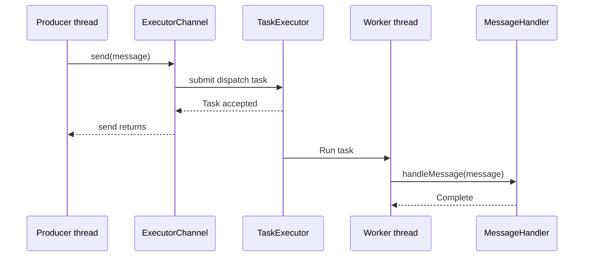
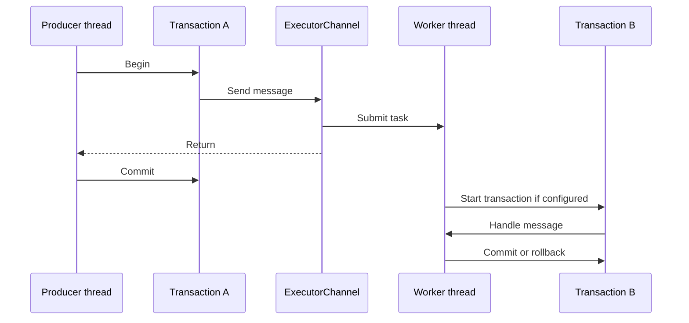

# TaskExecutor and Offloading Processing to Another Thread

In Spring Integration, a message flow typically starts processing on the message-sending thread or on a thread managed by a poller. When a processing step takes a long time, holding the calling thread can slow down producers, schedulers, or other tasks. Spring provides the **TaskExecutor** abstraction to hand off a task to another execution thread. Spring Integration uses this abstraction at points such as `ExecutorChannel`, `PublishSubscribeChannel`, and pollers.

Offloading processing to another thread decouples producer timing from handler execution time and enables concurrent processing. However, it also introduces new boundaries around transactions, completion ordering, errors, context, and overload handling. To use it properly, you need a clear understanding of where threads are switched and where pools are managed.

## 1. What is a TaskExecutor?

`TaskExecutor` is Spring Core's abstraction for executing a `Runnable` task. It extends Java's `Executor` contract and allows Spring components to accept an executor without depending on a specific implementation.

Instead of creating threads manually inside a handler, the application delegates the task to a `TaskExecutor`:

```java
taskExecutor.execute(() -> {
    // Work executed by the executor.
});
```

Calling `execute()` does not return a business result. It submits a task to the executor according to the implementation's policy. The task may run immediately on the current thread, be queued, or run on another worker thread. Therefore, looking at the `TaskExecutor` type alone is not enough to conclude whether execution is asynchronous; you must know the actual implementation and configuration.

Some common implementations:

| Implementation | Characteristics | When to consider |
|---|---|---|
| `SyncTaskExecutor` | Runs the task on the calling thread | Testing or intentional synchronous execution |
| `SimpleAsyncTaskExecutor` | Creates a new thread for each task without traditional pool thread reuse | Low-volume tasks or simple configurations; requires concurrency limits |
| `ThreadPoolTaskExecutor` | Manages a worker pool and a queue | Server applications needing concurrency and resource control |
| `ConcurrentTaskExecutor` | Adapter for an existing Java `Executor` | Integrating an executor managed elsewhere |

In long-running Spring Integration applications, `ThreadPoolTaskExecutor` is usually the easiest choice to control because you can configure worker counts, queue capacity, rejection policy, and shutdown behavior.

## 2. How does TaskExecutor differ from TaskScheduler?

These two abstractions both involve threads, but they solve two different problems:

- **TaskExecutor** decides which thread executes a task and under which pool policy.
- **TaskScheduler** decides when a task is triggered, such as every second or according to a cron expression.

A poller needs a trigger to know when to run. A scheduler schedules the poll; an executor can be used to run the poll task. An `ExecutorChannel`, on the other hand, does not need a periodic trigger: it hands work to the executor as soon as the channel dispatches a message.



You should not use `TaskScheduler` as a general-purpose thread pool for arbitrary work, nor use `TaskExecutor` to replace a poller's trigger. Each component has its own role; misconfiguration can keep threads occupied for too long or prevent tasks from firing as intended.

## 3. Offloading Processing with ExecutorChannel

`ExecutorChannel` is a `SubscribableChannel` that uses an executor to dispatch messages to subscribers. Endpoints still register handlers in an event-driven model, but invoking the handler is delegated to the executor.

The message path can be illustrated as follows:



Once the task is accepted by the executor, the message send call can usually return before the handler completes. The producer therefore does not have to wait for the full business processing. However, if the executor rejects the task because the pool or queue is overloaded, the send operation can fail and raise a message delivery error.

Example of declaring an executor and channel:

```java
@Configuration
@EnableIntegration
public class AsyncIntegrationConfiguration {

    @Bean
    ThreadPoolTaskExecutor integrationTaskExecutor() {
        ThreadPoolTaskExecutor executor = new ThreadPoolTaskExecutor();
        executor.setCorePoolSize(4);
        executor.setMaxPoolSize(8);
        executor.setQueueCapacity(200);
        executor.setKeepAliveSeconds(60);
        executor.setThreadNamePrefix("integration-worker-");
        executor.setRejectedExecutionHandler(
                new ThreadPoolExecutor.AbortPolicy());
        executor.setWaitForTasksToCompleteOnShutdown(true);
        executor.setAwaitTerminationSeconds(30);
        return executor;
    }

    @Bean
    MessageChannel asyncOrdersChannel(
            ThreadPoolTaskExecutor integrationTaskExecutor) {
        return new ExecutorChannel(integrationTaskExecutor);
    }

}
```

Spring manages the lifecycle of `ThreadPoolTaskExecutor` when it is declared as a bean. There is no need to call `initialize()` manually inside the `@Bean` method; the container invokes the appropriate initialization callback. The shutdown properties allow the pool to wait for in-flight tasks for the configured duration when the `ApplicationContext` closes.

A flow can be connected through the asynchronous channel:

```java
@Bean
MessageChannel ordersInput() {
    return new DirectChannel();
}

@Bean
IntegrationFlow ordersFlow(OrderService orderService) {
    return IntegrationFlow.from("ordersInput")
            .channel("asyncOrdersChannel")
            .handle(orderService, "process")
            .get();
}
```

In this flow, the step before the channel may send the message on the current thread. When the message passes through `asyncOrdersChannel`, dispatching to the downstream handler is handed off to the executor. The channel serves as the flow's thread-switching boundary.

## 4. How does ExecutorChannel differ from DirectChannel?

Both are subscribable channels, but how they invoke handlers differs:

| Characteristic | DirectChannel | ExecutorChannel |
|---|---|---|
| Dispatch mechanism | Invokes subscriber directly | Submits dispatch task to executor |
| Processing thread | Usually the sending thread | Executor worker thread |
| When send returns | Usually after synchronous processing completes | Usually after the task is accepted |
| Handler exceptions | Can propagate back to the sender | Usually do not propagate back to the original sender |
| Completion order | Follows synchronous call chain | Can differ from send order with multiple workers |
| Sender transaction | Can continue on the same thread | Does not propagate automatically to the worker thread |
| Backlog | Producer can be slowed down directly | Can accumulate in the executor queue |

Use `DirectChannel` when you need a synchronous, easily observable processing chain where exceptions can propagate back. Use `ExecutorChannel` when you need to decouple producers from consumers or enable parallel processing. Place the channel right at the boundary where switching threads provides a clear benefit.

## 5. PublishSubscribeChannel with an Executor

`PublishSubscribeChannel` distributes the same message to multiple subscribers. When configured with an executor, subscriber invocations can execute asynchronously. This is an option when a single event needs to trigger multiple independent branches.

Example:

```java
@Bean
PublishSubscribeChannel orderEventsChannel(
        ThreadPoolTaskExecutor integrationTaskExecutor) {
    return new PublishSubscribeChannel(integrationTaskExecutor);
}
```

A single message can be sent to subscribers such as audit, notification, and metrics. With an executor, these branches can run concurrently and finish in different orders.

Keep in mind:

- Producers should not assume all subscribers have finished when the send call returns.
- A slow branch does not necessarily block the producer thread, but it still occupies a worker.
- Errors in asynchronous branches must be monitored through proper error handling.
- If multiple branches update the same resource, race conditions and idempotency must be controlled.
- If one subscriber must run before another branch, model the dependency explicitly in the flow rather than relying on thread completion order.

## 6. Using TaskExecutor in a Poller

A poller has a trigger managed by a scheduler. When you need to separate the polling task from the scheduler thread, you can configure an executor in the poller metadata.

```java
@Bean
IntegrationFlow pollingOrders(
        OrderService orderService,
        ThreadPoolTaskExecutor integrationTaskExecutor) {

    return IntegrationFlow.from("ordersQueue",
                    endpoint -> endpoint.poller(
                            Pollers.fixedDelay(Duration.ofSeconds(1))
                                    .maxMessagesPerPoll(10)
                                    .taskExecutor(integrationTaskExecutor)))
            .handle(orderService, "process")
            .get();
}
```

Here, the executor is used for the poll task itself. This differs from placing an `ExecutorChannel` between two steps in a flow:

| Executor configuration point | Offloaded work |
|---|---|
| `Pollers...taskExecutor(...)` | The polling task triggered by the poller |
| `ExecutorChannel` | Dispatching messages from the channel to a subscriber |
| `PublishSubscribeChannel(executor)` | Dispatching messages to multiple subscribers |

If the poller processes the message within the same poll task, the handler can run on the worker executing the poller. If the flow subsequently passes through another executor channel, the message crosses yet another thread boundary. Multiple thread boundaries increase independence but also increase complexity when tracking errors, transactions, and ordering.

## 7. Configuring ThreadPoolTaskExecutor

A thread pool typically has the following main parameters:

| Property | Meaning |
|---|---|
| `corePoolSize` | Number of core workers kept in the pool according to configuration policy |
| `maxPoolSize` | Maximum number of workers |
| `queueCapacity` | Number of tasks that can wait in the queue |
| `keepAliveSeconds` | Time a non-core worker can remain idle before being reclaimed |
| `threadNamePrefix` | Thread name prefix, useful when reading logs and thread dumps |
| `rejectedExecutionHandler` | Policy when no more tasks can be accepted |
| `waitForTasksToCompleteOnShutdown` | Whether to wait for accepted tasks to finish during shutdown |
| `awaitTerminationSeconds` | Timeout to wait for shutdown completion |

### Core size, max size, and queue capacity

When tasks arrive, a thread pool typically creates workers up to the core size first. Once all core workers are busy, tasks are placed into the queue. Only when the queue is full does the pool scale workers beyond core up to max size. If it still cannot accept the task, the rejection policy is applied.

As a result, an unbounded queue can prevent the pool from ever scaling up to `maxPoolSize`: tasks keep getting queued instead of spawning additional workers. If you want the pool to grow workers under high load, queue capacity and max size must be designed together.

There is no universal optimal set of numbers. For CPU-bound work, the worker count should generally stay close to available CPU cores to avoid excessive context switching. For I/O-bound work, more workers may be needed because threads spend time waiting on I/O; measure wait times, CPU, latency, and downstream capacity before enlarging the pool.

## 8. Rejection Policies and How the System Reacts Under Overload

When workers reach their limit and the queue is full, the executor must decide how to handle incoming tasks. Common policies include:

| Policy | Behavior | Impact |
|---|---|---|
| Abort | Throws an exception when rejecting a task | Signals overload explicitly so the caller or error flow can handle it |
| CallerRuns | Runs the task on the calling thread | Creates natural backpressure by slowing down the producer |
| Discard | Drops the new task | Can lose messages if no other mechanism compensates |
| DiscardOldest | Drops the oldest queued task and retries accepting the new one | Can lose messages that were already waiting |

For business message processing, policies that drop tasks must be considered very carefully. Do not use discard unless business requirements allow message loss and corresponding metrics/recovery mechanisms are in place.

`CallerRunsPolicy` can help throttle the producer because the sending thread has to execute the task itself. However, it also alters threading assumptions: under overload, the handler may run on the sending thread instead of a worker. If code depends on thread name, transaction, or context, this scenario must be accounted for.

`AbortPolicy` makes rejection explicit. With `ExecutorChannel`, a submission failure can surface on the sending side as a message delivery error. The application needs to catch, retry, or route the message to an appropriate error-handling path; do not merely log and ignore it.

## 9. How Does an Async Boundary Affect Transactions?

In Spring, imperative transactions are typically bound to a thread via the transaction context. When a flow crosses an `ExecutorChannel`, the handler executes on a different worker thread. An active transaction on the producer thread does not automatically propagate to the worker.



If the handler requires a transaction, start the transaction on the worker side—for example, using a `@Transactional`-proxied service method or appropriate transaction advice on the endpoint. In that case, the handler's transaction is a separate transaction with its own boundary and commit/rollback outcome.

This is especially important when the producer writes to a database and then sends a message to an executor channel. The producer's database transaction might commit after or before the asynchronous handler runs. If you must guarantee that the message is only processed after the data has committed, design an outbox or an appropriate post-commit publishing mechanism; do not assume the executor thread can see an uncommitted transaction.

For reactive transactions, context propagation has its own mechanism based on Reactor Context. Do not assume that imperative `ThreadLocal` transactions automatically work across reactive pipelines or executors.

## 10. Message Headers Propagate, ThreadLocal Does Not

A Spring Integration `Message` carries a payload and headers. When the message is dispatched to a worker, the message itself along with its headers is handed over. Thus, message ID, correlation ID, reply channel, and routing metadata can still follow the message to the handler.

However, values bound to the current thread do not travel automatically with the message, such as:

- Logging MDC.
- `SecurityContext` stored in `ThreadLocal`.
- Tenant context stored in `ThreadLocal`.
- Imperative transaction context.
- Other custom context variables.

If context propagation is required, choose an explicit mechanism instead of relying on thread reuse. For MDC or custom context, you can use a `TaskDecorator` to capture context at submission time and restore it on the worker. For Spring Security, use an executor that supports propagating `SecurityContext`, such as `DelegatingSecurityContextAsyncTaskExecutor`. For tracing, prefer the context propagation mechanism of the instrumentation in use.

Example `TaskDecorator` to preserve MDC:

```java
@Bean
ThreadPoolTaskExecutor contextAwareExecutor() {
    ThreadPoolTaskExecutor executor = new ThreadPoolTaskExecutor();
    executor.setCorePoolSize(4);
    executor.setMaxPoolSize(8);
    executor.setQueueCapacity(200);
    executor.setThreadNamePrefix("context-worker-");

    executor.setTaskDecorator(task -> {
        Map<String, String> captured = MDC.getCopyOfContextMap();

        return () -> {
            Map<String, String> previous = MDC.getCopyOfContextMap();
            try {
                if (captured == null) {
                    MDC.clear();
                }
                else {
                    MDC.setContextMap(captured);
                }

                task.run();
            }
            finally {
                if (previous == null) {
                    MDC.clear();
                }
                else {
                    MDC.setContextMap(previous);
                }
            }
        };
    });

    return executor;
}
```

This example requires a logging dependency with MDC support, such as SLF4J backed by an MDC-capable implementation. Restoring in `finally` is critical because worker threads are reused; failing to clear or restore context can leak data from a previous message into subsequent ones.

Avoid blindly copying all `ThreadLocal` values. Only propagate contexts that are meaningful, have a clear lifecycle, and do not expose sensitive data unnecessarily.

## 11. Exceptions in Asynchronous Processing

With `DirectChannel`, a handler exception can propagate back up the call stack to the producer. With `ExecutorChannel`, the producer typically receives the task-submission result before the handler finishes running. Therefore, a handler exception cannot be returned up the original call stack.

Spring Integration provides error handling for asynchronous tasks, typically via `ErrorHandlingTaskExecutor` and an error channel. The error message can carry the cause and the failed message. However, the application still needs to configure a subscriber on the error channel, along with logging and an appropriate retry/dead-letter policy.

Distinguish between two failure categories:

1. **Task submission failure**: the executor rejects the task or cannot accept it. This error can surface immediately during the send operation.
2. **Handler execution failure**: the task was accepted, but the handler throws an exception while running on the worker. This error must be observed via asynchronous task error handling.

Do not simply check the return value of `send()` and conclude that the handler succeeded. On an async channel, task acceptance only proves that the executor accepted the work, not that business processing completed.

## 12. Processing Order and Concurrency

When an executor has multiple workers, multiple messages can be processed concurrently. Completion time depends on each message's processing duration, so completion order can differ from send order.

Example:

- Message A is sent first, but its handler takes 2 seconds.
- Message B is sent later, but its handler takes only 100 ms.
- B may finish before A.

If business logic requires ordering by key, you can partition messages by key, use a sequential consumer per partition, or design dedicated channels/executors accordingly. A single-thread pool can preserve execution order within a specific queue, but it reduces concurrency and still does not replace broker-level or system-wide ordering semantics.

If multiple messages update the same aggregate, protect state using transactions, optimistic locking, partitioning, or appropriate serialization mechanisms. Do not rely on thread launch order to guarantee business ordering.

## 13. Backpressure and Queue Limits

An executor queue is an in-memory buffer. It is not a durable message store and does not guarantee message survival across a process crash. If the JVM terminates abruptly, tasks remaining in the queue can be lost.

A large queue helps absorb short bursts, but it increases wait times and memory consumption. An unbounded queue can allow backlog to accumulate until heap memory is exhausted. A queue that is too small can cause tasks to be rejected prematurely. Choose queue capacity based on arrival rate, processing rate, and acceptable burst duration.

Ways to regulate load:

- Bound queue capacity.
- Limit worker count via core/max pool size.
- Use a rejection policy aligned with message semantics.
- Throttle producers or apply flow control.
- Use a broker or persistent queue when durable buffering is required.
- Monitor queue size and task wait time before execution.

`CallerRunsPolicy` can provide feedback when producers submit directly to the executor, but it is not a substitute for an end-to-end backpressure policy. If upstream continues sending unbounded traffic across multiple queue layers, overload may simply shift elsewhere.

## 14. Executor Lifecycle and Shutdown

An executor is a lifecycle-managed resource. If you instantiate a thread pool manually inside a handler without closing it, worker threads can outlive the flow or even prevent the JVM from exiting.

When declaring `ThreadPoolTaskExecutor` as a Spring bean, the container manages initialization and destruction callbacks. Settings such as:

- `setWaitForTasksToCompleteOnShutdown(true)`
- `setAwaitTerminationSeconds(...)`

allow the application to wait for accepted tasks for a bounded period during context shutdown.

Distinguish between shared executors and flow-specific executors:

| Executor | Owner | Cleanup |
|---|---|---|
| Pool shared across multiple flows | `ApplicationContext` or application infrastructure | Shut down when the context or owner closes |
| Dedicated pool for a dynamic flow | Flow manager or bean/resource tied to registration | Shut down when the flow unregisters after handling in-flight work |
| Executor managed by an external library | The library or component that created it | Follow the owner's lifecycle |

Do not shut down a shared executor when unregistering a single flow. If a dynamic flow needs its own pool, tie that resource to a bean with a clear lifecycle and ensure flow removal invokes cleanup.

A timed shutdown does not guarantee every message has been processed. The application must decide what happens when the timeout expires: continue waiting, stop the process, persist remaining work, or accept dropping tasks per business policy.

## 15. Testing Off-Thread Processing

Async tests should synchronize using tools such as `CountDownLatch`, `CompletableFuture`, or Awaitility rather than arbitrary `Thread.sleep()` calls.

Simple example with a latch:

```java
CountDownLatch handled = new CountDownLatch(1);

MessageHandler handler = message -> {
    try {
        // Verify processing logic.
    }
    finally {
        handled.countDown();
    }
};

// Send message to the flow or channel.
boolean accepted = channel.send(message);

assertThat(accepted).isTrue();
assertThat(handled.await(5, TimeUnit.SECONDS)).isTrue();
```

In real tests, use an executor with deterministic configuration and verify both handler outcomes and error paths. Close the `ApplicationContext` after tests so worker threads do not leak into other tests. Do not assert solely on thread name, because a thread name does not prove a task completed or data was committed.

Cases worth testing:

- Tasks are processed on another thread when the executor has capacity.
- The executor rejects tasks when the queue is full.
- Handler exceptions reach the expected error handling path.
- Message headers and correlation IDs remain intact after handoff.
- MDC or security context is propagated and properly cleared after the task.
- Shutdown waits for tasks as configured and leaves no orphaned worker threads.
- Concurrent messages do not corrupt business state.

## 16. Observing TaskExecutor at Runtime

When a flow slows down or messages fail to complete, inspect both the channel and the executor:

| Metric | Warning sign |
|---|---|
| Active thread count | Pool consistently exhausts available workers |
| Pool size | Actual worker count relative to core/max |
| Queue size | Queued tasks growing continuously |
| Task execution time | Handlers or poll tasks running slowly |
| Rejected task count | Executor is unable to accept more work |
| Completed task count | Completion throughput |
| Thread state | Workers stuck in `BLOCKED`, `WAITING`, or long I/O waits |
| Error count | Handlers failing after task acceptance |

When reading thread dumps, search for threads by the configured prefix such as `integration-worker-`. If all workers are waiting on the same downstream system, increasing the pool size may simply increase concurrent requests and overload that downstream even further. Identify the bottleneck before changing core/max sizes.

Including the following metadata in logs aids tracing:

- Component name or endpoint ID.
- Message ID and correlation ID.
- Thread name.
- Send timestamp, handler start timestamp, and completion timestamp.
- Retry count and root exception.

## 17. Choosing a Thread-Switching Mechanism by Need

| Need | Mechanism |
|---|---|
| Keep processing synchronous on the sending thread | `DirectChannel` and synchronous handlers |
| Offload a branch's dispatch to a worker pool | `ExecutorChannel` |
| Send the same event to multiple asynchronous branches | `PublishSubscribeChannel` with an executor |
| Run a poller on managed workers | Poller metadata with `taskExecutor` |
| Invoke an asynchronous method in an application service | Spring `@Async` when architecturally appropriate |
| Need durable buffering and delivery | Broker or persistent message store, not just an executor queue |

Place async boundaries where they make sense for latency or concurrency. If every step switches to another pool, the system ends up with many queues, many thread contexts, and many places where errors can occur. A single well-placed boundary is usually easier to operate than multiple unnecessary ones.

## 18. Pre-Production Checklist for Executors

- Which `TaskExecutor` is being used, and who owns its lifecycle?
- Does the pool have explicit `corePoolSize`, `maxPoolSize`, and `queueCapacity`?
- Does the rejection policy match message semantics?
- Does the channel actually offload processing to a worker?
- Is the poller executor being confused with an executor channel?
- Is a transaction opened on the worker if the handler requires one?
- Does an error channel receive asynchronous exceptions?
- Are message headers and correlation IDs preserved?
- Do MDC, `SecurityContext`, and tracing context need to propagate?
- Does completion order affect business logic?
- Is the executor queue monitored and bounded?
- Does shutdown wait for tasks with a configured timeout?
- Do messages require durable buffering across process crashes?

`TaskExecutor` helps Spring Integration offload work to managed threads and increase concurrency. Its effectiveness depends on async boundary placement, pool configuration, overload policies, and how the application handles transactions, context, errors, and lifecycle. When these factors are clearly defined, thread switching improves responsiveness while maintaining runtime observability and control.
