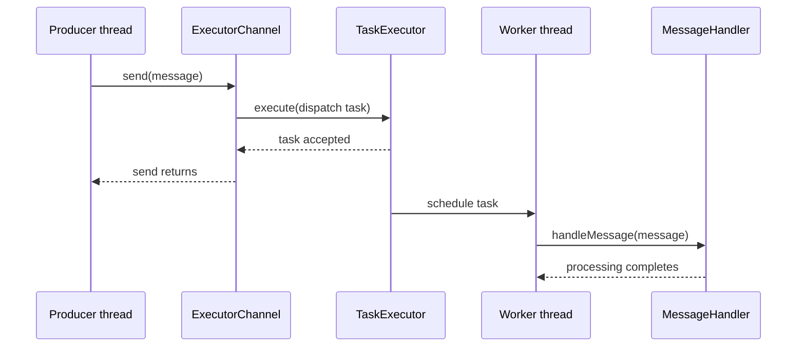
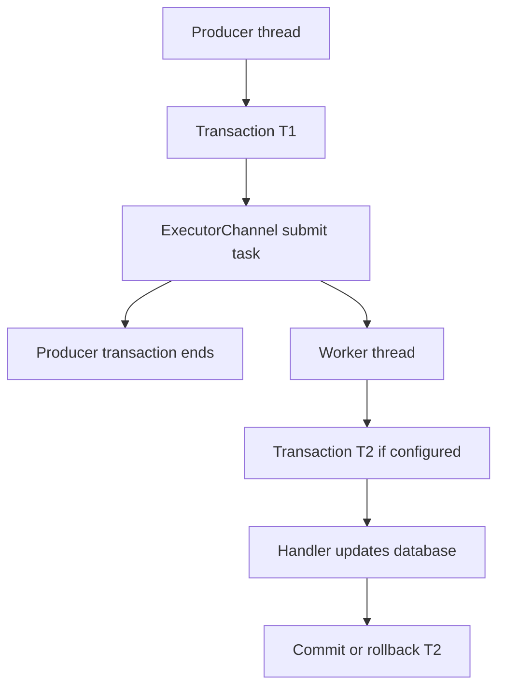

# ExecutorChannel with Async Dispatch

In Spring Integration, `ExecutorChannel` creates an asynchronous execution boundary between where a message is sent and where it is processed. The channel delegates dispatch to a `TaskExecutor`; the handler typically runs on a worker thread instead of the sending thread. This separates business processing time from the sending flow, increases parallelism, and prevents a slow handler from holding the producer thread for too long.

This lesson belongs to the **Task executor** section of the `SPRING_INTEGRATION_RUNTIME` module. The module focuses on how Spring Integration orchestrates message flows across channels, endpoints, consumers, pollers, and executors; it also covers managing `IntegrationFlow` lifecycles, transactions, retries, message stores, errors, correlation, and diagnosing threading, performance, and runtime state.

## 1. How Does ExecutorChannel Work?

`ExecutorChannel` is a `SubscribableChannel` that uses a `TaskExecutor` to dispatch messages to consumers. Endpoints register handlers as subscribers to the channel. When a producer sends a message, the channel submits a task that invokes the subscriber to the executor. With a truly asynchronous executor, a worker thread invokes the handler afterward.



The sequence above illustrates the case where the executor accepts the task successfully and executes it asynchronously. When `send()` returns, it usually only indicates that the dispatch was accepted; it does not prove that the handler has finished running or that business work has committed.

`ExecutorChannel` does not execute business logic itself. It only changes how messages are handed off to subscribers. The handler remains responsible for processing the payload, producing replies, or raising errors according to the endpoint's contract.

## 2. Configuring ExecutorChannel in Spring Integration

You can declare a `ThreadPoolTaskExecutor` and pass it to `ExecutorChannel`:

```java
@Bean
ThreadPoolTaskExecutor integrationExecutor() {
    ThreadPoolTaskExecutor executor = new ThreadPoolTaskExecutor();
    executor.setCorePoolSize(4);
    executor.setMaxPoolSize(8);
    executor.setQueueCapacity(200);
    executor.setThreadNamePrefix("si-worker-");
    executor.setWaitForTasksToCompleteOnShutdown(true);
    executor.setAwaitTerminationSeconds(30);
    return executor;
}

@Bean
MessageChannel asyncOrders(TaskExecutor integrationExecutor) {
    return new ExecutorChannel(integrationExecutor);
}

@Bean
IntegrationFlow asyncOrderFlow(OrderService orderService) {
    return IntegrationFlow.from("orders.in")
        .channel("asyncOrders")
        .handle(orderService, "process")
        .get();
}
```

When a message arrives at `asyncOrders`, the channel dispatches the handler invocation via `integrationExecutor`. Because `ThreadPoolTaskExecutor` is a Spring bean, the container manages its initialization and shutdown lifecycle. Configure pool size, queue capacity, thread names, and shutdown policy according to actual load.

One important note: `TaskExecutor` is an abstraction. If you pass a synchronous executor such as `SyncTaskExecutor`, the task may execute immediately on the calling thread. If you want async dispatch, use an executor that genuinely offloads work to worker threads and verify the runtime configuration.

## 3. How Does ExecutorChannel Differ from DirectChannel and QueueChannel?

All three channels can connect producers to consumers, but their dispatch mechanisms differ.

| Channel | Mechanism | Processing thread | Dedicated message buffer? |
|---|---|---|---|
| `DirectChannel` | Invokes subscriber directly during send | Usually the sending thread | No |
| `ExecutorChannel` | Delegates dispatch to a `TaskExecutor` | Usually a worker thread | No dedicated message queue; the executor may have a task queue |
| `QueueChannel` | Places messages into a queue; consumer receives via poller | Poller/consumer thread | Yes |

`ExecutorChannel` differs from `QueueChannel` in that it does not turn the message channel into a message buffer awaiting consumer polling. Any task waiting typically occurs inside the executor's internal queue. An executor's queue holds dispatch tasks, whereas a `QueueChannel` holds messages. The two queue types have different lifecycles, bounds, and semantics.

`ExecutorChannel` also differs from `PublishSubscribeChannel`. `ExecutorChannel` uses a unicast mechanism: each message is dispatched to one subscriber according to the dispatcher's distribution strategy. `PublishSubscribeChannel` is suited when the same message must be broadcast to multiple subscribers.

Choose according to intent:
- Use `DirectChannel` when you want synchronous processing and need exceptions to propagate back to the sender on the same call stack.
- Use `ExecutorChannel` when you need to decouple execution threads and allow handlers to run asynchronously.
- Use `QueueChannel` when you need to decouple send and receive timing with a message queue capable of buffering messages up to a capacity limit.
- Use `PublishSubscribeChannel` when you need to deliver the same message to multiple subscribers.

## 4. Async Dispatch Changes the Meaning of send()

With `DirectChannel`, a `send` call typically encompasses both dispatching and handler execution. If the handler throws a synchronous exception, that exception can propagate back to the caller.

With `ExecutorChannel` and an asynchronous executor, `send` usually completes once the dispatch task is accepted. The handler may start later, take longer, or fail on a worker thread.

| Event | DirectChannel | ExecutorChannel |
|---|---|---|
| Handler invocation | In the sending call stack | Usually on a worker thread |
| When `send` returns | After synchronous dispatch completes | Usually after the task is accepted by the executor |
| Slow handler | Blocks the sending thread | Blocks a worker thread |
| Handler throws exception | Can propagate to the sender | Cannot return to an already-finished sender call stack |
| Overload | Sender absorbs processing duration | Depends on executor queue and rejection policy |

Distinguish two categories of errors:

1. **Task submission errors:** the executor rejects the task, for example when the pool and queue are full. A rejection error can surface directly during the `send` call.
2. **Handler execution errors:** the task was accepted, but the handler throws an exception on the worker thread. The sender may already have received a successful return from `send` and cannot catch this exception with a `try/catch` around `send`.

Therefore, never treat a successful `send` result as proof that business processing succeeded. If outcome confirmation is required, design explicit replies, acknowledgements, or processing state tracking.

## 5. How Are Messages Distributed to Subscribers?

`ExecutorChannel` is a subscribable channel that uses unicast dispatch. When multiple subscribers are registered, the dispatcher selects one subscriber according to its load-balancing strategy. A message is delivered to a single subscriber for that dispatch, not copied to all subscribers by default.

If a message needs to be processed by multiple independent branches, use `PublishSubscribeChannel` or split the flow explicitly. Do not register multiple subscribers on an `ExecutorChannel` expecting all of them to receive the same message.

With multiple worker threads, different messages can be processed concurrently. This boosts throughput when handlers can execute in parallel, but it also introduces ordering issues, race conditions, and contention over shared resources.

## 6. Thread Boundaries and Contexts That Do Not Propagate Automatically to Workers

When a message crosses an `ExecutorChannel`, execution moves to another thread. Information stored inside the `Message` object and its headers travels with the message, whereas data bound to the current thread does not automatically move to the worker thread.

Contexts to watch out for:
- **Transaction context:** a transaction bound to the sender thread does not automatically wrap work running on a worker.
- **ThreadLocal:** data stored in a producer's `ThreadLocal` does not automatically appear on the worker.
- **SecurityContext:** authentication details do not propagate automatically unless the executor uses an appropriate context-propagation mechanism.
- **Logging MDC:** correlation keys or trace fields in MDC must be propagated/set on the worker if continuous contextual logging is needed.
- **Request context:** data tied to an HTTP request thread should not be read directly after the request thread has ended.

If a worker needs a correlation ID, tenant ID, or tracing metadata, place them into message headers or payload via an explicit contract. For security context and MDC, use a task decorator or context-propagation mechanism appropriate for your application stack; always clear context after the task finishes to prevent data leaks between tasks sharing the same thread.

A Spring `Message` has an immutable structure, but the payload inside can be a mutable object. If the producer mutates the object after sending, the worker may observe modified data or hit race conditions. Prefer immutable payloads or create copies when transferring data ownership across thread boundaries.

## 7. Transactions Do Not Propagate Across ExecutorChannel

This is a major difference when switching from `DirectChannel` to `ExecutorChannel`.

With `DirectChannel`, the sender and handler typically run on the same thread. If they share a transaction manager, a transaction wrapping the send call can encompass handler processing as well, depending on transaction configuration and propagation.

With `ExecutorChannel`, the handler runs on a worker thread. A transaction bound to the sender thread does not propagate to the worker. If the handler requires a transaction, open one on the worker side, such as via transaction advice on the endpoint or a transactional boundary in the invoked service.



This also means the producer may commit its transaction after submitting the task while the worker-side handler has not yet finished. If business rules require source writes and message publication to be atomic, `ExecutorChannel` alone does not provide that guarantee. Consider a transactional outbox, a broker with appropriate transactions/acks, or persisting durable state before dispatching.

Do not assume that swapping `DirectChannel` for `ExecutorChannel` without adjusting transactions preserves the same semantics. This is an architectural change in execution boundaries.

## 8. Asynchronous Error Handling

With async dispatch, exceptions thrown inside a handler cannot propagate back to a sending thread that has already returned. Consequently, errors must be observed and routed on the asynchronous execution side.

Spring Integration supports an error channel mechanism for message flows. You can use the `errorChannel` header on a message to route errors per message; when no message-specific header is present, the application's global error channel configuration can be used according to the active error-handling mechanism.

Example attaching an error channel to a message before sending:

```java
Message<Order> message = MessageBuilder
    .withPayload(order)
    .setHeader("errorChannel", "orders.errors")
    .build();

asyncOrders.send(message);
```

You can define a separate flow to receive errors:

```java
@Bean
IntegrationFlow orderErrorFlow(OrderErrorService errorService) {
    return IntegrationFlow.from("orders.errors")
        .handle(errorService, "record")
        .get();
}
```

The error flow must be able to process the error message and retain details needed for investigation, such as the exception, failed message, correlation ID, and business key. Depending on the async error handler configuration, the exception may be wrapped in an `ErrorMessage` and sent to the error channel.

Do not rely solely on a `try/catch` around `asyncOrders.send(message)` to catch all handler exceptions. That `try/catch` can catch message construction or submission/rejection failures, but it cannot catch an exception occurring later on a worker thread.

If the error channel itself is also processed asynchronously, avoid error loops when the error handler throws an exception. Configure a dead-letter path, error-state persistence, or appropriate alerting so errors never vanish silently.

## 9. Backpressure, Queue Capacity, and Rejection Policies

`ExecutorChannel` has no message buffer of its own. Task admission capacity depends on the executor. With `ThreadPoolTaskExecutor`, key parameters include:

| Property | Meaning |
|---|---|
| `corePoolSize` | Baseline number of workers kept in the pool |
| `maxPoolSize` | Maximum worker limit |
| `queueCapacity` | Number of tasks that can wait in the queue |
| `keepAliveSeconds` | Duration non-core workers may stay idle before being reclaimed |
| `RejectedExecutionHandler` | Policy when the pool cannot accept additional tasks |

An unbounded queue allows producers to send faster than the processing rate for extended periods, causing backlog and memory to grow continuously. A bounded queue caps backlog but forces the system to define a policy when the queue fills up.

Common options:
- **AbortPolicy:** rejects the task and throws a rejection error. The producer or calling layer must handle the overload condition.
- **CallerRunsPolicy:** the sending thread executes the task itself upon rejection. This provides simple backpressure, though it can unexpectedly make the sender run the handler synchronously.
- **DiscardPolicy/DiscardOldestPolicy:** drops tasks. Use only when business semantics permit task loss and proper observability is in place.

Example configuring `CallerRunsPolicy`:

```java
@Bean
ThreadPoolTaskExecutor integrationExecutor() {
    ThreadPoolTaskExecutor executor = new ThreadPoolTaskExecutor();
    executor.setCorePoolSize(4);
    executor.setMaxPoolSize(8);
    executor.setQueueCapacity(200);
    executor.setThreadNamePrefix("si-worker-");
    executor.setRejectedExecutionHandler(
        new ThreadPoolExecutor.CallerRunsPolicy());
    return executor;
}
```

`CallerRunsPolicy` can slow down producers under overload, but it also changes asynchronous characteristics at the moment of rejection. If the sending thread is an HTTP request thread, the request may unexpectedly execute heavy business work. Choose a rejection policy based on business semantics, not merely to avoid exceptions.

## 10. Ordering and Parallel Processing

`ExecutorChannel` does not guarantee that messages finish in exact send order when using a multi-threaded pool. For instance, message A may be submitted before message B, yet B's handler can complete before A if A takes longer or is picked up by a different worker.

Even when a task queue preserves submission order, multiple workers can finish tasks in different orders. If multiple producers send concurrently, submission order across threads does not necessarily reflect the desired business order either.

When ordering must be preserved:
- Use a single worker or single-threaded executor for flows that require serialization.
- Partition by business key so related data flows through the same processing stream.
- Use a resequencer or aggregator when message order must be restored downstream in the flow.
- Design idempotent handlers and concurrency-safe state updates.
- Do not assume an entire flow is sequential simply because the channel is point-to-point.

When increasing concurrency, verify that downstream services are thread-safe. A singleton service holding unsynchronized mutable state can suffer race conditions when invoked simultaneously by multiple workers.

## 11. When Should You Use ExecutorChannel?

`ExecutorChannel` is appropriate when you need to hand off processing to a worker pool and accept asynchronous semantics:
- Handlers perform slow I/O and should not block the sending thread.
- Multiple messages can be processed in parallel.
- Producers and consumers need decoupled execution timing without requiring a durable message store at the channel itself.
- The flow has dedicated mechanisms to track results, errors, and processing status.
- The system has concurrency limits aligned with databases or remote services.

Consider other solutions when:
- Messages must survive restarts or process crashes: use a broker or durable messaging.
- Every subscriber must receive the same message: use `PublishSubscribeChannel`.
- The sender must wait synchronously for the processing result: use `DirectChannel` or a request-reply flow with an appropriate timeout.
- Messages must sit in a queue and be pulled by consumers via a poller: use `QueueChannel` or a broker-backed channel.
- Atomic transactions are required between producer and downstream processing: design appropriate transaction/broker/outbox patterns rather than relying on a simple thread handoff.

## 12. Diagnosing ExecutorChannel at Runtime

| Symptom | Possible cause | How to check |
|---|---|---|
| `send` returns success, yet handler has not finished | Task was only accepted into the executor | Measure queue wait time and handler duration |
| Tasks are rejected | Pool and queue are full, or executor has shut down | Inspect active count, queue size, rejection count, and lifecycle |
| Exceptions do not appear on the sender | Handler runs on a worker thread | Check `errorChannel`, async error handler, and worker logs |
| Messages complete out of order | Multi-worker pool or multiple subscribers | Inspect concurrency, partition keys, and ordering requirements |
| Transactions do not roll back with producer | Handler executes on a different thread | Verify transaction boundaries on the worker |
| Thread pool is congested | Blocking handlers, large queues, or slow dependencies | Inspect thread dumps, queue depth, and downstream latency |
| High CPU after enlarging the pool | Concurrency exceeds target system capacity | Monitor CPU, DB connections, remote rate limits, and context switching |
| Context or MDC is lost | `ThreadLocal` is not propagated | Check `TaskDecorator` and message headers |

Investigation workflow:
1. Confirm the channel is actually an `ExecutorChannel` and the expected executor bean is injected.
2. Confirm the executor is asynchronous, not `SyncTaskExecutor` or an executor running on the caller thread.
3. Inspect active workers, pool size, queue capacity, and rejection policy.
4. Record timestamps for producer send, task start, and handler completion.
5. Monitor exceptions on the error channel or async error handler.
6. Verify transactions, security context, MDC, and correlation IDs across thread boundaries.
7. Verify handlers are thread-safe and idempotent.
8. Evaluate backlog, timeouts, and downstream system load.

Assign a distinct thread name prefix per executor, include the correlation ID in logs, and measure at least three intervals: wait time in the executor queue, handler execution duration, and end-to-end time from send to completion. These measurements help distinguish bottlenecks caused by insufficient workers, queue backlog, or slow external dependencies.

## 13. Design Principles

- `ExecutorChannel` changes the execution thread; it is not a durable queue.
- A successful `send` usually means the task was accepted, not that the handler has finished.
- Use a genuinely asynchronous executor if you intend to switch to worker threads.
- Explicitly define queue capacity, concurrency, and rejection policies.
- Never assume transactions, `ThreadLocal`, `SecurityContext`, or MDC propagate automatically across thread boundaries.
- Put necessary correlation and business context into message headers or payloads.
- Design an error channel to observe failures occurring after the sender returns.
- Control ordering and thread safety when increasing worker counts.
- Use a broker or durable messaging when messages must survive restarts.

`ExecutorChannel` is valuable when you need in-process async dispatch and can bound worker load. To operate it safely, treat the executor as part of the messaging runtime: configure bounded pools and queues, define rejection handling, observe asynchronous errors, and design transactions and correlation around thread boundaries.
