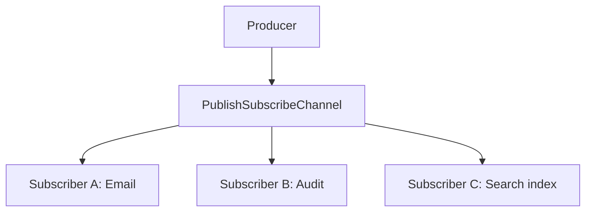
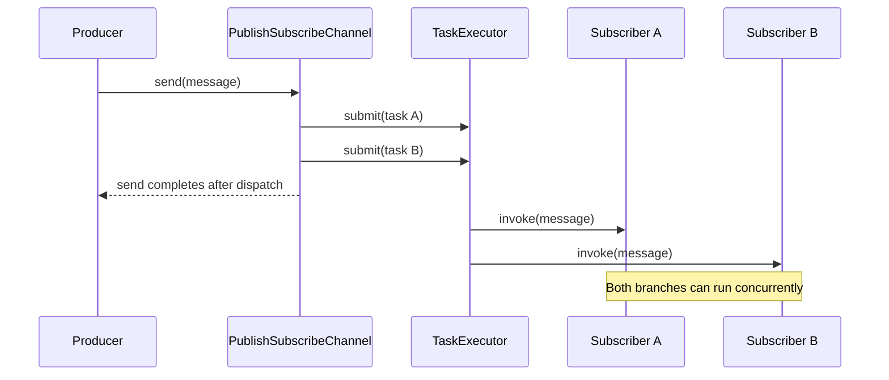
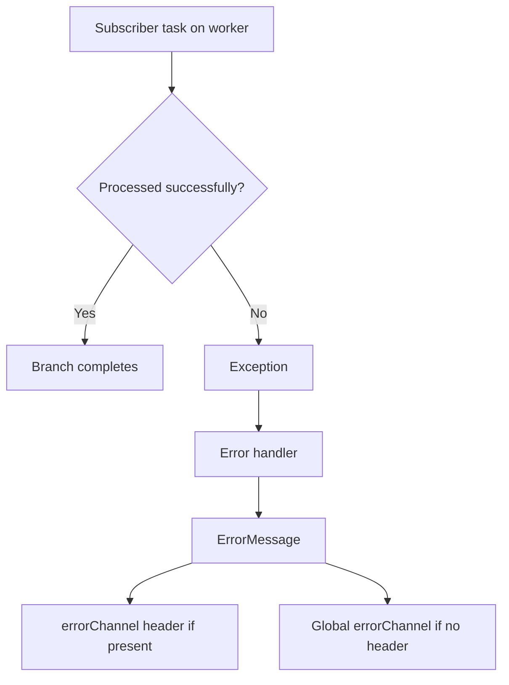
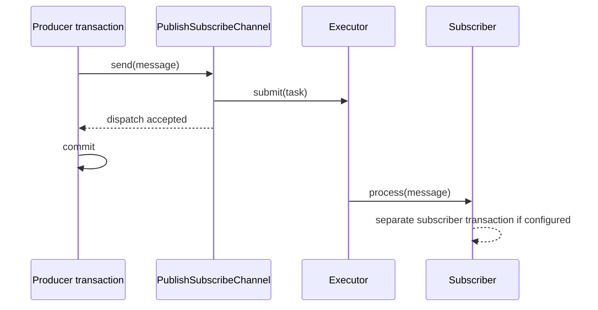

# PublishSubscribeChannel with a Task Executor

`PublishSubscribeChannel` broadcasts a message to all subscribers registered on the channel. When no executor is configured, subscribers are typically invoked sequentially on the sending thread. When a `TaskExecutor` is attached, Spring Integration can dispatch each subscriber on a worker thread, freeing the producer from waiting for all processing branches to complete.

This is how asynchronous fan-out is implemented in Spring Integration. It works well when a single event needs to trigger multiple independent tasks such as sending emails, writing audit logs, updating a search index, and issuing notifications. However, async fan-out changes completion timing, execution order, error handling, and transaction boundaries. Understanding these differences prevents confusing "the message was sent" with "every subscriber processed it successfully."

## 1. Publish-Subscribe Is Broadcast, Not Load Balancing

A `PublishSubscribeChannel` delivers the same message to every registered subscriber. If there are three subscribers, all three receive the message. The channel does not pick one subscriber to handle it on behalf of the others.



This differs from `DirectChannel` and `ExecutorChannel`:

| Channel | Distribution behavior | Default execution thread |
| --- | --- | --- |
| `DirectChannel` | Point-to-point; one subscriber is chosen to receive the message. | Sending thread. |
| `ExecutorChannel` | Point-to-point; one subscriber is chosen and the invocation is handed to an executor. | Worker thread. |
| `PublishSubscribeChannel` without an executor | Broadcasts to all subscribers. | Sending thread, one subscriber after another. |
| `PublishSubscribeChannel` with an executor | Broadcasts to all subscribers; invocations are submitted to the executor. | Worker thread, depending on executor and rejection policy. |

Therefore, if the goal is to distribute load across multiple workers processing one message at a time in a competing-consumers pattern, choose a point-to-point channel with appropriate load balancing. If the goal is for every branch to receive the same event, `PublishSubscribeChannel` is the right choice.

## 2. Synchronous vs. Asynchronous

Without an executor, the channel invokes subscribers on the thread calling `send()`. The producer receives control back only after synchronous dispatch finishes. If the first subscriber takes a long time, subsequent subscribers must wait.

When an executor is configured, the channel submits work to the executor. Each subscriber gets its own invocation. The producer typically returns once the tasks are accepted by the executor, while subscribers continue running afterward.



The return of `send()` is not proof that subscribers have finished. Nor does it confirm that each branch's side effects have committed. If the producer needs results from all branches, design a request-reply/scatter-gather pattern, an aggregator, or a separate completion-tracking mechanism.

### No Completion Order Guarantee

The executor can run subscribers across multiple workers. Subscriber B can finish before A even though A was submitted first. Consecutive messages can also be processed concurrently and finish in an order different from send order.

If a branch requires per-key ordering, partition by key, use an executor/channel with an appropriate sequential model, or serialize work for that key. A `PublishSubscribeChannel` backed by a shared thread pool does not guarantee each subscriber's completion order.

## 3. Java Configuration with ThreadPoolTaskExecutor

Example creating an executor with bounded workers and queue, then attaching it to a `PublishSubscribeChannel`:

```java
@Configuration
class NotificationConfiguration {

    @Bean("notificationExecutor")
    ThreadPoolTaskExecutor notificationExecutor() {
        ThreadPoolTaskExecutor executor = new ThreadPoolTaskExecutor();
        executor.setCorePoolSize(4);
        executor.setMaxPoolSize(12);
        executor.setQueueCapacity(200);
        executor.setKeepAliveSeconds(60);
        executor.setThreadNamePrefix("notification-");
        executor.setWaitForTasksToCompleteOnShutdown(true);
        executor.setAwaitTerminationSeconds(30);
        executor.setRejectedExecutionHandler(
            new ThreadPoolExecutor.CallerRunsPolicy());
        return executor;
    }

    @Bean
    MessageChannel notifications(
            @Qualifier("notificationExecutor") TaskExecutor executor) {
        PublishSubscribeChannel channel = new PublishSubscribeChannel(executor);
        channel.setApplySequence(true);
        channel.setMinSubscribers(1);
        return channel;
    }
}
```

Choices in this example:

- `corePoolSize = 4`: baseline number of workers retained in the pool.
- `maxPoolSize = 12`: maximum worker limit when the queue is full and the executor needs to expand the pool.
- `queueCapacity = 200`: bounds pending tasks to prevent unbounded queue growth.
- `CallerRunsPolicy`: when the executor rejects a task due to overload, the thread calling `send()` can run the task itself, creating backpressure.
- `waitForTasksToCompleteOnShutdown` and `awaitTerminationSeconds`: allow the executor to wait for accepted tasks to finish within a bounded window during application shutdown.
- `setApplySequence(true)`: instructs the channel to add sequence metadata to broadcast messages.
- `setMinSubscribers(1)`: requires at least one subscriber for sending to be considered successful.

`TaskExecutor` is Spring's abstraction; `ThreadPoolTaskExecutor` is the implementation typically used for server applications. A Spring-managed executor bean is initialized and shut down along with the container lifecycle. Never create a new thread pool per message or per send call.

### XML Configuration

When using the XML namespace, you can attach an executor directly to the channel:

```xml
<task:executor id="notificationExecutor"
               pool-size="4-12"
               queue-capacity="200"
               rejection-policy="CALLER_RUNS"/>

<int:publish-subscribe-channel id="notifications"
        task-executor="notificationExecutor"
        apply-sequence="true"
        min-subscribers="1"/>
```

Declare the `task` and `int` namespaces accordingly in the XML root element. Flows or endpoints subscribed to the `notifications` channel become broadcast subscribers.

## 4. Registering Multiple Subscribers with IntegrationFlow

Each flow below subscribes independently to the same `notifications` channel:

```java
@Configuration
class NotificationFlows {

    @Bean
    IntegrationFlow emailNotificationFlow(EmailService emailService) {
        return IntegrationFlow.from("notifications")
            .handle(emailService, "send")
            .get();
    }

    @Bean
    IntegrationFlow auditNotificationFlow(AuditService auditService) {
        return IntegrationFlow.from("notifications")
            .handle(auditService, "record")
            .get();
    }

    @Bean
    IntegrationFlow searchNotificationFlow(SearchIndexService searchService) {
        return IntegrationFlow.from("notifications")
            .handle(searchService, "update")
            .get();
    }
}
```

When a producer sends a `Notification` to the channel, all three flows receive the message. Because the channel has an executor, each subscriber can run on a worker thread. Services should be injected as regular beans; the channel only orchestrates dispatch and does not create or manage subscriber business dependencies.

Producers can send via `MessageChannel` or `MessagingTemplate`:

```java
@Service
class NotificationPublisher {

    private final MessageChannel notifications;

    NotificationPublisher(MessageChannel notifications) {
        this.notifications = notifications;
    }

    void publish(Notification notification) {
        notifications.send(MessageBuilder.withPayload(notification).build());
    }
}
```

If the application has multiple `MessageChannel` beans of the same type, use `@Qualifier("notifications")` on the constructor to avoid injecting the wrong channel.

## 5. Sequence Metadata and `applySequence`

`PublishSubscribeChannel` can attach sequence metadata when `applySequence` is enabled. When broadcasting to N subscribers, messages produced for the branches can carry the following headers:

| Header | Meaning |
| --- | --- |
| `CORRELATION_ID` | Key linking messages emitted from the same broadcast. |
| `SEQUENCE_NUMBER` | Position of the message in the broadcast set. |
| `SEQUENCE_SIZE` | Expected number of messages in that set. |

By default, `applySequence` is off. Enable it only when downstream components need this metadata—for example, when branches later converge into an aggregator or when you need to track relationships among copies. Sequence headers do not force subscribers to run in order, nor do they wait for all subscribers to finish.

Do not confuse publish-subscribe sequence metadata with a business correlation ID. A channel can emit thousands of events; if you need to correlate results per request, design an explicit business correlation key and ensure it is preserved across endpoints.

## 6. `minSubscribers` and `ignoreFailures`

`minSubscribers` is the minimum number of subscribers required for `send()` to count as a successful dispatch. The default allows a channel with zero subscribers without necessarily throwing an error. For an event that must have at least one consumer, setting `minSubscribers` to `1` helps detect wiring mistakes or unregistered flows.

`ignoreFailures` controls how the dispatcher reacts to exceptions when invoking subscribers. In synchronous dispatch, enabling this property allows skipping a failing subscriber to continue dispatching to remaining subscribers. Consider this carefully, because ignoring an exception does not mean the branch succeeded; it can hide a failed side effect from the producer.

With async dispatch, tasks may already have been submitted independently before one branch fails. Do not rely on `ignoreFailures` as a retry mechanism or confirmation that all branches succeeded. Use an error flow and business state if you need to know which branches succeeded or failed.

## 7. Error Handling When Subscribers Run on an Executor

In synchronous mode, an exception from a subscriber can propagate back through `send()` and affect dispatching to remaining subscribers depending on failure-handling configuration.

In asynchronous mode, the producer usually no longer has an active call stack to receive exceptions thrown once the task runs. Spring Integration's error handling converts worker failures into an `ErrorMessage` sent to an appropriate error channel. Typically, the destination is chosen from the message's `errorChannel` header if present, or otherwise the global `errorChannel`. If your application replaces the default executor or error handler, verify that the actual setup still publishes errors as expected.



You can declare a common error flow:

```java
@Bean
IntegrationFlow notificationErrorFlow(ErrorAuditService auditService) {
    return IntegrationFlow.from("errorChannel")
        .handle((MessageHandler) message -> {
            ErrorMessage error = (ErrorMessage) message;
            auditService.record(error.getPayload(), error.getOriginalMessage());
        })
        .get();
}
```

The error flow should capture the root exception, failed message, subscriber/endpoint ID if available, correlation ID, and timestamp. Classify transient errors for bounded retries; permanent data or business errors should go to a dead-letter or audit flow. Never let an error flow repeatedly throw unhandled exceptions without a fallback path.

One detail to remember: a successful `send()` in async mode mainly confirms that dispatch was accepted. It does not guarantee subscribers succeeded. If the executor rejects a task, rejection can occur immediately on submission and fail the send call; if a task starts running and then throws an exception, the failure follows worker error handling.

## 8. Backpressure and Rejection Policies

An executor is a finite resource. When producers send faster than subscribers process, the task queue grows. If the queue is unbounded, the application can accumulate tasks on the heap, increasing latency and eventually causing an `OutOfMemoryError`.

Use a bounded queue capacity and pick a rejection policy aligned with requirements:

| Rejection policy | Behavior | When to consider |
| --- | --- | --- |
| `AbortPolicy` | Throws `RejectedExecutionException` when unable to accept more tasks. | When the producer needs a clear overload signal so it can retry or throttle. |
| `CallerRunsPolicy` | The sending thread runs the rejected task itself. | When you want natural backpressure and can accept the producer occasionally running work synchronously. |
| `DiscardPolicy` | Silently drops the rejected task without an error. | Only when task loss is explicitly acceptable; usually unsuitable for business events. |
| `DiscardOldestPolicy` | Drops the oldest queued task and retries submitting the new one. | Only when newer data supersedes older data and losing old events is acceptable. |

For business notifications, `AbortPolicy` or an observable backpressure/retry mechanism is usually safer than discard policies. `CallerRunsPolicy` helps curb producer rate, but it can alter execution threading: a branch may occasionally execute on the sending thread. Subscribers must therefore be safe across different thread types.

### Sizing the Pool

There is no single core/max/queue configuration that fits every flow. Measure processing duration, I/O-to-CPU ratio, subscriber count, arrival rate, and acceptable latency.

- CPU-bound tasks usually need a worker count close to available CPU cores; adding too many threads only increases context switching.
- I/O-bound tasks can use more workers, but you must account for connection pool limits, rate limits, and downstream service capacity.
- Large queues increase wait time and retained memory. A queue is not a cure for insufficient processing capacity.
- `ThreadPoolTaskExecutor` typically scales from core to max only after the queue is full; if the queue is unbounded, `maxPoolSize` may never be reached.
- Monitor queue wait time and processing duration separately to tell whether the bottleneck is the executor or a subscriber.

## 9. Shared Payloads and Thread Safety

A Spring `Message` is immutable at the envelope level: headers cannot be arbitrarily mutated after the message is created. However, the payload is not automatically deep-copied. All subscribers can receive the exact same payload object.

If the payload is a mutable object and one subscriber modifies a field, another subscriber can read mutated data or hit a race condition. Prefer immutable DTOs/records, or make a separate copy per branch before permitting mutation. Avoid storing per-request state in fields of a singleton handler when the same handler can be invoked concurrently by multiple workers.

```java
public record Notification(String recipient, String subject, String body) { }
```

Records/immutable DTOs help branches read data safely. Individual side effects like email, audit, and index updates should carry an idempotency key to avoid duplicate processing when producers retry or messages are replayed.

## 10. Transactions and Async Fan-Out

A producer's transaction does not propagate automatically to worker threads. If a producer sends a message to an executor-backed `PublishSubscribeChannel` inside a transaction, that transaction can commit right after task submission, before subscribers finish executing.



If a subscriber needs to update a database transactionally, place the transaction boundary on that branch's handler/service. If business requirements dictate that database state and broadcast events be recorded atomically, consider a transactional outbox: persist the event in the same database transaction as the business change, then let a publisher emit events from the outbox. Do not rely on submitting to an executor to guarantee that a broker or subscriber durably received an event.

## 11. Context Propagation: MDC, Security, and Tracing

When crossing an executor, the sending thread's `ThreadLocal` values do not appear automatically in the worker thread. Commonly affected contexts include:

- MDC logging context (trace ID, request ID).
- Security context.
- Locale or custom contexts stored in `ThreadLocal`.
- Certain instrumentation-dependent tracing/observation contexts.

Do not assume `ThreadLocal` values are copied just because payload and message headers are forwarded. You can use a `TaskDecorator` on `ThreadPoolTaskExecutor` to capture context on submission and restore/clear it after the task ends. For Spring Security, use the corresponding delegating executor or context-propagation mechanism. For tracing, prefer the official instrumentation for your Spring Boot/Micrometer version.

Illustrative example of an MDC decorator:

```java
executor.setTaskDecorator(task -> {
    Map<String, String> context = MDC.getCopyOfContextMap();
    return () -> {
        Map<String, String> previous = MDC.getCopyOfContextMap();
        try {
            if (context == null) {
                MDC.clear();
            }
            else {
                MDC.setContextMap(context);
            }
            task.run();
        }
        finally {
            if (previous == null) {
                MDC.clear();
            }
            else {
                MDC.setContextMap(previous);
            }
        }
    };
});
```

This is an illustrative example; in real applications, choose the right MDC implementation and combine it with whatever tracing/security context your application uses. Always restore or clear context in `finally` so one request's data never leaks to the next task sharing that worker.

## 12. Graceful Shutdown and Executor Lifecycle

When the context closes, the executor must stop accepting new tasks and finish already accepted tasks according to its shutdown policy. Properties such as `waitForTasksToCompleteOnShutdown` and `awaitTerminationSeconds` bound the wait window. However, a shutdown timeout does not guarantee all external side effects completed; tasks may be interrupted or the process may exit before finishing.

When deploying:

1. Stop producers or halt accepting new events before shutting down the executor.
2. Wait for submitted tasks for an appropriate duration.
3. Monitor active task counts and remaining queue items.
4. Ensure subscribers enforce I/O timeouts so shutdown does not hang indefinitely.
5. For events that must not be lost, persist them before submission or use a broker/outbox as the durable source.

Never create executors manually inside handlers and forget to shut them down. Use a Spring-managed executor bean so its lifecycle aligns with channels and the application context.

## 13. Observing Performance and Troubleshooting

Metrics worth monitoring:

- Registered subscriber count on the channel and sent message count.
- Active tasks, pool size, and queue depth.
- Executor task rejection count.
- Time from submission to worker start (queue wait time).
- Execution duration per subscriber.
- Exception and `ErrorMessage` counts per branch.
- Remaining tasks during shutdown and drain duration.

| Symptom | Possible cause | Resolution |
| --- | --- | --- |
| Producer sends one message and email/audit/index all run | Broadcast is working as intended. | Verify subscriber count and ensure each branch is idempotent. |
| Producer returns quickly, but branches are not done yet | Async dispatch only submits tasks. | Use completion tracking or scatter-gather if the caller needs results. |
| Branches finish out of order | Workers execute in parallel. | Partition/serialize by key or use a resequencer if appropriate sequence metadata exists. |
| One branch fails, but producer sees no exception | Error occurred on a worker thread after submission. | Check header/global `errorChannel` and the error flow. |
| `RejectedExecutionException` on `send` | Pool and queue reached capacity or executor is shutting down. | Check pool/queue sizing, producer rate, and rejection policy. |
| Low CPU, yet queue grows | Subscribers are waiting on I/O, connection pools, or congested downstream services. | Measure I/O latency, bound downstream calls, and increase workers only if resources allow. |
| Heap grows continuously | Unbounded queue or large payloads retained in tasks. | Use a bounded queue, limit payload sizes, and apply backpressure. |
| Subscriber reads a mutated payload | Branches share a mutable object. | Use immutable payloads or copy per branch. |
| Worker logs lack trace/request IDs | `ThreadLocal`/MDC is not propagated. | Configure a `TaskDecorator` or proper context propagation. |

When investigating a message, log the message ID, correlation ID, subscriber/endpoint ID, thread name, submission time, start time, and completion time. This separates delay spent waiting in the executor queue from delay inside the business handler.

## 14. Process for Choosing and Configuring PublishSubscribeChannel

1. Confirm whether business logic requires broadcasting to all subscribers or processing by a single consumer.
2. If all subscribers should run on the sending thread, use `PublishSubscribeChannel` without an executor.
3. If branches are independent and should run concurrently, attach a Spring-managed `TaskExecutor`.
4. Set core/max pool sizes, queue capacity, rejection policy, and shutdown timeout based on real load.
5. Enable `applySequence` only when downstream needs sequence metadata; set `minSubscribers` if missing subscribers must be detected.
6. Define the error channel, retry strategy, dead-letter handling, and per-branch result observability.
7. Use immutable payloads and propagate context via decorators or instrumentation if needed.
8. Test overload, executor rejection, subscriber failures, and shutdown to verify operational semantics.

## 15. Key Takeaways

- `PublishSubscribeChannel` broadcasts a message to all subscribers; it does not distribute load like competing consumers.
- Without an executor, subscribers run synchronously on the sending thread; with an executor, each subscriber is dispatched as an asynchronous task.
- Completing `send()` does not mean all subscribers processed the message successfully.
- An executor changes completion order, transaction boundaries, and error routing; worker threads do not inherit the producer's transaction.
- Use a bounded queue and an intentional rejection policy to control backpressure; avoid silently discarding business events.
- Payload objects may be shared across branches; prefer immutable DTOs and idempotent subscribers.
- Use error flows, metrics, and graceful shutdown to run fan-out reliably.

## References

- [Spring Integration Reference — Channel Configuration](https://docs.spring.io/spring-integration/reference/channel/configuration.html)
- [Spring Integration Reference — Error Handling](https://docs.spring.io/spring-integration/reference/error-handling.html)
- [Spring Integration Reference — Task Executor Support](https://docs.spring.io/spring-integration/reference/task-executor.html)
- [Spring Framework Reference — Task Execution and Scheduling](https://docs.spring.io/spring-framework/reference/integration/scheduling.html)
- [Spring Integration API — PublishSubscribeChannel](https://docs.spring.io/spring-integration/api/org/springframework/integration/channel/PublishSubscribeChannel.html)
