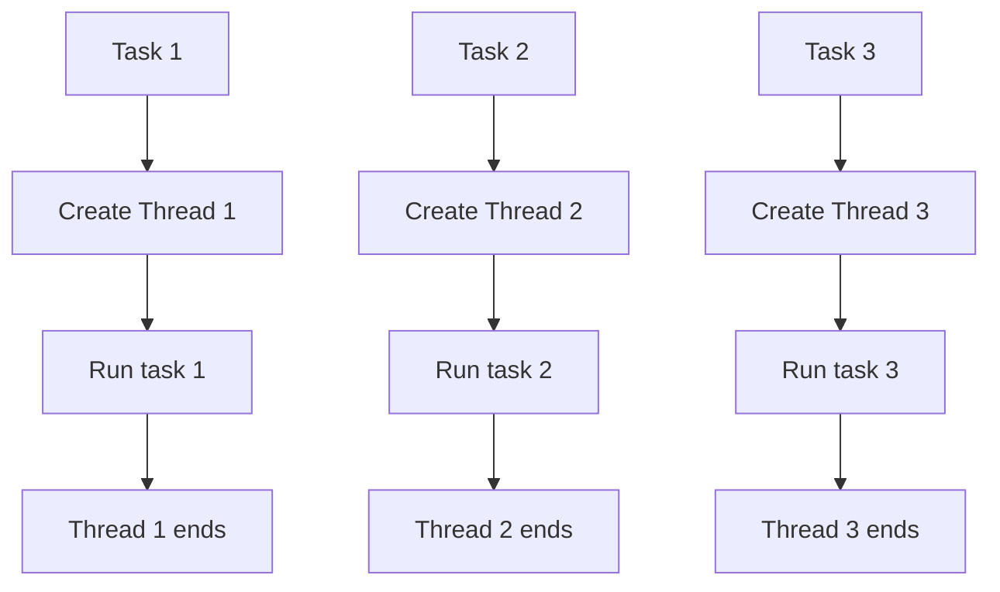

# SimpleAsyncTaskExecutor and Thread Creation Limits

`SimpleAsyncTaskExecutor` is a Spring `TaskExecutor` that follows the **one new thread created per submitted task** model. This executor does not maintain a thread pool to reuse threads after tasks complete. Consequently, if many messages are dispatched concurrently, the number of active threads can climb rapidly unless a concurrency limit is configured.

An important distinction is that `concurrencyLimit` bounds the **number of tasks running concurrently**, not the total number of threads created over the application's lifetime. For example, setting a limit of 10 means at most roughly 10 tasks managed by the executor run at the same time; as tasks finish, subsequent tasks still spawn new threads. Over a day, the executor may create thousands of sequential threads even though the concurrency limit is only 10.

In Spring Integration, `SimpleAsyncTaskExecutor` can serve as the executor for `ExecutorChannel`, `PublishSubscribeChannel`, or other asynchronous processing points that accept a `TaskExecutor`. To use it safely, you must understand the thread-per-task model, behavior when reaching the limit, effects on message flows, and when to prefer `ThreadPoolTaskExecutor`.

## 1. The Thread-per-Task Model

When `execute(task)` is called, `SimpleAsyncTaskExecutor` creates a new thread and runs the task on that thread. Once the task finishes, the thread terminates. The executor does not retain idle threads to hand off to future tasks.



Example of creating the executor:

```java
SimpleAsyncTaskExecutor executor =
        new SimpleAsyncTaskExecutor("integration-");

executor.execute(() -> processMessage(message));
```

The `integration-` prefix helps identify threads in logs and thread dumps. Each time `execute()` accepts work, the executor creates a new thread as configured. If the application submits tasks continuously, threads are continuously created and destroyed.

### 1.1. Advantages and Overhead

| Characteristic | Implication |
|---|---|
| Simple configuration | No need to tune core pool, max pool, or queue like a thread pool |
| Dedicated thread per task | Tasks do not wait for an idle pooled thread while below the concurrency limit |
| No thread reuse | Thread creation and teardown cost is paid for every task |
| No thread-pool queue | When the concurrency limit is reached, the executor blocks or rejects per configuration |
| Unbounded concurrency by default | Many concurrent tasks can spawn huge thread counts and put pressure on the process |

`SimpleAsyncTaskExecutor` suits moderate workloads or independent tasks where thread-per-task is an intentional choice. For sustained high traffic requiring thread reuse, `ThreadPoolTaskExecutor` usually makes resource control easier.

## 2. How Does the Concurrency Limit Work?

`SimpleAsyncTaskExecutor` supports bounding concurrent tasks via `setConcurrencyLimit(int)`. The default is unlimited (`UNBOUNDED_CONCURRENCY`). When set to a positive integer, the executor tracks running tasks and allows only that many to run simultaneously.

```java
SimpleAsyncTaskExecutor executor =
        new SimpleAsyncTaskExecutor("integration-");

executor.setConcurrencyLimit(10);
```

With this configuration, at most 10 tasks managed by the executor can run concurrently. Subsequent tasks follow the limit-reached behavior.

### 2.1. Concurrency Limit Is Not a Total Thread Limit

Suppose an executor has `concurrencyLimit = 3` and processes 12 tasks sequentially/concurrently. At any instant, at most 3 tasks execute. Once a task finishes, its slot is released and the next task starts on a newly created thread.

```text
Time       ─────────────────────────────────────────────>

Task 1     [ Thread 1 ]
Task 2     [ Thread 2       ]
Task 3     [ Thread 3 ]
Task 4                     [ Thread 4 ]
Task 5                     [ Thread 5       ]
Task 6                     [ Thread 6 ]
Task 7                                      [ Thread 7 ]
...

Max concurrency at any instant: 3
Total threads created across the entire run: possibly 12
```

Thus, the concurrency limit protects how many tasks run simultaneously. It does not place a cumulative cap on threads created since application startup.

## 3. Behavior When Reaching the Concurrency Limit

When running tasks reach the limit, `SimpleAsyncTaskExecutor` can handle new tasks in two ways.

**Wait for an available slot:** this is the default behavior when a limit is enabled. The thread calling `execute()` blocks until an active task finishes and frees a slot. This applies backpressure upstream to the caller.

**Reject the task:** you can configure `setRejectTasksWhenLimitExceeded(true)` in Spring Framework versions that support this property. When the limit is reached, the executor throws `TaskRejectedException` instead of waiting.

Example configuring the limit and rejection:

```java
@Bean("integrationTaskExecutor")
SimpleAsyncTaskExecutor integrationTaskExecutor() {
    SimpleAsyncTaskExecutor executor =
            new SimpleAsyncTaskExecutor("integration-");
    executor.setConcurrencyLimit(20);
    executor.setRejectTasksWhenLimitExceeded(true);
    return executor;
}
```

Check your Spring Framework version before calling `setRejectTasksWhenLimitExceeded`; APIs and configuration options can vary across versions. Without reject mode enabled, the caller can block once the executor reaches its limit.

### 3.1. Choosing Between Waiting and Rejecting

| Policy | Behavior | When appropriate | Risks to manage |
|---|---|---|---|
| Wait for slot | Caller blocks until a slot frees up | Backpressure is desired and the caller tolerates waiting | Can hold HTTP request or poller threads for too long |
| Reject task | `execute()` throws `TaskRejectedException` | Fail-fast is desired so the flow handles overload explicitly | Requires appropriate error handling, retry, or message persistence |

Waiting does not mean the message is buffered in an internal queue. The calling thread executing the submission is blocked. If the caller is an HTTP thread, a poller thread, or holds a lock/transaction, blocking can stall other parts of the system.

Rejection lets the caller detect overload immediately. In Spring Integration, an executor dispatch failure can surface as a message-send or delivery failure depending on the channel and call path. Configure proper error handling and decide whether messages should be retried, persisted, or routed to an error flow.

## 4. Using SimpleAsyncTaskExecutor with Spring Integration

`ExecutorChannel` uses a `TaskExecutor` to dispatch messages to handlers on another thread. You can configure the channel as a bean:

```java
@Bean("integrationTaskExecutor")
SimpleAsyncTaskExecutor integrationTaskExecutor() {
    SimpleAsyncTaskExecutor executor =
            new SimpleAsyncTaskExecutor("si-worker-");
    executor.setConcurrencyLimit(16);
    executor.setRejectTasksWhenLimitExceeded(true);
    return executor;
}

@Bean
MessageChannel asyncOrdersChannel(
        @Qualifier("integrationTaskExecutor") TaskExecutor executor) {
    return new ExecutorChannel(executor);
}

@Bean
IntegrationFlow ordersFlow(MessageChannel asyncOrdersChannel,
                           OrderService orderService) {
    return IntegrationFlow.from("orders.input")
            .channel(asyncOrdersChannel)
            .handle(orderService, "process")
            .get();
}
```

When a message reaches `asyncOrdersChannel`, `ExecutorChannel` hands off the handler invocation to the executor. With `SimpleAsyncTaskExecutor`, each dispatched task uses a newly created thread if accepted.

### 4.1. What Changes in the Message Flow?

Before the async point, the message is processed on the sending thread. After `ExecutorChannel`, the handler can run on a thread created by the executor. This has several consequences:

- The sending thread can continue once the task is successfully dispatched.
- A successful `send()` only confirms dispatch acceptance; it does not confirm business processing completed.
- Exceptions thrown inside an asynchronous handler cannot propagate as synchronous exceptions back to the sending thread; an error channel and error monitoring are required.
- Completion order across multiple messages can differ from send order.
- A transaction bound to the sending thread does not propagate automatically to the new execution thread.

If synchronous business results are needed, `DirectChannel` may be more appropriate. If switching threads is needed, define clearly where results are received, where exceptions are handled, and how in-flight messages are tracked.

### 4.2. Distinguishing TaskExecutor from TaskScheduler

`TaskExecutor` executes tasks. `TaskScheduler` schedules when tasks trigger, such as a poller running every second or on a cron expression. Both abstractions can participate in the same flow, but they do not replace each other.

When an inbound adapter uses a poller, the scheduler decides when polling occurs. An executor can be configured to execute the related work depending on the endpoint and poller setup. Setting a concurrency limit on an executor does not automatically limit the firing rate of a cron or fixed-rate trigger; configure the scheduler/poller separately as appropriate.

## 5. Limiting Threads to Protect Downstream Systems

The right thread count does not depend on CPU alone. It also depends on how long tasks hold threads, I/O wait ratios, connection pools, and downstream system capacity.

For instance, if a flow calls a database whose pool has only 12 connections, configuring 100 concurrent tasks can leave many threads waiting for a connection. Waiting threads still consume stacks, memory, and scheduling overhead. Adding threads does not make the database faster.

When choosing a concurrency limit, consider:

1. How many concurrent requests downstream systems can sustain.
2. Database and HTTP client connection pool sizes.
3. Average and high-percentile task processing times.
4. Ratio of CPU-bound vs. I/O-bound tasks.
5. How many other flows or channels share the same executor.
6. Number of application replicas; a limit of 20 per replica becomes 100 concurrent tasks across 5 replicas.

If one executor is shared by multiple channels, its concurrency limit applies globally to tasks submitted through that executor. If each flow has its own executor, total application concurrency can equal the sum of all executor limits. Calculate at both the process level and the cluster level, not just per bean.

## 6. Comparison with ThreadPoolTaskExecutor

`SimpleAsyncTaskExecutor` and `ThreadPoolTaskExecutor` both implement Spring's task execution abstraction, but their thread management models differ.

| Criterion | `SimpleAsyncTaskExecutor` | `ThreadPoolTaskExecutor` |
|---|---|---|
| Model | Thread-per-task | Thread pool |
| Thread reuse | No | Yes |
| Task queue | No dedicated thread-pool queue; may block caller at limit | Configurable queue capacity |
| Concurrency control | `concurrencyLimit` | Core/max pool size and queue policy |
| Thread creation cost | Creates a thread for every accepted task | Mainly creates threads when scaling pool size |
| Overload behavior | Blocks or rejects per configuration | Queues, expands pool, or rejects per configuration |
| Best suited for | Moderate workloads, intentional thread-per-task | Steady workloads needing reuse and pool/queue control |

Example `ThreadPoolTaskExecutor` configuration:

```java
@Bean("integrationPool")
ThreadPoolTaskExecutor integrationPool() {
    ThreadPoolTaskExecutor executor = new ThreadPoolTaskExecutor();
    executor.setThreadNamePrefix("si-pool-");
    executor.setCorePoolSize(8);
    executor.setMaxPoolSize(16);
    executor.setQueueCapacity(100);
    executor.initialize();
    return executor;
}
```

This is an illustrative configuration. With `ThreadPoolTaskExecutor`, `queueCapacity` affects when the pool scales from core size to max size. Understand rejection policy and shutdown behavior before using it in production.

Choose `SimpleAsyncTaskExecutor` when you want a thread-per-task model and can bound active tasks. Choose `ThreadPoolTaskExecutor` when you need thread reuse, a bounded queue, and explicit pool sizing. There is no universal concurrency or pool size for every application; measure load and downstream capacity.

## 7. Virtual Threads

In Spring Framework versions that support virtual threads, `SimpleAsyncTaskExecutor` can be configured to use virtual threads instead of platform threads:

```java
@Bean("virtualIntegrationExecutor")
SimpleAsyncTaskExecutor virtualIntegrationExecutor() {
    SimpleAsyncTaskExecutor executor =
            new SimpleAsyncTaskExecutor("si-virtual-");
    executor.setVirtualThreads(true);
    executor.setConcurrencyLimit(200);
    return executor;
}
```

Support for `setVirtualThreads(true)` depends on the Spring Framework version; virtual thread support was introduced in the Spring Framework 6.2 line and requires a Java runtime with virtual threads (Java 21 or later). Verify your actual versions before using it.

Virtual threads reduce the cost of maintaining many threads for blocking I/O tasks, but they do not add capacity to databases, HTTP servers, or brokers. If 200 virtual threads contend for 10 database connections, 190 tasks still wait for a connection. Hence, `concurrencyLimit` still matters to protect downstream systems and bound tasks holding resources.

Virtual threads also do not make CPU-bound tasks run faster. For CPU-heavy processing, concurrent task counts should still respect CPU core count and capacity.

## 8. Thread Naming, Context Propagation, and Shutdown

### 8.1. Thread Naming and Diagnostics

Configure an identifiable prefix:

```java
SimpleAsyncTaskExecutor executor =
        new SimpleAsyncTaskExecutor("orders-integration-");
```

When inspecting thread dumps, the prefix identifies which executor or flow owns a thread. Combine thread names with correlation IDs in logs to trace a message across endpoints.

### 8.2. ThreadLocal Does Not Propagate Automatically to New Threads

When a task runs on a different thread, `ThreadLocal` data on the sending thread is not automatically present on the new thread. This can affect:

- MDC logging context.
- Security context.
- Custom application-managed tenant or request contexts.
- Thread-bound transaction context.

If context propagation is needed, use dedicated framework mechanisms or a `TaskDecorator` to capture context on submission and restore it on the worker, clearing it once the task completes. Do not rely on `InheritableThreadLocal` as a general solution; it can leak or carry stale context when execution models change.

### 8.3. Shutdown and In-Flight Tasks

Thread-per-task does not have a pool to shut down in the same manner as `ThreadPoolTaskExecutor`. If the application needs to wait for running tasks to finish during context close, inspect the lifecycle and termination-tracking support of your `SimpleAsyncTaskExecutor` version. Supporting versions can configure a wait timeout via `setTaskTerminationTimeout(...)`.

Do not assume that calling `stop()` on an integration endpoint automatically cancels every task already dispatched by the executor. The endpoint stops accepting new work per its lifecycle; already running tasks may continue. If tasks must stop cooperatively, design explicit cancellation/interruption and timeouts.

## 9. Testing the Concurrency Limit

You can use `CountDownLatch` to hold two tasks running and then verify that a third task is rejected when the limit is 2 and reject mode is enabled.

```java
@Test
void rejectsTaskWhenConcurrencyLimitIsReached() throws Exception {
    SimpleAsyncTaskExecutor executor =
            new SimpleAsyncTaskExecutor("limit-test-");
    executor.setConcurrencyLimit(2);
    executor.setRejectTasksWhenLimitExceeded(true);

    CountDownLatch started = new CountDownLatch(2);
    CountDownLatch release = new CountDownLatch(1);
    CountDownLatch finished = new CountDownLatch(2);

    Runnable blockingTask = () -> {
        started.countDown();
        try {
            release.await();
        }
        catch (InterruptedException ex) {
            Thread.currentThread().interrupt();
        }
        finally {
            finished.countDown();
        }
    };

    try {
        executor.execute(blockingTask);
        executor.execute(blockingTask);

        assertTrue(started.await(2, TimeUnit.SECONDS));
        assertThrows(TaskRejectedException.class,
                () -> executor.execute(() -> fail("Task must not run")));
    }
    finally {
        release.countDown();
    }

    assertTrue(finished.await(2, TimeUnit.SECONDS));
}
```

This test demonstrates reject mode and assumes a Spring version offering `setRejectTasksWhenLimitExceeded(true)`. For the default caller-blocking mode, the test must run the third submission on a separate thread so the test thread can release the latch; calling it directly would block the test thread itself.

In addition to testing the executor alone, write an integration test with `ExecutorChannel` to verify send behavior when the executor rejects tasks and how the error flow receives errors. Tests should distinguish dispatch errors from business errors occurring after the handler begins.

## 10. Observing the Executor at Runtime

When a flow slows down or thread counts spike abnormally, gather the following signals:

- Active running tasks and task submission rate over time.
- Submission wait time if the executor is using blocking mode at limit.
- `TaskRejectedException` and message dispatch failure counts.
- Handler processing time and end-to-end message latency.
- Thread dumps, thread name prefixes, and stack traces of tasks waiting on I/O.
- Active and waiting connection counts in database and HTTP client pools.
- Replica count and total allocated concurrency across the cluster.

`SimpleAsyncTaskExecutor` does not expose pool metrics like queue size and active pool size in the way `ThreadPoolTaskExecutor` does. If you need a concurrency dashboard, wrap tasks via a `TaskDecorator` or application-level instrumentation to increment/decrement an active-task counter and record execution durations. Ensure the counter is decremented inside `finally` so it never drifts when a task throws an exception.

## 11. Common Issues and Troubleshooting

| Symptom | Possible cause | How to investigate |
|---|---|---|
| High thread count | Default unbounded concurrency or limit set too high | Set a limit; inspect task durations and thread dumps |
| Message-sending thread blocks | Limit reached in slot-waiting mode | Measure submission time; find which tasks hold slots longest |
| Messages are rejected | Reject mode enabled and limit reached | Handle `TaskRejectedException`; check error flow and retries |
| Downstream overloaded | Concurrency exceeds database or HTTP service capacity | Lower limit; inspect connection pools and timeouts |
| Logs missing correlation/MDC | `ThreadLocal` is not propagated to new threads | Use `TaskDecorator` or proper context propagation |
| Transactions do not cover async handler | Thread-bound transactions do not cross executors | Place transactions appropriately on the worker/handler side |
| Messages complete out of order | Multiple threads running concurrently | Use key partitioning or ordered channels/consumers as required |
| Tasks still running on shutdown | Tasks were dispatched before endpoint stopped | Design timeouts, termination tracking, and cooperative cancellation |

## 12. Selection and Configuration Guidelines

- Use `SimpleAsyncTaskExecutor` when thread-per-task is acceptable and concurrent load is controlled.
- Always evaluate `concurrencyLimit`; the unbounded default can be dangerous under sudden traffic spikes.
- Choose blocking when backpressure is needed and callers can wait; choose rejection when fail-fast is desired with an explicit recovery path.
- Never treat `concurrencyLimit` as a cap on total threads created over the process lifetime.
- Use `ThreadPoolTaskExecutor` when you need thread reuse, bounded queues, and explicit pool sizing.
- Even with virtual threads, cap concurrency according to downstream capacity.
- Keep scheduler and executor roles distinct when configuring pollers.
- Explicitly define transactions, error handling, ordering, and context propagation at async boundaries.
- Calculate aggregate concurrency across all executors per replica and across the cluster.
- Test limit-reached, blocking, rejection, and shutdown scenarios.

`SimpleAsyncTaskExecutor` is simple because every task gets its own thread, yet that simplicity must be paired with concurrency limits and overload policies. Once you understand how the executor creates threads, what happens at the limit, and how `ExecutorChannel` hands messages off across threads, you can choose an appropriate configuration without letting threads, downstream systems, or runtime state spiral out of control.
