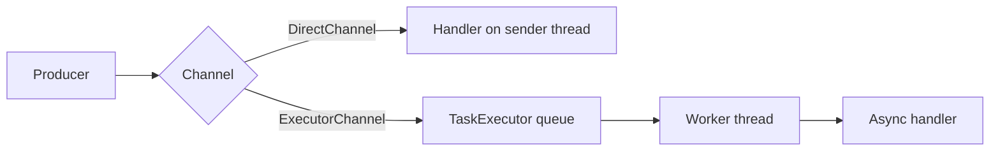

# Choosing an Executor Based on CPU, I/O, and Latency

In Spring Integration, a `TaskExecutor` determines which thread executes work and how much concurrency is permitted. Choosing an executor is not merely picking a thread count. A pool suited for CPU-bound tasks can perform poorly for I/O-bound work; a large queue can make throughput look steady while driving latency sharply upward; and an unbounded pool can push an application to memory exhaustion or overload downstream systems.

To pick the right executor, start from the workload's characteristics: CPU time, I/O wait time, concurrency requirements, latency budgets, and the capacity of databases, brokers, or external APIs. Only then choose pool size, queue capacity, and task rejection policies.

## 1. Where Does TaskExecutor Fit in a Message Flow?

`TaskExecutor` is Spring's abstraction for running a `Runnable` on a thread. Spring Integration uses it at asynchronous boundaries, such as an `ExecutorChannel` or a polling endpoint configured to hand work off to an executor.

Two channel types are commonly compared:

| Channel | Dispatch mechanism | Consequence |
|---|---|---|
| `DirectChannel` | Invokes subscriber directly on the sending thread | Sender typically waits for the handler to finish; exceptions can propagate back to the sender |
| `ExecutorChannel` | Hands processing off to a `TaskExecutor` | Sender can continue after the task is accepted; handler runs on a worker thread |

For example, a producer sending a message to a `DirectChannel` invokes the handler synchronously on the same call stack. Sending to an `ExecutorChannel` causes the channel to dispatch via the executor. This creates a thread boundary and alters ordering, exception, transaction, and request-context semantics.



The executor decides where tasks execute; the channel decides how messages are delivered to consumers. An executor's queue holds tasks waiting for workers, whereas a `QueueChannel` holds messages waiting for polling consumers. These are two distinct queues at two different boundaries.

## 2. Distinguishing CPU-Bound and I/O-Bound Work

The most critical workload characteristic when sizing a pool is how long a task spends using CPU versus waiting on external resources.

| Workload type | Characteristics | Examples | Effect of adding threads |
|---|---|---|---|
| CPU-bound | Most time spent executing instructions on CPU | Computation, compression/decompression, encryption, image processing | Exceeding core count increases context switching and CPU contention |
| I/O-bound | Most time spent waiting on network, database, file, or broker | HTTP calls, DB queries, reading object storage | May need more concurrent tasks than CPU cores to overlap wait time |
| Mixed | Combines computation and I/O waits | Reading data, transforming, then writing to another system | Measure each stage and cap downstream load |

A single handler's load profile can vary by payload. For example, parsing small JSON may be CPU-oriented, while calling an API to verify an order is I/O-oriented. Never classify based solely on business names. Measure CPU time, wall-clock time, and wait time across dependencies.

## 3. Sizing Threads for CPU-Bound Work

For purely CPU-bound tasks, the starting point is usually a worker count close to the CPU cores available to the process. If tasks include short waits, you can experiment with slightly more threads, though large increases rarely help.

A common heuristic to begin experimenting:

\[
N_{threads} \approx N_{CPU}
\]

Here `N_CPU` is the number of processors the JVM/container is actually allowed to use, not necessarily the host machine's physical core count. In containerized environments, account for CPU quotas and container-aware JVM settings.

For example, if an application has 4 CPUs and handlers mainly perform computation, start with roughly 4 workers and measure throughput and latency. If raising to 8 workers pushes CPU near 100% with no throughput gain and rising context switches, the larger pool may actually slow the system down.

CPU-bound tasks typically need a bounded queue and admission control. If producers submit tasks faster than CPUs can process them, a long queue only makes tasks wait longer while retaining payload references on the heap. When latency breaches targets, rejecting early or throttling producers is often better than accumulating a large backlog.

## 4. Sizing Threads for I/O-Bound Work

With I/O-bound tasks, workers spend much of their time waiting for responses from external systems. While one worker waits on network or database I/O, the CPU is free to run other tasks. Hence, worker counts can exceed CPU core counts.

A common starting heuristic is:

\[
N_{threads} \approx N_{CPU} \times \left(1 + \frac{T_{wait}}{T_{compute}}\right)
\]

`T_wait` is average I/O wait time and `T_compute` is average CPU compute time per task. This is only an initial estimate, not a guarantee of optimal sizing. It does not fully capture latency distributions, burst traffic, connection pool limits, rate limits, or retry behavior.

For instance, a task using 10 ms of CPU while waiting an average of 90 ms on an API has a high wait-to-compute ratio. You can try a pool larger than core count, but concurrency must stay within what the target API tolerates. If the API allows only 30 concurrent requests, a 200-worker pool simply increases timeouts, queuing, and 429/503 errors.

For I/O-bound work, configure finite timeouts across HTTP clients, databases, and brokers. If workers block indefinitely, the pool will gradually exhaust all threads even while CPU remains low. Monitor connection pools and pending request counts to see whether the bottleneck sits in the executor or the dependency.

## 5. Latency Matters as Much as Throughput

Throughput is the number of messages processed per unit of time. Latency is the time a message takes from send until processing finishes. An executor can increase aggregate throughput while still degrading per-message latency if tasks wait too long in queues.

Monitor at least:

- **Queue wait:** time a task sits in the queue before a worker starts it.
- **Execution time:** time a worker spends executing the task.
- **End-to-end latency:** time from message send to processing completion.
- **Tail latency:** p95/p99 percentiles reflecting the slowest messages.
- **Throughput:** tasks or messages completed per second.

Little's Law relates average work in the system, completion rate, and residence time:

\[
L = \lambda W
\]

Where `L` is average tasks in the system, `λ` is average throughput, and `W` is average time a task spends in the system. If throughput stays constant while queued tasks grow, average wait time increases proportionally. Queue depth is therefore a key signal when latency climbs.

A large queue can absorb short bursts, but when arrival rate exceeds processing rate for an extended period, the queue grows and latency degrades. Base `queueCapacity` on maximum tolerable wait time, per-task memory footprint, and post-burst recovery capacity.

## 6. ThreadPoolTaskExecutor: Core, Max, and Queue Capacity

`ThreadPoolTaskExecutor` is Spring's standard worker-pool implementation. Three properties require clear understanding:

| Property | Meaning |
|---|---|
| `corePoolSize` | Core workers maintained by the pool per initialization and timeout policies |
| `maxPoolSize` | Maximum number of workers the pool can create |
| `queueCapacity` | Number of tasks that can wait in the queue before the pool must add workers or reject tasks |

With a positive queue capacity, `ThreadPoolTaskExecutor` typically uses a bounded `LinkedBlockingQueue`. With capacity `0` or less, it uses direct handoff similar to `SynchronousQueue`. This behavior strongly shapes when the pool spawns extra workers.

`ThreadPoolExecutor`'s general rules are:

1. Create workers up to `corePoolSize` as new tasks arrive.
2. Once core workers exist, prefer inserting tasks into the queue.
3. Only when the queue is full, create extra workers above core up to `maxPoolSize`.
4. If max is reached and the queue still cannot accept the task, apply the rejection policy.

Therefore, configuring `corePoolSize = 4`, `maxPoolSize = 16`, `queueCapacity = 500` does not mean the pool immediately runs 16 tasks. The pool can stay at 4 workers and queue tasks; only when the queue fills does it scale workers past core. If the queue is unbounded, the pool rarely needs to grow toward `maxPoolSize`, so max size may never have the expected effect.

## 7. Configuring a Bounded Executor

The example below creates a pool with 8 core workers, up to 16 max workers, and a 200-task queue:

```java
@Configuration
class IntegrationExecutorConfiguration {

    @Bean("integrationExecutor")
    ThreadPoolTaskExecutor integrationExecutor() {
        ThreadPoolTaskExecutor executor = new ThreadPoolTaskExecutor();
        executor.setCorePoolSize(8);
        executor.setMaxPoolSize(16);
        executor.setQueueCapacity(200);
        executor.setKeepAliveSeconds(60);
        executor.setThreadNamePrefix("si-worker-");
        executor.setRejectedExecutionHandler(
                new ThreadPoolExecutor.AbortPolicy());
        executor.setWaitForTasksToCompleteOnShutdown(true);
        executor.setAwaitTerminationSeconds(30);
        return executor;
    }
}
```

When managed by Spring as a bean, `ThreadPoolTaskExecutor` is initialized along with the container lifecycle. There is no need to call `initialize()` manually inside a normal `@Bean` method. The values 8/16/200 are only illustrative; tune them according to CPU, I/O durations, target latency, and downstream limits.

`AbortPolicy` rejects tasks when the pool reaches capacity and throws a rejection exception. This makes overload observable and actionable on the sending side. With `ExecutorChannel`, rejection failures can occur immediately during message send if the executor declines the task; failures occurring after the task is accepted belong to the asynchronous execution path.

## 8. Choosing Queue Capacity for Latency and Memory

Queue capacity should not be set arbitrarily to a huge number. Every queued task can retain references to a message, payload, headers, and related objects. If payloads are large, a queue holding tens of thousands of tasks can consume substantial heap.

When choosing capacity, evaluate:

- Arrival rate during bursts and expected burst duration.
- Steady-state processing throughput of the worker pool.
- Maximum wait time acceptable to the business.
- Average and worst-case payload size.
- Other pools sharing the application's heap and connections.
- Behavior when full: block, reject, run on caller, or offload to a durable broker.

A rough estimate divides queued tasks by pool throughput to gauge how long the current backlog takes to drain, factoring in new arrivals separately. If a queue holds 200 tasks and the pool completes 100 tasks/second, draining the current backlog takes roughly 2 seconds assuming no new arrivals. This is a coarse estimate; processing-time variance and real concurrency can shift actual drain times.

If the latency target is 300 ms while the queue routinely holds tasks waiting for several seconds, increasing capacity makes things worse. Reduce input load, scale processing capacity within downstream limits, or reject tasks early.

## 9. Rejection Policies and Backpressure

When the pool reaches `maxPoolSize` and the queue cannot accept more tasks, the executor must decide how to handle incoming tasks.

| Policy | Behavior | When to consider |
|---|---|---|
| `AbortPolicy` | Throws a task-rejection exception | When overload errors must surface explicitly for caller/recovery handling |
| `CallerRunsPolicy` | Thread calling `execute()` runs the task itself if the executor has not shut down | When you want to slow down producers by forcing the sender to perform the work |
| `DiscardPolicy` | Drops the new task without reporting an error | Suitable only when task loss is explicitly acceptable |
| `DiscardOldestPolicy` | Drops the oldest waiting task and retries submitting the new task | Suitable only when dropping stale tasks is permitted by business rules |

No single rejection policy fits every flow. For business messages that must be preserved, silent drops are usually dangerous. `AbortPolicy` alerts the application to overload, but you must implement a response, bounded retries, or durable persistence.

`CallerRunsPolicy` creates backpressure because producers execute handlers instead of offloading to the worker pool. However, it also alters sender latency and thread identity; if the sender is an HTTP request thread or broker listener thread, running heavy work on that thread can bottleneck another boundary. Evaluate transaction and call-stack impacts before selecting it.

## 10. Using an Executor with ExecutorChannel

`ExecutorChannel` is a standard way to offload message processing to a worker pool:

```java
@Bean
MessageChannel ordersAsyncChannel(
        @Qualifier("integrationExecutor") TaskExecutor executor) {
    return new ExecutorChannel(executor);
}

@Bean
IntegrationFlow ordersFlow(OrderService orderService) {
    return IntegrationFlow
            .from("orders.input")
            .channel("ordersAsyncChannel")
            .handle(orderService, "process")
            .get();
}
```

Messages are sent to `ordersAsyncChannel`; the executor picks up the task to invoke the handler on a worker thread. The sender does not wait for the handler to complete as it would with `DirectChannel`. Therefore, a successful `send()` generally indicates only that dispatch was accepted, not that downstream business processing completed.

When the executor rejects a task, sending can fail immediately. When the handler fails after dispatch, exceptions cannot propagate back to a sender that has already moved on. Configure appropriate error handling for the endpoint and message—such as an error channel or recovery flow—and log with message IDs and correlation IDs.

`ExecutorChannel` backed by a multi-threaded pool does not guarantee completion order matches send order. If ordering per key or per aggregate is required, partition by key, use a consumer with matching concurrency, or select channels/executors with ordering-preserving semantics. A single-threaded executor can preserve execution order within one queue, but it limits throughput and still needs a queue policy.

## 11. Using an Executor with a Poller

Pollers and `ExecutorChannel` are two places that can use an executor, but with different goals:

- A poller uses a scheduler to trigger scheduled message retrieval. It can be configured with an executor to separate polling tasks from the scheduler thread.
- `ExecutorChannel` uses an executor to dispatch messages from a channel to subscribers/handlers asynchronously.

If both boundaries are asynchronous, one message can traverse multiple queues and thread pools. That increases total concurrency and observability complexity. Avoid stacking multiple executor layers merely in hopes of "going faster"; each layer needs a clear rationale, bounded queue, and metrics.

When configuring `taskExecutor` in `PollerMetadata` or Java DSL, check the API of your Spring Integration version. Do not confuse the poller's executor with the scheduler firing triggers, nor confuse it with a downstream channel's executor.

## 12. Transactions, Security Context, and Thread-Bound Data

Many mechanisms in Spring applications bind to the current thread, such as transactions managed via thread-bound resources, certain security contexts, or MDC logging contexts. When a message crosses an `ExecutorChannel`, the handler can run on a different thread from the producer.

Consequences:

- An active transaction on the sender thread does not propagate automatically to the worker thread.
- Handler exceptions cannot propagate up the sender's already-completed call stack.
- `ThreadLocal` or MDC values do not automatically match the sending thread.
- Do not pass business data by relying on thread-locals; place required data in payload/headers or use supported context-propagation mechanisms.

If a handler needs a transaction, start the transaction at the worker boundary via transaction advice or an appropriate endpoint mechanism. If correlation is needed, put correlation IDs into message headers and restore MDC on the worker where necessary. For operations requiring consistency between database writes and message publication, consider outbox/inbox patterns or proper transactional designs instead of assuming transactions cross executor boundaries.

## 13. Splitting Pools by Load Type and Bulkheads

A single pool shared across every kind of work lets slow tasks exhaust all workers and starve latency-sensitive tasks. Pools can be split by workload group:

| Pool | Workload type | Goal |
|---|---|---|
| `cpuExecutor` | CPU-bound transformations or calculations | Keep concurrency close to CPU capacity |
| `ioExecutor` | HTTP, DB, or file calls with wait times | Allow higher concurrency while bounding by dependency limits |
| `batchExecutor` | Background tasks, batches, or backfills | Isolate batch load from interactive flows |
| `latencyExecutor` | Work requiring steady response times | Small queue, clear admission, insulated from batch spikes |

This applies the bulkhead pattern: failures or backlogs in one group cannot consume every worker belonging to another group. In return, each pool maintains its own queue, threads, and lifecycle, so monitor aggregate thread counts and heap usage. Avoid creating dedicated pools per message or per tenant unless genuine isolation is required.

## 14. Executor Shutdown and Lifecycle

An executor is a lifecycle-managed resource. When the application context closes, Spring manages shutdown of `ThreadPoolTaskExecutor` beans. Properties such as `waitForTasksToCompleteOnShutdown` and `awaitTerminationSeconds` govern waiting for accepted tasks to finish within a bounded window.

Key principles:

- Stop accepting new tasks before shutting down the executor.
- Align shutdown wait time with dependency timeouts.
- Decide whether waiting tasks drain or cancel upon timeout expiration.
- Never shut down a shared executor while other flows still rely on it.
- Track rejected tasks, unfinished tasks, and shutdown duration.

For dynamically registered flows, stop/destroy endpoints before releasing flow-owned executors. For shared executors, only the application context or owning component should shut them down. Never create ad-hoc executors with `Executors.newFixedThreadPool()` inside handlers and forget to call `shutdown()`.

## 15. Observing and Diagnosing Executors

When messages slow down or go unprocessed, examine the following metrics:

- Pool size, core size, max size, and active workers.
- Queue size, remaining capacity, and task wait times.
- Completed task count and rejected task count.
- Handler execution duration and p95/p99 end-to-end latency.
- CPU utilization, runnable/blocked/waiting thread counts, and thread dumps.
- Downstream connection pools, request rates, timeouts, and error rates.

| Symptom | Possible cause | How to investigate |
|---|---|---|
| High CPU with flat throughput | Too many CPU-bound workers or repeated processing | CPU profile, core count, context switching |
| Low CPU yet executor queue grows | Workers waiting on I/O or slow dependencies | Thread dumps, network/DB latency, connection pools |
| p99 climbs while throughput holds steady | Rising queue wait or long-tail slow tasks | Queue depth, task duration distribution |
| Rejections spike | Pool and queue reached capacity | Admission rate, producer rate, max size, downstream health |
| Handler unexpectedly runs on sender thread | `CallerRunsPolicy` triggered or `DirectChannel` in use | Rejection policy and channel topology |
| Message send succeeds yet business work fails | Async dispatch accepted task; failure happened on worker | Error channel, recovery path, and correlation ID |

Do not look solely at active thread counts. A pool with many threads alongside a growing queue and high latency is still overloaded. Read queue wait time, execution time, rejection counts, and downstream capacity together to pinpoint the real bottleneck.

## 16. Executor Selection Process

1. **Classify the workload:** measure CPU vs. I/O ratios and identify blocking operations.
2. **Set latency targets:** define p95/p99 targets and maximum tolerable queue wait time.
3. **Estimate concurrency:** start near CPU core count for CPU-bound work; test higher for I/O-bound work while capping by dependency limits.
4. **Bound the queue:** pick capacity based on bursts, payload size, and tolerable wait time.
5. **Select a rejection policy:** decide whether overload triggers errors, backpressure, or shifts to durable buffering.
6. **Choose the right execution boundary:** `DirectChannel`, `ExecutorChannel`, poller executor, or service executor must reflect required semantics.
7. **Load-test and observe:** measure throughput, queue wait, p95/p99, CPU, rejected tasks, and downstream load.
8. **Verify errors and shutdown:** confirm transactions, error handling, context propagation, and cleanup behave properly under high load and context shutdown.

A good executor sustains throughput within resource limits without allowing queues to push latency past targets. Size pools around real CPU, I/O, and latency profiles; then use queue capacity, rejection policies, and metrics to keep the system stable as load fluctuates.
