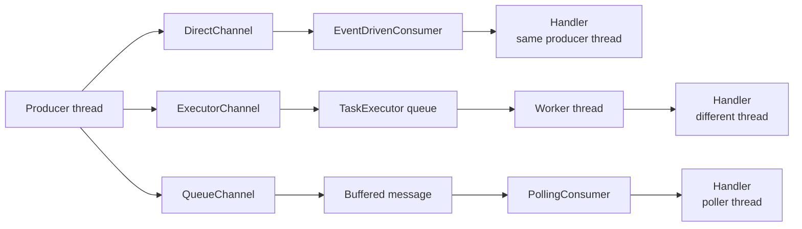
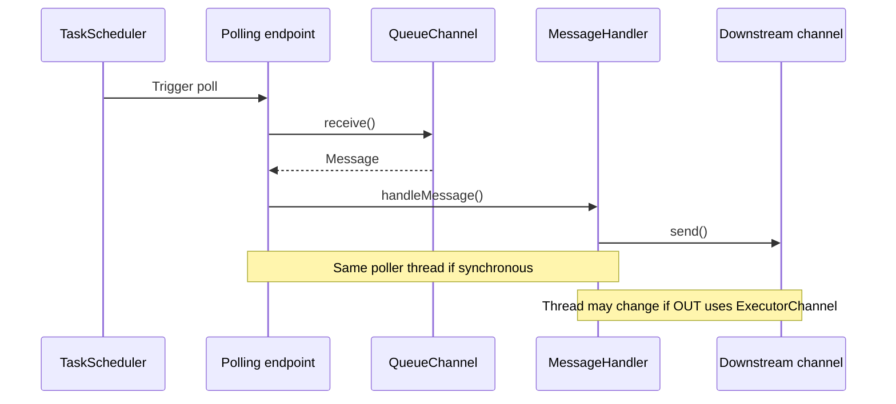
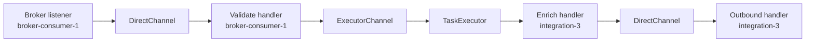
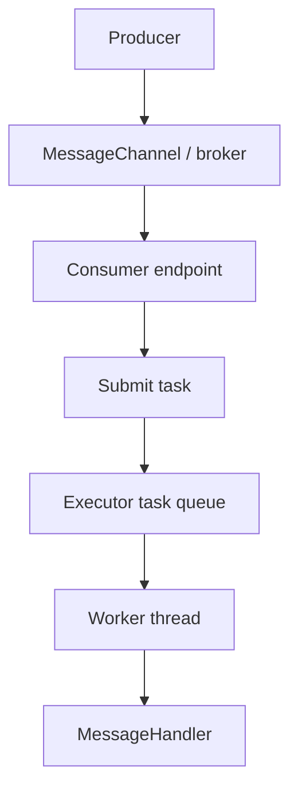

# Thread Boundaries Between Channel and Endpoint

In Spring Integration, a message flow does not necessarily run on a single thread from start to finish. The thread that processes a message depends on where the message is created, the type of channel used to dispatch or buffer it, how the endpoint receives the message, and work-handoff mechanisms such as pollers or executors.

The key point is that a `MessageChannel` does not always create a new thread. `DirectChannel` invokes the consumer directly on the sending thread; `ExecutorChannel` hands off dispatching to an executor; `QueueChannel` holds messages for a polling consumer to retrieve later. An inbound adapter may receive data on a thread owned by the connection library, while a polling endpoint typically runs work on a thread triggered by a poller.

This guide traces the thread across producer, channel, endpoint, and handler, and explains the impact on transactions, exceptions, thread-local context, concurrency, and performance.

## 1. What Is a Thread Boundary?

A thread boundary is the point where message processing moves from the current thread to another thread or is decoupled from the current call stack. A flow can have multiple boundaries:

- The producer calls `MessageChannel.send()`.
- The channel dispatches directly or submits a task to an executor.
- A poller is triggered by a scheduler to receive a message.
- An inbound adapter receives data on a transport-managed thread.
- A handler invokes an executor or another asynchronous API.
- An outbound adapter hands data off to a client with its own event loop or thread.

The diagram below illustrates three common dispatch approaches:



A message can pass through multiple channels and endpoints. Each time it crosses a synchronous channel, the handler typically continues on the current thread. When it passes through a channel or endpoint with an asynchronous mechanism, the thread can change.

There is no rule that each endpoint corresponds to one thread. An endpoint is the component connecting a message channel to a handler or source; the thread depends on the dispatch/receive mechanism the endpoint uses.

## 2. Channels Determine How Messages Are Dispatched

The `MessageChannel` interface only describes the send operation. Concrete threading behavior depends on the channel implementation.

| Channel | Dispatch behavior | Typical processing thread | Buffers messages? |
|---|---|---|---|
| `DirectChannel` | Invokes subscriber directly | Thread calling `send()` | No |
| `PublishSubscribeChannel` without executor | Invokes all subscribers in the dispatch path | Thread calling `send()` | No |
| `PublishSubscribeChannel` with executor | Submits subscriber dispatch via executor | Thread in the executor | Not a durable backlog |
| `ExecutorChannel` | Dispatches via `TaskExecutor` | Executor worker thread | Executor has its own task queue if configured |
| `QueueChannel` | Stores messages, consumer calls `receive()` | Thread calling `receive()`, usually a poller | Yes; defaults to an in-memory queue and can be configured with another implementation |
| `PriorityChannel` | Buffers and retrieves by priority | Thread calling `receive()`, usually a poller | Yes |

### 2.1. DirectChannel: Synchronous on the Sending Thread

`DirectChannel` is a point-to-point channel that implements a subscribe/dispatch mechanism. When a producer calls `send()`, the channel selects a subscriber and invokes the handler immediately on the current call stack.

```java
@Bean
public MessageChannel ordersIn() {
    return new DirectChannel();
}

@Bean
public IntegrationFlow orderFlow(OrderService orderService) {
    return IntegrationFlow.from("ordersIn")
            .handle(orderService, "process")
            .get();
}
```

If the producer calls:

```java
log.info("before send: {}", Thread.currentThread().getName());
ordersIn.send(new GenericMessage<>(order));
log.info("after send: {}", Thread.currentThread().getName());
```

The handler typically logs the same thread name as the producer. The `send()` call normally returns only after the synchronous dispatch path completes.

This brings several characteristics:

- Easy to follow the call stack when debugging.
- Exceptions from the handler can propagate back to the caller in the synchronous dispatch path, depending on error handling.
- If the handler is slow, the producer is slowed down as well.
- An active thread-bound transaction on the caller can continue to cover downstream synchronous processing steps, if the transaction manager and corresponding resources support it.

**Synchronous does not mean there is only one thread in the entire system.** Two different producers can simultaneously call `send()` on the same `DirectChannel`, causing the same handler to be invoked concurrently on two threads. If serialization is required, you must design explicit concurrency/serialization controls; simply using `DirectChannel` does not guarantee that the handler runs sequentially on a single thread.

When there are multiple subscribers, `DirectChannel` typically selects one subscriber per message according to a load-balancing strategy. It does not broadcast messages to all subscribers; to broadcast, consider `PublishSubscribeChannel`.

### 2.2. ExecutorChannel: Handing Off Dispatch to a Worker Thread

`ExecutorChannel` is still a `SubscribableChannel`, but it uses a `TaskExecutor` to dispatch messages. The producer sends a message and the executor schedules a task to invoke the consumer.

```java
@Bean
public ThreadPoolTaskExecutor integrationExecutor() {
    ThreadPoolTaskExecutor executor = new ThreadPoolTaskExecutor();
    executor.setCorePoolSize(4);
    executor.setMaxPoolSize(8);
    executor.setQueueCapacity(200);
    executor.setThreadNamePrefix("integration-");
    return executor;
}

@Bean
public MessageChannel asyncOrders(
        @Qualifier("integrationExecutor") TaskExecutor executor) {
    return new ExecutorChannel(executor);
}

@Bean
public IntegrationFlow asyncOrderFlow(OrderService orderService) {
    return IntegrationFlow.from("asyncOrders")
            .handle(orderService, "process")
            .get();
}
```

In this example, the handler runs on a thread provided by `integrationExecutor`. The producer does not need to wait for the handler to finish; the `send()` call typically completes once the task is accepted by the executor.

Two kinds of failures need to be distinguished:

- The executor rejects the task at send time, for example when the queue is full and the rejection policy rejects it. This error can surface directly on the send call.
- The handler throws an exception after the task has started running on a worker thread. This is an asynchronous error that cannot propagate back to the already-completed producer call stack; an error channel or the executor/endpoint's error handling mechanism must be configured.

An executor does not make messages durable on its own. A thread pool's task queue typically lives in process memory and can be lost when the process stops.

### 2.3. PublishSubscribeChannel: Broadcast Is Not Necessarily Asynchronous

`PublishSubscribeChannel` sends the same message to multiple subscribers. If no executor is configured, subscribers are typically invoked on the message-sending thread. If an executor is configured, dispatching can be offloaded to a thread pool.

Therefore, the name "publish-subscribe" describes a one-to-many distribution model, and does not by itself imply a thread boundary. You need to inspect the channel's executor configuration.

### 2.4. QueueChannel: Buffering Does Not Create a Worker Thread on Its Own

`QueueChannel` stores messages for consumers to receive later. With the default configuration, the queue resides in memory; the channel does not automatically start a thread to process messages. Typically, a `PollingConsumer` uses a poller to call `receive()`.

A producer can run on thread A, place a message into the queue, and continue. Later, a poller retrieves the message on thread B and invokes the handler. The thread boundary here comes from the polling mechanism, not from the buffering operation itself creating a thread.

If the application calls `receive()` directly from its own thread, the handler or receiving code runs on that thread. Thus, the channel does not dictate a fixed thread for `QueueChannel`.

## 3. An Endpoint Does Not Automatically Have Its Own Thread

An endpoint is the bridge between a channel and a message handler or message source. It manages subscriptions, polling, lifecycle, and processing configuration. The thread an endpoint uses depends on how it is triggered.

| Endpoint / adapter | How messages are received | Typical executing thread |
|---|---|---|
| `EventDrivenConsumer` on `DirectChannel` | Channel invokes subscriber | Message-sending thread |
| `EventDrivenConsumer` on `ExecutorChannel` | Executor dispatches subscriber | Worker thread |
| `PollingConsumer` on `QueueChannel` | Poller calls `receive()` | Thread running the poller task |
| `SourcePollingChannelAdapter` | Poller calls `MessageSource.receive()` | Thread running the poller task |
| Inbound listener adapter | Transport/listener receives data and sends a message into the flow | Thread managed by the listener container or client |
| Outbound adapter | Handler invokes client to send data | Current thread, unless the client/adapter switches to an asynchronous mechanism |

For example, a broker inbound adapter may be invoked by a listener container on a consumer thread. If the adapter sends to a `DirectChannel`, downstream handlers typically continue on that consumer thread. If it sends to an `ExecutorChannel`, the handler switches to an executor thread.

Therefore, when reading a thread dump, you need to identify the thread source: broker listener, scheduler, executor, or application request thread.

## 4. How Does a Poller Create a Thread Boundary?

A poller periodically triggers reading messages. For a polling consumer, the poller calls `receive()` on a `PollableChannel`; for a source polling adapter, the poller calls `MessageSource.receive()`.



Typically, a scheduler triggers the poller task. If a task executor is configured for the poller, the polling work can be executed by that executor. Java DSL example:

```java
@Bean
public IntegrationFlow queuedOrders(
        OrderService orderService,
        @Qualifier("pollerExecutor") TaskExecutor pollerExecutor) {

    return IntegrationFlow.from(
                    "ordersQueue",
                    endpoint -> endpoint.poller(
                            Pollers.fixedDelay(500)
                                    .maxMessagesPerPoll(10)
                                    .taskExecutor(pollerExecutor)))
            .handle(orderService, "process")
            .get();
}
```

Distinguish between:

- `TaskScheduler` manages when polls are triggered.
- `TaskExecutor` can execute the polling work on a thread pool.
- `PollingConsumer` performs the receive and invokes the handler.
- `QueueChannel` holds messages between producer and consumer.

If the poller processes messages synchronously, the handler typically runs on the thread executing the poller task. If the flow sends onward through an `ExecutorChannel`, the thread changes at that dispatch point.

## 5. A Flow Can Switch Threads Multiple Times

Consider a flow with an inbound listener, a direct channel, an executor channel, and then an outbound adapter:



A thread trace might look like this:

| Step | Component | Example thread |
|---|---|---|
| 1 | Broker listener receives message | `broker-consumer-1` |
| 2 | Inbound adapter sends to DirectChannel | `broker-consumer-1` |
| 3 | Validate handler | `broker-consumer-1` |
| 4 | ExecutorChannel submits task | Handoff from `broker-consumer-1` |
| 5 | Enrich handler | `integration-3` |
| 6 | Downstream DirectChannel | `integration-3` |
| 7 | Synchronous outbound handler | `integration-3` |

The thread names here are only examples. Executor, adapter, and container configuration will determine the actual names.

An effective debugging rule is to find the **first thread transition point**. If the first handler runs on the expected thread but the next handler runs on a different thread, inspect the channel or endpoint sitting between the two handlers.

## 6. How Do Thread Boundaries Affect Transactions and Context?

### 6.1. Transactions Are Bound to a Thread

Standard Spring transactions are bound to the current thread through transaction synchronization/resource binding. When a message passes through synchronous steps on the same thread, those steps can participate in an active transaction if properly configured.

When a message crosses an `ExecutorChannel` or another executor, the worker thread does not automatically inherit the producer's transaction. If downstream work needs a transaction, start a transaction at the downstream endpoint/handler or use transaction support appropriate for the transport.

| Processing path | Typical transaction consequence |
|---|---|
| Producer → DirectChannel → handler | Can share the same thread-bound transaction |
| Producer → ExecutorChannel → handler | Producer's transaction does not automatically propagate to the worker |
| Poller → synchronous handler | Poller transaction advice can wrap the poll execution if configured |
| Listener container → DirectChannel → handler | Can participate in the listener thread's transaction if supported by adapter/transport |
| Listener → ExecutorChannel → handler | Listener's transaction does not automatically propagate to the executor thread |

Do not assume that every message flow is transactional just because a producer or handler carries `@Transactional`. You must determine where the transaction starts, which thread executes it, which resources are enlisted, and where commit/rollback occurs.

### 6.2. ThreadLocal Does Not Automatically Follow the Message

The following data is typically tied to a thread or execution context:

- Transaction resources and transaction synchronization.
- MDC logging context.
- Security context when using thread-bound storage.
- Request context and certain tracing contexts.
- Custom `ThreadLocal` variables created by the application.

When switching to an executor thread, these values are not automatically copied. Message headers are still carried with the message, but that does not mean ThreadLocal values are propagated.

If context propagation is needed:

- Use message headers for correlation IDs, tenant IDs, or business metadata.
- Use a `TaskDecorator` or executor wrapper to capture/restore MDC or appropriate context.
- Use dedicated security/tracing integrations when provided by the libraries.
- Always restore or clear context in `finally` to avoid leaking data across tasks that reuse the same worker thread.

Do not put transaction objects or an entire request context into message headers in an attempt to propagate a transaction across threads. Design a new transaction boundary at the point of processing instead.

## 7. Exceptions and Error Channels Across Thread Boundaries

With a synchronous dispatch path, a handler exception can travel back up the call stack and be observed by the producer. Error-handling interceptors or error channels can alter how the error is handled.

With an asynchronous dispatch path, the producer may have already finished before the handler throws an exception. Errors must be handled on the worker side, typically via a configured error channel or the endpoint/executor's error-handling mechanism.

| Scenario | Where the exception appears | What to observe |
|---|---|---|
| Handler fails via DirectChannel | Producer call stack or synchronous error flow | `send()` result, handler logs, error channel |
| Executor rejects task | Producer thread at submission time | Rejection policy, executor queue, and send logs |
| Handler fails after ExecutorChannel dispatch | Worker thread | Error channel, async error handler, worker logs |
| Polling handler fails | Thread running the poller task | Poller advice, error handler, error channel |
| Inbound listener fails before publishing | Listener/container thread | Error handler and transport acknowledgment/redelivery |

When using an executor, do not just catch exceptions around `send()` and assume you have caught all downstream errors. The send call can succeed while the handler fails later.

## 8. Concurrency Is Not the Same as a Thread Boundary

A thread boundary creates the ability to hand off work to another thread, but it does not by itself tell you how many messages are processed concurrently. Concurrency also depends on:

- Number of producer threads sending messages.
- Number of subscribers and load-balancing strategy.
- Number of threads in the executor.
- Capacity of the task queue.
- Number of active pollers/consumers.
- Listener container concurrency.
- Processing time and downstream limits.

For example, a `DirectChannel` without an executor can still invoke the same handler concurrently if multiple producer threads send messages at the same time. Conversely, an `ExecutorChannel` backed by a single-thread executor switches threads but processes sequentially on one worker.

| Configuration | Thread boundary | Possible concurrency |
|---|---|---|
| DirectChannel, single producer thread | No | Typically sequential on that thread |
| DirectChannel, multiple producer threads | Not at the channel | Can be concurrent due to multiple senders |
| ExecutorChannel, 8-worker pool | Yes | Can process concurrently up to pool capacity |
| ExecutorChannel, single-thread executor | Yes | Worker processes sequentially |
| QueueChannel, single polling consumer | Decouples producer/consumer via buffer | Typically one consumer poll at a time |
| QueueChannel, multiple polling endpoints/consumers | Can have multiple consumers | Can compete for messages and process concurrently |

If the business requirement demands ordering by key—for example, all messages for the same order must be processed sequentially—you need partitioning by key, serialization by key, or a broker/consumer strategy with suitable ordering. You cannot rely solely on choosing DirectChannel or QueueChannel to guarantee global ordering.

## 9. Executor Queue and Message Queue Are Two Different Layers

When using `ExecutorChannel`, there may be an internal queue in the thread pool. That queue holds tasks waiting for a worker thread. A message queue such as `QueueChannel` or a broker queue holds messages waiting for a consumer.



The two queues serve different purposes and behave differently:

| Characteristic | Message queue | Executor task queue |
|---|---|---|
| What it stores | Messages/work items | Runnables/tasks waiting for a thread |
| Consumer | Message endpoint/worker | Thread pool worker |
| Ack/redelivery | May exist per broker | No standard message ack semantics |
| Persistence | Broker can persist durably; QueueChannel is typically in memory | Typically in memory only |
| Metrics | Message depth, age, redelivery | Task queue size, active threads, rejected tasks |
| When full | Producer send may block/reject | Executor applies rejection policy |

A message may have already left the message queue while its processing task is still waiting in the executor queue. When observing backlogs, you must inspect both layers to avoid wrongly concluding that consumers have finished processing just because message queue depth dropped.

## 10. Configuring an Executor Safely

Thread pools should be sized according to processing time, workload type, and resource limits. An executor with an unbounded queue can mask a situation where consumers cannot keep up for a long time and cause memory to grow.

Example bounded pool configuration:

```java
@Bean
public ThreadPoolTaskExecutor integrationExecutor() {
    ThreadPoolTaskExecutor executor = new ThreadPoolTaskExecutor();
    executor.setCorePoolSize(4);
    executor.setMaxPoolSize(8);
    executor.setQueueCapacity(200);
    executor.setKeepAliveSeconds(60);
    executor.setThreadNamePrefix("integration-");
    executor.setRejectedExecutionHandler(
            new ThreadPoolExecutor.CallerRunsPolicy());
    return executor;
}
```

`CallerRunsPolicy` causes the submitting thread to execute the task itself when the executor is overloaded. This is a way to create backpressure, but it changes threading behavior: a message expected to run on a worker can run on the producer thread when the pool is full. You must consider the impact on latency, transactions, and request threads.

Some guidelines:

- Set a finite queue capacity when you need to bound the task backlog.
- Choose core/max pool sizes based on CPU, I/O, and actual processing time.
- Use a thread name prefix to distinguish executors in logs and thread dumps.
- Define a rejection policy and how rejected tasks should be handled.
- Do not share a single pool across all types of work if workloads can block each other.
- Monitor active count, pool size, queue size, task duration, and rejected count.
- Shut down executors cleanly with lifecycle management; avoid creating a new executor per message.

## 11. Observing Thread Boundaries in Practice

The simplest way is to log the thread name at the producer, handler, and key points in the flow:

```java
private void logThread(String step, Message<?> message) {
    log.info(
            "step={}, thread={}, messageId={}",
            step,
            Thread.currentThread().getName(),
            message.getHeaders().getId());
}
```

Call this helper at:

- Before and after `MessageChannel.send()`.
- Handler before processing.
- Handler after calling a downstream service.
- Callback from an inbound adapter.
- Scheduled/polling task.
- Points before and after handing off to an executor.

When inspecting a thread dump, group threads by name prefix such as `http-nio`, `task-scheduler`, `integration-`, `broker-`. Check which threads are blocked on I/O, which are waiting on queues, which are spending a long time in handlers, and which are held by locks.

### 11.1. Common Symptoms

| Symptom | Where to check | Possible cause |
|---|---|---|
| Producer API is slow when sending messages | DirectChannel and downstream handlers | Handler runs synchronously on the request thread |
| Handler runs on a different thread | ExecutorChannel, poller executor, listener container | There is an asynchronous handoff |
| Transaction is no longer active in handler | Thread boundary before the handler | Thread-bound transaction was not propagated across the executor |
| MDC/correlation logs are lost | Executor and context propagation | ThreadLocal was not copied |
| Message queue depth drops but processing is still slow | Executor task queue | Message was retrieved, but the task is still waiting for a worker |
| Low CPU but high latency | Thread dump, I/O, locks, queue wait | Workers are blocked or the pool lacks appropriate threads |
| Handler runs concurrently unexpectedly | Producer count, executor pool, consumer concurrency | Multiple threads are invoking the same handler |
| Tasks are rejected | Executor queue capacity and rejection policy | Pool has exhausted capacity to accept tasks |
| Message order changes | Executor concurrency, multi-producer, channel dispatch | Multiple tasks run concurrently |

### 11.2. Procedure for Finding the Thread-Switch Point

1. Log the thread name in the producer right before sending the message.
2. Log the thread name in the first handler.
3. If they differ, check the inbound adapter, listener container, poller, or input channel.
4. Log the thread in each subsequent handler to pinpoint the first boundary that changes the thread.
5. Check the channel implementation at that boundary.
6. If there is an executor, check pool size, queue, rejection policy, and thread name prefix.
7. If there is a poller, check the scheduler, task executor, and execution duration per poll.
8. Cross-check transaction, MDC, and error handling at the same boundary.

## 12. Combined Example: Same Flow, Two Threading Models

The same handler can run synchronously or asynchronously simply by changing the channel:

```java
@Bean
public MessageChannel syncOrders() {
    return new DirectChannel();
}

@Bean
public MessageChannel asyncOrders(
        @Qualifier("integrationExecutor") TaskExecutor executor) {
    return new ExecutorChannel(executor);
}

@Bean
public IntegrationFlow syncFlow(OrderService service) {
    return IntegrationFlow.from("syncOrders")
            .handle(service, "process")
            .get();
}

@Bean
public IntegrationFlow asyncFlow(OrderService service) {
    return IntegrationFlow.from("asyncOrders")
            .handle(service, "process")
            .get();
}
```

If a producer invokes both channels from the same thread:

- `syncOrders`: the handler runs on the producer thread; the producer typically waits for processing to finish.
- `asyncOrders`: the handler runs on an executor worker; the producer only waits for dispatch acceptance.

This difference affects producer return latency, transactions, exception propagation, context propagation, and processing order. When changing a channel in a running flow, review all of those properties rather than measuring throughput alone.

## 13. Takeaways

- A channel does not create a new thread by default; the implementation determines how dispatching works.
- `DirectChannel` typically invokes the handler synchronously on the sending thread.
- `ExecutorChannel` hands off dispatching to a `TaskExecutor`.
- `PublishSubscribeChannel` broadcasts; the executor determines whether a thread switch occurs.
- `QueueChannel` buffers messages; a polling consumer receives messages on the thread running the poller task.
- An inbound adapter may run on a listener container or client transport thread.
- A flow can switch threads multiple times; locate the first boundary when debugging.
- Transactions and ThreadLocal values do not automatically cross executors; message headers still travel with the message.
- Synchronous does not guarantee system-wide sequential execution: multiple producer threads can invoke the same handler concurrently.
- Distinguish the message queue from the executor task queue when measuring backlog.
- Bounded executors, rejection policies, and metrics are necessary to control load.
- Use thread names, logs, and thread dumps to observe actual threads rather than inferring them solely from a flow diagram.

## References

- [Spring Integration — Message Channels](https://docs.spring.io/spring-integration/reference/channel.html)
- [Spring Integration — Message Endpoints](https://docs.spring.io/spring-integration/reference/endpoint.html)
- [Spring Integration — Polling Consumer](https://docs.spring.io/spring-integration/reference/polling-consumer.html)
- [Spring Integration — Executor Channel](https://docs.spring.io/spring-integration/reference/channel.html#channel-implementations-executorchannel)
- [Spring Framework — Task Execution and Scheduling](https://docs.spring.io/spring-framework/reference/integration/scheduling.html)
- [Spring Framework — Transaction Management](https://docs.spring.io/spring-framework/reference/data-access/transaction.html)
