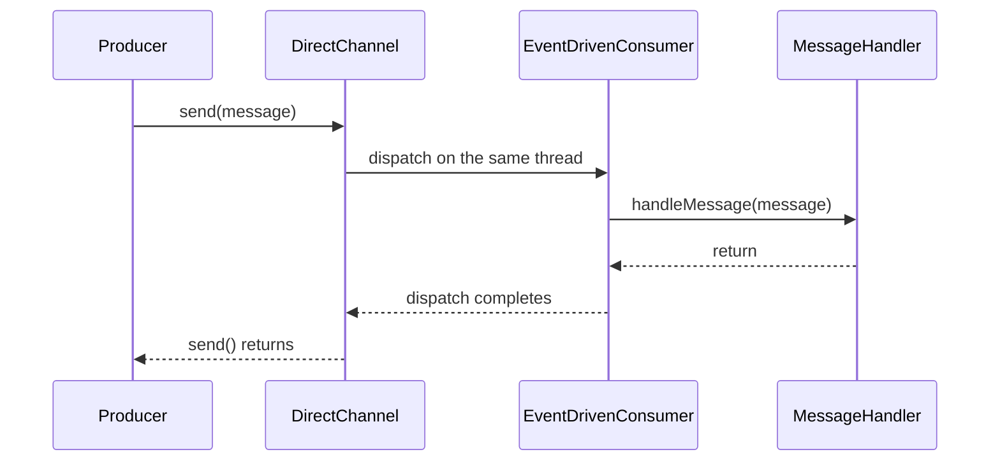
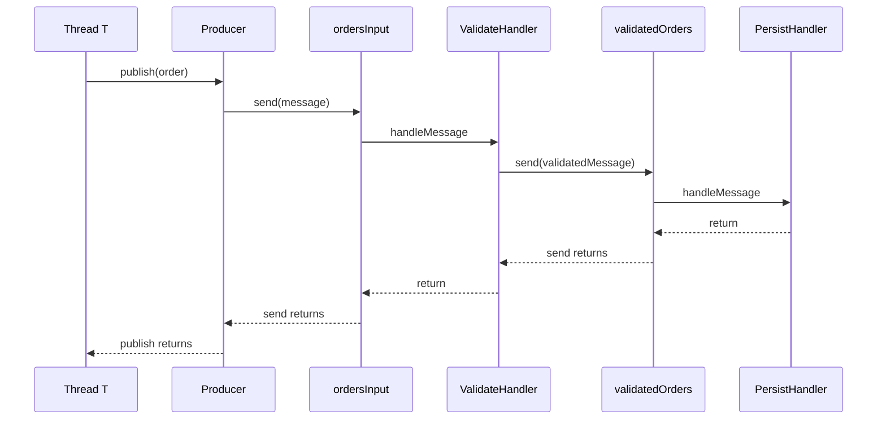
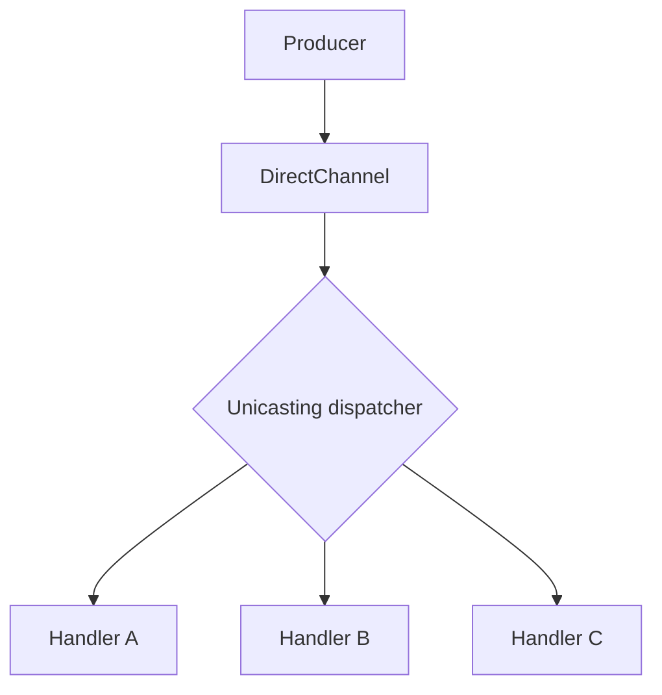
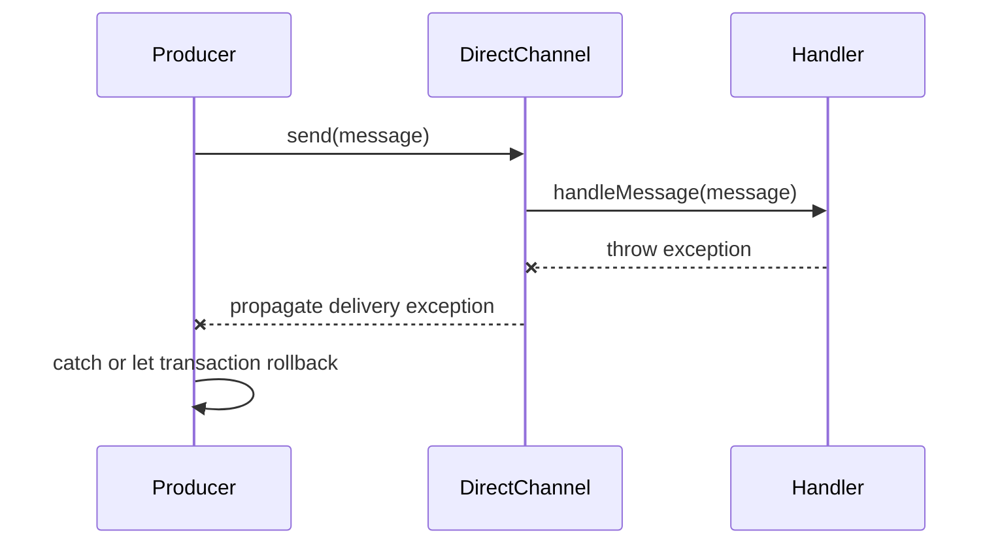

# Synchronous Execution in DirectChannel

In Spring Integration, `DirectChannel` is a point-to-point channel that dispatches messages directly to a registered consumer. Under standard configuration, the handler is invoked right on the thread sending the message. The `send()` call therefore sits in the same call stack as the downstream processing and only completes after the synchronous dispatch finishes.

This mechanism makes the processing flow easy to follow: the producer calls the channel, the channel calls the endpoint, the endpoint calls the handler, and then control returns to the producer. On the other hand, the handler's execution time directly affects the wait time of the sending thread. This is an important characteristic when designing transactions, error handling, and runtime performance.

## 1. What Is DirectChannel?

`DirectChannel` implements `SubscribableChannel`. The producer sends a message using `send()`; consumers register subscriptions with the channel; the channel dispatches the message to a selected subscriber.

Key characteristics:

- **Point-to-point dispatch**: a send operation is normally delivered to a single selected consumer, not broadcast to every subscriber.
- **No message storage queue**: the channel does not hold messages for a consumer to retrieve later like `QueueChannel`.
- **Synchronous by default**: the handler is invoked on the message-sending thread.
- **Supports multiple subscribers**: the dispatcher chooses one subscriber according to the configured load-balancing strategy.
- **Configurable failover**: if the selected handler fails, the dispatcher can try another subscriber depending on configuration.

```mermaid
flowchart LR
    A[Producer thread] -->|send(message)| B[DirectChannel]
    B --> C[EventDrivenConsumer]
    C --> D[MessageHandler]
    D -->|return or exception| C
    C --> B
    B -->|send returns or throws| A
```

The core point is that the channel dispatches directly. There is no enqueue step for another worker to pick up the message later. If the handler takes 300 ms, the thread calling `send()` is also held for that duration.

## 2. DirectChannel Works Together with EventDrivenConsumer

`DirectChannel` receives and dispatches messages. `EventDrivenConsumer` is the endpoint that connects the channel to a `MessageHandler`.

When the endpoint starts, it registers the handler with the channel. When the endpoint stops, it unregisters. Thus, the channel and endpoint have distinct responsibilities:

| Component | Responsibility |
|---|---|
| `DirectChannel` | Receives messages and dispatches them to a subscriber |
| `EventDrivenConsumer` | Manages the handler's subscription according to its lifecycle |
| `MessageHandler` | Executes message processing logic |
| Producer | Creates messages and calls `send()` |

With a running endpoint, the basic path is:



No poller is needed for this endpoint. The channel proactively dispatches the message when the producer sends it. This is what distinguishes it from `PollingConsumer`, where a poller calls `receive()` on a `PollableChannel`.

## 3. An End-to-End Synchronous Flow

Example declaring a channel and an order-processing flow:

```java
@Configuration
@EnableIntegration
public class OrderIntegrationConfiguration {

    @Bean
    DirectChannel ordersInput() {
        return new DirectChannel();
    }

    @Bean
    IntegrationFlow orderFlow(OrderService orderService) {
        return IntegrationFlow.from("ordersInput")
                .handle(orderService, "process")
                .get();
    }

}
```

A producer sends a message to the channel:

```java
@Service
public class OrderPublisher {

    private final MessageChannel ordersInput;

    public OrderPublisher(
            @Qualifier("ordersInput") MessageChannel ordersInput) {
        this.ordersInput = ordersInput;
    }

    public void publish(Order order) {
        Message<Order> message =
                MessageBuilder.withPayload(order).build();

        this.ordersInput.send(message);
    }

}
```

In this example, `publish()` calls `send()`; `DirectChannel` dispatches to the endpoint; the endpoint invokes `OrderService.process(...)`. If the handler completes normally, `send()` returns control to `publish()`. If the handler throws an exception and no error-handling mechanism intercepts it, the exception can propagate back through the synchronous call chain.

No worker pool is added simply because the application uses Spring Integration. If `publish()` runs on a web server request thread, the handler also typically runs on that request thread. If the producer calls from a worker thread, the handler continues on that worker thread.

## 4. One Call Stack, One Thread

When using `DirectChannel`, synchronous steps in the flow execute nested on the same thread. For example:



If both `ordersInput` and `validatedOrders` are `DirectChannel` instances, the second handler call takes place before the first handler finishes. The call stack can be read from top to bottom, and exceptions can unwind through the stack frames.

This characteristic is beneficial when you want sequential processing and to preserve thread transactions/context. However, the longer the flow, the longer the thread is held. A handler making a remote service call or slow database query will prolong the entire producer call.

## 5. DirectChannel Is Point-to-Point, Not Broadcast

A `DirectChannel` can have multiple subscribers. The dispatcher selects one subscriber to handle a message according to a load-balancing strategy. It does not send copies of the message to all subscribers.

For example, if three handlers are subscribed to the same channel:



Depending on the dispatcher strategy, messages can be distributed across the handlers. If all subscribers need to receive the same message, use `PublishSubscribeChannel` or model broadcast branches in the flow.

Distinguish three concepts:

- **Unicast**: each message is sent to one selected subscriber.
- **Publish-subscribe**: one message is broadcast to multiple subscribers.
- **Load balancing**: multiple subscribers share the work of handling different messages.

With multiple subscribers, inspect the load-balancing strategy and failover settings instead of assuming a fixed order. If multiple producer threads send concurrently, handlers can be invoked concurrently even though the channel is a `DirectChannel`.

## 6. DirectChannel Does Not Create a Queue and Does Not Bound Concurrency

Because the channel dispatches directly, messages are not placed in a channel queue to wait for a consumer. This has two consequences:

1. When a handler is slow, the producer is blocked inside the `send()` call.
2. When there are multiple producer threads, each thread can dispatch concurrently; the channel does not automatically turn the whole system into a single sequential consumer.

For example, a web server receives 50 concurrent requests and each sends to the same `DirectChannel`. If the handler performs blocking I/O, many request threads can be held at the same time. The channel does not create its own queue to smooth out that burst.

This can be a useful form of coupling: producer rate is tied directly to processing speed in the call stack. However, it is not an end-to-end backpressure protocol and does not replace concurrency limits on the web server, connection pools, or downstream systems.

If buffering is needed, use a channel with storage semantics such as `QueueChannel` or a suitable broker. If processing needs to move to worker threads, introduce an intentional async boundary, such as `ExecutorChannel`.

## 7. Transactions When Using DirectChannel

Imperative Spring transactions are typically bound to a thread. Because a `DirectChannel` handler runs on the sending thread, an active transaction on that thread can continue across synchronous steps.

For example, a producer opens a transaction and sends a message:

```java
@Service
public class OrderApplicationService {

    private final MessageChannel ordersInput;

    public OrderApplicationService(
            @Qualifier("ordersInput") MessageChannel ordersInput) {
        this.ordersInput = ordersInput;
    }

    @Transactional
    public void accept(Order order) {
        // Database operations within the current transaction.
        this.ordersInput.send(
                MessageBuilder.withPayload(order).build());
    }

}
```

If the handler calls another service annotated with `@Transactional` using the default `REQUIRED` propagation and the same transaction manager, that call can join the current transaction because it runs on the same thread. If the handler fails and the exception triggers transaction rollback according to the rollback rules, the outer transaction can roll back.

Keep in mind:

- `DirectChannel` does not start a transaction on its own.
- A transaction must be opened by `@Transactional`, transaction advice, or an equivalent mechanism.
- The transaction only covers operations that actually fall within the boundary.
- If a handler catches an exception and does not rethrow it, the outer transaction interceptor may not see the error to trigger a rollback.
- Different transaction managers or different propagation settings can create separate boundaries.

With `ExecutorChannel`, the handler runs on a different worker thread, so the producer's transaction does not automatically propagate. DirectChannel preserves thread affinity within the synchronous segment, but it does not guarantee that components outside that thread are part of the same transaction.

## 8. ThreadLocal and Context in Synchronous Calls

Because the handler runs on the same thread, thread-bound contexts typically remain available throughout the call stack:

- Imperative Spring transaction context.
- MDC logging.
- SecurityContext if the application uses thread-bound storage.
- Tenant or request context managed by the application via ThreadLocal.

There is no need to copy these values across an executor because there is no thread boundary in a synchronous DirectChannel segment. However, that does not mean business state should be stored in ThreadLocal. Message headers remain the right place to carry message IDs, correlation IDs, reply channels, and metadata that must travel with the message.

If the flow later crosses an `ExecutorChannel`, or a handler submits work to an executor itself, ThreadLocal values do not automatically transfer to the new thread. At that point, an appropriate context-propagation mechanism is required.

Also ensure contexts are cleaned up properly at request boundaries. Servlet containers or thread pools reuse threads; an uncleared ThreadLocal can leak context from a previous request into the next one.

## 9. Exceptions Propagating Back Up the Call Stack

In a synchronous flow, an exception from a handler can return to the `send()` caller. Spring Integration may wrap the exception in appropriate `MessagingException` types, including message or endpoint details depending on where it occurred.



Example error handling in an application service:

```java
public void publish(Order order) {
    Message<Order> message =
            MessageBuilder.withPayload(order).build();

    try {
        ordersInput.send(message);
    }
    catch (MessagingException ex) {
        log.error("Cannot process order message", ex);
        throw ex;
    }
}
```

If the producer catches the exception and continues as if no error occurred, the outer transaction may commit depending on rollback rules. Decide clearly which errors should be rethrown, which should be translated into business outcomes, and which should be routed to an error flow.

### Failover with Multiple Subscribers

With multiple subscribers, the dispatcher can be configured to try another subscriber when the selected handler fails. When failover is enabled, an exception does not necessarily return to the producer immediately after the first attempt. Exact behavior depends on the dispatcher and load-balancing/failover configuration.

This matters for side effects: if the first handler already wrote data before throwing an exception, retrying another handler can lead to duplicate processing. Use idempotency and enable failover only when business semantics allow it.

### Does the Error Channel Automatically Receive Every Exception?

Do not assume every exception in a DirectChannel automatically becomes a message on `errorChannel`. In synchronous processing, errors can typically propagate back through the call stack. The error channel is used when an endpoint, gateway, error handler, or corresponding configuration converts the exception into an error message.

When investigating an error, determine whether the exception was thrown by the handler, caught by the endpoint, converted by a gateway, or sent to an error channel. Having a bean named `errorChannel` does not mean every error in the application is automatically routed there.

## 10. ChannelInterceptor in a Synchronous Flow

`ChannelInterceptor` lets you observe or intervene in message sending at the channel boundary. Common hooks include:

- `preSend()`: runs before the channel dispatches the message; can return a transformed message or reject the send.
- `postSend()`: runs after the send/dispatch operation and receives the send outcome.
- `afterSendCompletion()`: called when the send completes, even if an exception occurred, for cleanup or recording results.
- `preReceive()` and `postReceive()`: relate to receive operations on a pollable channel, not the normal DirectChannel dispatch path.

With a synchronous DirectChannel, interceptors run within the same send call, so interceptor execution time also affects producer latency. Avoid remote queries or heavy work in `preSend()` or `postSend()`.

Example interceptor that only records metadata:

```java
public class MessageAuditInterceptor implements ChannelInterceptor {

    private static final Logger log =
            LoggerFactory.getLogger(MessageAuditInterceptor.class);

    @Override
    public Message<?> preSend(
            Message<?> message, MessageChannel channel) {

        log.debug("channel={}, messageId={}",
                channel,
                message.getHeaders().getId());

        return message;
    }

}
```

Register the interceptor with the appropriate channel:

```java
@Bean
DirectChannel ordersInput() {
    DirectChannel channel = new DirectChannel();
    channel.addInterceptor(new MessageAuditInterceptor());
    return channel;
}
```

In a real application, you can register the interceptor as a bean and manage its dependencies via Spring. Avoid logging sensitive payloads; message ID, correlation ID, and component name are usually more useful.

## 11. Gateways and Synchronous Request-Reply

When the application invokes an integration flow through a messaging gateway, the gateway call can operate in a request-reply model. If all channels and endpoints along the path are synchronous, the thread calling the gateway continues executing until a reply arrives or it times out.

This lets application code use the flow like a service call:

```java
@MessagingGateway
public interface OrderGateway {

    @Gateway(requestChannel = "ordersInput",
             replyTimeout = 3000)
    OrderResult process(Order order);

}
```

The gateway can convert the request into a message, send it to the request channel, and wait for a reply according to its configuration. If the handler executes synchronously, its processing time is included in the gateway call duration. If the flow has an async boundary, the reply may arrive later on another thread; the gateway needs an appropriate correlation/reply mechanism and may time out before the result returns.

Do not increase timeouts just to mask slow handlers. Measure per-step latency, identify where downstream is blocking, and decide whether a synchronous call fits the application's requirements.

## 12. Endpoint Lifecycle on DirectChannel

The endpoint consuming a DirectChannel is typically an `EventDrivenConsumer`. When the endpoint starts, the handler is subscribed; when the endpoint stops, the subscription is removed.

Lifecycle properties to pay attention to:

| Property | Meaning |
|---|---|
| `autoStartup` | Whether to automatically start the endpoint when the context starts |
| `phase` | Start/stop order among SmartLifecycle components |
| `isRunning()` | Lifecycle state of the endpoint |
| `start()` | Registers the handler and begins receiving dispatches |
| `stop()` | Removes the subscription so no new dispatches are received |

The channel bean can still exist when the endpoint is stopped. A producer sending to the channel while there are no subscribers is subject to the channel/dispatcher's configured behavior, such as the send failing or throwing an error when a subscriber is required. Therefore, check both the endpoint state and the channel rather than only checking whether the channel bean exists.

Stopping an endpoint also does not cancel a handler that is already running mid-flight. If dispatch has already started on the sending thread, stopping must be coordinated with in-flight execution and ingress if the application requires graceful shutdown.

## 13. Processing Order and Concurrency

With a single producer thread sending multiple messages sequentially through a DirectChannel that has one subscriber, handler invocations occur sequentially on that thread: the next message is sent only after the previous invocation returns.

However, this does not create a system-wide ordering guarantee:

- Multiple producer threads can send concurrently.
- A DirectChannel with multiple subscribers can distribute messages across different handlers.
- A handler can call asynchronous services or hand off work to an executor itself.
- Downstream components can store messages in a queue or broker and process them according to their own policies.

If business logic requires ordering by a key, clearly define the ordering scope: per request, per aggregate, per partition, or system-wide. Key-based serialization, partitioning, or a broker with ordering guarantees may be needed.

Do not use a DirectChannel as a global locking mechanism. It does not serialize all producer threads on its own.

## 14. Performance and Limits of Synchronous Processing

The advantage of DirectChannel is minimal coordination overhead: there is no internal queue and no task submission to an executor. However, handler execution time adds directly to producer latency.

For example, a flow with three sequential handlers takes 30 ms, 120 ms, and 50 ms respectively. Without other wait times, the producer may be held for around 200 ms for that send. If one handler makes an HTTP call and waits 1 second, the entire call stack is held for that wait time as well.

Signals to monitor:

| Symptom | Possible cause |
|---|---|
| Request thread processing time increases | Slow synchronous handler or high downstream latency |
| Producer is blocked | DirectChannel is invoking the handler on the sending thread |
| Thread dump shows many threads waiting on JDBC/HTTP | Handler performs blocking I/O |
| Throughput drops when adding flow steps | Sequential processing time increased |
| Exceptions return to API caller | Errors propagate through the synchronous call stack |
| Multiple handlers run at the same time | Multiple producer threads or multiple subscribers/branches |

Optimization usually starts with measuring each handler and downstream call. Optimize queries, connection pools, payload transformations, and the number of sequential steps before adding concurrency. Switching threads can make the producer respond faster, but it also introduces queues, context boundaries, and asynchronous error handling.

## 15. Deadlocks, Reentrancy, and Cyclic Flows

Because DirectChannel invokes the handler directly on the current call stack, a handler can synchronously send a message to another channel. This is useful for multi-step flows, but certain situations should be avoided:

- **Circular flow**: handler A sends to channel B, and handler B sends back to A without a stopping condition; the call stack can loop indefinitely.
- **Reentrant handler**: a handler sends back to the same channel while internal state is not yet in a safe state.
- **Lock ordering**: two threads acquire locks in opposite orders and cross-call into synchronous flows, leading to deadlock.
- **Blocking wait**: a handler waits for a result that can only be produced by work blocked on the same resource/thread.

Map out message directions clearly and avoid loops without termination conditions. Avoid holding business locks while invoking a long synchronous flow if other branches might need the same locks.

## 16. Testing Synchronous Behavior

A simple test can record the thread at the producer and the handler:

```java
@Test
void directChannelInvokesHandlerOnSendingThread() {
    DirectChannel channel = new DirectChannel();
    AtomicReference<String> handlerThread = new AtomicReference<>();

    channel.subscribe(message ->
            handlerThread.set(Thread.currentThread().getName()));

    String senderThread = Thread.currentThread().getName();

    boolean sent = channel.send(
            new GenericMessage<>("order-1"));

    assertThat(sent).isTrue();
    assertThat(handlerThread.get()).isEqualTo(senderThread);
}
```

This test demonstrates the synchronous behavior of a simple DirectChannel setup. For a real integration flow, also verify:

- The handler is invoked before `send()` returns.
- Handler exceptions are observed at the producer as configured.
- The producer's transaction is joined by the handler when using the same transaction manager and suitable propagation.
- Channel interceptors are invoked in the expected order.
- Stopping the endpoint removes the subscription.
- Multiple producer threads do not corrupt handler state.
- The flow does not create unintended message loops.

Do not use `Thread.sleep()` to prove synchrony. Check invocation order and state immediately after `send()` returns.

## 17. When Is DirectChannel the Right Choice?

| Need | When DirectChannel fits |
|---|---|
| Chain sequential processing steps | You want the handler to run immediately on the call stack |
| Need exceptions propagated to caller | Producer needs to know synchronous processing failed |
| Need to join current transaction | Steps run on the same thread with a compatible transaction manager |
| Want minimal coordination overhead | No queue or worker pool is needed at that boundary |
| Want fan-out | Not suitable; use publish-subscribe semantics |
| Want buffering when consumer is busy | Not suitable; use a pollable queue or broker |
| Want to decouple producer from handler | Not suitable; use an intentional async boundary |

DirectChannel typically fits transformation, validation, routing, and fast service calls within a single processing flow. For long I/O, fan-out, or burst absorption needs, evaluate channels and endpoints with other semantics.

## 18. DirectChannel Diagnostic Checklist

When a message sent through DirectChannel is slow or fails, check in sequence:

1. Is the channel bean actually a `DirectChannel`, and which endpoints subscribe to it?
2. Has the endpoint started, and are `autoStartup` and `phase` configured correctly?
3. How many subscribers are there, and which load-balancing/failover strategy is the dispatcher using?
4. On which thread does the producer call `send()`?
5. Which handler accounts for most of the processing time?
6. Does the handler make JDBC, HTTP, or other blocking calls?
7. Where do exceptions propagate back or get converted into error messages?
8. Is the transaction actually active on the same thread and with the same transaction manager?
9. Is any interceptor running heavy work before or after dispatch?
10. Are multiple producer threads running or are handlers sharing mutable state?
11. Are there cyclic flows, lock ordering issues, or blocking waits causing deadlocks?
12. If async is needed, at which channel/endpoint should the thread transition sit, and who manages the executor?

Understanding DirectChannel as a synchronous dispatch call on the sending thread allows you to predict latency, transactions, exceptions, and thread context more accurately. It is the foundation for deciding which steps should stay synchronous and how to observe a message moving through the Spring Integration runtime.
