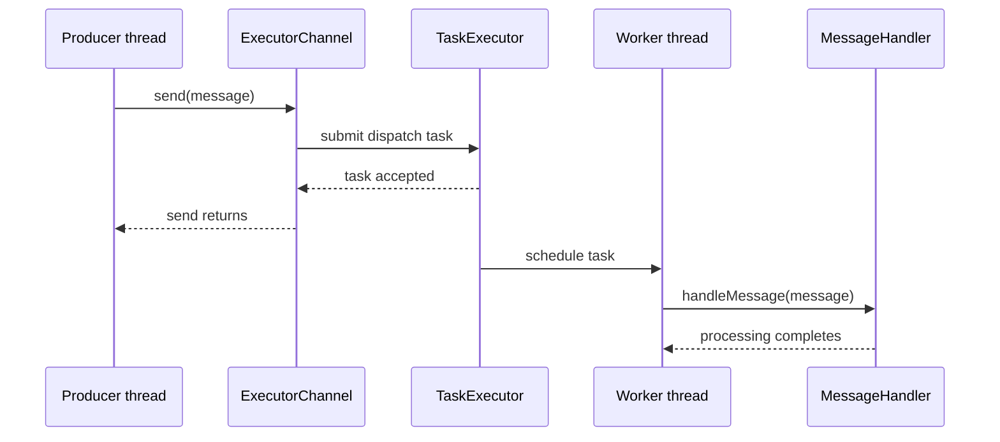
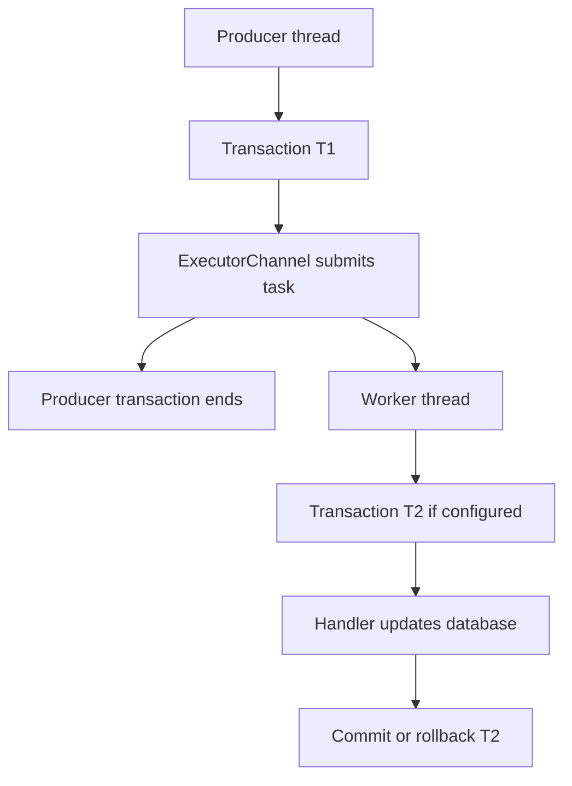

# Asynchronous Execution via ExecutorChannel

In Spring Integration, `ExecutorChannel` creates an asynchronous execution boundary between where a message is sent and where it is processed. The channel hands off dispatching to a `TaskExecutor`; the handler typically runs on a worker thread instead of the sending thread. This mechanism decouples business processing duration from the sending thread, enables concurrent execution, and avoids having slow handlers hold producer threads for too long.

This lesson belongs to the **Threading model** section of the `SPRING_INTEGRATION_RUNTIME` module. The module explores how Spring Integration coordinates message flows across channels, endpoints, consumers, pollers, and executors, while practicing IntegrationFlow lifecycle management, transactions, retries, message stores, errors, correlation, and diagnosing threading, performance, and runtime state.

## 1. Async Dispatch Is a Thread Boundary in a Message Flow

A message flow can pass through multiple endpoints. If endpoints are connected by a `DirectChannel`, handlers typically run sequentially on the same thread that called send. When a flow passes through an `ExecutorChannel`, the channel delegates subscriber invocation to an executor. From that point onward, downstream processing runs on a worker thread managed by the executor.



The diagram illustrates the case where the executor accepts the task and executes it asynchronously. When `send()` returns, it typically only indicates that the task was accepted; the handler may not have started yet, may be running, or may have already completed later.

This boundary only affects the part of the flow after `ExecutorChannel`. Steps before the channel still run on the current thread. If the worker-side handler sends a message onward through a `DirectChannel`, subsequent synchronous downstream steps usually continue on that same worker thread. If the flow encounters another `ExecutorChannel`, it introduces a new handoff.

## 2. ExecutorChannel Connects the Dispatcher to a TaskExecutor

`ExecutorChannel` is a `SubscribableChannel` using unicast dispatch. Endpoints register handlers as subscribers. When a producer sends a message, the dispatcher selects a subscriber and submits the dispatch task to the `TaskExecutor`.

An example configuration:

```java
@Bean
ThreadPoolTaskExecutor integrationExecutor() {
    ThreadPoolTaskExecutor executor = new ThreadPoolTaskExecutor();
    executor.setCorePoolSize(4);
    executor.setMaxPoolSize(8);
    executor.setQueueCapacity(200);
    executor.setThreadNamePrefix("si-worker-");
    executor.setWaitForTasksToCompleteOnShutdown(true);
    executor.setAwaitTerminationSeconds(30);
    return executor;
}

@Bean
MessageChannel asyncOrders(TaskExecutor integrationExecutor) {
    return new ExecutorChannel(integrationExecutor);
}

@Bean
IntegrationFlow asyncOrderFlow(OrderService orderService) {
    return IntegrationFlow.from("orders.in")
        .channel("asyncOrders")
        .handle(orderService, "process")
        .get();
}
```

In this example, steps before `asyncOrders` run on the sending thread. When the message reaches this channel, invoking the `process` handler is handed off to `integrationExecutor`. Because `ThreadPoolTaskExecutor` is a Spring bean, the container manages its initialization and shutdown lifecycle.

`TaskExecutor` is only an abstraction. If you pass a synchronous executor such as `SyncTaskExecutor`, the task can run right on the calling thread. To create async dispatch, you need an executor that actually hands tasks off to worker threads. Therefore, verify the injected executor type and thread names when running the application.

## 3. ExecutorChannel, DirectChannel, and QueueChannel Create Different Threading Models

| Channel | How messages are handed off | Typical processing thread | Stores messages in the channel? |
|---|---|---|---|
| `DirectChannel` | Invokes subscriber directly during send | Sending thread | No |
| `ExecutorChannel` | Submits dispatch task to TaskExecutor | Worker thread | No; executor may have a task queue |
| `QueueChannel` | Places message in a queue, consumer receives via poller | Poller/consumer thread | Yes, within queue bounds |
| `PublishSubscribeChannel` | Broadcasts message to subscribers | Sending thread or executor depending on configuration | Not a message store |

`ExecutorChannel` is not a queue channel. If the executor has a queue, that queue holds dispatch tasks, whereas `QueueChannel` holds `Message` instances. The two queues differ in ownership, lifecycle, and how items are taken.

`ExecutorChannel` also does not mean broadcast. It uses a unicast dispatcher; each dispatch selects one subscriber. If all subscribers must receive the same message, use `PublishSubscribeChannel` or split flow branches explicitly.

Choose a channel according to processing requirements:

- Use `DirectChannel` when synchronous processing is required and exceptions should be able to propagate back to the sender on the same call stack.
- Use `ExecutorChannel` when you want to switch threads and allow handlers to run asynchronously within the same process.
- Use `QueueChannel` when you need to decouple send and receive timing and hold messages in a queue for consumers to poll.
- Use `PublishSubscribeChannel` when you need to send the same message to multiple subscribers.

## 4. A Flow Can Switch Threads Multiple Times

Not all steps in a flow automatically run asynchronously just because an `ExecutorChannel` is present. Only the steps dispatched through that channel move to a worker. Subsequent channels and endpoints determine whether that thread is kept or handed off again.

For example:

```java
@Bean
IntegrationFlow orderFlow(
        ValidationService validation,
        OrderService orderService,
        NotificationService notificationService) {

    return IntegrationFlow.from("orders.in")
        .handle(validation, "validate")
        .channel("orders.async")
        .handle(orderService, "persist")
        .channel("orders.notifications")
        .handle(notificationService, "notify")
        .get();
}
```

Suppose `orders.async` is an `ExecutorChannel` and `orders.notifications` is a `DirectChannel`:

1. `validation.validate` runs on the thread that sent the message into the flow.
2. When the message passes through `orders.async`, dispatching to `orderService.persist` is handed off to a worker thread.
3. `notificationService.notify` continues on that worker thread because the next channel is a `DirectChannel`.
4. If `orders.notifications` is also an `ExecutorChannel`, notification is handed off again to a worker according to the second channel's executor.

Map out every thread boundary in the flow when analyzing latency or errors. A long-running handler before the async boundary still holds the producer thread; placing an `ExecutorChannel` after a handler does not make that preceding handler asynchronous.

## 5. A Successful Send Does Not Mean Processing Is Complete

With `DirectChannel`, `send()` typically includes dispatch and the handler invocation on the same call stack. If the handler throws an exception synchronously, it can propagate back to the sender.

With `ExecutorChannel` and an asynchronous executor, `send()` typically completes once the executor accepts the task. The handler may fail after the sender has already returned.

| Event | DirectChannel | ExecutorChannel |
|---|---|---|
| Handler invocation | In the sending call stack | Typically on a worker thread |
| Send returns | After synchronous dispatch | Typically after the task is accepted |
| Long-running handler | Holds the sending thread | Holds the worker thread |
| Handler throws exception | Can propagate back to sender | Cannot return to the already-finished sender call stack |
| Overload | Sender absorbs the processing time | Depends on queue and rejection policy |

Two failure groups must be distinguished:

- **Submission error:** the executor rejects the task, such as when the pool is shut down or the queue is full. Rejection errors can surface directly in the `send()` call.
- **Processing error:** the task was accepted, but the handler throws an exception on the worker thread. A try/catch around `send()` will not catch exceptions thrown later.

Therefore, the `send()` result only confirms dispatch according to the channel/executor contract. If the caller needs to know when business processing is complete, design explicit acknowledgments, reply messages, processing state tracking, or a separate task-tracking mechanism.

## 6. ThreadLocal and Context Do Not Automatically Cross the Boundary

When a message moves from a producer thread to a worker thread, the `Message` object and its headers travel with the message. Data bound to the current thread does not automatically move to the worker.

Common examples:

- **Transaction context:** a transaction bound to the producer thread does not automatically wrap work on the worker.
- **ThreadLocal:** data stored in a producer's ThreadLocal does not automatically appear on the worker.
- **SecurityContext:** authentication details require an appropriate context-propagation mechanism if the worker needs them.
- **Logging MDC:** trace IDs or correlation fields in MDC must be populated on the worker to keep logs correlated in the same context.
- **Request context:** do not access data tied to an HTTP request thread after the request thread has finished.

If the worker needs a correlation ID, tenant ID, or business key, place those values in message headers or payload via an explicit contract. For security context and MDC, use a `TaskDecorator` or executor wrapper suitable for your application stack. Always restore or clear context in `finally` so data from a previous task does not leak into the next task on the same worker.

Conceptual example using `TaskDecorator` to propagate MDC:

```java
@Bean
ThreadPoolTaskExecutor integrationExecutor() {
    ThreadPoolTaskExecutor executor = new ThreadPoolTaskExecutor();
    executor.setCorePoolSize(4);
    executor.setMaxPoolSize(8);
    executor.setQueueCapacity(200);
    executor.setTaskDecorator(task -> {
        Map<String, String> captured = MDC.getCopyOfContextMap();
        return () -> {
            Map<String, String> previous = MDC.getCopyOfContextMap();
            try {
                if (captured == null) {
                    MDC.clear();
                }
                else {
                    MDC.setContextMap(captured);
                }
                task.run();
            }
            finally {
                if (previous == null) {
                    MDC.clear();
                }
                else {
                    MDC.setContextMap(previous);
                }
            }
        };
    });
    return executor;
}
```

This example uses SLF4J's MDC; the corresponding logging dependency is required. For other contexts, use the propagation mechanism supported by that framework instead of arbitrarily copying all ThreadLocals.

Spring `Message` structures are immutable, but the payload can be a mutable object. If the producer mutates the payload after sending, the worker may see modified data or encounter a race condition. Prefer immutable payloads or copy data when transferring ownership across a thread boundary.

## 7. Transactions Have Separate Boundaries on the Worker

With `DirectChannel`, sender and handler typically run on the same thread. If they share a transaction manager, a transaction wrapping the send call can encompass handler processing, depending on transaction configuration and propagation.

With `ExecutorChannel`, the handler runs on a worker thread. A transaction bound to the sender thread does not automatically propagate to the worker. If the handler needs a transaction, open one on the worker—for example, with transaction advice on the endpoint or a transaction boundary in the invoked service.



The producer can commit its transaction after submitting the task while the worker handler has not finished processing yet. If business requirements demand that writing source data and publishing the message be atomic, using `ExecutorChannel` alone does not provide that guarantee. Consider a transactional outbox, a broker with appropriate transactions/acks, or persisting durable state before dispatching.

When switching a flow from `DirectChannel` to `ExecutorChannel`, re-evaluate transaction boundaries, isolation, retries, and idempotency. This is a change in semantics, not merely a performance change.

## 8. Handling Exceptions After the Sender Has Returned

Handler exceptions on a worker thread must be handled on the asynchronous execution side. You cannot rely on exceptions returning to the producer's call stack.

Spring Integration provides an error channel mechanism. Depending on async error-handling configuration, an exception can be wrapped in an `ErrorMessage` and sent to an error channel; the `errorChannel` header can specify an error destination per message, or otherwise a global mechanism can be used.

Example attaching an error channel to a message:

```java
Message<Order> message = MessageBuilder
    .withPayload(order)
    .setHeader("errorChannel", "orders.errors")
    .build();

asyncOrders.send(message);
```

A dedicated flow can be created to receive errors:

```java
@Bean
IntegrationFlow orderErrorFlow(OrderErrorService errorService) {
    return IntegrationFlow.from("orders.errors")
        .handle(errorService, "record")
        .get();
}
```

An error flow should capture the exception, failed message, correlation ID, and business key so failures can be investigated or redriven. Verify which channel the async error handler routes errors to in your actual configuration; do not assume every executor automatically routes errors to an arbitrary error flow.

If the error flow also runs asynchronously and the error handler itself throws an exception, prevent error loops. Persist error state durably, route the message to a dead-letter flow, or emit alerts per operational policy.

## 9. Backpressure and Rejection Policies

`ExecutorChannel` does not have its own message buffer. Task-acceptance capacity depends on the executor. For `ThreadPoolTaskExecutor`, key parameters include:

| Property | Meaning |
|---|---|
| `corePoolSize` | Baseline number of workers |
| `maxPoolSize` | Maximum worker limit |
| `queueCapacity` | Number of tasks waiting in the executor queue |
| `keepAliveSeconds` | How long excess workers above core can stay idle before reclamation |
| `RejectedExecutionHandler` | Policy when the executor cannot accept more tasks |

An unbounded queue allows producers to send faster than processing speed for extended periods, causing backlog and memory to grow continuously. With `ThreadPoolExecutor`, once core workers are busy, tasks are typically queued first; the pool only grows beyond core size when the queue cannot accept more tasks and the pool is still below `maxPoolSize`. Consequently, an unbounded queue can keep `maxPoolSize` from ever being used.

Common policies:

- **AbortPolicy:** rejects the task and throws a rejection exception. The producer or caller must handle overload.
- **CallerRunsPolicy:** the submitting thread executes the task itself when the executor rejects it. This provides simple backpressure, though it makes the sender execute the handler synchronously during overload.
- **DiscardPolicy/DiscardOldestPolicy:** drops tasks. Use only when business logic tolerates task loss and proper observability is in place.

Example configuring `CallerRunsPolicy`:

```java
@Bean
ThreadPoolTaskExecutor integrationExecutor() {
    ThreadPoolTaskExecutor executor = new ThreadPoolTaskExecutor();
    executor.setCorePoolSize(4);
    executor.setMaxPoolSize(8);
    executor.setQueueCapacity(200);
    executor.setThreadNamePrefix("si-worker-");
    executor.setRejectedExecutionHandler(
        new ThreadPoolExecutor.CallerRunsPolicy());
    return executor;
}
```

`CallerRunsPolicy` can throttle producers when the system is overloaded, but it also changes async behavior at the moment of rejection. If the sending thread is an HTTP request thread, the request may unexpectedly have to run heavy business work. Choose a rejection policy based on business semantics, not just to avoid exceptions.

## 10. Ordering, Concurrency, and Thread Safety

`ExecutorChannel` does not guarantee that messages finish in the exact order they were sent when backed by a multi-threaded pool. Message A may be submitted before B, yet B's handler may finish before A if A takes longer or runs on a different worker.

Even when the task queue preserves submission order, multiple workers can finish tasks in different orders. If multiple producers send concurrently, submission order across threads does not necessarily reflect the desired business order either.

When ordering must be preserved:

- Use a single-threaded executor for flows that require serialization.
- Partition by business key so related data goes through the same processing stream.
- Use a resequencer or aggregator when message order needs to be restored.
- Design handlers to be idempotent and update data with concurrency control.
- Do not assume a point-to-point channel means the entire flow is sequential.

When increasing concurrency, verify that downstream services are thread-safe. A singleton service with unsynchronized mutable state can develop race conditions when multiple workers invoke it simultaneously.

## 11. Replies and Correlation When a Flow Runs Asynchronously

`ExecutorChannel` does not block the sender to wait for the handler to finish. If the flow must return a result, a reply can still be produced and sent via a reply channel after the handler finishes, but the caller must use an appropriate request-reply pattern with a timeout.

Ensure that:

- The request has a valid reply channel or the endpoint has an explicit output channel.
- The caller has a timeout large enough to cover executor queue wait time plus processing time.
- A correlation ID or business key is preserved to match replies with their requests.
- The system handles late replies, caller timeouts, and retried requests.
- The reply channel still exists and has a receiving consumer when the reply is sent.

Do not use an in-memory mutable object without synchronization to correlate request-reply across threads. For distributed flows or flows that must survive restarts, use proper correlation and persistence rather than relying on a single JVM's memory.

## 12. Diagnosing Thread Boundaries at Runtime

| Symptom | Possible cause | How to check |
|---|---|---|
| Send returns before handler finishes | Task was only accepted by the executor | Measure queue wait and handler duration |
| Handler runs on sending thread | Synchronous executor or CallerRunsPolicy during rejection | Check executor type and rejection counter |
| Task is rejected | Pool/queue full or executor shut down | Check active count, queue size, rejections, and lifecycle |
| Exception does not appear at sender | Handler failed after async handoff | Check errorChannel and worker logs |
| Messages complete out of order | Multi-worker pool or multiple producers | Check concurrency, partition key, and ordering requirements |
| Transaction does not roll back with producer | Handler runs on another thread | Check transaction boundary on the worker |
| MDC or SecurityContext is lost | Context was not propagated | Check TaskDecorator or context-aware executor |
| Thread pool is congested | Blocking handler, queue backlog, or slow dependency | Inspect thread dump, queue depth, and downstream latency |

Investigation procedure:

1. Confirm the channel is actually an `ExecutorChannel` and the right executor bean is injected.
2. Confirm the executor performs async dispatch rather than being `SyncTaskExecutor`.
3. Log thread names before and after the channel boundary.
4. Measure send timestamp, worker start timestamp, and handler completion timestamp.
5. Check active workers, pool size, queue capacity, and rejection policy.
6. Track exceptions via the error channel or async error handler.
7. Check transactions, security context, MDC, and correlation IDs across the thread boundary.
8. Verify handlers are thread-safe and idempotent, and downstream systems tolerate the concurrency.

Measure at least three intervals: time waiting in the executor queue, handler execution time, and total time from send to completion. Separating these three measurements helps distinguish bottlenecks caused by too few workers, queue backlog, or slow external dependencies.

## 13. Design Principles

- `ExecutorChannel` changes the execution thread; it is not a durable message queue.
- The async boundary begins only at channel dispatch; earlier steps still run on the current thread.
- A successful send usually only means the task was accepted, not that the handler has finished.
- Do not assume transactions, ThreadLocal values, SecurityContext, or MDC automatically cross a thread boundary.
- Explicitly define queue capacity, concurrency, and rejection policy.
- Place needed correlation/business context in message headers or payload.
- Design error handling for exceptions occurring after the sender has returned.
- Control ordering and thread safety when increasing worker count.
- Use a broker or durable messaging when messages must survive restarts.

`ExecutorChannel` is suitable when you need in-process async dispatch and can control worker load. To operate safely, treat every `ExecutorChannel` as an explicit thread boundary in the flow: configure bounded pools and queues, define rejection handling, observe async errors, and design transactions, replies, and correlation around that boundary.
