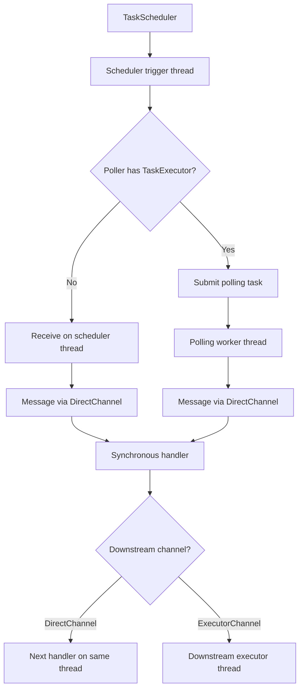

# Polling Thread and Handler Thread

In a Spring Integration polling flow, receiving a message and processing that message can happen on the same thread or on multiple different threads. This distinction depends on the scheduler, the poller's `TaskExecutor`, and the types of channels sitting between endpoints.

When thread boundaries are not clearly distinguished, logs can mislead you into thinking a handler is running on a scheduler thread, transactions or MDC can be lost across an executor handoff, or multiple polls can run concurrently even though the poller uses `fixedDelay`. To diagnose accurately, trace each step: **the thread triggering the schedule, the thread executing the poll, the thread running the handler, and the threads of downstream steps**.

## 1. Threads Participating in a Polling Flow

A polling consumer usually involves at least two thread roles:

- **Scheduler trigger thread:** a `TaskScheduler` thread that tracks the trigger and decides when to fire a poll.
- **Polling execution thread:** the thread that executes `receive()` or calls the message source, then passes the message into the flow.

If the poller has no `TaskExecutor` configured, the scheduler thread typically executes the polling task directly. In that case, `receive()` and synchronous downstream handlers run on the same thread.

If the poller has a `TaskExecutor`, the scheduler thread submits the polling task to the executor. An executor worker thread performs the receive and runs the synchronous part of the flow. The scheduler thread can return to scheduling the next trigger without waiting for the handler to complete.



The diagram illustrates the common path. Inbound adapters, message sources, and specialized endpoints may add their own execution steps; inspect the actual configuration of each endpoint.

The configuration snippets in the following sections are independent options for comparison. When applying them in the same configuration class, choose the option you need or give the beans distinct names.

## 2. Poller Without a TaskExecutor

Example of a poller without an executor declared:

```java
@Bean
public IntegrationFlow ordersFlowDirect(
        PollableChannel ordersQueue,
        OrderHandler orderHandler) {

    return IntegrationFlow.from(ordersQueue, endpoint -> endpoint.poller(
            Pollers.fixedDelay(500)
                .maxMessagesPerPoll(10)))
        .handle(orderHandler, "handle")
        .get();
}
```

With this configuration, the scheduler triggers the polling task and the polling task runs on the scheduler thread. If `ordersQueue` has a message, that thread receives the message and calls `OrderHandler.handle`. If the handler sends onward through a `DirectChannel`, the next handler also runs synchronously on the same thread.

The upside is a simple execution flow that is easy to trace in stack traces, and a synchronous transaction can span the entire processing block on that thread. The downside is that a slow handler holds the scheduler thread, delaying other pollers or scheduled tasks sharing that scheduler.

If a handler makes HTTP or database calls with long wait times, the scheduler thread can be tied up for that entire duration. Therefore, avoid placing too many pollers with blocking work onto a small scheduler pool.

## 3. Poller With a TaskExecutor

You can configure a dedicated `TaskExecutor` on the poller to decouple schedule triggering from poll execution:

```java
@Bean("pollerExecutor")
public ThreadPoolTaskExecutor pollerExecutor() {
    ThreadPoolTaskExecutor executor = new ThreadPoolTaskExecutor();
    executor.setCorePoolSize(4);
    executor.setMaxPoolSize(8);
    executor.setQueueCapacity(100);
    executor.setThreadNamePrefix("poller-worker-");
    return executor;
}

@Bean
public IntegrationFlow ordersFlowWithPollerExecutor(
        PollableChannel ordersQueue,
        @Qualifier("pollerExecutor") TaskExecutor pollerExecutor,
        OrderHandler orderHandler) {

    return IntegrationFlow.from(ordersQueue, endpoint -> endpoint.poller(
            Pollers.fixedDelay(500)
                .taskExecutor(pollerExecutor)
                .maxMessagesPerPoll(10)))
        .handle(orderHandler, "handle")
        .get();
}
```

In this example, the scheduler thread triggers the poller and submits the task to `pollerExecutor`. A worker thread whose name starts with `poller-worker-` performs the receive and invokes the handler. Since `QueueChannel` is a `PollableChannel`, the message retrieval operation also runs on the polling worker.

The poller's `TaskExecutor` governs the thread that runs the entire polling task. It does not move only the handler call to another thread. If downstream still uses `DirectChannel`, subsequent handlers continue running on that polling worker thread.

In this example, the executor is a Spring bean, so the container manages initialization and shutdown automatically via `ThreadPoolTaskExecutor` lifecycle callbacks. Do not call `initialize()` manually inside the bean method, as that can cause duplicate initialization.

### TaskExecutor Does Not Always Create a New Thread

`TaskExecutor` is an abstraction; whether a thread switch occurs depends on the implementation. `ThreadPoolTaskExecutor` typically executes tasks on a pool worker thread. `SyncTaskExecutor` runs tasks right on the thread calling `execute()`, so using it as a poller executor creates no new thread boundary.

Pool exhaustion policies can also change the executing thread. For instance, `CallerRunsPolicy` can run a rejected task on the submitting thread (for a poller, that is the scheduler thread). Thus, the threading model under high load can differ from normal load. Choose rejection policies deliberately and test behavior under load instead of inferring threads solely from the `TaskExecutor` type name.

## 4. Poller TaskExecutor Differs from ExecutorChannel

Both configurations involve an executor, yet they place the thread boundary at different positions:

| Mechanism | What does the executor run? | Thread transition point |
|---|---|---|
| Poller `.taskExecutor(...)` | The entire polling task: receiving the message and the synchronous flow that follows | Between scheduler trigger and polling execution. |
| `ExecutorChannel` | Handlers dispatched through that channel | At the channel after the message is sent into it. |
| `DirectChannel` | Does not create an executor boundary | Handler runs on the message-sending thread. |

Example where the poller runs on one worker and downstream hands off to another executor:

```java
@Bean("handlerExecutor")
public ThreadPoolTaskExecutor handlerExecutor() {
    ThreadPoolTaskExecutor executor = new ThreadPoolTaskExecutor();
    executor.setCorePoolSize(8);
    executor.setMaxPoolSize(16);
    executor.setQueueCapacity(500);
    executor.setThreadNamePrefix("handler-worker-");
    return executor;
}

@Bean
public MessageChannel asyncHandlerChannel(
        @Qualifier("handlerExecutor") TaskExecutor executor) {
    return new ExecutorChannel(executor);
}

@Bean
public IntegrationFlow ordersFlowWithSeparateHandlerExecutor(
        PollableChannel ordersQueue,
        @Qualifier("pollerExecutor") TaskExecutor pollerExecutor,
        MessageChannel asyncHandlerChannel,
        OrderHandler orderHandler) {

    return IntegrationFlow.from(ordersQueue, endpoint -> endpoint.poller(
            Pollers.fixedDelay(500).taskExecutor(pollerExecutor)))
        .channel(asyncHandlerChannel)
        .handle(orderHandler, "handle")
        .get();
}
```

There are two handoffs here:

1. The scheduler thread submits the polling task to `pollerExecutor`.
2. The polling worker sends the message through `ExecutorChannel`; the channel submits the handler task to `handlerExecutor`.

As a result, `OrderHandler.handle` runs on a `handler-worker-...` thread, not the scheduler thread or the polling worker thread. Adding executors can increase parallelism, but it also increases the number of queues, latency, and places where errors must be tracked.

## 5. Thread Names and Tracing Messages

Using distinct prefixes for the scheduler, poller executor, and handler executor makes logs easier to read:

```text
si-scheduler-1       -> triggers the schedule
poller-worker-2      -> receives the message and runs the synchronous segment in the poller flow
handler-worker-5     -> runs the handler after ExecutorChannel
```

A thread name is a diagnostic aid, not a business identifier. One worker can process many messages at different times. To correlate logs across steps, also include:

- `MessageHeaders.ID` or the corresponding message ID.
- Business correlation ID.
- Flow, endpoint, or channel name.
- Thread name and timestamp.
- Sanitized tenant or business key if needed.

Do not log tokens, credentials, or sensitive full payloads. When a message crosses multiple executors, a correlation ID in headers ties the processing segments together even as threads change.

## 6. Concurrency and Multiple Polls Running Simultaneously

When a poller uses a `TaskExecutor`, the scheduler thread can submit a polling task and immediately return to handle the next trigger. If the previous worker has not finished yet, a new polling task can be submitted. Therefore, using `fixedDelay` does not automatically guarantee that the previous polling task finished before the next one begins when an asynchronous executor is used.

The reason is that the scheduled callback can finish right after submitting the task to the executor. `fixedDelay` is then measured from when the submit callback finishes, without waiting for the asynchronous polling work to complete.

For example, a poller has a fixed delay of 500 ms, while each poll takes 2 seconds to process. The scheduler can continue submitting new polls while earlier workers are still busy. If the executor has multiple threads, multiple polls can run at the same time and pull messages from the same queue.

This can increase throughput, yet it also imposes requirements:

- Handlers must be safe when multiple messages are processed concurrently.
- Shared services and objects must be thread-safe.
- If ordering is required, define ordering per message, key, or partition.
- Pools and queues must be bounded so tasks do not accumulate indefinitely.
- If business rules require only one poll active at a time, configure a single-threaded executor or an appropriate synchronization/concurrency limit.

`maxMessagesPerPoll` limits how many messages are processed in a single poll, not the total number of polls running concurrently. Those two concerns must be designed separately.

## 7. Blocked Scheduler Threads and Starvation

If no poller executor is configured, blocking handlers can hold scheduler threads. If the scheduler pool has few threads, other pollers must wait for triggers or fail to fire on cadence.

Even after separating a poller executor, poller workers can still block in `receiveTimeout` or inside a handler. If all workers are waiting or processing slowly, new polling tasks can pile up in the executor queue.

Common symptoms:

| Symptom | Possible cause |
|---|---|
| Multiple pollers are delayed at the same time | Scheduler pool lacks threads or one scheduled task blocks for a long time. |
| Scheduler threads are idle while message queue grows | Poller executor lacks workers or handlers process slowly. |
| `pollerExecutor` queue grows continuously | Scheduler submits faster than workers complete tasks. |
| Concurrent handler execution causes data corruption | Shared service or state is not thread-safe. |
| `RejectedExecutionException` | Executor exhausted capacity to accept tasks per queue/pool/rejection configuration. |

Do not solve every issue simply by increasing pool size. Measure wait times, processing times, active thread counts, queue depth, and task rejection rates before changing configuration.

## 8. How receiveTimeout Affects the Polling Worker

With a `PollableChannel`, the poller calls `receive()` to fetch a message. If the queue is empty and `receiveTimeout` is positive, the thread executing the poll is held for that wait duration.

Without a poller executor, the held thread is the scheduler thread. With a poller executor, the held thread is the polling worker thread. That is an important operational distinction.

Example:

```java
Pollers.fixedDelay(1_000)
    .taskExecutor(pollerExecutor)
    .receiveTimeout(200)
    .maxMessagesPerPoll(5)
```

If many pollers share a small executor and all wait on receive simultaneously, the worker pool can be occupied even when queues have no messages. Coordinate receive timeout, poller count, and pool size. Short timeouts reduce how long workers are held on empty queues but can increase empty polls; long timeouts reduce empty polls but increase thread wait times.

## 9. Transactions, ThreadLocal, and Context Propagation

Many mechanisms in Java bind state to the current thread. For example, Spring transactions are typically bound to a thread, MDC logging can use `ThreadLocal`, and some security contexts also rely on thread-local storage.

When a poller runs synchronously, transaction advice wrapping the polling task can cover `receive()` and downstream handlers running synchronously on the same thread, depending on advice placement and the transaction manager.

When using `ExecutorChannel` or another executor, the message moves to a new thread. Thread-bound transactions do not automatically carry over to the new thread; MDC or security contexts are also not automatically copied without a corresponding context-propagation mechanism.

Common approaches:

- Place the transaction at the endpoint that actually performs data operations after the thread boundary.
- Use message headers to carry correlation IDs and necessary routing metadata.
- Configure a `TaskDecorator` or appropriate context-propagation mechanism to copy and clean up MDC/security context when using an executor.
- Do not store request state in a `ThreadLocal` and assume a handler on another thread will read it.
- Do not hold a transaction open while waiting for asynchronous work to complete on another thread.

Example of a simple `TaskDecorator` to propagate MDC:

```java
@Bean
public TaskDecorator mdcTaskDecorator() {
    return task -> {
        Map<String, String> context = MDC.getCopyOfContextMap();
        return () -> {
            Map<String, String> previous = MDC.getCopyOfContextMap();
            try {
                if (context != null) {
                    MDC.setContextMap(context);
                }
                else {
                    MDC.clear();
                }
                task.run();
            }
            finally {
                if (previous != null) {
                    MDC.setContextMap(previous);
                }
                else {
                    MDC.clear();
                }
            }
        };
    };
}
```

To use the decorator, attach it to `ThreadPoolTaskExecutor` via `setTaskDecorator(...)`. This example illustrates copying MDC at submission time and restoring the prior context on the worker; reactive contexts or security contexts require their corresponding specialized mechanisms.

## 10. Exceptions and Error Handling Across Thread Boundaries

With `DirectChannel`, handlers usually run synchronously on the sending thread. Exceptions can propagate back to the caller or be handled by endpoint advice/error handling.

With `ExecutorChannel`, the sender usually only knows the task was submitted or the channel accepted the message. Exceptions raised afterward belong to the asynchronous processing thread; they cannot by default return to the original `send()` call. Configure an appropriate error channel/error handler for the endpoint or executor task.

For a poller, errors during receiving or processing a message can be converted into an `ErrorMessage` on the poller's configured error channel. If the poller has a `TaskExecutor`, identify that the error originates on the polling worker and where it is routed. The scheduler trigger thread does not necessarily see business exceptions if the poller handles errors internally.

When diagnosing, record both the thread where the exception occurred and the thread where the error handler runs. If the error flow is also asynchronous, that may be a third thread.

## 11. Transactions and Processing Order

Thread boundaries affect transactions and completion order. With a single-threaded poller, messages are typically processed sequentially within a polling task. With a multi-worker executor, different messages can be processed in parallel and finish out of receive order.

If ordering must be preserved per business key, you can:

- Partition messages by key so the same key goes to the same sequential consumer.
- Use a single-threaded executor for flows that need serialization, if throughput permits.
- Use key-based locks or serialization in the service, while evaluating contention.
- Design handlers to be idempotent and business state to tolerate retries or out-of-order completion.

Do not assume `QueueChannel` with one poller is enough to preserve completion order when the poller dispatches to multiple workers. The queue can preserve retrieval order, yet parallel handlers can finish in a different order.

## 12. Sizing and Splitting Thread Pools

An application can have pools with distinct responsibilities:

| Pool | Work | What to monitor |
|---|---|---|
| `TaskScheduler` | Triggers pollers and scheduled tasks | Thread count, trigger delay, blocked tasks. |
| Poller `TaskExecutor` | Receives and runs the synchronous part of the polling flow | Active workers, queue depth, poll duration, task overlap. |
| Handler executor | Runs downstream after `ExecutorChannel` | Throughput, queue depth, rejections, and handler latency. |
| Client-specific executor | External library I/O or callbacks | In-flight requests, timeouts, and thread leaks. |

You do not necessarily need four separate pools. Pools can be shared when load and lifecycle fit, provided you understand that one group of tasks can starve another group of threads. Avoid sharing a small executor among mutually dependent blocking tasks, as this can cause starvation or deadlocks.

When sizing, measure average and p95/p99 processing time, poller count, messages per poll, blocking ratio, queue depth, and SLAs. Adding threads can improve throughput for I/O-bound workloads, but it also increases contention, context switching, and concurrent connections.

## 13. Practical Thread Diagnosis

When a handler runs on an unexpected thread, check in order:

1. **Does the poller have a `taskExecutor`?** If not, polling tasks typically run on the scheduler thread.
2. **What type is the channel after receive?** `DirectChannel` keeps the current thread; `ExecutorChannel` switches to another executor.
3. **Is there a service activator or adapter creating an async boundary?** Inspect the executor configured on the endpoint.
4. **Which pool does the thread name prefix indicate?** Compare `si-scheduler-`, `poller-worker-`, and `handler-worker-`.
5. **Are multiple polls running concurrently?** Compare processing duration against the trigger and check active worker count.
6. **Is the pool blocked or is its queue full?** Check thread dumps, active count, queue depth, and rejections.
7. **Is context lost across a thread switch?** Check MDC, security context, transactions, and correlation headers.
8. **Are exceptions occurring on background threads?** Cross-check error channels, scheduler error handlers, and executor logs.

Thread dumps help identify workers waiting on `receive()`, waiting on locks, waiting on HTTP, or executing handlers. Executor metrics help distinguish a scheduler that is not firing from polling tasks that were submitted but have no worker to run them.

## 14. Testing Thread Boundaries

You can inspect the thread name directly inside a handler:

```java
public void handle(Order order) {
    log.info("Handling order on thread {}",
        Thread.currentThread().getName());
}
```

For stable tests, use a `CountDownLatch` or `BlockingQueue<String>` to record thread names from the handler and assert the expected prefix. Avoid asserting exact thread index numbers because pools can reuse workers in different orders.

Useful tests include:

- Poller without `TaskExecutor`: verify the handler runs on the configured scheduler thread.
- Poller with `TaskExecutor`: verify the synchronous handler runs on the polling worker.
- Poller with `TaskExecutor` and downstream `ExecutorChannel`: verify the handler after the channel runs on the handler executor.
- Slow handler: verify concurrent poll count and task queuing per configuration.
- Context shutdown: verify pollers stop submitting new tasks and executors shut down according to lifecycle.
- Context propagation: verify MDC/correlation IDs remain intact after switching threads and are cleared from the worker after the task.

## 15. Common Design Mistakes

- **Assuming the scheduler thread always runs the handler.** This is only true when the polling task is not handed off to an executor and downstream has no async boundary.
- **Confusing poller `TaskExecutor` with `ExecutorChannel`.** One moves the entire polling task; the other hands off messages at a specific channel.
- **Assuming fixedDelay guarantees no overlap when the poller uses an executor.** The scheduler can submit the next run while an earlier worker is still running.
- **Sharing a small pool for multiple blocking workloads.** One workload can exhaust all workers needed by another.
- **Leaving executor queues unbounded.** Tasks can pile up and create huge latency when submission rate exceeds processing rate.
- **Assuming transactions or MDC propagate across threads automatically.** ThreadLocal state is not shared across worker threads automatically.
- **Increasing worker count without checking thread safety.** Shared mutable state can produce race conditions.
- **Using maxMessagesPerPoll to limit concurrency.** That value limits messages per poll, not necessarily the number of concurrent polls.
- **Not observing rejections and async errors.** A caller may send successfully while a downstream handler still fails.

## 16. Design Checklist

Before operating a polling flow, determine:

- Which thread triggers the poller and which thread performs `receive()`?
- Does the poller have a `TaskExecutor`, and how many workers does that pool have?
- Does the handler run synchronously after receive or get handed off through an `ExecutorChannel`?
- How many polling tasks can run concurrently at any moment?
- Is the handler thread-safe and idempotent?
- Does message order need to be preserved globally or per business key?
- How are transactions, MDC, and security context handled across thread switches?
- Do queues and executors have appropriate bounds, metrics, and rejection policies?
- Where are polling worker errors and downstream worker errors observed?
- When the context closes, in what order are pools and polling tasks stopped?

Clearly identifying the scheduler trigger thread, polling execution thread, and handler thread makes reading logs, sizing executors, designing transactions, and investigating failures much more accurate. Every thread boundary should be an intentional architectural decision tied to the message flow's throughput, latency, ordering, and resilience requirements.
