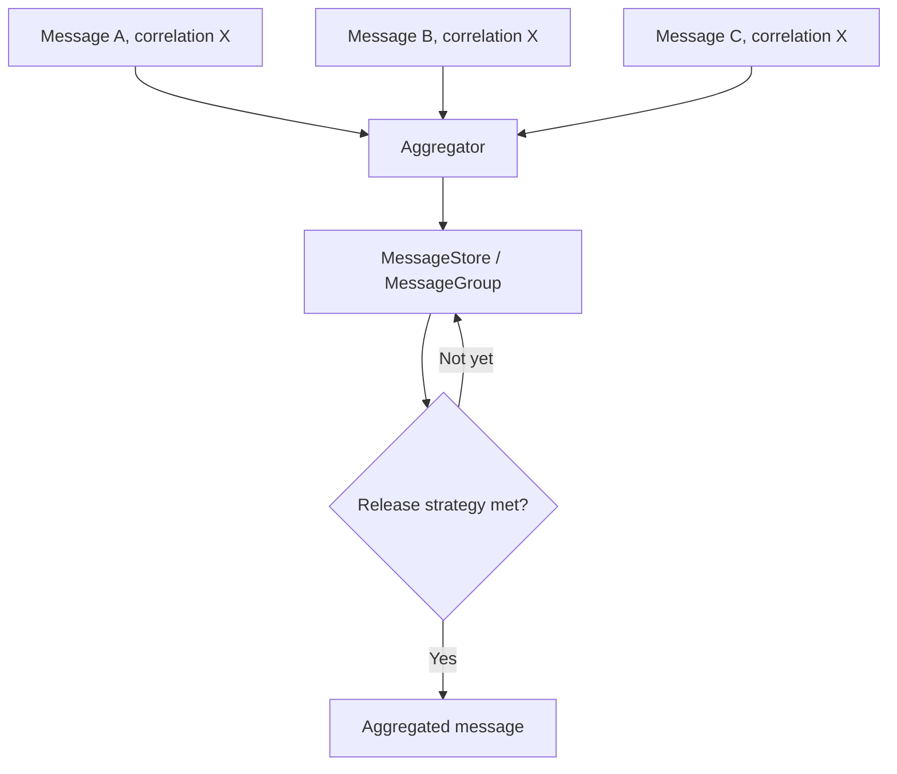

# Thread Safety of Handlers and Stateful Components

In Spring Integration, a message may be processed on the sending thread, on a poller thread, or on a thread provided by an executor. An endpoint typically holds a reference to its handler for the lifetime of the application; if the handler is a Spring singleton, multiple messages can invoke the same instance nearly simultaneously. Therefore, a flow that works properly for a single message is not necessarily safe when consumer count increases or when switching to asynchronous processing.

Thread safety is the ability of a component to preserve correct behavior and state when accessed concurrently by multiple threads. For handlers and stateful components, you must identify which data is shared, who is allowed to mutate it, which operations must be atomic, and where state is stored. This guide moves from the Spring Integration threading model to designing safe handlers, managing state, protecting ordering, and testing for race conditions.

## 1. Why Can a Handler Be Invoked Concurrently?

Spring manages beans by scope. The default scope is singleton: a single instance is shared within the `ApplicationContext`. If a service is injected into multiple endpoints, those endpoints can invoke the very same object simultaneously.

```java
@Service
public class OrderHandler {

    public void handle(Order order) {
        // Message processing logic
    }
}
```

The bean above is not automatically instantiated once per message. If multiple threads call `handle()` at the same time, they execute on the same object. That is completely valid when the method uses only local data and safely shared dependencies; however, it causes bugs if the method mutates shared fields or collections without synchronization.

### 1.1. Paths That Create Concurrency

| Runtime mechanism | How the handler is invoked | Risks to evaluate |
|---|---|---|
| `DirectChannel` | Handler is invoked synchronously on the sending thread | Multiple independent sending threads can still call the same handler concurrently |
| `ExecutorChannel` | Tasks are dispatched via `TaskExecutor` | Multiple workers can invoke the handler simultaneously; completion order can change |
| `PublishSubscribeChannel` | One message is broadcast to multiple subscribers | Multiple branches can run concurrently when an executor is configured; the same payload may be shared |
| `QueueChannel` with multiple polling consumers | Consumers pull messages from the queue | Multiple handler invocations can run in parallel |
| Polling endpoint with executor or multiple instances | Poll tasks can run on separately managed threads | Active poll count and potential overlap must be determined from configuration |

`DirectChannel` does not mean single-threaded. It invokes the handler on the sending thread, yet two concurrent HTTP requests can spawn two different sending threads that both call the endpoint. Similarly, an endpoint with only one poller thread can still receive concurrent invocations from other entry paths if the same handler is reused across multiple flows.

### 1.2. Do Not Infer Thread Safety from Channel Type

The channel determines how messages are handed off; thread safety is a property of the handler, payload, and shared state. Switching from `DirectChannel` to `ExecutorChannel` often exposes race conditions that already existed under concurrent requests.

When evaluating a handler, trace every place it is called, the number of consumers, executors, pollers, subscribers, and flows sharing that bean. Counting endpoints is not enough; you need to know how many invocations can run concurrently on the same instance.

## 2. Stateless Handlers Are the Easiest to Guarantee

A stateless handler does not store per-message state in fields. Processing data is passed through parameters and local variables; shared dependencies have thread-safe or immutable contracts.

```java
@Service
public class OrderHandler {

    private final OrderRepository repository;
    private final OrderValidator validator;

    public OrderHandler(OrderRepository repository,
                        OrderValidator validator) {
        this.repository = repository;
        this.validator = validator;
    }

    public OrderResult handle(Order order) {
        validator.validate(order);
        Order normalized = normalize(order);
        repository.save(normalized);
        return new OrderResult(normalized.id(), "ACCEPTED");
    }

    private Order normalize(Order order) {
        // Create a new value without mutating shared input objects.
        return new Order(order.id(), order.customerId(),
                List.copyOf(order.lines()));
    }
}
```

This example assumes `Order`, `OrderLine`, and `OrderResult` are immutable types, and that the repository and validator are designed for concurrent use. Being stateless does not mean all dependencies are automatically thread-safe; inspect the contract of each dependency, connection/session, and transaction manager.

Helpful principles:

- Use local variables for temporary data within a single invocation.
- Pass business state via payloads or a store with appropriate concurrency control.
- Prefer immutable DTOs, records, and unmodifiable collections.
- Never store `currentMessage`, `currentOrder`, or per-message buffers in singleton fields.
- Do not share mutable objects across flow branches if any branch mutates them.
- Confirm whether shared libraries support concurrent access or require a separate instance per invocation.

## 3. Common Mistakes with Mutable State

### 3.1. Fields Holding Current Message Data

The following code is unsafe:

```java
@Service
public class UnsafeOrderHandler {

    private String currentOrderId;

    public void handle(Order order) {
        currentOrderId = order.id();
        validate(currentOrderId);
        save(currentOrderId);
    }
}
```

If thread A assigns `order-1` and thread B assigns `order-2` before A calls `save()`, A can save the wrong ID. The field does not represent stable bean state; it is being used like a local variable while shared across invocations.

Fix with a local variable:

```java
public void handle(Order order) {
    String orderId = order.id();
    validate(orderId);
    save(orderId);
}
```

### 3.2. Shared Collections

`ArrayList`, `HashMap`, and many ordinary mutable collections do not support safe concurrent updates.

```java
@Service
public class UnsafeBatchCollector {

    private final List<Order> orders = new ArrayList<>();

    public void handle(Order order) {
        orders.add(order);
    }
}
```

Multiple threads calling `add()` can cause lost updates or inconsistent internal state. Replacing `ArrayList` with `Collections.synchronizedList()` or `ConcurrentLinkedQueue` may protect individual collection operations, but it does not automatically protect multi-step business logic such as checking size, copying a whole batch, and clearing.

For example, the sequence `if (orders.size() >= batchSize) { copy; clear; }` still needs synchronization around the entire sequence or a different batching design. Thread safety of individual methods does not make a sequence of methods atomic.

### 3.3. Mutable Payloads Shared Across Multiple Branches

A standard Spring `Message` has an immutable envelope and headers by design, but the payload is not automatically immutable. If a message holds an `ArrayList` or a business object with setters, branches can hold references to the same object.

```text
                  Message<OrderDraft>
                          |
                  PublishSubscribeChannel
                    /           \
                   v             v
             Inventory       Pricing
             branch          branch
                 |              |
            modifies lines  modifies discount
```

If two branches mutate the same `OrderDraft`, the outcome depends on execution timing. Three common solutions exist:

1. Convert the payload to an immutable structure before broadcasting.
2. Create an isolated copy per branch if each branch must transform data.
3. Grant write ownership to only one component; other components send commands or new results back to that owner.

Copying a collection is only a shallow copy if elements inside remain mutable. When true isolation is needed, perform an intentional deep copy or use an immutable object graph.

## 4. Distinguishing Thread-Safe, Immutable, and Atomic

These three concepts are related but not identical.

| Concept | Meaning | Example |
|---|---|---|
| Immutable | Object state never changes after construction | A `record` holding immutable values and immutable collections |
| Thread-safe | Invariants hold under concurrent access by multiple threads | Concurrent map with proper operations or lock-protected object |
| Atomic operation | An operation observed as an indivisible unit | `AtomicLong.incrementAndGet()` |

`AtomicLong` increments a counter safely, but it does not turn multiple related fields into a transaction. `ConcurrentHashMap` protects defined map operations, yet a `get -> check -> put` sequence is not atomic by default. `synchronized` can protect a critical section, but only when every access path uses the same monitor.

When choosing a protection mechanism, identify the business invariant first. For instance, "each order ID may be processed at most once" is an invariant; merely using a thread-safe collection does not enforce that invariant if check and record are not performed atomically.

## 5. Ways to Protect State in Handlers

### 5.1. Use Immutable Objects

If state does not change frequently, build immutable objects and swap the entire snapshot when updates occur. This reduces locking needs and makes sharing across threads straightforward.

```java
public record ConnectorConfig(
        String endpoint,
        Duration timeout,
        int maxAttempts) {
}
```

When configuration changes, construct a new `ConnectorConfig` and publish the new reference via a safe mechanism such as `volatile` or `AtomicReference`. Do not mutate individual fields of the old configuration object while handlers are reading it.

### 5.2. Use Concurrent Collections for Simple Operations

If you need a keyed state map, you can use `ConcurrentHashMap`:

```java
private final ConcurrentMap<String, ConnectorStatus> statuses =
        new ConcurrentHashMap<>();

public void markRunning(String connectorId) {
    statuses.put(connectorId, ConnectorStatus.RUNNING);
}
```

If you need to initialize a value by key, use `computeIfAbsent()` so computation for the same key is coordinated according to the map's contract:

```java
ConnectorState state = states.computeIfAbsent(
        connectorId, id -> new ConnectorState(id));
```

The mapping function should be short and avoid slow I/O or reentrant calls back into the same map. For state with multiple related fields, the value object itself must also be thread-safe; a concurrent map does not automatically protect mutable internals of its values.

### 5.3. Use Atomic Types for a Single Independent Value

```java
private final AtomicLong processedCount = new AtomicLong();

public void handle(Order order) {
    process(order);
    processedCount.incrementAndGet();
}
```

`AtomicLong` fits an independent counter. If you must update `processedCount`, `failedCount`, and `lastProcessedAt` together as one consistent state, use a protected state object or store them in a transactional system.

### 5.4. Use synchronized or Lock for Multi-Step Invariants

```java
public class BatchState {

    private final List<Order> pending = new ArrayList<>();

    public synchronized List<Order> takeBatch(int size) {
        if (pending.size() < size) {
            return List.of();
        }

        List<Order> batch = new ArrayList<>(pending.subList(0, size));
        pending.subList(0, size).clear();
        return batch;
    }
}
```

This snippet protects check, copy, and clear under the same monitor. Every other method reading or modifying `pending` must also use the same monitor; if even one unsynchronized path exists, the invariant can still be broken.

Keep critical sections short. Avoid HTTP calls, database calls, or waiting on I/O while holding a lock because other threads will block longer, increasing contention and deadlock risk. If I/O is needed, take a snapshot under the lock and release the lock before calling external systems.

## 6. Stateful Components in Spring Integration

Some components must retain state across multiple messages. For example:

- Aggregator holding a message group until the release strategy allows emitting a result.
- Resequencer holding messages to restore order.
- Service collecting batches or deduplicating messages.
- Handler maintaining caches, counters, sessions, or connector state.
- Component coordinating a multi-step workflow.

You cannot apply a blanket "stateless everywhere" rule to every component. Instead, identify where state is owned and what mechanism protects it.

### 6.1. Aggregator and MessageStore

The aggregator is a classic stateful component. It receives messages sharing a correlation key, stores them in a message group, evaluates the release strategy, and emits the aggregated message once the group qualifies.



`MessageStore` persists messages and group state according to its implementation. When multiple messages with the same correlation ID arrive nearly simultaneously, ensure the store and aggregator coordinate properly so messages are not lost and groups are not released at the wrong time. Spring Integration provides built-in implementations and group-management mechanisms; if you write a custom store or message group processor, follow its concurrent access and lifecycle contracts.

Points to verify:

- Does the correlation strategy produce stable keys without accidentally grouping messages from two unrelated business flows?
- Does the store support multiple threads or multiple processes as deployed?
- Can the release strategy be evaluated concurrently for messages in the same group?
- By what policy are completed groups removed from the store?
- Do message group timeouts and expiry prevent unbounded state growth?
- When the application restarts, are open groups recovered properly?

Do not assume all `MessageStore` implementations offer the same durability or distributed coordination. In-memory stores fit transient state within one process; durable stores must be configured and tested with real transactions, serialization, and concurrency.

### 6.2. Custom Stateful Services

If a handler needs to store state by order ID, consider placing state in a database or dedicated store rather than keeping a `HashMap` inside a singleton bean.

```java
@Service
public class OrderProgressHandler {

    private final OrderProgressRepository progressRepository;

    public OrderProgressHandler(OrderProgressRepository progressRepository) {
        this.progressRepository = progressRepository;
    }

    public void handle(OrderEvent event) {
        progressRepository.applyEvent(event.orderId(), event);
    }
}
```

The repository must apply updates with proper transactions and concurrency control, such as optimistic locking with version, unique constraints, or conditional update statements. Simply placing `@Transactional` on a method is not enough to prevent lost updates if the data model and isolation level do not satisfy the invariant.

In-memory state can be useful for caches or transient data, but define clear bounds, eviction, restart recovery, and behavior across multiple replicas. A map in a singleton exists only inside one JVM; replicas do not automatically share that map.

## 7. Protecting Business State During Retries and Duplicate Processing

Thread safety does not solve duplicate delivery on its own. A Spring Integration flow may retry a message, an adapter may replay after reconnecting, or a broker may redeliver an unacknowledged message. A thread-safe handler can still apply the same side effect twice.

Distinguish between:

- **Thread safety:** concurrent thread operations do not corrupt state.
- **Idempotency:** applying the same request multiple times produces the same business outcome as applying it once.
- **Deduplication:** detecting and skipping messages already processed by a key.
- **Ordering:** ensuring events are applied in the required sequence.

For instance, charging a payment by `paymentRequestId` needs a unique constraint or idempotency table so two threads receiving the same request cannot create two charges. A `synchronized` method inside one JVM provides no protection when the application runs multiple replicas.

For state updates in a database, optimistic locking can be used:

```java
@Entity
public class OrderProgress {
    @Id
    private String orderId;

    @Version
    private long version;

    private String status;
}
```

When two transactions read the same version and update concurrently, the second writer can fail with an optimistic locking failure. The application must decide whether to retry the transaction, reload state, and apply the event according to business rules. A version column does not make events idempotent by itself; an event ID or idempotency key is still needed if a message can be redelivered.

## 8. Preserving Order via Partitioning Instead of Global Locking

Some business flows require messages for the same entity to be processed sequentially, such as events updating a single order or account. Putting a global lock around the entire handler forces all messages into a single queue, reducing throughput.

One option is partitioning by business key:

```text
order-1001 -> partition 1 -> processed sequentially
order-1002 -> partition 2 -> processed sequentially
order-1003 -> partition 1 -> processed sequentially
```

Messages with the same key enter the same sequential partition/consumer; different keys can still execute in parallel. This can be implemented with broker partition keys, a router by key to separate queues, or a key-based serial executor. Define behavior when scaling consumers and when partition ownership changes.

`ExecutorChannel` does not guarantee ordering across messages when multiple workers exist. If order matters, design an explicit ordering mechanism rather than relying on thread timing.

## 9. Avoiding Design Mistakes When Adding Synchronization

Too little synchronization causes race conditions; overly broad synchronization can bottleneck the flow.

| Design | Problem | Improvement |
|---|---|---|
| `synchronized` on entire handler | All messages are serialized even without shared state | Isolate the protected state into a short critical section |
| Holding locks during database/HTTP calls | Lock is held while waiting on I/O | Take a snapshot under lock, release lock, then perform I/O |
| Using `ConcurrentHashMap` with mutable values | Map is safe, value objects still race | Make values immutable or synchronize value updates |
| Using `ThreadLocal` for business state | State binds to thread, not message; async flows switch threads | Move state to payload/headers or a business-keyed store |
| Using static mutable fields | Shared across all instances and tests in the JVM | Use an explicit state-managing bean or external store |
| Using in-JVM locks for a cluster | Other replicas do not see the lock | Use distributed coordination or database constraints |
| Relying on executor message order | Tasks can finish out of order | Partition by key or use a sequential consumer |

Deadlocks can occur when two locks are acquired in opposite orders across two code paths. If multiple locks are unavoidable, enforce a consistent lock acquisition order and always release locks in `finally`.

## 10. Testing Thread Safety

Sequential tests rarely reveal race conditions. Generate concurrent invocations and verify final invariants.

Example testing a handler that counts processed messages:

```java
@Test
void counterKeepsAllConcurrentUpdates() throws Exception {
    int taskCount = 100;
    ExecutorService pool = Executors.newFixedThreadPool(8);
    CountDownLatch ready = new CountDownLatch(taskCount);
    CountDownLatch start = new CountDownLatch(1);
    CountDownLatch done = new CountDownLatch(taskCount);

    try {
        for (int i = 0; i < taskCount; i++) {
            pool.submit(() -> {
                ready.countDown();
                try {
                    start.await();
                    handler.handle(message);
                }
                catch (InterruptedException ex) {
                    Thread.currentThread().interrupt();
                }
                finally {
                    done.countDown();
                }
            });
        }

        assertTrue(ready.await(2, TimeUnit.SECONDS));
        start.countDown();
        assertTrue(done.await(5, TimeUnit.SECONDS));
        assertEquals(taskCount, handler.processedCount());
    }
    finally {
        start.countDown();
        pool.shutdownNow();
    }
}
```

This skeleton illustrates a synchronization barrier; `handler` and `message` must be initialized in the test. If testing race conditions in an unsafe implementation, run repeated iterations or use specialized tools like jcstress for concurrency primitives. A single passing JUnit test does not prove the absence of race conditions.

### 10.1. Invariants to Verify

- Total recorded events equal total submitted events.
- No two side effects occur for the same idempotency key.
- All updates for the same business key obey the required order.
- No message group is lost or released twice.
- After concurrent thread updates, state still satisfies business constraints.
- When an exception occurs, locks/counters/permits are released in `finally`.

### 10.2. Testing on Real Flows

Beyond unit tests for handlers, write at least one integration test running through real channels and endpoints. Send concurrent messages through an `ExecutorChannel` or multiple producers into a `DirectChannel`, then assert results in the store/handler. Tests must wait for completion using latches or Awaitility rather than `Thread.sleep()`.

If using an aggregator, send multiple messages with the same correlation ID concurrently and verify the group releases only under expected conditions. If running multiple replicas or a distributed store, testing inside one JVM is not sufficient to prove cluster correctness.

## 11. Observing Thread Safety at Runtime

When suspecting a race condition, collect enough data to correlate invocations with state:

- Thread name and processing endpoint/channel.
- Message ID, correlation ID, and log-safe business key.
- Handler start/end timestamps and lock wait time if measurable.
- Active task count on executors and consumer/poller counts.
- Counts of optimistic locking conflicts, duplicate keys, and retries.
- Counts of open message groups, expired groups, and release errors.
- Count of handler re-invocations for the same idempotency key.

Logs should not dump entire payloads if they contain sensitive data. Correlation IDs trace messages, while business keys identify invocations modifying the same entity. These two values serve different purposes and should be recorded appropriately.

## 12. Handler and Stateful Component Design Checklist

- [ ] Identify whether the handler is a singleton or another scope, and list all flows/endpoints calling it.
- [ ] Inventory all sources of concurrency: producers, channels, consumers, pollers, and executors.
- [ ] Never store per-message data in singleton fields.
- [ ] Keep payloads and nested objects immutable or copy them before sharing.
- [ ] Ensure shared dependencies have clear thread-safety contracts.
- [ ] Protect mutable collections and maps according to business invariants.
- [ ] Never confuse thread-safe collections with atomic multi-step workflows.
- [ ] Ensure stateful components have explicit ownership, stores, expiry, and recovery mechanisms.
- [ ] Configure aggregators with appropriate correlation, release, timeout, and persistence.
- [ ] Handle retries and duplicate delivery using idempotency/deduplication.
- [ ] Guarantee ordering per business key where business rules require it.
- [ ] Keep locks short, enforce consistent lock ordering, and avoid holding locks during I/O.
- [ ] Include concurrent invocation tests and integration tests across channels/endpoints.
- [ ] Add metrics/logs to detect contention, duplicates, retries, and abnormal group states.

A thread-safe handler does not need to lock every method. The most controllable design keeps handlers stateless, passes data via immutable messages, and places shared state in components with clear ownership and synchronization. For stateful components such as aggregators or workflow coordinators, test concurrency, retries, restarts, and multiple replicas according to your deployment scope. Once these invariants are defined upfront, scaling executors or consumers will not make business outcomes depend on thread scheduling.
