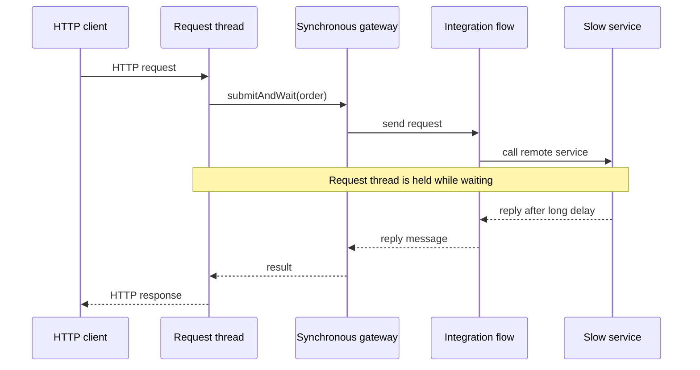
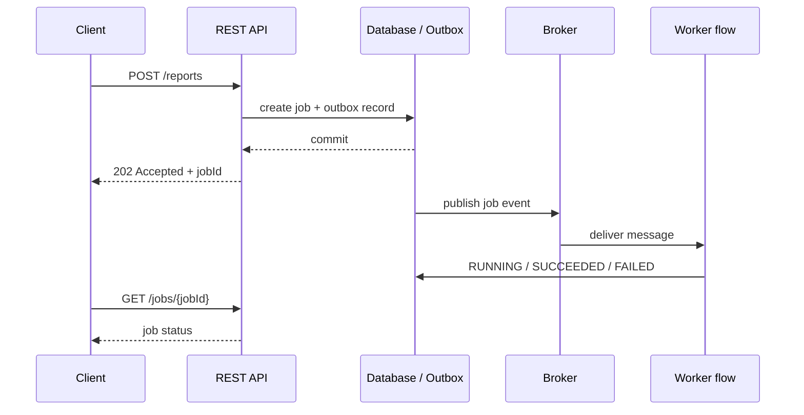

# Never Block Request Threads Across Unbounded Flows

An HTTP request or a gateway call typically starts on a request thread. If the message flow executes synchronously, that thread continues running through the endpoints until the flow returns a result or throws an exception. When a step calls a slow service, waits for another message, waits for an aggregator to collect all parts, or runs work of unbounded duration, the request thread is held for that entire time.

Holding request threads too long reduces how many concurrent requests the server can accept. As waiting requests pile up, the servlet thread pool can be exhausted, forcing new requests to queue or time out even when CPU is not busy. For flows without a well-defined completion bound, decouple request intake from business processing time.

That does not mean every flow must be asynchronous. A short request that needs an immediate result and has bounded processing time can run synchronously. This lesson focuses on identifying long-running flows, choosing the right handoff point, returning results via `Future`/`CompletableFuture`, bounding executors, and handling the consequences for transactions, context, timeouts, and reliability.

## 1. How Does a Request Thread Get Held?

In a synchronous flow, `DirectChannel` invokes the handler on the same thread that sent the message. If a controller calls a synchronous gateway, the gateway sends the message into the flow and waits for a reply. The request thread remains inside the message flow during that entire wait.



Example:

```java
@MessagingGateway
public interface OrderGateway {

    @Gateway(requestChannel = "orders.input")
    OrderResult submit(Order order);
}
```

With a signature returning `OrderResult`, the gateway call is a synchronous request-reply. If downstream waits 20 seconds on an external API, the request thread can be held for that duration. If the flow waits for an event that might arrive minutes later or never arrive, holding the request thread is the wrong design.

### A Simple Calculation on Thread Occupancy

Suppose an application has 200 request threads and each synchronous request holds a thread for 5 seconds on average. When 200 requests arrive together and all wait, the server has consumed all 200 request threads. The 201st request must wait even if CPU capacity is still available.

Little's Law tells us the average number of concurrent requests is roughly the arrival rate multiplied by the request hold duration. At 40 requests/second with an average 5-second hold time, about 200 request threads are needed just to sustain that steady load, before accounting for bursts and headroom.

Do not solve this by growing the request thread pool indefinitely. Threads are still finite resources; when flows wait on slow I/O, adding threads only pushes the bottleneck to memory, connection pools, or downstream services.

## 2. Identifying Where to Decouple the Request Thread

Consider an asynchronous handoff when a flow exhibits one or more of these characteristics:

- Calling external APIs with high or highly variable latency.
- Waiting for responses from multiple branches, an aggregator, or scatter-gather.
- Processing large files, reports, imports/exports, or batches.
- Waiting for state from another system with an unbounded completion time.
- Executing multiple independent side effects after the request has been accepted.
- Able to complete after the HTTP connection has closed, or when the client does not need to wait for the result.

Before switching to async, define the caller's contract:

| Need | Suitable model |
| --- | --- |
| Need immediate result and short, bounded processing time | Synchronous gateway/DirectChannel. |
| Need result later without holding the request thread | Asynchronous gateway returning `Future`/`CompletableFuture`, combined with async HTTP response for web requests. |
| Only need acknowledgment that work was accepted | Send-and-forget or durable queue; return job ID/HTTP 202. |
| Work must survive restarts and needs durable retries | Broker or persistent message store, often combined with outbox/inbox. |
| Need results from multiple branches | Scatter-gather/aggregator; if duration is unbounded, use async reply or a job resource. |

Do not split threads just because a handler takes more than a few milliseconds. Weigh the overhead of thread switching, queues, observability, and error semantics. Split only when it improves request intake capacity or workload isolation.

## 3. Distinguishing Channel Handoff from Asynchronous Gateway

Two mechanisms are frequently confused:

**`ExecutorChannel`** moves the invocation of a subscriber to a `TaskExecutor`. `send()` usually returns quickly once the task is accepted, but the caller may still wait for a reply if calling a synchronous request-reply gateway.

**Asynchronous gateway** changes the contract of the gateway call itself. The method returns a `Future` or `CompletableFuture`, so the caller receives a handle to the result and can continue other work. With an async executor configured on the gateway, the framework runs the invocation on that executor and returns the future to the caller.

| Configuration | Where does the handler run? | Does the request thread still wait for reply? |
| --- | --- | --- |
| Synchronous gateway + `DirectChannel` | Thread calling the gateway. | Yes; held until the flow returns or fails. |
| Synchronous gateway + `ExecutorChannel` | Worker thread after the handoff point. | Possibly yes; the gateway still waits for reply up to timeout. |
| Async gateway returning `CompletableFuture` with async executor | Gateway's executor runs the invocation/flow. | No waiting in the initial call; caller receives a future. |
| Send message to async channel, no reply awaited | Worker thread processes it. | Does not wait for processing completion; only knows dispatch result per channel semantics. |

Key point: a synchronous gateway's `reply-timeout` cannot interrupt a long-running handler on the same thread. The timeout only takes effect once the flow returns control to the gateway—for example, after the message is handed off to another thread and the gateway is waiting for a reply. If downstream still runs synchronously, the request thread remains held until the handler finishes.

## 4. Asynchronous Gateway with CompletableFuture

Spring Integration supports gateway methods returning `Future` or `CompletableFuture`. When an async executor is configured and the method returns the exact `CompletableFuture` type (not a custom subclass), the framework runs the invocation on the executor and returns the future immediately to the caller.

### Declaring the Gateway

```java
@MessagingGateway(asyncExecutor = "orderGatewayExecutor")
public interface OrderGateway {

    @Gateway(requestChannel = "orders.input")
    CompletableFuture<OrderResult> submit(Order order);
}
```

The flow can still be wired with the default `DirectChannel`:

```java
@Configuration
class OrderFlowConfiguration {

    @Bean
    IntegrationFlow orderFlow(OrderService orderService) {
        return IntegrationFlow.from("orders.input")
            .handle(orderService, "process")
            .get();
    }
}
```

Because the gateway already runs the invocation on `orderGatewayExecutor`, the downstream flow is invoked from the gateway's worker thread. There is no need to add an `ExecutorChannel` right after the gateway without a separate workload-isolation reason; switching threads multiple times increases queuing and complicates tracing.

### Using the Future Without Blocking

```java
CompletableFuture<OrderResult> result = orderGateway.submit(order);

result.thenApply(this::toResponse)
      .thenAccept(this::publishResponse);
```

`thenApply`/`thenAccept` callbacks may run on whichever thread completes the future if no separate executor is specified. Callbacks should be short and avoid blocking workers. For heavy processing steps, use `thenApplyAsync(..., anotherExecutor)` and bound that executor accordingly.

The following snippet defeats the benefit of async:

```java
OrderResult result = orderGateway.submit(order).get();
```

`get()` holds the current thread until the result is ready or times out. Calling it inside a controller blocks the request thread again. Return the future to the web framework or switch to a job/status API if the work does not need to return immediately.

### Explicit Executor Configuration

Gateways use `SimpleAsyncTaskExecutor` by default in some `Future` scenarios. That executor creates a new thread per invocation instead of reusing threads like a pool. For server workloads, configure a dedicated executor to control concurrency, queuing, and thread naming.

```java
@Configuration
class OrderExecutorConfiguration {

    @Bean("orderGatewayExecutor")
    ThreadPoolTaskExecutor orderGatewayExecutor() {
        ThreadPoolTaskExecutor executor = new ThreadPoolTaskExecutor();
        executor.setCorePoolSize(8);
        executor.setMaxPoolSize(16);
        executor.setQueueCapacity(100);
        executor.setKeepAliveSeconds(60);
        executor.setThreadNamePrefix("order-flow-");
        executor.setRejectedExecutionHandler(
            new ThreadPoolExecutor.AbortPolicy());
        executor.setWaitForTasksToCompleteOnShutdown(true);
        executor.setAwaitTerminationSeconds(30);
        return executor;
    }
}
```

These numbers are only examples to illustrate configuration, not optimal values for every application. Choose pool sizes based on processing time, CPU/I/O ratio, connection pool limits, and downstream service capacity.

## 5. Returning CompletableFuture from Spring MVC

If the flow is invoked from a REST controller, Spring MVC supports asynchronous return types such as `CompletableFuture`. The controller can return the future instead of calling `get()`; the servlet request thread is released while the result is computed, and Spring MVC completes the response when the future completes.

```java
@RestController
@RequestMapping("/orders")
class OrderController {

    private final OrderGateway orderGateway;

    OrderController(OrderGateway orderGateway) {
        this.orderGateway = orderGateway;
    }

    @PostMapping
    CompletableFuture<ResponseEntity<OrderResult>> submit(
            @RequestBody Order order) {
        return orderGateway.submit(order)
            .thenApply(ResponseEntity::ok);
    }
}
```

This is Spring MVC's asynchronous request processing. It frees the servlet thread while waiting, yet the HTTP connection and request lifecycle remain open until the response completes or times out. If work can take several minutes, holding the client connection open is not a good option either; use a job resource and return `202 Accepted`.

WebFlux has its own non-blocking model. Never call `.block()` on an event-loop thread. If a message flow calls blocking JDBC or SDKs, offload blocking work to an appropriate scheduler/executor; merely changing the return type to `Mono` does not turn blocking code into non-blocking code.

## 6. ExecutorChannel When Decoupling a Single Branch

If you do not need an asynchronous gateway but want to decouple one step in the flow, use `ExecutorChannel` or a DSL channel backed by an executor. Example:

```java
@Configuration
class OrderAsyncChannelConfiguration {

    @Bean("orderWorkerExecutor")
    ThreadPoolTaskExecutor orderWorkerExecutor() {
        ThreadPoolTaskExecutor executor = new ThreadPoolTaskExecutor();
        executor.setCorePoolSize(6);
        executor.setMaxPoolSize(12);
        executor.setQueueCapacity(80);
        executor.setThreadNamePrefix("order-worker-");
        return executor;
    }

    @Bean(name = "orders.async")
    MessageChannel orderAsyncChannel(
            @Qualifier("orderWorkerExecutor") TaskExecutor executor) {
        return new ExecutorChannel(executor);
    }

    @Bean
    IntegrationFlow orderWorkerFlow(OrderWorker worker) {
        return IntegrationFlow.from("orders.async")
            .handle(worker, "process")
            .get();
    }
}
```

When sending a message to `orders.async`, the channel dispatches to one subscriber on the executor. This is a point-to-point handoff. It is useful for commands that do not await a reply or for a downstream branch with its own transaction/error handling.

If a synchronous gateway sends to `ExecutorChannel` and awaits a reply, the gateway caller can still be held waiting for the result. Use an async gateway when you need to change the request-reply contract and release the caller immediately.

`ExecutorChannel` does not share transaction context between sender and handler. It can also execute the task on the caller thread if the executor uses `CallerRunsPolicy` and is overloaded. Therefore, do not treat adding an executor as an absolute guarantee that the request thread will never run long work.

## 7. Long-Running Work: Return a Job ID Instead of Holding the HTTP Request

For reports, data imports, or processing that can take minutes, a job resource model is usually better than a `Future` tied to an HTTP connection:

1. The API receives the request and validates the input.
2. The application generates a `jobId` and stores state `ACCEPTED` along with the payload/reference to the data.
3. The work is published to a broker or persistent queue.
4. The API returns `202 Accepted` and a URL to query job status.
5. The worker updates `RUNNING`, `SUCCEEDED`, or `FAILED`.
6. The client polls status or receives a callback/webhook upon completion.



A transactional outbox lets you save business changes and the event to publish in the same database transaction. A separate publisher sends outbox entries to the broker and marks them sent; workers must be idempotent because messages can be redelivered. An executor's in-memory queue does not replace a broker/persistent store if work must not be lost across process restarts.

## 8. Bounded Executors, Queues, and Backpressure

Decoupling the request thread only helps when the executor is bounded. With an unbounded queue, the system can accept infinite tasks while workers gradually slow down, causing heap growth, high latency, and eventually `OutOfMemoryError`.

With `ThreadPoolTaskExecutor`, when submitting a task, the executor normally uses workers up to `corePoolSize`, then places tasks into the queue. Once the queue is full, it grows workers beyond core up to `maxPoolSize`; once both the queue and pool reach their limits, tasks are rejected.

| Policy | Behavior | Consequence for request threads |
| --- | --- | --- |
| `AbortPolicy` | Throws a rejection error when pool/queue is full. | Caller receives an overload signal; can map to HTTP 429/503. |
| `CallerRunsPolicy` | Caller executes the rejected task itself. | Can hold the request thread for a long time; strong backpressure, but thread isolation is lost. |
| `DiscardPolicy` | Drops the rejected task. | Request may appear dispatched successfully even though work was lost; unsuitable for business jobs. |
| `DiscardOldestPolicy` | Drops the oldest waiting task and retries submitting the new task. | Can lose older work; use only when semantics allow it. |

If the requirement is that request threads never run long work, avoid `CallerRunsPolicy` on an executor called directly from the request path. Use reject/fail-fast, return an overload error, or persist to a broker. If choosing `AbortPolicy`, handle `TaskRejectedException`/`RejectedExecutionException` at the boundary so callers receive a clear response.

Queue capacity must align with maximum acceptable wait time. A queue may hold 100 tasks, yet if each task takes 30 seconds and the pool has only 4 workers, the last task can wait a very long time. Bounding item count without factoring in queue wait time can still produce latency far beyond SLAs.

## 9. Never Hold a Worker Thread Waiting for Another Task

After freeing the request thread, avoid accidentally creating a new bottleneck inside the worker pool. For example, a task on pool A calls `future.get()` waiting for another task that also needs pool A. If all workers in pool A are blocked waiting on tasks sitting in pool A's own queue, the system can hit a thread-starvation deadlock.

Guidelines:

- Avoid `.get()`, `.join()`, or `CountDownLatch.await()` inside a worker if the awaited work needs the same pool.
- Use `CompletableFuture` composition (`thenCompose`, `thenCombine`, `allOf`) instead of blocking waits.
- Separate pools by workload type when mixing long-blocking tasks and latency-sensitive tasks.
- Never share a small pool across gateway invocations, HTTP client callbacks, and subtasks that must finish to unblock that same pool.
- Set timeouts on I/O calls and bound concurrency to target services.

Example combining two async calls without blocking a worker:

```java
CompletableFuture<Customer> customer = customerClient.fetchAsync(order.customerId());
CompletableFuture<Inventory> inventory = inventoryClient.checkAsync(order.items());

CompletableFuture<OrderContext> context = customer.thenCombine(
    inventory,
    (customerResult, inventoryResult) ->
        new OrderContext(order, customerResult, inventoryResult));
```

This snippet assumes both clients truly return asynchronous futures. If a client merely wraps a blocking call in `CompletableFuture` on an inadequately bounded common pool, thread issues can still appear in that other pool.

## 10. Timeouts, Deadlines, and Cancellation

A timeout limits how long you wait for a result; it does not automatically stop running work.

- A synchronous gateway's `reply-timeout` limits how long to wait for a reply after the flow returns control to the gateway. It does not interrupt a handler running synchronously on the caller thread.
- `Future.get(timeout, unit)` stops the caller from waiting when expired, yet still blocks the caller for that duration.
- `CompletableFuture.orTimeout(...)` completes the future with `TimeoutException`; it does not guarantee that the underlying operation is interrupted or canceled.
- `Future.cancel(true)` only requests an interrupt per task/executor semantics. Running code must cooperate with interruption, and I/O clients must have their own timeouts.
- An HTTP client disconnecting does not automatically mean the message flow has been canceled.

Propagate a deadline or timeout budget through headers/message metadata so each step knows how much time remains. If the total SLA is 10 seconds, do not let three downstream calls each wait 10 seconds on their own. Each step should consume the remaining budget and stop early once the deadline has passed.

```java
CompletableFuture<OrderResult> result = orderGateway.submit(order)
    .orTimeout(8, TimeUnit.SECONDS);
```

This example only limits how long the caller waits for the future to complete. To actually stop I/O, configure connect/read/response timeouts on the HTTP client, database timeouts, cancellation tokens, or appropriate interrupt handling on the worker.

## 11. Transactions and Request Context Do Not Cross Thread Boundaries Automatically

When an async gateway or `ExecutorChannel` switches to a worker thread, the transaction bound to the request thread is not automatically propagated. Do not open a transaction in a controller and expect the worker to continue using it.

Place the transaction at the service/endpoint performing data updates on the worker thread:

```java
@Service
class OrderService {

    @Transactional
    public OrderResult process(Order order) {
        // Read/write data within the worker invocation's transaction.
        return ...;
    }
}
```

Never keep a database transaction open while waiting on a slow remote API. Usually, split the workflow into short transactional steps, persist intermediate state, and use idempotency/outbox to continue safely.

Data bound to `ThreadLocal`—such as MDC, security context, locale, and certain tracing contexts—does not automatically appear on the worker either. Use message headers for correlation ID, tenant ID, and deadline; use `TaskDecorator`, Micrometer context propagation, or the corresponding delegating executor for contexts that must propagate. Always restore/clear context after each task to prevent leaking data across requests.

## 12. Error Handling and Asynchronous Results

With a synchronous gateway, downstream exceptions can usually propagate to the caller in the method invocation. With an async gateway, an error in the worker completes the `Future`/`CompletableFuture` exceptionally. The caller must handle errors with `exceptionally`, `handle`, or `whenComplete`, and preserve the underlying cause for logging/metrics.

```java
return orderGateway.submit(order)
    .thenApply(ResponseEntity::ok)
    .exceptionally(ex -> {
        Throwable cause = unwrapCompletionException(ex);
        log.error("Order flow failed", cause);
        return ResponseEntity.status(HttpStatus.SERVICE_UNAVAILABLE).build();
    });
```

In a real system, error mapping should distinguish validation, business rejection, timeout, dependency outage, and executor overload. Do not blindly return 503 for every error; use status codes matching the API contract.

For send-and-forget message flows through `ExecutorChannel`, worker errors cannot return to the already-completed `send()` call. You need an error channel to route `ErrorMessage` to an error flow, or a broker with retry/dead-letter support. A future only tracks errors if the gateway/flow returns a corresponding future result; do not assume async dispatch automatically creates a completion handle for every subscriber.

## 13. Observability: Knowing the Request Thread Was Released

To confirm thread boundaries behave as designed, log the thread name and timestamps at key points:

1. Entering the controller/gateway.
2. Before and after submitting the async invocation.
3. Handler start on the worker.
4. Handler completion or error.
5. Future completion and HTTP response emission.

Track these metrics:

- Web server active request threads, queue, and request latency.
- Executor active count, pool size, queue depth, and rejected task count.
- Wait time in the executor queue separately from handler execution duration.
- Pending futures count, timeouts, cancellations, and exceptional completions.
- Downstream connection pool utilization, timeouts, and error rates.
- Overdue `ACCEPTED`, `RUNNING`, and `FAILED` jobs if using a job resource.

| Symptom | Common cause | How to check |
| --- | --- | --- |
| Request thread remains busy despite adding `ExecutorChannel` | Synchronous gateway still waits for reply or controller calls `.get()`. | Inspect gateway signature and controller call stack. |
| Request returns fast but task does not run | Task waiting in executor queue, executor shut down, or no subscriber. | Check queue depth, active count, rejections, and channel subscriptions. |
| Request thread occasionally runs long handler | `CallerRunsPolicy` triggered when executor overloaded. | Check rejection policy and thread name when handler starts. |
| Latency increases even though workers are idle | Tasks sitting in queue or waiting on connection pool/downstream. | Measure queue wait time and I/O time separately. |
| Future times out yet side effect still occurs | Timeout does not cancel task/remote operation. | Check cancellation, deadline propagation, and idempotency. |
| Worker lacks trace/security context | `ThreadLocal` was not propagated. | Check TaskDecorator/context propagation and message headers. |
| Tasks lost on restart | Only using in-memory executor queue. | Use a persistent broker/store or transactional outbox. |

## 14. Process for Designing Flows That Never Block Request Threads

1. Define the request SLA and the maximum duration a request thread may be held.
2. Classify the flow: short synchronous, async request-reply, or long-running job.
3. Pick one clear handoff point; avoid chaining multiple consecutive executors/channels without reason.
4. If a result is needed later, use an async gateway returning `CompletableFuture`; never call `get()` in the controller.
5. If work is long and does not require keeping the HTTP connection open, persist the job/event and return `202 Accepted` with a job ID.
6. Use bounded executor queues, explicit rejection policies, and downstream concurrency limits.
7. Place transactions at the worker boundary; propagate correlation/deadline/context explicitly.
8. Configure timeouts/cancellation per I/O call; remember that timing out a future does not stop the work by itself.
9. Monitor request threads, executor queues, task latency, rejections, and future completions.
10. Test load, overload, worker failures, client disconnects, timeouts, and restarts to verify semantics.

## 15. Takeaways

- A synchronous flow over `DirectChannel` holds the request thread until downstream returns a result or throws an error.
- `ExecutorChannel` separates the handler from the sender thread, yet a synchronous gateway can still wait for a reply and hold the request thread.
- An async gateway returning `Future`/`CompletableFuture` is what lets the caller obtain a result handle without waiting during the initial call.
- Never call `.get()`/`.join()` in a controller if the goal is to release request threads.
- Executors need bounded queues and clear rejection policies. `CallerRunsPolicy` can push long work back onto the request thread.
- For long-running work, return `202 Accepted` and a job ID; use a broker/persistent store if work must survive restarts.
- Transactions, `ThreadLocal`, security, and tracing context do not automatically cross to worker threads.
- Timeout does not mean cancellation; you need deadlines, I/O timeouts, idempotency, and task-stopping policies.

## References

- [Spring Integration Reference — Messaging Gateways: Asynchronous Gateway](https://docs.spring.io/spring-integration/reference/gateway.html)
- [Spring Integration Reference — ExecutorChannel](https://docs.spring.io/spring-integration/reference/channel/implementations.html)
- [Spring Integration Reference — Message Channel Configuration](https://docs.spring.io/spring-integration/reference/channel/configuration.html)
- [Spring Framework Reference — Task Execution and Scheduling](https://docs.spring.io/spring-framework/reference/integration/scheduling.html)
- [Spring Framework Reference — Asynchronous Requests in Spring MVC](https://docs.spring.io/spring-framework/reference/web/webmvc/mvc-ann-async.html)
