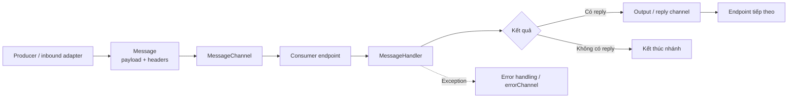

# Message flow từ lúc producer phát message đến khi handler hoàn tất

Trong Spring Integration, một message đi qua nhiều thành phần Spring quản lý: producer tạo message, channel chuyển hoặc lưu message, consumer endpoint lấy message ra, rồi endpoint gọi handler. `IntegrationFlow` mô tả cách ghép các thành phần đó thành một luồng xử lý.

Điểm quyết định cách luồng chạy là loại channel và cấu hình poller hoặc executor. Với `DirectChannel`, handler thường chạy ngay trên thread gọi `send()`. Với `QueueChannel` hoặc `ExecutorChannel`, producer có thể kết thúc lời gọi gửi trước khi handler bắt đầu hoặc hoàn tất. Hiểu ranh giới này giúp đọc đúng log, thiết kế transaction và xử lý lỗi.

## 1. Các thành phần tham gia vào message flow

| Thành phần | Vai trò trong runtime |
|---|---|
| Producer | Tạo và phát message. Có thể là code ứng dụng gọi `MessageChannel.send()`, inbound channel adapter nhận dữ liệu từ hệ thống ngoài, hoặc một message source được poll định kỳ. |
| Message | Gói dữ liệu gồm payload và headers. Payload chứa dữ liệu nghiệp vụ; headers mang metadata phục vụ định tuyến, correlation, reply và error handling. |
| Message channel | Điểm giao tiếp giữa producer và consumer. Channel quyết định message được dispatch ngay, broadcast hay lưu vào hàng đợi. |
| Consumer endpoint | Thành phần Spring quản lý việc nhận message từ input channel và gọi handler. Endpoint có thể nhận theo cơ chế event-driven hoặc polling. |
| Message handler | Thành phần thực hiện công việc trên message: gọi service, biến đổi payload, lọc, định tuyến, tách hoặc gom message. |
| Output/reply channel | Đưa kết quả của handler đến endpoint kế tiếp hoặc trả kết quả về phía gọi. |
| Error channel | Nhận `ErrorMessage` khi lỗi được chuyển sang cơ chế xử lý lỗi bằng message. |

Các vai trò này được tách rời để producer không cần biết consumer cụ thể là bean nào, đang chạy trên thread nào hoặc được triển khai bằng service nào. Producer chỉ cần gửi message tới channel mà nó biết.

### Message là envelope, không chỉ là payload

Một message có hai phần:

- **Payload**: đối tượng dữ liệu mà handler cần xử lý, ví dụ `Order`, `String`, byte array hoặc một đối tượng domain khác.
- **Headers**: metadata như message ID, timestamp, correlation ID, priority, reply channel và error channel.

`Message` và `MessageHeaders` được thiết kế theo hướng bất biến sau khi tạo. Muốn thay payload hoặc header, ta tạo message mới bằng `MessageBuilder`. Tuy vậy, tính bất biến của envelope không tự làm cho object payload bất biến: nếu payload là object mutable và nhiều consumer cùng giữ tham chiếu tới nó, ứng dụng vẫn phải quản lý việc truy cập đồng thời.

Ví dụ tạo message có metadata phục vụ correlation:

```java
Message<Order> message = MessageBuilder.withPayload(order)
        .setHeader("correlationId", requestId)
        .setHeader("sourceSystem", "checkout-api")
        .build();
```

`correlationId` giúp nối các log hoặc message thuộc cùng một nghiệp vụ. Khi flow có splitter và aggregator, correlation cùng các sequence headers còn giúp framework nhận diện những message nào thuộc cùng một nhóm.

## 2. Vòng đời từ producer đến handler

Một luồng đơn giản có thể được đọc theo thứ tự sau:

1. **Producer có dữ liệu đầu vào.** Dữ liệu có thể đến từ lời gọi trong ứng dụng, một inbound adapter hoặc một message source.
2. **Producer tạo `Message<?>`.** Payload chứa dữ liệu; headers bổ sung metadata cần thiết.
3. **Producer gửi message tới channel.** Lời gọi thường là `send(message)`. Channel áp dụng chính sách dispatch hoặc buffering của nó.
4. **Consumer endpoint nhận message.** Với channel có subscriber, endpoint được gọi khi channel dispatch. Với channel có hàng đợi, polling consumer gọi `receive()` theo lịch.
5. **Endpoint gọi handler.** Endpoint kết nối message với `MessageHandler` tương ứng và áp dụng các cấu hình quanh lần xử lý như advice, transaction hoặc retry nếu có.
6. **Handler thực hiện nghiệp vụ.** Handler có thể kết thúc flow, tạo reply, hoặc chuyển kết quả tới endpoint kế tiếp.
7. **Flow xử lý kết quả hoặc lỗi.** Reply đi theo output/reply channel; exception được truyền ngược hoặc được chuyển thành `ErrorMessage` tùy mô hình thực thi.

Sơ đồ tổng quát:



`IntegrationFlow` giúp định nghĩa các thành phần và mối nối này. Khi application context khởi tạo, Spring đăng ký các channel, endpoint và handler cần thiết thành những bean runtime. Vì vậy, một flow DSL không nên được hiểu như một lời gọi Java duy nhất chạy từ đầu đến cuối; runtime thực tế là tập hợp các component phối hợp qua channel.

## 3. Channel quyết định cách message được chuyển

`MessageChannel` là abstraction chung. Hành vi thực tế phụ thuộc implementation mà flow sử dụng.

| Channel | Cách chuyển message | Điều producer có thể suy ra từ `send()` |
|---|---|---|
| `DirectChannel` | Dispatch trực tiếp tới một subscriber. Handler thường chạy trên thread của producer. | Trong luồng đồng bộ, lời gọi gửi chỉ trả về sau khi lần dispatch và xử lý đồng bộ kết thúc. |
| `PublishSubscribeChannel` | Phát cùng message tới tất cả subscriber. Không cấu hình executor thì subscriber chạy trên thread gửi. | Nếu chạy đồng bộ, việc dispatch subscriber diễn ra trong lời gọi gửi; nếu có executor, việc xử lý có thể tiếp tục bất đồng bộ. |
| `QueueChannel` | Lưu message vào hàng đợi; polling consumer lấy message ra sau. | Thành công thường chỉ có nghĩa message đã được nhận vào queue. Handler có thể chưa chạy. |
| `ExecutorChannel` | Dispatch tới subscriber thông qua `TaskExecutor`. | Producer có thể nhận kết quả gửi trước khi handler hoàn tất. |

### DirectChannel: dispatch đồng bộ

`DirectChannel` triển khai `SubscribableChannel` và có point-to-point semantics: mỗi message được dispatch tới một subscriber. Nếu có nhiều subscriber, dispatcher mặc định sử dụng load balancing round-robin; cấu hình failover có thể cho phép thử subscriber tiếp theo khi subscriber được chọn không xử lý thành công.

Điểm quan trọng nhất là thread. Khi producer gọi `send()`, channel gọi handler trực tiếp trên cùng thread. Vì vậy:

- Handler có thể chạy trước khi `send()` trả về.
- Exception đồng bộ có thể truyền ngược về phía gọi.
- Transaction gắn với thread hiện tại có thể tiếp tục bao quanh lời gọi handler, nếu transaction boundary được mở ở phía producer.

Đây là lựa chọn phù hợp khi cần một chuỗi xử lý đồng bộ và muốn giữ transaction context qua channel. Đổi lại, thời gian `send()` bao gồm cả thời gian xử lý của downstream đồng bộ.

### PublishSubscribeChannel: một message, nhiều subscriber

`PublishSubscribeChannel` phát message tới nhiều subscriber. Nếu không cấu hình executor, việc gọi các subscriber diễn ra trên thread gửi. Khi gắn executor, việc dispatch có thể bất đồng bộ.

Không nên nhầm channel này với `DirectChannel`: DirectChannel chọn một subscriber cho mỗi message; PublishSubscribeChannel phát tới các subscriber đã đăng ký. Nếu cần xử lý song song, hãy kiểm tra executor, giới hạn pool và cách xử lý lỗi của từng nhánh.

### QueueChannel: tách thời điểm gửi khỏi thời điểm xử lý

`QueueChannel` triển khai `PollableChannel` và lưu message trong queue. Producer có thể gửi xong trong khi message vẫn đang chờ consumer lấy ra.

Queue mặc định trong bộ nhớ; nếu không đặt capacity, queue có thể không giới hạn. Với hệ thống có tải thực tế, nên cân nhắc capacity hữu hạn để tránh backlog tăng vô hạn và tiêu thụ hết bộ nhớ. Khi queue đầy, khả năng chờ hoặc thất bại của `send()` phụ thuộc timeout và cấu hình channel.

Queue trong bộ nhớ cũng không tự cung cấp durability qua lần process restart. Nếu cần lưu message bền vững, cần cấu hình message store phù hợp và hiểu rõ transaction cũng như semantics lưu/nhận message của store đó.

### ExecutorChannel: tách dispatch sang thread pool

`ExecutorChannel` vẫn dispatch theo subscriber, nhưng việc gọi handler được bàn giao cho `TaskExecutor`. Đây là một ranh giới bất đồng bộ rõ ràng:

- Thread gửi có thể tiếp tục khi task đã được executor nhận.
- Handler chạy trên thread thuộc executor.
- Transaction context gắn với thread của producer không tự động đi theo task.
- Exception của handler không thể được ném trực tiếp về lời gọi `send()` đã kết thúc.

Cần quan sát cả queue của executor, số thread hoạt động và chính sách từ chối task. Nếu executor bão hòa, độ trễ và khả năng tiếp nhận message của flow sẽ thay đổi.

## 4. Consumer endpoint và cách message được lấy ra

Channel mô tả cách giao tiếp; consumer endpoint chịu trách nhiệm nối channel với handler. Spring Integration có hai mô hình tiêu thụ chính.

### Event-driven consumer

Khi input channel là `SubscribableChannel`, endpoint đăng ký handler làm subscriber. Khi channel dispatch message, handler được gọi ngay. `EventDrivenConsumer` là implementation tiêu biểu cho mô hình này.

Mô hình này thường đi cùng `DirectChannel`, `ExecutorChannel` hoặc `PublishSubscribeChannel`. Việc có chạy đồng bộ hay không vẫn phụ thuộc channel và executor, không chỉ phụ thuộc tên endpoint.

### Polling consumer

Khi input channel là `PollableChannel`, endpoint phải chủ động gọi `receive()` để lấy message. `PollingConsumer` thực hiện việc này theo lịch do poller quản lý.

Các tham số poller ảnh hưởng trực tiếp tới độ trễ và tải:

- **Trigger / fixed delay / cron** quyết định thời điểm bắt đầu một poll cycle.
- **`maxMessagesPerPoll`** giới hạn số message được nhận trong một poll cycle. Giá trị này ảnh hưởng tốc độ xả backlog và thời gian một cycle chiếm thread.
- **`receiveTimeout`** quyết định thời gian chờ khi gọi `receive()` mà chưa có message.
- **`taskExecutor`** cho phép chuyển việc gọi handler sang executor riêng.

Nếu poller không có task executor, handler thường được gọi trên một thread của task scheduler. Nếu có task executor, việc gọi handler diễn ra trên thread của executor đó. Tránh để nghiệp vụ chạy lâu chiếm các thread scheduler dùng chung, đặc biệt khi có nhiều polling endpoint.

Cần phân biệt `PollingConsumer` với `SourcePollingChannelAdapter`. PollingConsumer lấy message từ một PollableChannel. SourcePollingChannelAdapter gọi một `MessageSource` theo lịch, sau đó gửi message nhận được vào output channel. Cả hai dùng poller nhưng nằm ở hai vị trí khác nhau trong flow.

## 5. Handler thực hiện công việc gì?

Consumer endpoint không đồng nghĩa với logic nghiệp vụ. Endpoint quản lý cách nhận message; handler là callback thực hiện xử lý. Nhiều component Spring Integration được xây trên abstraction `MessageHandler`, với phương thức cốt lõi:

```java
public interface MessageHandler {
    void handleMessage(Message<?> message);
}
```

Các endpoint phổ biến ánh xạ thành những thao tác khác nhau:

| Thao tác trong flow | Ý nghĩa |
|---|---|
| `transform()` | Tạo payload mới hoặc biến đổi message để downstream sử dụng. |
| `filter()` | Quyết định message có được đi tiếp trên nhánh hiện tại hay không. |
| `route()` | Chọn channel tiếp theo dựa trên payload hoặc headers. |
| `split()` | Tách một message thành nhiều message. |
| `aggregate()` | Gom các message có liên quan thành một kết quả. |
| `handle()` | Gọi service hoặc thực hiện hành động nghiệp vụ, thường qua service activator. |

Một flow có thể có nhiều endpoint nối tiếp, nhiều nhánh router hoặc các bước split/aggregate. Vì vậy, một message ban đầu không nhất thiết tương ứng với đúng một lần gọi handler: filter có thể loại message, splitter tạo nhiều message, publish-subscribe tạo nhiều nhánh và aggregator có thể chờ nhiều message mới phát kết quả.

## 6. Ví dụ: producer gửi Order tới service activator

Ví dụ sau dùng Java DSL với một DirectChannel làm input. Các endpoint trong flow không khai báo channel riêng nên DSL sử dụng các channel nội bộ phù hợp để nối các bước; với cấu hình đồng bộ này, việc xử lý tiếp tục trên thread gửi.

```java
@Configuration
@EnableIntegration
class OrderFlowConfiguration {

    @Bean
    MessageChannel ordersInput() {
        return new DirectChannel();
    }

    @Bean
    IntegrationFlow ordersFlow(OrderHandler handler) {
        return IntegrationFlow.from(ordersInput())
                .transform(Order.class, order -> order.normalize())
                .handle(handler, "save")
                .get();
    }
}
```

Handler nghiệp vụ:

```java
@Component
class OrderHandler {

    private final OrderRepository repository;

    OrderHandler(OrderRepository repository) {
        this.repository = repository;
    }

    public void save(Order order) {
        repository.save(order);
    }
}
```

Producer gửi message:

```java
@Component
class OrderProducer {

    private final MessageChannel ordersInput;

    OrderProducer(@Qualifier("ordersInput") MessageChannel ordersInput) {
        this.ordersInput = ordersInput;
    }

    public void publish(Order order, String requestId) {
        Message<Order> message = MessageBuilder.withPayload(order)
                .setHeader("correlationId", requestId)
                .build();

        boolean sent = ordersInput.send(message, 1_000);
        if (!sent) {
            throw new IllegalStateException("ordersInput did not accept the message");
        }
    }
}
```

Trình tự runtime trong ví dụ:

1. `publish()` tạo message có payload là Order và header correlation ID.
2. `send()` dispatch message vào `ordersInput`.
3. `DirectChannel` gọi consumer endpoint đã đăng ký.
4. Endpoint chạy transformer để tạo Order đã chuẩn hóa.
5. Service activator gọi `OrderHandler.save()`.
6. Khi `save()` kết thúc, nhánh xử lý đồng bộ kết thúc và lời gọi gửi có thể trả về.

Phương thức `save()` trả về `void`, nên ví dụ không tạo reply nghiệp vụ. Nếu handler trả về một object, service activator có thể chuyển giá trị đó thành reply message và gửi theo output/reply channel phù hợp. Việc có nơi nhận reply hay không phụ thuộc cách flow và gateway được cấu hình.

Nếu thay input bằng `QueueChannel` hoặc thêm `ExecutorChannel`, cần xem lại kết luận về thời điểm `publish()` trả về: producer có thể kết thúc trước khi `OrderHandler.save()` bắt đầu.

## 7. `send()` trả về có nghĩa là handler đã hoàn tất không?

Không có một câu trả lời chung cho mọi flow. Ý nghĩa của kết quả gửi phụ thuộc channel và các ranh giới bất đồng bộ ở phía sau.

| Tình huống | Khi `send()` trả về | Handler đã hoàn tất chưa? |
|---|---|---|
| DirectChannel, flow đồng bộ | Sau khi dispatch đồng bộ kết thúc | Thông thường là rồi, đối với chuỗi xử lý đồng bộ được gọi trong lần dispatch đó. |
| QueueChannel | Sau khi message được nhận vào queue | Chưa chắc; consumer có thể chưa poll message. |
| ExecutorChannel | Sau khi task được bàn giao cho executor | Chưa chắc; handler có thể chưa bắt đầu. |
| PublishSubscribeChannel không executor | Sau khi các subscriber đồng bộ được dispatch | Thông thường là rồi đối với các subscriber chạy đồng bộ. |
| PublishSubscribeChannel có executor | Sau khi việc dispatch được bàn giao cho executor | Chưa chắc; các subscriber có thể vẫn đang xử lý. |

Ngay cả trong flow đồng bộ, `send()` cũng không phải một cam kết chung rằng toàn bộ nghiệp vụ bên ngoài đã durable. Ví dụ, transaction có thể chỉ commit sau khi lời gọi handler kết thúc và transaction interceptor hoàn tất. Một hệ thống ngoài cũng có thể xử lý tiếp sau khi handler đã gửi request.

Nếu producer cần biết kết quả nghiệp vụ, hãy dùng cơ chế phản hồi phù hợp:

- Dùng messaging gateway cho mô hình request-reply, kèm timeout rõ ràng.
- Trả reply message qua `replyChannel` hoặc output channel được cấu hình.
- Phát acknowledgment hoặc completion event có correlation ID.
- Lưu trạng thái xử lý vào nơi có thể truy vấn khi công việc kéo dài hoặc bất đồng bộ.

Đừng dùng riêng giá trị boolean của `send()` để kết luận nghiệp vụ đã thành công. Nó cho biết kết quả gửi theo semantics của channel.

## 8. Threading và transaction thay đổi theo channel

Threading ảnh hưởng trực tiếp đến transaction vì nhiều transaction context trong Spring được gắn với thread hiện tại.

| Mô hình | Thread xử lý | Hệ quả với transaction |
|---|---|---|
| DirectChannel | Thread gọi `send()` | Có thể giữ cùng transaction thread-bound từ producer qua handler. |
| ExecutorChannel | Thread do TaskExecutor cấp | Transaction của producer không tự động truyền sang thread handler. |
| QueueChannel + PollingConsumer | Thread poller hoặc executor của poller | Transaction thường được mở quanh poll/handler theo cấu hình advice của poller. |
| PublishSubscribeChannel không executor | Thread gửi | Các subscriber đồng bộ dùng cùng thread; cần xem xét thứ tự và lỗi giữa các subscriber. |
| PublishSubscribeChannel có executor | Thread executor | Các nhánh có thể chạy bất đồng bộ; transaction của producer không tự động bao trùm chúng. |

Nếu cần transaction ở phía consumer, hãy thiết lập transaction boundary tại endpoint hoặc poller phù hợp. Với polling consumer, có thể cấu hình advice chain để bao quanh poll operation. Với handler chạy trong executor, hãy xác định transaction mới ở phía xử lý nếu nghiệp vụ cần nó.

Một transaction qua DirectChannel cũng không tự tạo ra distributed transaction với hệ thống ngoài. Nếu handler vừa cập nhật database vừa gọi HTTP hoặc broker khác, cần thiết kế consistency, retry và idempotency theo khả năng thực tế của từng hệ thống.

## 9. Exception đi đâu?

Cách exception được quan sát cũng phụ thuộc thread thực thi.

### Lỗi trong flow đồng bộ

Với DirectChannel và các bước đồng bộ, handler chạy trong call stack của producer. Nếu handler ném exception, exception có thể truyền ngược về caller. Khi producer gọi trực tiếp `MessageChannel` hoặc `MessagingTemplate`, caller thường là nơi nhận exception đồng bộ.

### Lỗi trong flow bất đồng bộ

Với task chạy trong `TaskExecutor` hoặc task polling, lời gọi gửi ban đầu có thể đã kết thúc nên exception không thể được ném ngược về thread producer theo call stack thông thường. Spring Integration có cơ chế phát `ErrorMessage` tới error channel:

1. Nếu message đang được xử lý có header `errorChannel`, error message được gửi tới channel đó.
2. Nếu không có header riêng, cơ chế error handling có thể gửi tới channel toàn cục tên `errorChannel`.
3. Một error flow có thể tiếp nhận, phân loại, ghi log hoặc chuyển lỗi tới bước xử lý tiếp theo.

Cơ chế này phụ thuộc task và error handler được cấu hình. Lỗi phát sinh trên cùng thread với producer không tự động trở thành `ErrorMessage` chỉ vì ứng dụng có một bean `errorChannel`.

Với polling task, cần kiểm tra cả error handler của task scheduler. Nếu tự cung cấp scheduler, hãy xác nhận cấu hình có `MessagePublishingErrorHandler` khi muốn lỗi scheduler được chuyển qua error channel.

## 10. Correlation, reply và trạng thái xử lý

Headers giúp duy trì ngữ cảnh xuyên qua các endpoint:

- **Message ID** nhận diện một message cụ thể.
- **Correlation ID** liên kết các message thuộc cùng một request hoặc nghiệp vụ.
- **Sequence number / sequence size** mô tả vị trí và số lượng message trong một nhóm, thường hữu ích với splitter và aggregator.
- **Reply channel** xác định nơi gửi kết quả trả về.
- **Error channel** xác định nơi gửi lỗi của message.
- **Priority** có ý nghĩa khi channel hỗ trợ ưu tiên, ví dụ PriorityChannel.

Khi handler tạo message mới, hãy quyết định headers nào cần được giữ lại và headers nào phải thay đổi. `MessageBuilder.fromMessage()` hoặc các phương thức copy headers giúp tạo message mới mà vẫn giữ metadata cần thiết. Không nên giữ nguyên một correlation ID nếu message mới đã bắt đầu một nghiệp vụ độc lập.

Với flow bất đồng bộ, correlation ID đặc biệt hữu ích vì log của producer, poller và handler có thể xuất hiện trên các thread khác nhau và cách xa nhau về thời gian.

## 11. Cách chẩn đoán một message không tới handler

Khi thấy producer đã gửi nhưng handler không chạy, hãy lần theo từng ranh giới runtime thay vì chỉ kiểm tra method nghiệp vụ.

1. **Xác nhận producer thực sự gửi gì.** Kiểm tra channel bean được inject, payload type, headers quan trọng và kết quả `send()`.
2. **Xác nhận đúng channel instance.** Kiểm tra tên bean và cấu hình flow. Hai flow có thể vô tình gửi và lắng nghe trên hai channel khác nhau nếu chúng không dùng cùng bean.
3. **Xác nhận channel semantics.** DirectChannel cần subscriber; QueueChannel cần consumer/poller; ExecutorChannel cần executor hoạt động và còn khả năng nhận task.
4. **Xác nhận endpoint đang chạy.** Kiểm tra lifecycle, `autoStartup`, trạng thái start/stop và input channel của endpoint.
5. **Nếu là polling, kiểm tra lịch poll.** Xem trigger, `maxMessagesPerPoll`, `receiveTimeout`, backlog và thread scheduler.
6. **Nếu là executor, kiểm tra pool.** Xem active thread, queue của executor, task bị từ chối và thời gian chờ trước khi handler bắt đầu.
7. **Kiểm tra handler và nhánh tiếp theo.** Filter có thể loại message; router có thể đưa sang channel khác; transformer có thể tạo payload khác; handler có thể không phát reply.
8. **Kiểm tra error flow.** Tìm `ErrorMessage`, header `errorChannel` và subscriber của global error channel.

Để đo độ trễ, nên ghi nhận tối thiểu correlation ID, message ID, thời điểm producer gửi, thời điểm consumer nhận, tên thread và thời gian handler bắt đầu/kết thúc. Không ghi payload nhạy cảm vào log nếu không có yêu cầu và kiểm soát phù hợp.

Khi hệ thống có bật công cụ quản lý Spring Integration, Integration Graph có thể giúp quan sát channel, endpoint và các kết nối đã đăng ký trong application context. Khả năng hiển thị và endpoint quản lý cụ thể phụ thuộc phiên bản cùng cấu hình ứng dụng.

### Một số triệu chứng thường gặp

| Triệu chứng | Nguyên nhân cần kiểm tra trước |
|---|---|
| `send()` trả về nhưng handler chưa chạy | Message đã vào QueueChannel hoặc task đã được bàn giao cho executor; kiểm tra consumer, poller và executor. |
| Queue tăng liên tục | Consumer không chạy, poller quá chậm, handler quá lâu hoặc năng lực xử lý thấp hơn tốc độ producer. |
| Handler chạy trên thread khác | Flow có ExecutorChannel, executor ở PublishSubscribeChannel hoặc task executor của poller. |
| Producer không nhận được exception của handler | Exception xảy ra sau ranh giới bất đồng bộ; kiểm tra errorChannel và error handler. |
| Handler không được gọi dù channel nhận message | Endpoint chưa chạy, đăng ký sai channel, không có subscriber hoặc polling consumer chưa được kích hoạt. |
| Transaction của producer không bao trùm handler | Flow đã chuyển sang thread khác hoặc transaction boundary nằm ở component khác. |

## 12. Các nguyên tắc cần nhớ khi đọc runtime

- Producer gửi tới channel; producer thường không gọi trực tiếp handler.
- Channel quyết định dispatch, fan-out hoặc buffering.
- Consumer endpoint nối input channel với handler và quyết định nhận theo event-driven hay polling.
- Poller quyết định nhịp nhận message từ nguồn hoặc pollable channel; task executor quyết định thread thực thi khi được cấu hình.
- Handler hoàn tất khi phần xử lý của nó kết thúc; điều đó có thể xảy ra sau khi producer đã nhận kết quả gửi.
- Reply và error là những đường đi riêng, cần được cấu hình và quan sát riêng.
- Ranh giới bất đồng bộ làm thay đổi thread, transaction, exception propagation và cách đo completion.

Khi điều tra một flow, hãy lần theo chuỗi **producer → message → channel → endpoint/consumer → handler → output/reply hoặc error**. Ở mỗi đoạn, xác định loại component, thread thực thi và thời điểm component coi công việc của nó là hoàn tất. Ba câu hỏi đó thường đủ để giải thích vì sao một message đang chờ, vì sao handler chạy trên thread khác hoặc vì sao producer không nhìn thấy exception.

## Tài liệu tham khảo

- [Message](https://docs.spring.io/spring-integration/reference/message.html) — cấu trúc Message, headers và MessageBuilder.
- [Message Channel Implementations](https://docs.spring.io/spring-integration/reference/channel/implementations.html) — DirectChannel, QueueChannel và các channel implementation.
- [Configuring Message Channels](https://docs.spring.io/spring-integration/reference/channel/configuration.html) — cấu hình channel, executor và queue.
- [Message Endpoints](https://docs.spring.io/spring-integration/reference/endpoint.html) — event-driven consumer, polling consumer và MessageHandler.
- [Error Handling](https://docs.spring.io/spring-integration/reference/error-handling.html) — exception propagation, ErrorMessage và errorChannel.
- [Java DSL Basics](https://docs.spring.io/spring-integration/reference/dsl/java-basics.html) — cách IntegrationFlow DSL ánh xạ thành endpoint và runtime component.

Các chi tiết cấu hình có thể khác giữa các phiên bản Spring Integration. Khi áp dụng vào dự án, hãy đối chiếu tài liệu đúng phiên bản đang được quản lý bởi dependency BOM của ứng dụng.
