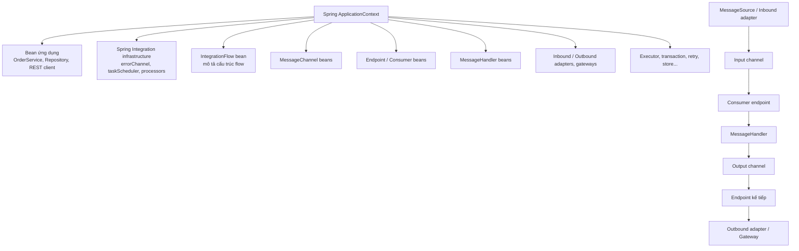
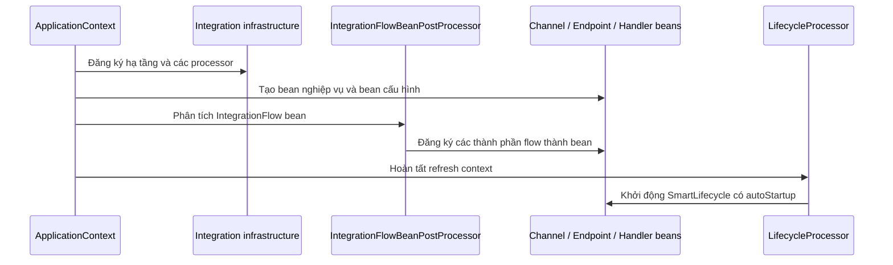
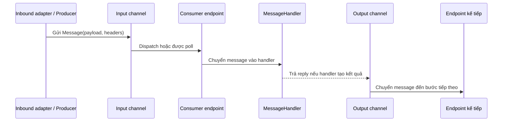

# ApplicationContext, IntegrationContext và các bean tích hợp liên hệ

Spring Integration không dựng một IoC container độc lập để chạy message flow. Nó mở rộng container của Spring bằng các bean, endpoint và hạ tầng messaging. Trong ứng dụng thông thường, `ApplicationContext` vẫn là nơi tạo, liên kết, quản lý vòng đời và cung cấp dependency cho cả bean nghiệp vụ lẫn bean tích hợp.

Tên `IntegrationContext` dễ gây nhầm lẫn. Trong API công khai hiện hành của Spring Integration, không có một container thứ hai mang tên `IntegrationContext` đứng ngang hàng với `ApplicationContext`. Hai API có tên gần nhất nhưng vai trò khác nhau là `IntegrationFlowContext`, dùng để đăng ký và quản lý flow động lúc ứng dụng đang chạy, và `IntegrationContextUtils`, một lớp tiện ích tra cứu một số bean tích hợp từ `BeanFactory`. Nếu một ví dụ cũ hoặc thư viện khác dùng kiểu `IntegrationContext`, cần kiểm tra package đầy đủ và phiên bản dependency trước khi áp dụng.

## 1. Nhìn toàn cảnh: một container, nhiều loại bean

Hãy xem `ApplicationContext` là phạm vi quản lý của ứng dụng. Bên trong nó có thể cùng tồn tại:

- Bean nghiệp vụ do ứng dụng viết, chẳng hạn `OrderService`, repository hoặc client gọi REST.
- Bean hạ tầng Spring Integration, chẳng hạn error channel, task scheduler, converter và các processor phục vụ cấu hình.
- Bean mô tả và thực thi luồng tích hợp: `IntegrationFlow`, `MessageChannel`, endpoint, handler, message source và adapter.
- Bean hỗ trợ runtime như executor, transaction manager, retry advice, message store hoặc metadata store khi flow cần chúng.

Sơ đồ dưới đây biểu diễn quan hệ sở hữu. Các thành phần trong khung Spring container đều được Spring quản lý như bean; các mũi tên trong message flow biểu diễn đường đi của message khi ứng dụng hoạt động.



Một flow có thể dùng nhiều bean khác nhau, nhưng chúng không cần nằm trong một runtime container riêng. Chúng được đăng ký trong bean factory của application context phù hợp, được inject dependency và được quản lý vòng đời theo cơ chế Spring.

## 2. Phân biệt các khái niệm có tên gần nhau

| Khái niệm | Vai trò | Có phải container độc lập không? |
|---|---|---|
| `ApplicationContext` | Container Spring: quản lý bean, dependency injection, event, resource và lifecycle | Có. Đây là container thực sự của ứng dụng |
| Hạ tầng Spring Integration | Các bean nền tảng hỗ trợ channel, endpoint, poller, error handling và cấu hình tích hợp | Không. Chúng là bean bên trong `ApplicationContext` |
| `IntegrationFlow` | Mô tả một message flow bằng Java DSL hoặc cấu hình tương đương | Không. Đây là một bean mô tả/cấu thành flow |
| `IntegrationFlowContext` | API đăng ký, tra cứu và gỡ bỏ `IntegrationFlow` động trong lúc ứng dụng chạy | Không. Nó hoạt động trên bean factory của ứng dụng |
| `IntegrationContextUtils` | Hàm tiện ích lấy một số bean tích hợp phổ biến từ `BeanFactory` | Không. Đây là utility class |
| `MessageChannel`, endpoint, handler, adapter | Các thành phần cụ thể truyền và xử lý message | Không. Chúng là các bean tham gia runtime |

### 2.1. ApplicationContext là nơi quản lý

`ApplicationContext` kế thừa khả năng tra cứu bean của `BeanFactory` và bổ sung các chức năng ở cấp ứng dụng như phát application event, resource loading và tích hợp với môi trường cấu hình. Với Spring Integration, nó đảm nhiệm các việc sau:

1. Tạo các bean được khai báo bằng component scan, `@Bean`, annotation messaging hoặc XML.
2. Inject bean nghiệp vụ vào handler, gateway, adapter và các thành phần cấu hình flow.
3. Cung cấp `BeanFactory` để các thành phần tích hợp tra cứu channel, service, scheduler và các bean hỗ trợ.
4. Quản lý khởi động, dừng và hủy các thành phần có hỗ trợ lifecycle.
5. Phát các sự kiện của Spring để ứng dụng có thể phản ứng với trạng thái context.

Vì vậy, khi nói một flow “nằm trong application context”, ý nghĩa chính xác là các bean cấu thành flow được đăng ký và quản lý bởi bean factory của context đó. `ApplicationContext` không phải kho chứa message; một số channel như `QueueChannel` có thể buffer message, còn message được chuyển và xử lý trong message flow.

Spring hỗ trợ context cha-con. Bean trong context con có thể tra cứu bean từ context cha, còn context cha không tra cứu ngược bean chỉ được khai báo ở context con. Mô hình này có thể hữu ích khi nhiều context con dùng chung một phần hạ tầng tích hợp, nhưng ứng dụng thông thường chỉ cần một context chính.

### 2.2. Hạ tầng Spring Integration được đưa vào context

Với cấu hình Java, `@EnableIntegration` là annotation chuẩn để đăng ký hạ tầng Spring Integration. Annotation này nhập cấu hình cần thiết, thêm các `BeanFactoryPostProcessor`, `BeanPostProcessor` và annotation processor, đồng thời đăng ký một số bean mặc định. Ví dụ thường gặp là `errorChannel` và `taskScheduler` dùng cho poller.

```java
@Configuration
@EnableIntegration
@ComponentScan(basePackageClasses = IntegrationConfiguration.class)
public class IntegrationConfiguration {
    // Khai báo channel, IntegrationFlow và các bean tích hợp tại đây.
}
```

Trong dự án dùng XML namespace, hạ tầng tương ứng có thể được kích hoạt qua cấu hình XML. Với Spring Boot, starter và auto-configuration còn phụ thuộc phiên bản; hãy kiểm tra cấu hình thực tế của ứng dụng trước khi kết luận bean hạ tầng nào đã được tạo tự động.

Các bean hạ tầng không phải là một “IntegrationContext” mới. Chúng là những dependency mà endpoint, poller, expression, error handler hoặc thành phần khác có thể sử dụng trong cùng application context.

## 3. Từ IntegrationFlow đến các bean runtime

Java DSL cho phép khai báo một flow theo dạng fluent API. Ví dụ, đoạn `IntegrationFlow` sau mô tả một luồng nhận mã đơn hàng, chuẩn hóa chuỗi, gọi service và chuyển kết quả sang channel đầu ra:

```java
@Configuration
@EnableIntegration
public class OrderIntegrationConfiguration {

    @Bean
    public MessageChannel ordersIn() {
        return new DirectChannel();
    }

    @Bean
    public QueueChannel ordersOut() {
        return new QueueChannel(100);
    }

    @Bean
    public IntegrationFlow orderFlow(OrderService orderService) {
        return IntegrationFlow.from("ordersIn")
                .<String, String>transform(String::trim)
                .handle(String.class,
                        (orderId, headers) -> orderService.accept(orderId))
                .channel("ordersOut")
                .get();
    }
}
```

Bean nghiệp vụ được inject như dependency thông thường:

```java
@Service
public class OrderService {

    public String accept(String orderId) {
        // Thực hiện nghiệp vụ; ví dụ này trả về kết quả để minh họa.
        return "accepted:" + orderId;
    }
}
```

Có thể gửi và nhận message qua các channel đã khai báo:

```java
@Autowired
@Qualifier("ordersIn")
private MessageChannel ordersIn;

@Autowired
@Qualifier("ordersOut")
private PollableChannel ordersOut;

public void submit() {
    ordersIn.send(new GenericMessage<>("  order-42  "));

    Message<?> result = ordersOut.receive(1_000);
    // Payload kết quả là "accepted:order-42" nếu flow xử lý thành công.
}
```

Ở ví dụ này:

- `ordersIn` là `DirectChannel`. Khi gửi message, channel chuyển message đến consumer đã đăng ký trên channel trong cùng luồng gọi.
- `orderFlow` là bean mô tả chuỗi thao tác. Nó tham chiếu channel đầu vào, transformer, handler và channel đầu ra.
- `OrderService` vẫn là bean nghiệp vụ thông thường. Spring inject service vào phương thức tạo flow; handler gọi service khi message đến.
- `ordersOut` là `QueueChannel`. Kết quả được đưa vào hàng đợi và ví dụ lấy ra bằng `receive()`.

### 3.1. Ai biến DSL thành endpoint và channel?

`IntegrationFlowBuilder` thu thập các thành phần được mô tả trong flow, ví dụ `MessageChannel`, endpoint và handler. `IntegrationFlowBeanPostProcessor` phân tích các bean `IntegrationFlow` và đăng ký các thành phần cần thiết thành bean trong `BeanFactory`.

Do đó, một flow DSL không phải một đoạn code duy nhất được gọi tuần tự như một phương thức Java. Khi context được khởi tạo, cấu hình flow được chuyển thành các bean runtime có liên kết cụ thể. Tùy cách khai báo, một endpoint thường bao gồm consumer endpoint kết nối channel đầu vào với message handler. Tên bean của các thành phần do DSL sinh ra có thể được tạo tự động; đặt ID tường minh cho flow hoặc endpoint quan trọng giúp việc quản lý và quan sát dễ hơn.

Các cách khai báo khác như XML namespace, `@ServiceActivator`, `@Transformer`, `@Router` hoặc `@MessagingGateway` cũng được chuyển thành bean definition và endpoint tương ứng. Cú pháp khai báo khác nhau, nhưng kết quả vẫn là các thành phần được quản lý trong Spring container.

### 3.2. Quan hệ giữa channel, endpoint, consumer và handler

| Thành phần | Trách nhiệm | Câu hỏi khi debug |
|---|---|---|
| `Message` | Đóng gói payload và headers | Payload/header nào đang được truyền? |
| `MessageChannel` | Chuyển message từ producer đến consumer | Channel có đúng tên và đúng loại không? |
| `MessageHandler` | Thực hiện thao tác trên message | Handler có được tạo và nhận đúng payload không? |
| Consumer endpoint | Kết nối channel đầu vào với handler; quyết định cách nhận message | Endpoint có subscribe hoặc poll đúng cách không? |
| `MessageSource` | Tạo message từ nguồn dữ liệu khi được đọc/poll | Source có trả về dữ liệu không? |
| Inbound adapter | Đưa dữ liệu từ hệ thống ngoài vào message flow | Kết nối nguồn ngoài và cấu hình nhận dữ liệu có hoạt động không? |
| Outbound adapter | Gửi message từ flow ra hệ thống ngoài | Handler gửi đi có được gọi và có lỗi kết nối không? |
| Gateway | Cung cấp điểm gọi tích hợp, thường hỗ trợ request-reply | Có reply, timeout hoặc error nào xảy ra không? |

Endpoint là cầu nối giữa channel và handler. Với channel dạng subscribe, endpoint có thể đăng ký consumer để nhận message khi có message mới. Với channel dạng pollable hoặc một `MessageSource`, endpoint cần poller để lấy message theo lịch.

## 4. Luồng khởi động và luồng xử lý message

### 4.1. Khi ApplicationContext khởi động

Một trình tự khái quát như sau:



Diễn giải theo trách nhiệm:

1. Spring đọc cấu hình và chuẩn bị bean factory.
2. Cấu hình Spring Integration đăng ký hạ tầng và các processor cần thiết.
3. Spring tạo bean nghiệp vụ, channel và bean khai báo flow; dependency được inject.
4. `IntegrationFlowBeanPostProcessor` phân tích flow và đăng ký các thành phần cụ thể trong bean factory.
5. Khi context hoàn tất refresh, lifecycle processor khởi động các thành phần `SmartLifecycle` được cấu hình tự khởi động.

Các endpoint và adapter có lifecycle riêng. `autoStartup` quyết định một thành phần có tự khởi động cùng context hay không; `phase` giúp sắp thứ tự khởi động và dừng giữa các thành phần hỗ trợ `SmartLifecycle`. Khi context đóng, Spring dừng các thành phần đang chạy và gọi quá trình hủy bean để giải phóng tài nguyên.

Không nên gửi message từ constructor, `@PostConstruct` hoặc `afterPropertiesSet()` của bean nếu message cần endpoint chưa khởi động. Nếu cần phát message sau khi ứng dụng sẵn sàng, hãy dùng một sự kiện lifecycle phù hợp, chẳng hạn `ApplicationReadyEvent` trong ứng dụng Spring Boot, hoặc `ContextRefreshedEvent` khi cần bám theo Spring context.

### 4.2. Khi một message đi qua flow



Channel là điểm nối, còn endpoint quyết định cách consumer nhận message và gọi handler. Một handler có thể chỉ tạo side effect, hoặc trả về kết quả để tạo reply message. Reply thường đi đến output channel đã cấu hình; nếu không, framework có thể dùng return address có trong message header khi phù hợp.

Không phải mọi flow đều chạy trên một thread. Thread thực tế phụ thuộc loại channel, poller, executor, adapter và cấu hình endpoint. Vì thế, khi chẩn đoán thứ tự xử lý hoặc độ trễ, cần xác định chính xác điểm dispatch và nơi thread được chuyển giao.

## 5. Channel, poller và executor ảnh hưởng đến runtime như thế nào?

Các bean channel có hành vi khác nhau. Chọn channel sẽ ảnh hưởng đến đồng bộ, buffering và cách consumer nhận message.

| Loại channel | Cách chuyển message | Hệ quả thường gặp |
|---|---|---|
| `DirectChannel` | Gọi subscriber trong thread gửi message | Đơn giản và đồng bộ; handler chậm có thể làm chậm caller |
| `QueueChannel` | Đưa message vào hàng đợi để consumer lấy ra | Có buffering; cần consumer nhận message, thường qua poller |
| `PublishSubscribeChannel` | Phát message đến nhiều subscriber | Phù hợp khi nhiều nhánh cùng cần nhận một message |
| `ExecutorChannel` | Dùng `TaskExecutor` để dispatch | Có thể chuyển xử lý sang thread khác; cần quan tâm thứ tự, concurrency và error propagation |

Poller là cấu hình lịch đọc dữ liệu, không phải một loại channel. Nó thường gắn với polling consumer hoặc source polling channel adapter. `taskScheduler` lên lịch kích hoạt poller; `TaskExecutor` có thể thực hiện công việc trên thread pool nếu cấu hình endpoint yêu cầu. Không nên suy luận rằng chỉ cần khai báo poller thì toàn bộ flow tự động chạy bất đồng bộ.

Ví dụ:

- Một inbound adapter đọc file theo chu kỳ thường dùng poller để kiểm tra nguồn file.
- Một `DirectChannel` nối handler xử lý đồng bộ trong thread gửi message.
- Một `ExecutorChannel` chuyển việc dispatch sang executor, có thể tăng khả năng xử lý song song nhưng làm thay đổi thứ tự và cách lỗi được truyền về caller.
- Một `QueueChannel` giữ message chờ consumer đọc; nếu không có consumer hoặc poller phù hợp, message có thể nằm lại trong queue.

Transaction, retry, error channel, message store và correlation cũng được gắn vào các thành phần runtime cụ thể. Chúng không thay thế `ApplicationContext`; chúng là dependency hoặc cấu hình mà endpoint, handler, aggregator và các thành phần tích hợp sử dụng. Khi một message thất bại, cần xác định lỗi xảy ra ở source, channel dispatch, handler hay outbound adapter để biết error channel, retry advice hoặc transaction boundary nào có hiệu lực.

## 6. Đăng ký flow động: vai trò của IntegrationFlowContext

Flow khai báo bằng `@Bean` thường được tạo khi context khởi động. Nếu ứng dụng cần tạo hoặc gỡ flow khi chạy, Spring Integration cung cấp `IntegrationFlowContext`.

`IntegrationFlowContext` là một bean do framework cung cấp. Nó đăng ký `IntegrationFlow` cùng các bean phụ thuộc vào bean factory đang chạy, trả về một registration để quản lý flow, và hỗ trợ gỡ flow theo ID.

```java
@Component
public class PartnerFlowRegistry {

    private final IntegrationFlowContext flowContext;

    public PartnerFlowRegistry(IntegrationFlowContext flowContext) {
        this.flowContext = flowContext;
    }

    public String register(String partnerId, MessageChannel inputChannel) {
        IntegrationFlow flow = IntegrationFlow.from(inputChannel)
                .<String, String>transform(String::trim)
                .handle(String.class,
                        (payload, headers) -> "partner-" + partnerId + ":" + payload)
                .get();

        IntegrationFlowContext.IntegrationFlowRegistration registration =
                this.flowContext.registration(flow)
                        .id("partner-" + partnerId)
                        .autoStartup(true)
                        .register();

        return registration.getId();
    }

    public void unregister(String flowId) {
        this.flowContext.remove(flowId);
    }
}
```

Trong ví dụ, `inputChannel` là channel đã được tạo và quản lý phù hợp trong ứng dụng. Khi đăng ký, flow được thêm vào context đang chạy; khi gỡ bằng ID, framework hủy flow cùng các bean phụ thuộc do registration quản lý và dọn registry tương ứng. Có thể dùng registration để truy cập flow, input channel hoặc messaging template theo nhu cầu.

Một vài nguyên tắc khi quản lý flow động:

- Chọn ID ổn định và duy nhất trong phạm vi context. ID giúp tra cứu, quan sát và gỡ đúng flow.
- Quyết định rõ `autoStartup`; nếu tắt tự khởi động, ứng dụng phải chủ động khởi động registration hoặc các thành phần liên quan.
- Gỡ flow khi không còn cần thiết để endpoint và tài nguyên đi kèm được dừng, hủy.
- Nếu flow cần thêm connection factory, serializer hoặc bean hỗ trợ chưa nằm trong context, đăng ký chúng cùng flow bằng các tùy chọn của registration builder.
- Tránh tạo một `ApplicationContext` mới cho mỗi flow nếu nhu cầu chỉ là thêm/bớt flow. `IntegrationFlowContext` được thiết kế cho việc đăng ký flow động trong context hiện có.

### 6.1. IntegrationContextUtils có vai trò gì?

`IntegrationContextUtils` thuộc package `org.springframework.integration.context`. Đây là utility class cung cấp các phương thức tra cứu bean tích hợp phổ biến từ `BeanFactory`, ví dụ error channel, task scheduler, metadata store hoặc evaluation context.

Ví dụ:

```java
MessageChannel errorChannel =
        IntegrationContextUtils.getErrorChannel(beanFactory);

TaskScheduler taskScheduler =
        IntegrationContextUtils.getTaskScheduler(beanFactory);
```

Lớp này không chứa toàn bộ trạng thái runtime và cũng không đăng ký flow. Trong code ứng dụng thông thường, ưu tiên dependency injection theo kiểu và tên bean khi phù hợp; utility này hữu ích khi một thành phần hạ tầng cần tra cứu bean từ `BeanFactory`.

## 7. Kiểm tra quan hệ bean khi flow không chạy

Khi flow không hoạt động như mong đợi, hãy lần theo quan hệ từ container đến message thay vì chỉ nhìn vào phương thức lambda trong DSL.

| Triệu chứng | Kiểm tra ở đâu | Nguyên nhân thường gặp |
|---|---|---|
| Không thấy channel trong context | `ApplicationContext` và bean name | Chưa khai báo channel, sai tên hoặc flow tham chiếu nhầm context |
| Có flow bean nhưng không có message | Source, inbound adapter và input channel | Nguồn chưa phát message, adapter chưa kết nối hoặc message đi vào channel khác |
| Message đến channel nhưng handler không chạy | Consumer endpoint và subscription | Endpoint chưa được tạo/khởi động, channel không có subscriber hoặc endpoint dùng sai channel |
| Polling source không đọc dữ liệu | `MessageSource`, poller và `TaskScheduler` | Thiếu poller, lịch polling chưa phù hợp hoặc source trả về rỗng |
| Handler chạy trên thread không mong đợi | Loại channel và `TaskExecutor` | Dispatch đồng bộ qua `DirectChannel`, hoặc flow chuyển thread qua executor |
| Flow động vẫn còn sau khi ngừng sử dụng | Registration ID và `IntegrationFlowContext` | Chưa gọi remove/destroy đúng ID hoặc ứng dụng còn giữ reference đến bean/tài nguyên |
| Flow dừng khi ứng dụng shutdown | `SmartLifecycle`, `autoStartup`, `phase` | Đây có thể là lifecycle bình thường; kiểm tra trạng thái context và endpoint |

Có thể kiểm tra nhanh các bean theo kiểu từ application context:

```java
Map<String, MessageChannel> channels =
        applicationContext.getBeansOfType(MessageChannel.class);

Map<String, AbstractEndpoint> endpoints =
        applicationContext.getBeansOfType(AbstractEndpoint.class);

endpoints.forEach((name, endpoint) ->
        log.info("endpoint={}, running={}", name, endpoint.isRunning()));
```

Khi dùng cách này, cần nhớ rằng tên bean do DSL sinh ra có thể dài hoặc chứa ID của flow. Với ứng dụng có nhiều flow, hãy đặt ID rõ ràng cho các endpoint quan trọng để log và kết quả tra cứu có thể liên hệ ngược về cấu hình.

Một quy trình chẩn đoán thực tế:

1. Xác nhận đúng `ApplicationContext` đang chứa channel và endpoint mong đợi.
2. Xác nhận channel đầu vào có đúng tên và đúng implementation.
3. Xác nhận inbound adapter hoặc producer thực sự gửi một `Message`.
4. Xác nhận endpoint đang chạy và đã subscribe hoặc poll channel.
5. Kiểm tra thread dispatch, handler, output channel và error channel.
6. Nếu là flow động, kiểm tra ID registration và trạng thái của registration.

## 8. Ghi nhớ mối quan hệ

- `ApplicationContext` là container Spring duy nhất mà ứng dụng thường cần quan tâm để quản lý các bean tích hợp.
- Spring Integration bổ sung infrastructure và các bean messaging vào container đó.
- `IntegrationFlow` mô tả cấu trúc flow; processor của Java DSL đăng ký các channel, endpoint và handler cụ thể thành bean runtime.
- Channel vận chuyển message; endpoint nối channel với handler và quyết định cách consumer nhận message.
- Poller, scheduler và executor quyết định cách công việc được kích hoạt và phân phối trên thread.
- `IntegrationFlowContext` quản lý đăng ký/gỡ flow động trong context đang chạy.
- `IntegrationContextUtils` chỉ là utility tra cứu bean. Không nên xem nó như một context container.

Khi hiểu ranh giới này, việc đọc log, kiểm tra bean, quản lý lifecycle và chẩn đoán threading trở nên có hệ thống: bắt đầu từ application context, xác định các bean flow đã được tạo, rồi lần theo message qua channel, endpoint và handler.

## Tài liệu tham khảo

- [Spring Integration — Overview và cấu hình infrastructure](https://docs.spring.io/spring-integration/reference/overview.html)
- [Spring Integration — Java DSL](https://docs.spring.io/spring-integration/reference/dsl.html)
- [Spring Integration — Dynamic and Runtime Integration Flows](https://docs.spring.io/spring-integration/reference/dsl/java-runtime-flows.html)
- [Javadoc — IntegrationFlowContext](https://docs.spring.io/spring-integration/api/org/springframework/integration/dsl/context/IntegrationFlowContext.html)
- [Javadoc — IntegrationFlowBeanPostProcessor](https://docs.spring.io/spring-integration/api/org/springframework/integration/dsl/context/IntegrationFlowBeanPostProcessor.html)
- [Javadoc — IntegrationContextUtils](https://docs.spring.io/spring-integration/api/org/springframework/integration/context/IntegrationContextUtils.html)

