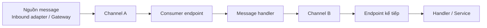
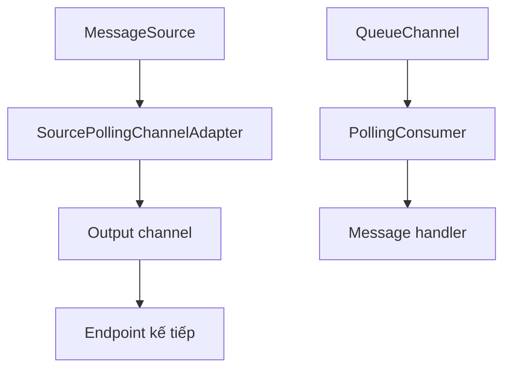

# Channel, endpoint, dispatcher và executor trong thời gian chạy

Trong **SPRING_INTEGRATION_RUNTIME**, cần nhìn một message flow như một đồ thị các thành phần đang hoạt động trong Spring container. **Channel** nối các bước và quyết định cách message được chuyển tiếp hoặc lưu đệm; **endpoint** đưa một handler hoặc nguồn dữ liệu vào flow; **dispatcher** chọn subscriber nhận message; **executor** quyết định task được chạy trên thread nào. Bốn khái niệm liên quan chặt chẽ nhưng giải quyết bốn trách nhiệm khác nhau.

Bài này tập trung vào cách các thành phần phối hợp khi chạy: message đi qua channel ra sao, endpoint nhận message theo cơ chế nào, dispatcher chọn handler thế nào, và executor tạo ranh giới thread ảnh hưởng đến thứ tự, transaction, lỗi và hiệu năng như thế nào. Đây là nền tảng để đọc trạng thái runtime và chẩn đoán message flow trong Spring Integration.

## 1. Bắt đầu từ Message và message flow

Spring Integration trao đổi dữ liệu bằng `Message<?>`. Một message gồm:

- **Payload**: dữ liệu nghiệp vụ, chẳng hạn `Order`, chuỗi JSON hoặc byte array.
- **Headers**: metadata như `id`, `timestamp`, `correlationId`, `replyChannel`, `errorChannel` hoặc header do ứng dụng tự đặt.

Ví dụ tạo message:

```java
Message<Order> message = MessageBuilder
    .withPayload(order)
    .setHeader("source", "checkout")
    .setHeader("correlationId", requestId)
    .build();
```

Message là vỏ dữ liệu mà các thành phần trong flow chuyển cho nhau. Bản thân channel thường không biến đổi payload; transformer, filter, router, service activator hoặc handler mới thực hiện xử lý nghiệp vụ. Đối tượng Message và headers được thiết kế theo hướng bất biến, nhưng điều đó không tự làm cho object payload có thể thay đổi trở thành immutable.

Một flow điển hình có dạng:



Khi đọc sơ đồ, hãy tách ba câu hỏi:

1. Message đang nằm ở đâu hoặc được chuyển qua đâu? Đó là trách nhiệm của **channel**.
2. Thành phần nào kết nối handler với flow và quản lý cách handler được gọi? Đó là **endpoint**.
3. Nếu channel có subscriber, subscriber nào được chọn và lời gọi được thực hiện trên thread nào? Đây là phần việc của **dispatcher** và **executor**.

## 2. Channel: điểm nối và cơ chế chuyển message

`MessageChannel` là abstraction để gửi message. Producer gọi `send(message)`; consumer nhận message theo khả năng của loại channel. Channel có thể chuyển message trực tiếp, phát cho nhiều subscriber, hoặc lưu message để consumer lấy sau.

Hai nhóm interface quan trọng:

- **SubscribableChannel**: consumer đăng ký làm subscriber. Khi producer gửi message, channel kích hoạt cơ chế dispatch tới subscriber.
- **PollableChannel**: consumer chủ động gọi `receive()` để lấy message. Channel có thể giữ message cho tới khi consumer poll.

Các channel thường gặp:

| Channel | Cách nhận message | Hành vi chính | Mô hình xử lý |
|---|---|---|---|
| `DirectChannel` | Subscriber được gọi khi `send()` | Chuyển tới một subscriber | Event-driven, mặc định đồng bộ |
| `ExecutorChannel` | Subscriber được dispatch qua executor | Chuyển tới một subscriber | Event-driven, có thể bất đồng bộ |
| `PublishSubscribeChannel` | Các subscriber được gọi khi `send()` | Phát message tới nhiều subscriber | Broadcast; đồng bộ nếu không cấu hình executor |
| `QueueChannel` | Consumer gọi `receive()` | Giữ message trong queue | Polling, tách thời điểm gửi và nhận |

### 2.1 DirectChannel

`DirectChannel` là channel event-driven, point-to-point. Khi producer gọi `send()`, channel chọn một subscriber và gọi subscriber đó ngay trong luồng thực thi hiện tại. Vì vậy, nếu không có ranh giới bất đồng bộ khác, handler chạy trên cùng thread với nơi gửi message.

Nếu một `DirectChannel` có nhiều subscriber, dispatcher chọn một subscriber cho mỗi message. Mặc định channel dùng chiến lược load balancing round-robin; nó không phát bản sao message tới tất cả subscriber. Nếu cần broadcast, dùng `PublishSubscribeChannel`.

Ưu điểm của `DirectChannel` là đường đi đơn giản, ít chi phí chuyển thread và dễ giữ một chuỗi xử lý trong cùng call stack. Điều này hữu ích khi cần kết quả hoặc exception quay lại caller, hoặc khi các bước cần tham gia cùng transaction đang gắn với thread hiện tại.

### 2.2 ExecutorChannel

`ExecutorChannel` cũng là channel event-driven và point-to-point, nhưng nó sử dụng một `Executor` để thực thi việc dispatch. Khi gửi message thành công vào channel, công việc xử lý được giao cho executor; handler thường chạy trên worker thread.

Điểm khác biệt quan trọng là **ranh giới thread xuất hiện tại channel này**. Caller có thể tiếp tục sau khi công việc được chấp nhận vào executor, trong khi handler vẫn đang chạy. Vì thế thời điểm hoàn thành, thứ tự hoàn thành và nơi exception xuất hiện có thể khác với `DirectChannel`.

`ExecutorChannel` không phải một `QueueChannel`. Hàng đợi nội bộ của thread pool giữ task chờ worker thực thi; nó không cung cấp giao diện `PollableChannel.receive()` để ứng dụng chủ động lấy từng message, và không tự mang ngữ nghĩa message store của một queue channel.

### 2.3 PublishSubscribeChannel

`PublishSubscribeChannel` phát message tới các subscriber đã đăng ký. Mỗi subscriber nhận cùng message được publish, phù hợp cho các nhánh độc lập như ghi audit, cập nhật chỉ số và gửi thông báo.

Nếu không cấu hình executor, các subscriber thường được gọi đồng bộ trong thread gửi message. Nếu cấu hình executor, việc gọi subscriber có thể được thực thi bất đồng bộ. Vì vậy, chỉ nhìn tên channel là chưa đủ để kết luận flow chạy đồng bộ hay bất đồng bộ; cần xem cấu hình executor của channel.

### 2.4 QueueChannel

`QueueChannel` là `PollableChannel`: producer gửi message vào queue, còn consumer lấy message bằng `receive()`. Việc gửi và xử lý không nhất thiết diễn ra cùng thời điểm hoặc trên cùng thread.

Queue tạo vùng đệm giữa producer và consumer. Khi queue có giới hạn dung lượng, ứng dụng có thể kiểm soát lượng message chờ; nếu queue đầy, kết quả gửi phụ thuộc vào timeout và cấu hình gửi. Queue không tự xử lý message: cần một polling consumer hoặc thành phần khác đọc message ra.

Nếu cần giữ message qua restart hoặc chia sẻ trạng thái giữa nhiều node, phải chọn message store và cấu hình lưu trữ phù hợp. Một queue trong bộ nhớ không tự trở thành hàng đợi bền vững chỉ vì nó có dung lượng lớn.

## 3. Endpoint: đưa handler vào flow và quản lý cách gọi

Endpoint là thành phần runtime kết nối một chức năng xử lý với message flow. Nó quản lý việc đăng ký nhận message hoặc lịch poll, đồng thời điều phối lời gọi tới handler. Handler mới là nơi thực hiện logic cụ thể.

Ví dụ các handler thường thấy trong Java DSL:

- `transform(...)`: chuyển đổi payload.
- `filter(...)`: quyết định message có được đi tiếp hay không.
- `route(...)`: chọn channel đích.
- `split(...)`: tách một message thành nhiều message.
- `aggregate(...)`: gom nhiều message thành một kết quả.
- `handle(...)`: gọi service hoặc message handler.

Các annotation như `@ServiceActivator`, `@Transformer`, `@Filter`, `@Router` và `@Aggregator` cũng khai báo các endpoint tương ứng. Endpoint không đồng nghĩa với handler: cùng một handler có thể được endpoint quản lý theo các cơ chế nhận message khác nhau.

### 3.1 Event-driven consumer

Với `SubscribableChannel`, consumer endpoint đăng ký handler làm subscriber. Khi channel dispatch message, endpoint gọi handler mà không cần một poller định kỳ.

Ví dụ, một service activator nhận message từ `DirectChannel` sẽ được gọi ngay trong thread gửi message, trừ khi có executor hoặc một ranh giới bất đồng bộ khác trên đường đi.

### 3.2 Polling consumer

Với `PollableChannel`, consumer endpoint cần poller để gọi `receive()` theo lịch. Poller xác định nhịp lấy message và giới hạn số message xử lý trong một lượt. Các thuộc tính thường gặp gồm:

- `fixedDelay`, `fixedRate` hoặc `cron`: lịch chạy poll.
- `maxMessagesPerPoll`: số message tối đa lấy trong một lần poll.
- `receiveTimeout`: thời gian chờ khi nhận message.
- `taskExecutor`: executor dùng cho công việc poll/dispatch theo cấu hình.
- `adviceChain`: các advice bao quanh thao tác poll hoặc xử lý, thường dùng cho transaction, retry và các cross-cutting concern.

Nếu poller không chỉ định executor riêng cho xử lý, tác vụ poll và lời gọi handler thường chạy trên thread được scheduler sử dụng. Khi thêm executor, cần tính đến số poller, số worker và khả năng xử lý đồng thời.

### 3.3 Source polling channel adapter

Một `SourcePollingChannelAdapter` định kỳ gọi `MessageSource` để tạo hoặc lấy message từ nguồn bên ngoài, rồi gửi message vào output channel. Nó khác với polling consumer: polling consumer lấy message từ một `PollableChannel`; source polling adapter chủ động đọc một nguồn dữ liệu như thư mục, database hoặc nguồn tích hợp khác.

Có thể hình dung:



Phân biệt hai mô hình này giúp xác định đúng nơi cần kiểm tra khi một message không xuất hiện: nguồn chưa được poll, poller chưa chạy, queue chưa có message, hay consumer không lấy được message.

## 4. Dispatcher: chọn subscriber nhận message

Dispatcher là cơ chế nội bộ của channel dùng để điều phối message tới các subscriber. Ứng dụng thường không tạo dispatcher trực tiếp; loại channel quyết định kiểu dispatch và cấu hình channel quyết định cách nó hoạt động.

Hai mô hình chính:

- **Unicast dispatch**: chọn một subscriber. `DirectChannel` và `ExecutorChannel` dùng mô hình này. Nếu có nhiều subscriber, chiến lược load balancing quyết định subscriber nào nhận message.
- **Broadcast dispatch**: gọi các subscriber. `PublishSubscribeChannel` dùng mô hình này.

`QueueChannel` hoạt động theo cách khác: message được đưa vào queue; consumer poll để lấy message. Không nên suy luận rằng mọi channel đều dispatch message ngay tới subscriber.

Ví dụ với ba subscriber A, B và C:

| Channel | Một message được gửi tới |
|---|---|
| `DirectChannel` | Một subscriber được chọn, ví dụ A |
| `ExecutorChannel` | Một subscriber được chọn; lời gọi được giao cho executor |
| `PublishSubscribeChannel` | A, B và C |
| `QueueChannel` | Queue giữ message; consumer lấy message sau |

Một lỗi thiết kế thường gặp là đăng ký nhiều service activator lên `DirectChannel` với kỳ vọng tất cả cùng chạy. Hành vi thực tế là phân phối message giữa các subscriber. Nếu mỗi subscriber phải nhận một bản message, hãy dùng broadcast channel hoặc tách nhánh flow một cách tường minh.

## 5. Executor: điều khiển thread thực thi

`Executor` và `TaskExecutor` là abstraction thực thi task. Executor không quyết định message sẽ đi tới endpoint nghiệp vụ nào; dispatcher làm việc đó. Executor quyết định task được chạy bằng thread hiện tại hay được chuyển cho một cơ chế thực thi khác.

Một cấu hình thường dùng là `ThreadPoolTaskExecutor`:

Đặt các method `@Bean` dưới đây trong một class `@Configuration`; imports được lược bỏ để tập trung vào cấu hình runtime.

```java
@Bean
ThreadPoolTaskExecutor orderExecutor() {
    ThreadPoolTaskExecutor executor = new ThreadPoolTaskExecutor();
    executor.setCorePoolSize(4);
    executor.setMaxPoolSize(8);
    executor.setQueueCapacity(200);
    executor.setThreadNamePrefix("si-order-");
    executor.setWaitForTasksToCompleteOnShutdown(true);
    executor.setAwaitTerminationSeconds(30);
    return executor;
}

@Bean
MessageChannel ordersInput() {
    return new DirectChannel();
}

@Bean
MessageChannel ordersAsync() {
    return new ExecutorChannel(orderExecutor());
}

@Bean
IntegrationFlow orderFlow(OrderService orderService) {
    return IntegrationFlow.from(ordersInput())
        .channel(ordersAsync())
        .handle(orderService, "process")
        .get();
}
```

Ví dụ trên có hai đoạn thực thi:

1. Producer gửi message vào `ordersInput`. Endpoint đầu tiên được kích hoạt trên thread gửi message vì `ordersInput` là `DirectChannel`.
2. Flow gửi tiếp message qua `ordersAsync`. `ExecutorChannel` giao task cho `orderExecutor`; handler `orderService.process` chạy trên worker thread khi executor thực thi task.

Các tham số của thread pool có ý nghĩa vận hành:

| Tham số | Ý nghĩa | Cần quan sát |
|---|---|---|
| `corePoolSize` | Số worker cơ bản | Mức song song thông thường |
| `maxPoolSize` | Giới hạn worker tối đa | Khả năng tăng worker khi tải tăng |
| `queueCapacity` | Số task có thể chờ | Độ dài hàng đợi và thời gian chờ |
| `threadNamePrefix` | Tiền tố tên thread | Dấu vết thread trong log |
| Chính sách từ chối | Cách xử lý khi pool và queue đều bão hòa | Exception, caller chạy task hoặc cơ chế từ chối đã chọn |

Nên đặt queue có giới hạn và theo dõi tình trạng bão hòa. Queue không giới hạn có thể khiến độ trễ và lượng bộ nhớ tăng dần khi tốc độ producer vượt tốc độ xử lý. Với queue có giới hạn, khi pool không thể nhận thêm task, executor áp dụng rejection policy; mặc định thường là từ chối task và phát sinh exception. Nếu chọn `CallerRunsPolicy`, thread gửi có thể phải tự chạy task, tạo áp lực ngược lên producer nhưng cũng làm thay đổi kỳ vọng về tính bất đồng bộ.

### 5.1 Executor và poller không phải một khái niệm

Poller trả lời câu hỏi **khi nào lấy message**. Executor trả lời câu hỏi **task được thực thi trên thread nào**.

- `TaskScheduler` lên lịch chạy poller theo fixed delay, fixed rate hoặc cron.
- `TaskExecutor` thực thi task, có thể dùng thread pool.
- Một polling endpoint có thể phối hợp scheduler và executor; cấu hình cụ thể quyết định thread thực thi thao tác poll và handler.
- Một `ExecutorChannel` có thể tạo ranh giới bất đồng bộ mà không cần poller.

Do đó, khi chẩn đoán một flow bị chậm, cần kiểm tra cả lịch poll lẫn năng lực executor. Tăng số worker không giải quyết được tình huống poller không chạy đúng lịch; tăng tần suất poll cũng không giải quyết được thread pool đang bão hòa.

## 6. Ranh giới thread ảnh hưởng đến transaction, lỗi và thứ tự

### 6.1 Transaction

Transaction của Spring thường gắn với thread hiện tại. Với `DirectChannel`, handler chạy đồng bộ trong call stack gửi message nên có thể tham gia transaction đang hoạt động trên thread đó, nếu cấu hình transaction và resource phù hợp.

Với `ExecutorChannel`, handler chạy trên worker thread. Transaction gắn với thread gửi không tự truyền sang worker thread. Nếu handler cần transaction riêng, hãy đặt transaction boundary tại endpoint/handler tương ứng, chẳng hạn dùng transaction advice trong cấu hình poller hoặc endpoint.

Một tình huống cần chú ý: service ghi dữ liệu trong transaction rồi gửi message qua `ExecutorChannel`. Worker có thể bắt đầu xử lý trước khi transaction phía producer commit; transaction của worker cũng không tự nhìn thấy transaction chưa commit đó. Nếu xử lý phụ thuộc dữ liệu vừa ghi, hãy thiết kế thời điểm phát message sau commit hoặc dùng mẫu outbox phù hợp.

### 6.2 Exception và error flow

Với đường đi đồng bộ, exception từ handler có thể quay về thread gửi và được caller quan sát trực tiếp. Điều này giúp caller quyết định rollback hoặc xử lý lỗi trong cùng luồng điều khiển.

Với đường đi bất đồng bộ, sender có thể đã hoàn tất lời gọi `send()` trước khi handler ném exception. Exception xảy ra trên worker thread nên không thể được ném ngược về caller như một lời gọi đồng bộ. Cần cấu hình và giám sát error flow, thường thông qua `errorChannel` và `ErrorMessage`, đồng thời đặt retry/advice tại nơi handler thực sự chạy.

Cũng cần phân biệt lỗi gửi message với lỗi xử lý message:

- **Lỗi gửi**: channel không nhận được message, ví dụ queue đầy hoặc executor từ chối task.
- **Lỗi xử lý**: handler đã được gọi nhưng xử lý thất bại.
- **Lỗi poll**: poller hoặc nguồn dữ liệu thất bại khi lấy message.

Ba lỗi này xảy ra ở ba giai đoạn khác nhau; log và metric cần chỉ ra được giai đoạn nào thất bại.

### 6.3 Thứ tự và xử lý đồng thời

`DirectChannel` xử lý message trong thread gửi nên một producer gửi tuần tự thường quan sát được thứ tự xử lý tuần tự trên đường đi đó. `ExecutorChannel` với nhiều worker cho phép nhiều message xử lý đồng thời; thứ tự hoàn tất có thể khác thứ tự gửi.

Ngay cả khi executor dùng queue FIFO, nhiều worker vẫn có thể hoàn thành task theo thứ tự khác nhau do thời gian xử lý khác nhau. Nếu nghiệp vụ yêu cầu thứ tự theo từng khóa như `orderId`, cần thiết kế phân vùng hoặc tuần tự hóa theo khóa, thay vì dựa vào một thread pool dùng chung.

Với `PublishSubscribeChannel`, các nhánh có thể có thời gian hoàn thành khác nhau. Không nên giả định rằng tất cả nhánh đã hoàn tất chỉ vì thao tác publish đã trả về, đặc biệt khi channel dùng executor.

## 7. Vòng đời IntegrationFlow và endpoint

Java DSL mô tả cấu trúc flow; khi Spring ApplicationContext khởi tạo, Spring Integration đăng ký các channel, endpoint, handler và adapter cần thiết thành các bean runtime. Endpoint tham gia cơ chế lifecycle của Spring, vì vậy trạng thái start/stop của endpoint ảnh hưởng trực tiếp đến khả năng nhận message.

Với flow khai báo bằng bean `IntegrationFlow`, các thành phần được tạo và quản lý cùng ApplicationContext. Khi context khởi động, endpoint được khởi động theo lifecycle; khi context dừng, các endpoint được dừng và tài nguyên liên quan được đóng theo cơ chế quản lý của container.

Khi cần đăng ký flow động lúc ứng dụng đang chạy, có thể dùng `IntegrationFlowContext`. Đối tượng đăng ký flow cho phép điều khiển lifecycle của flow động, ví dụ start, stop hoặc destroy khi không còn cần thiết. Cần bảo đảm flow được dừng trước khi giải phóng tài nguyên mà handler hoặc executor đang sử dụng.

Khi điều tra một flow không xử lý message, kiểm tra theo thứ tự:

1. ApplicationContext đã khởi tạo thành công chưa?
2. IntegrationFlow và các channel liên quan đã được đăng ký chưa?
3. Endpoint tương ứng đang running hay đã bị stop?
4. Subscriber đã đăng ký trên channel chưa, hoặc polling endpoint có lịch chạy không?
5. Executor còn nhận task và có worker hoạt động không?

Một channel tồn tại dưới dạng bean không có nghĩa endpoint phía sau chắc chắn đang chạy. Tương tự, một IntegrationFlow được khai báo trong mã nguồn không đảm bảo mọi endpoint đều đang hoạt động nếu lifecycle bị dừng hoặc đăng ký động đã bị hủy.

## 8. Chọn mô hình theo yêu cầu runtime

| Nhu cầu | Thành phần thường phù hợp | Lý do |
|---|---|---|
| Xử lý ngay trong thread gửi, cần call stack đồng bộ | `DirectChannel` | Ít chi phí chuyển thread, exception có thể quay lại caller |
| Phân phối message cho một trong nhiều consumer | `DirectChannel` hoặc `ExecutorChannel` | Unicast dispatch |
| Mọi nhánh đều cần nhận message | `PublishSubscribeChannel` | Broadcast tới subscriber |
| Đệm message và để consumer lấy sau | `QueueChannel` + polling consumer | Tách thời điểm gửi và nhận |
| Tách xử lý sang worker thread | `ExecutorChannel` | Executor thực thi handler bất đồng bộ |
| Đọc định kỳ từ nguồn bên ngoài | `MessageSource` + `SourcePollingChannelAdapter` | Poll nguồn theo lịch |
| Cần transaction/retry quanh mỗi lần poll hoặc xử lý | Poller/endpoint advice phù hợp | Bao quanh đúng thao tác cần quản lý |

Không có một channel tốt nhất cho mọi flow. Hãy chọn theo yêu cầu về đồng bộ, broadcast, buffering, thứ tự, transaction và khả năng chịu tải. Mỗi ranh giới bất đồng bộ làm thay đổi cách exception, transaction và thứ tự được quan sát; cần đưa các thay đổi đó vào thiết kế nghiệp vụ.

## 9. Chẩn đoán trạng thái và hiệu năng

Khi message không đi tới đích hoặc throughput giảm, nên lần theo từng ranh giới trong flow thay vì chỉ nhìn log của service cuối cùng.

### 9.1 Quan sát channel và endpoint

- Xác nhận đúng channel bean và loại channel đang được sử dụng.
- Với `SubscribableChannel`, kiểm tra số subscriber và trạng thái endpoint đăng ký vào channel.
- Với `QueueChannel`, theo dõi số message đang chờ, tốc độ enqueue/dequeue và tình trạng queue đầy.
- Với polling endpoint, kiểm tra poller có chạy theo lịch, có nhận được message và có bị giới hạn bởi `maxMessagesPerPoll` hay không.
- Kiểm tra endpoint có bị stop hoặc flow động đã bị destroy hay chưa.

### 9.2 Quan sát executor

- Dùng `threadNamePrefix` có ý nghĩa để nhận ra thread của từng flow trong log và thread dump.
- Theo dõi pool size, active worker, queue size, thời gian chờ task và số lần task bị từ chối.
- Nếu active worker luôn chạm giới hạn và queue liên tục tăng, handler đang xử lý chậm hơn tốc độ nhận task.
- Nếu worker nhàn rỗi nhưng message không được xử lý, kiểm tra channel, subscriber và poller trước khi tăng pool size.
- Nếu CPU thấp nhưng độ trễ cao, kiểm tra thao tác I/O, lock, transaction và thời gian chờ bên ngoài.

### 9.3 Theo dấu message

Khi log, nên ghi các định danh hữu ích như `id` (`MessageHeaders.ID`), `correlationId`, loại payload và tên thread. Với flow nhiều bước, message history có thể giúp xác định message đã đi qua component nào nếu tính năng này được bật. Spring Integration cũng cung cấp thông tin integration graph và các metric quản lý khi ứng dụng cấu hình management/Actuator tương ứng.

Một quy trình điều tra thực tế:

1. Tìm log đầu vào theo `correlationId` hoặc `id`.
2. Xác định channel tiếp theo và kiểu channel.
3. Kiểm tra endpoint đã subscribe hoặc poll chưa.
4. Nếu có executor, kiểm tra task đã được nhận, đang chờ hay bị từ chối.
5. Tìm exception ở đúng thread và error flow.
6. Đối chiếu thời gian gửi, thời gian bắt đầu xử lý và thời gian hoàn tất để xác định độ trễ nằm ở queue, executor hay handler.

## 10. Những nhầm lẫn cần tránh

- **Channel không phải endpoint**: channel là điểm nối/chuyển message; endpoint quản lý việc kết nối handler hoặc source vào flow.
- **Dispatcher không phải executor**: dispatcher chọn subscriber; executor thực thi task trên thread.
- **Nhiều subscriber không đồng nghĩa broadcast**: `DirectChannel` và `ExecutorChannel` chọn một subscriber; `PublishSubscribeChannel` mới phát tới nhiều subscriber.
- **ExecutorChannel không phải QueueChannel**: executor queue giữ task chờ worker; QueueChannel giữ message để consumer poll.
- **Có IntegrationFlow không đồng nghĩa bất đồng bộ**: flow chỉ trở nên bất đồng bộ tại những thành phần tạo ranh giới thread, chẳng hạn ExecutorChannel hoặc executor được cấu hình cho channel/poller.
- **Tăng thread pool không tự tăng throughput**: nếu handler bị nghẽn ở database, API ngoài, lock hoặc giới hạn connection pool, thêm worker có thể làm cạnh tranh tài nguyên nghiêm trọng hơn.
- **Transaction không tự truyền qua thread**: khi thêm executor, phải xác định transaction boundary mới.
- **Gửi thành công không đồng nghĩa xử lý thành công**: với đường đi bất đồng bộ, cần theo dõi cả lỗi dispatch, lỗi executor và lỗi handler.

## 11. Tự kiểm tra

1. Nếu cần hai service activator cùng nhận một message, nên chọn loại channel nào? Vì sao `DirectChannel` không đáp ứng yêu cầu broadcast?
2. Một flow dùng `ExecutorChannel` trả về nhanh nhưng handler thất bại sau đó. Vì sao caller không nhận exception như với `DirectChannel`? Cần quan sát error flow nào?
3. Một `QueueChannel` tăng backlog liên tục trong khi executor vẫn còn worker nhàn rỗi. Bạn sẽ kiểm tra poller, consumer và cấu hình receive ở đâu?
4. Một service ghi dữ liệu trong transaction rồi gửi message qua `ExecutorChannel`. Điều gì có thể xảy ra nếu worker đọc dữ liệu trước khi transaction producer commit?
5. Khi nhiều worker xử lý message cùng lúc, vì sao thứ tự hoàn tất có thể khác thứ tự gửi? Nếu nghiệp vụ cần thứ tự theo `orderId`, cần bổ sung cơ chế nào?

## Kết luận

Khi đọc runtime của Spring Integration, hãy lần theo chuỗi **message → channel → endpoint → handler**, sau đó xác định **dispatcher** chọn consumer nào và **executor/poller** quyết định lúc nào, trên thread nào công việc được chạy. Từ đó có thể giải thích được vì sao một flow đồng bộ hay bất đồng bộ, message được broadcast hay phân phối, queue tăng ở đâu, exception xuất hiện ở đâu và transaction có bao phủ bước xử lý hay không.
