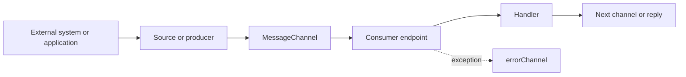
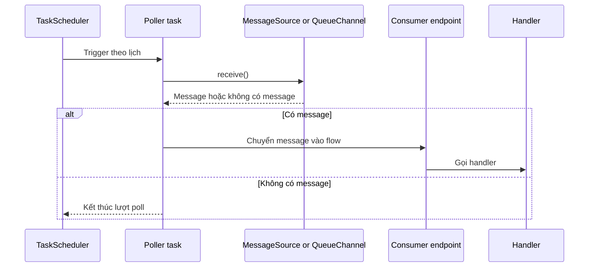
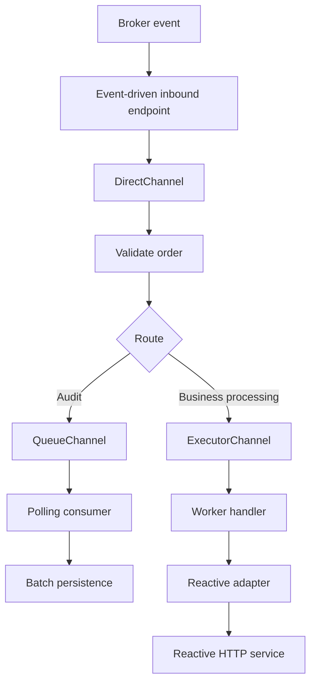

# Event-driven, polling và reactive runtime

Spring Integration là một runtime xử lý message. Một `IntegrationFlow` mô tả các bước và quan hệ nối giữa chúng; khi Spring ApplicationContext khởi động, framework tạo channel, endpoint và các thành phần hỗ trợ để thực thi luồng đó. Cách một message được kích hoạt, chuyển đến consumer và tiếp tục qua các bước phụ thuộc chủ yếu vào loại nguồn dữ liệu, loại channel và cơ chế thực thi của endpoint.

Ba mô hình thường gặp là **event-driven**, **polling** và **reactive**. Chúng mô tả cách runtime nhận và phân phối công việc ở những góc nhìn khác nhau. Event-driven thường đẩy message đến consumer ngay khi có message. Polling chủ động kiểm tra nguồn hoặc channel theo lịch. Reactive biểu diễn việc xử lý như một chuỗi tín hiệu bất đồng bộ có thể truyền nhu cầu tiêu thụ ngược về phía upstream. Một ứng dụng có thể kết hợp cả ba trong cùng một hệ thống.

## 1. Runtime Spring Integration nhìn từ một message

Một message của Spring Integration gồm payload và headers:

- **Payload** chứa dữ liệu nghiệp vụ, ví dụ một `Order`, dòng CSV hoặc nội dung sự kiện.
- **Headers** mang metadata như message ID, timestamp, correlation ID, reply channel, error channel hoặc thông tin định tuyến.
- **MessageChannel** chuyển message từ nơi gửi đến nơi nhận. Channel tạo ranh giới giữa producer và consumer.
- **Endpoint** kết nối một channel với hành vi xử lý. Các endpoint phổ biến gồm service activator, transformer, filter, router, splitter, aggregator và bridge.
- **Message source hoặc inbound adapter** đưa dữ liệu từ hệ thống bên ngoài vào flow.
- **Gateway** cho phép ứng dụng gọi vào một flow như gọi một API, đồng thời có thể nhận reply.
- **Poller, scheduler và executor** quyết định khi nào công việc được lấy ra và thread nào thực thi nó.

Một đường đi đơn giản có thể được hình dung như sau:



Channel không tự quyết định toàn bộ cách chạy. Ví dụ, `DirectChannel` gọi subscriber ngay trên thread gửi message; `QueueChannel` giữ message để consumer nhận sau; `ExecutorChannel` chuyển việc dispatch sang executor; `FluxMessageChannel` còn tham gia vào mô hình Reactive Streams. Vì vậy, khi đọc một flow, hãy xác định lần lượt: nguồn tạo message, channel nhận message, endpoint đăng ký với channel, và cơ chế nào kích hoạt endpoint đó.

## 2. Event-driven runtime: message đến thì xử lý

Trong mô hình event-driven, producer gửi message vào một channel có khả năng thông báo cho consumer. Khi message đến, channel dispatch nó đến handler đã đăng ký. Consumer không cần thức dậy theo chu kỳ để hỏi xem có message mới hay chưa.

Các channel dạng `SubscribableChannel` phù hợp với kiểu phân phối push này. Endpoint đăng ký handler với channel khi được khởi tạo và gỡ đăng ký khi dừng. Với cấu hình đồng bộ, lời gọi xử lý thường diễn ra ngay trong luồng gọi `send()`.

### DirectChannel

`DirectChannel` là lựa chọn phổ biến cho các bước nối tiếp trong một flow. Nó dispatch mỗi message đến một subscriber phù hợp. Khi có nhiều subscriber, dispatcher có thể phân phối message theo chiến lược load balancing; một message thông thường chỉ được một handler xử lý, không phải tất cả handler đều nhận bản sao.

Điểm quan trọng của `DirectChannel` là lời gọi xử lý diễn ra đồng bộ trên thread gửi message. Nếu handler mất 200 ms, producer gọi `send()` cũng phải chờ phần xử lý đó hoàn tất. Lỗi phát sinh trong chuỗi gọi đồng bộ có thể truyền ngược về phía caller. Đổi lại, luồng điều khiển dễ theo dõi và transaction đang hoạt động trên thread đó có thể bao trùm các bước đồng bộ tiếp theo.

### PublishSubscribeChannel

`PublishSubscribeChannel` gửi một message đến nhiều subscriber. Nó thích hợp khi cùng một sự kiện cần kích hoạt nhiều nhánh độc lập, chẳng hạn cập nhật chỉ số, ghi audit và gửi thông báo.

Nếu không cấu hình executor, việc dispatch thường vẫn đồng bộ: producer có thể phải chờ các subscriber hoàn tất. Khi cấu hình executor, các subscriber có thể chạy bất đồng bộ. Khi đó cần xem xét thứ tự hoàn tất, xử lý lỗi và giới hạn tài nguyên vì các nhánh không còn nhất thiết kết thúc theo cùng thứ tự mà producer gửi.

### ExecutorChannel

`ExecutorChannel` dùng một `TaskExecutor` để dispatch message trên worker thread. Producer có thể tiếp tục sau khi công việc được chuyển cho executor, tùy kết quả gửi và chính sách từ chối của executor. Cách này tách thời gian xử lý handler khỏi thread gửi message, nhưng đồng thời tạo ra ranh giới thực thi mới.

Ranh giới đó có một số hệ quả:

- Transaction gắn với thread gửi không tự động truyền sang worker thread.
- Thứ tự hoàn tất có thể khác thứ tự gửi nếu có nhiều worker.
- Queue của executor có thể tích tụ khi tốc độ gửi cao hơn tốc độ xử lý.
- Exception xảy ra trong tác vụ bất đồng bộ cần được quan sát qua cơ chế error handling phù hợp; caller ban đầu thường không nhận exception theo kiểu gọi đồng bộ.

Không nên chọn executor chỉ vì muốn “nhanh hơn”. Executor hữu ích khi cần tách producer khỏi consumer hoặc cho phép xử lý đồng thời. Nếu không giới hạn số thread và hàng đợi, nó có thể chuyển một đợt tải tăng đột biến thành backlog lớn hoặc cạn tài nguyên.

### So sánh các channel thường gặp

| Channel | Cách nhận message | Buffer | Mô hình thực thi thường gặp |
|---|---|---|---|
| `DirectChannel` | Push đến subscriber | Không lưu hàng đợi | Đồng bộ trên thread gửi |
| `PublishSubscribeChannel` | Push đến nhiều subscriber | Không phải queue lưu trữ | Đồng bộ, hoặc bất đồng bộ nếu gắn executor |
| `ExecutorChannel` | Push qua executor | Có thể có queue trong executor | Worker thread |
| `QueueChannel` | Consumer gọi `receive()` | Có | Consumer thường dùng poller |
| `FluxMessageChannel` | Publisher phát message cho subscriber | Theo cơ chế Reactor và cấu hình stream | Reactive Streams |

Bảng này mô tả đặc tính chính, không thay thế việc kiểm tra cấu hình thực tế. Ví dụ, `PublishSubscribeChannel` có thể dùng executor; `QueueChannel` có thể được dùng với nhiều consumer; và executor có thể dùng hàng đợi có giới hạn hoặc không giới hạn tùy cách cấu hình.

## 3. Polling runtime: chủ động lấy message theo lịch

Polling được dùng khi nguồn dữ liệu không chủ động phát sự kiện, hoặc khi ứng dụng muốn kiểm soát nhịp đọc. Consumer được kích hoạt bởi một poller. Poller lên lịch một tác vụ; tác vụ đó gọi `receive()` trên channel hoặc gọi `receive()` trên một `MessageSource`, sau đó chuyển message lấy được vào flow.

Có hai trường hợp thường bị nhầm lẫn:

1. **Source polling**: `SourcePollingChannelAdapter` hỏi một `MessageSource` theo lịch. Ví dụ, đọc file mới, truy vấn bảng dữ liệu hoặc gọi một nguồn có API lấy dữ liệu.
2. **Pollable channel consumer**: `PollingConsumer` lấy message đã nằm trong một `PollableChannel`, ví dụ `QueueChannel`.

Cả hai đều dùng poller, nhưng điểm được thăm dò khác nhau. Source polling hỏi nguồn bên ngoài hoặc một nguồn message; pollable consumer lấy message đã được producer gửi vào channel.



### Cấu hình poller

Poller thường kết hợp trigger, giới hạn số message mỗi lượt và các advice cho tác vụ poll. Các tham số quan trọng gồm:

| Thành phần | Ý nghĩa vận hành |
|---|---|
| `fixedDelay` | Lập lịch lượt tiếp theo sau khi lượt trước kết thúc và hết khoảng delay |
| `fixedRate` | Lập lịch theo nhịp thời gian cố định |
| `cron` | Chạy theo biểu thức lịch |
| `maxMessagesPerPoll` | Giới hạn số message lấy trong một lượt poll |
| `receiveTimeout` | Thời gian chờ khi nhận từ pollable channel |
| `taskExecutor` | Executor dùng để thực thi tác vụ poll khi được cấu hình |
| Transaction advice | Bao một lượt poll hoặc phạm vi được cấu hình trong transaction |
| Retry advice | Thử lại thao tác theo chính sách retry |

Chọn `fixedDelay` khi muốn giữ khoảng nghỉ sau mỗi lượt xử lý. Chọn `fixedRate` khi muốn nhịp chạy bám theo mốc thời gian định kỳ. Chọn `cron` khi lịch nghiệp vụ có giờ hoặc ngày cụ thể. Với handler chạy lâu, hãy tính đến thời gian xử lý thực tế và chính sách scheduler để tránh tạo backlog hoặc tải chồng lấn ngoài ý muốn.

`maxMessagesPerPoll` cho phép xử lý theo lô. Lô lớn có thể giảm overhead lập lịch và tăng throughput, nhưng cũng làm một lượt transaction kéo dài hơn, giữ tài nguyên lâu hơn và tăng lượng công việc phải phục hồi nếu lượt đó thất bại. Lô nhỏ giúp giới hạn thời gian mỗi lượt và tạo cơ hội cho các tác vụ khác chạy.

### Ví dụ source polling

Ví dụ sau đọc tối đa 20 message trong mỗi lượt, cách nhau một giây. Transaction được gắn vào poller để phạm vi lấy và chuyển message tuân theo transaction manager đã chọn:

```java
@Bean
IntegrationFlow pollingOrders(
        MessageSource<Order> orderSource,
        OrderHandler orderHandler,
        PlatformTransactionManager transactionManager) {

    return IntegrationFlow.from(orderSource, endpoint -> endpoint.poller(
                    Pollers.fixedDelay(Duration.ofSeconds(1))
                            .maxMessagesPerPoll(20)
                            .transactional(transactionManager)))
            .handle(orderHandler, "handle")
            .get();
}
```

Nếu bắt đầu từ một `QueueChannel`, endpoint consumer cũng cần poller để gọi `receive()`:

```java
@Bean
IntegrationFlow consumeQueuedOrders(OrderHandler orderHandler) {
    return IntegrationFlow.from("orders.queue",
                    endpoint -> endpoint.poller(
                            Pollers.fixedDelay(Duration.ofMillis(250))
                                    .maxMessagesPerPoll(10)))
            .handle(orderHandler, "handle")
            .get();
}
```

Trong ví dụ thứ hai, `orders.queue` phải là một `PollableChannel`, chẳng hạn `QueueChannel`. Gắn poller vào một channel push như `DirectChannel` không phải cách cấu hình tương ứng: channel push gọi subscriber khi message đến, còn poller cần một nguồn có thể được gọi để nhận message.

### Polling ảnh hưởng đến độ trễ và tải như thế nào?

Nếu poller chạy mỗi giây, một message vừa xuất hiện có thể phải chờ gần một giây trước khi được lấy, chưa kể thời gian chờ của nguồn và xử lý handler. Giảm chu kỳ poll có thể giảm độ trễ trung bình nhưng làm tăng số lần kiểm tra khi không có dữ liệu. Với nguồn từ xa, các lần poll rỗng cũng có thể tiêu tốn kết nối, CPU hoặc quota API.

Khi thiết kế polling, cần đo cả số lượt poll rỗng, số message mỗi lượt, thời gian nhận, thời gian xử lý và backlog. Nếu nguồn hỗ trợ đọc theo cursor hoặc offset, cần xác định rõ thời điểm commit tiến độ. Nếu có retry, phải bảo đảm việc đọc lại không làm phát sinh tác dụng phụ trùng lặp; các thao tác nghiệp vụ quan trọng thường cần idempotency key hoặc cơ chế deduplication.

## 4. Reactive runtime: xử lý theo luồng dữ liệu và demand

Reactive runtime dựa trên Reactive Streams. Một publisher phát dữ liệu, subscriber đăng ký nhận dữ liệu và subscription biểu diễn nhu cầu tiêu thụ. Subscriber có thể yêu cầu số lượng phần tử mà nó sẵn sàng xử lý. Cơ chế demand này tạo nền tảng cho backpressure: khi downstream chậm, upstream có thể điều tiết tốc độ phát thay vì tiếp tục đẩy dữ liệu không giới hạn.

Spring Integration tích hợp với Reactor và Reactive Streams để kết nối message flow với publisher/subscriber. `FluxMessageChannel` là một channel có thể tham gia vai trò publisher của message stream. Các thành phần reactive có thể kết nối publisher với flow và chuyển kết quả xử lý bất đồng bộ trở lại message flow.

Ví dụ khai báo một channel reactive:

```java
@Bean
FluxMessageChannel reactiveOrders() {
    return new FluxMessageChannel();
}
```

Flow có thể bắt đầu từ channel này và nối với handler phù hợp với kiểu xử lý reactive:

```java
@Bean
IntegrationFlow reactiveOrderFlow(
        FluxMessageChannel reactiveOrders,
        ReactiveOrderHandler reactiveOrderHandler) {

    return IntegrationFlow.from(reactiveOrders)
            .handle(reactiveOrderHandler)
            .get();
}
```

Trong ví dụ, `ReactiveOrderHandler` đại diện cho handler tích hợp với API reactive của ứng dụng. Khi triển khai, cần dùng đúng kiểu handler và kiểu trả về reactive mà phiên bản Spring Integration đang dùng hỗ trợ; không nên bọc một lời gọi blocking trong `Mono` rồi xem đó là xử lý non-blocking.

### Backpressure không tự động biến mọi bước thành non-blocking

Reactive có lợi khi các bước trong chuỗi đều phối hợp với mô hình reactive. Nếu một handler gọi JDBC blocking, đọc file đồng bộ hoặc chờ một HTTP client blocking trên thread đang phục vụ stream, thread đó vẫn bị giữ. Điều này có thể làm giảm khả năng tiêu thụ của cả chuỗi.

Khi phải gọi API blocking, cần chuyển phần blocking sang scheduler phù hợp, thường là bounded elastic hoặc executor được kiểm soát. Với thao tác I/O, ưu tiên client reactive để tránh chiếm thread trong thời gian chờ. Cũng cần xác định concurrency của các toán tử như `flatMap`, `concatMap` hoặc `parallel`: concurrency cao tăng throughput trong một số tình huống nhưng có thể làm thay đổi thứ tự hoàn tất và tăng số request đang bay.

Backpressure chỉ có tác dụng tại ranh giới mà publisher, subscriber và adapter thực sự phối hợp theo Reactive Streams. Nếu một nguồn imperative liên tục gửi message vào một queue không giới hạn, việc thêm một `FluxMessageChannel` ở bước sau không tự động kiểm soát được tốc độ từ nguồn ban đầu. Cần thiết kế buffer, giới hạn concurrency, chính sách overflow và cách phản hồi khi downstream quá tải.

### Reactive khác asynchronous executor ở đâu?

Hai mô hình đều có thể tránh việc producer chờ handler hoàn tất, nhưng cơ chế điều phối khác nhau:

- Executor nhận một tác vụ và xếp tác vụ vào executor. Số worker và queue quyết định lượng công việc có thể chạy hoặc chờ.
- Reactive stream biểu diễn chuỗi dữ liệu và demand giữa producer với consumer. Backpressure là một phần của giao thức stream.
- Executor thường được cấu hình ở ranh giới dispatch của channel hoặc endpoint.
- Reactive thường được cấu hình xuyên suốt publisher, operator, subscriber và các adapter kết nối.

Dùng executor không có nghĩa là có backpressure. Dùng reactive cũng không bảo đảm hệ thống không có queue hoặc không thể quá tải. Cần kiểm tra toàn bộ đường đi của message và các ranh giới chuyển đổi giữa imperative, executor và reactive.

## 5. Kết hợp ba mô hình trong một flow

Một hệ thống thực tế hiếm khi chỉ dùng một mô hình. Ví dụ, một ứng dụng có thể nhận sự kiện đơn hàng từ broker theo kiểu event-driven, đưa một nhánh audit vào `QueueChannel` để ghi theo lô bằng poller, rồi gọi dịch vụ HTTP reactive ở nhánh tiếp theo.



Khi ghép các mô hình, hãy đánh dấu rõ nơi đổi thread, nơi có buffer và nơi transaction kết thúc. Một flow có thể bắt đầu đồng bộ, chuyển qua executor, rồi đi vào reactive publisher. Mỗi ranh giới có chính sách lỗi và lifecycle riêng. Nếu không xác định ranh giới, việc truy vết một message qua log và thread dump sẽ khó hơn nhiều.

## 6. Lifecycle của IntegrationFlow và endpoint

`IntegrationFlow` là cấu hình mô tả một tuyến xử lý. Spring Integration đăng ký các channel và endpoint tương ứng trong ApplicationContext. Các endpoint do framework quản lý lifecycle; chúng thường tham gia cơ chế `SmartLifecycle` của Spring.

Khi context khởi động, endpoint được khởi tạo và đăng ký với channel hoặc scheduler phù hợp. Khi context dừng, endpoint được dừng để ngăn nhận công việc mới và giải phóng tài nguyên theo lifecycle của từng thành phần. Trạng thái thực tế còn phụ thuộc các thuộc tính như `autoStartup`, `phase`, cấu hình executor, scheduler và việc flow có được đăng ký động hay không.

Với flow tĩnh, khai báo bean thường là đủ. Khi cần thêm hoặc gỡ flow trong lúc ứng dụng đang chạy, Spring Integration cung cấp `IntegrationFlowContext` và cơ chế đăng ký flow động. Flow đăng ký động cần được start, stop và destroy có chủ đích; nếu chỉ đăng ký mà không quản lý vòng đời, endpoint hoặc tài nguyên liên quan có thể tồn tại lâu hơn dự kiến.

Khi chẩn đoán một flow không hoạt động, cần kiểm tra cả việc bean đã được tạo và endpoint đã thực sự chạy. Có bean `IntegrationFlow` không đồng nghĩa mọi endpoint trong flow đang nhận message. Một endpoint có thể chưa start, bị dừng, không có subscriber, hoặc đang chờ poller kích hoạt.

## 7. Transaction, retry và error channel theo từng runtime

### Transaction

Transaction boundary phụ thuộc cơ chế thực thi:

- Với `DirectChannel`, các handler chạy đồng bộ trên cùng thread nên có thể tham gia transaction đang tồn tại trên thread đó, nếu transaction manager và cấu hình endpoint phù hợp.
- Với poller, transaction advice có thể mở transaction cho tác vụ poll. Cần xác định transaction bao gồm bước nhận message, xử lý handler hay cả thao tác xác nhận nguồn dữ liệu.
- Với `ExecutorChannel`, worker thread không tự kế thừa transaction gắn với thread gửi. Nếu handler cần transaction, hãy cấu hình transaction ở phía consumer hoặc trong chính tác vụ worker.
- Với reactive flow, transaction cần phù hợp với reactive context và reactive transaction manager. Không nên giả định ThreadLocal transaction của imperative code tự truyền qua publisher.

Transaction không thay thế idempotency. Một nguồn bên ngoài có thể giao lại message sau timeout hoặc sau khi consumer xử lý xong nhưng chưa xác nhận thành công. Hãy xác định semantics giao nhận của nguồn, thời điểm ack/commit và cách xử lý message trùng.

### Retry

Retry thường được gắn vào endpoint hoặc poller thông qua advice chain. Retry phù hợp với lỗi tạm thời như timeout hoặc giới hạn tốc độ, nhưng cần có giới hạn số lần thử, khoảng nghỉ và phân loại lỗi. Không nên retry vô hạn một lỗi dữ liệu không hợp lệ.

Với thao tác có side effect, retry có thể chạy lại một phần công việc đã thành công. Hãy dùng idempotency key, unique constraint, outbox/inbox hoặc cơ chế deduplication phù hợp với nghiệp vụ. Khi retry kết thúc mà vẫn thất bại, message cần có đường đi rõ ràng để ghi nhận, đưa vào dead-letter hoặc xử lý thủ công.

### Error channel

Spring Integration có cơ chế error message và `errorChannel` để định tuyến lỗi. Với xử lý đồng bộ, exception có thể truyền ngược qua chuỗi gọi. Với xử lý bất đồng bộ hoặc poller, exception không nhất thiết quay lại caller ban đầu; lỗi cần được quan sát ở error channel hoặc cơ chế error handler của tác vụ.

Khi điều tra lỗi, hãy giữ đủ ngữ cảnh: exception gốc, failed message, message ID, correlation ID, endpoint, thời điểm và số lần retry. Nếu chỉ log stack trace mà bỏ headers hoặc payload định danh, việc nối lỗi với message ban đầu sẽ khó khăn. Không nên ghi payload nhạy cảm nguyên vẹn vào log; chỉ ghi khóa tra cứu và metadata cần thiết.

### Message store và correlation

Channel quyết định cách message được chuyển đến consumer; message store giữ message hoặc trạng thái nhóm message để một xử lý nhiều bước có thể tiếp tục khi chưa đủ dữ liệu. Hai vai trò này liên quan nhưng không thay thế nhau. Các implementation in-memory phù hợp với trạng thái tạm thời trong một lần chạy; muốn giữ trạng thái qua restart cần chọn implementation có lưu trữ bền vững và cấu hình transaction, backup, cleanup tương ứng.

Một ví dụ điển hình là splitter và aggregator. Splitter tách một message thành nhiều message con và gắn metadata về nhóm, thường gồm correlation ID cùng sequence number và sequence size. Aggregator dùng correlation để gom các message thuộc cùng một nhóm, lưu trạng thái nhóm trong message group store và áp dụng release strategy để quyết định khi nào nhóm đủ điều kiện phát kết quả. Nếu nhóm có thể không bao giờ hoàn tất, cần đặt timeout và chính sách dọn nhóm hết hạn để trạng thái không tăng mãi.

Correlation ID phải ổn định và đủ phân biệt các luồng nghiệp vụ đang chạy đồng thời. Nếu nhiều đơn hàng dùng chung một correlation key, aggregator có thể gom nhầm dữ liệu; nếu mỗi message con có key khác nhau, nhóm sẽ không bao giờ hoàn tất. Khi điều tra aggregator bị treo, hãy kiểm tra correlation ID, sequence headers, số message đã vào nhóm, release strategy, timeout và trạng thái được lưu trong message group store. Với claim-check pattern, store còn có thể giữ payload lớn và flow chỉ truyền một khóa tham chiếu; khi đó cần quản lý thời hạn sống và việc xóa payload sau khi sử dụng.

## 8. Chẩn đoán runtime và hiệu năng

Hãy theo dõi cả trạng thái endpoint lẫn trạng thái tài nguyên thực thi. Một flow có thể được start nhưng vẫn chậm do executor cạn worker, poller nhận quá ít message mỗi lượt hoặc handler chờ I/O quá lâu.

| Triệu chứng | Nơi cần kiểm tra |
|---|---|
| Message đã gửi nhưng không có handler chạy | Loại channel, subscriber đã đăng ký, trạng thái endpoint và tên channel |
| Message nằm lâu trong queue | Queue depth, tốc độ producer/consumer, poll interval, `maxMessagesPerPoll` |
| Độ trễ tăng khi tải tăng | Executor active thread, queue capacity, thời gian handler, scheduler và downstream latency |
| Message xử lý lặp | Retry, ack/commit, transaction rollback, semantics của nguồn và idempotency |
| Lỗi không xuất hiện ở caller | `errorChannel`, error handler của executor/poller và log của worker thread |
| Thứ tự xử lý thay đổi | Số worker, concurrency của reactive operator, load balancing và nhiều subscriber |
| Flow không nhận message sau restart | Lifecycle endpoint, `autoStartup`, đăng ký động, subscription và kết nối nguồn |

Một số cách quan sát hữu ích:

- Gắn message ID và correlation ID xuyên suốt flow để nối log của nhiều endpoint.
- Dùng `MessageHistory` khi cần biết message đã đi qua những component nào.
- Dùng `ChannelInterceptor` hoặc `WireTap` để quan sát message ở một ranh giới cụ thể; tránh tạo thêm side effect trong interceptor.
- Theo dõi queue depth, số message nhận/xử lý/lỗi, thời gian xử lý và số lần retry.
- Theo dõi thread pool: active threads, pool size, queue size và rejected tasks.
- Dùng thread dump khi nghi ngờ deadlock, thread starvation hoặc handler blocking.
- Kiểm tra trạng thái lifecycle của endpoint và lịch poll thực tế, thay vì chỉ kiểm tra bean có tồn tại.

Với polling, cần phân biệt “không có dữ liệu” với “poller không chạy”. Với event-driven, cần phân biệt “producer không gửi” với “channel không có subscriber”. Với reactive, cần phân biệt “publisher không phát”, “subscriber chưa đăng ký”, “downstream không yêu cầu thêm dữ liệu” và “handler bị block”.

## 9. Chọn mô hình theo yêu cầu

| Nhu cầu | Mô hình phù hợp để bắt đầu | Lý do |
|---|---|---|
| Nguồn có callback hoặc broker đẩy sự kiện | Event-driven | Xử lý khi message đến, độ trễ thấp |
| Đọc file, bảng dữ liệu hoặc API chỉ hỗ trợ truy vấn | Polling | Ứng dụng chủ động kiểm soát nhịp đọc |
| Cần gom dữ liệu theo lô hoặc giới hạn tốc độ lấy dữ liệu | Polling | Có thể điều chỉnh chu kỳ và số message mỗi lượt |
| Nhiều I/O bất đồng bộ và cần điều tiết theo demand | Reactive | Có mô hình stream và backpressure |
| Cần tách producer khỏi consumer bằng worker pool | Executor-based event-driven | Điều phối tác vụ qua executor |
| Một flow có nhiều loại nguồn và yêu cầu khác nhau | Hybrid | Mỗi đoạn dùng cơ chế phù hợp với nguồn và tải |

Một số quy tắc thiết kế thực tế:

1. Chọn channel dựa trên semantics cần có: dispatch một consumer, broadcast, buffer hay stream.
2. Chọn polling khi nguồn cần được hỏi theo lịch; đừng thêm poller vào một đường push chỉ để tạo cảm giác có scheduler.
3. Giới hạn queue và executor theo khả năng xử lý của downstream. Một queue không giới hạn chỉ trì hoãn thời điểm quá tải biểu hiện.
4. Đặt transaction ở nơi có thể bảo đảm ranh giới nhất quán; không kỳ vọng transaction tự đi qua thread hoặc reactive boundary.
5. Thiết kế retry cùng idempotency và error handling ngay từ đầu.
6. Chỉ chọn reactive khi có thể giữ lợi ích non-blocking qua các bước quan trọng của chuỗi.
7. Đo throughput, latency, backlog và tỷ lệ lỗi trước khi điều chỉnh poll interval hoặc số worker.

## 10. Checklist đọc một IntegrationFlow khi vận hành

Khi tiếp nhận hoặc debug một flow, có thể lần theo các câu hỏi sau:

- Message bắt đầu từ gateway, inbound adapter, `MessageSource`, publisher hay một ứng dụng gửi trực tiếp?
- Channel đầu tiên là `SubscribableChannel`, `PollableChannel` hay `FluxMessageChannel`?
- Endpoint được kích hoạt bằng push, poller hay subscription?
- Handler chạy trên thread gửi, scheduler thread, executor worker hay reactive scheduler?
- Có buffer ở channel, executor hoặc adapter nào? Buffer có giới hạn không?
- Có transaction, retry và error channel ở ranh giới nào?
- Message có correlation ID và cơ chế idempotency chưa?
- Endpoint có đang chạy và subscription có còn hoạt động không?
- Metrics nào chứng minh producer, channel và consumer đang tiến triển?

Nếu trả lời được các câu hỏi này, ta có thể giải thích một message được tạo ra, chờ ở đâu, được thread nào xử lý, lỗi đi về đâu và vì sao độ trễ thay đổi. Đó là nền tảng để quản lý lifecycle, transaction, retry, message store, correlation, threading và hiệu năng của Spring Integration runtime.

