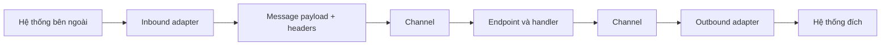

# Điểm mở rộng của runtime và ranh giới với adapter

Spring Integration cung cấp một runtime để kết nối các thành phần xử lý message thành flow. Runtime quản lý message, channel, endpoint, consumer, poller, executor và vòng đời của các thành phần tích hợp. Adapter đứng ở ranh giới giữa runtime và một hệ thống bên ngoài như file system, HTTP, JMS, Kafka, mail hoặc TCP. Adapter chuyển đổi cách giao tiếp của hệ thống đó thành mô hình message mà flow có thể xử lý.

Phân biệt hai phần này giúp chọn đúng điểm mở rộng. Khi cần thay đổi cách ứng dụng xử lý message, hãy mở rộng flow bằng handler, transformer, router hoặc channel phù hợp. Khi cần kết nối một giao thức hay nguồn dữ liệu mới, hãy dùng adapter hoặc triển khai một adapter theo contract của Spring Integration. Đặt ranh giới rõ ràng giúp logic nghiệp vụ ít phụ thuộc vào chi tiết transport, đồng thời giúp quản lý transaction, retry, lỗi, correlation và threading có chủ đích.

## 1. Runtime và adapter nằm ở đâu trong kiến trúc?

Runtime làm việc với một mô hình message chung. Một message mang payload và headers; channel chuyển message giữa các thành phần; endpoint kết nối channel với handler hoặc source. Các endpoint có thể biến đổi, định tuyến, lọc, phân tách, kết hợp hoặc xử lý message.

Adapter chuyển đổi giữa mô hình này và giao tiếp riêng của hệ thống bên ngoài. Adapter inbound nhận dữ liệu từ bên ngoài rồi đưa vào flow. Adapter outbound nhận message từ flow rồi gửi dữ liệu ra bên ngoài.



Trong sơ đồ, runtime quản lý message, channel, endpoint và cách chúng được thực thi. Adapter chịu trách nhiệm giao tiếp với hệ thống bên ngoài và ánh xạ dữ liệu vào hoặc ra mô hình message. Một flow có thể không cần adapter nếu nó bắt đầu từ một channel nội bộ hoặc được gọi trực tiếp bởi ứng dụng.

| Thành phần | Trách nhiệm | Ví dụ |
|---|---|---|
| Runtime core | Điều phối message và vòng đời endpoint | `Message`, `MessageChannel`, `MessageHandler`, `IntegrationFlow` |
| Thành phần xử lý flow | Thực hiện biến đổi hoặc quyết định trên message | Transformer, router, filter, splitter, aggregator, service activator |
| Inbound adapter | Đưa dữ liệu từ hệ thống bên ngoài vào flow | File inbound, HTTP inbound, JMS message-driven adapter |
| Outbound adapter | Gửi dữ liệu từ flow đến hệ thống bên ngoài | File outbound, HTTP outbound, JMS outbound adapter |
| Gateway | Kết nối lời gọi có request/reply qua ranh giới hệ thống | HTTP inbound gateway, HTTP outbound gateway, messaging gateway |

Một adapter không phải là một channel. Adapter là endpoint hoặc thành phần kết nối với transport; channel là cấu trúc runtime để nối producer với consumer trong flow.

## 2. Các contract mở rộng cốt lõi của runtime

Spring Integration có nhiều contract để thay đổi một phần của flow mà không phải viết lại cơ chế điều phối message.

| Contract hoặc thành phần | Vai trò | Khi nào dùng |
|---|---|---|
| `MessageSource<T>` | Cung cấp message khi được gọi nhận dữ liệu | Nguồn có thể được đọc theo chu kỳ, thường kết hợp poller |
| `MessageHandler` | Nhận và xử lý một message | Tích hợp service hoặc logic xử lý tùy chỉnh vào flow |
| Transformer | Chuyển payload hoặc message sang dạng khác | Chuẩn hóa dữ liệu, ánh xạ schema, giải mã định dạng |
| Router | Chọn channel tiếp theo dựa trên message | Định tuyến theo loại payload, header hoặc kết quả phân loại |
| Filter | Quyết định message có được đi tiếp hay không | Kiểm tra điều kiện hợp lệ hoặc loại bỏ message không phù hợp |
| Channel interceptor | Quan sát hoặc can thiệp thao tác gửi/nhận trên channel | Logging, đo thời gian, kiểm tra metadata hoặc chính sách dùng chung |
| Endpoint và lifecycle contract | Kết nối handler với channel và tham gia quản lý vòng đời | Tạo thành phần tích hợp có cấu hình start/stop rõ ràng |

### 2.1. Nguồn được poll và nguồn chủ động đẩy message

`MessageSource<T>` là contract nhận dữ liệu theo kiểu pull: runtime gọi source để lấy một message. `SourcePollingChannelAdapter` kết hợp source với poller để gọi nó theo lịch hoặc trigger. Mô hình này phù hợp với thư mục file, bảng dữ liệu cần quét định kỳ hoặc một API chỉ hỗ trợ truy vấn.

Nguồn event-driven hoạt động theo chiều ngược lại: hệ thống bên ngoài báo có dữ liệu mới, thành phần producer nhận sự kiện rồi gửi message vào channel. Những adapter dạng này thường quản lý listener hoặc callback của transport. Khi triển khai adapter chủ động đẩy message, cần quản lý đăng ký listener, dừng nhận sự kiện và giải phóng tài nguyên theo lifecycle của endpoint.

Hai mô hình không thể hoán đổi tùy ý. Poller điều khiển tần suất gọi một nguồn pull; nó không phải cơ chế bắt sự kiện. Với nguồn push, hãy dùng adapter event-driven hoặc bridge phù hợp thay vì tạo một vòng poll không cần thiết.

### 2.2. Handler là điểm nối với logic ứng dụng

`MessageHandler` nhận toàn bộ message nên có thể đọc payload và headers. Với các handler POJO được khai báo qua annotation hoặc Java DSL, Spring Integration phân giải tham số từ message. Có thể dùng một kiểu payload cụ thể để biểu đạt hợp đồng đầu vào, hoặc nhận `Message<?>` khi cần truy cập envelope.

Một handler nên tập trung vào một nhiệm vụ có thể mô tả rõ. Nếu cần chuyển đổi dữ liệu, dùng transformer. Nếu cần chọn nhánh, dùng router. Nếu cần gọi nghiệp vụ, dùng service activator. Cách tách này giúp flow quan sát được và tránh đưa toàn bộ điều phối vào một phương thức lớn.

## 3. Ranh giới adapter: ánh xạ transport sang message

Adapter inbound thường thực hiện một số công việc trước khi message đi vào flow:

1. Nhận dữ liệu từ API, listener, socket, broker hoặc nguồn lưu trữ.
2. Chuyển dữ liệu transport thành payload phù hợp, có thể là bytes, text, object hoặc một kiểu chuyên biệt.
3. Ánh xạ metadata của transport thành headers nếu adapter hỗ trợ và cấu hình yêu cầu.
4. Gửi message vào output channel hoặc đưa message cho endpoint tiếp theo.

Adapter outbound thực hiện chiều ngược lại: đọc message, chuyển payload và metadata thành request hoặc bản ghi theo giao thức đích, gửi đi, rồi xử lý kết quả theo semantics của adapter.

Không nên để kiểu transport như HTTP request, JMS session hay Kafka consumer record lan sâu vào logic nghiệp vụ nếu service chỉ cần một DTO. Hãy giữ chi tiết giao thức ở adapter và chuyển thành mô hình ứng dụng tại đầu flow. Khi cần trả lời hệ thống bên ngoài, hãy ánh xạ kết quả nghiệp vụ trở lại dạng mà adapter hoặc gateway yêu cầu.

Headers là một phần quan trọng của ranh giới. Adapter có thể tạo hoặc ánh xạ các header như content type, message ID, correlation ID, partition, delivery tag hay thông tin nguồn. Tên header và quy tắc ánh xạ phụ thuộc adapter cụ thể; không nên giả định mọi adapter đều tạo cùng một bộ header. Hãy xác định rõ header nào là metadata kỹ thuật, header nào là dữ liệu nghiệp vụ và header nào cần được truyền qua các bước tiếp theo.

## 4. Phân biệt adapter một chiều và gateway request/reply

Adapter và gateway khác nhau ở hợp đồng giao tiếp:

| Loại endpoint | Hướng giao tiếp | Kết quả mong đợi |
|---|---|---|
| Inbound adapter | Bên ngoài vào flow | Phát message vào flow, không đòi hỏi một reply cho từng message |
| Outbound adapter | Flow ra bên ngoài | Gửi message đi, không tạo một reply nghiệp vụ cho flow |
| Inbound gateway | Request từ bên ngoài vào flow | Có thể gửi kết quả từ flow trở lại caller |
| Outbound gateway | Request từ flow ra bên ngoài | Nhận reply từ hệ thống đích và đưa kết quả về flow |

Ví dụ, một HTTP inbound adapter phù hợp với webhook hoặc endpoint chỉ tiếp nhận sự kiện. HTTP inbound gateway phù hợp khi client gửi request và cần nhận response được tạo từ kết quả xử lý. Tương tự, outbound adapter gửi dữ liệu sang hệ thống đích theo kiểu một chiều; outbound gateway thực hiện request và chờ reply theo giao thức hỗ trợ.

Gateway làm xuất hiện thêm các vấn đề về timeout, tương quan request/reply và xử lý lỗi khi hệ thống đích không phản hồi. Không nên dùng gateway chỉ vì muốn gửi một message; nếu không cần reply, adapter một chiều thường diễn đạt đúng ý định hơn.

## 5. Tạo flow bằng Java DSL và giữ logic ngoài adapter

Ví dụ sau đọc file theo chu kỳ rồi chuyển file cho handler ứng dụng. Adapter lo việc tìm và nhận file; handler xử lý nội dung theo hợp đồng của ứng dụng:

```java
@Bean
IntegrationFlow inboundFiles(FileHandler fileHandler) {
    return IntegrationFlow
            .from(Files.inboundAdapter(new File("/var/app/in")),
                    endpoint -> endpoint.poller(Pollers.fixedDelay(1_000)))
            .handle(fileHandler, "accept")
            .get();
}
```

Ở ví dụ này, inbound adapter là nguồn dữ liệu; poller quy định thời điểm runtime hỏi nguồn; service activator gọi `FileHandler`. Nếu sau này thay file bằng một broker hoặc HTTP endpoint, phần xử lý nghiệp vụ có thể giữ nguyên khi adapter mới ánh xạ dữ liệu về cùng hợp đồng payload và headers.

Một flow outbound có thể bắt đầu từ channel nội bộ rồi ghi message ra thư mục đích:

```java
@Bean
IntegrationFlow outboundFiles() {
    return IntegrationFlow
            .from("completedFiles")
            .handle(Files.outboundAdapter(new File("/var/app/out"))
                    .autoCreateDirectory(true))
            .get();
}
```

Đây là flow minh họa ranh giới: channel `completedFiles` thuộc runtime; outbound adapter thực hiện thao tác file. Trong ứng dụng thực tế, cần xác định payload mà file adapter nhận, cách tạo tên file, xử lý file trùng, ghi file tạm rồi đổi tên, quyền truy cập và chính sách lỗi.

## 6. Mở rộng bằng adapter tùy chỉnh

Trước khi tự viết adapter, hãy kiểm tra adapter có sẵn cho transport và nhu cầu đang dùng. Adapter có sẵn thường đã xử lý nhiều chi tiết khó như quản lý connection, acknowledgement, retry của client, ánh xạ header và shutdown.

Nếu cần một nguồn pull riêng, có thể triển khai `MessageSource<T>` và để `SourcePollingChannelAdapter` gọi nó. Source trả về message khi có dữ liệu và trả về `null` khi hiện không có message. Logic đọc dữ liệu cần có timeout và giới hạn công việc hợp lý để một lần poll không chiếm thread quá lâu.

Nếu cần nhận sự kiện từ một thư viện callback, hãy tích hợp listener với lifecycle của endpoint hoặc dùng lớp nền dành cho message producer như `MessageProducerSupport` khi phù hợp. Thành phần producer phải:

- Đăng ký listener hoặc kết nối khi được khởi động.
- Chuyển sự kiện nhận được thành `Message<?>` với payload và headers có hợp đồng rõ ràng.
- Gửi message qua output channel theo cơ chế của producer.
- Ngừng nhận sự kiện và giải phóng tài nguyên khi endpoint dừng.
- Chuyển lỗi nhận dữ liệu hoặc gửi message vào cơ chế error handling thích hợp.

Nếu cần xử lý message tùy chỉnh ở phía trong flow, triển khai `MessageHandler` thường là đủ. Không cần viết adapter transport chỉ để gọi một service hoặc biến đổi payload; hãy mở rộng ở đúng contract của runtime.

Một adapter tùy chỉnh tốt không làm lộ connection, callback hay kiểu dữ liệu riêng của thư viện transport ra ngoài. Nó cung cấp cấu hình rõ ràng, quản lý tài nguyên đúng lifecycle và đưa ra message nhất quán để flow phía sau xử lý.

## 7. Lifecycle: runtime khởi động và dừng endpoint

Các endpoint do Spring quản lý thường tham gia lifecycle của application context. Nhiều endpoint triển khai `SmartLifecycle`, nhờ đó Spring có thể điều khiển start/stop, thứ tự khởi động qua phase và việc tự khởi động qua `autoStartup`.

Khi ứng dụng khởi động, các thành phần được tạo và liên kết theo cấu hình; endpoint bắt đầu nhận hoặc phát message khi được start. Khi ứng dụng dừng, endpoint cần ngừng nhận công việc mới, hoàn tất hoặc xử lý công việc đang chạy theo chính sách của nó, rồi giải phóng tài nguyên. Chi tiết shutdown phụ thuộc adapter và transport: listener broker, scheduler, executor và connection pool có vòng đời riêng.

### 7.1. Đăng ký flow động bằng IntegrationFlowContext

Một số hệ thống cần tạo hoặc hủy flow trong lúc ứng dụng đang chạy, ví dụ bật một luồng tích hợp theo tenant hoặc theo cấu hình được quản trị. `IntegrationFlowContext` hỗ trợ đăng ký flow động:

```java
IntegrationFlowRegistration registration = flowContext
        .registration(tenantFlow)
        .id("tenant-" + tenantId)
        .register();
```

Đối tượng registration cho phép truy cập các thành phần của flow và điều khiển lifecycle như start, stop hoặc destroy. Khi flow không còn cần thiết, phải dừng và hủy đăng ký để loại bỏ endpoint, channel và tài nguyên liên quan. ID cần duy nhất và ổn định trong phạm vi context.

Flow động hữu ích khi topology thực sự thay đổi trong runtime. Không nên tạo một flow mới cho từng message; việc đó làm tăng số lượng endpoint, khó quan sát trạng thái và có thể gây rò rỉ tài nguyên. Nếu chỉ cần định tuyến theo tenant hoặc loại dữ liệu, router và cấu hình channel thường phù hợp hơn.

## 8. Transaction, retry và error ở ranh giới adapter

Transaction và retry phải được đặt theo semantics của transport và vị trí thực thi. Runtime có thể cung cấp advice hoặc cấu hình endpoint/poller, nhưng không thể tự tạo một transaction phân tán bao trùm mọi hệ thống.

### 8.1. Transaction gắn với tài nguyên và execution boundary

Với một polling endpoint, có thể gắn transaction advice vào poller để thao tác nhận dữ liệu và xử lý message nằm trong transaction của tài nguyên tương ứng, nếu source và transaction manager hỗ trợ. Với listener-driven adapter, transaction thường gắn với container hoặc cơ chế nhận message của transport.

Một transaction JDBC không tự động bao gồm việc publish message lên một broker khác. Nếu flow đi qua `ExecutorChannel`, queue hoặc một ranh giới bất đồng bộ, phần xử lý phía sau thường chạy trên thread khác và không nằm trong transaction thread-bound ban đầu. Hãy xác định rõ transaction bao phủ thao tác nào, lúc nào commit và điều gì xảy ra nếu bước downstream thất bại sau commit.

Khi cần bảo đảm nhất quán giữa cập nhật database và phát sự kiện, cân nhắc outbox/inbox, idempotent consumer hoặc cơ chế transaction của broker thay vì giả định một transaction cục bộ sẽ bao trùm toàn flow.

### 8.2. Retry phải tính đến việc gửi lặp

Retry advice có thể thử lại lời gọi handler khi gặp lỗi phù hợp. Adapter hoặc client transport cũng có thể có retry riêng. Hai tầng retry cần được phối hợp để tránh số lần thử tăng ngoài dự kiến.

Trước khi bật retry, hãy xác định thao tác có an toàn khi chạy lặp hay không. Gửi HTTP request tạo đơn hàng, ghi file hoặc publish event có thể đã thành công ở hệ thống đích nhưng phản hồi bị mất. Nếu thử lại mà không có idempotency key hoặc cơ chế phát hiện trùng, một nghiệp vụ có thể được thực hiện nhiều lần.

Retry cũng cần có giới hạn, khoảng chờ và phân loại lỗi. Lỗi cấu hình hoặc dữ liệu không hợp lệ thường không thể giải quyết bằng cách gửi lại ngay lập tức.

### 8.3. Error channel và ranh giới transport

Lỗi có thể xảy ra khi adapter nhận dữ liệu, khi endpoint xử lý payload hoặc khi adapter outbound giao tiếp với hệ thống đích. Cần phân biệt lỗi transport, lỗi chuyển đổi và lỗi nghiệp vụ vì cách phục hồi của chúng khác nhau.

Spring Integration có thể chuyển lỗi xử lý message thành `ErrorMessage` và gửi tới error channel theo cấu hình của flow, endpoint hoặc message. Trong xử lý đồng bộ, exception có thể truyền ngược về caller. Với poller hoặc consumer bất đồng bộ, lỗi thường được xử lý tại thread thực thi và cần được quan sát qua error channel, logging hoặc cơ chế xử lý lỗi của container.

Adapter còn có thể phải ánh xạ lỗi runtime sang semantics của transport: từ chối hoặc requeue message, gửi vào dead-letter queue, trả HTTP status, giữ file để thử lại hoặc chuyển file lỗi sang thư mục riêng. Không nên mặc định rằng gửi lỗi tới error channel đồng nghĩa transport đã rollback hoặc message sẽ tự được nhận lại.

## 9. Message store và correlation thuộc về runtime flow

Một số flow cần giữ trạng thái qua nhiều message. Aggregator có thể đợi đủ các phần của một nhóm; resequencer có thể sắp xếp message theo sequence; queue hoặc thành phần khác có thể cần lưu message trước khi consumer xử lý. `MessageStore` cung cấp abstraction lưu message và trạng thái liên quan cho những thành phần này; tùy cấu hình, store có thể ở bộ nhớ hoặc dựa trên kho lưu trữ bền vững.

Correlation xác định message nào thuộc cùng một nhóm. Các header như `correlationId`, `sequenceNumber` và `sequenceSize` có thể hỗ trợ gom nhóm và sắp xếp. Adapter có thể ánh xạ message ID hoặc key của transport thành metadata phù hợp, nhưng flow phải có quy tắc correlation nhất quán. Không nên dùng một giá trị ID có phạm vi duy nhất trong broker như thể nó tự động là correlation ID nghiệp vụ.

Khi dùng store bền vững, cần xác định thời gian lưu, chính sách dọn dữ liệu hết hạn, xử lý nhóm không bao giờ đủ phần tử và khả năng phục hồi sau restart. Store giúp giữ trạng thái của flow; nó không thay thế cơ chế acknowledgement, offset hay transaction của adapter transport.

## 10. Threading và hiệu năng tại ranh giới runtime/adapter

Kiểu channel và endpoint quyết định message được xử lý trên thread nào:

| Cơ chế | Execution model | Hệ quả cần xem xét |
|---|---|---|
| `DirectChannel` | Gọi consumer đồng bộ trên thread gửi | Dễ truyền exception về caller; thời gian xử lý downstream ảnh hưởng thread gửi |
| `ExecutorChannel` | Gửi công việc qua executor | Tách thread; cần quản lý queue, pool, lỗi và context truyền qua ranh giới |
| `QueueChannel` | Lưu message để consumer nhận sau | Tạo buffer và tách producer/consumer; cần capacity, timeout và cơ chế nhận message |
| Poller | Gọi source hoặc nhận message theo lịch | Cần giới hạn số message mỗi lần poll và thời gian xử lý để tránh trễ lịch |

Adapter event-driven thường phụ thuộc thread của listener container hoặc client. Adapter polling phụ thuộc scheduler và poller. Thêm executor có thể tăng throughput khi có đủ tài nguyên, nhưng cũng có thể làm tăng queue backlog, độ trễ, số message đang xử lý và độ khó quan sát lỗi.

Khi chẩn đoán hiệu năng, nên quan sát đồng thời:

- Tốc độ message đi vào và đi ra từng channel.
- Độ dài queue hoặc số message đang chờ xử lý.
- Thời gian xử lý handler và thời gian chờ hệ thống bên ngoài.
- Kích thước executor pool, số thread bận và task bị từ chối.
- Tần suất retry, số lỗi, số message chuyển vào dead-letter hoặc error flow.
- Số nhóm correlation đang mở và lượng dữ liệu trong message store.

Nếu producer nhanh hơn consumer trong thời gian dài, tăng thread pool chỉ trì hoãn thời điểm cạn tài nguyên. Cần tìm endpoint chậm, giới hạn tốc độ đầu vào, điều chỉnh batch hoặc capacity, và xác định chính sách backpressure phù hợp với transport.

## 11. Chẩn đoán lỗi theo đúng ranh giới

Khi một message không đi đến đích, hãy lần theo các boundary theo thứ tự:

1. **Adapter inbound:** dữ liệu có thực sự được nhận không? Listener hoặc poller có đang chạy? Có lỗi kết nối, quyền truy cập hay acknowledgement không?
2. **Message đầu vào:** payload có kiểu và nội dung mong đợi? Header quan trọng như message ID, correlation ID và content type có được ánh xạ đúng không?
3. **Channel:** có subscriber không? Channel có buffer đầy hoặc consumer không nhận message không?
4. **Endpoint/handler:** endpoint có start không? Handler có ném exception, bị retry hoặc bị chặn bởi filter/router không?
5. **Ranh giới bất đồng bộ:** message có chuyển sang executor hoặc queue không? Error được xử lý trên thread nào và ở error channel nào?
6. **Adapter outbound:** request có được gửi? Hệ thống đích trả kết quả gì? Có timeout, reject, retry hoặc duplicate không?

Một số triệu chứng thường gặp:

| Triệu chứng | Khu vực nên kiểm tra trước |
|---|---|
| Không có message đi vào flow | Inbound adapter, listener, poller và kết nối transport |
| Có message nhưng sai payload hoặc thiếu header | Mapping và conversion tại adapter boundary |
| Message dừng ở một channel | Subscriber, router, filter, queue capacity và trạng thái endpoint |
| Lỗi chỉ xuất hiện sau khi thêm executor | Error channel, thread pool, queue và context qua ranh giới thread |
| Message được xử lý nhiều lần | Retry, acknowledgement, redelivery và tính idempotent của handler |
| Aggregator không phát kết quả | Correlation key, sequence metadata, timeout và message store |
| Flow không dừng sạch | Lifecycle adapter, listener container, scheduler và executor |

Quan sát runtime nên kết hợp log có correlation ID, metrics và trạng thái endpoint. Khi cần xem topology đang được tạo trong context, có thể dùng khả năng quan sát Integration graph/Actuator tương ứng với phiên bản và cấu hình ứng dụng. Đồ thị giúp xác định kết nối; log và metrics giúp hiểu message đang đi qua đâu và mất bao lâu.

## 12. Chọn đúng điểm mở rộng

Hãy bắt đầu bằng câu hỏi phần nào đang cần thay đổi:

- **Thay đổi dữ liệu hoặc quyết định trong flow:** dùng transformer, router, filter, splitter, aggregator hoặc service activator.
- **Đọc một nguồn pull theo lịch:** triển khai `MessageSource<T>` hoặc dùng inbound adapter có sẵn và cấu hình poller.
- **Nhận sự kiện chủ động từ transport:** dùng inbound event-driven adapter hoặc producer theo contract thích hợp.
- **Gửi message một chiều ra hệ thống khác:** dùng outbound adapter.
- **Gửi request và cần reply:** dùng gateway với timeout và correlation được xác định rõ.
- **Thay đổi topology khi ứng dụng đang chạy:** dùng `IntegrationFlowContext` và quản lý đầy đủ start/stop/destroy.
- **Thay đổi chính sách dùng chung trên channel hoặc endpoint:** cân nhắc interceptor, advice hoặc cấu hình endpoint phù hợp.

Trước khi đưa một adapter hoặc endpoint vào production, cần xác định payload và headers mà nó tạo ra, lifecycle của tài nguyên, transaction boundary, chính sách retry, đường đi của lỗi, quy tắc correlation và execution model. Khi các quyết định này rõ ràng, runtime có thể điều phối flow ổn định trong khi adapter chịu trách nhiệm giao tiếp đúng với hệ thống bên ngoài.
