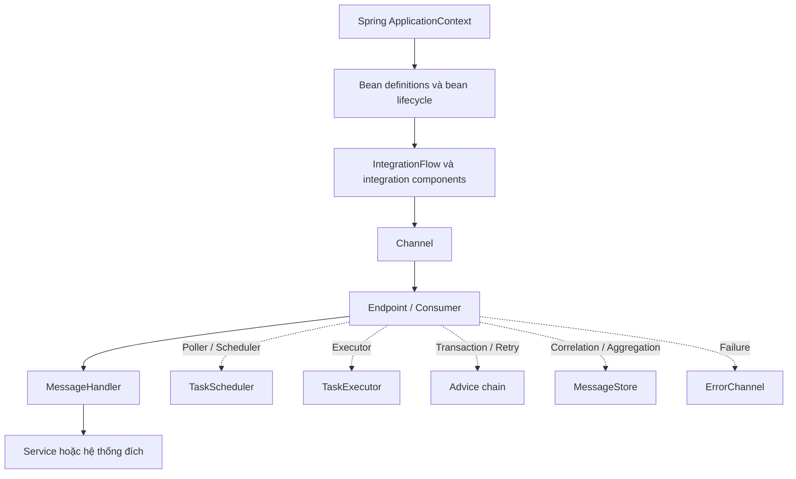
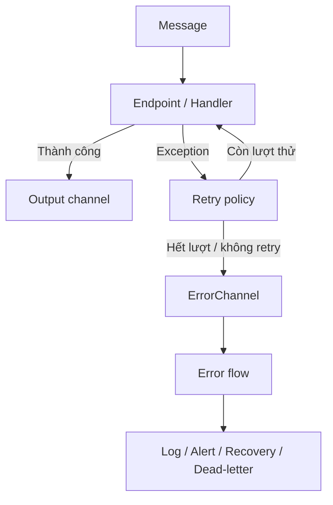
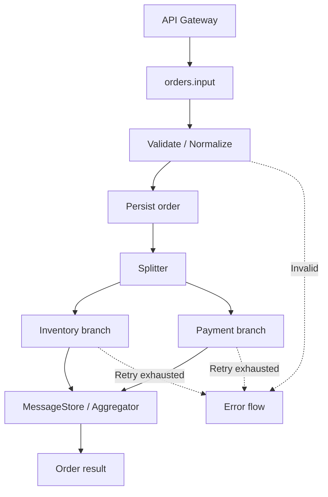

# Lộ trình học từ vòng đời bean đến vận hành flow production

Spring Integration là framework giúp ứng dụng kết nối các hệ thống và tổ chức xử lý dữ liệu theo message flow. Một flow có thể nhận message từ adapter, chuyển qua channel, gọi các endpoint, chờ poller, chạy trên executor, lưu trạng thái vào message store rồi phát kết quả hoặc chuyển lỗi sang một flow khác. Để hiểu runtime, cần nhìn cả vòng đời Spring bean lẫn cách các thành phần Integration được tạo, kết nối, khởi động, thực thi và dừng.

Bài này đưa ra lộ trình học từ nền tảng container đến vận hành production. Mỗi giai đoạn giải quyết một câu hỏi: thành phần nào được tạo ra, message đi qua đâu, ai kích hoạt xử lý, thread nào thực thi, trạng thái được lưu ở đâu, lỗi được phục hồi thế nào và làm sao biết flow đang hoạt động đúng.

## 1. Bức tranh tổng thể của runtime

Một flow trong ứng dụng Spring Integration thường có các lớp thành phần sau:



Các thành phần này có quan hệ với nhau nhưng không phải một khái niệm duy nhất:

- **Spring container** quản lý bean, dependency injection, callback khởi tạo và vòng đời ứng dụng.
- **IntegrationFlow** mô tả đường đi và các bước xử lý message.
- **Channel** chuyển message giữa các thành phần và quyết định kiểu giao tiếp như đồng bộ, hàng đợi hoặc broadcast.
- **Endpoint** kết nối channel với một handler hoặc nguồn message; endpoint quản lý cách handler được kích hoạt.
- **Consumer** là thành phần nhận message từ channel để chuyển cho handler. Tùy loại channel và endpoint, việc nhận có thể theo cơ chế event-driven hoặc polling.
- **Poller** lập lịch việc lấy message theo chu kỳ hoặc trigger. **Executor** cung cấp thread để chạy công việc.
- **Transaction, retry, error flow và message store** cung cấp các cơ chế về độ tin cậy và trạng thái.

Một flow có thể rất ngắn, ví dụ nhận một message rồi gọi service. Nhưng để vận hành ổn định, phải hiểu cách Spring tạo endpoint, thời điểm endpoint bắt đầu nhận message, cách message được chuyển giao và điều gì xảy ra khi xử lý chậm hoặc thất bại.

## 2. Giai đoạn đầu: nắm vòng đời Spring bean

Spring Integration chạy bên trong Spring ApplicationContext. Các channel, endpoint, poller, task scheduler, message store và service nghiệp vụ thường được quản lý như Spring bean hoặc được framework đăng ký thành bean. Vì vậy, vòng đời bean là nền tảng để hiểu runtime.

### 2.1. Từ bean definition đến bean sẵn sàng hoạt động

Ở mức khái quát, quá trình khởi tạo context gồm các bước:

1. Spring đọc cấu hình và tạo các bean definition.
2. Container tạo instance và giải quyết dependency.
3. Các bean post-processor tham gia xử lý bean trước hoặc sau initialization.
4. Bean thực hiện callback khởi tạo như `@PostConstruct`, `InitializingBean.afterPropertiesSet()` hoặc custom init method.
5. Sau khi context được refresh, các bean có lifecycle contract phù hợp được khởi động.
6. Khi context đóng, các thành phần được yêu cầu dừng và giải phóng tài nguyên.

Không phải mọi callback đều có cùng mục đích. `@PostConstruct` phù hợp để kiểm tra hoặc chuẩn bị trạng thái của một bean sau khi dependency đã được inject. Nó không phải nơi lý tưởng để tự khởi chạy một luồng nền dài hạn trước khi toàn bộ context sẵn sàng. Với thành phần cần start/stop theo context, nên dùng lifecycle contract mà Spring quản lý.

### 2.2. `Lifecycle` và `SmartLifecycle`

`Lifecycle` định nghĩa hai thao tác cơ bản `start()` và `stop()`. `SmartLifecycle` bổ sung các khả năng hữu ích cho ứng dụng chạy thực tế, gồm:

- `isAutoStartup()` cho biết bean có tự khởi động khi context refresh hay không.
- `getPhase()` giúp sắp xếp thứ tự start và stop giữa các thành phần lifecycle.
- `stop(Runnable callback)` cho phép báo hiệu khi quá trình dừng bất đồng bộ hoàn tất.

Nhiều integration endpoint được quản lý theo lifecycle. Khi context khởi động, endpoint có thể subscribe vào channel hoặc bắt đầu lịch polling. Khi context dừng, endpoint ngừng nhận công việc mới và thực hiện quá trình stop theo lifecycle của nó.

Thứ tự lifecycle có ý nghĩa. Ví dụ, một endpoint phát message cần các dependency quan trọng sẵn sàng trước khi chạy; một consumer nên được dừng đúng lúc để tránh nhận thêm message khi tài nguyên phía sau đã đóng. Khi một flow có nhiều thành phần tự quản lý thread, hãy kiểm tra thứ tự khởi động và dừng thay vì chỉ dựa vào thứ tự khai báo method `@Bean`.

### 2.3. Phân biệt khởi tạo bean và xử lý message

Một bean tồn tại trong context không có nghĩa nó đang xử lý message. Cần phân biệt:

- **Created:** instance đã được Spring tạo.
- **Initialized:** dependency và callback khởi tạo đã hoàn tất.
- **Started:** lifecycle component đã được bật.
- **Subscribed hoặc scheduled:** endpoint đã kết nối với channel hoặc được scheduler lên lịch.
- **Processing:** handler đang thực thi một message cụ thể.
- **Stopped/destroyed:** endpoint đã dừng hoặc bean đã giải phóng tài nguyên.

Khi debug, chỉ nhìn thấy bean trong ApplicationContext chưa đủ để kết luận flow đang chạy. Cần xem trạng thái lifecycle của endpoint, subscription, lịch poll và các chỉ số xử lý.

## 3. Giai đoạn hai: hiểu IntegrationFlow, endpoint và channel

`IntegrationFlow` là cách mô tả một tuyến xử lý. Java DSL cho phép ghép các bước thành chuỗi dễ đọc:

```java
@Bean
IntegrationFlow orderFlow(OrderService orderService) {
    return IntegrationFlow.from("orders.input")
            .filter(Order.class, Order::isValid)
            .transform(Order.class, Order::normalize)
            .handle(orderService, "process")
            .get();
}
```

Đoạn DSL mô tả logic và kết nối. Khi context được xử lý, Spring Integration tạo hoặc đăng ký các thành phần runtime tương ứng, chẳng hạn channel và endpoint nối handler với channel. Mỗi endpoint có cấu hình và lifecycle riêng.

### 3.1. Endpoint và consumer làm gì?

Endpoint là lớp tích hợp đứng giữa channel và logic xử lý. Nó cấu hình cách message được nhận, chuyển đổi tham số, gọi handler, phát reply và áp dụng các cơ chế như advice. Consumer là phía nhận message từ channel.

Hai dạng thường gặp:

- **Event-driven consumer:** endpoint đăng ký handler vào một `SubscribableChannel`. Khi channel gửi message tới subscriber, handler được gọi theo cơ chế dispatch của channel.
- **Polling consumer:** endpoint lấy message từ một `PollableChannel` theo lịch poller. Message có thể đã nằm trong hàng đợi trước khi consumer lấy ra.

Inbound adapter có thể hoạt động như một message producer. Với nguồn dữ liệu cần truy vấn định kỳ, `SourcePollingChannelAdapter` dùng poller để gọi `MessageSource` rồi phát message vào flow. Với nguồn có cơ chế callback hoặc listener, adapter có thể nhận dữ liệu theo sự kiện mà không cần poller.

### 3.2. Chọn channel theo cách giao tiếp

| Channel | Cách hoạt động | Khi phù hợp |
|---|---|---|
| `DirectChannel` | Gọi handler đồng bộ trên thread gửi | Luồng đơn giản, cần call stack rõ và có thể dùng chung transaction thread-bound |
| `QueueChannel` | Lưu message trong hàng đợi để consumer lấy ra | Cần tách thời điểm gửi và nhận, hấp thụ chênh lệch tốc độ trong giới hạn capacity |
| `ExecutorChannel` | Dispatch handler thông qua `TaskExecutor` | Cần xử lý bất đồng bộ hoặc tách thread gửi khỏi thread xử lý |
| `PublishSubscribeChannel` | Phát một message tới nhiều subscriber | Cần nhiều nhánh cùng nhận một sự kiện |
| `RendezvousChannel` | Sender chờ receiver nhận message theo cơ chế rendezvous | Cần handoff đồng bộ giữa hai phía theo semantics của channel |

Chọn channel là quyết định về giao tiếp và runtime, không chỉ là cách đặt tên một đoạn flow. Ví dụ, chuyển từ `DirectChannel` sang `ExecutorChannel` có thể thay đổi thread thực thi, thứ tự quan sát, cách truyền lỗi và ranh giới transaction.

### 3.3. Theo dấu một message

Khi một message đi qua flow, hãy lần theo các câu hỏi sau:

1. Adapter hoặc gateway nào tạo message?
2. Message được gửi vào channel nào?
3. Channel đó là subscribable hay pollable?
4. Endpoint nào nhận message và handler nào được gọi?
5. Handler trả về void, reply message hay một payload mới?
6. Reply đi vào channel nào để tiếp tục flow?
7. Nếu endpoint không xử lý được, exception được chuyển tới error flow nào?

Thói quen lần theo message giúp đọc DSL dễ hơn và xác định đúng nơi cần quan sát khi flow không chạy như dự kiến.

## 4. Giai đoạn ba: phân biệt event-driven, poller và scheduler

Poller chỉ xuất hiện khi một thành phần cần chủ động lấy dữ liệu theo lịch. Không phải mọi endpoint đều có poller.

### 4.1. Hai trường hợp polling phổ biến

**Polling consumer** đọc message từ một `PollableChannel`, chẳng hạn `QueueChannel`. Message được gửi vào queue trước; poller đánh thức consumer để nhận một hoặc nhiều message.

**Source polling adapter** gọi một `MessageSource` theo lịch để lấy dữ liệu từ nguồn bên ngoài, ví dụ đọc bản ghi cần xử lý từ database hoặc kiểm tra thư mục chứa file. Adapter tạo message rồi gửi vào channel của flow.

Trong cả hai trường hợp, poller điều khiển thời điểm thực thi. `TaskScheduler` quản lý việc lên lịch task; `PollerMetadata` mô tả các thuộc tính của lần poll.

### 4.2. Những thuộc tính poller cần hiểu

| Thuộc tính | Ý nghĩa vận hành |
|---|---|
| `fixedDelay` | Lập lịch lần chạy tiếp theo sau khi lần trước hoàn tất và hết khoảng delay cấu hình |
| `fixedRate` | Lập lịch theo nhịp thời gian cố định; cần chú ý khả năng chồng lấn tùy cấu hình thực thi |
| `cron` | Lập lịch theo biểu thức thời gian |
| `maxMessagesPerPoll` | Giới hạn số message được xử lý trong một lần poll |
| `receiveTimeout` | Thời gian chờ khi nhận từ pollable channel |
| `taskExecutor` | Executor có thể được cấu hình để thực thi poll task |
| `adviceChain` | Áp dụng advice như transaction hoặc retry quanh thao tác polling/endpoint theo vị trí cấu hình |

Chọn trigger theo yêu cầu nghiệp vụ. Ví dụ, một job kiểm tra file mỗi phút có thể dùng cron hoặc fixed delay. Một consumer đọc queue liên tục cần xem xét `maxMessagesPerPoll`, receive timeout và cách scheduler được cấp thread. Poller chạy quá thường xuyên có thể tạo tải không cần thiết; chạy quá thưa có thể làm tăng độ trễ và tuổi message trong queue.

### 4.3. Ví dụ cấu hình poller

```java
@Bean(name = PollerMetadata.DEFAULT_POLLER)
PollerMetadata defaultPoller() {
    return Pollers.fixedDelay(500)
            .maxMessagesPerPoll(10)
            .receiveTimeout(1000)
            .get();
}
```

Đây là ví dụ khai báo default poller để các polling endpoint cần cấu hình mặc định có thể sử dụng. Một endpoint có thể khai báo poller riêng để có nhịp chạy và giới hạn khác. Các giá trị trên chỉ minh họa tham số, không phải cấu hình tối ưu cho mọi ứng dụng; cần kiểm tra cách endpoint nhận cấu hình poller trong phiên bản Spring Integration đang dùng.

## 5. Giai đoạn bốn: hiểu executor và concurrency

Thread hiện tại của một bước xử lý phụ thuộc vào loại channel, endpoint và cấu hình executor.

| Cơ chế | Thread thường thực thi handler |
|---|---|
| `DirectChannel` | Thread gửi message |
| `ExecutorChannel` | Thread do `TaskExecutor` cấp |
| `QueueChannel` với polling consumer | Thread thực thi poll task/consumer |
| `PublishSubscribeChannel` không cấu hình executor | Thread phát message thực hiện việc dispatch subscriber |
| `PublishSubscribeChannel` có executor | Subscriber có thể được thực thi trên executor |
| Source polling adapter | Thread chạy poll task, hoặc executor được cấu hình cho poller |

Không nên suy luận thread chỉ từ tên endpoint. Hãy xem channel thực tế, poller metadata, executor và cách subscriber được cấu hình.

### 5.1. `TaskExecutor` và `TaskScheduler`

Hai abstraction này có mục tiêu khác nhau:

- `TaskExecutor` thực thi công việc trên thread được quản lý, thường dùng cho xử lý bất đồng bộ và song song.
- `TaskScheduler` lên lịch công việc theo thời điểm hoặc trigger, thường dùng để kích hoạt poller.

Một poller có thể được scheduler kích hoạt và sau đó dùng executor theo cấu hình. Không nên gộp hai khái niệm thành một thread pool chung nếu chưa hiểu tải và vòng đời của từng loại công việc.

### 5.2. Các rủi ro concurrency

- **Race condition:** nhiều thread đọc và ghi cùng trạng thái mutable.
- **Unbounded queue:** công việc đến nhanh hơn tốc độ xử lý, khiến bộ nhớ tăng liên tục.
- **Thread starvation:** tác vụ blocking chiếm hết thread của pool, làm các tác vụ khác không được chạy.
- **Oversubscription:** quá nhiều thread gây tranh chấp CPU, context switching và áp lực lên database hoặc dịch vụ bên ngoài.
- **Ordering thay đổi:** xử lý bất đồng bộ có thể hoàn thành khác thứ tự message được gửi.

Để kiểm soát, hãy dùng payload bất biến, giới hạn queue capacity, đặt kích thước pool theo năng lực downstream, cấu hình timeout và xác định chính sách khi executor từ chối task. Nếu nghiệp vụ cần thứ tự, phải chọn channel/partitioning/key và mô hình consumer giữ được thứ tự cần thiết.

### 5.3. Ví dụ về ranh giới thread

```text
Thread HTTP request
    |
    v
DirectChannel
    |
    v
Service Activator (cùng thread)

Thread HTTP request
    |
    v
ExecutorChannel
    |
    v
TaskExecutor worker thread
    |
    v
Service Activator (thread khác)
```

Với `DirectChannel`, call stack đồng bộ thường dễ theo dõi và transaction gắn với thread có thể tiếp tục trong cùng đường gọi. Với `ExecutorChannel`, việc xử lý được chuyển sang thread khác. Transaction thread-bound của thread gửi không tự động đi theo message sang worker thread.

## 6. Giai đoạn năm: quản lý vòng đời IntegrationFlow

Có hai cách quản lý flow thường gặp.

### 6.1. Flow khai báo tĩnh bằng bean

Khai báo `IntegrationFlow` bằng `@Bean` phù hợp với các tuyến xử lý có vòng đời gắn với ứng dụng:

```java
@Bean
IntegrationFlow billingFlow(BillingService billingService) {
    return IntegrationFlow.from("billing.input")
            .handle(billingService, "charge")
            .get();
}
```

Khi context khởi động, framework đăng ký các thành phần của flow và khởi động các endpoint theo lifecycle/autostartup đã cấu hình. Khi context đóng, các endpoint được dừng theo cơ chế lifecycle.

### 6.2. Flow đăng ký động bằng `IntegrationFlowContext`

Một số ứng dụng cần tạo hoặc gỡ flow khi runtime đang hoạt động, ví dụ bật một tuyến tích hợp cho tenant mới hoặc cấu hình một nguồn dữ liệu mới. `IntegrationFlowContext` cung cấp API đăng ký flow động:

```java
IntegrationFlowRegistration registration = flowContext
        .registration(dynamicFlow)
        .id("tenant-orders-" + tenantId)
        .autoStartup(false)
        .register();

registration.start();

// Khi không còn cần flow:
registration.stop();
registration.destroy();
```

Ví dụ cần được điều chỉnh theo kiểu flow và phiên bản Spring Integration đang dùng. Các điểm phải quản lý gồm:

- ID của flow phải ổn định và không xung đột với flow đã đăng ký.
- Nếu có nhiều channel/endpoint cùng tên, cần quy ước prefix để tránh trùng bean name.
- Quyết định rõ flow có tự start ngay sau đăng ký hay cần start theo điều kiện.
- Lưu handle `IntegrationFlowRegistration` để có thể lấy input channel, start, stop và destroy.
- Khi gỡ flow, phải giải phóng registration và tài nguyên liên quan; chỉ bỏ reference Java không đồng nghĩa endpoint đã được unregister.

Không nên đăng ký lặp flow cho cùng một tenant sau mỗi request. Cần có registry hoặc cơ chế đồng bộ để tránh tạo nhiều consumer trùng nhau. Nếu thay thế flow đang chạy, phải kiểm soát thời điểm dừng flow cũ, chuyển lưu lượng sang flow mới và tránh xử lý trùng trong giai đoạn chuyển tiếp.

### 6.3. Graceful shutdown

Khi ứng dụng dừng, cần xác định:

1. Ngừng nhận message mới ở inbound adapter hoặc nguồn tạo tải.
2. Dừng endpoint/consumer theo lifecycle.
3. Cho các message đang xử lý hoàn tất trong giới hạn thời gian shutdown.
4. Commit hoặc rollback transaction theo kết quả xử lý.
5. Giữ lại message chưa xử lý trong queue/store bền vững nếu yêu cầu nghiệp vụ cần phục hồi.
6. Đóng executor, scheduler và các tài nguyên tích hợp đúng thứ tự.

Một queue chỉ nằm trong bộ nhớ có thể mất message khi process dừng đột ngột. Graceful shutdown giúp giảm rủi ro, nhưng không thay thế persistence và thiết kế idempotency khi cần độ bền cao.

## 7. Giai đoạn sáu: transaction và ranh giới đảm bảo xử lý

Transaction giúp phối hợp các thao tác thuộc resource có hỗ trợ transaction, ví dụ database hoặc broker tương thích. Trong Spring Integration, transaction thường được áp dụng qua transaction advice trên poller hoặc endpoint, cùng một `PlatformTransactionManager` phù hợp.

### 7.1. Xác định transaction boundary

Trước khi cấu hình transaction, hãy trả lời:

- Transaction bắt đầu trước khi nhận message, sau khi nhận hay trước khi gọi handler?
- Những thao tác nào tham gia cùng transaction manager?
- Commit xảy ra khi handler hoàn tất hay sau khi reply được gửi?
- Nếu gửi message sang channel bất đồng bộ, bước xử lý sau có nằm trong transaction ban đầu không?
- Khi exception xảy ra, loại exception nào kích hoạt rollback?

Transaction của poller có thể bao quanh lần polling và xử lý tương ứng tùy vị trí advice và loại resource. Tuy nhiên, transaction database không tự bao phủ một lời gọi HTTP hoặc một thao tác trên hệ thống bên ngoài. `ExecutorChannel` cũng tạo ranh giới thread; transaction gắn với thread hiện tại không tự truyền sang worker thread.

### 7.2. Transaction không đồng nghĩa exactly-once

Một transaction database có thể rollback dữ liệu database, nhưng không tự thu hồi email đã gửi, HTTP request đã thực hiện hoặc thay đổi trên object Java mutable. Nếu message được gửi lại sau khi lỗi, handler có thể chạy nhiều lần.

Vì vậy, với thao tác nghiệp vụ có side effect, nên thiết kế idempotency key, unique constraint, inbox/outbox pattern hoặc cơ chế deduplication phù hợp. Cần nói rõ semantics mà hệ thống đảm bảo: at-most-once, at-least-once hay một cách phối hợp gần với exactly-once trong phạm vi resource cụ thể.

## 8. Giai đoạn bảy: retry, error channel và phục hồi lỗi

Lỗi có thể xuất hiện khi nhận message, chuyển đổi payload, gọi service, gửi message hoặc giao tiếp với hệ thống bên ngoài. Một flow production phải xác định lỗi nào có thể retry, lỗi nào cần đưa sang nhánh xử lý riêng và lỗi nào cần dừng xử lý.

### 8.1. Retry có giới hạn

Retry advice có thể bọc quanh handler hoặc thao tác polling. Chính sách thường cần:

- Số lần thử tối đa.
- Khoảng chờ giữa các lần thử và backoff.
- Loại exception được retry.
- Điều kiện dừng retry.
- Recovery callback hoặc nơi chuyển message sau khi hết số lần thử.

Chỉ retry lỗi có khả năng tự phục hồi, ví dụ timeout tạm thời hoặc lỗi kết nối ngắn hạn. Retry lỗi dữ liệu không hợp lệ thường chỉ lặp lại cùng một thất bại và làm tăng tải. Với downstream đang quá tải, retry dồn dập có thể tạo retry storm; cần backoff và giới hạn concurrency.

### 8.2. Error flow

Spring Integration hỗ trợ error channel để chuyển lỗi thành `ErrorMessage` và cho phép một flow xử lý lỗi. Cách lỗi được chuyển phụ thuộc execution mode và cấu hình error channel: lỗi trong tác vụ polling hoặc xử lý bất đồng bộ có thể được gửi tới error channel; với đường gọi đồng bộ, exception cũng có thể truyền ngược về thread gửi nếu không có cơ chế xử lý lỗi phù hợp. Có thể định tuyến theo loại exception, endpoint nguồn hoặc metadata nghiệp vụ để ghi log, lưu trạng thái, gửi cảnh báo hoặc đưa message vào dead-letter path.



Khi thiết kế error flow, cần giữ thông tin đủ để điều tra: exception, message gốc hoặc thông tin định danh, endpoint phát sinh lỗi và correlation ID. Cẩn trọng khi log payload có dữ liệu nhạy cảm.

Không nên nuốt exception rồi coi message đã xử lý thành công. Nếu recovery path ghi nhận message là đã xử lý, phải có trạng thái rõ ràng để người vận hành phân biệt thành công nghiệp vụ với lỗi đã được cách ly.

## 9. Giai đoạn tám: message store và correlation

Một số flow cần giữ message qua nhiều thời điểm hoặc gom nhiều message thành một kết quả. Khi đó, trạng thái không thể chỉ nằm trong biến local của một lần gọi handler.

### 9.1. MessageStore

`MessageStore` là abstraction để lưu và truy xuất message hoặc message group. Nó được dùng trong các thành phần như aggregator, resequencer và một số loại channel. Tùy implementation, dữ liệu có thể chỉ nằm trong bộ nhớ hoặc được lưu bền vững.

Khi chọn store, cần xem xét:

- Message có còn sau khi ứng dụng restart không?
- Store có hỗ trợ transaction với resource liên quan không?
- Cách serialize payload và headers là gì?
- Có giới hạn dung lượng, cơ chế cleanup và chính sách hết hạn group không?
- Có thể quan sát số lượng message/group đang chờ không?

In-memory store hữu ích cho kiểm thử hoặc tình huống không yêu cầu phục hồi sau restart. Với flow cần khôi phục trạng thái, phải chọn persistence phù hợp và kiểm thử tình huống process dừng giữa chừng.

### 9.2. Correlation trong splitter và aggregator

Splitter tạo nhiều message con từ một message. Aggregator dùng correlation strategy để xác định các message thuộc cùng một nhóm, sau đó dùng release strategy để quyết định khi nào nhóm đủ điều kiện phát kết quả.

Các header thường liên quan gồm:

- `correlationId`: định danh nhóm message.
- `sequenceNumber`: vị trí của message trong chuỗi.
- `sequenceSize`: số lượng message dự kiến trong nhóm khi có thể xác định.

Nếu message bị thiếu, trùng hoặc đến sai thứ tự, aggregator cần timeout, release strategy và chính sách xử lý nhóm không hoàn chỉnh. Message group bị giữ quá lâu có thể làm store tăng không giới hạn; cần cấu hình expiry và kiểm tra dữ liệu còn tồn đọng.

Correlation không đồng nghĩa idempotency. Correlation liên kết message trong một nhóm; idempotency ngăn một thao tác nghiệp vụ bị áp dụng lặp. Một flow có thể cần cả hai.

## 10. Giai đoạn chín: kiểm thử và quan sát runtime

Không nên đợi đến production mới xác nhận flow chạy đúng. Kiểm thử cần bao phủ cả logic handler và hành vi runtime quan trọng.

### 10.1. Các lớp kiểm thử

| Lớp kiểm thử | Mục tiêu |
|---|---|
| Unit test service | Kiểm tra logic nghiệp vụ độc lập với IntegrationFlow |
| Flow test | Gửi message vào input channel và xác minh output, header, thứ tự bước |
| Endpoint test | Kiểm tra mapping payload/header, filter, router, transformer và handler |
| Poller test | Kiểm tra trigger, batch size, receive timeout và xử lý queue rỗng |
| Error/retry test | Xác minh số lần thử, backoff, recovery và error flow |
| Lifecycle test | Kiểm tra endpoint start/stop, đăng ký/gỡ flow động và shutdown |
| Integration test | Kiểm tra transaction, message store, broker hoặc database thật/giả lập phù hợp |

Với Spring Integration Test, có thể dùng các tiện ích kiểm thử như `MockIntegration` và các channel trong bộ test để gửi/nhận message. Với phần phụ thuộc scheduler hoặc executor, cần kiểm tra cả kết quả cuối lẫn điều kiện hoàn tất bất đồng bộ; tránh test dựa vào `Thread.sleep()` tùy tiện.

### 10.2. Những tín hiệu nên quan sát

- Số message được gửi, nhận, xử lý thành công và thất bại theo channel/endpoint.
- Độ sâu queue và tuổi của message cũ nhất.
- Thời gian xử lý trung bình, percentile và thời gian chờ trong queue.
- Số lần retry, số message đi vào error flow và dead-letter path.
- Số thread đang hoạt động, queue của executor và số lần executor từ chối task.
- Poll duration, số message mỗi lần poll và thời gian chờ của poller.
- Số message group đang mở, tuổi group và số group hết hạn.
- Transaction duration, rollback và lỗi kết nối resource.

Micrometer và hệ sinh thái observability của Spring có thể được dùng để xuất metrics tùy phiên bản và cấu hình ứng dụng. Message history hoặc log theo correlation ID giúp lần theo đường đi của một message. Không nên bật log payload đầy đủ trong production nếu có nguy cơ lộ dữ liệu nhạy cảm.

### 10.3. Quy trình chẩn đoán khi flow không chạy

1. Xác nhận ApplicationContext đã refresh thành công và bean liên quan đã được tạo.
2. Kiểm tra endpoint đã start, `autoStartup` và lifecycle phase.
3. Xác nhận input channel có đúng tên và adapter/gateway đã gửi message.
4. Xác định channel là event-driven hay pollable; nếu pollable, kiểm tra poller và scheduler.
5. Kiểm tra consumer/subscriber có đăng ký đúng và handler có được gọi không.
6. Kiểm tra executor còn thread, queue có bị đầy và downstream có bị chậm không.
7. Tìm exception, retry và error message theo correlation ID.
8. Nếu dùng aggregator, kiểm tra correlation key, sequence metadata, message store và group timeout.
9. Nếu dùng transaction, xác định transaction manager, boundary và resource thực sự tham gia.

Quy trình này đi từ lifecycle tới message path rồi mới tới concurrency và reliability. Nó giúp thu hẹp phạm vi lỗi theo từng ranh giới runtime.

## 11. Lộ trình thực hành theo từng chặng

Bảng sau gợi ý thứ tự học và sản phẩm cần tự làm sau mỗi chặng. Có thể dùng một ví dụ xuyên suốt là xử lý đơn hàng để kết nối các khái niệm.

| Chặng | Nội dung cần nắm | Bài thực hành / kết quả mong đợi |
|---|---|---|
| 1. Spring container | Bean definition, dependency injection, initialization, `Lifecycle`, `SmartLifecycle` | Tạo bean có log start/stop và quan sát khi context refresh/close |
| 2. Flow cơ bản | `IntegrationFlow`, channel, endpoint, handler | Nhận một Order, validate, transform và gọi service |
| 3. Channel và consumer | Direct, queue, publish-subscribe, event-driven consumer | Thay channel và ghi nhận khác biệt về thread, buffering và fan-out |
| 4. Polling | `MessageSource`, polling consumer, `PollerMetadata`, scheduler | Đọc công việc theo chu kỳ, giới hạn batch và xử lý queue rỗng |
| 5. Executor | `TaskExecutor`, `TaskScheduler`, concurrency, backpressure | Chạy bất đồng bộ, giới hạn pool và mô phỏng downstream chậm |
| 6. Flow lifecycle | Static flow, `IntegrationFlowContext`, start/stop/destroy | Đăng ký flow theo tenant rồi gỡ flow khi tenant ngừng hoạt động |
| 7. Reliability | Transaction advice, retry, error channel, idempotency | Mô phỏng lỗi tạm thời, lỗi vĩnh viễn và gửi lại cùng request |
| 8. Stateful flow | MessageStore, splitter, aggregator, correlation | Chia đơn hàng thành nhiều công việc và gom kết quả |
| 9. Production | Metrics, logging, graceful shutdown, capacity và recovery | Chạy tải thử, dừng ứng dụng giữa chừng và kiểm tra khả năng phục hồi |

Sau mỗi chặng, nên ghi lại ba thứ: message bắt đầu ở đâu, thành phần nào kích hoạt bước kế tiếp và thread nào thực thi bước đó. Khi có câu trả lời rõ cho ba câu hỏi này, bức tranh runtime sẽ dễ hiểu hơn nhiều.

## 12. Tình huống tổng hợp: xử lý đơn hàng trong production

Giả sử hệ thống nhận đơn hàng từ API, lưu đơn, tách công việc kiểm tra tồn kho và thanh toán, rồi tổng hợp kết quả.



Khi thiết kế flow này, cần đưa ra các quyết định cụ thể:

- API adapter gửi message vào channel nào và endpoint nào nhận đầu tiên?
- Bước lưu đơn chạy trong transaction nào? Transaction có bao phủ các thao tác ở nhánh thanh toán không?
- Splitter tạo correlation ID nào và aggregator dựa vào điều kiện gì để release?
- Hai nhánh chạy đồng bộ hay bất đồng bộ? Executor có giới hạn bao nhiêu công việc đồng thời?
- Nếu payment service timeout, retry bao nhiêu lần và dùng idempotency key nào để tránh trừ tiền hai lần?
- Nếu một nhánh không bao giờ trả kết quả, group timeout xử lý ra sao và ai nhận cảnh báo?
- Khi ứng dụng restart, message và group đang chờ được khôi phục từ store nào?
- Dashboard nào cho biết queue đang tăng, retry đang lặp hoặc aggregator đang giữ group quá lâu?

Các quyết định này liên kết bean lifecycle, channel, endpoint, consumer, poller, executor, transaction, retry, message store và observability thành một thiết kế runtime thống nhất.

## 13. Checklist trước khi đưa flow vào production

- [ ] Tất cả endpoint có lifecycle và trạng thái startup rõ ràng.
- [ ] Input channel, output channel và consumer được xác định rõ.
- [ ] Poller chỉ gắn vào endpoint cần polling; trigger, batch size và timeout đã được chọn theo tải.
- [ ] Executor có giới hạn thread, queue capacity và chính sách từ chối task.
- [ ] Payload và metadata dùng chung an toàn khi xử lý đa luồng.
- [ ] Transaction boundary và resource tham gia đã được kiểm chứng.
- [ ] Retry có giới hạn, backoff và phân loại exception.
- [ ] Error flow có recovery rõ ràng, không âm thầm bỏ message.
- [ ] MessageStore có persistence/expiry phù hợp với yêu cầu phục hồi.
- [ ] Correlation và idempotency được thiết kế riêng, không nhầm lẫn.
- [ ] Có metrics cho queue, endpoint, executor, poller, retry và message group.
- [ ] Graceful shutdown và kịch bản restart đã được kiểm thử.
- [ ] Log không làm lộ payload hoặc headers nhạy cảm.

Khi hoàn thành lộ trình này, người học có thể đọc một IntegrationFlow và giải thích được nó được Spring tạo ra thế nào, endpoint nào nhận message, consumer nào kích hoạt handler, poller/executor dùng thread ra sao, transaction và retry bao quanh bước nào, trạng thái được lưu ở đâu và cần quan sát tín hiệu gì khi vận hành. Đó là nền tảng để chuyển từ việc chỉ viết được một flow sang khả năng chẩn đoán và vận hành flow production.
