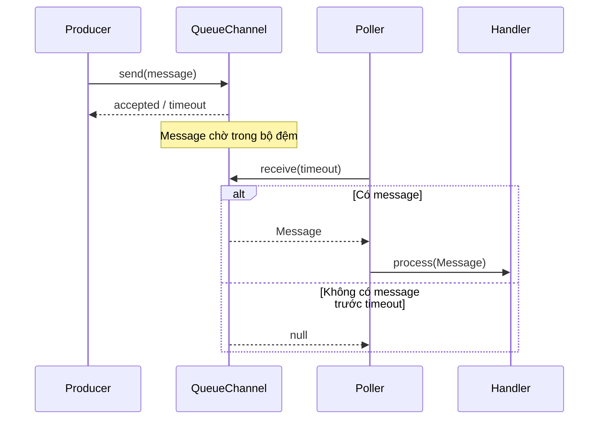
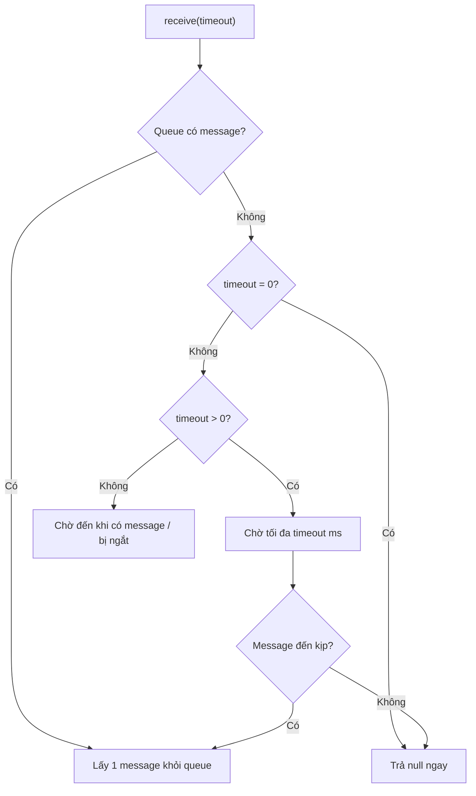
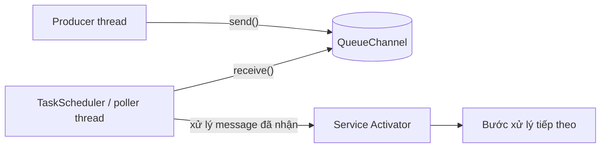
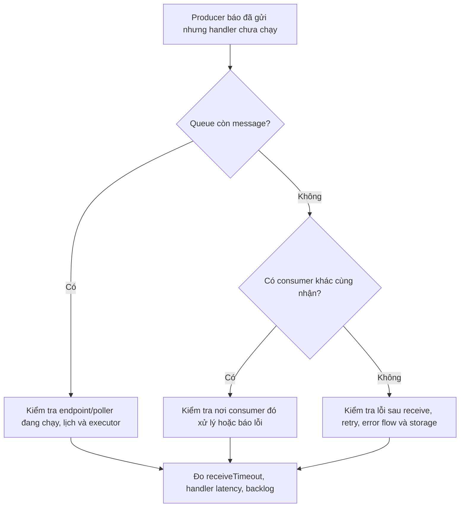

# PollableChannel và receive semantics

Trong **Spring Integration runtime**, một message flow không nhất thiết đẩy thông điệp thẳng từ producer sang consumer. Với `PollableChannel`, producer gửi message vào channel, còn consumer chủ động **lấy** message khi có nhu cầu hoặc khi một `poller` được lập lịch. Cách tách nhịp gửi và nhịp xử lý này đặc biệt hữu ích khi hệ thống nhận dữ liệu theo đợt, cần bộ đệm để hấp thụ tải đột biến, hoặc muốn giới hạn tốc độ xử lý.

Chủ đề này tập trung vào **channel runtime**: ý nghĩa chính xác của `receive()`, timeout, việc một message được lấy khỏi hàng đợi, cách poller điều phối consumer, cũng như những hệ quả về threading, transaction, retry, lỗi và quan sát trạng thái hệ thống.

## 1. PollableChannel đóng vai trò gì trong message flow?

`org.springframework.messaging.PollableChannel` là giao diện mở rộng `MessageChannel`, bổ sung hai thao tác nhận message:

```java
public interface PollableChannel extends MessageChannel {
    Message<?> receive();
    Message<?> receive(long timeout);
}
```

Khác biệt chính nằm ở **ai quyết định thời điểm nhận**:

| Kiểu channel | Cách consumer nhận | Đặc điểm runtime |
| --- | --- | --- |
| `DirectChannel` | Channel gọi subscriber khi producer `send()` | Gọi trực tiếp, thường xử lý trên thread của producer |
| `ExecutorChannel` | Channel dispatch đến subscriber qua executor | Đẩy chủ động, việc xử lý có thể chạy trên thread khác |
| `QueueChannel` | Consumer gọi `receive()` hoặc được poller gọi hộ | Có bộ đệm, tách producer khỏi nhịp consumer |
| `PriorityChannel` | Consumer gọi `receive()` | Có bộ đệm và lựa chọn message theo mức ưu tiên |
| `RendezvousChannel` | Sender và receiver gặp nhau để trao đổi message | Không lưu hàng đợi đệm; việc gửi/nhận cần phối hợp về thời điểm |

Ba channel cuối là các triển khai thường gặp của `PollableChannel`. `DirectChannel` và `ExecutorChannel` là các channel dạng `SubscribableChannel`; không gọi `receive()` trên chúng.



Điểm dễ nhầm: **`PollableChannel` không tự tạo một thread polling chỉ vì nó tồn tại**. Phải có một thành phần gọi `receive()`: mã ứng dụng, `PollingConsumer`, hoặc một endpoint polling do framework quản lý. Poller chính là cơ chế lập lịch gọi nhận message và kích hoạt handler tương ứng.

## 2. Ý nghĩa của `receive()` và `receive(timeout)`

Với `QueueChannel`, cách hiểu thực tế là:

| Lệnh gọi | Khi hàng đợi có message | Khi hàng đợi rỗng |
| --- | --- | --- |
| `receive(0)` | Lấy message ngay | Trả về `null` ngay, không chờ |
| `receive(250)` | Lấy message khi sẵn có | Chờ tối đa khoảng 250 ms rồi trả `null` nếu vẫn rỗng |
| `receive(-1)` | Lấy message khi sẵn có | Có thể chờ vô thời hạn cho đến khi nhận được message hoặc thread bị ngắt |
| `receive()` | Lấy message khi sẵn có | Tương đương nhận với thời gian chờ vô hạn trong cách triển khai thông thường của `QueueChannel` |

Timeout tính bằng **mili giây**. Giá trị dương là giới hạn *thời gian chờ để nhận*, không phải thời hạn cho toàn bộ công việc xử lý message. Với `QueueChannel`, timeout âm biểu thị chờ không giới hạn. Khi sử dụng một triển khai `PollableChannel` khác hoặc một lớp wrapper tùy biến, cần kiểm tra contract và hành vi thực tế của triển khai đó, đặc biệt ở các trường hợp timeout và interruption.

Ví dụ nhận chủ động, không cần khởi động poller:

```java
import org.springframework.integration.channel.QueueChannel;
import org.springframework.messaging.Message;
import org.springframework.messaging.support.MessageBuilder;

QueueChannel channel = new QueueChannel(2);

Message<?> empty = channel.receive(0);  // null: kiểm tra không chờ

channel.send(MessageBuilder.withPayload("ORDER-001").build(), 0);
Message<?> first = channel.receive(0);  // nhận ORDER-001, lấy khỏi queue

Message<?> next = channel.receive(100); // chờ tối đa 100 ms; null nếu rỗng
```

Khi không có message, `null` là kết quả bình thường của một lần polling có timeout. Không nên xem mọi lần `null` là lỗi hoặc tạo retry vô hạn trong một vòng lặp bận.

### 2.1. `receive()` lấy message, không xác nhận xử lý thành công

Với `QueueChannel` lưu trong bộ nhớ, sau khi `receive()` trả về một message, message đã được **lấy ra khỏi queue**. Lệnh gọi không biết handler phía sau sẽ thành công hay ném exception. Do đó:

1. `send()` thành công chỉ cho biết channel chấp nhận message tại thời điểm gửi.
2. `receive()` trả về message chỉ cho biết consumer đã lấy được message.
3. Handler chạy xong thành công là một sự kiện riêng; muốn có xác nhận nghiệp vụ phải thiết kế cơ chế tương ứng.

Một message bị lấy khỏi hàng đợi rồi gặp lỗi ở handler **không mặc nhiên quay lại hàng đợi**. `QueueChannel` in-memory không tự cung cấp bảo đảm xử lý `exactly-once` hay phục hồi message qua việc ứng dụng khởi động lại.

### 2.2. Phân biệt timeout lúc gửi và lúc nhận

Hai thao tác có thể block vì **hai nguyên nhân khác nhau**:

| Thao tác | Điều kiện phải chờ | Kết quả khi hết timeout |
| --- | --- | --- |
| `channel.send(message, 200)` | Queue có giới hạn dung lượng và đang đầy | Thường trả `false` nếu không thể đưa message vào kịp |
| `channel.receive(200)` | Queue đang rỗng | Trả `null` khi không có message |

`send()` cũng có thể thất bại do exception hoặc interceptor; đừng quy mọi thất bại gửi về một giá trị `false`. Với `QueueChannel` có dung lượng cố định, `send(message, 0)` là cách kiểm tra khả năng đưa message vào ngay mà không phải chờ chỗ trống.



## 3. Ví dụ: tạo QueueChannel và consumer có poller

Một cấu hình tối thiểu bằng annotation của Spring Integration:

```java
import org.springframework.context.annotation.Bean;
import org.springframework.context.annotation.Configuration;
import org.springframework.integration.annotation.EnableIntegration;
import org.springframework.integration.annotation.Poller;
import org.springframework.integration.annotation.ServiceActivator;
import org.springframework.integration.channel.QueueChannel;
import org.springframework.messaging.Message;
import org.springframework.messaging.support.MessageBuilder;
import org.springframework.stereotype.Component;

@Configuration
@EnableIntegration
class OrderFlowConfig {
    @Bean
    QueueChannel ordersQueue() {
        return new QueueChannel(100); // Giới hạn 100 message chờ
    }
}

@Component
class OrderProcessor {
    @ServiceActivator(
        inputChannel = "ordersQueue",
        poller = @Poller(fixedDelay = "500", maxMessagesPerPoll = "5")
    )
    public void process(Message<String> message) {
        System.out.println("Processing: " + message.getPayload());
        // Gọi nghiệp vụ thực tế tại đây
    }
}

@Component
class OrderPublisher {
    private final QueueChannel ordersQueue;

    OrderPublisher(QueueChannel ordersQueue) {
        this.ordersQueue = ordersQueue;
    }

    boolean publish(String orderId) {
        Message<String> message =
                MessageBuilder.withPayload(orderId).build();
        return ordersQueue.send(message, 200);
    }
}
```

Trong ví dụ này:

- `OrderPublisher` gửi message vào queue. Nếu handler đang bận, message có thể nằm chờ, miễn queue còn chỗ.
- `@Poller(fixedDelay = "500")` lập lịch các lần polling, với khoảng trễ 500 ms sau khi một lượt polling hoàn tất.
- `maxMessagesPerPoll = "5"` cho phép một lượt poll xử lý tối đa 5 message; không có nghĩa hệ thống tạo 5 thread.
- `OrderProcessor.process()` nhận từng message đã được poller lấy ra. Với cấu hình mặc định không thêm executor hoặc ranh giới bất đồng bộ, handler chạy trên luồng thực thi của poller.

Trong các trường hợp cần đọc thủ công, có thể inject bean `ordersQueue` và gọi `receive(0)` hay `receive(timeout)`. **Không nên vừa thử `receive()` thủ công vừa để poller tiêu thụ cùng một queue** khi đang kiểm tra thứ tự hoặc số lượng message: hai phía là các consumer cạnh tranh.

## 4. PollingConsumer, lịch chạy và threading

Một endpoint tiêu thụ từ `PollableChannel` thường được framework triển khai bằng `PollingConsumer`. Endpoint dùng `TaskScheduler` để kích hoạt các lần poll; khi lấy được message, nó gọi handler được cấu hình. Điều này ảnh hưởng trực tiếp đến độ trễ, thông lượng và vị trí quan sát exception.



Các nút điều khiển phổ biến:

| Thiết lập | Tác động | Lưu ý khi vận hành |
| --- | --- | --- |
| `fixedDelay` | Chờ một khoảng sau khi lượt poll trước kết thúc | Phù hợp khi không cần nhịp tuyệt đối cố định |
| `fixedRate` | Lập lịch theo nhịp thời gian đều đặn | Thời gian handler, pool scheduler và mức trùng lắp tác vụ ảnh hưởng nhịp thực tế |
| `maxMessagesPerPoll` | Giới hạn số message xử lý trong một lượt poll | Số lớn tăng khả năng rút queue, nhưng có thể làm một lượt poll kéo dài |
| `taskExecutor` | Cho phép giao công việc polling/xử lý sang executor theo cấu hình | Cần quản lý pool, saturation, shutdown và thứ tự |
| `receiveTimeout` | Quy định khoảng chờ của thao tác nhận trong vòng poll | Giá trị lớn có thể giữ thread polling khi queue rỗng |
| `adviceChain` | Bọc quá trình polling bằng advice như transaction/retry | Phạm vi advice quyết định điều gì thực sự được retry/rollback |

**Một poller không đồng nghĩa một worker cho mỗi message.** Nếu handler mất 2 giây và một lượt poll xử lý nối tiếp 5 message, lượt đó có thể kéo dài khoảng 10 giây (chưa tính I/O khác). Tăng nhịp scheduler trong tình huống này không tự biến handler thành xử lý song song. Muốn tăng concurrency cần thiết kế rõ executor hoặc các consumer được quản lý, đồng thời kiểm tra yêu cầu thứ tự và khả năng chịu tải của hệ thống phía sau.

### 4.1. Receive semantics khi nhiều consumer cùng poll

Khi nhiều consumer cùng đọc một `QueueChannel`, mỗi lần dequeue chỉ trao message cụ thể đó cho **một consumer**. Cơ chế này thích hợp cho mô hình competing consumers. Tuy nhiên:

- Thứ tự đưa vào queue có thể là FIFO, nhưng **thứ tự hoàn tất xử lý** không được bảo đảm nếu nhiều consumer chạy đồng thời.
- Hai message cùng `correlationId` vẫn có thể được hai consumer khác nhau xử lý.
- Nếu cần xử lý tuần tự theo từng mã đơn hàng/khách hàng, phải chọn thiết kế phân vùng, khóa theo key hoặc cơ chế điều phối phù hợp; chỉ đặt header correlation không làm queue tự nhóm message.

`PriorityChannel` thay quy tắc lấy message bằng ưu tiên, nên không thể giả định FIFO toàn cục. `RendezvousChannel` không có bộ đệm: thao tác gửi và nhận phải gặp nhau, vì thế thời gian chờ của sender/receiver càng quan trọng.

## 5. Backpressure, dung lượng và hiệu năng

Giả sử hệ thống nhận 400 message/giây nhưng handler chỉ xử lý 250 message/giây. Queue có thể hấp thụ phần chênh lệch trong một thời gian, nhưng nếu tình trạng kéo dài thì sẽ đầy. `QueueChannel(100)` trong ví dụ đặt một giới hạn rõ ràng để producer biết khi nào hệ thống không còn khả năng nhận thêm.

Khi queue đầy, sender gọi `send(message, timeout)` có thể phải chờ đến khi consumer lấy bớt message. Khi timeout kết thúc mà vẫn không có chỗ, thao tác gửi không thành công. Đây là một dạng **backpressure tại ranh giới channel**, song ứng dụng producer vẫn phải quyết định sẽ thử lại, báo lỗi, giảm tốc hay chuyển sang một cơ chế bền vững hơn.

Các triệu chứng và hướng kiểm tra:

| Hiện tượng | Khả năng cần kiểm tra | Hướng xử lý |
| --- | --- | --- |
| Độ sâu queue tăng liên tục | Tốc độ gửi vượt tốc độ xử lý | Đo thông lượng producer/consumer, giảm tải hoặc tăng năng lực xử lý |
| Producer thường xuyên hết timeout khi gửi | Queue đạt giới hạn hoặc consumer ngừng chạy | Kiểm tra poller, handler và dung lượng queue |
| Queue thường rỗng, handler vẫn có độ trễ | Khoảng polling lớn hoặc lịch scheduler bị trễ | Điều chỉnh lịch poll dựa trên yêu cầu latency |
| Thread polling bị giữ lâu | `receiveTimeout` lớn hoặc handler có I/O chậm | Đo thời gian nhận và thời gian xử lý riêng |
| Tăng thread nhưng không tăng throughput | Tắc ở DB/API, lock hoặc pool kết nối | Xác định tài nguyên giới hạn trước khi tăng concurrency |

Queue trong bộ nhớ là bộ đệm runtime, **không phải message broker bền vững**. Đối với yêu cầu khôi phục sau restart, cần xét message store bền vững hoặc broker ngoài phù hợp với semantics của hệ thống.

## 6. Lỗi, transaction và retry sau khi đã receive

Xét chuỗi:

```text
send -> QueueChannel -> receive -> handler -> database/API
                              |
                              +-> handler ném exception
```

Với `QueueChannel` in-memory, message có thể đã rời hàng đợi **trước** khi handler thất bại. Retry ở tầng nghiệp vụ có thể gọi lại handler cho *cùng message đang được giữ trong ngữ cảnh thực thi*, nhưng không thể mặc định kỳ vọng queue tự đưa message đó trở lại.

Cần phân biệt ba lớp trách nhiệm:

1. **Retry:** quy định lỗi nào được thử lại, số lần, khoảng chờ và khi hết lượt retry sẽ làm gì. Nếu retry chỉ bọc lời gọi handler, nó không tự biến thao tác lấy message thành giao dịch có rollback.
2. **Transaction:** khi kết hợp poller với `TransactionInterceptor` và một `MessageStore` hỗ trợ transaction, thao tác lấy message và xử lý tài nguyên cùng transaction *có thể* được rollback theo cách triển khai và transaction manager. Với `QueueChannel` lưu trong RAM, không nên giả định rollback của database sẽ khôi phục một message đã dequeue.
3. **Error flow / recovery:** khi xử lý thất bại, cần một điểm thu nhận exception, ghi log có ngữ cảnh, chuyển sang kênh lỗi hoặc kho phục hồi, và xác định khi nào có thể phát lại. Lỗi trong task polling không nhất thiết được ném về thread producer đã gọi `send()`.

Trong Spring Integration, poller có cơ chế xử lý lỗi, và có thể cấu hình error channel hoặc advice tương ứng. Cấu hình cụ thể phụ thuộc loại endpoint và cách bố trí `errorChannel`; cần kiểm tra đường đi của `ErrorMessage` bằng kiểm thử có chủ đích thay vì suy luận rằng mọi exception đều tự động đến một handler lỗi tùy ý.

Ví dụ chiến lược xử lý một event đơn hàng:

| Lỗi | Xử lý đề xuất | Lý do |
| --- | --- | --- |
| HTTP 503 tạm thời | Retry có giới hạn và backoff | Lỗi có khả năng hồi phục |
| Dữ liệu thiếu trường bắt buộc | Chuyển sang luồng lỗi kèm lý do | Retry nguyên dữ liệu thường không giúp |
| DB cập nhật thành công nhưng phản hồi bị mất | Dùng idempotency key khi thử lại | Tránh tạo tác dụng phụ hai lần |
| Consumer dừng khi queue chỉ nằm trong RAM | Chấp nhận rủi ro hoặc dùng lưu trữ bền vững | Bộ nhớ tiến trình không bảo toàn message sau restart |

Nếu nghiệp vụ yêu cầu `at-least-once`, xác nhận, retry sau crash hoặc `exactly-once` ở mức tác dụng phụ, phải thiết kế toàn tuyến: nguồn, storage, transaction, khóa idempotency, sink, và cơ chế recovery. Chỉ riêng giao diện `PollableChannel` không đưa ra các cam kết đó.

## 7. Message store, correlation và thứ tự xử lý

Message có hai nhóm dữ liệu cần phân biệt:

- **Payload:** nội dung nghiệp vụ, chẳng hạn mã đơn hàng hoặc sự kiện thanh toán.
- **Headers:** metadata phục vụ routing, tracing hoặc liên kết message, như `id`, `timestamp`, `correlationId`, `sequenceNumber`, `sequenceSize`.

`PollableChannel` chuyên chở message và quyết định cơ chế nhận, nhưng không tự xây dựng nhóm correlation. Nếu muốn gom nhiều phần message thành một kết quả, cần các endpoint như `Aggregator`/`Resequencer` cùng cấu hình `MessageGroupStore`, release strategy và timeout nhóm. Độ sâu của queue và số lượng message còn chờ trong một correlation group cũng là hai đại lượng khác nhau.

Tương tự, `QueueChannel` dùng queue trong RAM theo mặc định. Có thể cấu hình `MessageStore` phù hợp để hỗ trợ lưu trữ bền vững; khi làm vậy phải xem xét nguyên tử của thao tác lấy message, cấu hình transaction, cơ chế khôi phục và ảnh hưởng đến throughput. Không nên xem mọi `MessageStore` đều có semantics giao dịch giống nhau.

Về thứ tự:

- FIFO của `QueueChannel` áp dụng cho **thứ tự lấy khỏi queue** trong điều kiện sử dụng thông thường.
- Thứ tự **hoàn tất** có thể khác khi handler chạy bất đồng bộ.
- Retry, chuyển lỗi, phản hồi chậm và ưu tiên đều có thể làm thứ tự nghiệp vụ khác với thứ tự gửi ban đầu.

## 8. Quan sát và chẩn đoán channel runtime

Khi một message flow chạy chậm hoặc “mất” message, hãy theo dõi theo từng ranh giới:

1. **Producer:** số message gửi, số lần `send()` trả không thành công, thời gian chờ khi queue đầy.
2. **Channel:** độ sâu queue, dung lượng tối đa, thời gian message nằm chờ (nếu có instrumentation phù hợp).
3. **Poller:** lịch kích hoạt thực tế, số message nhận mỗi lượt, tỷ lệ lượt nhận `null`, thời gian chờ `receive()`.
4. **Handler:** thời gian thực thi, lỗi theo loại, số lần retry và thông lượng hoàn tất.
5. **Runtime:** trạng thái endpoint đang start/stop, scheduler/executor có còn thread hoạt động hay bị saturation.

Spring Integration có khả năng tích hợp observation/metrics tùy phiên bản và cấu hình; có thể kết hợp Micrometer, log có `correlationId` và message history để lần dấu. Không nên suy ra “message đã xử lý” chỉ từ số lượng producer gửi thành công.

Một quy trình chẩn đoán ngắn:



Nếu một endpoint polling bị stop thì message có thể tiếp tục tích lũy trong queue cho đến khi producer bị chặn bởi giới hạn dung lượng. Khi endpoint start lại, poller mới tiếp tục lấy message còn tồn tại; điều này chỉ áp dụng cho các message thực sự còn trong store tương ứng.

## 9. Bài thực hành ngắn

**Bài 1 — Kiểm chứng timeout.** Tạo `QueueChannel(2)`, gọi `receive(0)` khi rỗng và quan sát `null`. Gửi một message, nhận bằng `receive(0)`, rồi gọi `receive(100)` khi rỗng; dùng đồng hồ đo thời gian để nhận biết sự khác nhau giữa non-blocking và timed wait. Không dùng `receive()` vô hạn trong test không có producer tương ứng.

**Bài 2 — Kiểm chứng capacity.** Gửi hai message vào `QueueChannel(2)` mà chưa có consumer, sau đó thử gửi message thứ ba bằng `send(message, 0)`. Quan sát kết quả, lấy một message bằng `receive(0)` rồi thử gửi lại. Giải thích vì sao producer chịu backpressure khi consumer chậm.

**Bài 3 — Kiểm chứng poller.** Gắn `@ServiceActivator` cùng `@Poller(fixedDelay = "500", maxMessagesPerPoll = "2")`. Gửi 5 message và log thời gian/thread xử lý. Sau đó tăng thời gian xử lý handler để quan sát khoảng cách thực tế giữa các lượt poll; thử thêm concurrency có kiểm soát và quan sát thứ tự hoàn tất.

**Bài 4 — Kiểm chứng đường lỗi.** Cho handler cố ý ném exception với một payload nhất định. Ghi lại độ sâu queue trước/sau, log poller và đường error/recovery. Trả lời: message đã được lấy khỏi queue chưa, có tự xuất hiện trở lại không, và cấu hình nào cần bổ sung nếu bài toán yêu cầu phát lại có kiểm soát?

## 10. Những nguyên tắc cần nhớ

- `PollableChannel` cho consumer quyền quyết định thời điểm nhận; **poller là thành phần thực hiện việc nhận theo lịch**.
- `receive(0)` kiểm tra ngay, `receive(timeout > 0)` chờ có giới hạn; `QueueChannel` hỗ trợ chờ vô hạn khi dùng `receive()` hoặc timeout âm.
- `null` khi hết thời gian chờ thường có nghĩa là **chưa có message**, không phải xử lý thất bại.
- `send()` thành công, `receive()` thành công và **xử lý nghiệp vụ thành công** là ba mốc khác nhau.
- Dung lượng queue, thời gian poll, thread/executor và tốc độ handler quyết định latency, backlog và backpressure.
- Retry, transaction, message store, error flow và correlation phải được thiết kế minh bạch nếu cần khôi phục, bảo đảm giao hàng hoặc sắp xếp nghiệp vụ.

Nắm vững receive semantics giúp đọc chính xác trạng thái của một Spring Integration flow: message đang chờ trong channel, đang được poller lấy, đang xử lý trong handler, hay đã chuyển sang đường phục hồi khi có lỗi.
