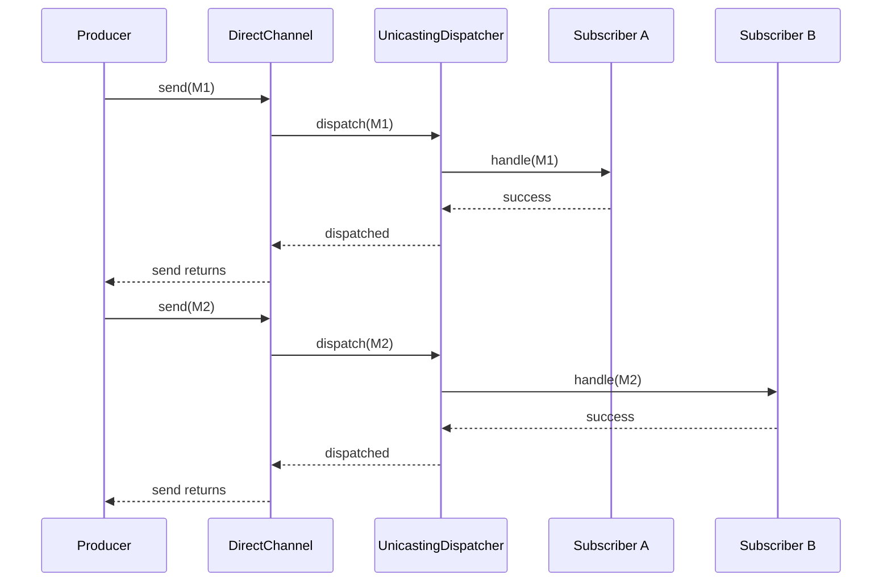
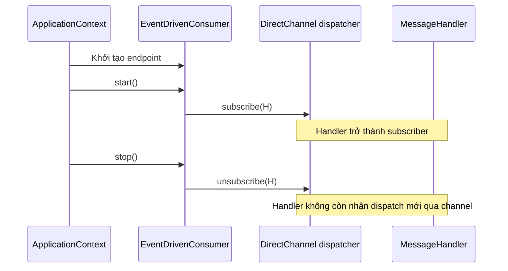
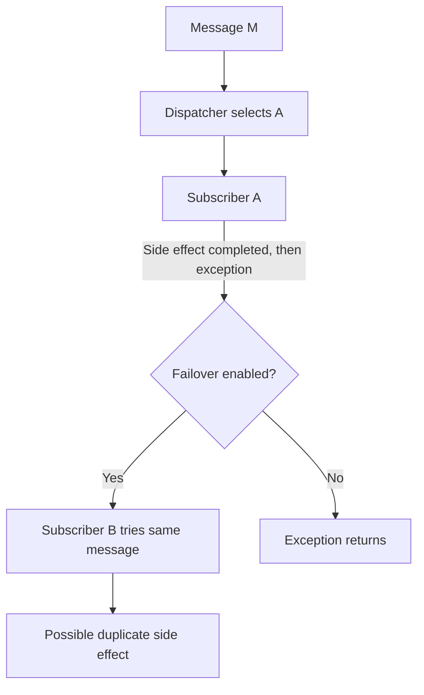
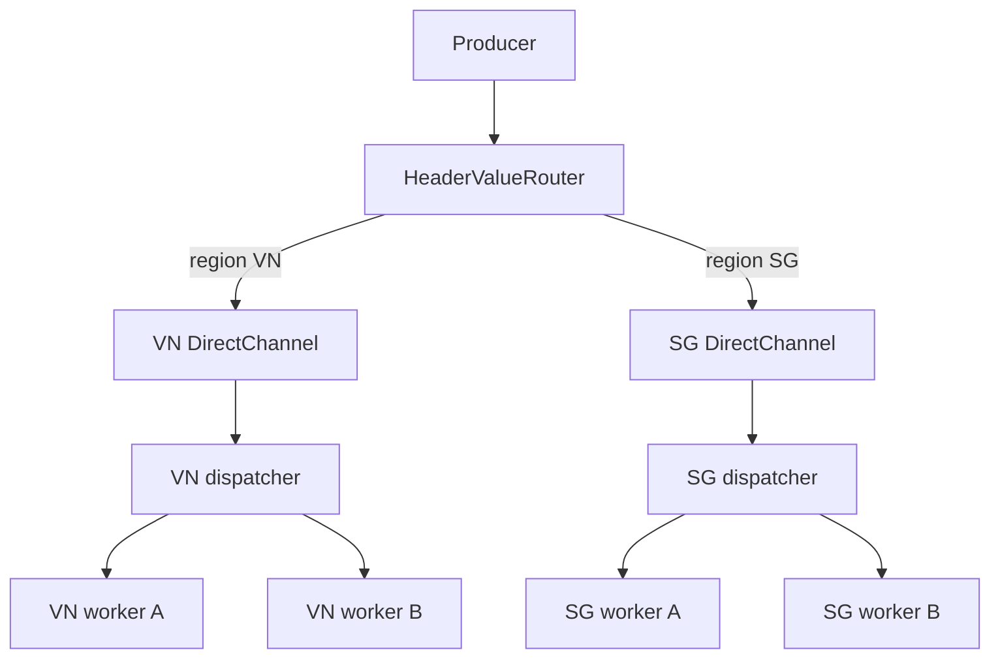

# DirectChannel dispatcher và subscriber

Trong Spring Integration, `DirectChannel` nhận message từ producer rồi dispatch trực tiếp đến một subscriber đã đăng ký. Thành phần quyết định subscriber nào được gọi là **dispatcher**. Với `DirectChannel`, dispatcher sử dụng cơ chế unicast: mỗi lần gửi message chỉ chọn một subscriber để xử lý. Khi có nhiều subscriber, dispatcher có thể phân phối các message giữa họ theo chiến lược load balancing.

Hiểu quan hệ giữa dispatcher và subscriber giúp giải thích vì sao nhiều endpoint cùng đọc một channel nhưng mỗi message chỉ đến một endpoint, cách round-robin hoạt động, điều gì xảy ra khi handler lỗi và vì sao `DirectChannel` không tự tuần tự hóa các producer thread.

## 1. Channel, dispatcher và subscriber là ba vai trò khác nhau

Một channel là điểm nối giữa producer và consumer. Với `DirectChannel`, channel nhận lời gọi `send()` và giao việc dispatch cho `UnicastingDispatcher`. Dispatcher quản lý danh sách handler đã đăng ký và chọn một handler cho message hiện tại.

Các vai trò:

| Thành phần | Trách nhiệm |
|---|---|
| Producer | Tạo message và gọi `send()` trên channel |
| `DirectChannel` | Nhận message, cung cấp ranh giới giao tiếp và chuyển yêu cầu dispatch |
| Dispatcher | Chọn subscriber và điều phối lời gọi handler |
| Subscriber | `MessageHandler` đã đăng ký để nhận message |
| Endpoint | Kết nối handler với channel và quản lý subscription theo lifecycle |

`DirectChannel` là một `SubscribableChannel`. Producer không gọi trực tiếp một handler cụ thể; producer chỉ gửi vào channel. Dispatcher chọn handler dựa trên danh sách subscriber và chiến lược phân phối.

```mermaid
flowchart LR
    P[Producer] -->|send(message)| C[DirectChannel]
    C --> D[UnicastingDispatcher]
    D --> S1[Subscriber A]
    D --> S2[Subscriber B]
    D --> S3[Subscriber C]
    S1 --> H1[MessageHandler A]
    S2 --> H2[MessageHandler B]
    S3 --> H3[MessageHandler C]
```

Sơ đồ cho thấy dispatcher có nhiều lựa chọn subscriber. Trong một lần dispatch thông thường, nó chọn một subscriber để gọi. Nó không phát message đến cả ba subscriber.

## 2. UnicastingDispatcher thực hiện điều gì?

`DirectChannel` dùng `UnicastingDispatcher` để điều phối message đến một handler. Dispatcher thực hiện hai công việc liên quan:

1. Dựa trên `LoadBalancingStrategy` để chọn handler tiếp theo từ danh sách subscriber.
2. Gọi handler đã chọn và xử lý kết quả dispatch, bao gồm hành vi failover nếu được bật.

Tên *unicasting* thể hiện semantics unicast: một message được giao cho một subscriber được chọn. Nếu channel có nhiều subscriber, chúng chia nhau nhận các message khác nhau. Dispatcher không nhân bản message để broadcast.

Trong cấu hình mặc định phổ biến, `DirectChannel` sử dụng chiến lược round-robin. Khi có nhiều subscriber, các lượt gửi được phân phối lần lượt giữa các subscriber theo vòng. Cấu hình dispatcher cũng có thể điều chỉnh hành vi failover khi handler được chọn ném exception.



Dispatcher không hiểu ý nghĩa nghiệp vụ của payload. Nó không tự chọn subscriber theo `tenantId`, loại đơn hàng hoặc giá trị header. Việc chọn handler theo điều kiện nghiệp vụ thuộc về router hoặc logic định tuyến riêng.

## 3. Subscriber là ai và được đăng ký như thế nào?

Hợp đồng subscriber của `SubscribableChannel` là `MessageHandler`. Handler có thể được đăng ký trực tiếp bằng `subscribe()`, hoặc được endpoint Spring Integration quản lý.

Ví dụ đăng ký handler trực tiếp:

```java
DirectChannel channel = new DirectChannel();

MessageHandler auditHandler =
        message -> auditService.record(message);

channel.subscribe(auditHandler);
```

Khi gửi message vào channel, dispatcher có thể chọn `auditHandler` để xử lý. Nếu chỉ có một subscriber, lựa chọn của dispatcher là subscriber đó.

Trong một flow Spring Integration, ứng dụng thường không cần tự gọi `subscribe()`. Khi flow được khởi tạo, framework tạo endpoint và handler. Endpoint event-driven đăng ký handler với input channel khi start, rồi hủy đăng ký khi stop.



Điều này có nghĩa bean channel có thể vẫn tồn tại trong ApplicationContext trong khi endpoint đã dừng. Khi chẩn đoán channel không có consumer, cần kiểm tra subscription và lifecycle của endpoint, không chỉ kiểm tra bean channel.

### Ví dụ hai flow cùng subscribe một DirectChannel

Giả sử một ứng dụng có hai worker xử lý cùng loại message:

```java
@Bean
DirectChannel ordersChannel() {
    return new DirectChannel();
}

@Bean
IntegrationFlow orderWorkerA(
        OrderWorkerA workerA) {

    return IntegrationFlow.from("ordersChannel")
            .handle(workerA, "handle")
            .get();
}

@Bean
IntegrationFlow orderWorkerB(
        OrderWorkerB workerB) {

    return IntegrationFlow.from("ordersChannel")
            .handle(workerB, "handle")
            .get();
}
```

Hai flow tạo hai endpoint tiêu thụ cùng channel. Khi cả hai endpoint đã start, hai handler là hai subscriber của `ordersChannel`. Với chiến lược mặc định round-robin, các message gửi vào channel được phân phối luân phiên giữa hai subscriber.

Đây là cách chia tải point-to-point. Nếu mục tiêu là cả worker A và worker B đều phải nhận bản sao của mỗi đơn hàng, `DirectChannel` không đáp ứng semantics đó; hãy dùng `PublishSubscribeChannel` hoặc tạo các nhánh broadcast.

## 4. Round-robin load balancing

Round-robin là chiến lược chọn subscriber theo vòng. Với ba subscriber A, B và C, các lần dispatch thành công liên tiếp thường được phân phối theo chu kỳ:

```text
Message 1 -> A
Message 2 -> B
Message 3 -> C
Message 4 -> A
Message 5 -> B
Message 6 -> C
```

Round-robin phù hợp khi các subscriber có năng lực xử lý tương đối tương đương và mỗi message có chi phí gần nhau. Nó không cân bằng theo thời gian xử lý thực tế, CPU hiện tại hoặc độ dài công việc đang chạy của từng subscriber.

Ví dụ, nếu handler A xử lý một message trong 20 ms nhưng handler B mất 500 ms, round-robin vẫn phân phối message theo lượt. Subscriber B có thể trở thành điểm nghẽn dù số message được giao cho hai bên gần bằng nhau.

| Đặc điểm | Round-robin |
|---|---|
| Cách chọn | Lần lượt theo vòng subscriber |
| Phân phối | Dựa trên lượt dispatch, không dựa trên thời gian xử lý |
| Phù hợp | Subscriber tương đồng về năng lực và chi phí message |
| Không bảo đảm | Cân bằng CPU, latency hoặc số tác vụ đang chạy |
| Thứ tự hoàn tất | Có thể khác thứ tự gửi nếu producer đồng thời hoặc handler có thời gian xử lý khác nhau |

Đừng xem round-robin là cơ chế đảm bảo mọi subscriber nhận chính xác cùng số message trong mọi khoảng thời gian ngắn. Producer có thể gửi đồng thời, subscriber có thể được thêm hoặc gỡ, và lỗi/failover có thể làm thay đổi nơi xử lý thực tế.

## 5. Cấu hình load-balancing strategy

`DirectChannel` cho phép cấu hình `LoadBalancingStrategy` thông qua constructor. Nếu muốn nêu rõ chiến lược mặc định đang dùng, có thể tạo channel với `RoundRobinLoadBalancingStrategy`:

```java
@Bean
DirectChannel ordersChannel() {
    return new DirectChannel(
            new RoundRobinLoadBalancingStrategy());
}
```

Đây cũng là chiến lược round-robin được dùng trong cấu hình mặc định của `DirectChannel` ở các phiên bản Spring Integration hiện hành. Việc chỉ định tường minh có thể hữu ích khi muốn người đọc cấu hình thấy rõ cách phân phối.

Nếu cần một chính sách khác, có thể triển khai `LoadBalancingStrategy` phù hợp với phiên bản framework đang dùng. Chiến lược cần chọn subscriber từ danh sách handler do dispatcher cung cấp. Hãy giữ logic lựa chọn đơn giản, thread-safe và không thực hiện I/O blocking trong quá trình chọn.

Không nên đưa quy tắc nghiệp vụ phức tạp vào load-balancing strategy. Nếu message cần đến đúng handler dựa trên header hoặc payload, dùng router để định tuyến đến channel phù hợp. Load balancing giải quyết việc chia các message giữa nhiều subscriber tương đương; router giải quyết quyết định message phải đi nhánh nào.

## 6. Failover khi subscriber xử lý thất bại

Failover là hành vi dispatcher thử subscriber khác nếu subscriber được chọn không xử lý message thành công do exception. `DirectChannel` hỗ trợ cấu hình bật hoặc tắt failover.

Ví dụ cấu hình không thử subscriber tiếp theo khi handler được chọn ném exception:

```java
@Bean
DirectChannel strictOrdersChannel() {
    DirectChannel channel = new DirectChannel();
    channel.setFailover(false);
    return channel;
}
```

Với failover được bật, dispatcher có thể tiếp tục thử subscriber tiếp theo theo chiến lược load balancing khi handler trước đó ném exception. Khi tắt failover, lỗi từ subscriber được chọn được trả về theo đường xử lý lỗi của lời gọi dispatch.

Cần phân biệt:

- **Load balancing** chọn subscriber nào được thử trước.
- **Failover** quyết định dispatcher có thử subscriber khác khi lần xử lý trước thất bại hay không.
- **Retry advice** thực hiện chính sách thử lại theo số lần, loại exception và khoảng nghỉ được cấu hình.
- **Dead-letter/error flow** tiếp nhận message hoặc lỗi sau khi xử lý thất bại theo chính sách ứng dụng.

Failover không phải retry policy hoàn chỉnh. Nó không có backoff, giới hạn số lần thử theo nghiệp vụ hoặc phân loại lỗi giống một retry advice được cấu hình riêng.

### Rủi ro side effect khi failover

Giả sử subscriber A đã ghi một bản ghi vào database nhưng sau đó ném exception do bước gửi thông báo thất bại. Nếu dispatcher failover sang subscriber B, B có thể xử lý lại cùng message và ghi thêm một bản ghi tương tự.



Vì vậy, failover chỉ an toàn khi subscriber có semantics tương đương và xử lý idempotent, hoặc khi các side effect được rollback/kiểm soát phù hợp. Không nên dùng failover để che giấu lỗi cấu hình hoặc lỗi dữ liệu không thể phục hồi.

## 7. Cấu hình load balancing và failover cùng nhau

Một channel có thể chỉ định strategy và điều chỉnh failover riêng:

```java
@Bean
DirectChannel balancedOrdersChannel() {
    DirectChannel channel =
            new DirectChannel(new RoundRobinLoadBalancingStrategy());

    channel.setFailover(true);

    return channel;
}
```

Cấu hình trên thể hiện hai quyết định độc lập:

1. Round-robin chọn subscriber đầu tiên theo vòng.
2. Nếu subscriber được chọn ném exception, dispatcher được phép thử subscriber khác.

Khi tắt failover, round-robin vẫn có thể tiếp tục phân phối message tiếp theo sang subscriber kế tiếp; chỉ hành vi thử subscriber khác cho cùng một lần dispatch thay đổi.

Nếu muốn kiểm soát hành vi lỗi, hãy cấu hình rõ và kiểm thử với một handler cố ý ném exception. Đừng chỉ dựa vào số message mỗi worker đã nhận để suy ra failover có hoạt động đúng hay không.

## 8. Dispatcher không thay thế router

Một câu hỏi thường gặp là: “Nếu có nhiều subscriber, làm sao DirectChannel biết message thuộc về subscriber nào?” Câu trả lời là dispatcher không thực hiện định tuyến theo nội dung message. Nó chọn subscriber theo load-balancing strategy.

Ví dụ, nếu message có header `region` và yêu cầu:

- `region=VN` đi đến xử lý trong nước.
- `region=SG` đi đến xử lý Singapore.
- Các region khác đi đến nhánh mặc định.

Đây là bài toán router. Flow có thể dùng router để chọn channel theo header, rồi mỗi channel có thể có nhiều subscriber và tự load balance trong nhóm đó.



Router quyết định **message đi nhóm nào**. Dispatcher của từng DirectChannel quyết định **subscriber nào trong nhóm nhận message**. Hai cấp quyết định này có thể kết hợp trong cùng flow.

## 9. Subscriber không phải worker thread

Subscriber là handler đăng ký với channel, không đồng nghĩa với một thread hoặc một instance executor. Một handler có thể được gọi trên các producer thread khác nhau nếu nhiều producer gửi đồng thời vào DirectChannel.

Điều này dẫn đến một số hệ quả:

- Một subscriber có thể xử lý nhiều message đồng thời nếu có nhiều thread gọi dispatch.
- State mutable bên trong handler/service phải được bảo vệ thread-safety.
- Round-robin phân phối lượt gọi, không cấp một worker thread cố định cho từng subscriber.
- DirectChannel không tự tạo thread pool.
- Nếu cần giới hạn concurrency, phải dùng cơ chế khác như executor, semaphore, queue hoặc giới hạn concurrency tại upstream.

Ví dụ, một singleton service được dùng làm handler có thể nhận nhiều lời gọi đồng thời. Nếu service giữ một biến instance mutable để tích lũy dữ liệu từng message, code cần đồng bộ hoặc thiết kế state theo request/message thay vì dùng chung không an toàn.

Đừng suy luận rằng vì DirectChannel dispatch đồng bộ nên một handler luôn chỉ chạy một lần tại một thời điểm. Đồng bộ ở đây có nghĩa lời gọi handler diễn ra trên thread gửi; nó không có nghĩa channel khóa toàn cục.

## 10. Subscription lifecycle và thay đổi danh sách subscriber

Subscriber có thể được thêm hoặc gỡ khỏi channel theo lifecycle endpoint:

- Khi endpoint start, handler được subscribe.
- Khi endpoint stop, handler được unsubscribe.
- Khi flow động được đăng ký, endpoint của flow có thể subscribe vào channel.
- Khi flow động bị unregister, endpoint bị hủy và subscription tương ứng được gỡ.

Nếu một channel dùng chung cho nhiều flow, dừng một endpoint không nên làm mất subscription của endpoint khác. Khi điều tra subscriber bị thiếu, hãy kiểm tra endpoint nào đang chạy và flow registration nào còn tồn tại.

Với subscription thủ công, ứng dụng sở hữu trách nhiệm gọi `unsubscribe(handler)` khi không còn cần handler. Nếu quên gỡ đăng ký, channel có thể tiếp tục giữ tham chiếu đến handler và các dependency của nó, làm component sống lâu hơn dự kiến.

Đối với flow động, nên dùng `IntegrationFlowContext` để đăng ký và remove flow. Không tự xóa bean hoặc can thiệp danh sách subscriber nội bộ của dispatcher để thay thế lifecycle của framework.

## 11. Không có subscriber và giới hạn subscriber

Nếu endpoint chưa start hoặc mọi subscriber đã unsubscribe, channel có thể không có handler để dispatch. Khi đó `send()` không thể hoàn tất một lần dispatch đến consumer. Kết quả gửi và việc có ném exception hay không còn phụ thuộc cấu hình channel, chẳng hạn chính sách yêu cầu subscriber và cách producer xử lý kết quả boolean.

Vì vậy, producer nên kiểm tra kết quả `send()` khi việc giao message là quan trọng:

```java
boolean accepted = ordersChannel.send(message);

if (!accepted) {
    throw new MessageDeliveryException(
            message, "No subscriber accepted the message");
}
```

Đây là ví dụ minh họa cho việc kiểm tra kết quả gửi; ứng dụng cần chọn exception và chính sách xử lý phù hợp. Nếu channel được cấu hình yêu cầu phải có subscriber, framework có thể báo lỗi ngay khi không có consumer.

Khi triển khai endpoint động, tránh gửi message trước khi flow đã được đăng ký và endpoint sẵn sàng. Nếu có yêu cầu không được mất message trong giai đoạn chuyển đổi, hãy buffer tại queue/broker và chỉ mở ingress khi consumer đã sẵn sàng.

## 12. Thứ tự message và concurrency giữa producer

Round-robin không phải bảo đảm ordering toàn cục. Với một producer thread gửi tuần tự, lời gọi dispatch thứ hai chỉ diễn ra sau khi lời gọi thứ nhất trả về nếu xử lý đồng bộ thành công. Nhưng khi có nhiều producer thread, các lời gọi có thể xen kẽ và chạy đồng thời.

Ngay cả khi dispatcher chọn subscriber theo vòng, thứ tự hoàn tất có thể khác thứ tự gửi:

- Message A được gửi trước và chọn subscriber A, handler A mất 500 ms.
- Message B được gửi sau và chọn subscriber B, handler B mất 50 ms.
- Message B có thể hoàn tất trước message A.

Nếu nghiệp vụ cần thứ tự theo aggregate hoặc key, cần thiết kế partitioning/serialization theo key. Một DirectChannel với round-robin không bảo đảm tất cả message của cùng một đơn hàng đến cùng subscriber.

Nếu cần sticky routing theo key, dùng router hoặc partitioning strategy có state phù hợp, và bảo đảm các message cùng key được xử lý theo đúng semantics yêu cầu. Đừng dùng round-robin để giải quyết thứ tự nghiệp vụ.

## 13. Transaction và lỗi khi có nhiều subscriber

Với DirectChannel, handler chạy đồng bộ trên thread gửi. Nếu producer đang ở trong transaction và handler sử dụng cùng transaction manager với propagation phù hợp, các thao tác có thể tham gia transaction đó.

Tuy nhiên, failover có thể làm việc xử lý chuyển sang subscriber khác sau exception. Nếu subscriber đầu tiên đã thực hiện side effect, kết quả phụ thuộc transaction boundary và loại side effect:

- Database update nằm trong cùng transaction có thể rollback nếu exception làm transaction rollback.
- HTTP call hoặc gửi email không thể được database transaction rollback.
- File write hoặc thao tác với hệ thống ngoài cần cơ chế bù trừ/idempotency riêng.
- Nếu handler bắt exception và không ném lại, dispatcher có thể xem lần xử lý là thành công tùy đường thực thi.

Với nhiều subscriber, không nên bật failover một cách máy móc. Hãy xác định subscriber có thực sự thay thế được nhau không và side effect có thể lặp hay không.

Khi cần retry nghiệp vụ, dùng retry advice hoặc error flow có giới hạn và quan sát được. Failover chỉ nên là một phần của quyết định dispatch, không phải cơ chế phục hồi duy nhất.

## 14. So sánh DirectChannel dispatcher với các channel khác

| Channel | Dispatch semantics | Subscriber/consumer behavior |
|---|---|---|
| `DirectChannel` | Unicast, dispatch trực tiếp | Chọn một subscriber; có load balancing/failover |
| `PublishSubscribeChannel` | Broadcast | Gửi đến các subscriber đã đăng ký |
| `ExecutorChannel` | Unicast qua executor | Chọn subscriber và giao dispatch cho worker thread |
| `QueueChannel` | Buffer trong queue | Consumer lấy message qua poller |
| `FluxMessageChannel` | Reactive Streams | Publisher/subscriber theo demand và stream semantics |

Đừng nhầm `ExecutorChannel` với `DirectChannel` chỉ vì cả hai có thể có nhiều subscriber. Khác biệt quan trọng là `ExecutorChannel` giao dispatch qua executor, còn `DirectChannel` gọi handler đồng bộ trên thread gửi theo mặc định.

## 15. Quan sát dispatcher và subscriber trong runtime

Khi một message đến sai handler hoặc không được xử lý, hãy quan sát cả channel lẫn endpoint:

- Tên channel và component name của endpoint.
- Số lượng subscriber đang đăng ký.
- Trạng thái running của các endpoint.
- Chiến lược load balancing đang sử dụng.
- Trạng thái failover.
- Message ID và correlation ID.
- Thread name của producer và handler.
- Thời gian xử lý của từng subscriber.
- Số exception và số lần failover.
- Số message mỗi subscriber nhận trong một khoảng thời gian.

Một bảng chẩn đoán:

| Triệu chứng | Nơi cần kiểm tra |
|---|---|
| Chỉ một handler nhận message | Có thể chỉ có một subscriber đã start |
| Message luân phiên giữa các handler | Round-robin đang hoạt động |
| Một handler nhận nhiều hơn | Subscriber thay đổi, producer concurrency hoặc failover |
| Handler thứ hai chạy sau lỗi handler đầu | Failover đang bật và subscriber tiếp theo được thử |
| Message đến tất cả handler | Có thể đang dùng PublishSubscribeChannel hoặc nhiều nhánh, không phải unicast mặc định |
| Không có handler nhận message | Endpoint chưa start, subscription bị gỡ hoặc không có subscriber |
| Một subscriber xử lý đồng thời nhiều message | Nhiều producer thread đang dispatch đến handler đó |
| Message xử lý trùng | Failover sau side effect, retry hoặc producer gửi lại |

Có thể dùng `ChannelInterceptor` để ghi nhận message tại channel và log component name ở handler để xác định subscriber nào đã xử lý. Không ghi toàn bộ payload nhạy cảm; ưu tiên message ID, correlation ID và khóa tra cứu.

## 16. Kiểm thử load balancing và failover

Khi kiểm thử dispatcher, nên tách hai hành vi: lựa chọn subscriber và xử lý khi subscriber lỗi.

Ví dụ kiểm thử round-robin với hai handler:

```java
@Test
void directChannelDistributesMessagesAcrossSubscribers() {
    DirectChannel channel = new DirectChannel();

    AtomicInteger firstCount = new AtomicInteger();
    AtomicInteger secondCount = new AtomicInteger();

    channel.subscribe(message -> firstCount.incrementAndGet());
    channel.subscribe(message -> secondCount.incrementAndGet());

    channel.send(new GenericMessage<>("one"));
    channel.send(new GenericMessage<>("two"));
    channel.send(new GenericMessage<>("three"));
    channel.send(new GenericMessage<>("four"));

    assertThat(firstCount.get()).isEqualTo(2);
    assertThat(secondCount.get()).isEqualTo(2);
}
```

Test này minh họa phân phối round-robin trong điều kiện đơn giản: hai subscriber ổn định, một producer thread, không có exception. Trong test của ứng dụng thực tế, nên tránh giả định thứ tự subscriber nếu strategy được thay đổi.

Kiểm thử failover riêng:

```java
@Test
void dispatcherCanFailOverWhenSelectedHandlerThrows() {
    DirectChannel channel = new DirectChannel();
    channel.setFailover(true);

    AtomicInteger fallbackCount = new AtomicInteger();

    channel.subscribe(message -> {
        throw new IllegalStateException("temporary failure");
    });

    channel.subscribe(message -> fallbackCount.incrementAndGet());

    channel.send(new GenericMessage<>("order"));

    assertThat(fallbackCount.get()).isEqualTo(1);
}
```

Ví dụ minh họa cần được chạy với phiên bản Spring Integration và thứ tự subscriber/strategy tương ứng của ứng dụng. Khi kiểm thử failover, nên xác nhận cả exception behavior, side effect và kết quả trả về từ `send()`, không chỉ kiểm tra handler dự phòng có được gọi.

Các tình huống nên có trong test suite:

- Một subscriber duy nhất nhận message.
- Nhiều subscriber được phân phối theo strategy đã cấu hình.
- Failover bật và tắt cho kết quả khác nhau khi handler ném exception.
- Subscriber bị unsubscribe khi endpoint stop.
- Không có subscriber và kết quả `send()` theo chính sách channel.
- Nhiều producer thread gửi đồng thời.
- Handler có side effect không bị lặp ngoài ý muốn khi failover.
- Subscriber mới được thêm hoặc gỡ theo lifecycle flow động.

## 17. Chọn dispatcher hay router?

| Yêu cầu | Cơ chế nên dùng |
|---|---|
| Chia message giữa các handler tương đương | DirectChannel dispatcher với load balancing |
| Một message cần đến mọi subscriber | PublishSubscribeChannel |
| Chọn nhánh theo header hoặc payload | Router |
| Chọn subscriber khác khi handler được chọn lỗi | Failover của dispatcher, nếu semantics an toàn |
| Thử lại cùng thao tác theo số lần/backoff | Retry advice |
| Buffer message khi chưa có consumer | QueueChannel hoặc broker |
| Xử lý theo key và giữ ordering | Partitioning hoặc routing theo key với consumer tuần tự |

Một flow có thể kết hợp router và dispatcher. Router quyết định nhóm xử lý theo nghiệp vụ; mỗi nhóm dùng DirectChannel để chia tải giữa các subscriber tương đương.

## 18. Checklist chẩn đoán DirectChannel dispatcher

Khi cần tìm hiểu vì sao một subscriber được gọi hoặc bị bỏ qua, hãy lần lượt kiểm tra:

1. Channel thực tế có phải `DirectChannel` không?
2. Có bao nhiêu endpoint đang subscribe vào channel?
3. Endpoint đã start và đăng ký handler thành công chưa?
4. Dispatcher đang dùng load-balancing strategy nào?
5. Failover đang bật hay tắt?
6. Handler được chọn có ném exception không?
7. Side effect có thể đã xảy ra trước exception không?
8. Có đang nhầm load balancing với router theo payload/header không?
9. Có nhiều producer thread gửi đồng thời không?
10. Handler có state mutable cần bảo vệ thread-safety không?
11. Subscriber có bị stop hoặc unregister trong lúc cấu hình flow thay đổi không?
12. Metrics/log có message ID, correlation ID, endpoint ID và thread name không?

Khi phân biệt được dispatcher với subscriber, ta hiểu vì sao DirectChannel chọn một handler, cách round-robin chia lượt, failover thay đổi đường xử lý ra sao và lifecycle endpoint tác động đến danh sách subscriber như thế nào. Đây là nền tảng để thiết kế chia tải point-to-point, xử lý lỗi an toàn và chẩn đoán channel runtime trong Spring Integration.

