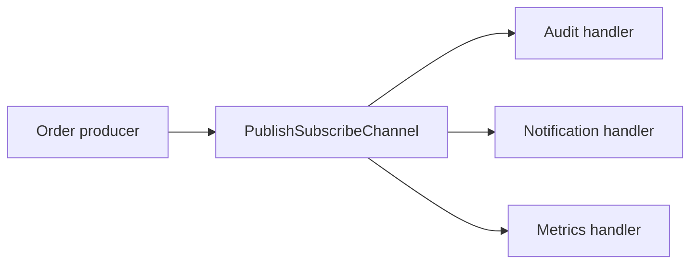

# PublishSubscribeChannel broadcast message

Trong Spring Integration, `PublishSubscribeChannel` gửi một message đến tất cả `MessageHandler` đã đăng ký với channel. Đây là kiểu broadcast (phát đến nhiều nơi), thường dùng cho event thông báo như `OrderCreated`, `PaymentCompleted` hoặc `CustomerUpdated`: cùng một sự kiện cần được ghi audit, cập nhật chỉ số, gửi thông báo và đồng bộ sang các hệ thống khác.

Channel này phù hợp khi mỗi subscriber cần nhận cùng một sự kiện và xử lý phần việc riêng. Nó không lưu message để consumer nhận sau, không tự tạo bản sao bền vững và không bảo đảm mọi nhánh hoàn tất thành công. Muốn thiết kế message flow đáng tin cậy, cần hiểu cách channel dispatch, khác biệt giữa xử lý đồng bộ và bất đồng bộ, cách xử lý lỗi, correlation và vòng đời subscriber.

## 1. Cơ chế broadcast

`PublishSubscribeChannel` là một `SubscribableChannel`. Khi producer gọi `send(message)`, channel duyệt qua các subscriber hiện có và dispatch message đến từng subscriber. Subscriber là `MessageHandler`, thường được Spring Integration tạo và đăng ký thông qua consumer endpoint của một `IntegrationFlow`.

Ví dụ một sự kiện đơn hàng cần được xử lý ở ba nhánh:



Cả ba nhánh đều nhận sự kiện `OrderCreated`. Mỗi nhánh chịu trách nhiệm cho một tác vụ riêng. Một message không được chia thành ba phần payload; channel phát cùng nội dung đến từng subscriber.

Điểm khác biệt với các channel thường gặp:

| Channel | Cách phân phối | Khi nào phù hợp |
|---|---|---|
| `DirectChannel` | Chọn một subscriber để xử lý message; thường dùng load balancing khi có nhiều subscriber | Một trong các handler thực hiện công việc chính |
| `ExecutorChannel` | Dispatch bất đồng bộ đến một subscriber được chọn theo dispatcher | Muốn tách thread gửi và thread xử lý cho một nhánh point-to-point |
| `PublishSubscribeChannel` | Broadcast đến tất cả subscriber | Nhiều nhánh cùng cần nhận một event |
| `QueueChannel` | Đưa message vào queue; consumer nhận message bằng thao tác poll | Cần buffer giữa producer và consumer hoặc điều khiển nhịp nhận |

`PublishSubscribeChannel` chỉ hỗ trợ gửi. Nó không triển khai `PollableChannel`, không có `receive()` và không dùng poller để lấy message ra khỏi channel. Các consumer đăng ký trực tiếp làm subscriber.

Broadcast cũng khác với việc gửi nhiều message độc lập đến một broker. Subscriber chỉ nhận message khi đang đăng ký và hoạt động tại thời điểm dispatch. Subscriber khởi động sau không nhận lại các message đã phát trước đó. Nếu cần lưu backlog qua restart, hãy dùng broker hoặc message store phù hợp.

## 2. Đồng bộ và bất đồng bộ

Mặc định, `PublishSubscribeChannel` gọi các subscriber trên thread gửi message. Có thể truyền một `TaskExecutor` để dispatch subscriber trên worker thread.

| Đặc điểm | Không cấu hình executor | Có cấu hình executor |
|---|---|---|
| Thread xử lý | Thread gọi `send()` | Worker thread của executor |
| Thời điểm `send()` kết thúc | Sau khi các subscriber được gọi đồng bộ | Thường sau khi các task được dispatch vào executor |
| Ảnh hưởng của subscriber chậm | Làm chậm producer và các subscriber được gọi sau | Chiếm worker và có thể làm queue executor tăng |
| Ngoại lệ từ handler | Có thể truyền trực tiếp về thread gửi | Được xử lý qua `ErrorHandler` của channel; không quay về lời gọi gửi đã kết thúc |
| Transaction gắn với thread gửi | Có thể được dùng trong cùng thread nếu transaction đang hoạt động | Không tự truyền sang worker thread |

Trong chế độ đồng bộ, subscriber chạy lần lượt trong quá trình dispatch. Một handler chậm làm tăng thời gian `send()` và kéo dài thời gian producer giữ tài nguyên. Cách này hữu ích khi producer cần biết kết quả xử lý ngay trong cùng lời gọi và muốn giữ một ranh giới thread rõ ràng.

Trong chế độ bất đồng bộ, executor tách việc dispatch khỏi việc thực thi handler. Producer không chờ từng nhánh hoàn tất. Điều này giúp giảm latency của producer trong điều kiện bình thường, nhưng đổi lại phải quản lý queue, số worker, rejection và lỗi xảy ra sau khi task bắt đầu chạy.

Lưu ý: dùng executor không có nghĩa là mọi nhánh hoàn tất đồng thời hoặc theo một thứ tự cố định. Thời điểm bắt đầu và kết thúc phụ thuộc lịch chạy của worker, thời gian xử lý và tài nguyên downstream. Nếu nghiệp vụ cần thứ tự, hãy biểu diễn thứ tự bằng dữ liệu hoặc cơ chế tuần tự hóa riêng.

## 3. Cấu hình bằng Java DSL

Ví dụ dưới đây phát sự kiện đơn hàng đến hai nhánh: audit và notification. Hai nhánh dùng chung một executor để xử lý bất đồng bộ.

```java
import java.util.concurrent.Executor;
import java.util.concurrent.ThreadPoolExecutor;

import org.springframework.beans.factory.annotation.Qualifier;
import org.springframework.context.annotation.Bean;
import org.springframework.context.annotation.Configuration;
import org.springframework.integration.dsl.IntegrationFlow;
import org.springframework.messaging.MessageHeaders;
import org.springframework.scheduling.concurrent.ThreadPoolTaskExecutor;

@Configuration
public class OrderBroadcastConfiguration {

    @Bean
    public ThreadPoolTaskExecutor broadcastExecutor() {
        ThreadPoolTaskExecutor executor = new ThreadPoolTaskExecutor();
        executor.setCorePoolSize(4);
        executor.setMaxPoolSize(8);
        executor.setQueueCapacity(200);
        executor.setThreadNamePrefix("si-broadcast-");
        executor.setRejectedExecutionHandler(
                new ThreadPoolExecutor.AbortPolicy());
        return executor;
    }

    @Bean
    public IntegrationFlow orderBroadcastFlow(
            @Qualifier("broadcastExecutor") Executor broadcastExecutor,
            AuditService auditService,
            NotificationService notificationService) {

        return IntegrationFlow.from("orders.input")
                .publishSubscribeChannel(broadcastExecutor, pubSub -> pubSub
                        .minSubscribers(2)
                        .subscribe(branch -> branch.handle(
                                (OrderCreated event, MessageHeaders headers) -> {
                                    auditService.record(event, headers);
                                    return null;
                                }))
                        .subscribe(branch -> branch.handle(
                                (OrderCreated event, MessageHeaders headers) -> {
                                    notificationService.send(event);
                                    return null;
                                })))
                .get();
    }
}
```

`orders.input` là đầu vào của flow. `publishSubscribeChannel(...)` tạo điểm broadcast và đăng ký hai subflow làm subscriber. Cả hai nhận cùng `OrderCreated`, nhưng xử lý độc lập. `return null` thể hiện handler chỉ thực hiện side effect và không phát message kết quả tiếp theo.

Executor là bean do Spring quản lý vòng đời. `corePoolSize`, `maxPoolSize` và `queueCapacity` cần được chọn theo tải đo được và khả năng xử lý của audit service, notification service cùng các dependency của chúng. Ví dụ trên dùng `AbortPolicy`: nếu executor không nhận thêm task, việc dispatch có thể thất bại và lỗi rejection xuất hiện ngay ở phía submit.

`minSubscribers(2)` yêu cầu channel dispatch thành công đến ít nhất hai subscriber để `send()` được xem là thành công. Nếu chỉ một subscriber được dispatch thành công, kết quả gửi không đạt ngưỡng. Nếu không cấu hình `minSubscribers`, giá trị mặc định là `0`; do đó send có thể được xem là thành công ngay cả khi không có subscriber. Từ Spring Integration 5.4.3, có thêm tùy chọn `requireSubscribers` để ném `MessageDispatchingException` khi channel không có subscriber. Chọn cách kiểm tra phù hợp với phiên bản framework và yêu cầu của flow.

Nếu không cần xử lý bất đồng bộ, có thể bỏ tham số executor:

```java
return IntegrationFlow.from("orders.input")
        .publishSubscribeChannel(pubSub -> pubSub
                .subscribe(branch -> branch.handle(auditService, "record"))
                .subscribe(branch -> branch.handle(notificationService, "send")))
        .get();
```

Trong cấu hình đồng bộ, lời gọi gửi chỉ kết thúc sau khi các subscriber được gọi. Vì thế, cần đánh giá thời gian xử lý của từng nhánh và ảnh hưởng đến producer.

## 4. Sequence headers và correlation

Mặc định `applySequence` là `false`. Khi đó, channel có thể chuyển cùng một `Message` instance đến nhiều subscriber. Đây là lựa chọn phù hợp cho các nhánh độc lập chỉ cần đọc cùng một event.

Khi các nhánh tạo ra kết quả cần gom lại, có thể bật `applySequence(true)`. Channel tạo các message có cùng payload reference nhưng bổ sung metadata:

- `correlationId`: định danh nhóm các message được tạo từ một lần broadcast.
- `sequenceNumber`: vị trí của nhánh trong nhóm, bắt đầu từ `1`.
- `sequenceSize`: số subscriber trong nhóm broadcast.

Ví dụ có ba subscriber thì các message được phát đi có cùng correlation ID, sequence size bằng `3`, và sequence number lần lượt từ `1` đến `3`.

```java
.publishSubscribeChannel(broadcastExecutor, pubSub -> pubSub
        .applySequence(true)
        .subscribe(branch -> branch.transform(this::createAuditResult)
                .channel("broadcast.results"))
        .subscribe(branch -> branch.transform(this::createNotificationResult)
                .channel("broadcast.results"))
        .subscribe(branch -> branch.transform(this::createMetricsResult)
                .channel("broadcast.results")))
```

Các kết quả có thể được đưa về cùng một channel và chuyển đến `Aggregator`. Với completion strategy mặc định dựa trên sequence size, aggregator có thể biết cần nhận đủ ba phần tử thuộc cùng correlation ID.

Không bật sequence một cách máy móc. Nếu một subscriber không phát kết quả, aggregator có thể chờ mãi cho đến khi timeout hoặc chính sách xử lý nhóm thiếu được kích hoạt. Nếu một nhánh phát nhiều kết quả, cần xác định rõ cách giữ hoặc điều chỉnh sequence metadata. Khi dùng aggregator, hãy cấu hình release strategy, group timeout, message store và xử lý nhóm hết hạn theo yêu cầu nghiệp vụ.

`applySequence(true)` tạo các `Message` instance riêng để gắn header khác nhau, nhưng các instance vẫn tham chiếu cùng payload object. Message và header được thiết kế theo hướng bất biến; tuy nhiên, payload do ứng dụng cung cấp vẫn có thể là object mutable. Không sửa trực tiếp payload dùng chung trong một subscriber, vì nhánh khác có thể quan sát trạng thái đã bị thay đổi. Nếu cần biến đổi, hãy tạo object mới.

## 5. Xử lý lỗi ở các subscriber

Lỗi có thể xuất hiện ở hai thời điểm khác nhau:

1. **Dispatch thất bại:** executor từ chối task hoặc channel không thể dispatch đến subscriber. Lỗi có thể xuất hiện ngay trong lời gọi gửi.
2. **Handler thất bại:** task đã được thực thi nhưng code của subscriber ném exception, chẳng hạn gọi database hoặc dịch vụ ngoài bị lỗi.

Với dispatch đồng bộ, exception từ handler có thể truyền trực tiếp về thread gửi. Theo mặc định, `ignoreFailures` là `false`, nghĩa là lỗi handler được báo ra thay vì bị bỏ qua. Nếu đặt `ignoreFailures(true)`, channel có thể bỏ qua lỗi subscriber theo cấu hình đó. Chỉ dùng tùy chọn này khi nghiệp vụ cho phép một nhánh thất bại mà không làm thất bại thao tác gửi.

Với executor, exception phát sinh trong worker không thể quay lại lời gọi `send()` đã kết thúc. `PublishSubscribeChannel` hỗ trợ `ErrorHandler`; mặc định khi dùng executor là `MessagePublishingErrorHandler`, gửi error message đến channel được chỉ định trong header `errorChannel` của request hoặc đến global `errorChannel`. Có thể cấu hình `ErrorHandler` riêng nếu cần cách xử lý khác. Nếu không cấu hình executor, `ErrorHandler` của channel không được dùng và exception được ném trong thread gửi.

Ví dụ cấu hình error handler ở DSL:

```java
.publishSubscribeChannel(broadcastExecutor, pubSub -> pubSub
        .errorHandler(broadcastErrorHandler)
        .subscribe(branch -> branch.handle(auditService, "record"))
        .subscribe(branch -> branch.handle(notificationService, "send")))
```

`broadcastErrorHandler` là một bean triển khai `org.springframework.util.ErrorHandler`, được ứng dụng cấu hình để ghi nhận hoặc chuyển tiếp lỗi theo chính sách vận hành. Error handler ở ranh giới channel cần giữ được thông tin message gốc, subscriber và correlation ID nếu muốn chẩn đoán chính xác.

Không nhầm lỗi của subscriber với lỗi gửi message ban đầu. Với xử lý bất đồng bộ, `send()` thành công thường chỉ cho biết việc dispatch được chấp nhận theo chính sách channel và executor. Nó không chứng minh audit đã ghi xong, notification đã gửi xong hoặc mọi downstream service đều thành công.

## 6. Transaction và bảo đảm xử lý

`PublishSubscribeChannel` không tự mở transaction. Transaction phụ thuộc vào ranh giới transaction của producer hoặc từng subscriber.

Trong chế độ đồng bộ, subscriber được gọi trên thread gửi. Nếu producer đang ở trong transaction và các thao tác downstream tham gia cùng transaction manager, chúng có thể cùng nằm trong transaction đó. Nếu một handler ném exception và exception truyền ra ngoài, transaction bao quanh lời gọi gửi có thể rollback theo rule của Spring. Điều này cần được kiểm tra với transaction manager, propagation và loại exception thực tế.

Trong chế độ bất đồng bộ, subscriber chạy trên worker thread. Transaction context gắn với thread gửi không tự truyền sang worker. Mỗi nhánh cần mở transaction riêng nếu thao tác của nhánh cần transaction. Ví dụ, phương thức nghiệp vụ của `AuditService` hoặc `NotificationService` có thể định nghĩa transaction phù hợp; không nên dựa vào transaction của producer để bảo vệ công việc chạy sau đó.

Broadcast trong bộ nhớ không tạo bảo đảm giao nhận bền vững. Nếu tiến trình dừng sau khi producer gửi thành công nhưng trước khi một worker hoàn tất, công việc đang chạy hoặc đang nằm trong queue executor có thể mất. Khi nghiệp vụ yêu cầu event không bị mất, hãy cân nhắc transactional outbox ở phía producer và broker bền vững để phân phối event. Các subscriber nên idempotent vì broker, retry hoặc phục hồi có thể khiến cùng event được xử lý nhiều lần.

Retry cũng nên được thiết kế theo từng nhánh. Nếu nhánh audit đã thành công nhưng nhánh notification thất bại, retry toàn bộ thao tác broadcast có thể khiến audit chạy lần nữa. Dùng event ID ổn định, idempotency key hoặc cơ chế lưu trạng thái theo subscriber để tránh tác dụng phụ trùng lặp. Retry có giới hạn, backoff và chuyển lỗi cuối cùng sang nơi xử lý phù hợp.

## 7. Backpressure, executor và hiệu năng

Ở chế độ đồng bộ, subscriber chậm trực tiếp làm chậm producer. Đây là một dạng backpressure tự nhiên, nhưng một nhánh chậm có thể ảnh hưởng mọi nhánh được gọi sau nó.

Ở chế độ bất đồng bộ, executor hấp thụ một phần tải bằng worker và queue. Khi tốc độ message đến cao hơn tốc độ xử lý trong thời gian dài, queue sẽ tăng. Nếu queue đầy, `RejectedExecutionHandler` quyết định cách executor phản ứng. `AbortPolicy` phát lỗi rõ ràng; `CallerRunsPolicy` có thể làm thread gửi thực thi task và chậm lại; các policy discard có thể làm mất công việc. Với event nghiệp vụ quan trọng, không chọn policy bỏ task nếu không có cơ chế bảo toàn và phục hồi khác.

Một executor dùng chung cho channel có thể khiến nhánh xử lý chậm chiếm worker của các nhánh còn lại. Nếu audit và notification có đặc tính tải rất khác nhau, hãy cân nhắc tách chúng qua các channel hoặc executor riêng để giới hạn ảnh hưởng chéo. Đổi lại, cần quản lý thêm queue, giới hạn concurrency và vòng đời của từng executor.

Các chỉ số nên theo dõi gồm:

- Số subscriber đang đăng ký và trạng thái hoạt động của endpoint.
- Số message được gửi, số subscriber nhận được và tỷ lệ send không đạt `minSubscribers`.
- Số task đang chạy, độ dài queue, số task bị từ chối và thời gian chờ trong queue.
- Thời gian xử lý, tỷ lệ lỗi và số lần retry của từng nhánh.
- Tỷ lệ message vào error channel và số event chưa được xử lý thành công.

Đặt thread name prefix có ý nghĩa giúp nhận diện worker khi đọc thread dump. Tránh queue không giới hạn nếu tải có thể tăng kéo dài, vì queue lớn chỉ trì hoãn thời điểm bão hòa và làm tăng bộ nhớ cũng như latency.

## 8. Vòng đời subscriber và trạng thái runtime

Các consumer endpoint của `IntegrationFlow` đăng ký handler với channel trong quá trình khởi tạo và lifecycle của application context. Khi endpoint dừng, subscriber được gỡ khỏi channel; khi endpoint khởi động lại, nó đăng ký trở lại. Vì vậy, số subscriber thực tế có thể thay đổi theo trạng thái runtime, không chỉ theo số bean đã khai báo.

Nếu dùng `minSubscribers`, số subscriber hiện hoạt có thể khiến `send()` trả về `false`. Nếu bật `requireSubscribers`, một lần gửi khi không có subscriber sẽ ném `MessageDispatchingException`. Cần kiểm tra trạng thái endpoint và thứ tự start/stop khi triển khai hoặc shutdown, nhất là khi producer vẫn tiếp tục gửi trong lúc consumer đang dừng.

Channel không giữ lại message cho subscriber đang dừng. Nếu cần bảo đảm xử lý trong giai đoạn rolling deployment, hãy tạm dừng nguồn phát, dùng broker có acknowledgement hoặc áp dụng quy trình drain phù hợp trước khi dừng consumer.

## 9. Kiểm thử hành vi broadcast

Một kiểm thử đơn giản có thể xác nhận hai subscriber đều nhận cùng một message:

```java
import static org.junit.jupiter.api.Assertions.assertEquals;
import static org.junit.jupiter.api.Assertions.assertTrue;

import java.util.concurrent.atomic.AtomicInteger;

import org.junit.jupiter.api.Test;
import org.springframework.integration.channel.PublishSubscribeChannel;
import org.springframework.messaging.Message;
import org.springframework.messaging.support.MessageBuilder;

class PublishSubscribeChannelTests {

    @Test
    void sendsMessageToEverySubscriber() {
        PublishSubscribeChannel channel = new PublishSubscribeChannel();
        AtomicInteger auditCalls = new AtomicInteger();
        AtomicInteger notificationCalls = new AtomicInteger();

        channel.subscribe(message -> auditCalls.incrementAndGet());
        channel.subscribe(message -> notificationCalls.incrementAndGet());

        Message<String> message = MessageBuilder
                .withPayload("order-42")
                .build();

        assertTrue(channel.send(message));
        assertEquals(1, auditCalls.get());
        assertEquals(1, notificationCalls.get());
    }
}
```

Với channel bất đồng bộ, không dùng `Thread.sleep()` để chờ worker trong kiểm thử. Dùng `CountDownLatch`, `CompletableFuture` hoặc một test utility phù hợp để chờ từng nhánh hoàn tất với timeout hữu hạn. Kiểm thử thêm các trường hợp: không có subscriber, số subscriber thấp hơn `minSubscribers`, handler ném exception, executor từ chối task và lỗi được chuyển đến error channel.

Nếu dùng `applySequence(true)`, kiểm tra correlation ID, sequence number và sequence size của từng nhánh. Nếu kết quả đi vào aggregator, kiểm tra cả trường hợp một nhánh không phát kết quả và xác nhận group timeout hoặc release strategy hoạt động như mong đợi.

## 10. Chẩn đoán sự cố thường gặp

| Triệu chứng | Nguyên nhân có thể | Hướng kiểm tra |
|---|---|---|
| Chỉ một nhánh nhận được message | Các flow còn lại chưa start, đăng ký sai channel hoặc đã stop | Kiểm tra endpoint lifecycle và subscriber thực tế của channel |
| `send()` trả về `true` dù không có subscriber | `minSubscribers` mặc định bằng `0` và chưa bật `requireSubscribers` | Cấu hình ngưỡng subscriber hoặc yêu cầu subscriber theo phiên bản đang dùng |
| Producer bị chậm khi broadcast | Đang chạy đồng bộ hoặc một subscriber giữ thread lâu | Kiểm tra thread gửi, thời gian từng handler và lựa chọn executor |
| `send()` thành công nhưng một nhánh thất bại | Nhánh chạy bất đồng bộ và lỗi phát sinh sau khi dispatch | Kiểm tra `ErrorHandler`, error channel và log của worker |
| Queue tăng hoặc có rejection | Throughput của subscriber thấp hơn tốc độ event đến, hoặc executor đang shutdown | Theo dõi worker, queue, downstream latency và chính sách rejection |
| Aggregator không hoàn tất | Thiếu output từ một nhánh, sequence metadata bị mất hoặc correlation không khớp | Kiểm tra `applySequence`, header propagation, release strategy và timeout |
| Một nhánh nhìn thấy payload đã bị thay đổi | Subscriber sửa object payload dùng chung | Dùng payload bất biến hoặc tạo bản sao trước khi biến đổi |

Khi điều tra, hãy lấy một event ID hoặc correlation ID cụ thể rồi lần theo thời điểm producer gửi, danh sách subscriber đang hoạt động, thời điểm từng nhánh bắt đầu và kết thúc, cùng lỗi ở downstream. Với xử lý bất đồng bộ, cần đối chiếu log và metrics của worker; chỉ nhìn kết quả `send()` là chưa đủ.

## 11. Checklist thiết kế

- Dùng `PublishSubscribeChannel` khi tất cả subscriber cần nhận cùng một event.
- Dùng `DirectChannel` hoặc `ExecutorChannel` nếu mỗi message chỉ cần một handler xử lý.
- Chọn đồng bộ hay bất đồng bộ dựa trên latency, transaction và khả năng chịu tải của producer.
- Với executor, giới hạn queue và concurrency; cấu hình rejection cùng error handling rõ ràng.
- Đặt `minSubscribers` hoặc `requireSubscribers` nếu việc không có consumer phải được phát hiện.
- Chỉ bật `applySequence` khi cần correlation và gom kết quả từ các nhánh.
- Giữ payload bất biến hoặc sao chép dữ liệu trước khi sửa.
- Thiết kế transaction, retry và idempotency riêng cho từng subscriber.
- Dùng broker hoặc outbox khi event cần tồn tại bền vững qua restart.
- Theo dõi trạng thái endpoint, throughput, queue, rejection, latency và lỗi từng nhánh.

`PublishSubscribeChannel` giúp một message kích hoạt nhiều nhánh xử lý trong cùng Spring Integration runtime. Chất lượng của broadcast phụ thuộc vào việc chọn đúng ngữ nghĩa phân phối, quản lý subscriber theo lifecycle, kiểm soát executor và xác định rõ cách xử lý lỗi, transaction, correlation cùng bảo đảm giao nhận.
