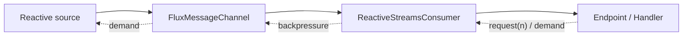
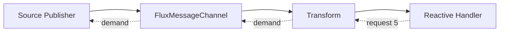

# FluxMessageChannel và reactive subscription

`FluxMessageChannel` là channel của Spring Integration kết hợp hai vai trò: nhận message qua `MessageChannel` và phát message như một Reactive Streams `Publisher<Message<?>>`. Thành phần này nối mô hình message-based của Spring Integration với Project Reactor, cho phép subscriber yêu cầu dữ liệu theo nhu cầu và truyền backpressure ngược về phía nguồn khi toàn bộ đường xử lý hỗ trợ reactive.

Điểm quan trọng là `FluxMessageChannel` không phải `QueueChannel` và cũng không phải `SubscribableChannel` thông thường. Nó không cung cấp API `receive()` để polling, cũng không cho consumer đăng ký trực tiếp bằng `MessageHandler.subscribe(...)`. Consumer phải là Reactive Streams `Subscriber`; trong integration flow, Spring Integration thường tạo `ReactiveStreamsConsumer` để kết nối endpoint với publisher.

## 1. Reactive Streams giải quyết vấn đề gì?

Trong mô hình imperative, producer thường gửi message và consumer xử lý message theo cách push. Nếu producer phát nhanh hơn tốc độ consumer xử lý, hệ thống cần một cơ chế giới hạn hoặc buffer. Nếu không có giới hạn, dữ liệu chờ có thể tăng và gây áp lực bộ nhớ.

Reactive Streams bổ sung cơ chế **backpressure**. Consumer cho publisher biết nó sẵn sàng nhận bao nhiêu phần tử thông qua demand. Publisher chỉ phát phần tử theo số lượng đã được yêu cầu. Khi consumer xử lý chậm, demand giảm và tín hiệu có thể truyền ngược về nguồn, giúp điều tiết tốc độ phát.



Reactive Streams tách hai giai đoạn:

- **Assembly:** xây dựng publisher và các operator mô tả cách dữ liệu sẽ đi qua stream.
- **Subscription:** subscriber đăng ký, yêu cầu dữ liệu và kích hoạt quá trình thực thi.

Vì vậy, việc tạo một `Flux` hoặc một `IntegrationFlow` reactive chưa có nghĩa dữ liệu đã được xử lý. Cần có subscription ở downstream để bắt đầu tiêu thụ. Demand được phát sinh từ phía subscriber rồi truyền ngược lên các publisher/operator có hỗ trợ Reactive Streams.

## 2. FluxMessageChannel là loại channel nào?

`FluxMessageChannel` có các đặc điểm chính:

- Implement `MessageChannel` nên producer vẫn có thể gửi `Message<?>` bằng `send()`.
- Implement `Publisher<Message<?>>` nên subscriber có thể gọi `subscribe()` để nhận message.
- Implement `ReactiveStreamsSubscribableChannel` nên channel có thể nhận một upstream `Publisher<Message<?>>` qua `subscribeTo(...)`.
- Không implement `SubscribableChannel` và không implement `PollableChannel`.
- Dùng một hot `Flux` nội bộ làm nguồn phát message đã được gửi vào channel.

Bảng sau giúp phân biệt các API tiêu thụ:

| Channel | Consumer nhận dữ liệu bằng | Có Reactive Streams demand? | Đặc trưng |
|---|---|---|---|
| `DirectChannel` | `MessageHandler` subscriber | Không theo contract Reactive Streams | Dispatch đồng bộ trên thread gửi |
| `QueueChannel` | `receive()` hoặc polling consumer | Không theo contract Reactive Streams | Buffer message trong queue, có capacity |
| `ExecutorChannel` | `MessageHandler` được dispatch qua `TaskExecutor` | Không tự có demand của Reactive Streams | Tách thread xử lý bằng executor |
| `FluxMessageChannel` | Reactive Streams `Subscriber` | Có | Publisher hot, tiêu thụ theo demand |

Không gọi `receive()` trên `FluxMessageChannel`, vì nó không phải `PollableChannel`. Cũng không dùng API subscribe của `SubscribableChannel`; consumer cần đăng ký theo Reactive Streams. Trong flow, Spring Integration cung cấp adapter consumer để developer vẫn có thể cấu hình endpoint theo Java DSL quen thuộc.

## 3. Hai hướng kết nối reactive

`FluxMessageChannel` hỗ trợ cả hai hướng:

1. **Imperative producer sang reactive consumer:** ứng dụng gọi `send(message)`, subscriber downstream nhận message theo demand.
2. **Reactive publisher sang integration flow:** upstream `Publisher<Message<?>>` được đưa vào `subscribeTo(...)`; channel đăng ký upstream khi downstream subscription sẵn sàng.

```mermaid
flowchart TB
    subgraph A[Imperative to reactive]
        P[Message producer] -->|send(message)| F1[FluxMessageChannel]
        F1 -->|Publisher.subscribe| S[Reactive subscriber]
    end
    subgraph B[Reactive to integration flow]
        R[Publisher<Message<?>>] -->|subscribeTo| F2[FluxMessageChannel]
        F2 --> C[ReactiveStreamsConsumer]
        C --> H[MessageHandler]
    end
```

### 3.1. Từ imperative producer sang subscriber

Producer có thể gửi message theo API Spring Integration:

```java
@Bean
FluxMessageChannel ordersFluxChannel() {
    return new FluxMessageChannel();
}

public void publishOrder(FluxMessageChannel channel, Order order) {
    Message<Order> message = MessageBuilder
            .withPayload(order)
            .setHeader("correlationId", order.id())
            .build();

    boolean accepted = channel.send(message);
    if (!accepted) {
        throw new MessageDeliveryException(message,
                "FluxMessageChannel không nhận message");
    }
}
```

Ở phía tiêu thụ, có thể chuyển channel thành Reactor `Flux`:

```java
Flux<Message<?>> stream = Flux.from(ordersFluxChannel);

Disposable subscription = stream
        .map(Message::getPayload)
        .cast(Order.class)
        .subscribe(this::processOrder);
```

Ví dụ này minh họa cách kết nối API; trong ứng dụng thật, subscription phải có lifecycle rõ ràng và lỗi xử lý cần được quan sát. `send()` thành công cho biết thao tác gửi được channel chấp nhận theo semantics của nó, không phải bằng chứng handler đã hoàn thành xử lý nghiệp vụ.

`FluxMessageChannel` là hot source. Vì vậy, không nên mặc định một subscriber đăng ký muộn sẽ nhận lại mọi message đã được gửi trước đó như khi subscribe vào một cold publisher tạo lại dữ liệu cho mỗi subscriber. Nếu mọi message đều phải được xử lý, hãy thiết lập subscription trước khi producer phát dữ liệu hoặc dùng queue/broker có persistence và replay semantics phù hợp.

### 3.2. Dùng subscriber điều khiển demand

Reactive Streams subscriber gọi `request(n)` để báo số phần tử sẵn sàng nhận. Reactor cung cấp `BaseSubscriber` để tùy chỉnh cách yêu cầu dữ liệu:

```java
BaseSubscriber<Message<?>> subscriber = new BaseSubscriber<>() {

    @Override
    protected void hookOnSubscribe(Subscription subscription) {
        request(8); // Yêu cầu tối đa 8 message ban đầu
    }

    @Override
    protected void hookOnNext(Message<?> message) {
        process(message);
        request(1); // Xử lý xong một message thì yêu cầu thêm một message
    }
};

Flux.from(ordersFluxChannel).subscribe(subscriber);
```

Subscriber trên giữ tối đa 8 demand ban đầu, rồi bổ sung từng phần tử sau khi xử lý. Đây là cách minh họa cơ chế demand; nếu `process()` blocking, nó sẽ làm chậm việc phát demand tiếp theo. Trong ứng dụng thật, nên dùng operator và scheduler phù hợp thay vì tự quản lý request nếu không cần điều khiển ở mức thấp.

Khi không còn cần nhận message, hủy subscription:

```java
subscriber.dispose();
```

Hủy một subscription dừng việc subscriber đó nhận thêm phần tử. Nó không đồng nghĩa tự động dừng mọi producer hoặc các subscriber khác đang sử dụng nguồn.

## 4. ReactiveStreamsSubscribableChannel và subscribeTo

`ReactiveStreamsSubscribableChannel` là contract cho channel có thể đăng ký một upstream Reactive Streams publisher. `FluxMessageChannel.subscribeTo(Publisher<? extends Message<?>>)` cho phép kết nối một stream message có sẵn vào channel.

```java
Flux<Message<Order>> source = orderClient.events()
        .map(order -> MessageBuilder.withPayload(order).build());

ordersFluxChannel.subscribeTo(source);
```

Khi downstream subscription sẵn sàng, channel có thể subscribe publisher đã được cung cấp và chuyển các message vào `Flux` nội bộ. Điều này cho phép nguồn reactive phát theo demand của flow downstream.

Phân biệt hai thao tác:

| API | Hướng dữ liệu | Ý nghĩa |
|---|---|---|
| `send(message)` | Producer imperative → channel | Đẩy một message vào channel |
| `subscribe(subscriber)` | Channel → consumer reactive | Consumer đăng ký nhận message và phát demand |
| `subscribeTo(publisher)` | Publisher upstream → channel | Channel đăng ký nguồn reactive để nhận message theo demand |

`subscribeTo(...)` không giống việc gọi `send()` nhiều lần trong một vòng lặp. Nó kết nối subscription và demand của publisher upstream với quá trình tiêu thụ phía dưới.

## 5. ReactiveStreamsConsumer trong IntegrationFlow

Khi input channel của endpoint là `FluxMessageChannel`, Spring Integration có thể dùng `ReactiveStreamsConsumer` để kết nối `MessageHandler` với publisher. Cấu hình flow vẫn giữ dạng Java DSL:

```java
@Bean
FluxMessageChannel ordersInput() {
    return new FluxMessageChannel();
}

@Bean
FluxMessageChannel normalizedOrders() {
    return new FluxMessageChannel();
}

@Bean
IntegrationFlow normalizeOrders(FluxMessageChannel ordersInput,
                                FluxMessageChannel normalizedOrders) {
    return IntegrationFlow.from(ordersInput)
            .transform(Order.class, Order::normalize)
            .channel(normalizedOrders)
            .get();
}
```

Trong ví dụ, input và output đều là `FluxMessageChannel`. Endpoint nhận dữ liệu từ reactive channel được kết nối theo Reactive Streams; kết quả được gửi tới một reactive channel khác để downstream tiếp tục tiêu thụ theo demand.

### 5.1. Muốn flow fully reactive thì mọi ranh giới phải phù hợp

Đặt một `FluxMessageChannel` ở đầu flow không tự biến mọi endpoint và channel còn lại thành reactive. Nếu giữa hai endpoint vẫn có `DirectChannel`, `QueueChannel` hoặc một thành phần imperative, ranh giới đó có thể chuyển xử lý về mô hình push thông thường.

Để giữ reactive behavior xuyên suốt, đặt `FluxMessageChannel` giữa các endpoint cần nằm trong cùng reactive pipeline và bảo đảm các handler/adapter tương thích với mô hình này. Tài liệu Spring Integration khuyến nghị channel reactive ở các ranh giới giữa endpoint khi muốn flow fully reactive.

### 5.2. Reactive option cho endpoint

Từ Spring Integration 5.5, `ConsumerEndpointSpec.reactive()` cho phép cấu hình endpoint thành `ReactiveStreamsConsumer` độc lập với loại input channel. Có thể cung cấp function biến đổi `Flux<Message<?>>`, ví dụ để áp dụng `publishOn()`, `doOnNext()`, `log()` hoặc `retry()`:

```java
IntegrationFlow flow = IntegrationFlow.from("orders.input")
        .handle(orderService, endpoint -> endpoint.reactive(flux ->
                flux.publishOn(Schedulers.boundedElastic())
                    .doOnNext(message -> log.debug(
                            "Handling {}", message.getHeaders().getId()))))
        .get();
```

Đoạn code minh họa ý tưởng cấu hình reactive function; chữ ký handler và generic cần khớp API của phiên bản đang dùng. `publishOn()` thay đổi scheduler cho các operator downstream của nó; không tự làm một API blocking trở thành non-blocking. Nếu handler gọi JDBC đồng bộ, thread thực thi vẫn bị giữ trong lúc chờ database.

## 6. Backpressure lan truyền qua flow như thế nào?

Giả sử downstream chỉ có thể xử lý 20 message mỗi giây trong khi upstream có thể phát 500 message mỗi giây. Với Reactive Streams, downstream phát demand theo năng lực hiện tại. Các operator và publisher upstream nhận request tương ứng, từ đó điều tiết lượng dữ liệu phát ra.



Backpressure giúp kiểm soát lượng phần tử đang được yêu cầu qua stream. Tuy nhiên, không nên đồng nhất nó với một queue có capacity cố định hoặc cơ chế persistence:

- Demand giới hạn số phần tử subscriber yêu cầu tại thời điểm đó.
- Một số operator có thể có prefetch hoặc buffer nội bộ; cần hiểu cấu hình của operator.
- Một nguồn imperative gọi `send()` không nhất thiết tự biết cách tạm dừng việc tạo dữ liệu theo demand như một publisher reactive.
- Khi flow đi qua endpoint blocking hoặc channel imperative, backpressure có thể không truyền xuyên suốt như mong đợi.
- Backpressure không lưu message bền vững qua restart.

Nếu cần giới hạn buffer, hãy kiểm tra operator, adapter và nguồn dữ liệu cụ thể. Nếu cần giữ message khi downstream ngừng hoạt động hoặc process restart, dùng `QueueChannel` có cấu hình phù hợp, persistent `MessageStore` hoặc broker như JMS/Kafka thay vì xem `FluxMessageChannel` là durable queue.

## 7. Hot source, subscription và lifecycle

`FluxMessageChannel` sử dụng hot `Flux` nội bộ để nhận message được gửi vào. Hot source có vòng đời độc lập với từng lần subscribe; message được phát tại thời điểm runtime chứ không được tạo lại từ đầu cho mỗi subscriber như cold publisher.

Điều này tạo ra một số quy tắc vận hành:

1. Xác định thời điểm subscriber được tạo so với thời điểm producer bắt đầu gửi.
2. Giữ reference tới `Disposable` hoặc subscription nếu ứng dụng cần chủ động cancel.
3. Khi stop adapter hoặc flow, kiểm tra publisher upstream có được cancel/complete theo lifecycle contract không.
4. Khi restart, xác định publisher có thể subscribe lại hay cần tạo publisher mới.
5. Không dùng hot in-memory stream làm nơi lưu trữ message bền vững.

Java DSL có thể nhận trực tiếp một `Publisher<Message<T>>` làm nguồn:

```java
IntegrationFlow flow = IntegrationFlow
        .from(orderPublisher)
        .transform(Order.class, Order::normalize)
        .get();
```

`IntegrationFlowBuilder.toReactivePublisher()` có thể biến một flow thành reactive publisher để ứng dụng subscribe ở phía ngoài. Từ Spring Integration 5.5.6 có biến thể `toReactivePublisher(boolean autoStartOnSubscribe)` để điều khiển việc start flow khi có subscription. Với `autoStartOnSubscribe=true`, flow được start từ subscription; flow được stop khi publisher bị cancel hoặc terminate theo lifecycle được framework quản lý.

Không nhầm lifecycle của `toReactivePublisher()` với mọi subscription trên một `FluxMessageChannel` bean tự khai báo. Nếu tự tạo subscription ngoài flow, ứng dụng vẫn phải quản lý cancellation và lifecycle của các thành phần liên quan.

## 8. ReactiveMessageHandler và handler imperative

Spring Integration hỗ trợ `ReactiveMessageHandler` cho các client trả về reactive type. Cách framework xử lý phụ thuộc flow có reactive consumer hay không.

| Bối cảnh | Cách xử lý reactive return type |
|---|---|
| Imperative flow thông thường | Adapter có thể subscribe ngay vào kết quả reactive sau khi handler trả về; không có reactive composition xuyên suốt để giữ backpressure |
| Flow có `ReactiveStreamsConsumer` | Reactive result được compose vào stream, chẳng hạn qua `flatMap`, để demand có thể điều tiết quá trình tiêu thụ |

Vì vậy, chỉ đổi method nghiệp vụ từ trả `OrderResult` sang trả `Mono<OrderResult>` chưa đủ để kết luận toàn bộ integration flow đã reactive. Cần xem endpoint đang được chạy bằng `ReactiveStreamsConsumer` hay adapter imperative.

Các handler blocking như JDBC, file I/O hoặc client đồng bộ có thể chiếm thread đang xử lý stream. Nếu cần gọi API blocking, hãy cô lập nó trên scheduler/executor phù hợp và giới hạn concurrency; tốt hơn nữa là dùng reactive client nếu hệ thống đích hỗ trợ. Không gọi `block()` tùy tiện bên trong reactive pipeline vì thao tác đó chặn thread và phá lợi ích của non-blocking flow.

## 9. Error, retry và cancellation

Reactive Streams biểu diễn kết thúc stream bằng tín hiệu `onComplete` hoặc `onError`; subscriber cũng có thể cancel subscription. Đây là lifecycle khác với việc một handler imperative ném exception trực tiếp trên thread gửi.

### 9.1. Xử lý lỗi

Có thể quan sát hoặc chuyển đổi lỗi bằng Reactor operator:

```java
Flux.from(ordersFluxChannel)
        .doOnError(error -> log.error("Reactive flow failed", error))
        .onErrorResume(error -> fallbackPublisher(error))
        .subscribe(this::processMessage);
```

`onErrorResume()` thay phần stream lỗi bằng một publisher fallback. Nếu lỗi không được xử lý, subscription kết thúc bằng `onError`; không nên giả định subscriber sẽ tiếp tục nhận message tiếp theo sau lỗi đó.

### 9.2. Retry

```java
Flux.from(ordersFluxChannel)
        .retryWhen(Retry.backoff(3, Duration.ofMillis(200)))
        .subscribe(this::processMessage);
```

Retry là resubscribe theo chính sách của operator. Với hot source, resubscribe không có nghĩa các message đã trôi qua sẽ tự được phát lại. Nếu cần replay message lỗi, phải thiết kế nguồn có khả năng replay hoặc lưu message lỗi vào store/broker. Handler có side effect cần idempotent vì retry có thể làm một thao tác được thực hiện nhiều lần trong những tình huống nhất định.

### 9.3. Cancellation

Cancel có thể truyền ngược lên publisher upstream nếu publisher hỗ trợ cancellation. Điều này giúp nguồn dừng phát dữ liệu khi không còn subscriber hoặc khi ứng dụng chủ động ngừng tiêu thụ. Tuy nhiên, không phải mọi adapter hoặc API bên ngoài đều có thể dừng tức thì; cần kiểm tra contract của driver và lifecycle implementation.

## 10. So sánh FluxMessageChannel với queue và executor

| Nhu cầu | Thành phần phù hợp | Lý do |
|---|---|---|
| Buffer message và consumer poll khi sẵn sàng | `QueueChannel` | Có queue và API `receive()`; có thể cấu hình capacity |
| Dispatch async qua thread pool | `ExecutorChannel` | Dùng `TaskExecutor` để chạy handler trên worker thread |
| Reactive source/consumer, demand và backpressure | `FluxMessageChannel` | Publisher và Reactive Streams subscription |
| Lưu message bền vững qua restart | Persistent `MessageStore` hoặc broker channel | Có cơ chế persistence phù hợp |
| Gọi handler đồng bộ, cùng thread và transaction boundary | `DirectChannel` | Handler chạy trực tiếp trên thread gửi |

`FluxMessageChannel` không phải giải pháp thay thế chung cho mọi queue hoặc executor. Nó phù hợp khi nguồn và các bước xử lý có thể tham gia Reactive Streams. Nếu endpoint là blocking, một thread pool có queue giới hạn có thể phù hợp hơn; nếu cần durability, dùng store/broker.

## 11. Quan sát và chẩn đoán reactive subscription

Khi flow không phát message hoặc downstream không nhận dữ liệu, kiểm tra theo thứ tự:

1. Publisher nguồn đã được tạo đúng và có dữ liệu hay chưa?
2. `FluxMessageChannel` đã được nối đúng vào flow hoặc đã gọi `subscribeTo(...)` chưa?
3. Có subscriber downstream hoạt động không?
4. Subscriber đã request demand chưa, hay đang giữ demand bằng 0?
5. Subscription đã bị cancel hoặc stream đã terminate do lỗi chưa?
6. Có operator nào lọc hết message, giữ buffer hoặc giới hạn concurrency không?
7. Flow có ranh giới imperative như `DirectChannel`, `QueueChannel` hoặc handler blocking không?
8. Nếu dùng reactive adapter, stop/restart có tạo subscription mới theo đúng lifecycle không?

Các tín hiệu hữu ích:

- Số subscription đang hoạt động và số lần cancel.
- Số message được phát/tiêu thụ, tốc độ phát và tốc độ xử lý.
- Thời gian xử lý từng operator/handler và số lỗi `onError`.
- Demand/prefetch hoặc concurrency của các operator có cấu hình giới hạn.
- Thread name tại các điểm `publishOn`/scheduler boundary.
- Số message bị đưa vào fallback, retry hoặc dead-letter path.

Có thể dùng `doOnSubscribe`, `doOnRequest`, `doOnNext`, `doOnCancel`, `doOnError` và `log()` để quan sát trong môi trường kiểm thử. Trong production, chọn mức log phù hợp để tránh ghi quá nhiều event và tránh lộ payload nhạy cảm.

## 12. Kiểm thử FluxMessageChannel

Test cần xác minh cả message path và subscription lifecycle. Có thể dùng `StepVerifier` của Reactor để kiểm tra publisher:

```java
@Test
void subscriberReceivesMessagesOnDemand() {
    FluxMessageChannel channel = new FluxMessageChannel();

    try {
        StepVerifier.create(Flux.from(channel), 0)
                .thenRequest(1)
                .then(() -> assertTrue(channel.send(MessageBuilder
                        .withPayload("order-1")
                        .build())))
                .assertNext(message ->
                        assertEquals("order-1", message.getPayload()))
                .thenCancel()
                .verify(Duration.ofSeconds(2));
    }
    finally {
        channel.destroy();
    }
}
```

Test tạo subscription với demand ban đầu bằng 0, sau đó yêu cầu một phần tử trước khi gửi message. Nó xác minh đường nhận hoạt động sau khi subscriber phát demand; để kiểm tra backpressure theo từng lô, có thể gửi nhiều message và chỉ gọi `thenRequest(n)` theo từng bước. Cleanup channel trong `finally` để tránh rò rỉ tài nguyên khi assertion thất bại.

Các tình huống nên kiểm thử:

- Subscriber nhận message sau khi request demand.
- Không có message nào được xử lý vượt quá demand đã yêu cầu.
- `subscribeTo()` kết nối publisher upstream và subscriber downstream.
- Cancellation dừng subscriber nhận thêm message.
- Lỗi upstream được quan sát theo `onError` hoặc recovery policy.
- Flow có `FluxMessageChannel` giữa các endpoint giữ được reactive behavior.
- Handler blocking không làm test treo vô hạn và scheduler boundary được cấu hình như dự định.
- Lifecycle stop/restart của adapter hoặc flow tạo và hủy subscription đúng cách.

Không dùng `Thread.sleep()` để chờ stream phát message. Dùng `StepVerifier`, `StepVerifier.withVirtualTime()` cho operator dựa trên thời gian khi phù hợp, hoặc latch/await có timeout rõ ràng.

## 13. Lỗi thường gặp

| Triệu chứng | Nguyên nhân có thể | Cách xử lý |
|---|---|---|
| Gọi `receive()` không được | `FluxMessageChannel` không phải `PollableChannel` | Dùng Reactive Streams `Subscriber` |
| Không thể subscribe bằng `MessageHandler` | Channel không implement `SubscribableChannel` | Dùng `Publisher.subscribe()` hoặc endpoint reactive |
| Gửi trước khi subscriber sẵn sàng bị mất khỏi luồng quan sát | Hot source không replay như cold publisher | Thiết lập subscription trước hoặc dùng queue/broker có replay/persistence |
| Không thấy message dù flow đã khai báo | Chưa có subscription hoặc chưa có demand | Kiểm tra subscriber, request và lifecycle |
| Backpressure không giảm tốc nguồn | Một đoạn flow là imperative hoặc nguồn không reactive | Kiểm tra mọi channel/endpoint và khả năng pause của source |
| Handler blocking làm stream chậm | Blocking call chạy trên thread xử lý reactive | Dùng reactive client hoặc cô lập bằng bounded scheduler/executor |
| Retry không phát lại message cũ | Retry resubscribe vào hot source | Dùng nguồn replayable hoặc lưu message lỗi |
| Cancel nhưng nguồn ngoài vẫn chạy | Adapter/driver không hỗ trợ cancellation như mong đợi | Kiểm tra lifecycle và cancellation contract của adapter |

## 14. Checklist thiết kế và vận hành

- [ ] Xác định rõ producer và consumer có thực sự hỗ trợ Reactive Streams hay không.
- [ ] Dùng `FluxMessageChannel` khi cần publisher/subscriber và backpressure.
- [ ] Không dùng `receive()` hoặc `SubscribableChannel.subscribe()` với channel này.
- [ ] Thiết lập subscription trước khi producer phát dữ liệu nếu cần nhận mọi message.
- [ ] Đặt reactive channel giữa các endpoint cần duy trì fully reactive flow.
- [ ] Xác định demand, prefetch, concurrency và buffer của các operator.
- [ ] Không giả định `send()` xác nhận handler đã xử lý xong.
- [ ] Cô lập blocking I/O khỏi reactive processing thread.
- [ ] Quản lý `Disposable`, cancel, stop và restart rõ ràng.
- [ ] Dùng nguồn replayable/persistent nếu cần phát lại hoặc không được mất message.
- [ ] Retry phải đi kèm idempotency khi handler có side effect.
- [ ] Có metrics/log cho subscription, demand, throughput, error và cancellation.
- [ ] Kiểm thử bằng `StepVerifier` hoặc cơ chế await có timeout; tránh sleep tùy tiện.

`FluxMessageChannel` là cầu nối giữa message channel và Reactive Streams. Giá trị chính của nó nằm ở subscription và demand: subscriber kiểm soát lượng dữ liệu cần nhận, còn flow có thể truyền backpressure về nguồn nếu các endpoint và adapter trên đường đi cùng hỗ trợ reactive. Khi chọn đúng ranh giới reactive, quản lý subscription/lifecycle và tách blocking work, Spring Integration có thể kết hợp cấu trúc integration flow với xử lý stream theo nhu cầu mà vẫn giữ được khả năng quan sát và kiểm soát runtime.

## Tài liệu tham khảo

- [Spring Integration — Message Channels](https://docs.spring.io/spring-integration/reference/channel.html)
- [Spring Integration — Reactive Streams Support](https://docs.spring.io/spring-integration/reference/reactive-streams.html)
- [Project Reactor — Reference Guide](https://projectreactor.io/docs/core/release/reference/)
