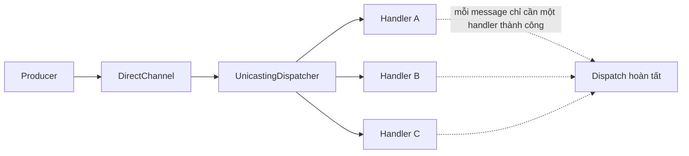
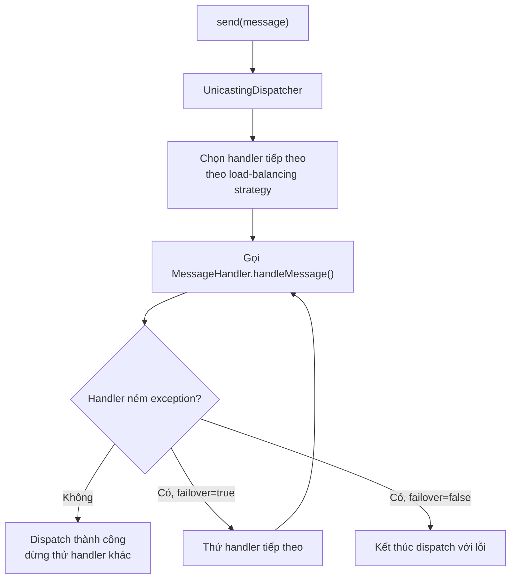
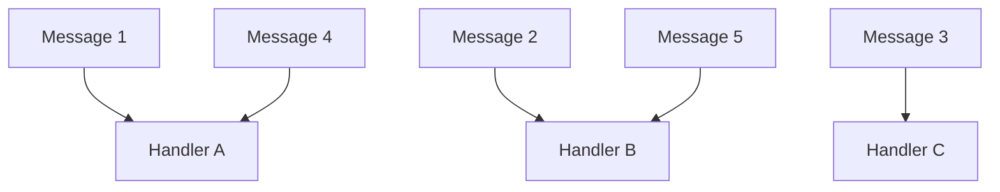

# UnicastingDispatcher với một handler được chọn

`UnicastingDispatcher` là bộ điều phối point-to-point của Spring Integration. Khi một channel có nhiều `MessageHandler` đăng ký, dispatcher chọn thứ tự thử các handler và dừng ngay khi một handler xử lý message thành công. Một message vì vậy được giao cho tối đa một handler thành công, thay vì được broadcast tới tất cả subscriber.

Trong cấu hình thông thường, `DirectChannel` sử dụng `UnicastingDispatcher` với load balancing round-robin và failover được bật. Các message liên tiếp được phân phối luân phiên giữa những handler đã đăng ký. Nếu handler được chọn ném exception, dispatcher có thể thử handler tiếp theo theo thứ tự của chiến lược. Đây là cơ chế chọn consumer và failover trong cùng lần dispatch; nó không phải retry lại cùng handler.

Bài này giải thích cách dispatcher chọn handler, cách round-robin và failover tương tác, khi nào nên dùng nhiều subscriber trên một channel, và cách chẩn đoán message đã được xử lý bởi handler nào.

## 1. UnicastingDispatcher nằm ở đâu trong message flow?

`MessageChannel` là điểm kết nối giữa producer và consumer. Với một channel dạng subscribe, các endpoint đăng ký `MessageHandler` làm subscriber. Khi producer gửi message, channel chuyển yêu cầu dispatch đến message dispatcher.

Với channel point-to-point như `DirectChannel` và `ExecutorChannel`, dispatcher thường là `UnicastingDispatcher`. Nó quản lý tập handler đã đăng ký và chọn một handler để xử lý mỗi message.



Các thành phần có trách nhiệm khác nhau:

| Thành phần | Vai trò |
|---|---|
| Producer | Tạo và gửi message vào channel |
| `DirectChannel` | Cung cấp điểm dispatch point-to-point và quản lý subscription |
| `UnicastingDispatcher` | Chọn thứ tự thử các handler và dispatch message |
| `LoadBalancingStrategy` | Quyết định thứ tự handler được thử, ví dụ round-robin |
| `MessageHandler` | Thực hiện nghiệp vụ với message |
| `failover` | Quyết định dispatcher có thử handler tiếp theo khi handler hiện tại ném exception hay không |

`UnicastingDispatcher` là implementation nội bộ trong quá trình dispatch. Trong ứng dụng, thường cấu hình hành vi này thông qua channel như `DirectChannel` hoặc `ExecutorChannel`, thay vì tự tạo dispatcher.

## 2. Một message được giao cho một handler như thế nào?

Giả sử ba endpoint cùng đăng ký vào channel `orders.input`. Khi producer gửi một message, dispatcher lấy danh sách subscriber, áp dụng load-balancing strategy nếu có, rồi thử các handler theo thứ tự đã xác định.

Khi một handler xử lý message mà không ném exception, dispatcher xem việc dispatch là thành công và bỏ qua các handler còn lại. Nếu handler ném exception và failover được bật, dispatcher có thể tiếp tục thử handler kế tiếp.



Cần hiểu chính xác cụm từ “một handler được chọn”:

- Trong trường hợp thành công thông thường, chỉ một handler được gọi thành công cho message đó.
- Khi handler đầu tiên ném exception và failover bật, nhiều handler có thể được thử tuần tự cho cùng một message.
- Khi tất cả handler đều ném exception, dispatch thất bại.
- Khi channel không có handler nào đăng ký, dispatcher không có đích để giao message.

Javadoc mô tả `UnicastingDispatcher` là thành phần cố gắng gửi một message đến tối đa một handler thành công. Nếu không có handler, nó ném `MessageDispatchingException`; nếu tất cả handler đều ném exception, nó ném `AggregateMessageDeliveryException`.

## 3. Round-robin load balancing

### 3.1. Cách hoạt động

Round-robin xoay vòng điểm bắt đầu giữa các handler đã đăng ký. Nếu có ba handler A, B và C và tất cả đều xử lý thành công, một chuỗi gửi tuần tự có thể được phân phối như sau:



Đây là cách phân phối theo lượt, không phải cơ chế đo tải thực tế. Round-robin không biết handler A đang rảnh hay đang xử lý một message lâu; nó cũng không tự điều chỉnh theo CPU, latency hoặc số lượng công việc đang chờ.

Trong Spring Integration, `DirectChannel` mặc định sử dụng round-robin load balancing và bật failover. Cơ chế này có ý nghĩa khi có nhiều handler cùng subscribe vào một channel. Nếu chỉ có một subscriber, không có handler khác để luân phiên.

### 3.2. Ví dụ hai flow cùng subscribe một DirectChannel

Khai báo channel:

```java
@Configuration
@EnableIntegration
public class DispatchConfiguration {

    @Bean
    public MessageChannel ordersInput() {
        return new DirectChannel();
    }

    @Bean
    public IntegrationFlow localOrdersFlow(
            LocalOrderHandler handler) {
        return IntegrationFlow.from("ordersInput")
                .handle(handler, "handle")
                .get();
    }

    @Bean
    public IntegrationFlow remoteOrdersFlow(
            RemoteOrderHandler handler) {
        return IntegrationFlow.from("ordersInput")
                .handle(handler, "handle")
                .get();
    }
}
```

Hai flow cùng tham chiếu channel `ordersInput`, do đó hai endpoint đăng ký handler trên cùng một `DirectChannel`. Với cấu hình mặc định, dispatcher phân phối các message theo round-robin khi cả hai handler đều sẵn sàng.

Producer:

```java
@Component
public class OrderPublisher {

    private final MessageChannel ordersInput;

    public OrderPublisher(
            @Qualifier("ordersInput") MessageChannel ordersInput) {
        this.ordersInput = ordersInput;
    }

    public void publish(Order order) {
        ordersInput.send(new GenericMessage<>(order));
    }
}
```

Mô hình này phù hợp khi hai handler là những worker thay thế nhau: mỗi message chỉ cần một worker xử lý. Nếu `LocalOrderHandler` và `RemoteOrderHandler` thực hiện hai nghiệp vụ độc lập đều phải chạy, dùng một `DirectChannel` với unicasting là sai mô hình; cần broadcast hoặc tách thành hai nhánh flow.

### 3.3. Round-robin không bảo đảm chia đều thời gian xử lý

Nếu A xử lý một message trong 5 ms còn B cần 2 giây, round-robin vẫn phân phối theo lượt chứ không dựa vào tốc độ xử lý. Tùy channel và thread model, một handler chậm có thể làm chậm producer hoặc chiếm một worker trong executor.

Đừng suy luận rằng round-robin đồng nghĩa với:

- Các handler luôn có cùng số message đang xử lý.
- Các handler có cùng thời gian chờ.
- Mỗi handler hoàn tất một message trước khi nhận message kế tiếp.
- Message được xử lý theo thứ tự toàn cục.
- Tải được phân phối theo CPU hoặc năng lực thực tế.

Nếu cần load balancing dựa trên năng lực, affinity theo key hoặc giới hạn concurrency riêng cho từng worker, hãy thiết kế strategy/partition/queue phù hợp. Round-robin chỉ là chính sách chọn thứ tự đơn giản.

## 4. Failover khi handler ném exception

### 4.1. Failover làm gì?

Thuộc tính `failover` điều khiển việc dispatcher có tiếp tục thử handler khác khi một handler ném exception hay không. Mặc định của `UnicastingDispatcher` là `true`.

Ví dụ có ba handler A, B, C:

1. Dispatcher chọn A.
2. A ném exception.
3. Nếu failover bật, dispatcher thử handler kế tiếp theo thứ tự do strategy và thứ tự đăng ký quyết định.
4. Nếu B xử lý thành công, dispatch kết thúc và C không được gọi.
5. Nếu B cũng ném exception, dispatcher có thể thử tiếp C.
6. Nếu tất cả đều lỗi, dispatcher ném `AggregateMessageDeliveryException`.

Failover không chạy lại A. Nó chuyển sang handler khác trong tập subscriber của channel.

### 4.2. Failover không phải retry nghiệp vụ

Đây là điểm rất quan trọng khi thiết kế nhiều handler thay thế nhau.

Giả sử handler A thực hiện các bước:

1. Ghi một bản ghi vào database.
2. Gọi dịch vụ thanh toán.
3. Ném exception khi ghi audit log.

Nếu failover bật, dispatcher có thể giao cùng message cho handler B. Handler B có thể lại ghi bản ghi và gọi dịch vụ thanh toán. Kết quả là side effect đã thực hiện một phần ở A có thể bị lặp ở B.

Vì vậy, chỉ bật failover khi các handler có thể thay thế nhau và nghiệp vụ có thể chịu được việc thử handler tiếp theo sau lỗi. Nếu handler có side effect, cần transaction, idempotency key hoặc cơ chế xác định rõ bước nào đã hoàn tất.

Không dùng failover như cách thay thế cho:

- Retry cùng handler theo backoff.
- Broker redelivery sau khi message chưa được acknowledge.
- Dead-letter queue.
- Circuit breaker.
- Router chọn handler dựa trên payload hoặc trạng thái nghiệp vụ.

### 4.3. Tắt failover

Nếu muốn lỗi ở handler được chọn làm thất bại ngay, có thể tắt failover:

```java
@Bean
public MessageChannel failFastOrders() {
    DirectChannel channel = new DirectChannel();
    channel.setFailover(false);
    return channel;
}
```

Khi đó, nếu handler được chọn ném exception, dispatcher không thử các subscriber còn lại. Điều này phù hợp khi mỗi message phải được xử lý bởi đúng worker đã chọn và lỗi cần được chuyển sang error handling/retry policy ở tầng khác.

### 4.4. Phân biệt failover với fixed-order fallback

Có hai quyết định độc lập:

- Load balancing quyết định handler nào được thử trước.
- Failover quyết định có thử handler tiếp theo khi handler hiện tại ném exception hay không.

Nếu muốn luôn thử primary trước, rồi secondary, tertiary theo một thứ tự cố định, có thể tắt load balancing và giữ failover bật. Khi không có strategy load balancing, dispatcher bắt đầu từ handler đầu tiên theo thứ tự endpoint được cấu hình; thứ tự có thể dựa trên thuộc tính `order` hoặc thứ tự subscribe.

Ví dụ XML:

```xml
<int:channel id="primaryThenBackup">
    <int:dispatcher load-balancer="none" failover="true"/>
</int:channel>
```

Còn nếu muốn phân phối round-robin nhưng không fallback khi lỗi:

```xml
<int:channel id="roundRobinFailFast">
    <int:dispatcher load-balancer="round-robin" failover="false"/>
</int:channel>
```

Hai cấu hình giải quyết hai mục tiêu khác nhau. Hãy chọn theo semantics nghiệp vụ, không chỉ theo mong muốn “có nhiều handler”.

## 5. Chọn load-balancing strategy

Spring Integration cung cấp các lựa chọn tiêu chuẩn cho dispatcher của channel:

| Strategy | Cách chọn handler | Khi phù hợp |
|---|---|---|
| `round-robin` | Xoay vòng giữa các subscriber | Các worker có vai trò tương đương |
| `none` | Không áp dụng load balancing; bắt đầu theo thứ tự handler | Primary/backup hoặc thứ tự cố định |
| Custom `LoadBalancingStrategy` | Ứng dụng tự quyết định thứ tự thử | Cần affinity, chính sách đặc thù hoặc lựa chọn dựa trên metadata |

Round-robin và none là các giá trị có sẵn trong cấu hình namespace. Từ Spring Integration 3.0, có thể cung cấp implementation `LoadBalancingStrategy` tùy chỉnh thông qua `load-balancer-ref`.

Ví dụ cấu hình XML với strategy tùy chỉnh:

```xml
<int:channel id="customDispatch">
    <int:dispatcher load-balancer-ref="customLoadBalancer"/>
</int:channel>

<bean id="customLoadBalancer"
      class="com.example.integration.CustomLoadBalancingStrategy"/>
```

Tên strategy phải trỏ tới bean thực thi `LoadBalancingStrategy`. Strategy cần xác định thứ tự handler được thử cho message. Nếu có nhiều thread gửi message đồng thời, implementation cũng phải an toàn với concurrency.

Không nên dùng strategy tùy chỉnh để thay thế router khi quyết định đích phụ thuộc vào nội dung nghiệp vụ của message. Router biểu diễn quyết định định tuyến tường minh và dễ quan sát hơn.

## 6. Failover strategy theo exception trong phiên bản mới

Từ Spring Integration 6.3, các channel dựa trên `UnicastingDispatcher` có thể dùng `Predicate<Exception>` làm failover strategy thay cho một cờ boolean đơn giản.

Điều này cho phép ứng dụng quyết định exception nào được phép thử handler tiếp theo:

- Lỗi tạm thời ở worker có thể cho phép failover.
- Lỗi validation hoặc dữ liệu không hợp lệ có thể không nên chuyển sang worker khác.
- Lỗi nghiệp vụ không thể khắc phục bằng handler thay thế nên đi vào error flow.

Javadoc của Spring Integration 6.5 mô tả `setFailoverStrategy(Predicate<Exception>)`; thuộc tính này thay thế `setFailover(boolean)`, vì vậy chỉ cấu hình một trong hai cơ chế.

Với logic phân tích lỗi phức tạp, tài liệu Spring Integration khuyến nghị xem xét `ErrorMessageExceptionTypeRouter`. Đưa quá nhiều logic nghiệp vụ vào predicate failover sẽ làm hành vi dispatcher khó hiểu và khó kiểm thử.

## 7. Unicasting khác broadcast và routing như thế nào?

Ba cơ chế có mục đích khác nhau:

| Cơ chế | Quyết định | Kết quả |
|---|---|---|
| `UnicastingDispatcher` | Chọn một subscriber theo strategy | Một handler thành công cho mỗi message |
| `PublishSubscribeChannel` | Gửi tới tất cả subscriber | Nhiều handler cùng nhận một message |
| Router | Dựa trên nội dung/header/trạng thái để chọn channel đích | Message được chuyển tới channel phù hợp |

### 7.1. Khi cần một worker xử lý

Dùng `DirectChannel` hoặc `ExecutorChannel` với nhiều subscriber nếu các subscriber là các worker thay thế nhau. Dispatcher chọn một handler; round-robin có thể phân phối công việc theo lượt.

### 7.2. Khi tất cả subscriber đều phải nhận

Dùng `PublishSubscribeChannel` nếu message là event notification mà nhiều thành phần đều cần xử lý, ví dụ gửi email, ghi audit và cập nhật projection. Mỗi subscriber có một trách nhiệm độc lập; failover không thay thế broadcast.

### 7.3. Khi đích phụ thuộc nội dung message

Dùng router nếu một đơn hàng nội địa phải đi tới handler nội địa, đơn hàng quốc tế phải đi tới handler quốc tế. Dispatcher không đọc payload để hiểu nghiệp vụ; nó chỉ chọn trong tập subscriber của cùng channel theo load-balancing strategy.

Ví dụ router:

```java
@Bean
public IntegrationFlow orderRouter() {
    return IntegrationFlow.from("orders.input")
            .<Order, String>route(
                    order -> order.isInternational()
                            ? "international"
                            : "domestic",
                    mapping -> mapping
                            .channelMapping("international", "internationalOrders")
                            .channelMapping("domestic", "domesticOrders"))
            .get();
}
```

Trong trường hợp này, routing decision dựa trên payload. Sau khi message đến channel đích, channel đó vẫn có thể có dispatcher riêng để chọn consumer.

## 8. DirectChannel và ExecutorChannel dùng cùng kiểu dispatch nhưng khác thread

Cả `DirectChannel` và `ExecutorChannel` đều dùng semantics point-to-point và hỗ trợ load balancing/failover. Khác biệt lớn là cách dispatch được thực thi.

| Thuộc tính | DirectChannel | ExecutorChannel |
|---|---|---|
| Dispatcher | UnicastingDispatcher | UnicastingDispatcher |
| Chọn subscriber | Một handler theo strategy | Một handler theo strategy |
| Thread handler | Thường là thread gửi | Thread do executor sử dụng |
| Producer chờ handler | Thường có | Thường không, trừ trường hợp executor áp dụng CallerRuns hoặc throttling |
| Transaction giữa sender và handler | Có thể cùng thread/transaction | Không chia sẻ transaction thread-bound của sender |
| Exception từ handler | Có thể truyền về sender | Lỗi sau khi dispatch thường xảy ra ở worker thread |
| Failover | Có | Có; lỗi async cần được quan sát ở phía worker |

Nếu `ExecutorChannel` dùng executor, việc submit task có thể thành công dù handler sau đó thất bại. Vì vậy, kết quả `send()` không chứng minh nghiệp vụ downstream đã hoàn tất.

## 9. Quan sát handler nào đã nhận message

Khi nhiều endpoint subscribe cùng channel, việc debug cần biết handler được chọn cho từng message. Có thể log tên handler, message ID và correlation ID ngay tại đầu handler.

```java
@Component
public class LocalOrderHandler {

    private static final Logger log =
            LoggerFactory.getLogger(LocalOrderHandler.class);

    public void handle(Message<Order> message) {
        log.info(
                "handler=local, messageId={}, orderId={}",
                message.getHeaders().getId(),
                message.getPayload().id());

        // Xử lý đơn hàng.
    }
}
```

Handler thay thế:

```java
@Component
public class RemoteOrderHandler {

    private static final Logger log =
            LoggerFactory.getLogger(RemoteOrderHandler.class);

    public void handle(Message<Order> message) {
        log.info(
                "handler=remote, messageId={}, orderId={}",
                message.getHeaders().getId(),
                message.getPayload().id());

        // Xử lý đơn hàng.
    }
}
```

Có thể theo dõi thêm:

- Số message được từng handler nhận.
- Số exception theo handler.
- Số lần failover.
- Thời gian xử lý theo handler.
- Tỷ lệ message thất bại sau khi đã thử hết handler.
- Thread name nếu channel dùng executor.
- Message ID và correlation ID để lần theo cùng một message qua các bước.

Không nên chỉ đếm tổng message gửi vào channel. Khi có nhiều subscriber, tổng số message gửi không nói được mỗi handler đã nhận bao nhiêu message hoặc có bao nhiêu lần failover.

## 10. Các lỗi thường gặp khi dùng UnicastingDispatcher

| Triệu chứng | Nguyên nhân có thể | Cách kiểm tra |
|---|---|---|
| Chỉ một trong hai handler chạy | Đây là semantics unicasting bình thường | Kiểm tra có cần broadcast hay không |
| Message luôn vào một handler | Chỉ có một subscriber, strategy bị tắt hoặc subscription không thành công | Kiểm tra subscriber count và load-balancer |
| Handler khác được gọi sau khi handler đầu lỗi | Failover đang bật | Kiểm tra exception và cấu hình failover |
| Side effect bị lặp | Handler đầu thực hiện một phần rồi ném exception, dispatcher chuyển sang handler khác | Kiểm tra idempotency và transaction |
| Không có handler nhận message | Không có subscriber hoặc endpoint chưa start | Kiểm tra channel và lifecycle endpoint |
| Tất cả handler đều lỗi | Mỗi handler trong lượt dispatch đều ném exception | Kiểm tra AggregateMessageDeliveryException và error flow |
| Message phân phối không đều theo thời gian xử lý | Round-robin không phải load-aware balancing | Đo latency và cân nhắc strategy phù hợp |
| Producer không thấy exception handler | Channel dùng executor, handler lỗi sau khi submit | Kiểm tra error channel và log worker |
| Message đến sai handler theo nghiệp vụ | Đang dùng dispatcher để giải quyết routing theo payload | Dùng router để chọn channel đích |

### 10.1. Kiểm tra số subscriber

Với channel có nhiều subscriber, có thể kiểm tra số lượng handler thông qua API quản lý channel phù hợp với implementation hoặc quan sát endpoint đã được đăng ký trong application context. Nếu cần chẩn đoán sâu, log lúc endpoint start/stop và đặt ID tường minh cho từng endpoint.

### 10.2. Khi tất cả handler đều thất bại

Nếu tất cả handler đều ném exception, dispatcher phát sinh `AggregateMessageDeliveryException`. Khi đó, cần đọc các exception thành phần để biết handler nào đã được thử và nguyên nhân của từng lỗi. Nếu failover bị tắt, lỗi của handler được chọn kết thúc lượt dispatch sớm hơn.

Với channel đồng bộ, exception có thể xuất hiện trên thread gửi. Với `ExecutorChannel`, handler có thể lỗi sau khi producer đã nhận kết quả submit; cần error handling ở phía worker.

## 11. Nguyên tắc thiết kế

- Dùng unicasting khi mỗi message chỉ cần một worker xử lý.
- Dùng round-robin khi các subscriber tương đương về trách nhiệm và có thể thay thế nhau.
- Chỉ bật failover nếu handler tiếp theo có thể an toàn xử lý cùng message sau khi handler trước lỗi.
- Thiết kế idempotency khi handler có side effect hoặc có khả năng lỗi giữa chừng.
- Dùng fixed-order fallback cho mô hình primary/backup.
- Tắt failover khi cần lỗi của handler được chọn kết thúc dispatch ngay.
- Dùng PublishSubscribeChannel khi mọi subscriber đều phải nhận message.
- Dùng router khi đích phụ thuộc payload hoặc header nghiệp vụ.
- Không xem round-robin là cơ chế cân bằng tải dựa trên latency hoặc năng lực worker.
- Với ExecutorChannel, theo dõi lỗi ở worker thread và không suy luận thành công nghiệp vụ chỉ từ kết quả send.
- Đặt endpoint ID và log message ID/correlation ID để truy vết handler đã nhận message.

## 12. Ghi nhớ

`UnicastingDispatcher` chọn thứ tự thử handler và dispatch message tới một handler thành công. `DirectChannel` mặc định dùng round-robin load balancing và failover bật. Round-robin xoay vòng subscriber; failover thử handler tiếp theo nếu handler hiện tại ném exception.

Hai thuộc tính giải quyết hai vấn đề khác nhau: load balancing chọn ai được thử trước, failover quyết định có tiếp tục khi handler lỗi. Failover không phải retry cùng handler và có thể gây lặp side effect nếu các handler không thật sự thay thế được nhau.

Nếu cần một worker xử lý mỗi message, unicasting phù hợp. Nếu tất cả subscriber đều phải nhận, dùng publish-subscribe. Nếu chọn đích theo nội dung message, dùng router.

## Tài liệu tham khảo

- [Spring Integration — Message Channel Implementations](https://docs.spring.io/spring-integration/reference/channel/implementations.html)
- [Spring Integration — Configuring Message Channels](https://docs.spring.io/spring-integration/reference/channel/configuration.html)
- [Javadoc — UnicastingDispatcher (Spring Integration 6.5)](https://www.springframework.org/spring-integration/docs/6.5.0/api/org/springframework/integration/dispatcher/UnicastingDispatcher.html)
- [Javadoc — LoadBalancingStrategy](https://docs.spring.io/spring-integration/api/org/springframework/integration/dispatcher/LoadBalancingStrategy.html)

