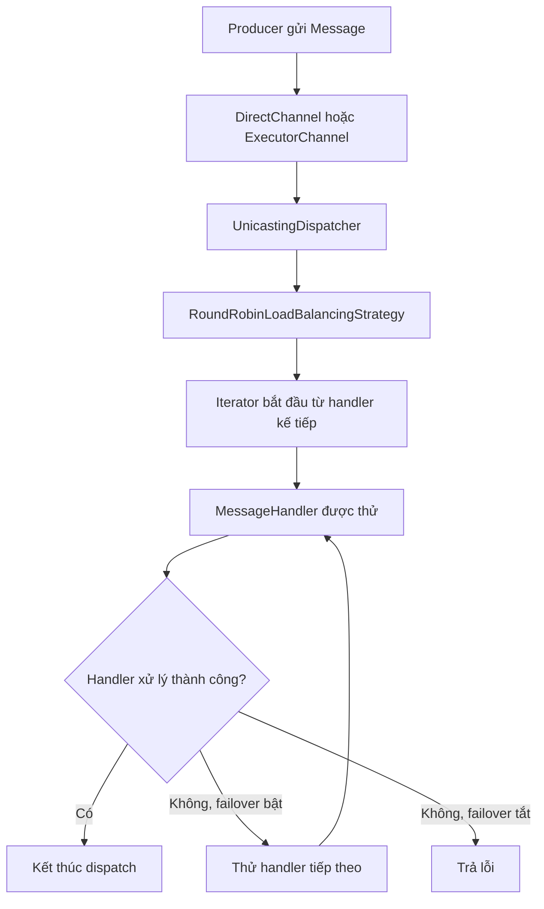

# RoundRobinLoadBalancingStrategy

Trong Spring Integration, một `SubscribableChannel` có thể có nhiều `MessageHandler` đăng ký nhận message. Với channel point-to-point như `DirectChannel` hoặc `ExecutorChannel`, dispatcher cần quyết định handler nào được thử trước cho mỗi lần gửi. `RoundRobinLoadBalancingStrategy` thực hiện quyết định đó bằng cách luân phiên điểm bắt đầu qua danh sách handler.

Chiến lược này phù hợp khi nhiều consumer có thể xử lý cùng một loại công việc và mỗi message chỉ cần một consumer xử lý thành công. Nó là một phần của cơ chế điều phối message flow: endpoint đăng ký handler vào channel, dispatcher chọn handler, sau đó việc thực thi diễn ra trên thread gửi hoặc executor tùy loại channel. Nó không tự tạo poller, queue, thread pool hay cơ chế lưu message.

## 1. Vị trí của round-robin trong quá trình dispatch

`RoundRobinLoadBalancingStrategy` triển khai interface `LoadBalancingStrategy` trong package `org.springframework.integration.dispatcher`. `UnicastingDispatcher` sử dụng strategy để tạo thứ tự duyệt các handler đã đăng ký. Với mỗi lần dispatch, round-robin chọn một handler làm điểm bắt đầu mới; các handler còn lại nằm phía sau theo thứ tự vòng tròn.



Điểm cần nhớ là dispatcher có ngữ nghĩa *unicast*: khi một handler xử lý thành công, các handler còn lại không được gọi cho message đó. Nếu handler hiện tại ném exception và failover được bật, dispatcher có thể thử handler tiếp theo. Vì vậy, trong trường hợp lỗi, một message có thể được nhiều handler thử xử lý trước khi dispatch kết thúc.

## 2. Thuật toán hoạt động như thế nào?

Giả sử channel có ba subscriber theo thứ tự `A`, `B`, `C`. Với các lần dispatch thành công ngay ở handler đầu tiên, điểm bắt đầu sẽ luân phiên như sau:

| Lần gửi | Handler được thử đầu tiên | Kết quả khi handler thành công |
| ---: | --- | --- |
| 1 | A | A xử lý message 1 |
| 2 | B | B xử lý message 2 |
| 3 | C | C xử lý message 3 |
| 4 | A | A xử lý message 4 |
| 5 | B | B xử lý message 5 |
| 6 | C | C xử lý message 6 |
| 7 | A | A xử lý message 7 |

Sau handler cuối cùng, vòng lặp quay lại handler đầu tiên. Javadoc mô tả strategy này là giữ chỉ số handler được thử đầu tiên và dùng một điểm bắt đầu khác ở mỗi lần dispatch. Iterator trả về phần còn lại của collection rồi quay vòng về phần đầu, nên mỗi handler xuất hiện tối đa một lần trong một lượt duyệt.

Ví dụ, nếu lần gửi tiếp theo bắt đầu tại `B`, thứ tự iterator là `B → C → A`. Nếu `B` xử lý thành công, dispatcher dừng tại đó. `C` và `A` không nhận message này.

Round-robin chỉ thay đổi điểm bắt đầu trong thứ tự thử handler. Nó không đo thời gian xử lý, CPU, số task đang chờ, độ sâu queue hay tình trạng sức khỏe của consumer. Nó cũng không phân tích payload để giữ các message cùng `orderId` ở một consumer cố định.

## 3. Channel nào sử dụng chiến lược này?

| Thành phần | Vai trò của round-robin | Ngữ nghĩa thực thi |
| --- | --- | --- |
| `DirectChannel` | Chọn handler bắt đầu trong nhóm subscriber | Gọi handler trên thread gửi message; xử lý đồng bộ với lời gọi `send()` |
| `ExecutorChannel` | Dùng cùng kiểu dispatcher và chiến lược phân phối handler | Chuyển việc thực thi qua `TaskExecutor`; handler có thể chạy trên worker thread |
| `PublishSubscribeChannel` | Không dùng round-robin unicast để chọn một handler | Broadcast message đến tất cả subscriber |
| `QueueChannel` | Không dùng round-robin dispatcher để phân phối subscriber | Lưu message trong queue; consumer/poller lấy message bằng `receive()` |

`DirectChannel` mặc định được tạo với `RoundRobinLoadBalancingStrategy` và bật failover. `ExecutorChannel` hỗ trợ cùng cấu hình dispatcher. Cơ chế load balancing và failover chỉ có ý nghĩa khi có nhiều hơn một `MessageHandler` đăng ký vào channel. Nếu chỉ có một subscriber, không có lựa chọn nào để luân phiên.

Đừng nhầm round-robin với broadcast. Nếu ba subscriber cần nhận cùng một sự kiện, hãy dùng `PublishSubscribeChannel`. Nếu ba consumer cần cạnh tranh lấy từng message đã được buffer, hãy dùng channel dạng queue và cấu hình poller. Round-robin của `DirectChannel`/`ExecutorChannel` là cách chọn handler cho dispatch point-to-point.

## 4. Cấu hình mặc định và cấu hình tường minh

### Java configuration

Có thể dùng constructor mặc định của `DirectChannel`; strategy round-robin đã được cấu hình sẵn:

```java
@Bean
DirectChannel ordersChannel() {
    return new DirectChannel();
}
```

Nếu muốn thể hiện rõ chủ đích trong cấu hình, có thể truyền strategy trực tiếp:

```java
@Bean
DirectChannel ordersChannel() {
    return new DirectChannel(new RoundRobinLoadBalancingStrategy());
}
```

Để cấu hình nhiều endpoint cùng nhận đầu vào từ channel, hãy cho chúng dùng chung tên input channel. Ví dụ rút gọn:

```java
@Bean
IntegrationFlow workerA() {
    return IntegrationFlow.from("ordersChannel")
            .handle((String payload, MessageHeaders headers) -> {
                System.out.println("worker-A: " + payload);
                return null;
            })
            .get();
}

@Bean
IntegrationFlow workerB() {
    return IntegrationFlow.from("ordersChannel")
            .handle((String payload, MessageHeaders headers) -> {
                System.out.println("worker-B: " + payload);
                return null;
            })
            .get();
}
```

Hai flow đăng ký hai handler vào cùng channel. Khi mỗi handler xử lý thành công, các message được phân phối luân phiên giữa `worker-A` và `worker-B`. Trong ứng dụng thực tế, nên inject một service riêng vào từng flow thay vì đặt toàn bộ logic nghiệp vụ trong lambda.

### XML configuration

Có thể khai báo strategy và failover ngay trong phần tử `dispatcher`:

```xml
<int:channel id="ordersChannel">
    <int:dispatcher load-balancer="round-robin" failover="true"/>
</int:channel>
```

`round-robin` là giá trị mặc định, vì vậy có thể bỏ thuộc tính `load-balancer` nếu không cần nhấn mạnh cấu hình. `load-balancer` và `load-balancer-ref` loại trừ lẫn nhau: dùng giá trị có sẵn hoặc tham chiếu một bean tùy biến.

## 5. Round-robin kết hợp với failover

`failover` quyết định dispatcher có tiếp tục thử handler tiếp theo khi handler hiện tại ném exception hay không. Mặc định, failover được bật.

Giả sử channel có ba handler `A`, `B`, `C`:

- Lần dispatch thứ nhất bắt đầu ở `A`.
- `A` ném exception.
- Nếu failover bật, dispatcher tiếp tục thử `B` rồi `C` theo iterator hiện tại, dừng khi một handler xử lý thành công.
- Nếu tất cả handler đều lỗi, dispatcher ném `AggregateMessageDeliveryException` chứa các lỗi phát sinh trong quá trình dispatch.

Ví dụ tắt failover trong Java:

```java
@Bean
DirectChannel failFastChannel() {
    DirectChannel channel = new DirectChannel();
    channel.setFailover(false);
    return channel;
}
```

Hoặc cấu hình XML:

```xml
<int:channel id="failFastChannel">
    <int:dispatcher failover="false"/>
</int:channel>
```

Tắt failover có nghĩa dispatcher không chuyển sang handler khác khi handler được thử ném exception. Nó không tự retry message, không đưa message vào queue và không ghi lại message để xử lý sau.

### Vì sao failover có thể tạo side effect trùng?

Giả sử `A` đã ghi một bản ghi vào cơ sở dữ liệu hoặc gọi API bên ngoài, sau đó ném exception vì bước tiếp theo thất bại. Với failover bật, `B` có thể nhận cùng message và thực hiện lại side effect. Dispatcher không thể biết phần xử lý của `A` đã hoàn tất đến đâu.

Do đó, chỉ bật failover khi các handler trong nhóm thực sự là các lựa chọn thay thế có thể xử lý cùng loại message. Nếu chúng cùng cập nhật một nghiệp vụ, hãy bảo đảm thao tác có tính idempotent, dùng khóa duy nhất theo `messageId`/`eventId`, hoặc thiết kế transaction để không tạo dữ liệu trùng. Không xem failover là cơ chế retry nghiệp vụ có backoff hay dead-letter handling.

Với `DirectChannel`, handler chạy đồng bộ trên thread gửi; exception có thể tác động trực tiếp đến kết quả lời gọi `send()`. Với `ExecutorChannel`, handler được thực thi qua executor nên lời gọi gửi thường có thể kết thúc sau khi task được giao, trước khi handler hoàn tất. Vì vậy, lỗi trong worker thread không nhất thiết được ném trở lại producer; cần cấu hình và theo dõi error handling của executor/Integration flow tương ứng.

## 6. Thứ tự subscriber ảnh hưởng ra sao?

Round-robin quay vòng trên collection handler mà dispatcher quản lý. Thứ tự subscriber được xác định theo thứ tự `order` nếu endpoint có khai báo; nếu không, thứ tự đăng ký subscriber được dùng. Vì vậy, thứ tự này ảnh hưởng đến handler nào là điểm bắt đầu đầu tiên và thứ tự failover tiếp theo.

Nếu nghiệp vụ yêu cầu một handler chính luôn được thử đầu tiên, sau đó mới đến handler dự phòng theo thứ tự cố định, hãy tắt load balancing. Ví dụ:

```java
@Bean
DirectChannel primaryBackupChannel() {
    // Không dùng LoadBalancingStrategy: luôn bắt đầu ở subscriber đầu tiên.
    // Failover vẫn bật mặc định để thử subscriber kế tiếp nếu handler lỗi.
    return new DirectChannel(null);
}
```

Trong XML, dùng `load-balancer="none"`:

```xml
<int:channel id="primaryBackupChannel">
    <int:dispatcher load-balancer="none" failover="true"/>
</int:channel>
```

Khi không có strategy, dispatcher luôn bắt đầu từ handler đầu tiên theo thứ tự subscriber. Failover vẫn có thể tiếp tục đến handler thứ hai, thứ ba nếu handler trước ném exception. Đây là mô hình primary/secondary rõ ràng hơn round-robin.

## 7. Giới hạn khi đánh giá tính công bằng và đồng thời

Round-robin thường phân phối số lần được thử đầu tiên khá đều nếu các handler luôn thành công và tập subscriber không thay đổi. Tuy nhiên, số message được chọn đầu tiên không đồng nghĩa với tải xử lý thực tế được cân bằng:

- **Thời gian xử lý khác nhau:** một handler xử lý message trong 5 ms, handler khác mất 500 ms. Luân phiên theo số message vẫn có thể làm handler chậm bị quá tải.
- **Chi phí message khác nhau:** một message có thể xử lý nhanh, message tiếp theo cần gọi nhiều dịch vụ. Strategy không cân bằng theo CPU hoặc chi phí dự kiến.
- **Failover:** khi handler đầu tiên lỗi, handler kế tiếp có thể xử lý message. Số lần xử lý thành công vì vậy có thể lệch khỏi số lần được chọn đầu tiên.
- **Nhiều producer thread:** mỗi lần dispatch có thể chọn điểm bắt đầu khác, nhưng các handler vẫn có thể được gọi đồng thời. Round-robin không tạo một hàng đợi tuần tự toàn cục.
- **Nhiều instance ứng dụng:** mỗi instance có channel và dispatcher riêng. Bộ đếm luân phiên không phải bộ điều phối dùng chung giữa các JVM hay các máy chủ.

Với `DirectChannel`, xử lý đồng bộ trong thread gửi không có nghĩa chỉ có một thread chạy handler. Nếu nhiều producer gọi `send()` đồng thời, cùng một handler có thể được gọi đồng thời trên các thread đó. Handler có state mutable dùng chung vẫn cần cơ chế đồng bộ phù hợp.

Với `ExecutorChannel`, round-robin quyết định handler được giao message, còn `TaskExecutor` quyết định cách thực thi task. Kích thước pool, queue capacity và rejection policy ảnh hưởng đến khả năng tiếp nhận công việc. Strategy không quan sát các chỉ số đó để tự điều chỉnh.

Nếu cần giữ thứ tự theo `correlationId` hoặc `orderId`, hãy dùng partition theo khóa hoặc một cơ chế tuần tự hóa phù hợp. Round-robin không bảo đảm hai message cùng khóa được gửi đến cùng handler. Nếu cần cân bằng theo tải thực tế, hãy cân nhắc một strategy tùy biến dựa trên thông tin tải có thể truy cập an toàn, hoặc chuyển việc điều phối đến nền tảng queue/broker có cơ chế consumer group phù hợp.

## 8. Tùy biến LoadBalancingStrategy

`LoadBalancingStrategy` là interface dùng để quyết định thứ tự duyệt `MessageHandler`. Phương thức chính là:

```java
Iterator<MessageHandler> getHandlerIterator(
        Message<?> message,
        Collection<MessageHandler> handlers);
```

Một implementation tùy biến có thể dựa trên header, loại message hoặc chính sách riêng để tạo iterator. Có thể truyền implementation vào constructor của `DirectChannel`, hoặc khai báo bean rồi tham chiếu bằng `load-balancer-ref` trong XML.

```xml
<int:channel id="customChannel">
    <int:dispatcher load-balancer-ref="customStrategy"/>
</int:channel>

<bean id="customStrategy" class="example.CustomLoadBalancingStrategy"/>
```

Strategy thường được dùng bởi nhiều lần dispatch trên cùng channel. Nếu implementation giữ trạng thái, hãy thiết kế thao tác cập nhật trạng thái an toàn khi có nhiều thread gọi đồng thời. Cũng cần bảo đảm iterator chỉ trả về các handler còn thuộc danh sách được dispatcher cung cấp và không vô tình lặp vô hạn.

Không nên viết strategy tùy biến chỉ để thay đổi thứ tự theo một quy tắc mà `order`, `load-balancer="none"` hoặc round-robin mặc định đã đáp ứng. Mỗi chính sách tùy biến làm tăng phần logic phải kiểm thử khi subscriber được thêm, gỡ hoặc khi hệ thống chạy nhiều instance.

## 9. Kiểm thử và chẩn đoán runtime

Khi xác minh round-robin, hãy kiểm tra cả phân phối thành công lẫn hành vi khi handler lỗi.

**Kiểm thử phân phối cơ bản:** đăng ký ba handler `A`, `B`, `C`, gửi một số message chia hết cho ba và đếm số lần mỗi handler xử lý thành công. Khi không có exception và subscriber không thay đổi, số lượng nên bằng nhau. Với số message không chia hết cho số handler, chênh lệch số lần được thử đầu tiên tối đa là một.

**Kiểm thử failover:** làm cho handler đầu tiên ném exception có kiểm soát, rồi xác minh handler kế tiếp được thử khi failover bật. Lặp lại với failover tắt để bảo đảm dispatcher dừng tại lỗi đầu tiên. Thêm trường hợp handler tạo side effect rồi mới ném exception để kiểm tra tính idempotent của nghiệp vụ.

**Ghi log theo message và handler:** ghi `messageId`, tên endpoint/handler, `Thread.currentThread().getName()`, thời gian bắt đầu, thời gian hoàn tất và exception. Log giúp phân biệt handler được chọn đầu tiên với handler chỉ được gọi do failover.

**Kiểm tra cấu hình subscriber:** xác nhận các endpoint thực sự dùng cùng channel, số subscriber lớn hơn một, thứ tự `order`/đăng ký như dự kiến và không có flow nào đang dùng channel khác do cấu hình sai tên.

**Kiểm tra executor:** nếu dùng `ExecutorChannel`, quan sát active thread, queue depth, task bị từ chối và error flow. Nếu log cho thấy message được gửi theo vòng tròn nhưng thời gian hoàn tất lệch lớn, cần phân tích thời gian xử lý và năng lực từng handler thay vì thay đổi round-robin một cách máy móc.

### Bài tập tình huống

Một `DirectChannel` có ba subscriber `A`, `B`, `C` theo đúng thứ tự đăng ký. Gửi sáu message liên tiếp. Ban đầu cả ba handler đều thành công.

1. Ghi lại handler được thử đầu tiên cho từng message.
2. Cho `B` ném exception ở lần nó được thử đầu tiên tiếp theo. Giữ `failover=true` và ghi lại handler nào được thử tiếp cho cùng message.
3. Tắt failover, chạy lại tình huống và so sánh kết quả.
4. Cho `B` ghi một bản ghi trước khi ném exception. Xác định cách ngăn side effect bị thực hiện lần nữa ở handler dự phòng.
5. Chạy nhiều producer thread cùng gửi message. Kiểm tra log và giải thích vì sao thứ tự hoàn tất không nhất thiết giống thứ tự message được gửi.

## 10. Khi nào nên dùng RoundRobinLoadBalancingStrategy?

Nên dùng khi có nhiều handler tương đương về khả năng xử lý, mỗi message chỉ cần một handler xử lý thành công, và việc luân phiên số lần được chọn là đủ cho mục tiêu phân phối. Đây là lựa chọn mặc định hợp lý cho nhiều `DirectChannel` có nhiều subscriber cùng thực hiện một loại công việc độc lập.

Hãy chọn cách khác nếu yêu cầu là broadcast, buffer message, giữ thứ tự theo khóa, chọn handler dựa trên tải hiện tại, hoặc định nghĩa rõ primary/backup. Round-robin giải quyết một câu hỏi hẹp: *handler nào được thử đầu tiên trong lần dispatch này?* Các yêu cầu về concurrency, transaction, retry, idempotency, thứ tự nghiệp vụ và giám sát runtime vẫn cần được thiết kế riêng.

## Tài liệu tham khảo

- [Spring Integration Reference — Configuring Message Channels](https://docs.spring.io/spring-integration/reference/channel/configuration.html): cấu hình `DirectChannel`, `ExecutorChannel`, round-robin và failover.
- [Spring Integration Reference — Message Channel Implementations](https://docs.spring.io/spring-integration/reference/channel/implementations.html): ngữ nghĩa point-to-point, broadcast, thread và dispatcher.
- [RoundRobinLoadBalancingStrategy Javadoc](https://docs.spring.io/spring-integration/docs/latest-ga/api/org/springframework/integration/dispatcher/RoundRobinLoadBalancingStrategy.html): mô tả strategy và `getHandlerIterator`.
- [UnicastingDispatcher Javadoc](https://docs.spring.io/spring-integration/docs/latest-ga/api/org/springframework/integration/dispatcher/UnicastingDispatcher.html): dispatch đến handler và cấu hình failover.
