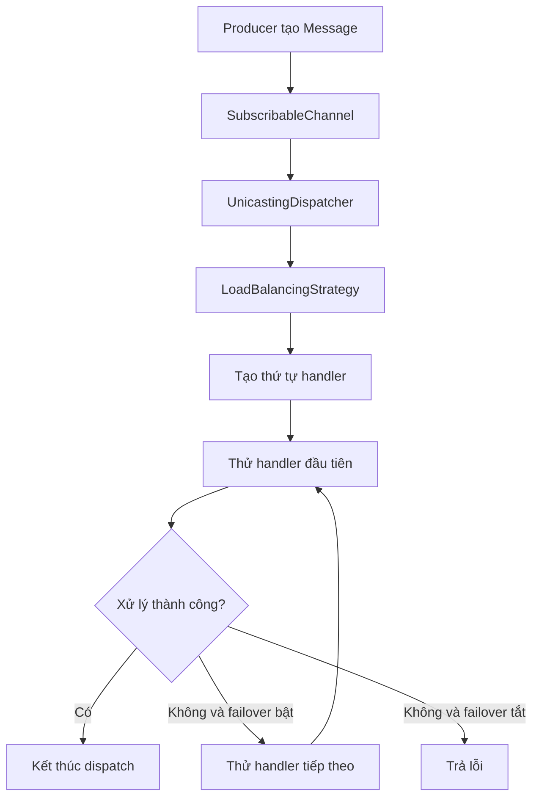

# Load balancing key và thứ tự handler

Khi một `SubscribableChannel` có nhiều handler đăng ký, dispatcher phải xác định handler nào được thử để xử lý message. Trong Spring Integration, `LoadBalancingStrategy` quyết định thứ tự thử các handler đó. Một *load balancing key* là dữ liệu mà ứng dụng dùng để đưa ra quyết định phân phối, thường được đặt trong message header như `customerId`, `accountId` hoặc `tenantId`.

Hai khái niệm cần tách biệt là **thứ tự handler** và **khóa phân phối**. Thứ tự handler là thứ tự các handler xuất hiện trong danh sách dispatcher quản lý. Khóa phân phối là dữ liệu của message được strategy dùng để chọn điểm bắt đầu hoặc thứ tự xử lý. Spring Integration cung cấp round-robin làm strategy mặc định cho `DirectChannel`; nếu cần giữ các message cùng khóa đi đến cùng handler trước tiên, ứng dụng có thể triển khai `LoadBalancingStrategy` riêng.

## 1. Dispatcher chọn handler như thế nào?

Với channel point-to-point như `DirectChannel` hoặc `ExecutorChannel`, `UnicastingDispatcher` duyệt các handler theo iterator do `LoadBalancingStrategy` cung cấp. Dispatcher gửi một message cho handler đầu tiên trong iterator. Nếu handler xử lý thành công, dispatch kết thúc. Nếu handler ném exception và failover được bật, dispatcher có thể thử handler tiếp theo trong iterator.



`PublishSubscribeChannel` có ngữ nghĩa broadcast nên không dùng cơ chế unicast này để chọn một handler duy nhất. `QueueChannel` là pollable channel; message được consumer lấy từ queue, không được phân phối giữa các subscriber bằng `UnicastingDispatcher`.

## 2. Thứ tự handler và load-balancing key khác nhau

Thứ tự handler xác định thứ tự mà dispatcher có thể thử các consumer. Nó thường xuất phát từ thứ tự subscriber được đăng ký và thứ tự endpoint mà cấu hình Spring Integration tạo ra. Nếu endpoint hỗ trợ thuộc tính `order`, thuộc tính đó có thể ảnh hưởng thứ tự đăng ký. Khi cần dựa vào thứ tự này, hãy khai báo rõ ràng và kiểm tra danh sách subscriber thực tế; không nên suy luận chỉ từ thứ tự các phương thức `@Bean` trong source code.

Load-balancing key là một phần dữ liệu của message. Ví dụ:

```java
Message<OrderCommand> message = MessageBuilder
        .withPayload(command)
        .setHeader("customerId", command.customerId())
        .build();
```

`customerId` không phải một header đặc biệt mà `DirectChannel` tự hiểu. Nó chỉ có ý nghĩa khi `LoadBalancingStrategy` của channel đọc header đó và áp dụng chính sách phân phối tương ứng. Có thể dùng `orderId`, `accountId`, `tenantId` hoặc một khóa nghiệp vụ khác, miễn là khóa có giá trị ổn định và được cung cấp nhất quán trên mọi message cần cùng chính sách.

Ví dụ với ba handler theo thứ tự `[A, B, C]`:

| Message | Key | Handler bắt đầu (ví dụ) |
| --- | --- | --- |
| M1 | `customer-17` | B |
| M2 | `customer-22` | A |
| M3 | `customer-17` | B |
| M4 | `customer-31` | C |
| M5 | `customer-22` | A |

Với strategy dựa trên hash, cùng một key sẽ tạo cùng điểm bắt đầu nếu danh sách handler và thứ tự của nó không thay đổi. Đây là *affinity* theo key: các message có cùng key ưu tiên cùng một handler. Nó không đồng nghĩa với việc handler xử lý tuần tự hoặc chỉ chạy một message tại một thời điểm.

## 3. Round-robin mặc định không giữ affinity theo key

`DirectChannel` mặc định dùng `RoundRobinLoadBalancingStrategy`. Strategy này luân phiên handler được thử đầu tiên theo từng lần dispatch, không dựa trên `customerId` hay header nghiệp vụ.

Giả sử có ba handler `A`, `B`, `C`. Các message liên tiếp có thể được phân phối như sau:

| Lần dispatch | Key | Handler được thử đầu tiên |
| ---: | --- | --- |
| 1 | `customer-17` | A |
| 2 | `customer-22` | B |
| 3 | `customer-17` | C |
| 4 | `customer-31` | A |
| 5 | `customer-17` | B |

Các message của cùng `customer-17` có thể bắt đầu ở các handler khác nhau. Round-robin phù hợp khi các consumer tương đương và message độc lập; nó không phù hợp nếu trạng thái của một khách hàng hoặc một aggregate cần được xử lý tại cùng một consumer.

Nếu cần primary/backup theo thứ tự cố định, có thể tắt load balancing để dispatcher luôn bắt đầu từ handler đầu tiên. Nếu cần affinity theo key, hãy cung cấp strategy riêng. Không nhầm hai chính sách này: round-robin phân phối theo lượt gửi, còn key-based strategy phân phối theo nội dung message.

## 4. Triển khai strategy dựa trên key

`LoadBalancingStrategy` nhận message cùng collection handler và trả về một iterator xác định thứ tự thử. Ví dụ sau dùng header `customerId` để chọn handler bắt đầu bằng hash của khóa:

```java
import java.util.ArrayList;
import java.util.Collection;
import java.util.Iterator;
import java.util.List;

import org.springframework.integration.dispatcher.LoadBalancingStrategy;
import org.springframework.messaging.Message;
import org.springframework.messaging.MessageHandler;

public final class CustomerKeyLoadBalancingStrategy
        implements LoadBalancingStrategy {

    private static final String KEY_HEADER = "customerId";

    @Override
    public Iterator<MessageHandler> getHandlerIterator(
            Message<?> message,
            Collection<MessageHandler> handlers) {

        List<MessageHandler> orderedHandlers = new ArrayList<>(handlers);
        if (orderedHandlers.isEmpty()) {
            return List.<MessageHandler>of().iterator();
        }

        Object headerValue = message.getHeaders().get(KEY_HEADER);
        if (!(headerValue instanceof String customerId)
                || customerId.isBlank()) {
            throw new IllegalArgumentException(
                    "Thiếu header customerId hợp lệ để phân phối message");
        }

        int start = Math.floorMod(customerId.hashCode(), orderedHandlers.size());
        List<MessageHandler> dispatchOrder = new ArrayList<>(orderedHandlers.size());

        for (int offset = 0; offset < orderedHandlers.size(); offset++) {
            int index = (start + offset) % orderedHandlers.size();
            dispatchOrder.add(orderedHandlers.get(index));
        }

        return dispatchOrder.iterator();
    }
}
```

Strategy tạo một bản sao của collection để xây iterator có thứ tự vòng tròn, đồng thời không thay đổi danh sách handler do dispatcher quản lý. `Math.floorMod` bảo đảm chỉ số bắt đầu nằm trong khoảng hợp lệ kể cả khi hash âm. Ví dụ dùng `String.hashCode()` để minh họa; trong hệ thống phân tán, cần thống nhất cách chuẩn hóa key và thuật toán hash giữa các instance.

Đăng ký strategy vào `DirectChannel`:

```java
@Bean
DirectChannel customerOrdersChannel() {
    return new DirectChannel(new CustomerKeyLoadBalancingStrategy());
}
```

Producer phải luôn gắn cùng một khóa nghiệp vụ cho các message cần affinity:

```java
Message<OrderCommand> message = MessageBuilder
        .withPayload(command)
        .setHeader("customerId", command.customerId())
        .build();

customerOrdersChannel.send(message);
```

Nếu không có key, ví dụ chủ động từ chối message để lỗi hợp đồng được phát hiện ngay. Một ứng dụng khác có thể chọn handler mặc định hoặc strategy fallback, nhưng phải quy định rõ trong hợp đồng; không nên âm thầm dùng `null`, chuỗi rỗng hoặc giá trị ngẫu nhiên vì kết quả phân phối sẽ khó chẩn đoán.

## 5. Handler order quyết định cả thứ tự failover

Strategy không chỉ chọn handler đầu tiên. Nó trả về toàn bộ thứ tự mà dispatcher sẽ duyệt nếu cần failover. Với collection `[A, B, C]` và key chọn điểm bắt đầu `B`, iterator là `[B, C, A]`.

Khi `failover=true`:

1. Dispatcher thử `B`.
2. Nếu `B` thành công, dispatch kết thúc; `C` và `A` không được gọi.
3. Nếu `B` ném exception, dispatcher thử `C`.
4. Nếu `C` cũng lỗi, dispatcher thử `A`.
5. Nếu tất cả đều lỗi, dispatch thất bại và exception tổng hợp được ném ra.

Khi `failover=false`, dispatcher không tiếp tục sang handler kế tiếp nếu handler được thử phát sinh lỗi. Hãy chọn failover dựa trên ý nghĩa nghiệp vụ. Nếu các handler là bản thay thế tương đương và side effect idempotent, failover có thể tăng khả năng xử lý thành công. Nếu mỗi handler sở hữu một phần trạng thái riêng theo key, failover có thể phá vỡ affinity và chuyển message sang handler không sở hữu trạng thái đó.

Đặc biệt, handler có thể đã ghi dữ liệu hoặc gọi dịch vụ ngoài trước khi ném exception. Handler tiếp theo không biết phần side effect trước đã xảy ra hay chưa. Vì vậy, cần dùng idempotency key, unique constraint hoặc transaction thích hợp để tránh xử lý trùng.

## 6. Key-based affinity không đảm bảo xử lý tuần tự

Nếu hai message cùng `customerId` được gửi gần như đồng thời, strategy có thể chọn cùng một handler cho cả hai. Tuy nhiên, handler đó vẫn có thể được gọi đồng thời:

- Với `DirectChannel`, nhiều producer thread có thể đồng thời gọi `send()`. Cùng một handler có thể được gọi trên nhiều thread.
- Với `ExecutorChannel`, các lần dispatch có thể giao task cho executor và nhiều worker thread có thể chạy cùng handler đồng thời.
- Nếu có nhiều instance ứng dụng, mỗi instance có dispatcher riêng. Cùng key có thể chọn cùng vị trí handler trong mỗi instance, nhưng đó là các object handler khác nhau.

Do đó, affinity chỉ trả lời câu hỏi *message có key này ưu tiên handler nào?* Nó không trả lời *các message cùng key có được xử lý lần lượt hay không?*

Nếu cần tuần tự theo key, hãy kết hợp routing với một cơ chế serialization:

1. **Partition theo key:** ánh xạ key vào một partition ổn định; mỗi partition có một consumer xử lý tuần tự.
2. **Queue/executor theo key:** đưa các message cùng key vào cùng hàng đợi tuần tự, đồng thời cho phép các key khác nhau chạy song song.
3. **Broker partition:** dùng key làm partition key trong broker hỗ trợ partition ordering, rồi chỉ có một consumer trong nhóm xử lý tuần tự từng partition theo semantics của broker.
4. **Khóa hoặc optimistic locking ở storage:** bảo vệ thao tác cập nhật dữ liệu dùng chung; optimistic locking phát hiện xung đột nhưng không tự bảo đảm thứ tự message.

Không dùng `synchronized` trên toàn bộ handler như giải pháp mặc định. Nó có thể tuần tự hóa mọi key không cần thiết, giảm throughput và chỉ phối hợp trong một JVM.

## 7. Tác động khi danh sách handler thay đổi

Chiến lược hash đơn giản dùng công thức:

\[
index = hash(key) \bmod N
\]

Trong đó `N` là số handler hiện có. Cách này dễ hiểu và phân phối khá đều nếu key phân bố tốt. Tuy nhiên, khi số handler thay đổi từ `N` sang `N+1`, nhiều key có thể được ánh xạ sang handler khác. Thứ tự collection thay đổi cũng có thể làm mapping đổi dù số handler không đổi.

Hệ quả thực tế:

- Rolling deployment hoặc scale số consumer có thể làm affinity thay đổi.
- Nếu handler giữ state trong bộ nhớ, message của một key có thể đến handler mới nhưng state vẫn nằm ở handler cũ.
- Nếu key được dùng để bảo vệ thứ tự nghiệp vụ, việc thay đổi mapping cần có kế hoạch drain hoặc chuyển giao state.

Với hệ thống cần giữ mapping ổn định khi số node thay đổi, có thể cân nhắc consistent hashing hoặc một số lượng partition cố định. Consistent hashing giảm số key phải remap khi membership thay đổi, nhưng vẫn cần quản lý việc di chuyển state và đảm bảo các instance dùng cùng membership view. Khi state có giá trị quan trọng, lưu state ở kho dùng chung hoặc broker partition thường dễ vận hành hơn việc giữ state chỉ trong handler memory.

## 8. Chọn key và thứ tự handler phù hợp

Một key tốt phải đại diện cho phạm vi cần affinity. Chọn `customerId` nếu tất cả thao tác của một khách hàng cần cùng handler; chọn `accountId` nếu trạng thái được phân chia theo tài khoản; chọn `orderId` nếu chỉ các bước thuộc cùng đơn hàng cần được gom. Key quá rộng làm giảm khả năng song song; key quá hẹp có thể khiến các cập nhật cần tuần tự lại chạy ở nhiều handler.

Các tiêu chí cần cân nhắc:

| Tiêu chí | Câu hỏi thiết kế |
| --- | --- |
| Tính ổn định | Key có giữ nguyên qua retry, redelivery và restart không? |
| Phạm vi nghiệp vụ | Những message nào bắt buộc cùng handler hoặc cùng partition? |
| Phân bố | Có key nóng chiếm phần lớn lưu lượng không? |
| Bảo mật | Key có chứa dữ liệu cá nhân hoặc bí mật không? Có nên dùng giá trị token hóa không? |
| Vòng đời handler | Khi thêm/bớt handler, state của key được chuyển giao thế nào? |
| Failover | Handler dự phòng có thể xử lý an toàn key này không? |

Thứ tự handler nên được khai báo có chủ đích. Nếu dùng round-robin, thứ tự chỉ quyết định vòng quay bắt đầu từ đâu. Nếu dùng key-based strategy, thứ tự collection là đầu vào của phép ánh xạ key sang vị trí. Nếu dùng primary/backup, thứ tự collection quyết định handler chính và các handler dự phòng.

Không dùng số thứ tự bean hoặc thứ tự file source làm hợp đồng phân phối. Hãy xác định order tại endpoint/channel theo cơ chế cấu hình được phiên bản Spring Integration đang dùng hỗ trợ, rồi xác minh subscriber thực tế khi ứng dụng khởi động. Khi membership thay đổi, cần coi đó là thay đổi routing có thể ảnh hưởng tới key affinity.

## 9. Kiểm thử và quan sát chiến lược phân phối

Kiểm thử strategy ở mức unit trước, sau đó kiểm thử hành vi dispatch qua channel:

1. **Cùng key:** gọi strategy nhiều lần với cùng key và cùng danh sách handler; handler đầu tiên phải giống nhau.
2. **Khác key:** kiểm tra nhiều key được phân bố trên các handler; không yêu cầu mọi tập key nhỏ phải chia đều tuyệt đối.
3. **Thiếu key:** xác minh đúng chính sách đã chọn, chẳng hạn từ chối message hoặc dùng fallback đã định nghĩa.
4. **Handler thay đổi thứ tự/số lượng:** xác nhận mapping thay đổi ra sao và có phù hợp kế hoạch vận hành không.
5. **Failover:** làm handler ưu tiên ném exception và xác minh handler tiếp theo đúng thứ tự; kiểm tra idempotency nếu handler đầu đã tạo side effect.
6. **Đồng thời:** gửi nhiều message cùng key từ nhiều thread để chứng minh strategy không tự bảo đảm tuần tự; nếu yêu cầu tuần tự, kiểm thử thêm queue/partition/lock thực tế.

Ví dụ kiểm thử đơn giản cho thuộc tính affinity:

```java
@Test
void sameCustomerKeyStartsWithSameHandler() {
    MessageHandler handlerA = message -> { };
    MessageHandler handlerB = message -> { };
    MessageHandler handlerC = message -> { };
    List<MessageHandler> handlers = List.of(handlerA, handlerB, handlerC);

    CustomerKeyLoadBalancingStrategy strategy =
            new CustomerKeyLoadBalancingStrategy();

    Message<String> first = MessageBuilder.withPayload("order-1")
            .setHeader("customerId", "customer-17")
            .build();
    Message<String> second = MessageBuilder.withPayload("order-2")
            .setHeader("customerId", "customer-17")
            .build();

    assertSame(strategy.getHandlerIterator(first, handlers).next(),
            strategy.getHandlerIterator(second, handlers).next());
}
```

Trong runtime, ghi nhận channel, handler được chọn, routing key đã được che hoặc token hóa, `messageId`, `correlationId`, thread name và kết quả dispatch. Theo dõi số message theo handler, thời gian xử lý, lỗi, retry, queue depth và tỷ lệ key nóng. Tránh dùng từng key làm metric label nếu cardinality rất lớn; có thể log key đã hash hoặc theo dõi top key ở hệ thống phân tích riêng.

## 10. Quy trình lựa chọn chính sách

1. Xác định các message có cần cùng handler, chỉ cần cùng partition hay hoàn toàn độc lập.
2. Nếu message độc lập và consumer tương đương, dùng round-robin mặc định.
3. Nếu cần handler chính và thứ tự dự phòng cố định, tắt load balancing và cấu hình subscriber order rõ ràng.
4. Nếu cần affinity, chọn key nghiệp vụ ổn định và triển khai `LoadBalancingStrategy` đọc key từ header.
5. Nếu cần tuần tự theo key, bổ sung queue/partition/serialization; không dựa vào affinity một mình.
6. Xác định hành vi failover, retry, idempotency và thay đổi membership trước khi triển khai.
7. Kiểm thử mapping, concurrency, lỗi và scale-out; theo dõi phân phối thực tế sau khi phát hành.

Load-balancing key giúp dispatcher chọn handler theo ngữ cảnh của message, còn thứ tự handler xác định trình tự thử và failover. Khi thiết kế hai phần này cùng với yêu cầu tuần tự, idempotency và vòng đời consumer, việc phân phối message trong Spring Integration sẽ dễ dự đoán và vận hành hơn.
