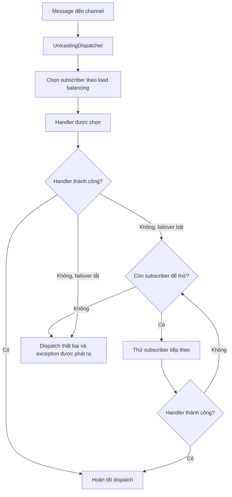

# Failover khi handler throw exception

Trong Spring Integration, một số channel dùng dispatcher kiểu unicast để chọn một subscriber xử lý message. Khi handler được chọn ném exception, dispatcher có thể thử subscriber tiếp theo nếu failover được bật và còn subscriber phù hợp. Cơ chế này giúp một lần dispatch có cơ hội thành công khi một handler không xử lý được message.

Failover của dispatcher là một quyết định trong phạm vi một lần dispatch. Nó không phải retry cùng handler, không tự chờ backoff, không bảo đảm xử lý đúng một lần và cũng không phải cơ chế chuyển đổi dự phòng giữa các instance ứng dụng. Muốn dùng an toàn, cần hiểu dispatcher chọn handler thế nào, exception nào kích hoạt failover, điều gì xảy ra khi tất cả handler đều lỗi và side effect của handler đầu tiên có thể đã xảy ra hay chưa.

## 1. Dispatcher unicast và nhiều subscriber

`DirectChannel` và `ExecutorChannel` thường dùng `UnicastingDispatcher`. Dispatcher chọn một subscriber trong số các subscriber đã đăng ký cho channel. Nếu có nhiều subscriber, load balancing strategy quyết định subscriber đầu tiên được gọi.

Với `DirectChannel`, handler chạy đồng bộ trên thread gửi. Với `ExecutorChannel`, việc dispatch được giao cho `TaskExecutor` và handler chạy trên worker thread. Cả hai đều có thể có nhiều subscriber, nhưng execution model và cách exception quay về sender khác nhau.



`PublishSubscribeChannel` có semantics khác: nó phát cùng message tới nhiều subscriber. Cấu hình bỏ qua lỗi của broadcast dispatcher không phải failover unicast. Chọn channel theo mục đích: một subscriber xử lý một message, hay nhiều subscriber cùng nhận message.

## 2. Failover hoạt động như thế nào?

Với unicast dispatcher, quá trình khái quát là:

1. Dispatcher lấy danh sách subscriber đang đăng ký.
2. Load balancing strategy chọn subscriber bắt đầu.
3. Dispatcher gọi handler với message.
4. Nếu handler hoàn tất, lần dispatch kết thúc.
5. Nếu handler ném exception và failover được cho phép, dispatcher thử subscriber tiếp theo.
6. Quá trình tiếp tục cho tới khi một handler thành công hoặc không còn subscriber có thể thử.
7. Nếu không handler nào xử lý thành công, lần dispatch thất bại và exception được truyền theo execution model của channel.

Trong cấu hình thông thường, failover của unicast dispatcher được bật mặc định. Có thể tắt bằng thuộc tính `failover` trên channel. Khi tắt, exception từ subscriber được chọn làm kết thúc dispatch ngay, không thử subscriber khác.

Failover không tạo thêm message mới. Dispatcher thử xử lý cùng message trên subscriber khác trong cùng lần dispatch. Do đó, message headers và payload được chuyển tới handler tiếp theo theo message đang được dispatch.

## 3. Cấu hình failover trên DirectChannel

Có thể cấu hình trực tiếp channel bean:

```java
@Configuration
class DispatchConfiguration {

    @Bean
    DirectChannel ordersDispatch() {
        DirectChannel channel = new DirectChannel();
        channel.setFailover(true);
        return channel;
    }
}
```

`setFailover(true)` cho phép dispatcher thử subscriber tiếp theo khi handler hiện tại ném exception. Đặt `false` nếu mỗi message chỉ được phép đi tới subscriber đã chọn và lỗi phải được trả về ngay.

Ví dụ hai handler đăng ký trên cùng một channel:

```java
@Component
class OrderHandlers {

    private final OrderService primaryService;
    private final OrderFallbackService secondaryService;

    OrderHandlers(OrderService primaryService,
                  OrderFallbackService secondaryService) {
        this.primaryService = primaryService;
        this.secondaryService = secondaryService;
    }

    @ServiceActivator(inputChannel = "ordersDispatch")
    public void primary(Order order) {
        primaryService.process(order);
    }

    @ServiceActivator(inputChannel = "ordersDispatch")
    public void secondary(Order order) {
        secondaryService.process(order);
    }
}
```

Hai phương thức là hai subscriber riêng. Nếu subscriber được chọn ném exception và failover bật, dispatcher có thể thử subscriber còn lại. Tuy nhiên, hai subscriber này được xem là các handler có thể thay thế nhau theo hợp đồng message; chúng không tự động trở thành cặp primary/backup theo thứ tự cố định.

## 4. Load balancing không đồng nghĩa primary/backup

Khi nhiều subscriber cùng đăng ký trên `DirectChannel`, chiến lược load balancing mặc định thường phân phối các message theo round robin. Message đầu tiên có thể tới subscriber A, message tiếp theo tới subscriber B. Failover chỉ quyết định việc thử subscriber khác sau khi handler ban đầu lỗi.

Ví dụ với hai subscriber A và B:

| Lần gửi | Subscriber được chọn đầu tiên | Nếu handler đầu tiên lỗi và failover bật |
|---|---|---|
| Message 1 | A | Thử B |
| Message 2 | B | Thử A |
| Message 3 | A | Thử B |

Do đó, không nên dựa vào thứ tự đăng ký bean để xây dựng ý nghĩa “A luôn là primary, B luôn là backup”. Nếu yêu cầu luôn gọi A trước rồi mới B, hãy cấu hình chiến lược load balancing phù hợp với phiên bản đang dùng hoặc mô hình hóa fallback tường minh bằng router/flow riêng.

Một điểm quan trọng khác: các subscriber được chọn để xử lý cùng loại message phải có hợp đồng tương thích. Nếu A và B thực hiện hai nghiệp vụ khác nhau, failover có thể khiến message đi vào nhánh không đúng ý nghĩa nghiệp vụ.

## 5. Failover khác retry

Failover và retry đều có thể làm một thao tác được gọi nhiều lần, nhưng mục đích khác nhau:

| Cơ chế | Đối tượng được thử lại | Thời điểm | Mục đích |
|---|---|---|---|
| Dispatcher failover | Subscriber khác trong cùng channel | Ngay trong lần dispatch hiện tại | Tìm handler khác có thể xử lý message |
| Retry advice | Lời gọi handler hoặc đoạn xử lý được bao quanh | Theo retry policy, có thể có backoff | Thử lại thao tác có khả năng thành công sau lỗi tạm thời |
| Broker redelivery | Message được broker giao lại | Theo acknowledgement và redelivery policy | Phục hồi khi consumer không xác nhận xử lý thành công |
| Circuit breaker | Lời gọi tới dependency đang lỗi | Theo trạng thái circuit | Ngăn tiếp tục gọi dependency đang không khỏe |

Ví dụ, một handler gọi API thanh toán và gặp timeout. Dispatcher failover có thể chuyển cùng message sang subscriber khác ngay. Retry advice có thể gọi lại cùng handler sau một khoảng chờ. Broker redelivery có thể giao message lại sau khi consumer không acknowledge. Ba cơ chế này có thể tạo side effect lặp nếu nghiệp vụ không idempotent.

Failover không tự có backoff hoặc giới hạn retry theo thời gian. Nếu tất cả subscriber đều gọi cùng một API đang lỗi, failover chỉ làm tăng số lần gọi dependency và có thể khiến sự cố nặng hơn.

## 6. Điều gì xảy ra khi handler đã tạo side effect rồi mới lỗi?

Đây là rủi ro lớn nhất của failover. Giả sử handler A thực hiện các bước:

1. Ghi một bản ghi vào database.
2. Gọi dịch vụ ngoài để tạo giao dịch.
3. Ném exception khi cập nhật trạng thái cuối cùng.

Dispatcher thấy exception và có thể thử handler B với cùng message. Nếu B thực hiện lại nghiệp vụ, bản ghi hoặc giao dịch từ A có thể bị tạo lần thứ hai.

Failover không thể tự rollback side effect của handler đã chạy. Nó cũng không biết handler lỗi trước hay sau khi thao tác bên ngoài đã thành công. Vì vậy:

- Handler nên idempotent theo business key hoặc idempotency key.
- Xác định rõ điểm commit và side effect nào có thể đã xảy ra trước exception.
- Không dùng nhiều subscriber như các bản sao thay thế nếu chúng không chia sẻ cùng hợp đồng và cơ chế idempotency.
- Nếu có thể, tách kiểm tra điều kiện trước side effect khỏi bước thực hiện nghiệp vụ không thể đảo ngược.
- Dùng transaction/outbox/inbox hoặc cơ chế deduplication phù hợp với tài nguyên tham gia.

Failover phù hợp nhất khi handler có thể thay thế nhau và một handler thất bại trước khi tạo side effect không thể đảo ngược, hoặc khi side effect đã được bảo vệ bằng idempotency.

## 7. Chọn loại exception nào kích hoạt failover

Trong cấu hình cơ bản, failover được điều khiển bằng boolean: bật để thử subscriber kế tiếp khi handler ném exception, tắt để dừng ngay. Một số phiên bản Spring Integration cung cấp thêm failover strategy để quyết định dựa trên loại exception.

Nếu phiên bản ứng dụng hỗ trợ `failoverStrategy`, có thể phân biệt lỗi tạm thời với lỗi nghiệp vụ hoặc lỗi dữ liệu. Ví dụ về ý tưởng chính sách:

| Loại lỗi | Quyết định thường cân nhắc |
|---|---|
| Dependency tạm thời không khả dụng | Có thể thử handler khác nếu handler đó dùng dependency hoặc đường xử lý độc lập |
| Payload sai định dạng | Thường không nên thử handler tương đương khác vì dữ liệu đầu vào vẫn sai |
| Vi phạm quy tắc nghiệp vụ | Thường nên trả lỗi nghiệp vụ hoặc định tuyến sang nhánh xử lý riêng |
| Lỗi lập trình không mong đợi | Cần làm rõ; failover có thể che khuất lỗi và lặp side effect |
| Lỗi đã có side effect một phần | Chỉ failover khi có idempotency hoặc cơ chế phục hồi an toàn |

API cấu hình strategy thay đổi theo phiên bản Spring Integration. Kiểm tra Javadoc và API của phiên bản ứng dụng trước khi dùng strategy cụ thể; không giả định mọi phiên bản đều có cùng phương thức cấu hình.

## 8. Failover với ExecutorChannel

`ExecutorChannel` cũng dùng unicast dispatch nhưng đưa công việc dispatch sang `TaskExecutor`. Vì vậy, dispatcher có thể thử subscriber tiếp theo trong worker thread nếu failover được bật. Khác biệt nằm ở nơi exception xuất hiện:

- Nếu executor từ chối task trước khi chạy, lỗi xảy ra trên đường gửi và có thể được caller quan sát ngay.
- Nếu task đã được chấp nhận nhưng handler lỗi, exception xảy ra trên worker thread.
- Nếu failover thử các subscriber và tất cả đều lỗi, lỗi cuối cùng thuộc execution path bất đồng bộ; sender đã trả về trước đó thường không nhận được exception của handler.

Với `ExecutorChannel`, cần cấu hình error handling cho worker path. Không đặt `try/catch` quanh `send()` rồi kỳ vọng bắt được mọi exception từ handler. Dùng error channel hoặc error handling của endpoint/executor phù hợp và ghi log bằng message ID/correlation ID.

Failover cũng không thay thế durable delivery. Queue của executor thường ở bộ nhớ tiến trình; task đang chờ có thể mất nếu JVM dừng đột ngột. Nếu cần persistence và redelivery, dùng broker hoặc store có semantics phù hợp.

## 9. Phân biệt failover với PublishSubscribeChannel

`PublishSubscribeChannel` gửi cùng message tới nhiều subscriber. Đây là broadcast, không phải unicast failover.

| Hành vi | Unicasting dispatcher | Broadcasting dispatcher |
|---|---|---|
| Subscriber nhận message | Một subscriber được chọn | Tất cả subscriber theo cấu hình |
| Khi handler lỗi | Có thể thử subscriber tiếp theo nếu failover bật | Xử lý theo chính sách lỗi của broadcast, ví dụ dừng hoặc bỏ qua lỗi |
| Ý nghĩa | Một handler trong nhóm chịu trách nhiệm xử lý message | Nhiều subscriber cùng quan tâm message |
| Cơ chế liên quan | `failover` | `ignoreFailures`, `minSubscribers` và cấu hình broadcast khác |

Không dùng `ignoreFailures` của publish-subscribe như thể đó là failover. Bỏ qua lỗi trong broadcast có nghĩa dispatcher tiếp tục phát tới subscriber khác; nó không có nghĩa tìm một handler thay thế để xử lý thay cho handler đã lỗi.

## 10. Exception propagation trên DirectChannel

`DirectChannel` dispatch đồng bộ. Nếu failover tắt hoặc mọi subscriber được thử đều ném exception, exception được truyền về phía gửi theo call stack, thường dưới dạng exception xử lý message hoặc exception gốc được bọc bởi framework.

Điều này cho phép caller đồng bộ quyết định rollback transaction, trả lỗi cho gateway hoặc xử lý exception ở ranh giới gọi flow. Tuy nhiên, nếu một subscriber trước đó đã tạo side effect rồi lỗi, việc exception truyền về caller không tự động undo side effect ở hệ thống ngoài.

Khi có retry advice ở endpoint, cần xác định advice bao quanh handler hay thao tác gửi channel. Retry có thể gọi lại một phần xử lý khác với dispatcher failover. Tránh bật cả retry và failover rộng mà không xác định số lần gọi tối đa và khả năng lặp nghiệp vụ.

## 11. Error handling sau khi tất cả handler thất bại

Nếu không còn subscriber để thử, dispatcher kết thúc dispatch bằng lỗi. Cách lỗi được quan sát phụ thuộc execution model:

- Với `DirectChannel`, exception có thể quay về sender và được xử lý ở upstream endpoint/gateway.
- Với `ExecutorChannel`, exception xảy ra trên worker thread sau async handoff; cần error channel/error handler được cấu hình phù hợp.
- Với polling consumer, exception có thể kết thúc lượt poll hoặc được xử lý bởi advice/error flow của polling endpoint.
- Với broker adapter, acknowledgement, rollback hoặc redelivery còn phụ thuộc transaction và container của broker.

Error flow nên ghi lại message gốc, exception gốc, channel, endpoint và correlation ID. Nếu cần phục hồi, phân loại lỗi trước khi quyết định retry, dead-letter hoặc chuyển sang nhánh xử lý thủ công.

## 12. Cấu hình failover có chủ đích

Một số nguyên tắc khi chọn bật hoặc tắt:

| Tình huống | Gợi ý |
|---|---|
| Nhiều handler tương đương có thể thay thế nhau | Có thể bật failover và dùng load balancing phù hợp |
| Handler là các nghiệp vụ khác nhau | Không nên dùng unicast failover để chọn nhánh nghiệp vụ; dùng router |
| Chỉ có một subscriber | Failover không có handler khác để thử |
| Handler tạo side effect không idempotent | Tắt failover hoặc bổ sung deduplication/idempotency trước |
| Muốn lỗi trả về ngay khi handler được chọn thất bại | Tắt failover |
| Muốn broadcast cho nhiều subscriber | Dùng `PublishSubscribeChannel` và thiết kế error policy broadcast |
| Muốn thử lại cùng handler sau lỗi tạm thời | Dùng retry advice với giới hạn và backoff phù hợp |

Ví dụ tắt failover để lỗi từ handler được chọn kết thúc dispatch ngay:

```java
@Bean
DirectChannel strictOrdersChannel() {
    DirectChannel channel = new DirectChannel();
    channel.setFailover(false);
    return channel;
}
```

Tên `strictOrdersChannel` thể hiện chính sách fail-fast của channel. Hãy cấu hình ở một nơi rõ ràng và kiểm thử khi có nhiều subscriber để tránh dựa vào default không được ghi nhận trong code.

## 13. Kiểm thử dispatcher failover

Kiểm thử nên xác nhận thứ tự gọi subscriber, kết quả khi handler đầu tiên lỗi, và exception cuối cùng khi tất cả handler đều lỗi. Với load balancing strategy round robin, test cần kiểm soát subscriber bắt đầu hoặc xác minh từng trường hợp qua nhiều lần gửi.

Các trường hợp quan trọng:

| Trường hợp | Kết quả mong đợi |
|---|---|
| Một subscriber thành công | Handler được chọn xử lý message; không có failover |
| Subscriber đầu tiên lỗi, subscriber tiếp theo thành công | Dispatcher gọi subscriber tiếp theo và dispatch thành công |
| Tất cả subscriber đều lỗi | Dispatch thất bại và exception được phát ra theo execution model |
| Failover bị tắt | Exception của subscriber được chọn kết thúc dispatch ngay |
| Chỉ có một subscriber lỗi | Không có handler khác để thử; lỗi được truyền ra |
| Handler có side effect rồi lỗi | Test chứng minh idempotency/deduplication ngăn thực hiện lặp |
| ExecutorChannel handler lỗi | Sender không được giả định nhận exception worker; error path được kiểm tra riêng |
| PublishSubscribeChannel có subscriber lỗi | Xác minh broadcast error policy, không nhầm với unicast failover |

Với `DirectChannel`, có thể gửi message trong test và assert exception đồng bộ. Với `ExecutorChannel`, cần chờ kết quả bất đồng bộ bằng latch hoặc test harness phù hợp và xác minh error flow. Tránh dùng `Thread.sleep()` cố định làm đồng bộ test vì dễ gây flaky.

## 14. Chẩn đoán khi failover không xảy ra như mong đợi

Khi handler ném exception nhưng subscriber tiếp theo không được gọi, kiểm tra:

1. Channel có phải `DirectChannel` hoặc `ExecutorChannel` dùng unicast dispatcher không?
2. Có thực sự nhiều subscriber đang đăng ký trên channel tại thời điểm gửi không?
3. `failover` có bị tắt bởi cấu hình channel hoặc DSL không?
4. Load balancing strategy chọn subscriber đầu tiên nào và còn subscriber nào để thử?
5. Exception có xảy ra bên trong lời gọi handler hay được xử lý/nuốt bên trong handler?
6. Nếu có failover strategy theo exception, exception thực tế có được strategy cho phép không?
7. Nếu là `ExecutorChannel`, task có được executor chấp nhận và worker có thực sự chạy không?
8. Nếu handler tiếp theo cũng lỗi, exception cuối cùng được đưa tới đâu?

| Triệu chứng | Nguyên nhân có thể | Hướng kiểm tra |
|---|---|---|
| Handler thứ hai không chạy | Chỉ có một subscriber, failover tắt hoặc strategy không cho phép | Subscriber count, channel config, exception type |
| Handler khác nhau xử lý message đầu tiên theo từng lần gửi | Load balancing round robin | Xác minh đây là phân phối tải, không phải primary/backup |
| Nghiệp vụ bị thực hiện hai lần | Handler đầu tiên tạo side effect rồi ném exception | Idempotency key, transaction, deduplication |
| Caller không thấy lỗi | Dispatch chạy bất đồng bộ qua executor | Worker error channel và error handler |
| Tất cả handler đều lỗi nhưng lỗi khó truy vết | Thiếu log theo message/correlation ID | Ghi subscriber, exception gốc và lần failover |
| Broadcast tiếp tục sau một subscriber lỗi | `PublishSubscribeChannel` đang bỏ qua lỗi theo cấu hình | `ignoreFailures` và semantics broadcast |

Metrics hữu ích gồm số lần failover, số subscriber được thử, tỷ lệ handler thành công theo subscriber, số dispatch thất bại, rejected task của executor và số lỗi theo loại. Spring Integration không nhất thiết cung cấp sẵn mọi metric nghiệp vụ này; có thể bổ sung observation/log ở handler hoặc lớp quản lý channel.

## 15. Nguyên tắc thiết kế

- **Dùng failover cho handler có thể thay thế nhau:** cùng hợp đồng payload và cùng ý nghĩa nghiệp vụ.
- **Hiểu load balancing trước khi gọi là primary/backup:** round robin chọn subscriber đầu tiên; failover thử phần còn lại khi lỗi.
- **Bảo vệ side effect:** idempotency, deduplication hoặc transaction cần thiết trước khi cho phép thử handler khác.
- **Tách failover khỏi retry:** failover đổi subscriber; retry gọi lại thao tác theo policy.
- **Chọn đúng channel semantics:** unicast cho một handler; publish-subscribe cho broadcast; queue channel cho pull consumption.
- **Phân biệt sync và async error:** DirectChannel có thể truyền exception về sender; ExecutorChannel cần quan sát worker error path.
- **Phân loại exception:** lỗi dữ liệu và lỗi nghiệp vụ thường không nên kích hoạt fallback mù quáng.
- **Kiểm thử khi nhiều subscriber:** xác minh thứ tự, strategy, exception cuối cùng và hành vi khi side effect đã xảy ra.

Trước khi bật failover, hãy xác định handler tiếp theo có thực sự thay thế được handler lỗi không, lỗi có thể xảy ra sau side effect hay không, và ai nhận exception khi mọi subscriber đều thất bại. Khi những điều kiện này rõ ràng, failover của dispatcher là một cơ chế phục hồi hữu ích trong phạm vi một lần dispatch mà không che giấu lỗi hoặc tạo ra nghiệp vụ lặp ngoài ý muốn.
