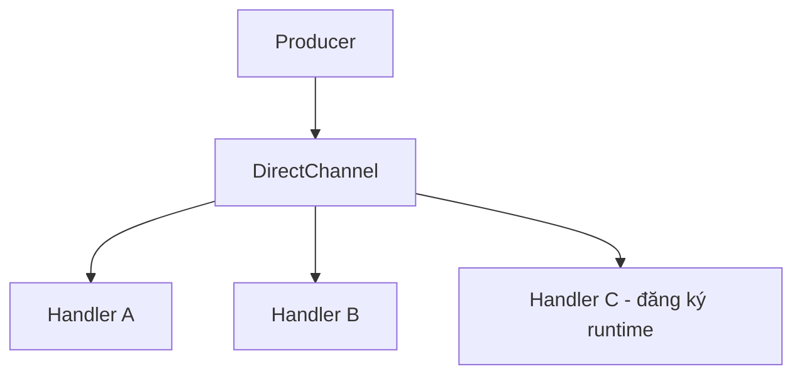
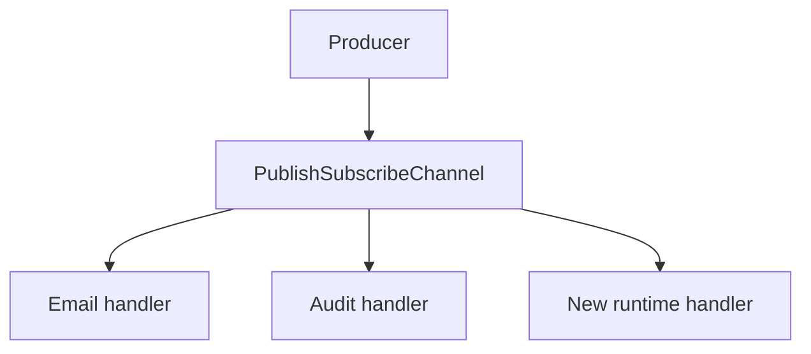
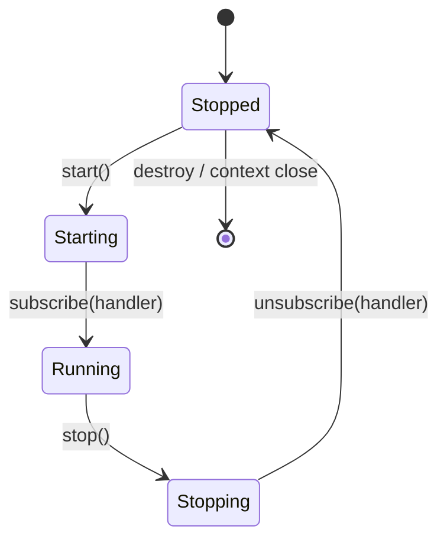

# Subscription thay đổi trong runtime

Trong Spring Integration, một channel có thể có subscriber được đăng ký khi application context khởi động, nhưng cũng có trường hợp số subscriber thay đổi trong lúc ứng dụng đang chạy. Ví dụ, một tenant vừa được kích hoạt cần nhận sự kiện, một plugin được nạp vào hệ thống, một kết nối cần thêm handler hoặc một flow phải ngừng nhận message khi tài nguyên kết thúc.

Để quản lý các trường hợp đó, cần phân biệt **subscription của channel** với **lifecycle của endpoint**. `SubscribableChannel` cho phép đăng ký/hủy đăng ký `MessageHandler` trực tiếp. Endpoint do Spring quản lý thường tự subscribe khi start và unsubscribe khi stop. Flow động có thể được tạo và gỡ qua `IntegrationFlowContext`. Ba cơ chế này liên quan nhưng có phạm vi quản lý khác nhau.

## 1. Channel nào hỗ trợ subscription?

Không phải mọi channel đều có subscriber. Spring Integration có hai nhóm channel quan trọng:

- `SubscribableChannel` đẩy message tới các handler đã đăng ký. Các ví dụ gồm `DirectChannel`, `ExecutorChannel` và `PublishSubscribeChannel`.
- `PollableChannel` giữ message để consumer chủ động gọi `receive()`. Các ví dụ gồm `QueueChannel` và `PriorityChannel`.

| Channel | Cơ chế nhận message | Có `subscribe()`/`unsubscribe()`? | Khi thay đổi consumer |
| --- | --- | --- | --- |
| `DirectChannel` | Dispatch tới một subscriber. | Có | Tập subscriber dùng cho các lần dispatch tiếp theo thay đổi. |
| `ExecutorChannel` | Dispatch tới một subscriber qua executor. | Có | Subscriber được chọn ở thời điểm dispatch; task đã submit vẫn có thể chạy. |
| `PublishSubscribeChannel` | Broadcast tới mọi subscriber. | Có | Tập recipient của các lần broadcast tiếp theo thay đổi. |
| `QueueChannel` | Consumer gọi `receive()` để lấy message từ queue. | Không | Quản lý poller/consumer endpoint; message có thể vẫn nằm trong queue khi endpoint dừng. |
| `PriorityChannel` | Consumer gọi `receive()` theo thứ tự ưu tiên. | Không | Quản lý poller/consumer endpoint. |

`subscribe()` là API của `SubscribableChannel`, không phải API chung của mọi `MessageChannel`. Nếu gọi `subscribe()` trên một channel không hỗ trợ subscription, thiết kế đang nhầm giữa dispatch event-driven và polling.

## 2. Đăng ký và hủy MessageHandler trực tiếp

`SubscribableChannel` khai báo hai thao tác:

```java
boolean subscribe(MessageHandler handler);
boolean unsubscribe(MessageHandler handler);
```

Ví dụ đăng ký một handler vào channel:

```java
@Configuration
class EventChannelConfiguration {

    @Bean
    SubscribableChannel applicationEvents() {
        return new PublishSubscribeChannel();
    }
}

@Component
class RuntimeHandlerRegistry {

    private final SubscribableChannel applicationEvents;
    private final Map<String, MessageHandler> handlers = new HashMap<>();

    RuntimeHandlerRegistry(
            @Qualifier("applicationEvents") SubscribableChannel applicationEvents) {
        this.applicationEvents = applicationEvents;
    }

    synchronized void register(String key, MessageHandler handler) {
        if (handlers.containsKey(key)) {
            throw new IllegalStateException("Handler already registered: " + key);
        }
        if (!applicationEvents.subscribe(handler)) {
            throw new IllegalStateException("Could not subscribe handler: " + key);
        }
        handlers.put(key, handler);
    }

    synchronized void unregister(String key) {
        MessageHandler handler = handlers.get(key);
        if (handler != null) {
            if (!applicationEvents.unsubscribe(handler)) {
                throw new IllegalStateException("Handler was not subscribed: " + key);
            }
            handlers.remove(key);
        }
    }
}
```

Ví dụ này giữ đúng instance `MessageHandler` đã đăng ký để có thể hủy về sau. Không tạo một lambda mới khi gọi `unsubscribe()` rồi mong channel nhận ra đó là handler cũ. Hãy giữ tham chiếu tới đúng object được truyền vào `subscribe()`.

Ý nghĩa kết quả trả về:

- `subscribe(handler)` trả `true` khi handler được thêm vào tập subscriber; trả `false` nếu không thêm được, ví dụ handler đã được đăng ký.
- `unsubscribe(handler)` trả `true` khi handler được gỡ; trả `false` nếu handler không có trong tập subscriber.

Registry trong ví dụ dùng `synchronized` để thao tác kiểm tra khóa, subscribe và cập nhật map thành một bước đối với các thread gọi manager. Nếu dùng registry trong cluster, map này chỉ quản lý process hiện tại; từng node phải nhận cấu hình và đăng ký subscriber riêng.

### Handler trực tiếp có lifecycle gì?

Gọi `channel.subscribe(handler)` chỉ đăng ký handler vào dispatcher. Nó không tự biến handler thành Spring bean, không tự inject dependency và không tự gọi `start()`/`stop()` cho object đó. Nếu handler đã là Spring bean và triển khai `Lifecycle`/`SmartLifecycle`, application context có thể quản lý lifecycle của bean theo hợp đồng đó; việc subscribe/unsubscribe vẫn là thao tác riêng và không tự start/stop bean. Nếu handler có tài nguyên hoặc lifecycle riêng, hãy phối hợp hai vòng đời một cách tường minh.

Khi subscribe trực tiếp, ứng dụng cũng tự chịu trách nhiệm giữ registry, tránh đăng ký trùng, unsubscribe đúng instance và cleanup khi context đóng. Với một endpoint có handler, advice, metrics hoặc lifecycle phức tạp, nên để Spring Integration quản lý endpoint thay vì tự đăng ký raw handler.

## 3. Subscription thay đổi hành vi theo loại dispatcher

Việc thêm hoặc bỏ subscriber có ý nghĩa khác nhau tùy channel.

### DirectChannel: point-to-point và load balancing

`DirectChannel` dùng dispatcher kiểu unicast. Khi có nhiều subscriber, mỗi message được giao cho một subscriber được chọn theo load-balancing strategy; mặc định là round-robin. Thêm một subscriber làm thay đổi tập handler có thể được chọn cho các message tiếp theo. Gỡ subscriber loại handler đó khỏi các lần dispatch tiếp theo.



Nếu channel có ba handler, một message không được broadcast tới cả ba. Dispatcher chọn một handler. Nếu các handler đại diện cho worker cùng loại, đây là competing consumers/load balancing. Nếu chúng đại diện cho ba tác vụ khác nhau, `DirectChannel` không phải lựa chọn broadcast.

Khi tập subscriber thay đổi, chu kỳ round-robin và handler được chọn cho các message sau đó có thể thay đổi. Không nên dựa vào việc một tenant hoặc một loại message luôn đi tới cùng subscriber chỉ vì subscriber đó được đăng ký trước. Nếu cần định tuyến theo tenant hoặc loại message, dùng router với điều kiện rõ ràng.

### PublishSubscribeChannel: broadcast

`PublishSubscribeChannel` dispatch message tới tất cả subscriber hiện có. Thêm handler mới nghĩa là các message broadcast tiếp theo được gửi thêm tới handler đó; gỡ handler nghĩa là các lần broadcast sau không còn gửi tới handler đó.



Nếu bật `applySequence`, channel có thể thêm correlation/sequence metadata cho các bản sao. Thay đổi số subscriber cũng làm thay đổi số recipient của broadcast. Vì vậy, aggregator downstream không nên giả định group luôn có cùng số phần tử nếu subscription có thể thay đổi trong lúc hệ thống chạy. Nếu mỗi lần phát cần một tập recipient cố định, hãy snapshot/version tập subscriber cho execution đó hoặc tạo correlation metadata riêng.

### ExecutorChannel: task đã submit vẫn còn hiệu lực

`ExecutorChannel` dùng dispatcher unicast nhưng thực hiện invocation qua `TaskExecutor`. Khi handler được chọn và task đã submit vào executor, việc gọi `unsubscribe(handler)` không thu hồi task đang chờ hoặc đang chạy. Unsubscribe chỉ ảnh hưởng các lần dispatch sau khi handler đã bị gỡ khỏi tập subscriber.

Điều này cũng áp dụng cho `PublishSubscribeChannel` có executor: message đã được broadcast và task của subscriber đã được submit vẫn có thể tiếp tục chạy sau khi subscriber bị unsubscribe. Nếu cần bảo đảm không còn công việc đang chạy trước khi gỡ tài nguyên, cần có drain/quiescence protocol ở tầng ứng dụng.

## 4. Endpoint event-driven tự subscribe theo lifecycle

Trong flow được Spring quản lý, ứng dụng thường không gọi `subscribe()` trực tiếp. `EventDrivenConsumer` là endpoint kết nối `SubscribableChannel` với `MessageHandler`. Khi endpoint start, nó đăng ký handler lên channel; khi endpoint stop, nó hủy subscription.



Đây là lý do endpoint có thể start/stop mà channel vẫn tồn tại. Channel quản lý tập subscriber; endpoint quản lý thời điểm handler tham gia hoặc rời tập đó.

Ví dụ Java DSL:

```java
@Bean
IntegrationFlow auditFlow(AuditHandler auditHandler) {
    return IntegrationFlow.from("events.input")
        .handle(auditHandler, "handle")
        .get();
}
```

Spring Integration tạo endpoint cho handler và quản lý subscription theo lifecycle của flow/context. Khi endpoint stop, channel không còn dispatch message mới tới endpoint đó. Khi endpoint start lại, nó subscribe trở lại.

### PollingConsumer không phải subscriber của PollableChannel

Với `QueueChannel`, consumer endpoint không gọi `subscribe()`. `PollingConsumer` được poller kích hoạt theo trigger rồi gọi `receive()` trên channel. Dừng endpoint/poller sẽ dừng việc polling; message đã nằm trong queue thường vẫn còn để consumer khác hoặc endpoint được start lại xử lý, tùy semantics của queue/store.

Không dùng `channel.unsubscribe()` để dừng `PollingConsumer`. Hãy điều khiển lifecycle endpoint hoặc registration chứa endpoint đó. Với broker message-driven adapter, lifecycle còn liên quan tới listener container/connection của broker; dùng cơ chế quản lý adapter tương ứng.

## 5. Dynamic IntegrationFlow qua IntegrationFlowContext

Khi cần thêm cả một pipeline trong runtime, `IntegrationFlowContext` phù hợp hơn việc tự subscribe một handler. Nó đăng ký flow và các component liên quan vào application context, trả về một registration handle để điều khiển lifecycle.

```java
@Component
class TenantFlowRegistry {

    private final IntegrationFlowContext flowContext;
    private final SubscribableChannel tenantEvents;
    private final Map<String, IntegrationFlowContext.IntegrationFlowRegistration>
        registrations = new ConcurrentHashMap<>();

    TenantFlowRegistry(IntegrationFlowContext flowContext,
                       @Qualifier("tenantEvents") SubscribableChannel tenantEvents) {
        this.flowContext = flowContext;
        this.tenantEvents = tenantEvents;
    }

    synchronized void register(String tenantId, TenantEventHandler handler) {
        if (registrations.containsKey(tenantId)) {
            throw new IllegalStateException("Tenant flow already exists: " + tenantId);
        }

        String flowId = "tenant-" + tenantId + "-events";
        IntegrationFlow flow = IntegrationFlow.from(tenantEvents)
            .handle(handler, "handle")
            .get();

        IntegrationFlowContext.IntegrationFlowRegistration registration =
            flowContext.registration(flow)
                .id(flowId)
                .useFlowIdAsPrefix()
                .register();

        registrations.put(tenantId, registration);
    }

    synchronized void unregister(String tenantId) {
        IntegrationFlowContext.IntegrationFlowRegistration registration =
            registrations.remove(tenantId);
        if (registration != null) {
            registration.destroy();
        }
    }
}
```

Ví dụ này đăng ký một flow theo tenant trên cùng một `SubscribableChannel`. Mỗi flow có endpoint riêng; với `DirectChannel`, các endpoint cạnh tranh nhận message theo load balancing; với `PublishSubscribeChannel`, mỗi flow nhận bản sao của message. Hãy chọn channel theo semantics mong muốn.

`IntegrationFlowRegistration` cung cấp các thao tác lifecycle như `start()`, `stop()` và `destroy()`:

- `stop()` dừng các endpoint của flow nhưng giữ registration để có thể start lại.
- `start()` khởi động lại endpoint theo lifecycle của registration.
- `destroy()` gỡ flow và các component được đăng ký cùng flow khỏi context. Sau khi destroy, registration không còn là flow đang hoạt động để start lại.

Flow ID phải duy nhất trong context. `useFlowIdAsPrefix()` giúp tên component do flow tạo ra không va chạm với flow khác. Lưu registration theo tenant/resource key để hủy đúng flow khi tài nguyên kết thúc.

Nếu cần flow bắt đầu từ channel riêng cho tenant, có thể tạo channel theo tenant và đăng ký flow từ channel đó. Nếu tất cả tenant cùng nghe một broadcast channel, cần đảm bảo handler tự kiểm tra tenant hoặc router chỉ đưa message tới đúng tenant; chỉ đặt flow ID theo tenant không tự lọc message.

## 6. Chọn API nào cho thay đổi runtime?

| Nhu cầu | Cơ chế phù hợp | Ai quản lý cleanup? |
| --- | --- | --- |
| Thêm/bỏ một `MessageHandler` đơn giản vào channel event-driven | `SubscribableChannel.subscribe()` / `unsubscribe()` | Registry của ứng dụng. |
| Start/stop endpoint đã được Spring tạo | `Lifecycle`/`SmartLifecycle` hoặc `IntegrationFlowRegistration.start()`/`stop()` | Spring context hoặc registration manager. |
| Thêm/gỡ một pipeline gồm nhiều endpoint | `IntegrationFlowContext` | Ứng dụng giữ registration và gọi `destroy()`. |
| Dừng consumer đọc từ `QueueChannel` | Stop `PollingConsumer`/flow chứa poller | Lifecycle endpoint/registration. |
| Dừng broker listener | Lifecycle của inbound adapter/listener container | Adapter/container và cấu hình broker. |
| Định tuyến message tới handler theo tenant/type | Router hoặc mapping cấu hình runtime | Registry/router configuration. |

Nếu chỉ cần thay đổi một endpoint có sẵn, cân nhắc stop/start endpoint thay vì tự thêm một raw subscriber thứ hai. Nếu cần thay đổi topology của flow, dùng `IntegrationFlowContext`. Nếu chỉ cần một callback đơn giản và có thể tự quản lý lifecycle, `subscribe()` là đủ.

## 7. Thay subscriber an toàn khi có message đang chạy

Thay subscriber không chỉ là hai lời gọi subscribe/unsubscribe. Trong khi registry cập nhật, producer vẫn có thể gửi message. Cần quyết định có chấp nhận một khoảng thời gian hai handler cùng nhận, một khoảng thời gian không có handler, hay cần chuyển đổi có kiểm soát.

### Hai cách thay cơ bản

**Subscribe mới trước, unsubscribe cũ sau:** tránh khoảng trống không có subscriber, nhưng với `PublishSubscribeChannel`, có thời điểm cả handler cũ và mới cùng nhận message. Nếu side effect không idempotent, có thể xử lý trùng.

**Unsubscribe cũ trước, subscribe mới sau:** tránh hai handler cùng nhận trong giai đoạn chuyển tiếp, nhưng có một khoảng thời gian channel không có handler đó. Message gửi trong khoảng này có thể bị bỏ qua hoặc `send()` thất bại tùy channel và `minSubscribers`.

Không có thao tác atomic replace chung trên `SubscribableChannel`. Nếu không thể chấp nhận cả duplicate lẫn gap, hãy tạm ngừng producer, drain message đang chạy rồi thay subscription; hoặc dùng một handler ổn định làm proxy và đổi delegate bằng `AtomicReference`.

### Stable delegating handler

Một cách giảm churn subscription là đăng ký một handler cố định. Handler này giữ tham chiếu tới implementation hiện tại:

```java
final class DelegatingMessageHandler implements MessageHandler {

    private final AtomicReference<MessageHandler> delegate =
        new AtomicReference<>();

    void replace(MessageHandler next) {
        delegate.set(Objects.requireNonNull(next));
    }

    @Override
    public void handleMessage(Message<?> message) {
        MessageHandler current = delegate.get();
        if (current == null) {
            throw new MessageDeliveryException(message, "No active delegate");
        }
        current.handleMessage(message);
    }
}
```

Channel chỉ subscribe `DelegatingMessageHandler` một lần. Khi thay implementation, gọi `replace()` thay vì unsubscribe/subscribe. Một invocation đã đọc delegate cũ vẫn có thể tiếp tục chạy; nếu cần chờ implementation cũ hoàn tất trước khi đóng tài nguyên, cần đếm in-flight invocation hoặc cơ chế drain riêng.

## 8. Race condition và message đang in-flight

Subscription thay đổi đồng thời với dispatch là thao tác runtime có concurrency. Có một số tình huống phải tính đến:

- Producer đã bắt đầu dispatch trước khi unsubscribe. Handler có thể vẫn được gọi trong lần dispatch đó.
- Với executor-backed channel, task đã được submit có thể bắt đầu hoặc tiếp tục sau khi unsubscribe hoàn tất.
- Một endpoint có thể đang xử lý message khi `stop()` được gọi. Stop subscription ngăn nhận thêm message mới; nó không nhất thiết interrupt invocation đang chạy.
- Nếu handler bị đóng resource ngay sau unsubscribe, invocation in-flight có thể truy cập resource đã đóng.
- Khi subscribe lại cùng handler, cần tránh cùng lúc có hai endpoint/registration khác nhau cũng sở hữu handler đó.

Một quy trình drain an toàn thường gồm:

1. Đánh dấu handler/tenant ở trạng thái `DRAINING` để không nhận công việc mới theo routing policy.
2. Ngừng dispatch tới handler bằng unsubscribe hoặc stop endpoint.
3. Chờ số invocation in-flight về 0 trong thời gian giới hạn.
4. Đóng resource mà handler sở hữu.
5. Xóa registration khỏi registry và ghi nhận trạng thái đã gỡ.

Đừng dùng `Thread.sleep()` như cơ chế drain. Dùng counter/condition, completion future, semaphore hoặc cơ chế lifecycle của adapter để biết chính xác khi nào công việc đang chạy đã kết thúc. Khi hết drain timeout, cần chính sách rõ ràng: tiếp tục chờ, hủy có kiểm soát, hoặc ghi nhận shutdown không hoàn toàn.

## 9. Lỗi và subscriber không còn hoạt động

Nếu `DirectChannel` không có subscriber, việc gửi có thể thất bại tùy cấu hình channel và dispatcher. Với `PublishSubscribeChannel`, `minSubscribers` xác định số subscriber tối thiểu cần có để dispatch được xem là thành công. Nếu runtime subscription thay đổi, cấu hình này giúp phát hiện channel không còn consumer như kỳ vọng.

Khi handler ném exception:

- Với dispatch đồng bộ, exception có thể truyền về sender và ảnh hưởng lần dispatch hiện tại.
- Với executor-backed channel, lỗi phát sinh trong worker không thể quay về call stack của sender sau khi task đã được chấp nhận; cần error handling/error channel phù hợp.
- Unsubscribe handler không phải retry, không xử lý message lỗi và không tự khôi phục message đã bị lấy khỏi queue.

Nếu endpoint được Spring quản lý, hãy ưu tiên cấu hình error channel, retry advice và lifecycle endpoint. Nếu đăng ký raw handler, registry phải quy định ai nhận lỗi, cách log failed message và có tiếp tục nhận message tiếp theo hay không.

## 10. QueueChannel và subscription lifecycle là hai chuyện khác nhau

`QueueChannel` không giữ danh sách subscriber. Producer gửi message vào queue; consumer endpoint lấy message bằng `receive()`. Vì vậy:

- Dừng polling endpoint không xóa subscriber vì không có subscription trên channel.
- Message đã nằm trong queue thường tiếp tục tồn tại khi endpoint stop, tùy queue/store implementation.
- Start lại poller cho phép endpoint tiếp tục nhận message còn lại.
- Với in-memory queue, message không được bảo đảm tồn tại qua process restart.
- Với persistent `MessageStore`, độ bền và transaction phụ thuộc implementation, database và transaction manager.

Nếu cần thêm một consumer runtime cho queue, tạo/start một polling endpoint hoặc flow động. Không gọi `subscribe()` trên `QueueChannel`.

## 11. Registry, idempotency và quản lý nhiều tenant

Khi số subscriber thay đổi theo tenant, thiết bị hoặc plugin, registry nên lưu khóa tài nguyên và handle quản lý tương ứng. Một registry có thể cần các trạng thái:

| Trạng thái | Ý nghĩa | Hành động cho phép |
| --- | --- | --- |
| `REGISTERING` | Đang tạo endpoint/subscription. | Chưa nhận request mới cho tài nguyên. |
| `ACTIVE` | Subscriber đã đăng ký và sẵn sàng. | Cho phép dispatch. |
| `DRAINING` | Đang ngừng nhận công việc mới và chờ in-flight. | Không route thêm message mới. |
| `STOPPED` | Endpoint dừng nhưng registration còn để start lại. | Có thể start theo chính sách. |
| `DESTROYED` | Registration đã gỡ khỏi context. | Phải tạo registration mới nếu muốn hoạt động lại. |

Các nguyên tắc quan trọng:

- Dùng ID duy nhất, ổn định và đã chuẩn hóa; không dùng trực tiếp chuỗi tùy ý từ request làm bean/flow ID.
- Đảm bảo thao tác register/unregister idempotent hoặc trả trạng thái rõ khi gọi lặp.
- Chỉ đánh dấu `ACTIVE` sau khi subscribe/register thành công.
- Nếu một bước đăng ký thất bại giữa chừng, rollback phần registration đã tạo để tránh handler mồ côi.
- Không đăng ký subscriber theo từng message; subscription thuộc vòng đời tenant/plugin/connection.
- Theo dõi số subscriber, registration count, thời điểm tạo và tuổi registration.
- Trong cluster, subscription là state cục bộ của từng application context. Cần cơ chế đồng bộ cấu hình và định tuyến message tới node có subscriber phù hợp.

## 12. Chẩn đoán subscription thay đổi không như mong đợi

| Triệu chứng | Nguyên nhân có thể | Hướng kiểm tra |
| --- | --- | --- |
| `subscribe()` trả `false` | Handler đã được đăng ký hoặc dispatcher không nhận thêm handler. | Kiểm tra registry và số subscriber hiện tại. |
| `unsubscribe()` trả `false` | Truyền một instance khác hoặc handler đã được gỡ. | Lưu và dùng lại đúng object đã subscribe. |
| DirectChannel gửi tới handler khác sau khi thêm subscriber | Round-robin/load balancing phân phối lại trong tập subscriber. | Kiểm tra channel semantics; dùng router nếu cần affinity. |
| PublishSubscribeChannel vẫn chạy handler cũ sau unsubscribe | Dispatch đã bắt đầu hoặc executor task đã submit trước đó. | Theo dõi in-flight task và thực hiện drain. |
| Handler mới không nhận message | Đăng ký vào channel instance khác, endpoint chưa start hoặc producer gửi nhầm channel. | Kiểm tra bean identity, flow input và trạng thái registration. |
| QueueChannel còn message khi endpoint stop | Queue giữ message độc lập với lifecycle poller. | Kiểm tra queue/store và trạng thái polling endpoint. |
| Flow động bị trùng component ID | Flow ID không duy nhất hoặc không dùng prefix cho component. | Đặt ID duy nhất và dùng `useFlowIdAsPrefix()`. |
| Tenant bị gỡ nhưng handler vẫn truy cập resource | Subscription đã bỏ nhưng invocation in-flight chưa kết thúc. | Thực hiện drain trước khi đóng resource. |
| Subscriber count tăng theo thời gian | Đăng ký lặp hoặc quên unsubscribe/destroy. | Theo dõi registry theo key, gọi cleanup theo lifecycle. |
| Một node nhận message còn node khác không nhận | Dynamic subscription chỉ được tạo trên một application context. | Đồng bộ cấu hình và định tuyến giữa các node. |

Khi debug, ghi nhận channel bean name/identity, handler hoặc endpoint ID, flow ID, tenant/resource key, thời điểm subscribe/unsubscribe/start/stop/destroy, thread name và message ID. Với executor channel, cần thêm thời điểm submit, bắt đầu và kết thúc invocation để nhận diện task in-flight sau khi unsubscribe.

## 13. Quy trình thay subscription trong runtime

1. Xác định channel là `SubscribableChannel` hay `PollableChannel` và hiểu dispatcher của nó.
2. Chọn quản lý raw handler, endpoint lifecycle hay dynamic flow registration.
3. Tạo handler/flow bằng dependency do Spring quản lý; chọn ID duy nhất cho tài nguyên.
4. Thực hiện register dưới một registry có đồng bộ và xử lý đăng ký lặp.
5. Chỉ chuyển trạng thái tài nguyên sang `ACTIVE` sau khi đăng ký thành công.
6. Khi gỡ, chặn routing mới, stop/unsubscribe rồi drain các invocation in-flight.
7. Chỉ đóng resource sau khi handler không còn xử lý message.
8. Gọi `destroy()` cho dynamic flow nếu không cần start lại; giữ registration nếu chỉ tạm dừng.
9. Theo dõi subscriber count, registration count, lỗi dispatch và thời gian drain.
10. Kiểm thử race giữa send/register/unregister, executor overload và shutdown.

## 14. Điểm cần nhớ

- `SubscribableChannel` hỗ trợ `subscribe()`/`unsubscribe()`; `PollableChannel` được tiêu thụ bằng `receive()` và poller.
- `DirectChannel` chọn một subscriber; `PublishSubscribeChannel` broadcast tới mọi subscriber; `ExecutorChannel` handoff invocation sang executor.
- Endpoint event-driven do Spring quản lý tự subscribe khi start và unsubscribe khi stop.
- `IntegrationFlowContext` quản lý việc đăng ký/gỡ một flow động; `stop()` giữ registration để start lại, còn `destroy()` gỡ flow khỏi context.
- Unsubscribe ngăn dispatch mới nhưng không thu hồi invocation hoặc task đã in-flight/được submit.
- Không đóng resource của handler trước khi drain hoàn tất; không có atomic replace chung cho subscription.
- Subscription là state của application context từng node; cluster cần đồng bộ đăng ký và định tuyến riêng.

## Tài liệu tham khảo

- [Spring Integration Reference — Message Channels](https://docs.spring.io/spring-integration/reference/channel.html)
- [Spring Integration Reference — Channel Implementations](https://docs.spring.io/spring-integration/reference/channel/implementations.html)
- [Spring Integration Reference — Messaging Endpoints](https://docs.spring.io/spring-integration/reference/messaging-endpoints.html)
- [Spring Integration Reference — Dynamic and Runtime Integration Flows](https://docs.spring.io/spring-integration/reference/dsl/java-runtime-flows.html)
- [Spring Integration API — SubscribableChannel](https://docs.spring.io/spring-integration/api/org/springframework/integration/SubscribableChannel.html)
