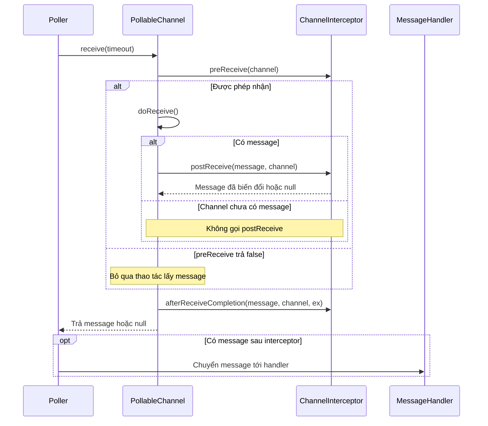

# preReceive, postReceive và afterReceiveCompletion

Trong Spring Integration, một poller lấy message từ `PollableChannel` bằng thao tác `receive()`. `ChannelInterceptor` cung cấp ba callback để kiểm soát và quan sát đúng khoảng thời gian channel thực hiện thao tác nhận: `preReceive`, `postReceive` và `afterReceiveCompletion`.

Ba callback này hữu ích khi cần chặn một lượt poll, bổ sung metadata cho message vừa lấy ra, ghi nhận kết quả nhận hoặc dọn tài nguyên gắn với thread poller. Chúng thuộc vòng đời **nhận message của channel**. Chúng không bao bọc toàn bộ quá trình xử lý ở message handler. Trong phạm vi Spring Integration Runtime, phân biệt ranh giới này giúp chẩn đoán chính xác hành vi của poller, consumer, thread và hiệu năng của message flow.

## 1. Callback nhận message áp dụng cho channel nào?

Đây là các callback dành cho channel có mô hình kéo (pull), tức là consumer chủ động gọi `receive()`. Ví dụ thường gặp là `QueueChannel`, `PriorityChannel` và `RendezvousChannel`.

Các channel theo mô hình đẩy (push), chẳng hạn `DirectChannel` và `PublishSubscribeChannel`, chuyển message tới subscriber khi có message được gửi. Chúng không thực hiện thao tác `receive()`, vì vậy ba callback nhận message này không chạy trên các channel đó.

Một `ChannelInterceptor` có thể được đăng ký trực tiếp trên channel bằng `addInterceptor(...)`, hoặc được cấu hình dưới dạng global channel interceptor. Ví dụ trong bài dùng đăng ký trực tiếp để làm rõ channel nào sở hữu interceptor.

## 2. Vai trò và thứ tự của từng callback

| Callback | Thời điểm | Giá trị trả về | Tác động |
|---|---|---|---|
| `preReceive(channel)` | Trước khi channel lấy message | `boolean` | `false` hủy lượt nhận hiện tại; channel không thực hiện thao tác lấy message |
| `postReceive(message, channel)` | Sau khi lấy được một message | `Message<?>` | Có thể trả message đã biến đổi hoặc trả `null` để loại message khỏi flow |
| `afterReceiveCompletion(message, channel, ex)` | Khi lượt nhận kết thúc | `void` | Ghi nhận kết quả, giải phóng tài nguyên hoặc dọn context; `ex` cho biết có exception hay không |

Khi channel có nhiều interceptor, `preReceive` và `postReceive` chạy theo thứ tự đăng ký. Mỗi `postReceive` nhận kết quả do callback trước trả về. Nếu một callback trả `null`, chuỗi xử lý message dừng tại đó.

`postReceive` chỉ chạy khi thao tác lấy message trả về một message khác `null`. Nếu channel không có message, callback này bị bỏ qua. `afterReceiveCompletion` là pha hoàn tất của lượt nhận: nó được gọi khi lượt nhận kết thúc, kể cả khi không có message hoặc có exception. Các interceptor đã tham gia lượt nhận được hoàn tất theo thứ tự ngược với thứ tự đăng ký. Khi không có exception, `ex` là `null`.

### Diễn tiến của một lượt poll



Điểm quan trọng trong sơ đồ là `afterReceiveCompletion` chạy trước khi `receive()` trả kết quả về poller. Chỉ sau đó poller mới chuyển message cho message handler. Vì thế, callback này không phải tín hiệu cho biết handler đã xử lý xong message.

## 3. Cài đặt một interceptor cho lượt nhận

Ví dụ sau ghi log kết quả nhận và thêm header `observedAt` vào message. Việc tạo message mới bằng `MessageBuilder` giữ đúng cách làm việc với message bất biến của Spring Messaging.

```java
import java.time.Instant;

import org.slf4j.Logger;
import org.slf4j.LoggerFactory;
import org.springframework.messaging.Message;
import org.springframework.messaging.MessageChannel;
import org.springframework.messaging.support.ChannelInterceptor;
import org.springframework.messaging.support.MessageBuilder;

public final class ReceiveObservationInterceptor implements ChannelInterceptor {

    private static final Logger log =
            LoggerFactory.getLogger(ReceiveObservationInterceptor.class);

    @Override
    public boolean preReceive(MessageChannel channel) {
        log.debug("Bắt đầu nhận từ channel {}", channel);
        return true;
    }

    @Override
    public Message<?> postReceive(Message<?> message, MessageChannel channel) {
        return MessageBuilder.fromMessage(message)
                .setHeader("observedAt", Instant.now())
                .build();
    }

    @Override
    public void afterReceiveCompletion(
            Message<?> message, MessageChannel channel, Exception ex) {

        if (ex != null) {
            log.warn("Nhận message từ channel {} thất bại", channel, ex);
        } else if (message == null) {
            log.debug("Lượt nhận từ channel {} không trả về message", channel);
        } else {
            log.debug("Lượt nhận từ channel {} hoàn tất", channel);
        }
    }
}
```

Đăng ký interceptor trên một `QueueChannel`:

```java
import org.springframework.context.annotation.Bean;
import org.springframework.integration.channel.QueueChannel;

@Bean
QueueChannel ordersChannel(ReceiveObservationInterceptor interceptor) {
    QueueChannel channel = new QueueChannel();
    channel.addInterceptor(interceptor);
    return channel;
}
```

Khi một poller nhận message từ `ordersChannel`, `preReceive` được gọi trước thao tác lấy message. Nếu lấy được message, `postReceive` bổ sung header. Sau đó `afterReceiveCompletion` ghi nhận kết quả và `receive()` trả message đã cập nhật cho poller.

Ví dụ trên dùng `afterReceiveCompletion` để quan sát kết quả. Nếu muốn đo thời gian, hãy xác định rõ khoảng đo: thời gian trong ba callback chỉ phản ánh lượt nhận ở channel, không phản ánh thời gian handler xử lý message.

## 4. Chọn callback theo mục đích

### Dùng `preReceive` để quyết định có thực hiện lượt nhận

Callback chỉ nhận `MessageChannel`, chưa có message để kiểm tra payload hoặc header. Nó phù hợp với điều kiện dựa trên channel, chẳng hạn một cờ cho phép tiêu thụ message hoặc một chính sách tạm ngừng poll.

Nếu trả về `false`, lượt nhận hiện tại kết thúc mà không lấy message khỏi channel. Với poller, kết quả nhận là `null`; đây không tự động là exception hay một cơ chế retry. Poller có thể thử lại ở lượt tiếp theo theo cấu hình polling của nó.

Không dùng `preReceive` để xác thực nội dung từng message vì nội dung chưa được lấy ra ở thời điểm này. Việc xác thực theo payload nên diễn ra sau khi message đã được nhận, tại một thành phần phù hợp trong flow.

### Dùng `postReceive` để biến đổi hoặc lọc message

Callback nhận được message vừa lấy khỏi channel. Những việc phù hợp gồm bổ sung header quan sát, chuẩn hóa metadata hoặc áp dụng một bộ lọc nhỏ trước khi message tới poller.

Trả về message mới nếu cần thay đổi header hoặc nội dung. Trả về `null` sẽ chặn message khỏi phần còn lại của flow. Hãy xem đây là hành vi loại message, không phải cơ chế retry. Chẳng hạn với `QueueChannel`, thao tác lấy message đã diễn ra trước khi `postReceive` được gọi; interceptor không tự đưa message bị lọc trở lại queue. Nếu cần rollback hoặc retry, phải thiết kế dựa trên transaction, message store và cơ chế retry phù hợp với channel đang dùng.

### Dùng `afterReceiveCompletion` để kết thúc công việc của interceptor

Callback này phù hợp để ghi nhận kết quả cuối của thao tác nhận, cập nhật metric, đóng tài nguyên hoặc dọn dữ liệu tạm gắn với thread. Kiểm tra cả `message` và `ex`:

- `message != null`: lượt nhận còn một message sau chuỗi `postReceive`.
- `message == null` và `ex == null`: không có message được trả về; có thể do channel rỗng, `preReceive` chặn lượt nhận hoặc một `postReceive` lọc message.
- `ex != null`: thao tác nhận gặp exception; callback có thể ghi nhận lỗi trước khi exception tiếp tục được truyền lên phía gọi.

Không suy luận nguyên nhân chỉ từ việc `message == null`; nếu cần phân biệt poll rỗng, bị chặn và bị lọc, hãy ghi nhận trạng thái tương ứng ở callback đã quyết định hành vi đó.

## 5. Những giới hạn cần nhớ khi vận hành

**Phạm vi thời gian.** `afterReceiveCompletion` chạy ngay khi thao tác `receive()` hoàn tất, trước khi poller gọi handler. Nếu đặt dữ liệu vào `ThreadLocal` trong `preReceive` hoặc `postReceive` rồi xóa trong `afterReceiveCompletion`, handler sẽ không nhìn thấy dữ liệu đó. Muốn bao quanh thời gian xử lý của handler, hãy dùng cơ chế advice hoặc interceptor ở endpoint/handler phù hợp.

**Lượt poll rỗng.** Một poller có thể gọi `receive()` nhiều lần khi queue chưa có message. `postReceive` không chạy trong trường hợp này, nhưng pha hoàn tất vẫn được gọi. Tránh ghi log ở mức quá chi tiết cho mọi lượt poll rỗng nếu tần suất poll cao; ưu tiên metric hoặc log có kiểm soát.

**Tác động hiệu năng.** Các callback chạy đồng bộ trong thread thực hiện thao tác nhận. Truy vấn mạng, gọi database hoặc xử lý nặng trong interceptor làm tăng thời gian poll và giảm thông lượng consumer. Giữ callback ngắn, có giới hạn thời gian và tránh tạo side effect nghiệp vụ khó khôi phục.

**An toàn luồng.** Một interceptor có thể được nhiều consumer hoặc poller dùng chung. Không giữ trạng thái riêng của một lượt nhận trong field mutable dùng chung nếu chưa có đồng bộ phù hợp. Với dữ liệu tạm theo thread, luôn dọn dẹp trong `afterReceiveCompletion`, kể cả khi có exception.

**Đúng loại interceptor.** Ba callback trong bài chỉ quan sát pha nhận của `PollableChannel`. Nếu cần chặn hoặc biến đổi message khi gửi, xem các callback `preSend` và `postSend`. Nếu cần đo thời gian xử lý nghiệp vụ, quản lý retry của handler hoặc bắt lỗi sau khi handler chạy, hãy đặt logic ở endpoint, handler, advice chain hoặc error flow tương ứng.

Khi chẩn đoán một message không tới handler, hãy lần lượt xác minh channel có phải `PollableChannel`, `preReceive` có cho phép nhận, `receive()` có lấy được message, `postReceive` có trả về message khác `null`, và exception có xuất hiện trong `afterReceiveCompletion` hay không. Chuỗi kiểm tra này xác định được message bị chặn trước khi lấy, không có trong channel, bị lọc sau khi lấy hay gặp lỗi trong thao tác nhận.
