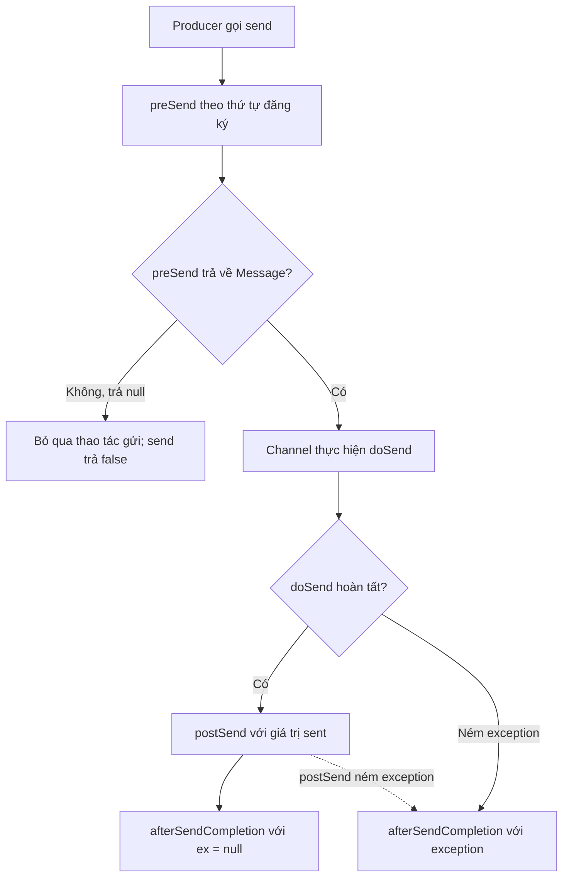

# Interceptor exception và ảnh hưởng đến send

Trong Spring Integration, `MessageChannel.send()` là ranh giới nơi producer chuyển một `Message` cho channel. `ChannelInterceptor` có thể kiểm tra hoặc biến đổi message trước khi gửi, quan sát kết quả gửi và dọn dẹp tài nguyên sau khi thao tác kết thúc. Vì interceptor chạy ngay trên đường gửi, một exception tại từng callback có thể làm thay đổi kết quả mà producer nhận được.

Bài học này thuộc module `SPRING_INTEGRATION_RUNTIME`, tập trung vào cách Spring Integration chạy và điều phối message flow qua channel, endpoint, consumer, poller và executor. Khi phân tích lỗi gửi, cần xác định cả callback interceptor lẫn loại channel đang dùng: cùng một exception ở handler có thể được trả về producer qua `DirectChannel`, nhưng chỉ xuất hiện ở luồng xử lý lỗi bất đồng bộ khi message đi qua `QueueChannel` hoặc `ExecutorChannel`.

Sau bài học, bạn có thể:

- Mô tả thứ tự và ý nghĩa của `preSend`, `postSend` và `afterSendCompletion`.
- Phân biệt gửi bị chặn, gửi trả về `false` và gửi thất bại bằng exception.
- Dự đoán exception đi về producer hay được xử lý ở luồng consumer.
- Thiết kế interceptor phục vụ audit, tracing và cleanup mà không làm sai lệch kết quả gửi.
- Chẩn đoán ảnh hưởng của exception đến transaction, retry và nguy cơ xử lý trùng message.

## 1. Vòng đời của một lần gửi

Với một channel kế thừa `AbstractMessageChannel`, đường gửi thông thường có dạng:



Ba callback quan trọng có vai trò khác nhau:

| Callback | Thời điểm | Ý nghĩa |
|---|---|---|
| `preSend(message, channel)` | Trước khi channel thực hiện gửi | Kiểm tra, bổ sung thông tin hoặc thay thế message. Trả về `null` để chủ động ngăn lần gửi. |
| `postSend(message, channel, sent)` | Sau khi thao tác gửi trả về | Quan sát kết quả boolean của thao tác gửi. Callback này không chạy nếu thao tác gửi ném exception. |
| `afterSendCompletion(message, channel, sent, ex)` | Khi lần gửi kết thúc, kể cả khi có exception | Dọn dẹp tài nguyên và ghi nhận kết quả cuối cùng. `ex` cho biết exception xảy ra trong quá trình gửi hoặc callback trước đó. |

Các interceptor được gọi `preSend` theo thứ tự đăng ký. `afterSendCompletion` được gọi theo thứ tự ngược lại, tương tự cách tháo các lớp đã mở trước đó. Callback hoàn tất chỉ được gọi cho interceptor có `preSend` kết thúc thành công và trả về một `Message`. Nếu một `preSend` trả về `null`, các interceptor trước đó vẫn được hoàn tất; interceptor trả về `null` không được xem là đã mở thành công.

`postSend` nhận `sent`, chính là kết quả boolean của thao tác gửi ở channel. `sent = true` có nghĩa channel chấp nhận message theo ngữ nghĩa của channel đó. Nó không mặc nhiên chứng minh handler phía sau đã xử lý xong nghiệp vụ.

## 2. Exception ở từng callback làm thay đổi send thế nào?

### Exception trong `preSend`

Nếu `preSend` ném exception, channel chưa gọi phần gửi thực tế (`doSend`). Những interceptor đã hoàn tất `preSend` trước đó được gọi `afterSendCompletion` để cleanup với thông tin exception. Interceptor đang ném exception chưa hoàn tất `preSend`, vì vậy callback hoàn tất của chính interceptor đó không được gọi.

Producer nhận exception từ lời gọi `send()`. Spring Integration có thể chuẩn hóa exception gửi thành một `MessagingException`, thường gặp là `MessageDeliveryException` đối với lỗi gửi không thuộc nhóm `MessagingException` sẵn có. Vì vậy, khi xử lý lỗi ở tầng gọi, nên kiểm tra cả nguyên nhân gốc (`cause`) thay vì chỉ dựa vào lớp exception ngoài cùng.

Hãy dùng exception trong `preSend` cho trường hợp thực sự là lỗi, chẳng hạn header bắt buộc không hợp lệ hoặc chính sách bảo mật bị vi phạm. Nếu muốn lọc message có chủ đích và chấp nhận kết quả gửi là `false`, trả về `null`. Hai cách này có ý nghĩa vận hành khác nhau: một cách báo lỗi, cách còn lại chủ động hủy lần gửi.

### `preSend` trả về `null`

Khi interceptor trả về `null`, Spring Integration không gọi `doSend` và `send()` trả về `false`. Đây không phải exception. Những interceptor đã chạy thành công trước đó vẫn được gọi `afterSendCompletion` để giải phóng tài nguyên.

Không nên trả về `null` chỉ để che một lỗi kỹ thuật. Nếu producer cần phân biệt message bị chính sách lọc với message không gửi được do channel đầy hoặc timeout, hãy ghi nhận lý do lọc bằng metric/log riêng hoặc dùng một luồng từ chối rõ ràng.

### Exception trong thao tác gửi của channel

Nếu `doSend` hoặc bước dispatch đồng bộ ném exception, `postSend` không được gọi vì thao tác gửi chưa trả về một giá trị boolean. `afterSendCompletion` được gọi cho các interceptor đã qua `preSend`, với `ex` chứa exception.

Ví dụ thường gặp là `DirectChannel` gọi handler ngay trên thread của producer và handler ném lỗi. Khi đó exception đi ngược qua lời gọi gửi. Đây là hành vi tương tự một lời gọi hàm Java đồng bộ.

### Exception trong `postSend`

`postSend` chỉ chạy sau khi thao tác gửi trả về `true` hoặc `false`. Nếu callback này ném exception, producer vẫn có thể nhận một lần gửi thất bại, dù channel đã chấp nhận message trước khi callback chạy. Các callback `postSend` phía sau có thể không được thực hiện; `afterSendCompletion` vẫn là nơi cleanup cho các interceptor đã qua `preSend`.

Đây là trường hợp dễ gây gửi trùng nhất. Ví dụ, `DirectChannel` đã gọi handler và handler đã ghi dữ liệu thành công; sau đó interceptor audit trong `postSend` gặp lỗi ghi log và ném exception. Producer thấy `send()` thất bại rồi retry, mặc dù xử lý nghiệp vụ ban đầu có thể đã xảy ra.

Vì vậy, `postSend` nên thực hiện công việc quan sát có khả năng chịu lỗi. Nếu audit hoặc metrics gặp sự cố, hãy xử lý lỗi đó riêng và tránh biến một lần gửi đã được chấp nhận thành một lần gửi thất bại ngoài ý muốn.

### Exception trong `afterSendCompletion`

`afterSendCompletion` phù hợp cho cleanup, đóng scope tracing và ghi nhận kết quả. Callback nhận `sent` cùng `ex`, nên có thể phân biệt gửi thành công, gửi trả về `false` và gửi kết thúc bằng exception.

Trong triển khai `AbstractMessageChannel` của Spring Integration, exception phát sinh từ callback hoàn tất được ghi log trong khi chuỗi cleanup tiếp tục. Không nên dựa vào callback này để báo lỗi nghiệp vụ cho producer. Hãy giữ callback ngắn, có tính phòng thủ và tự xử lý lỗi của phần cleanup nếu cần.

## 3. `send()` trả về `false` khác với ném exception

`MessageChannel.send()` trả về boolean. Đọc kết quả đúng cách giúp tránh retry sai:

| Kết quả | Diễn giải | Hướng kiểm tra |
|---|---|---|
| `true` | Channel đã chấp nhận message theo ngữ nghĩa của channel | Kiểm tra tiếp trạng thái xử lý ở consumer nếu cần xác nhận nghiệp vụ. |
| `false` | Lần gửi không được thực hiện thành công; có thể do interceptor trả `null`, timeout hoặc thread bị interrupt | Kiểm tra `preSend`, dung lượng channel, timeout và trạng thái thread. |
| Ném exception | Interceptor hoặc channel gặp lỗi trong quá trình gửi/dispatch | Đọc stack trace, exception gốc và callback cuối cùng đã chạy. |

Với `QueueChannel` có giới hạn dung lượng, producer có thể phải chờ chỗ trống. Gửi với timeout hữu hạn sẽ trả về `false` nếu hết thời gian mà message chưa được nhận vào queue. Timeout bằng `0` yêu cầu thử ngay và không chờ. Lời gọi `send(message)` không truyền timeout có thể chờ vô hạn đối với queue bị đầy, tùy channel.

Không đồng nhất `false` với exception. Nếu producer chỉ retry khi có exception, một lần gửi bị lọc hoặc timeout có thể bị bỏ qua. Ngược lại, nếu retry mọi exception, producer có thể gửi lại message đã được channel chấp nhận trước khi một callback quan sát ném lỗi.

## 4. Loại channel quyết định exception đi về đâu

Channel xác định ranh giới thread giữa producer và consumer. Ranh giới này ảnh hưởng trực tiếp đến việc producer có thể nhận exception từ handler hay không.

| Channel | Hành vi gửi | Ảnh hưởng của exception ở handler |
|---|---|---|
| `DirectChannel` | Dispatch đồng bộ trên thread gọi `send()` | Exception từ handler có thể truyền ngược đến producer. `postSend` không chạy nếu dispatch ném exception. |
| `QueueChannel` | Đưa message vào queue; consumer nhận sau qua `receive()` hoặc poller | `send() = true` chỉ xác nhận message đã được queue nhận. Lỗi xử lý xảy ra sau đó ở consumer/poller và cần cơ chế error handling tại luồng đó. |
| `ExecutorChannel` | Giao việc dispatch cho `TaskExecutor` | Handler thường chạy trên thread khác. `send()` có thể đã trả về thành công trước khi handler ném exception; transaction của producer không tự lan sang handler. |
| `PublishSubscribeChannel` | Gửi đến nhiều subscriber; có thể đồng bộ hoặc dùng executor | Không cấu hình executor thì exception có thể đi về caller. Có executor thì lỗi xử lý được chuyển qua `ErrorHandler`, thường là `MessagePublishingErrorHandler`, đến `errorChannel` phù hợp. |

Với `QueueChannel`, poller của consumer thường chạy trên thread do scheduler quản lý. Exception của handler vì thế thuộc lần thực thi poller, không còn nằm trong stack của producer đã gửi message trước đó. Spring Integration hỗ trợ phát `ErrorMessage` đến channel được chỉ định trong header `errorChannel` của message; nếu không có header phù hợp, cơ chế lỗi có thể dùng global `errorChannel`.

Với `ExecutorChannel`, executor tách thread gửi và thread xử lý. Exception của handler trong task bất đồng bộ được xử lý theo cơ chế error handling của Spring Integration và có thể được phát thành `ErrorMessage` đến channel trong header `errorChannel` hoặc global `errorChannel`. Nếu executor từ chối tác vụ do quá tải, lỗi từ chối có thể xuất hiện ngay ở thời điểm gửi, tùy cấu hình executor. Cần phân biệt lỗi submit task với exception xảy ra sau khi handler bắt đầu chạy.

`PublishSubscribeChannel` có executor cũng có thể dùng error handler để gửi lỗi đến `errorChannel`. Nếu không cấu hình executor, handler được gọi trên thread của sender và exception được ném trực tiếp về caller; error handler dành cho xử lý bất đồng bộ không thay thế hành vi đồng bộ đó.

## 5. Transaction và retry khi interceptor ném lỗi

Với `DirectChannel`, producer và handler chạy cùng thread. Nếu cả hai nằm trong cùng transaction được cấu hình ở tầng gọi hoặc endpoint, exception truyền ngược có thể khiến transaction rollback theo chính sách rollback của transaction manager. Tuy nhiên, việc rollback phụ thuộc vào ranh giới transaction và loại tài nguyên tham gia; nó không tự hoàn tác một lời gọi HTTP, email hay side effect bên ngoài cơ sở dữ liệu.

Với `ExecutorChannel` hoặc `QueueChannel`, producer và consumer thường hoạt động trong các thread và transaction khác nhau. Transaction đang hoạt động ở producer không tự được truyền sang handler bất đồng bộ. Nếu cần tính bền vững cho message, hãy cấu hình message store/queue và transaction phù hợp với tài nguyên lưu trữ, đồng thời thiết kế transaction xử lý ở consumer.

Khi retry, hãy xác định exception xảy ra trước hay sau thời điểm channel chấp nhận message:

1. Lỗi ở `preSend` thường xảy ra trước khi channel nhận message. Sửa nguyên nhân hoặc đưa message vào luồng từ chối phù hợp trước khi retry.
2. Lỗi trong `doSend` có thể có nghĩa channel chưa chấp nhận message, nhưng cần xem loại channel và exception cụ thể.
3. Lỗi ở `postSend` xảy ra sau khi thao tác gửi đã trả về. Không thể mặc định rằng message chưa được chuyển đi.
4. Lỗi handler trên channel bất đồng bộ xảy ra sau khi producer đã gửi xong. Retry ở producer không phải cách tự động khôi phục lần xử lý đó.

Để chống xử lý trùng, dùng khóa idempotency hoặc message ID/correlation ID ổn định, lưu trạng thái xử lý ở nơi có tính nhất quán phù hợp, và thiết kế handler để một message được gửi lại không tạo side effect lặp. Retry nên có giới hạn, backoff và phân loại lỗi có thể retry; không retry vô hạn mọi `MessageDeliveryException`.

## 6. Ví dụ interceptor an toàn

Ví dụ sau đăng ký một interceptor toàn cục cho các channel có bean name khớp `orders.*`. Interceptor chỉ quan sát message, kết quả gửi và exception. Nó không thay đổi payload hoặc ném exception khi hệ thống log gặp sự cố.

```java
import org.slf4j.Logger;
import org.slf4j.LoggerFactory;
import org.springframework.context.annotation.Bean;
import org.springframework.context.annotation.Configuration;
import org.springframework.integration.config.GlobalChannelInterceptor;
import org.springframework.messaging.Message;
import org.springframework.messaging.MessageChannel;
import org.springframework.messaging.support.ChannelInterceptor;

@Configuration
class OrderChannelInterceptorConfiguration {

    private static final Logger log = LoggerFactory.getLogger(
            OrderChannelInterceptorConfiguration.class);

    @Bean
    @GlobalChannelInterceptor(patterns = "orders.*")
    ChannelInterceptor orderAuditInterceptor() {
        return new ChannelInterceptor() {

            @Override
            public Message<?> preSend(Message<?> message, MessageChannel channel) {
                log.debug("preSend channel={}, messageId={}",
                        channel, message.getHeaders().getId());
                return message;
            }

            @Override
            public void postSend(Message<?> message, MessageChannel channel,
                                 boolean sent) {
                if (!sent) {
                    log.warn("Message was not accepted: channel={}, messageId={}",
                            channel, message.getHeaders().getId());
                }
            }

            @Override
            public void afterSendCompletion(Message<?> message, MessageChannel channel,
                                            boolean sent, Exception ex) {
                if (ex != null) {
                    log.error("Send failed: channel={}, messageId={}",
                            channel, message.getHeaders().getId(), ex);
                }
            }
        };
    }
}
```

Một số nguyên tắc khi viết interceptor thực tế:

- Giữ callback nhanh và không blocking. Interceptor nằm trên đường gửi nên một truy vấn database hoặc lời gọi HTTP chậm có thể làm tăng latency của toàn flow.
- Chỉ trả `null` khi chính sách thực sự muốn loại message. Nếu message không hợp lệ và cần phản hồi lỗi, ném exception có ý nghĩa hoặc chuyển sang luồng từ chối.
- Không dùng `postSend` để khẳng định nghiệp vụ đã hoàn tất. Với queue hoặc executor, callback chỉ quan sát thao tác gửi/dispatch.
- Không để lỗi logging, tracing hoặc metrics che exception gốc. Các công việc quan sát nên có cơ chế chịu lỗi riêng.
- Ghi log `messageId`, correlation ID, tên channel, thread, `sent` và exception. Tránh log payload nhạy cảm.

## 7. Chẩn đoán sự cố theo dấu hiệu

Khi một flow báo lỗi gửi, hãy kiểm tra theo thứ tự sau:

1. **Xác định kết quả của lời gọi `send()`.** Ghi rõ caller nhận `true`, `false` hay exception. Đừng gộp ba trường hợp thành một trạng thái “send failed”.
2. **Tìm callback cuối cùng đã chạy.** Có `preSend` nhưng không có `postSend` thường gợi ý lỗi trong `preSend` hoặc trong thao tác gửi. Có `postSend` rồi lỗi có thể nằm trong interceptor quan sát sau khi channel đã trả kết quả.
3. **Đọc `ex` trong `afterSendCompletion`.** Ghi lại exception gốc và toàn bộ cause chain. Đối chiếu với log của producer để biết lỗi có được ném đồng bộ hay xuất hiện ở luồng khác.
4. **Kiểm tra loại channel và thread name.** Nếu handler chạy trên thread executor hoặc poller, producer không thể bắt exception xử lý muộn bằng `try/catch` quanh `send()`.
5. **Kiểm tra khả năng quá tải.** Với queue, xem capacity, độ sâu queue, thời gian chờ và tốc độ consumer. Với executor, xem active thread, queue task và rejection policy.
6. **Kiểm tra error flow.** Xác minh endpoint có error handler phù hợp, message có header `errorChannel` cần thiết hay không, và global `errorChannel` có subscriber xử lý lỗi.
7. **Đánh giá retry và tính idempotent.** Trước khi retry, xác minh message đã được channel chấp nhận hoặc handler đã tạo side effect hay chưa.

Một bộ log hữu ích cho interceptor nên cho phép nối các sự kiện theo cùng `messageId` hoặc correlation ID. Ví dụ: `preSend` lúc 10:00:00.010, `postSend(sent=true)` lúc 10:00:00.012 và handler lỗi trên thread `task-3` lúc 10:00:00.080 cho thấy producer đã gửi thành công trước khi consumer gặp lỗi.

## 8. Các lỗi thiết kế thường gặp

- **Coi `send() = true` là xử lý nghiệp vụ thành công.** Với queue/executor, giá trị này thường chỉ xác nhận việc nhận hoặc dispatch message.
- **Giả định mọi exception handler đều về producer.** Điều đó chỉ đúng khi handler thực sự chạy đồng bộ trên cùng call stack, như trường hợp thường gặp với `DirectChannel`.
- **Ném exception từ `postSend` để báo lỗi audit.** Việc này có thể làm caller retry một message đã được chấp nhận.
- **Dùng `null` để biểu diễn lỗi dữ liệu.** Producer chỉ thấy `false`, không có nguyên nhân exception để phân loại.
- **Retry mọi lỗi gửi.** Retry mù có thể tạo side effect trùng, đặc biệt khi exception xuất hiện sau thời điểm channel đã nhận message.
- **Đưa xử lý nặng vào interceptor.** Điều này làm tăng latency, giữ thread lâu và có thể gây nghẽn poller hoặc executor.

## 9. Ghi nhớ

`preSend` quyết định message có được đi tiếp hay không; `postSend` quan sát kết quả boolean sau thao tác gửi; `afterSendCompletion` phục vụ cleanup và nhận exception. Một exception có ý nghĩa khác nhau tùy nó xuất hiện trước khi channel nhận message, trong lúc dispatch hay sau khi message đã được chấp nhận. Khi chẩn đoán, luôn kết hợp vòng đời interceptor với ngữ nghĩa channel, thread thực thi, transaction và chính sách retry.

## Tài liệu tham khảo

- [Spring Integration Reference — Message Channels](https://docs.spring.io/spring-integration/docs/latest-ga/reference/html/channel.html)
- [Spring Integration Reference — Error Handling](https://docs.spring.io/spring-integration/reference/7.0/error-handling.html)
- [Spring Framework API — ChannelInterceptor](https://docs.spring.io/spring-framework/docs/current/javadoc-api/org/springframework/messaging/support/ChannelInterceptor.html)
