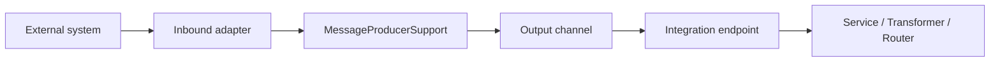

# MessageProducerSupport và output channel

Trong Spring Integration, một message producer nhận dữ liệu từ hệ thống bên ngoài rồi chuyển dữ liệu đó thành Spring `Message<?>` để đưa vào integration flow. Với producer chạy theo sự kiện, `MessageProducerSupport` là lớp hỗ trợ nền tảng: nó cung cấp cấu hình output channel, phương thức gửi message và tích hợp vòng đời endpoint với Spring.

Output channel là ranh giới giữa producer và phần còn lại của flow. Producer chịu trách nhiệm tạo message đúng hợp đồng và gửi message vào channel đã cấu hình. Channel quyết định cách message được chuyển tiếp: xử lý đồng bộ, giao cho executor, lưu trong queue hay broadcast đến nhiều subscriber. Hiểu rõ ranh giới này giúp tránh việc producer tự quản lý threading hoặc retry sai tầng.

## 1. Vị trí của MessageProducerSupport trong message flow

Một message producer thường là inbound adapter. Nó tiếp nhận dữ liệu từ API, socket, SDK, listener hoặc một nguồn event-driven, sau đó tạo message và gửi đến output channel.



`MessageProducerSupport` phù hợp với adapter nhận callback hoặc sự kiện từ nguồn bên ngoài. Nó là lớp nền để adapter cấu hình channel đầu ra và gửi message theo lifecycle của endpoint.

Phân biệt ba thành phần sau:

| Thành phần | Trách nhiệm | Cách lấy dữ liệu |
| --- | --- | --- |
| `MessageProducerSupport` | Hỗ trợ endpoint phát message vào output channel | Thường nhận callback/event rồi gọi `sendMessage()` |
| `MessageSource<T>` | Cung cấp message khi được yêu cầu | Poller gọi `receive()`; có thể trả `null` nếu chưa có dữ liệu |
| `SourcePollingChannelAdapter` | Điều phối việc poll một `MessageSource` và gửi kết quả vào channel | Gọi `receive()` theo trigger của poller |

Không cần tạo poller cho một producer vốn đã nhận callback từ hệ thống ngoài. Ngược lại, một nguồn chỉ có thao tác `poll()` thường phù hợp với `MessageSource` và `SourcePollingChannelAdapter` hơn là tự tạo thread nền trong `MessageProducerSupport`.

## 2. Output channel làm nhiệm vụ gì?

Output channel là đích nhận message do producer tạo ra. Producer có thể cấu hình trực tiếp một `MessageChannel` hoặc cấu hình tên channel để Spring phân giải từ application context. Trong API của `MessageProducerSupport`, các cấu hình thường dùng là `setOutputChannel(...)` và `setOutputChannelName(...)`.

Ví dụ cấu hình channel trực tiếp:

```java
@Bean
DirectChannel externalEvents() {
    return new DirectChannel();
}

@Bean
CustomEventAdapter customEventAdapter(
        ExternalClient client,
        @Qualifier("externalEvents") MessageChannel outputChannel) {

    CustomEventAdapter adapter = new CustomEventAdapter(client);
    adapter.setOutputChannel(outputChannel);
    return adapter;
}
```

Nếu cấu hình theo tên, adapter có thể dùng `setOutputChannelName("externalEvents")`; tên này phải khớp với bean channel được đăng ký trong context. Cấu hình channel tường minh giúp lỗi wiring được phát hiện khi khởi tạo thay vì để message đến lúc runtime mới phát hiện không có đích gửi.

Mỗi producer thường có một output channel cố định. Nếu cần phân luồng theo loại event, tenant hoặc thuộc tính nghiệp vụ, hãy gửi vào một channel đầu vào chung rồi đặt `Router` ở bước tiếp theo. Không nên biến callback của producer thành nơi chứa toàn bộ logic routing và nghiệp vụ.

## 3. Tạo producer tùy chỉnh bằng MessageProducerSupport

Giả sử một SDK bên ngoài cung cấp callback khi có `ExternalEvent`. Adapter cần đăng ký listener khi start, hủy listener khi stop và gửi event thành Spring message.

```java
public final class CustomEventAdapter extends MessageProducerSupport {

    private final ExternalClient client;
    private final Consumer<ExternalEvent> listener = this::publish;

    public CustomEventAdapter(ExternalClient client) {
        this.client = client;
    }

    @Override
    protected void doStart() {
        client.addListener(listener);
    }

    @Override
    protected void doStop() {
        client.removeListener(listener);
    }

    private void publish(ExternalEvent event) {
        Message<ExternalEvent> message = MessageBuilder
                .withPayload(event)
                .setHeader("source", "external-sdk")
                .setHeader("eventType", event.type())
                .build();

        sendMessage(message);
    }
}
```

`doStart()` và `doStop()` là các hook lifecycle để lớp con bật hoặc tắt việc nhận event. `sendMessage()` chuyển message đến output channel đã cấu hình trên producer. Ví dụ dùng API giả định `addListener`/`removeListener`; khi tích hợp SDK thật, thay chúng bằng API đăng ký và hủy subscription tương ứng.

Khai báo adapter như một bean để Spring quản lý lifecycle:

```java
@Bean
CustomEventAdapter customEventAdapter(
        ExternalClient client,
        @Qualifier("externalEvents") MessageChannel outputChannel) {

    CustomEventAdapter adapter = new CustomEventAdapter(client);
    adapter.setOutputChannel(outputChannel);
    return adapter;
}
```

Khi application context khởi động, endpoint được start theo cấu hình lifecycle. Khi context dừng, endpoint gọi `doStop()` để hủy listener. Nếu SDK trả về một subscription handle thay vì yêu cầu truyền lại listener, hãy lưu handle đó và đóng đúng handle trong `doStop()`.

## 4. Ai sở hữu client và tài nguyên bên ngoài?

Producer thường dùng một client để đăng ký listener hoặc đọc dữ liệu. Cần xác định rõ bean nào sở hữu client:

- Nếu adapter tự tạo và sở hữu client, adapter phải đóng client khi bị hủy.
- Nếu client là bean Spring dùng chung hoặc connection pool do một bean khác quản lý, adapter chỉ đăng ký/hủy listener; bean sở hữu client chịu trách nhiệm đóng nó.
- Nếu subscription có vòng đời riêng, hãy hủy subscription khi producer stop, kể cả khi client vẫn tiếp tục được dùng bởi adapter khác.

Ví dụ khi adapter sở hữu subscription handle:

```java
public final class CustomEventAdapter extends MessageProducerSupport {

    private final ExternalClient client;
    private volatile AutoCloseable subscription;

    public CustomEventAdapter(ExternalClient client) {
        this.client = client;
    }

    @Override
    protected synchronized void doStart() {
        if (this.subscription == null) {
            this.subscription = client.subscribe(this::publish);
        }
    }

    @Override
    protected synchronized void doStop() {
        AutoCloseable current = this.subscription;
        this.subscription = null;
        if (current != null) {
            try {
                current.close();
            }
            catch (Exception ex) {
                throw new IllegalStateException(
                        "Không thể hủy external event subscription", ex);
            }
        }
    }

    private void publish(ExternalEvent event) {
        sendMessage(MessageBuilder.withPayload(event).build());
    }
}
```

Đoạn code này minh họa việc giữ một subscription handle và hủy nó khi stop. Cần điều chỉnh xử lý exception theo API thực tế: một số SDK cung cấp thao tác unsubscribe không ném checked exception, một số khác yêu cầu chờ callback đang chạy kết thúc. Không đóng client trong `doStop()` nếu client được chia sẻ ngoài adapter.

Lifecycle start/stop có thể được gọi nhiều lần trong suốt thời gian ứng dụng chạy. Vì vậy, logic đăng ký và hủy listener nên idempotent hoặc được bảo vệ để không đăng ký listener trùng khi endpoint được start lại. Nếu việc đăng ký thất bại giữa chừng, cần cleanup mọi tài nguyên đã tạo trước khi ném lỗi ra ngoài.

## 5. Tạo message đúng hợp đồng trước khi gửi

Producer chuyển dữ liệu transport thành `Message<?>`. Payload nên biểu diễn dữ liệu nghiệp vụ hoặc event đã được chuẩn hóa. Header chứa metadata phục vụ định tuyến, correlation, tracing hoặc chẩn đoán.

```java
private void publish(ExternalEvent event) {
    Message<DomainEvent> message = MessageBuilder
            .withPayload(mapToDomainEvent(event))
            .setHeader("eventId", event.id())
            .setHeader("correlationId", event.correlationId())
            .setHeader("sourceSystem", "partner-gateway")
            .build();

    sendMessage(message);
}
```

Một số quy tắc:

- Dùng ID ổn định từ nguồn cho `eventId` nếu nguồn cung cấp, để consumer có thể nhận biết message trùng.
- Giữ `correlationId` xuyên suốt các bước thuộc cùng một nghiệp vụ; không tạo ID mới ở mỗi adapter nếu muốn trace cùng một flow.
- Chỉ đưa metadata cần thiết vào header; tránh sao chép token, thông tin xác thực hoặc payload nhạy cảm vào log/header.
- Chuẩn hóa kiểu payload ở producer để downstream không phải xử lý nhiều định dạng transport khác nhau.
- Ưu tiên payload immutable để tránh nhiều consumer cùng thay đổi một object sau khi gửi.

Nếu mapping dữ liệu phức tạp, tách thành mapper hoặc transformer có thể kiểm thử độc lập. Callback nên làm ít việc: xác định event, chuyển thành message và gửi vào channel.

## 6. Output channel quyết định semantics giao nhận

`MessageProducerSupport` không quyết định message được xử lý đồng bộ hay bất đồng bộ. Điều đó phụ thuộc loại channel được cấu hình:

| Output channel | Điều xảy ra khi producer gửi | Hệ quả với producer |
| --- | --- | --- |
| `DirectChannel` | Dispatcher gọi subscriber đồng bộ trên thread gửi | Lỗi từ handler có thể truyền ngược về lời gọi `sendMessage()`/callback |
| `ExecutorChannel` | Dispatcher giao việc cho `TaskExecutor` | Callback thường chỉ biết việc gửi/giao task; lỗi xảy ra sau đó trong worker thread cần error handling riêng |
| `QueueChannel` | Message được lưu trong queue để consumer/poller lấy sau | Có thể có backpressure hoặc timeout nếu queue giới hạn và đầy |
| `PublishSubscribeChannel` | Message được phát đến mọi subscriber | Một message có thể kích hoạt nhiều nhánh; payload nên immutable và các nhánh cần idempotent |

Ví dụ, nếu adapter gửi vào `DirectChannel`, callback của SDK có thể bị giữ trong lúc handler thực hiện truy cập database hoặc gọi HTTP. Nếu gửi vào `ExecutorChannel`, callback có thể kết thúc sớm hơn nhưng cần quản lý executor, queue và lỗi bất đồng bộ. Nếu gửi vào `QueueChannel`, producer được tách khỏi tốc độ consumer trong giới hạn dung lượng queue; khi queue đầy, chính sách gửi và timeout trở nên quan trọng.

Đừng kết luận rằng producer đã xử lý xong event chỉ vì `sendMessage()` trả về. Với channel bất đồng bộ, điều đó thường chỉ có nghĩa message đã được chấp nhận hoặc task đã được giao theo semantics của channel. Muốn biết nghiệp vụ hoàn tất, cần acknowledgment, reply channel, trạng thái xử lý hoặc metric ở phía consumer.

## 7. Send timeout, lỗi gửi và error channel

Gửi message có thể thất bại vì output channel không tồn tại, không có subscriber, queue đầy, executor từ chối task hoặc subscriber ném exception. Cần phân loại lỗi theo channel và theo thời điểm xảy ra.

`MessageProducerSupport` cung cấp các cấu hình gửi và error handling phù hợp với phiên bản Spring Integration đang dùng, gồm output channel, send timeout và error channel. Khi adapter cần giới hạn thời gian chờ gửi, hãy cấu hình send timeout thay vì để callback của nguồn bên ngoài bị block vô hạn. Giá trị timeout và hành vi khi timeout phụ thuộc loại channel và cấu hình messaging template.

Nếu producer được cấu hình error channel, kiểm tra cách implementation tạo và gửi `ErrorMessage` khi lỗi xảy ra trong đường gửi của producer. Error channel không tự biến lỗi thành message bền vững; nếu cần lưu lỗi qua restart, phải dùng queue/store hoặc cơ chế dead-letter có persistence. Với `ExecutorChannel`, lỗi phát sinh sau khi worker bắt đầu xử lý thường nằm ở error handling của worker/flow, không thể giả định sẽ quay lại callback của producer.

Một số nguyên tắc xử lý lỗi:

- Không nuốt exception trong callback rồi chỉ ghi một log chung chung. Hãy ghi `eventId`, loại lỗi và quyết định retry/acknowledgment.
- Chỉ retry khi biết nguồn có thể phát lại event hoặc producer có thể giữ event chưa xác nhận.
- Dùng idempotency key để consumer chịu được redelivery hoặc callback lặp.
- Nếu lỗi do cấu hình output channel, fail nhanh khi khởi động hoặc khi nhận event đầu tiên và phát cảnh báo có ngữ cảnh.
- Đặt timeout phù hợp để callback không chiếm thread của SDK quá lâu.
- Phân biệt lỗi gửi vào channel với lỗi xử lý downstream sau khi message đã được chấp nhận.

## 8. Lifecycle và graceful shutdown

Khi ứng dụng dừng, producer nên ngừng nhận event mới trước khi các tài nguyên downstream cần thiết bị đóng. Một quy trình thường dùng:

1. Dừng hoặc hủy subscription/listener của nguồn bên ngoài.
2. Ngăn callback mới bắt đầu; nếu SDK hỗ trợ, chờ callback đang chạy hoàn tất.
3. Theo dõi và chờ task đã gửi vào executor hoặc queue theo timeout của ứng dụng.
4. Để consumer hoàn tất transaction hoặc acknowledgment theo chính sách.
5. Đóng subscription, session hoặc client do adapter sở hữu.
6. Đóng client dùng chung ở bean sở hữu nó, theo thứ tự lifecycle của Spring.

`stop()` không đảm bảo tự động drain mọi queue. Với `ExecutorChannel`, task có thể còn nằm trong executor khi adapter đã ngừng nhận event. Với `QueueChannel`, message có thể vẫn còn trong queue sau khi producer dừng. Cần cấu hình shutdown behavior ở executor, consumer và broker theo yêu cầu giao nhận của hệ thống.

Nếu endpoint cần được khởi động có điều kiện, có thể đặt `autoStartup=false` và gọi lifecycle start sau khi client, schema hoặc kết nối đã sẵn sàng. Khi nhiều endpoint phụ thuộc nhau, dùng lifecycle phase để consumer sẵn sàng trước producer và producer dừng trước consumer. Phase chỉ điều khiển thứ tự start/stop; nó không thay thế drain, acknowledgment hoặc transaction.

## 9. Kiểm thử adapter và output channel

Kiểm thử producer nên tách thành hai lớp: kiểm tra adapter có tạo đúng message và kiểm tra channel có nhận message theo semantics mong muốn.

Ví dụ dùng `QueueChannel` để kiểm tra message được phát ra:

```java
@Test
void shouldPublishExternalEventToOutputChannel() {
    QueueChannel output = new QueueChannel();
    ExternalClient client = new StubExternalClient();
    CustomEventAdapter adapter = new CustomEventAdapter(client);
    adapter.setOutputChannel(output);

    adapter.start();
    try {
        client.emit(new ExternalEvent("evt-42", "ORDER_CREATED"));

        Message<?> received = output.receive(1000);
        assertNotNull(received);
        assertEquals("evt-42", received.getHeaders().get("eventId"));
    }
    finally {
        adapter.stop();
    }
}
```

Stub client trong test cần mô phỏng đúng giao thức đăng ký/hủy listener. Ngoài đường đi thành công, nên kiểm thử:

1. Adapter không start hai listener khi được start lặp.
2. Stop hủy listener và callback mới không còn được phát vào flow.
3. Start lại đăng ký listener mới đúng một lần.
4. Output channel chưa được cấu hình tạo lỗi dễ chẩn đoán.
5. Channel bị đầy hoặc executor từ chối task được xử lý theo timeout/error policy.
6. Callback gửi cùng `eventId` hai lần và consumer vẫn idempotent.
7. Lỗi trong worker bất đồng bộ được quan sát ở error flow tương ứng.

Không chỉ test `sendMessage()` được gọi. Hãy xác nhận payload, header, số message nhận được và hành vi khi adapter stop. Với callback bất đồng bộ, dùng latch hoặc cơ chế đồng bộ trong test thay vì `Thread.sleep` để tránh kiểm thử chập chờn.

## 10. Chẩn đoán runtime

Khi producer không phát message hoặc message không đến consumer, kiểm tra theo thứ tự:

| Dấu hiệu | Kiểm tra |
| --- | --- |
| Không có callback từ nguồn | Endpoint có running không; listener đã đăng ký chưa; kết nối và subscription của client có khỏe không |
| Callback có chạy nhưng không thấy message | Producer có gọi `sendMessage()` không; output channel đã được cấu hình và có đúng bean không |
| `DirectChannel` gửi chậm | Subscriber có xử lý đồng bộ quá lâu; có I/O hoặc lock trong handler không |
| `ExecutorChannel` queue tăng | Pool có đủ worker; task có bị block; queue capacity và rejection policy có phù hợp không |
| `QueueChannel` đầy | Consumer có poll không; `maxMessagesPerPoll`, thời gian xử lý và dung lượng queue có phù hợp không |
| Message xuất hiện nhiều lần | Nguồn có redelivery; callback có đăng ký trùng; consumer có idempotency không |
| Stop nhưng thread vẫn còn | Listener đã unsubscribe chưa; callback đang chạy có được chờ; executor có task chưa hoàn tất không |

Log nên có `eventId`, `messageId`, `correlationId`, tên producer, output channel, thread name và thời điểm gửi. Metric nên theo dõi số callback, số message gửi, send failure, timeout, queue depth, task active, thời gian xử lý và số lần redelivery. Không dùng payload đầy đủ làm log mặc định vì có thể chứa dữ liệu nhạy cảm.

## 11. Checklist khi triển khai MessageProducerSupport

1. Xác định nguồn phát event và API đăng ký/hủy listener.
2. Chọn `MessageProducerSupport` cho adapter event-driven; chọn `MessageSource` cùng poller cho nguồn polling.
3. Cấu hình output channel bằng bean hoặc tên channel rõ ràng.
4. Tạo payload và header đúng hợp đồng; dùng ID ổn định để hỗ trợ idempotency.
5. Giữ callback ngắn và tránh thực hiện nghiệp vụ nặng trực tiếp trên thread nguồn.
6. Xác định semantics đồng bộ/bất đồng bộ của output channel và cấu hình executor/queue phù hợp.
7. Thiết kế send timeout, error channel, retry và acknowledgment theo khả năng nguồn.
8. Đăng ký và hủy listener đúng lifecycle; chỉ đóng tài nguyên do adapter sở hữu.
9. Kiểm thử start/stop/restart, lỗi gửi, callback trùng và graceful shutdown.
10. Theo dõi trạng thái endpoint, kết nối nguồn, số message gửi và kết quả xử lý downstream.

`MessageProducerSupport` giúp chuẩn hóa phần endpoint và gửi message cho adapter event-driven. Producer vẫn phải định nghĩa rõ hợp đồng message, quyền sở hữu tài nguyên và cách xử lý lỗi. Output channel sau đó quyết định message được xử lý trực tiếp, chuyển sang executor, lưu đợi hay phát đến nhiều nhánh; hiểu đúng hai trách nhiệm này là nền tảng để vận hành producer ổn định.
