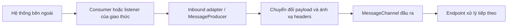

# MessageProducer tạo message từ nguồn bên ngoài

Trong Spring Integration Runtime, một luồng tích hợp thường bắt đầu bằng dữ liệu đến từ một hệ thống khác: message broker, ứng dụng gửi TCP, thiết bị IoT, dịch vụ HTTP hoặc một nguồn dữ liệu được kiểm tra định kỳ. Thành phần tiếp nhận dữ liệu bên ngoài chuyển dữ liệu đó thành `Message<?>` của Spring Integration rồi đưa message vào một channel để các endpoint phía sau xử lý.

`MessageProducer` là khái niệm ở phía phát message vào luồng. Nó giúp runtime kết nối cơ chế nhận dữ liệu của một giao thức với mô hình message thống nhất của Spring Integration. Nhờ vậy, các bước tiếp theo có thể xử lý message qua channel, transformer, router hoặc service activator mà không cần biết dữ liệu ban đầu đến từ broker hay thiết bị nào.

## 1. Từ dữ liệu bên ngoài đến Spring Message

Một message của Spring Integration có hai phần chính:

- **Payload**: dữ liệu nghiệp vụ, chẳng hạn một `Order`, chuỗi JSON, byte array hoặc nội dung file.
- **Headers**: metadata đi kèm, chẳng hạn `id`, `timestamp`, thông tin content type, correlation, nguồn gửi hoặc mã message bên ngoài.

Message là một envelope bất biến. Khi cần thay đổi payload hoặc bổ sung metadata, flow tạo message mới thay vì sửa message hiện có. `MessageBuilder` là cách thông dụng để tạo message trong mã ứng dụng:

```java
Message<OrderReceived> message = MessageBuilder
    .withPayload(orderReceived)
    .setHeader("sourceSystem", "partner-a")
    .setHeader("externalMessageId", externalMessageId)
    .build();
```

Spring Integration quản lý các header hệ thống như `id` và `timestamp`. Ứng dụng nên dùng header riêng có tên rõ nghĩa cho metadata của mình, tránh ghi đè header hệ thống hoặc đưa toàn bộ dữ liệu nghiệp vụ vào headers.

Một luồng nhận dữ liệu điển hình có các bước sau:



Inbound adapter chịu trách nhiệm về chi tiết giao thức: đăng ký listener, nhận dữ liệu, chuyển đổi kiểu dữ liệu và gửi message vào channel. Endpoint phía sau chỉ cần hiểu `Message<?>` và hợp đồng của channel.

## 2. Phân biệt mô hình push và pull

Spring Integration hỗ trợ hai cách phổ biến để lấy dữ liệu từ nguồn bên ngoài. Cần chọn đúng loại adapter vì cách runtime kích hoạt việc nhận dữ liệu khác nhau.

| Đặc điểm | Message-driven producer (push) | Polling source (pull) |
|---|---|---|
| Thành phần thường gặp | Inbound adapter dựa trên listener, triển khai hợp đồng `MessageProducer` | `MessageSource<?>` được chạy bởi `SourcePollingChannelAdapter` |
| Ai khởi động lần nhận | Sự kiện đến từ broker, socket hoặc hệ thống bên ngoài | Poller của Spring Integration gọi source theo lịch |
| Poller | Thường không cần poller | Cần poller để xác định chu kỳ và số lần lấy dữ liệu |
| Ví dụ | JMS message-driven adapter, TCP inbound adapter, MQTT message-driven adapter | File inbound adapter, JDBC inbound adapter hoặc custom `MessageSource` |
| Điều cần chú ý | Số listener, concurrency, acknowledgement và khả năng chịu tải của channel | Chu kỳ poll, giới hạn message mỗi lần poll và trạng thái dữ liệu đã đọc |

Với mô hình push, listener của adapter được đăng ký với nguồn bên ngoài. Khi có sự kiện, listener chuyển dữ liệu thành Spring Message và gửi vào output channel. Không thêm poller chỉ vì flow có điểm bắt đầu là inbound adapter; hãy kiểm tra loại adapter đang dùng.

Với mô hình pull, `MessageSource.receive()` được gọi bởi `SourcePollingChannelAdapter`. Poller quyết định thời điểm gọi, khoảng nghỉ giữa các lần gọi và số message tối đa trong một lượt. `MessageSource` không đồng nghĩa với `MessageProducer`: source cung cấp message khi được hỏi, còn producer đẩy message vào flow khi sự kiện xảy ra.

## 3. Khai báo một inbound producer bằng Java DSL

Ví dụ sau nhận message từ destination JMS `orders.in`. Message-driven adapter quản lý việc lắng nghe broker, chuyển JMS message thành Spring Message rồi gửi message vào channel `ordersInbound`.

```java
@Configuration
@EnableIntegration
public class OrderIngressConfiguration {

    @Bean
    public MessageChannel ordersInbound() {
        return new DirectChannel();
    }

    @Bean
    public IntegrationFlow ordersFromBroker(ConnectionFactory connectionFactory) {
        return IntegrationFlow
            .from(Jms.messageDrivenChannelAdapter(connectionFactory)
                .destination("orders.in"))
            .enrichHeaders(headers -> headers.header("sourceSystem", "jms"))
            .channel("ordersInbound")
            .get();
    }
}
```

Flow này minh họa ranh giới giữa adapter và phần xử lý nghiệp vụ:

1. `Jms.messageDrivenChannelAdapter(...)` tạo endpoint nhận message theo sự kiện từ JMS listener container.
2. `.destination("orders.in")` chọn destination mà endpoint đăng ký lắng nghe.
3. Adapter chuyển JMS message thành `Message<?>` của Spring Integration. Việc chuyển payload và ánh xạ JMS properties phụ thuộc converter và header mapper được cấu hình cho adapter.
4. `.enrichHeaders(...)` bổ sung metadata cho biết message đi vào từ JMS.
5. `.channel("ordersInbound")` chuyển message cho các subscriber của channel.

Một flow khác có thể đăng ký xử lý từ channel này:

```java
@Bean
public IntegrationFlow processInboundOrders(OrderApplicationService orderApplicationService) {
    return IntegrationFlow.from("ordersInbound")
        .handle(OrderReceived.class, (order, headers) -> {
            // Gọi application service để kiểm tra và xử lý đơn hàng.
            orderApplicationService.accept(order);
            return null;
        })
        .get();
}
```

Spring inject application service vào tham số của bean method. Điểm quan trọng là inbound adapter chỉ đảm nhiệm việc tiếp nhận và đưa message vào flow; quy tắc nghiệp vụ thuộc endpoint xử lý phía sau.

## 4. Chuyển đổi payload và ánh xạ headers

Dữ liệu nhận từ giao thức bên ngoài không phải lúc nào cũng có kiểu Java mà flow mong đợi. Adapter có thể cần một message converter để chuyển JSON, text, byte array hoặc đối tượng của giao thức thành payload phù hợp. Header mapper quyết định metadata nào của giao thức được đưa vào headers của Spring Message.

Khi thiết kế bước chuyển đổi, cần xác định rõ:

- **Kiểu payload đầu ra**: các endpoint tiếp theo mong đợi DTO, chuỗi, byte array hay kiểu khác.
- **Quy tắc giải mã**: charset, content type, schema hoặc phiên bản message.
- **Metadata cần giữ**: mã message từ broker, topic, routing key, correlation ID, thời điểm nguồn tạo message và tên hệ thống gửi.
- **Metadata cần loại bỏ hoặc chuẩn hóa**: header không dùng trong ứng dụng, tên header không thống nhất hoặc giá trị không phù hợp để truyền qua các ranh giới nội bộ.
- **Lỗi chuyển đổi**: dữ liệu sai định dạng phải đi vào đường xử lý lỗi có thể quan sát và khôi phục.

Ví dụ, nếu đối tác gửi JSON có `eventId`, `orderId` và `occurredAt`, adapter hoặc transformer có thể chuyển JSON thành `OrderReceived`, giữ `eventId` trong một header có tên `externalMessageId`, còn các trường nghiệp vụ tiếp tục nằm trong payload. Cách tổ chức này giúp router và bộ phận quan sát dùng metadata mà không phải giải mã payload.

Không nên mặc định rằng mọi header của giao thức bên ngoài đều được ánh xạ tự động. Hãy kiểm tra converter và header mapper của adapter cụ thể, đặc biệt khi cần giữ correlation ID, reply destination hoặc thuộc tính phục vụ acknowledgement.

## 5. Channel quyết định cách message được chuyển tiếp

Sau khi producer tạo message, output channel quyết định cách message đến endpoint kế tiếp. Loại channel ảnh hưởng trực tiếp đến threading, buffering và hành vi khi tải tăng.

| Channel | Cách chuyển message | Tác động khi dùng với inbound producer |
|---|---|---|
| `DirectChannel` | Gọi subscriber đồng bộ trên thread gửi | Xử lý phía sau chậm có thể làm chậm listener hoặc thread nhận message |
| `ExecutorChannel` | Gửi việc xử lý qua executor | Có thể tách thread nhận và thread xử lý; cần quản lý executor, thứ tự và xử lý lỗi bất đồng bộ |
| `QueueChannel` | Lưu message trong hàng đợi để consumer nhận sau | Tạo vùng đệm; cần giới hạn dung lượng và có consumer/poller lấy message ra |

Ví dụ JMS ở trên dùng `DirectChannel`. Vì xử lý subscriber diễn ra đồng bộ, listener thread có thể phải chờ xử lý hoàn tất. Cách này dễ hiểu và hữu ích khi muốn giữ luồng xử lý đơn giản, nhưng một handler chậm có thể làm giảm tốc độ nhận message.

Nếu dùng `ExecutorChannel`, hãy cấu hình executor có giới hạn phù hợp và xác định rõ điều gì xảy ra khi hàng đợi công việc đầy. Việc chuyển xử lý sang thread khác cũng làm thay đổi ranh giới transaction và nơi phát sinh exception.

Nếu dùng `QueueChannel`, cần có consumer nhận message. Với consumer được triển khai bằng polling endpoint, hãy cấu hình poller cho endpoint đó. Một `QueueChannel` không tự xử lý message chỉ vì producer đã gửi message vào hàng đợi.

Đối với nguồn phát nhanh, cần phối hợp concurrency của listener, năng lực xử lý của endpoint, dung lượng channel và chính sách retry của nguồn. Tăng số listener mà không tăng năng lực xử lý phía sau có thể chỉ chuyển điểm nghẽn sang channel hoặc database.

## 6. Acknowledgement, transaction và message trùng

Việc adapter đã nhận được message từ broker không tự động có nghĩa nghiệp vụ phía sau đã hoàn tất thành công. Thời điểm acknowledgement phụ thuộc loại adapter, cấu hình listener container và transaction đang tham gia.

Khi cần bảo đảm xử lý message theo transaction, hãy xác định rõ transaction bao phủ những thao tác nào: nhận message, gửi vào channel, cập nhật database và acknowledgement với broker. Không nên giả định một transaction database mặc nhiên bao trùm cả broker. Với channel bất đồng bộ, endpoint xử lý có thể chạy sau khi thread nhận message đã kết thúc; khi đó ranh giới transaction cần được thiết kế riêng.

Ngay cả khi broker hỗ trợ giao nhận đáng tin cậy, ứng dụng vẫn nên chuẩn bị cho message được giao lại. Một handler có thể đã ghi dữ liệu thành công nhưng acknowledgement bị lỗi, khiến broker gửi lại message. Dùng khóa idempotency như `externalMessageId` hoặc `eventId`, lưu dấu xử lý phù hợp và bảo đảm thao tác nghiệp vụ có thể chịu được lần giao lặp.

Với message cần retry, phân biệt lỗi tạm thời (timeout, dịch vụ phụ thuộc chưa sẵn sàng) với lỗi dữ liệu (schema sai, thiếu trường bắt buộc). Retry có giới hạn và backoff phù hợp cho lỗi tạm thời; message không thể xử lý nên được chuyển đến dead-letter hoặc quy trình xử lý thủ công theo chính sách của hệ thống.

## 7. Xử lý lỗi ở ranh giới inbound

Lỗi có thể xảy ra trước hoặc sau khi message được đưa vào channel:

- Lỗi kết nối hoặc đăng ký listener với nguồn bên ngoài.
- Lỗi giải mã, converter hoặc header mapper.
- Lỗi khi producer gửi message vào output channel.
- Lỗi trong transformer, router hoặc service activator phía sau.

Spring Integration biểu diễn lỗi message bằng `ErrorMessage`; payload thường là `MessagingException` chứa nguyên nhân và, khi có thể, message gây lỗi (`failedMessage`). Có thể cấu hình error channel ở adapter hoặc endpoint phù hợp để tập trung quan sát và xử lý lỗi. Với xử lý bất đồng bộ, hãy kiểm tra error channel của thành phần thực sự chạy công việc vì exception có thể phát sinh trên thread khác với thread nhận message.

Một chính sách xử lý lỗi nên trả lời được ba câu hỏi: lỗi nào được retry, retry tối đa bao nhiêu lần và message thất bại cuối cùng được lưu hoặc chuyển đi đâu. Log nên có `messageId`, `externalMessageId`, correlation ID và tên nguồn để có thể lần theo một sự kiện qua nhiều endpoint. Tránh ghi payload nhạy cảm hoặc toàn bộ headers không được kiểm soát vào log.

## 8. Vòng đời và vận hành producer

Inbound adapter là một endpoint do Spring Integration quản lý. Khi application context khởi động, endpoint được khởi chạy theo cấu hình vòng đời; khi context dừng, endpoint được dừng để giải phóng listener, connection hoặc tài nguyên của giao thức. Các endpoint thường cung cấp các thuộc tính vòng đời như `autoStartup` và `phase` thông qua cơ chế lifecycle của Spring.

Khi cần bật/tắt endpoint theo trạng thái ứng dụng, hãy dùng cơ chế quản lý vòng đời của Spring Integration thay vì tự tạo thread listener ngoài container. Với flow được đăng ký động, `IntegrationFlowContext` cho phép đăng ký và gỡ flow trong thời gian chạy; khi gỡ flow, cần bảo đảm producer và tài nguyên liên quan cũng được dừng đúng cách.

Các tín hiệu vận hành nên theo dõi gồm:

- Trạng thái endpoint và kết nối tới broker hoặc hệ thống nguồn.
- Số message nhận được, số message gửi vào channel và số lỗi chuyển đổi/gửi.
- Độ trễ từ lúc nhận đến lúc xử lý xong, cùng độ sâu hàng đợi nếu channel có buffering.
- Số lần retry, message bị dead-letter và số lần giao trùng.
- Số listener/thread đang hoạt động và tình trạng executor.

Nếu message không xuất hiện ở flow, kiểm tra lần lượt trạng thái endpoint, kết nối và subscription của nguồn, log converter, output channel có subscriber hay consumer không, rồi mới kiểm tra các handler phía sau. Cách lần theo từng ranh giới này giúp xác định message bị dừng ở khâu tiếp nhận, chuyển đổi hay xử lý.

## 9. Kiểm thử inbound producer

Nên kiểm thử riêng việc chuyển đổi dữ liệu và việc kết nối với nguồn bên ngoài. Với kiểm thử chuyển đổi, đưa dữ liệu mẫu vào converter hoặc thành phần ánh xạ và xác nhận payload cùng headers mong đợi. Với kiểm thử tích hợp, dùng broker thử nghiệm hoặc container phù hợp để xác nhận adapter thực sự nhận message, gửi vào đúng channel và tuân thủ cấu hình acknowledgement.

Một `QueueChannel` có thể làm điểm thu message trong kiểm thử flow để kiểm tra message đã được phát ra:

```java
QueueChannel captured = new QueueChannel();

// Gửi message thử qua điểm vào của flow, sau đó kiểm tra message được thu.
Message<?> actual = captured.receive(1_000);
assertThat(actual).isNotNull();
```

Đoạn mã trên chỉ minh họa thao tác nhận message từ queue; bài kiểm thử hoàn chỉnh cần nối `captured` với output channel của flow và gửi dữ liệu đầu vào trước khi gọi `receive`. Không nên chỉ kiểm tra rằng endpoint đã khởi động: cần xác nhận payload, headers, hành vi khi dữ liệu sai định dạng và khả năng xử lý message giao lặp.

## 10. Các lỗi thiết kế thường gặp

| Triệu chứng | Nguyên nhân có thể | Hướng kiểm tra |
|---|---|---|
| Không có message đi vào flow | Endpoint chưa start, sai destination/topic hoặc listener chưa đăng ký | Trạng thái lifecycle, cấu hình subscription và log kết nối |
| Polling endpoint không chạy | Thiếu poller hoặc cấu hình poller không phù hợp | Xác nhận đang dùng `MessageSource` và kiểm tra poller của endpoint |
| Listener bị chậm khi tải tăng | `DirectChannel` gọi xử lý đồng bộ và handler phía sau chậm | Đo thời gian handler, kiểm tra concurrency và cân nhắc channel/executor phù hợp |
| Message vào channel nhưng không được xử lý | `QueueChannel` chưa có consumer hoặc poller | Kiểm tra consumer, poller và độ sâu queue |
| Message lỗi lặp vô hạn | Retry không giới hạn hoặc lỗi dữ liệu bị xem như lỗi tạm thời | Phân loại lỗi, giới hạn retry và cấu hình dead-letter |
| Nghiệp vụ bị thực hiện hai lần | Nguồn giao lại message hoặc acknowledgement thất bại sau khi xử lý | Dùng idempotency key và kiểm tra ranh giới transaction |
| Không truy vết được nguồn gửi | Header mapper bỏ mất metadata hoặc log thiếu correlation | Chuẩn hóa header và log các mã định danh cần thiết |

Khi thiết kế producer, hãy xác định trước nguồn phát message, mô hình push hay pull, kiểu payload, metadata cần giữ, channel đầu ra và chính sách lỗi. Những quyết định này tạo nên hợp đồng đầu vào ổn định cho toàn bộ IntegrationFlow và giúp runtime điều phối message có thể quan sát, kiểm soát khi tải tăng hoặc khi nguồn bên ngoài gặp sự cố.
