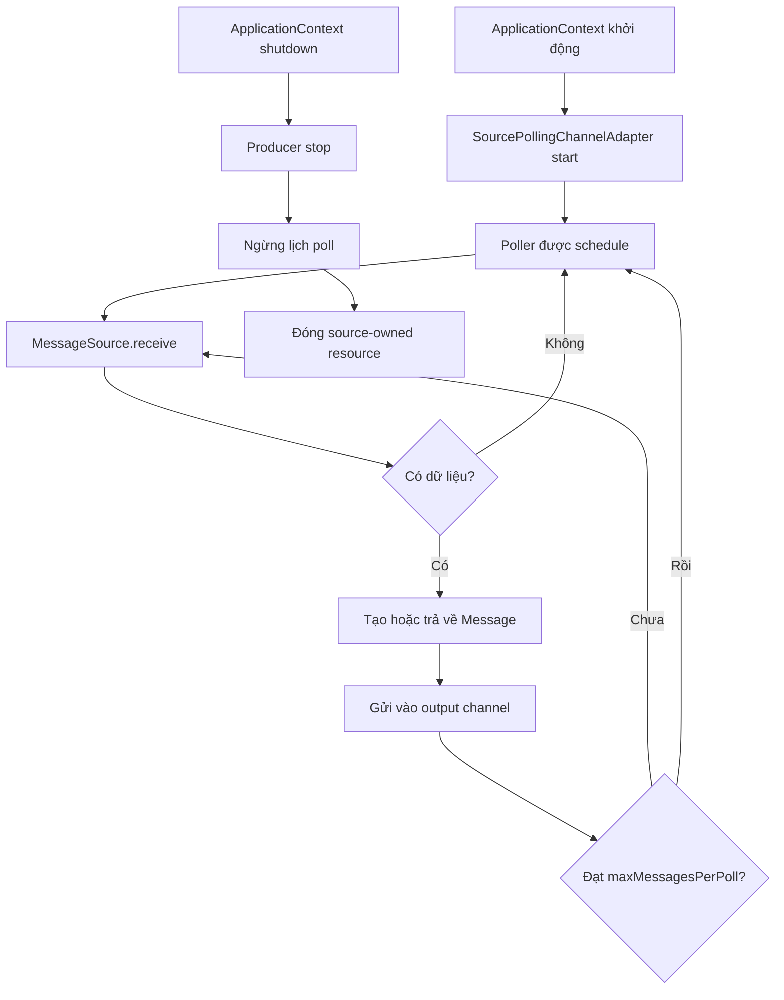

# Lifecycle của producer và source resource

Trong Spring Integration, message producer là điểm đưa dữ liệu từ bên ngoài vào message flow. Producer có thể chủ động lấy dữ liệu theo lịch, hoặc nhận callback từ một hệ thống phát sự kiện. Dù dùng cách nào, producer đều có vòng đời gắn với `ApplicationContext`: được khởi tạo, bắt đầu hoạt động, tạm dừng hoặc dừng, rồi giải phóng tài nguyên khi ứng dụng đóng.

Quản lý đúng vòng đời giúp tránh các lỗi như poller vẫn chạy khi ứng dụng đang shutdown, client hoặc stream bị rò rỉ, hai producer cùng đọc một nguồn, hoặc message bị mất khi dừng giữa chừng. Cần phân biệt vòng đời của **producer endpoint**, **MessageSource** và **tài nguyên mà source sử dụng**. Ba đối tượng này có liên quan nhưng không nhất thiết có cùng cơ chế start/stop/close.

## 1. Producer trong message flow

Producer thường được đặt ở đầu vào của một integration flow. Nó chuyển dữ liệu từ file, database, HTTP, message broker hoặc một API bên ngoài thành Spring `Message<?>`, sau đó gửi message vào output channel.

Spring Integration có hai kiểu producer chính:

| Kiểu producer | Cơ chế hoạt động | Thành phần thường gặp |
| --- | --- | --- |
| Polling inbound adapter | Định kỳ gọi source để lấy dữ liệu; source trả về message hoặc `null` nếu chưa có dữ liệu | `MessageSource`, `SourcePollingChannelAdapter`, `Poller` |
| Event-driven/message-driven inbound adapter | Nhận callback hoặc message từ listener/container của hệ thống bên ngoài rồi gửi vào channel | Message-driven adapter, listener container, `MessageProducerSupport` |

Luồng polling thường có dạng:



Với producer event-driven, hệ thống bên ngoài gọi listener hoặc adapter khi có sự kiện. Không có vòng `receive()` theo lịch, nhưng adapter và listener container vẫn phải được start/stop đúng lúc.

## 2. Phân biệt endpoint, source và resource

Ba lớp trách nhiệm thường gặp:

| Đối tượng | Trách nhiệm | Vòng đời điển hình |
| --- | --- | --- |
| Producer endpoint | Điều phối việc nhận dữ liệu và gửi message vào channel | Spring quản lý qua `Lifecycle`/`SmartLifecycle`; có `start()`, `stop()` và trạng thái chạy |
| `MessageSource<T>` | Cung cấp message khi được gọi `receive()` | Có thể chỉ là một object stateless; cũng có thể giữ state hoặc sở hữu tài nguyên cần đóng |
| Source resource | Kết nối, stream, file handle, client, listener hoặc session mà source sử dụng | Phải được đóng hoặc dispose bởi đúng chủ sở hữu khi không còn dùng |

`MessageSource<T>` là hợp đồng lấy message, không phải cam kết rằng source tự quản lý một thread hoặc tự đóng mọi tài nguyên. Phương thức `receive()` trả về một `Message<T>` khi có dữ liệu; trả về `null` khi hiện tại không có message. Một source tự viết cần xác định rõ nó có giữ tài nguyên lâu dài hay chỉ mở tài nguyên trong từng lần `receive()`.

Producer endpoint có vòng đời riêng. Ví dụ, `SourcePollingChannelAdapter` điều phối lịch poll và gọi source. Khi endpoint dừng, lịch poll được ngừng; điều đó không đồng nghĩa mọi object mà source đang tham chiếu đều tự động được đóng. Việc cleanup còn phụ thuộc loại source và cách bean được khai báo.

## 3. Vòng đời do Spring quản lý

Các endpoint Spring Integration thường tích hợp với Spring lifecycle. Trong lúc `ApplicationContext` khởi động, endpoint được khởi tạo và các endpoint cho phép tự khởi động sẽ được chạy. Khi context đóng, Spring gọi stop theo thứ tự phase và sau đó hủy bean để giải phóng tài nguyên.

Những thuộc tính cần chú ý:

- **`autoStartup`:** quyết định endpoint có tự start khi context khởi động hay không. Có thể đặt `false` nếu cần chờ cấu hình, kết nối hoặc điều kiện vận hành khác.
- **`phase`:** điều khiển thứ tự start/stop của các bean triển khai `SmartLifecycle`. Bean có phase thấp được start trước; khi dừng, thứ tự được đảo ngược. Thường nên để consumer sẵn sàng trước khi producer bắt đầu phát message, và dừng producer trước để consumer có thời gian xử lý phần việc còn lại.
- **`start()` / `stop()`:** bật hoặc dừng hoạt động endpoint trong runtime. Dừng endpoint không đồng nghĩa hủy bean; endpoint có thể được start lại nếu implementation hỗ trợ.
- **`isRunning()`:** cho biết endpoint có đang chạy theo trạng thái lifecycle hay không. Trạng thái này không chứng minh nguồn bên ngoài đang khỏe hoặc message đang được xử lý thành công.
- **`destroy()`:** bước cleanup khi bean bị hủy. Đây là nơi giải phóng tài nguyên do bean sở hữu; không nên dùng `stop()` như một cách thay thế cho việc đóng resource.

Ví dụ khai báo một endpoint chỉ chạy khi được điều khiển:

```java
@Bean
@InboundChannelAdapter(
        channel = "incomingEvents",
        autoStartup = "false",
        poller = @Poller(fixedDelay = "1000"))
public MessageSource<Event> eventSource(EventRepository repository) {
    return new RepositoryEventMessageSource(repository);
}
```

Trong ví dụ, endpoint không tự poll khi context vừa khởi động. Một thành phần quản trị có thể gọi `start()` sau khi ứng dụng hoàn tất bước chuẩn bị. Khi điều khiển runtime, nên thao tác với endpoint/bean lifecycle đã đăng ký trong context, tránh tự tạo một poller thứ hai gọi cùng source.

### Thứ tự start và stop

Giả sử flow có một consumer cần sẵn sàng trước khi producer phát message. Có thể đặt consumer ở phase thấp hơn và producer ở phase cao hơn. Khi start, consumer được khởi động trước; khi stop, producer được dừng trước consumer. Đây là cách giảm khả năng message được gửi vào một endpoint chưa sẵn sàng hoặc producer tiếp tục tạo message trong lúc consumer đã dừng.

Phase không phải cơ chế drain queue và cũng không thay thế dependency giữa các bean. Nếu producer phụ thuộc một client hoặc resource cụ thể, hãy khai báo dependency qua constructor injection và để Spring quản lý bean. Với shutdown cần chờ xử lý hoàn tất, phải cấu hình timeout và chính sách graceful shutdown phù hợp với executor, listener container hoặc broker đang dùng.

## 4. Lifecycle của polling producer và Poller

Polling inbound adapter kết hợp một `MessageSource` với `SourcePollingChannelAdapter`. Poller quyết định khi nào gọi source và mỗi chu kỳ lấy tối đa bao nhiêu message.

Ví dụ dùng Java DSL:

```java
@Bean
IntegrationFlow inboundEvents(MessageSource<Event> eventSource) {
    return IntegrationFlow.from(eventSource,
                    endpoint -> endpoint.poller(
                            Pollers.fixedDelay(Duration.ofSeconds(1))
                                    .maxMessagesPerPoll(20)))
            .channel("incomingEvents")
            .get();
}
```

Trong cấu hình này:

- `fixedDelay` đặt khoảng nghỉ giữa các lần poll theo thời điểm hoàn tất của chu kỳ trước.
- Có thể dùng `fixedRate` khi cần lịch dựa trên thời điểm bắt đầu các chu kỳ; cần tính đến thời gian xử lý và khả năng các tác vụ chồng lấn tùy executor/cấu hình.
- `initialDelay` trì hoãn lần poll đầu tiên nếu cần thời gian chuẩn bị.
- `maxMessagesPerPoll` giới hạn số message được lấy trong một chu kỳ. Giá trị `-1` có thể được dùng để tiếp tục lấy cho đến khi source không còn dữ liệu; cần thận trọng với nguồn liên tục luôn có dữ liệu vì một chu kỳ có thể chiếm nhiều thời gian.
- `taskExecutor` có thể chuyển việc thực thi poll sang executor. Nó ảnh hưởng đến thread thực thi và khả năng đồng thời; không tự làm source trở nên thread-safe.

Không nhầm `maxMessagesPerPoll` với số consumer hoặc số thread. Đây là giới hạn số lần source được gọi trong một chu kỳ poll. Nếu muốn tăng throughput, cần xem xét thời gian xử lý, executor, khả năng chịu tải của source và downstream, đồng thời xác nhận source có hỗ trợ nhiều lần `receive()` đồng thời hay không.

Một cách khai báo khác là dùng annotation `@InboundChannelAdapter` cùng `@Poller`:

```java
@Bean
@InboundChannelAdapter(
        channel = "incomingEvents",
        poller = @Poller(
                fixedDelay = "1000",
                maxMessagesPerPoll = "20"))
public MessageSource<Event> eventSource(EventRepository repository) {
    return new RepositoryEventMessageSource(repository);
}
```

Chọn một cách tạo endpoint cho mỗi source. Không vừa khai báo adapter annotation vừa tạo một `IntegrationFlow.from(source, ...)` khác để poll cùng một instance source, trừ khi source được thiết kế rõ ràng cho nhiều consumer đồng thời.

## 5. Lifecycle của event-driven producer

Với message-driven inbound adapter, hệ thống bên ngoài chủ động phát sự kiện. Ví dụ JMS hoặc một broker có thể dùng listener container để nhận message. Adapter thường quản lý listener container và gửi message nhận được vào output channel.

Vòng đời có thể hiểu theo các bước:

1. Spring khởi tạo adapter, container và connection factory theo dependency đã khai báo.
2. Khi adapter start, listener container bắt đầu nhận message hoặc đăng ký callback với nguồn.
3. Khi có message, adapter chuyển đổi dữ liệu transport thành Spring `Message<?>` rồi gửi đến channel.
4. Khi adapter stop, listener/container ngừng nhận thêm message theo cơ chế của transport.
5. Khi context đóng, connection, session hoặc client do bean sở hữu được giải phóng.

Đối với loại producer này, không có `MessageSource.receive()` được poll theo lịch. Cần đọc trạng thái lifecycle của adapter và listener container tương ứng. Nếu container hỗ trợ acknowledgment, consumer concurrency hoặc graceful shutdown, các thiết lập đó ảnh hưởng trực tiếp đến việc message đang xử lý được xác nhận, phát lại hay chờ hoàn tất.

Không đóng connection factory dùng chung từ một adapter nếu factory thuộc quyền sở hữu của context hoặc được nhiều endpoint sử dụng. Adapter chỉ nên dừng listener/container mà nó quản lý; bean sở hữu connection factory sẽ giải phóng nó theo lifecycle riêng.

## 6. Quản lý tài nguyên mà MessageSource sử dụng

Có hai mô hình sở hữu resource phổ biến.

### Resource chỉ tồn tại trong một lần receive

Nếu source mở file stream, HTTP response body hoặc reader trong một lần gọi `receive()`, hãy đóng resource ngay khi xử lý xong bằng `try-with-resources` hoặc `finally`:

```java
public Message<String> receive() {
    try (InputStream input = resource.getInputStream()) {
        String value = readNextValue(input);
        if (value == null) {
            return null;
        }
        return MessageBuilder.withPayload(value).build();
    }
    catch (IOException ex) {
        throw new MessageSourceException("Không đọc được resource", ex);
    }
}
```

Đoạn code minh họa nguyên tắc sở hữu: stream được mở trong lần poll và đóng ngay trong cùng lần poll, kể cả khi đọc lỗi. Không giữ stream mở qua nhiều chu kỳ nếu source không có giao thức quản lý vị trí đọc, timeout và cleanup rõ ràng.

### Resource tồn tại suốt vòng đời bean

Nếu source giữ một client, session hoặc watcher lâu dài, bean phải có cơ chế đóng rõ ràng. Ví dụ:

```java
public final class RemoteEventMessageSource
        implements MessageSource<RemoteEvent>, AutoCloseable {

    private final RemoteClient client;
    private volatile boolean closed;

    public RemoteEventMessageSource(RemoteClient client) {
        this.client = client;
    }

    @Override
    public Message<RemoteEvent> receive() {
        if (closed) {
            return null;
        }

        RemoteEvent event = client.poll();
        return event == null
                ? null
                : MessageBuilder.withPayload(event).build();
    }

    @Override
    public void close() {
        closed = true;
        client.close();
    }
}
```

Đăng ký source như bean và chỉ định phương thức cleanup:

```java
@Bean(destroyMethod = "close")
RemoteEventMessageSource remoteEventSource(RemoteClient client) {
    return new RemoteEventMessageSource(client);
}
```

Ví dụ này giả định source sở hữu `RemoteClient`. Nếu client là bean dùng chung hoặc connection pool do một bean khác quản lý, không đóng nó trong `RemoteEventMessageSource`; hãy để đúng bean sở hữu thực hiện cleanup. Đồng thời, phải bảo đảm endpoint dừng poll trước khi client bị đóng để tránh `receive()` đang chạy trên một client đã dispose.

Spring `Resource` thường mô tả vị trí hoặc cách truy cập dữ liệu như file, classpath hay URL. Bản thân đối tượng `Resource` không đồng nghĩa với một stream đang mở. Khi gọi `getInputStream()`, stream được trả về cần được đóng theo đúng quyền sở hữu. Phân biệt hai khái niệm này giúp tránh giữ nhầm file handle hoặc đóng một resource dùng chung quá sớm.

## 7. Quản lý source theo từng loại dữ liệu

| Nguồn | Điều cần quản lý | Gợi ý về cleanup và độ tin cậy |
| --- | --- | --- |
| File system | Directory scanner, bộ lọc file, file lock, stream đọc nội dung | Đóng stream sau mỗi lần đọc; giải phóng lock khi hoàn tất; dùng filter/persistent metadata phù hợp để tránh đọc trùng hoặc bỏ sót sau restart |
| JDBC/database | `DataSource`, transaction, cursor hoặc statement nếu tự quản lý | Ưu tiên `JdbcTemplate`/adapter để quản lý connection; nếu tự mở JDBC resource, đóng `ResultSet`, `Statement` và `Connection` đúng thứ tự |
| HTTP/remote API | HTTP client, connection pool, response body, timeout | Đóng response body; dùng client được quản lý như bean; dispose client/pool khi bean sở hữu đóng |
| JMS/message broker | Connection factory, listener container, session và acknowledgment | Dừng container theo lifecycle; để bean sở hữu factory đóng connection; xác định rõ acknowledgment/redelivery |
| Watcher hoặc stream liên tục | Thread, subscription, socket hoặc handle dài hạn | Hủy subscription, đánh thức thread đang block nếu cần, chờ thread kết thúc rồi đóng handle |

Với file source, cần phân biệt việc **phát hiện file** và việc **đọc nội dung file**. Một `FileReadingMessageSource` có thể phát ra đối tượng `File`; bước sau trong flow mới mở stream đọc nội dung. Không giả định source đã mở stream chỉ vì nó đã tạo message chứa `File`. Bộ lọc accept-once, scanner và file locker có trạng thái riêng; hãy chọn chính sách phù hợp với yêu cầu restart và xử lý trùng.

Với JDBC, adapter/source thường lấy dữ liệu thông qua `DataSource`. Nếu dùng connection pool do Spring quản lý, không tự đóng pool trong mỗi lần poll. Hãy phân biệt connection mượn từ pool với pool là tài nguyên sống suốt ứng dụng. Khi cần transaction, cấu hình transaction manager và phạm vi transaction quanh thao tác đọc/đánh dấu dữ liệu phù hợp.

## 8. Stop, restart và graceful shutdown

`stop()` là tín hiệu dừng endpoint. Với polling producer, nó ngăn các lần poll tiếp theo được lập lịch. Với event-driven producer, nó yêu cầu adapter/listener container ngừng nhận sự kiện. Tuy nhiên, dừng endpoint không mặc nhiên bảo đảm mọi message đã nhận đều được xử lý xong, queue được drain hoặc side effect đã commit.

Một quy trình shutdown có kiểm soát thường gồm:

1. Ngừng tạo message mới ở upstream hoặc dừng producer endpoint trước.
2. Chờ các task đang chạy hoàn tất trong khoảng timeout đã định.
3. Cho consumer xử lý phần message còn lại trong queue nếu chính sách ứng dụng yêu cầu drain.
4. Xác nhận hoặc rollback transaction/acknowledgment theo cơ chế nguồn.
5. Dừng executor, listener container và poller theo thứ tự phụ thuộc.
6. Đóng client, stream, connection hoặc resource do bean sở hữu.

Nếu producer và consumer dùng executor riêng, cần cấu hình shutdown timeout và chính sách chờ task của từng executor. Nếu message được gửi qua `ExecutorChannel`, việc producer gửi thành công thường chỉ xác nhận task đã được giao theo cấu hình executor; nó không chứng minh worker đã xử lý xong. Cần theo dõi số task đang chạy và queue chờ trước khi đóng các resource mà worker cần dùng.

Restart cũng cần chú ý trạng thái nguồn. Nếu source đọc từ file hoặc database và đánh dấu dữ liệu đã lấy, cần xác định điểm commit của marker so với việc xử lý message. Nếu đánh dấu quá sớm, lỗi downstream có thể làm mất dữ liệu; nếu đánh dấu quá muộn, restart có thể phát lại dữ liệu. Thiết kế idempotency cho consumer và cơ chế checkpoint/acknowledgment rõ ràng thường quan trọng hơn cố gắng bảo đảm một lần xử lý tuyệt đối.

## 9. Transaction, retry và lỗi ở producer

Lỗi có thể xảy ra trong nhiều giai đoạn:

- `receive()` lỗi khi truy cập nguồn.
- Source trả về message nhưng gửi vào output channel thất bại.
- Downstream handler xử lý lỗi sau khi message đã được gửi.
- Resource bị đóng trong khi poll hoặc callback vẫn đang chạy.

Hãy xác định lỗi xảy ra ở ranh giới nào trước khi cấu hình retry. Retry lời gọi source có thể lấy lại cùng dữ liệu, dữ liệu mới hoặc không lấy được gì, tùy nguồn. Retry gửi message có thể gây duplicate nếu lần gửi đầu đã thành công một phần. Vì vậy, dùng ID nguồn ổn định, idempotency key hoặc checkpoint để nhận biết message đã được xử lý.

Transaction của poller có thể được cấu hình qua transaction advice/transaction manager khi nguồn hỗ trợ. Nhưng không phải resource nào cũng rollback được. Đọc file, gọi HTTP hoặc nhận callback từ broker không tự nhiên trở thành thao tác transactional chỉ vì flow có transaction advice. Với broker, cần dùng acknowledgment/transaction theo khả năng của broker adapter. Với file, cần quy ước marker hoặc di chuyển file sau khi xử lý thành công. Với database, đọc và cập nhật trạng thái xử lý nên nằm trong transaction phù hợp.

Nếu lỗi xảy ra trong polling endpoint, cấu hình error handling cho poller và theo dõi log/metric của endpoint. Nếu lỗi xuất hiện trong xử lý bất đồng bộ, exception có thể được chuyển thành `ErrorMessage` trên error channel theo cấu hình; producer không nhất thiết nhận exception đồng bộ. Không coi `errorChannel` là cơ chế lưu trữ bền vững nếu không có queue/store phù hợp.

## 10. Quan sát trạng thái runtime

Trạng thái `isRunning()` của endpoint chỉ cho biết lifecycle của endpoint. Để biết producer thực sự hoạt động tốt, cần quan sát thêm:

- Thời điểm poll gần nhất và thời gian một lần `receive()`.
- Số message được tạo, gửi thành công, không có dữ liệu và bị lỗi.
- Queue depth hoặc số task đang chờ nếu có executor/channel dạng queue.
- Tuổi của message cũ nhất và độ trễ từ lúc source phát hiện dữ liệu đến lúc consumer xử lý.
- Số lần retry, redelivery, duplicate và message đi vào error flow.
- Trạng thái kết nối, timeout và lỗi của client/resource bên ngoài.
- Số thread đang hoạt động và thread bị block trong lúc shutdown.

Khi cần dừng hoặc khởi động lại một endpoint, hãy điều khiển bean lifecycle đã đăng ký trong context và xác nhận trạng thái sau thao tác. Tránh gọi `receive()` thủ công trên cùng source đang được poller quản lý vì có thể làm hai luồng cạnh tranh lấy dữ liệu hoặc phá vỡ checkpoint.

## 11. Checklist thiết kế producer an toàn

1. Xác định producer là polling hay event-driven; không gắn poller vào một nguồn vốn đã có listener callback nếu adapter không yêu cầu.
2. Xác định endpoint nào sở hữu source và mỗi source có bao nhiêu consumer.
3. Chọn `autoStartup`, `phase`, trigger và giới hạn message theo khả năng của nguồn.
4. Xác định resource nào sống theo từng lần `receive()` và resource nào sống theo vòng đời bean.
5. Đóng stream/response/statement ngay sau khi dùng; đóng client hoặc watcher ở cleanup của bean sở hữu.
6. Xác định hành vi khi `receive()` trả `null`, khi source lỗi và khi gửi channel thất bại.
7. Thiết kế transaction, acknowledgment, checkpoint, retry và idempotency theo semantics của nguồn thực tế.
8. Kiểm thử stop/restart trong lúc đang poll và lúc downstream đang xử lý.
9. Theo dõi cả trạng thái lifecycle lẫn tình trạng kết nối và tiến độ xử lý message.

Producer được quản lý tốt khi endpoint có thể start/stop có trật tự, source có quy tắc lấy dữ liệu rõ ràng và mỗi resource được đóng bởi đúng chủ sở hữu. Khi ba phần này được thiết kế riêng, message flow sẽ dễ vận hành, khởi động lại và xử lý lỗi hơn.
