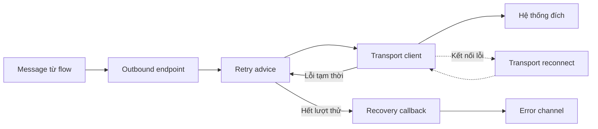
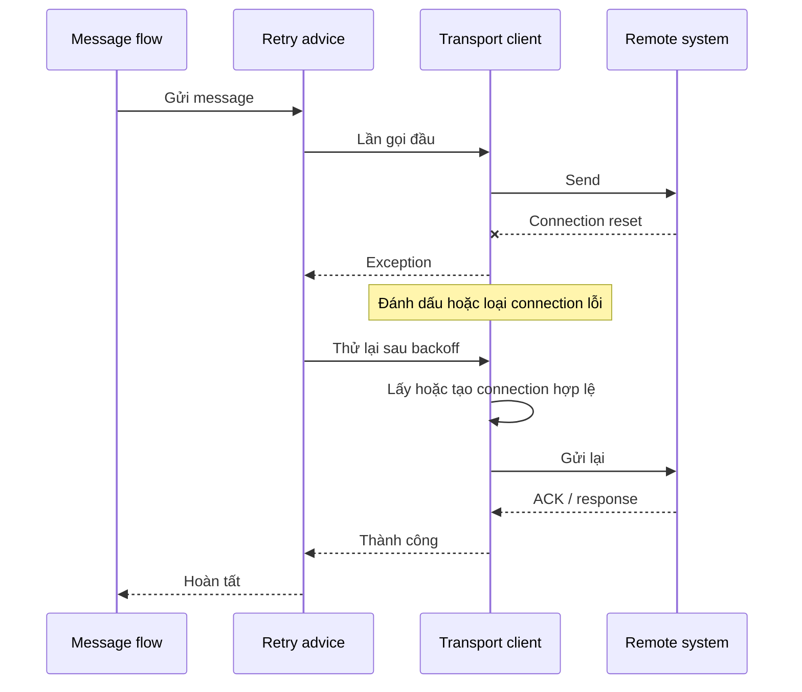

# Producer retry và reconnect

Trong Spring Integration, producer thường là một outbound adapter hoặc outbound gateway gửi message tới hệ thống bên ngoài như HTTP service, broker, TCP server, FTP/SFTP server hoặc một dịch vụ tích hợp khác. Khi đích đến tạm thời không sẵn sàng, producer cần một chính sách retry phù hợp; khi kết nối vật lý bị đóng hoặc hỏng, client hay connection factory của transport phải khôi phục kết nối.

Hai việc này liên quan nhưng khác nhau. **Retry** thực hiện lại thao tác gửi sau một lỗi. **Reconnect** thiết lập lại kết nối tới hệ thống đích. Retry không tự bảo đảm kết nối đã được tạo lại, còn reconnect không tự gửi lại message đã thất bại. Một producer đáng tin cậy cần phối hợp cả hai với timeout, error flow, idempotency và cơ chế lưu giữ message.

## 1. Xác định ranh giới của producer

Spring Integration cung cấp hai kiểu endpoint outbound phổ biến:

- **Outbound channel adapter** gửi message đi và không tạo reply message cho flow. Ví dụ: gửi một bản ghi sang broker hoặc ghi file tới máy chủ từ xa.
- **Outbound gateway** gửi request và chờ response. Ví dụ: gọi HTTP API hoặc gửi request qua TCP rồi chờ phản hồi.

Lỗi có thể xuất hiện khi tạo kết nối, khi ghi dữ liệu, khi chờ response hoặc khi đọc kết quả. Với gateway, việc không nhận được response không chứng minh hệ thống đích chưa thực hiện nghiệp vụ. Server có thể đã commit thay đổi nhưng response bị mất trên đường truyền.

Một endpoint outbound thường gọi transport client thông qua message handler. Có thể hình dung ranh giới xử lý như sau:



Retry advice bao quanh lời gọi của endpoint. Cách khôi phục kết nối bên dưới phụ thuộc transport client hoặc connection factory mà endpoint đang sử dụng.

## 2. Retry ở outbound endpoint

Spring Integration có `RequestHandlerRetryAdvice` để thử lại khi message handler ném exception. Advice này thường được gắn vào endpoint xử lý outbound. Nó sử dụng `RetryTemplate` của Spring Retry để xác định exception nào được thử lại, số lần tối đa và khoảng chờ giữa các lần thử.

Một chính sách retry nên xác định rõ:

| Thành phần | Câu hỏi cần trả lời |
|---|---|
| Retryable exception | Lỗi nào có khả năng tự hết, chẳng hạn timeout hoặc lỗi kết nối tạm thời? |
| Max attempts | Tổng số lần gọi tối đa, tính cả lần đầu, là bao nhiêu? |
| Backoff | Chờ bao lâu trước mỗi lần thử tiếp theo? |
| Recovery | Sau khi hết lượt thử, message và exception được chuyển đi đâu? |
| Timeout budget | Tổng thời gian chờ có nằm trong SLA của flow không? |

Không nên thử lại mọi exception. Lỗi cấu hình, dữ liệu sai, xác thực thất bại hoặc request không hợp lệ thường không tự hết khi gửi lại. Retry những lỗi này chỉ làm tăng tải và trì hoãn việc xử lý nguyên nhân thật.

### Cấu hình retry có giới hạn

Ví dụ sau cấu hình tối đa bốn lần gọi, với exponential backoff. Các exception được liệt kê là những lỗi có thể thử lại trong ví dụ; exception khác không thuộc chính sách retry này.

```java
import java.net.ConnectException;
import java.net.SocketTimeoutException;
import java.util.Map;

import org.springframework.context.annotation.Bean;
import org.springframework.integration.handler.advice.ErrorMessageSendingRecoverer;
import org.springframework.integration.handler.advice.RequestHandlerRetryAdvice;
import org.springframework.messaging.MessageChannel;
import org.springframework.retry.policy.SimpleRetryPolicy;
import org.springframework.retry.support.RetryTemplate;
import org.springframework.retry.backoff.ExponentialBackOffPolicy;

@Bean
RequestHandlerRetryAdvice producerRetryAdvice(
        MessageChannel producerErrors) {

    Map<Class<? extends Throwable>, Boolean> retryable =
            Map.of(
                SocketTimeoutException.class, true,
                ConnectException.class, true
            );

    SimpleRetryPolicy retryPolicy =
            new SimpleRetryPolicy(4, retryable, true);

    ExponentialBackOffPolicy backOff =
            new ExponentialBackOffPolicy();
    backOff.setInitialInterval(200);
    backOff.setMultiplier(2.0);
    backOff.setMaxInterval(2_000);

    RetryTemplate retryTemplate = new RetryTemplate();
    retryTemplate.setRetryPolicy(retryPolicy);
    retryTemplate.setBackOffPolicy(backOff);

    RequestHandlerRetryAdvice advice = new RequestHandlerRetryAdvice();
    advice.setRetryTemplate(retryTemplate);
    advice.setRecoveryCallback(
            new ErrorMessageSendingRecoverer(producerErrors));

    return advice;
}
```

`maxAttempts = 4` nghĩa là một lần gọi ban đầu và tối đa ba lần thử lại. Với backoff bắt đầu ở 200 ms và nhân đôi, thời gian chờ giữa các lần gọi tăng dần, nhưng không vượt quá 2.000 ms. Thời gian thực tế còn bao gồm thời gian mỗi lần gọi transport client và timeout của nó.

Đoạn cấu hình dùng các exception Java tiêu biểu để minh họa. Khi áp dụng cho một transport cụ thể, hãy đưa vào đúng loại exception mà client thực tế ném ra. Một client có thể bọc `SocketTimeoutException` trong exception khác; tham số `traverseCauses` của `SimpleRetryPolicy` cho phép kiểm tra chuỗi nguyên nhân.

Spring Retry phải có mặt trên classpath để sử dụng `RetryTemplate` và retry advice. Với dự án dùng dependency management, chọn phiên bản Spring Retry tương thích với phiên bản Spring Integration của dự án.

### Gắn advice vào outbound gateway

Ví dụ dưới đây gắn retry advice vào HTTP outbound gateway. Cùng cách cấu hình có thể áp dụng cho các outbound handler khác hỗ trợ advice chain.

```java
import org.springframework.context.annotation.Bean;
import org.springframework.integration.dsl.IntegrationFlow;
import org.springframework.integration.dsl.http.Http;
import org.springframework.http.HttpMethod;

@Bean
IntegrationFlow publishOrdersFlow(
        RequestHandlerRetryAdvice producerRetryAdvice) {

    return IntegrationFlow.from("ordersToPublish")
            .handle(
                Http.outboundGateway("https://partner.example/api/orders")
                    .httpMethod(HttpMethod.POST)
                    .expectedResponseType(String.class),
                endpoint -> endpoint.advice(producerRetryAdvice))
            .get();
}
```

Khi outbound handler ném exception thuộc retry policy, advice gọi lại handler theo số lần và backoff đã cấu hình. Nếu một lần thử thành công, kết quả tiếp tục theo flow. Nếu tất cả lần thử đều thất bại, recovery callback được gọi.

## 3. Xử lý khi retry đã hết lượt

Ví dụ trên dùng `ErrorMessageSendingRecoverer` để gửi một `ErrorMessage` vào channel `producerErrors`. Error message chứa thông tin về message gốc và exception cuối cùng. Flow xử lý lỗi có thể ghi log, phát metric, lưu message vào kho lỗi hoặc chuyển sang quy trình xử lý thủ công.

Khai báo channel và một error flow đơn giản:

```java
import org.springframework.context.annotation.Bean;
import org.springframework.integration.channel.DirectChannel;
import org.springframework.integration.dsl.IntegrationFlow;
import org.springframework.messaging.MessageChannel;

@Bean
MessageChannel producerErrors() {
    return new DirectChannel();
}

@Bean
IntegrationFlow producerErrorFlow() {
    return IntegrationFlow.from("producerErrors")
            .handle(message -> {
                // Ghi log, lưu lỗi và tạo cảnh báo theo chính sách vận hành.
            })
            .get();
}
```

Trong ứng dụng thực tế, error flow nên lưu đủ thông tin để có thể điều tra và phát lại: định danh message, đích gửi, thời điểm, số lần thử, exception và correlation ID. Không ghi payload nhạy cảm vào log nếu hệ thống chưa có chính sách bảo vệ dữ liệu phù hợp.

Cần phân biệt ba kết quả:

- **Retry thành công:** endpoint hoàn tất lời gọi và message tiếp tục theo flow.
- **Recovery đã xử lý:** callback nhận quyền xử lý sau khi hết lượt thử; hành vi tiếp theo phụ thuộc kết quả callback.
- **Lỗi tiếp tục được ném ra:** exception truyền về phía gọi và có thể được poller, error channel hoặc transaction xử lý theo cấu hình của flow.

Việc gửi error message không đồng nghĩa message đã được lưu bền vững. Nếu cần bảo đảm không mất message khi ứng dụng dừng, hãy dùng một nơi lưu trữ bền vững hoặc outbox phù hợp thay vì chỉ dựa vào log hay channel trong bộ nhớ.

## 4. Reconnect thuộc về transport client

Retry advice gọi lại handler. Reconnect lại do transport client, connection factory hoặc thư viện giao thức quản lý. Cấu hình cụ thể khác nhau giữa HTTP, TCP, JMS, AMQP, Kafka, MQTT và các adapter file.

Khi một kết nối hỏng, cơ chế transport có thể phát hiện lỗi ngay trong lần gửi, phát hiện khi kiểm tra connection hoặc chỉ phát hiện ở lần sử dụng tiếp theo. Tùy client, kết nối mới có thể được tạo tự động, được tạo khi có request tiếp theo, hoặc cần ứng dụng điều khiển vòng đời.

Khi cấu hình reconnect, cần xác định:

1. Thành phần nào sở hữu kết nối và quản lý pool hoặc cache kết nối?
2. Lỗi nào làm kết nối bị đánh dấu hỏng hoặc bị loại khỏi pool?
3. Thành phần nào tạo kết nối thay thế và có backoff hay giới hạn số lần thử không?
4. Khi kết nối phục hồi, message đang chờ được gửi lại bởi retry advice, broker hay cơ chế replay nào?
5. Sự kiện kết nối mở, đóng và lỗi được quan sát ở đâu?

Không nên mặc định rằng một outbound endpoint luôn tự tạo connection mới sau exception. Nếu client giữ một connection đã hỏng trong pool, các lần retry tiếp theo có thể tiếp tục thất bại. Cần cấu hình và kiểm thử khả năng loại bỏ kết nối lỗi, tạo kết nối mới và tiếp tục gửi theo tài liệu của transport đang dùng.

### Phối hợp retry và reconnect

Một chuỗi phục hồi điển hình diễn ra như sau:



Đây là mô hình khái niệm. Việc client có tạo connection mới trong lần thử tiếp theo hay không phải được xác minh với transport cụ thể. Retry advice không trực tiếp điều khiển bước tạo connection.

Nếu hệ thống đích ngừng hoạt động lâu, retry liên tục có thể tạo tải lớn lên cả ứng dụng lẫn hệ thống đang phục hồi. Dùng backoff tăng dần, giới hạn số lần thử, timeout hợp lý và cơ chế circuit breaker hoặc tạm ngừng producer khi phù hợp. Khi kết nối phục hồi, tăng dần lưu lượng gửi lại để tránh dồn tải đột ngột.

## 5. Tránh gửi trùng khi retry

Một tình huống nguy hiểm là client gửi request, server đã thực hiện nghiệp vụ, nhưng ACK hoặc response bị mất. Producer nhìn thấy timeout và gửi lại. Hệ thống đích có thể nhận cùng một nghiệp vụ hai lần.

Vì vậy, retry tạo khả năng gửi lặp. Hệ thống cần độ tin cậy thường phải được thiết kế với giả định một message có thể được giao nhiều lần (at-least-once); bản thân retry cũng không bảo đảm message không bị mất. Không thể tự suy ra exactly-once chỉ vì endpoint có retry hoặc connection được phục hồi.

Các biện pháp thường dùng:

- Gắn một idempotency key ổn định vào mỗi nghiệp vụ, ví dụ `orderId` hoặc `eventId`; giữ nguyên key qua tất cả lần thử.
- Yêu cầu hệ thống đích phát hiện request trùng và trả lại kết quả đã xử lý thay vì thực hiện side effect lần nữa.
- Với consumer do mình quản lý, lưu dấu message đã xử lý trong cùng transaction với cập nhật nghiệp vụ khi có thể.
- Dùng transactional outbox khi cần đồng bộ thay đổi trong database với việc phát message. Worker đọc outbox có thể gửi lại sau lỗi mà không làm mất ý định phát sự kiện.
- Xác định rõ ACK có nghĩa là transport đã nhận byte, broker đã nhận message hay nghiệp vụ phía server đã commit. Các mức xác nhận này không tương đương nhau.

Không tạo idempotency key mới trong mỗi lần retry. Nếu key thay đổi, hệ thống đích sẽ coi mỗi lần thử là một nghiệp vụ khác nhau.

## 6. Phối hợp với transaction, poller và executor

Retry đồng bộ giữ thread thực hiện lời gọi outbound trong thời gian gọi, chờ backoff và thử lại. Nếu endpoint chạy trong poller, các lần thử có thể kéo dài thời gian xử lý một lượt poll, làm giảm tốc độ tiêu thụ message và giữ tài nguyên thread lâu hơn.

Hãy tính ngân sách thời gian cho cả flow:

T_total = sum(request time) + sum(backoff time) + processing time

Mỗi `T_request` cần có timeout hữu hạn. Nếu client không có timeout, một lần thử có thể treo lâu hơn toàn bộ ngân sách dự kiến. Tổng thời gian retry cũng phải phù hợp với poller, transaction timeout, SLA và thời hạn message còn giá trị.

Một số điểm cần kiểm tra:

- **Transaction:** transaction database cục bộ không tự rollback side effect đã xảy ra ở hệ thống từ xa. Chỉ dùng transaction bao quanh gửi khi transport và cấu hình thực sự hỗ trợ semantics tương ứng.
- **Broker redelivery:** nếu transaction của consumer rollback, broker có thể giao lại message. Kết hợp broker redelivery với retry advice có thể tạo nhiều tầng retry.
- **Executor:** nếu flow chuyển sang executor bất đồng bộ, exception có thể xảy ra ở thread khác sau khi bước gửi ban đầu đã trả về. Retry advice đặt ở ranh giới không bao quanh được lỗi phát sinh sau ranh giới đó.
- **Thông lượng:** nhiều producer cùng retry có thể tạo đợt tải dồn. Backoff có jitter, giới hạn concurrency và circuit breaker giúp giảm hiện tượng nhiều client thử lại cùng thời điểm.
- **Shutdown:** khi ứng dụng dừng, cần xác định message đang chờ retry được giữ lại, chuyển sang error flow hay bị bỏ dở. Nếu message phải sống qua lần restart, dùng persistent queue, message store hoặc outbox phù hợp.

Đừng cấu hình retry độc lập ở mọi tầng mà không tính tổng số lần gửi. Ví dụ, bốn lần thử ở endpoint kết hợp năm lần thử trong client có thể tạo tối đa hai mươi lần gọi transport cho một message. Chọn một tầng làm nơi điều phối retry chính và ghi rõ giới hạn của các tầng còn lại.

## 7. Chẩn đoán producer không gửi được message

Khi producer gặp lỗi, thu thập bằng chứng theo đúng ranh giới thay vì chỉ tăng số lần retry.

| Triệu chứng | Cần kiểm tra |
|---|---|
| Lỗi ngay lần đầu | DNS, địa chỉ đích, xác thực, quyền truy cập, cấu hình endpoint và loại exception |
| Timeout nhưng đích có thể đã xử lý | ACK/response, idempotency key, log phía đích và khả năng gửi trùng |
| Mọi lần retry đều lỗi kết nối | Connection pool/cache, trạng thái connection, reconnect policy và thời gian phục hồi |
| Retry không chạy | Advice đã gắn đúng endpoint chưa, exception có nằm trong retry policy không, lời gọi có đồng bộ không |
| Retry chạy quá lâu | Max attempts, backoff, timeout mỗi lần gọi, transaction timeout và SLA |
| Message đi vào error channel | Exception cuối cùng, recovery callback, trạng thái lưu trữ và khả năng replay |
| Tải tăng mạnh khi đích phục hồi | Backoff, jitter, concurrency, circuit breaker và tốc độ phát lại |

Nên ghi nhận metric về số lần gửi, số lần retry, số lần recovery, số lần reconnect, thời gian gửi, thời gian chờ backoff và số message đang chờ xử lý. Dùng correlation ID hoặc message ID để nối log giữa producer, transport client và hệ thống đích.

Khi kiểm thử, tối thiểu cần mô phỏng ba trường hợp: đích lỗi tạm thời rồi phục hồi; đích lỗi liên tục đến khi recovery được gọi; và đích đã xử lý request nhưng response bị mất. Trường hợp cuối xác nhận chính sách idempotency có ngăn nghiệp vụ bị thực hiện lặp hay không.

Một producer được vận hành tốt phải trả lời được bốn câu hỏi: lỗi nào được retry, kết nối được khôi phục ở đâu, message được xử lý thế nào sau khi hết lượt thử, và làm sao bảo đảm gửi lại không tạo side effect trùng.
