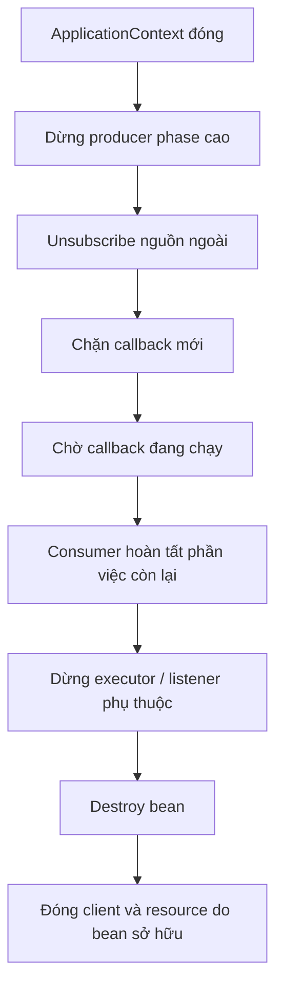

# Đóng producer đúng khi context dừng

Message producer thường nhận callback từ hệ thống bên ngoài, tạo Spring `Message<?>` rồi gửi vào output channel. Khi `ApplicationContext` dừng, producer phải ngừng nhận event mới, xử lý có kiểm soát các callback đang chạy và giải phóng đúng tài nguyên mà nó sở hữu. Nếu chỉ đóng client hoặc connection ngay lập tức, callback đang chạy có thể gửi message qua một channel đã dừng hoặc truy cập một resource đã bị dispose.

Trong Spring Integration, các endpoint được quản lý theo Spring lifecycle. Với producer tùy chỉnh dựa trên `MessageProducerSupport`, phần bật/tắt nguồn bên ngoài thường được đặt trong `doStart()` và `doStop()`. Tuy nhiên, dừng endpoint, chờ công việc đang chạy và đóng client là các bước khác nhau. Thiết kế shutdown cần nêu rõ thứ tự, timeout và hành vi khi không thể hoàn tất trong thời gian cho phép.

## 1. Phân biệt stop, destroy và close

Ba thao tác này có mục đích khác nhau:

| Thao tác | Mục đích | Ví dụ |
| --- | --- | --- |
| `stop()` | Ngừng hoạt động của endpoint trong runtime; có thể start lại nếu implementation hỗ trợ | Ngừng listener hoặc poller phát message mới |
| `destroy()` | Spring hủy bean khi context đóng hoặc bean bị loại bỏ | Dọn trạng thái cuối cùng của endpoint và dependency do bean sở hữu |
| `close()` | Đóng một tài nguyên cụ thể theo API của nó | Đóng subscription handle, socket, client hoặc stream |

Không nên xem ba thao tác này là đồng nghĩa. Một producer có thể dừng listener trong `doStop()` nhưng vẫn giữ HTTP client dùng chung để endpoint có thể start lại. Một subscription handle có thể được đóng khi stop, trong khi client connection pool chỉ được đóng khi bean sở hữu pool bị destroy. Ngược lại, nếu producer tự tạo và sở hữu client riêng, nó phải đóng client ở giai đoạn cleanup cuối cùng.

`MessageProducerSupport` cung cấp nền tảng endpoint và các hook lifecycle. Lớp con cần thực hiện đúng phần tích hợp với nguồn ngoài trong các hook này, đồng thời tuân theo quyền sở hữu resource đã xác định. Đừng đóng một bean client dùng chung chỉ vì một producer dừng.

## 2. Thứ tự shutdown bằng lifecycle phase

Spring quản lý các bean triển khai `Lifecycle`/`SmartLifecycle` khi `ApplicationContext` khởi động và đóng. `SmartLifecycle` có `phase` để sắp thứ tự hoạt động:

- Khi start, phase thấp hơn được khởi động trước.
- Khi stop, thứ tự được đảo ngược: phase cao hơn được dừng trước.
- `autoStartup` quyết định bean có tự start trong quá trình context khởi động hay không.
- `isRunning()` cho biết trạng thái lifecycle mà endpoint báo cáo; nó không chứng minh client ngoài vẫn khỏe hoặc mọi message đã xử lý xong.

Với một inbound producer gửi đến consumer nội bộ, thường muốn consumer sẵn sàng trước khi producer nhận event. Khi shutdown, muốn producer dừng phát event trước, rồi consumer mới dừng sau khi có cơ hội xử lý công việc còn lại.



Phase chỉ điều khiển thứ tự start/stop giữa các bean lifecycle. Nó không tự drain `QueueChannel`, không chờ mọi task trong executor và không xác nhận message với broker. Các việc đó cần cấu hình ở đúng thành phần.

## 3. Quy trình shutdown của một event-driven producer

Một quy trình shutdown an toàn thường gồm các bước sau:

1. Đánh dấu producer đang dừng để callback mới không bắt đầu công việc mới.
2. Hủy listener/subscription ở nguồn bên ngoài để ngăn event mới được phát đến adapter.
3. Chờ callback đã vào xử lý hoàn tất trong một khoảng thời gian hữu hạn.
4. Xử lý hoặc ghi nhận các message đã gửi sang executor/queue nhưng chưa hoàn tất, theo chính sách của ứng dụng.
5. Dừng các consumer hoặc executor theo thứ tự dependency.
6. Đóng client, session, socket hoặc resource mà producer thực sự sở hữu.

Thứ tự giữa bước 1 và bước 2 rất quan trọng. Nguồn ngoài có thể đang phát callback đồng thời với thao tác unsubscribe. Cờ dừng ở phía producer tạo hàng rào để callback đến muộn không bắt đầu công việc mới. Unsubscribe sau đó ngăn các callback tiếp theo ở phía nguồn. Cuối cùng, bộ đếm callback đang chạy giúp biết khi nào có thể giải phóng tài nguyên mà callback đang sử dụng.

## 4. Chặn callback mới và theo dõi callback đang chạy

Ví dụ dưới đây minh họa một adapter quản lý subscription. API `ExternalClient` là giả định của ví dụ; thay bằng API subscribe/unsubscribe thực tế của SDK.

```java
public final class CustomEventAdapter extends MessageProducerSupport {

    private final ExternalClient client;
    private final ReentrantLock lock = new ReentrantLock();
    private final Condition noCallbacks = lock.newCondition();

    private AutoCloseable subscription;
    private boolean accepting;
    private int inFlight;

    public CustomEventAdapter(ExternalClient client) {
        this.client = client;
    }

    @Override
    protected void doStart() {
        lock.lock();
        try {
            if (accepting) {
                return;
            }
            accepting = true;
        }
        finally {
            lock.unlock();
        }

        try {
            AutoCloseable newSubscription = client.subscribe(this::onEvent);
            lock.lock();
            try {
                subscription = newSubscription;
            }
            finally {
                lock.unlock();
            }
        }
        catch (RuntimeException ex) {
            lock.lock();
            try {
                accepting = false;
            }
            finally {
                lock.unlock();
            }
            throw ex;
        }
    }

    private void onEvent(ExternalEvent event) {
        lock.lock();
        try {
            if (!accepting) {
                return;
            }
            inFlight++;
        }
        finally {
            lock.unlock();
        }

        try {
            sendMessage(MessageBuilder.withPayload(event).build());
        }
        finally {
            lock.lock();
            try {
                inFlight--;
                if (inFlight == 0) {
                    noCallbacks.signalAll();
                }
            }
            finally {
                lock.unlock();
            }
        }
    }

    @Override
    protected void doStop() {
        AutoCloseable current;
        lock.lock();
        try {
            accepting = false;
            current = subscription;
            subscription = null;
        }
        finally {
            lock.unlock();
        }

        closeQuietly(current);
        awaitCallbacks(Duration.ofSeconds(10));
    }

    private void awaitCallbacks(Duration timeout) {
        long remaining = timeout.toNanos();
        lock.lock();
        try {
            while (inFlight > 0 && remaining > 0) {
                remaining = noCallbacks.awaitNanos(remaining);
            }
            if (inFlight > 0) {
                // Ghi metric/log để vận hành biết shutdown đã hết thời gian chờ.
            }
        }
        catch (InterruptedException ex) {
            Thread.currentThread().interrupt();
        }
        finally {
            lock.unlock();
        }
    }

    private void closeQuietly(AutoCloseable closeable) {
        if (closeable == null) {
            return;
        }
        try {
            closeable.close();
        }
        catch (Exception ex) {
            // Ghi log có ngữ cảnh; không che mất lỗi shutdown.
        }
    }
}
```

Ví dụ tập trung vào ba ý: khóa nhận callback mới, hủy subscription và chờ callback đã bắt đầu. Code production cần bổ sung xử lý lỗi unsubscribe phù hợp, metric cho số callback còn chạy và chính sách khi hết timeout. Nếu `subscribe()` có thể gọi callback ngay trước khi trả subscription handle, cần bảo đảm trạng thái start/stop không bị race; có thể dùng lifecycle lock riêng hoặc API subscription hỗ trợ đăng ký nguyên tử.

Một điểm quan trọng: không được chờ callback đang chạy nếu chính callback đó đang gọi `stop()` trên cùng producer, vì có thể tự chờ chính nó và gây deadlock. Nếu SDK có thể gọi stop từ callback thread, hãy chuyển yêu cầu stop sang thread quản lý lifecycle khác.

## 5. Dùng stop callback khi shutdown bất đồng bộ

`SmartLifecycle` có overload `stop(Runnable callback)` để bean báo cho lifecycle processor biết khi nào việc dừng bất đồng bộ đã hoàn tất. Điều này hữu ích khi việc unsubscribe hoặc chờ task phải diễn ra trên thread riêng và không nên block thread điều phối shutdown.

Một implementation bất đồng bộ cần tuân thủ hợp đồng:

- Ngăn nhận công việc mới ngay khi bắt đầu stop.
- Thực hiện unsubscribe và chờ công việc đang chạy trong worker quản lý shutdown.
- Chỉ gọi callback sau khi bean đã đạt trạng thái dừng theo chính sách.
- Luôn gọi callback trong nhánh hoàn tất, kể cả khi cleanup gặp lỗi, đồng thời ghi nhận lỗi rõ ràng.
- Đặt timeout cho quá trình chờ để shutdown không bị treo vô hạn.

Nếu dùng `MessageProducerSupport`, hãy kiểm tra cách lớp nền triển khai lifecycle và các hook mà phiên bản Spring Integration đang dùng cung cấp trước khi override phương thức lifecycle. Không tự thêm một `SmartLifecycle` thứ hai cho cùng một adapter nếu nó khiến Spring nhìn thấy hai chủ thể điều khiển start/stop cho cùng một nguồn.

## 6. Xử lý message đang chạy và message đang chờ

Dừng producer chỉ ngăn nguồn phát thêm message. Nó không tự bảo đảm message đã được gửi vào flow đã hoàn tất. Cần phân biệt các trạng thái:

| Trạng thái | Ví dụ | Cách xử lý khi shutdown |
| --- | --- | --- |
| Callback chưa bắt đầu | Event đang nằm trong nguồn ngoài | Unsubscribe hoặc dừng listener; để nguồn giữ hoặc phát lại theo giao thức |
| Callback đang chạy | Đang map event hoặc gọi `sendMessage()` | Chờ hữu hạn hoặc ghi nhận timeout; không đóng resource callback đang dùng |
| Task đã giao cho executor | `ExecutorChannel` đã nhận task nhưng handler chưa hoàn tất | Dừng nhận task mới, chờ executor theo timeout và xử lý task còn lại theo chính sách |
| Message trong `QueueChannel` | Message đang chờ poller/consumer | Giữ queue và consumer đủ lâu để drain nếu cần; xác định persistence nếu queue phải sống qua restart |
| Message đã được consumer xử lý nhưng chưa ack | Broker chờ acknowledgment | Ack sau commit hoặc để broker redeliver theo semantics đã chọn |

Với `DirectChannel`, handler thường chạy đồng bộ trong thread gọi send; khi `sendMessage()` trả về bình thường, đường xử lý đồng bộ đã hoàn tất. Với `ExecutorChannel`, lời gọi send có thể kết thúc khi task được giao, trong khi handler còn chạy. Với `QueueChannel`, message có thể vẫn nằm trong queue sau khi producer dừng. Mỗi loại cần chính sách shutdown riêng.

Nếu cần drain queue, hãy dừng producer trước, giữ consumer chạy, quan sát queue depth về 0 rồi mới dừng consumer. Đặt deadline cho quá trình drain; nếu queue không thể về 0 trong thời gian cho phép, quyết định rõ có giữ lại queue bền vững, chuyển message sang nơi lưu trữ hay chấp nhận redelivery. Không xóa queue chỉ để shutdown nhanh.

## 7. Acknowledgment, transaction và duplicate khi dừng

Một producer event-driven có thể nhận event từ broker, gọi `sendMessage()` rồi xác nhận event với broker. Thời điểm acknowledgment quyết định broker có thể phát lại message khi ứng dụng dừng bất ngờ.

- Ack trước khi xử lý downstream hoàn tất có thể làm mất message nếu ứng dụng crash sau ack.
- Ack sau khi transaction nghiệp vụ commit thường an toàn hơn, nhưng nếu crash giữa commit và ack, broker có thể phát lại message.
- Vì vậy, consumer cần idempotency key hoặc inbox/unique constraint để xử lý duplicate an toàn.
- Không thể giả định một lần xử lý tuyệt đối chỉ bằng cách chờ callback trong `doStop()`.

Transaction chỉ bảo vệ những thao tác nằm trong transaction manager tương ứng. Một API HTTP hoặc file system không tự rollback cùng transaction cơ sở dữ liệu. Với nguồn broker, dùng acknowledgment/transaction theo khả năng adapter và broker; với database, cân nhắc ghi trạng thái xử lý cùng transaction nghiệp vụ; với file, dùng marker hoặc thao tác di chuyển file sau khi xử lý thành công.

Nếu shutdown timeout xảy ra khi message chưa ack, để nguồn phát lại theo semantics của nó thường an toàn hơn việc ack một message chưa hoàn tất. Điều này chỉ hiệu quả khi consumer có thể xử lý idempotent và không tạo side effect trùng.

## 8. Đóng resource đúng chủ sở hữu

Quy tắc sở hữu cần được thể hiện rõ trong cấu hình bean:

| Resource | Chủ sở hữu thường gặp | Thời điểm đóng |
| --- | --- | --- |
| Listener registration/subscription handle | Producer adapter | Khi producer stop |
| HTTP client dùng riêng cho adapter | Producer adapter | Khi bean bị destroy hoặc theo lifecycle đã công bố |
| HTTP client/connection pool dùng chung | Bean client hoặc connection pool | Khi bean sở hữu bị destroy |
| JDBC connection mượn từ pool | Transaction manager/JDBC template trả về pool | Cuối transaction hoặc thao tác JDBC |
| Executor dùng riêng cho adapter | Bean executor hoặc adapter tùy cấu hình | Sau khi ngừng submit và chờ task theo timeout |
| File stream/HTTP response body | Đoạn code mở resource | Đóng ngay sau khi đọc/ghi xong bằng `try-with-resources` |

Đừng đóng connection pool trong `doStop()` nếu nhiều adapter còn sử dụng. Đừng giữ stream file qua nhiều lần poll nếu không có giao thức checkpoint và cleanup. Khi resource có nhiều người dùng, inject resource như dependency và để bean sở hữu đóng nó theo lifecycle của Spring.

## 9. Cấu hình timeout và thứ tự dừng

Một hệ thống production nên đặt thời gian chờ rõ ràng cho từng giai đoạn:

- Thời gian để nguồn ngoài hủy listener.
- Thời gian chờ callback đang chạy.
- Thời gian drain queue hoặc executor.
- Thời gian chờ listener container và client đóng connection.
- Tổng thời gian shutdown mà môi trường triển khai cho phép.

Không đặt mỗi timeout riêng lẻ bằng toàn bộ thời gian shutdown của ứng dụng. Hãy chia ngân sách thời gian sao cho các bước có thể hoàn tất trước deadline chung, đồng thời dành khoảng dự phòng cho cleanup. Nếu một bước hết thời gian, ghi rõ số callback/task/message còn lại và hành động tiếp theo.

Trong Spring, lifecycle processor có thể cấu hình timeout cho mỗi shutdown phase. Hãy điều chỉnh theo tổng thời gian thực tế của các bean trong cùng phase. Nếu stop của bean chạy đồng bộ quá lâu, nó có thể chặn thread shutdown; với công việc cần chờ lâu, cân nhắc stop callback bất đồng bộ hoặc tách tác vụ drain thành thành phần lifecycle chuyên trách.

## 10. Kiểm thử shutdown và restart

Kiểm thử lifecycle cần điều khiển được thời điểm callback bắt đầu và kết thúc. Dùng `CountDownLatch`, `Phaser` hoặc fake client để tạo tình huống xác định, tránh dựa vào `Thread.sleep`.

Các ca kiểm thử quan trọng:

1. **Stop khi rảnh:** producer unsubscribe, không nhận callback mới và đóng đúng subscription handle.
2. **Stop khi callback đang chạy:** callback hiện tại được chờ trong timeout; resource chưa bị đóng trước khi callback kết thúc.
3. **Callback đến sau unsubscribe:** cờ dừng từ chối callback mới; không gửi message sau khi producer đã dừng.
4. **Timeout:** callback bị treo quá hạn; producer ghi metric/log, shutdown vẫn tiếp tục theo chính sách.
5. **Unsubscribe lỗi:** lỗi được ghi nhận và cleanup các resource còn lại vẫn được thực hiện.
6. **Start-stop-start:** không đăng ký listener trùng, không tái sử dụng subscription handle đã đóng.
7. **Queue/executor còn việc:** xác minh chính sách drain, giữ lại hoặc redelivery đúng như thiết kế.
8. **Broker acknowledgment:** crash hoặc dừng giữa xử lý và ack phải dẫn đến hành vi redelivery/idempotency mong muốn.

Ví dụ kiểm thử stop trong khi callback đang chạy:

```java
@Test
void stopWaitsForCallbackInProgress() throws Exception {
    CountDownLatch callbackStarted = new CountDownLatch(1);
    CountDownLatch releaseCallback = new CountDownLatch(1);
    StubExternalClient client = new StubExternalClient();
    DirectChannel output = new DirectChannel();
    output.subscribe(message -> {
        callbackStarted.countDown();
        try {
            releaseCallback.await();
        }
        catch (InterruptedException ex) {
            Thread.currentThread().interrupt();
            throw new MessageHandlingException(message, ex);
        }
    });

    CustomEventAdapter adapter = new CustomEventAdapter(client);
    adapter.setOutputChannel(output);
    adapter.start();

    ExecutorService stopExecutor = Executors.newSingleThreadExecutor();
    try {
        client.emitAsync(new ExternalEvent("evt-1"));
        assertTrue(callbackStarted.await(1, TimeUnit.SECONDS));

        Future<?> stopping = stopExecutor.submit(adapter::stop);
        assertFalse(stopping.isDone());
        releaseCallback.countDown();
        stopping.get(2, TimeUnit.SECONDS);
    }
    finally {
        releaseCallback.countDown();
        adapter.stop();
        stopExecutor.shutdownNow();
        assertTrue(stopExecutor.awaitTermination(2, TimeUnit.SECONDS));
    }
}
```

`StubExternalClient.emitAsync()` cần gọi listener đã đăng ký trên một thread khác. Handler của `DirectChannel` cố ý chờ latch để giữ callback ở trạng thái đang chạy; test xác minh `stop()` chưa hoàn tất cho đến khi handler được giải phóng. Trong test suite thực tế, cũng cần dọn executor mà stub dùng để phát callback trong `finally`.

## 11. Quan sát shutdown trong runtime

Khi dừng producer, nên ghi nhận tối thiểu:

- Tên endpoint và thời điểm bắt đầu/dừng.
- Số callback đang chạy khi stop bắt đầu và số còn lại khi hết timeout.
- Kết quả unsubscribe/close của subscription.
- Số task active và queue depth của executor.
- Số message còn trong queue và tuổi message cũ nhất.
- Số message đã ack, chưa ack hoặc có khả năng redelivery.
- Thời gian từng phase shutdown và tổng thời gian đóng context.
- Lỗi cleanup, timeout và thread còn sống sau khi context đã đóng.

Tránh ghi payload hoặc token vào log. Dùng `eventId`, `messageId`, `correlationId` và tên channel để liên kết log. Nếu một endpoint báo `isRunning() == false` nhưng thread của SDK vẫn còn, hãy kiểm tra listener đã unsubscribe chưa, SDK có callback đang block không và client có sở hữu thread riêng cần đóng hay không.

## 12. Checklist đóng producer đúng cách

1. Xác định ai sở hữu listener, subscription, client, executor và connection pool.
2. Đặt lifecycle phase để producer dừng trước consumer phụ thuộc.
3. Khi stop, chặn callback mới trước rồi unsubscribe nguồn ngoài.
4. Theo dõi và chờ callback đang chạy trong thời gian hữu hạn.
5. Xử lý task executor và message queue theo chính sách drain hoặc redelivery.
6. Chỉ ack khi điều kiện xử lý tương ứng đã hoàn tất; thiết kế idempotency cho duplicate.
7. Đóng resource theo đúng chủ sở hữu và đúng giai đoạn stop/destroy.
8. Cấu hình timeout cho từng phase, ghi nhận timeout và không chờ vô hạn.
9. Kiểm thử stop, restart, callback đến muộn, lỗi unsubscribe và crash giữa xử lý/ack.
10. Theo dõi trạng thái endpoint cùng callback/task/message còn tồn tại sau khi shutdown.

Producer được đóng đúng khi nó đã ngừng nhận event mới, công việc đang chạy được xử lý theo một deadline rõ ràng và mọi tài nguyên được giải phóng bởi đúng chủ sở hữu. Việc dừng endpoint chỉ là một phần của quy trình; queue, executor, acknowledgment và client bên ngoài đều cần chính sách lifecycle tương ứng.
