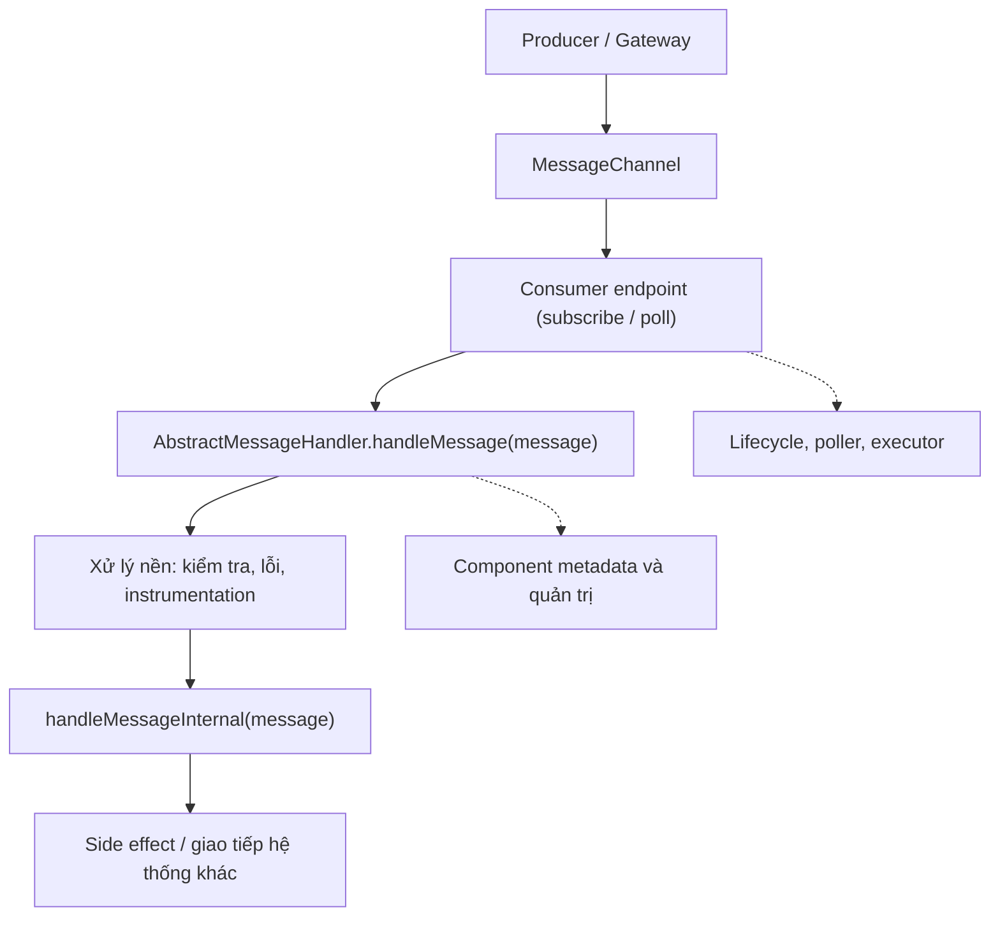

# AbstractMessageHandler và component metadata trong Spring Integration

## Mục tiêu và phạm vi

Trong một message flow, channel vận chuyển message, **consumer endpoint** quyết định khi nào chuyển message cho handler, còn **message handler** thực hiện hành động nghiệp vụ hoặc tích hợp. Lớp `org.springframework.integration.handler.AbstractMessageHandler` là nền tảng phổ biến cho nhiều handler của Spring Integration; các **component metadata** giúp nhận diện, quản lý và quan sát các thành phần này tại runtime.

Bài học thuộc chương **Message handler** của module **SPRING_INTEGRATION_RUNTIME**. Sau bài, bạn có thể:

- Giải thích đường đi từ `MessageChannel` và consumer endpoint tới `handleMessage()` và `handleMessageInternal()`.
- Phân biệt `MessageHandler`, `AbstractMessageHandler`, `AbstractMessageProducingHandler` và các handler tạo reply.
- Viết một handler riêng có metadata rõ ràng, đăng ký vào Spring context và gửi message thử.
- Đọc đúng ý nghĩa của bean name, component name, component type, endpoint ID, managed name/type và component source/description.
- Dùng metadata trong message history, Integration Graph, metrics/tracing và xử lý sự cố.
- Hiểu giới hạn của metadata: tên và loại component không tự bật polling, concurrency, transaction, retry, correlation hoặc message store.

Ví dụ API được trình bày theo dòng Spring Framework 6.x / Spring Integration 6.5.x (Java 17+); khi dùng phiên bản khác, đối chiếu API/Javadoc tương ứng.

## 1. AbstractMessageHandler nằm ở đâu trong runtime?

`MessageHandler` của Spring Messaging có hợp đồng cốt lõi:

```java
public interface MessageHandler {
    void handleMessage(Message<?> message) throws MessagingException;
}
```

Ứng dụng có thể hiện thực interface trực tiếp. Spring Integration cung cấp các lớp nền để tránh lặp lại cơ chế kiểm tra message, xử lý exception, thông tin component và quan sát runtime.



Đường đi này cho thấy hai ranh giới quan trọng:

1. **Endpoint** sở hữu việc nhận message từ channel. Với `DirectChannel`, method handler thường chạy ngay trên thread gọi `send()`; với `ExecutorChannel` hoặc endpoint poller, thread phụ thuộc executor/poller.
2. **Handler** sở hữu phần xử lý của message. `AbstractMessageHandler` cung cấp một phương thức public `handleMessage()` và yêu cầu subclass cài đặt phương thức protected `handleMessageInternal()`.

Một handler có thể nhận được nhiều message từ một endpoint, nhưng bản thân việc tạo handler bean không khiến nó tự subscribe vào channel. Cần cấu hình consumer endpoint hoặc subscribe một `MessageHandler` vào `SubscribableChannel` phù hợp.

### Cây kế thừa đáng nhớ

```text
IntegrationObjectSupport
  └─ MessageHandlerSupport
       ├─ AbstractMessageHandler
       │    ├─ AbstractMessageProducingHandler
       │    │    └─ AbstractReplyProducingMessageHandler
       │    ├─ LoggingHandler
       │    ├─ MethodInvokingMessageHandler
       │    └─ ... các handler khác
       └─ AbstractReactiveMessageHandler
```

Đây là sơ đồ giản lược các nhánh tiêu biểu, không phải đầy đủ mọi subclass. Mỗi tầng bổ sung trách nhiệm:

| Tầng | Trách nhiệm nổi bật |
|---|---|
| `IntegrationObjectSupport` | Truy cập BeanFactory/ApplicationContext khi cần; hỗ trợ initialization, `NamedComponent` và metadata (name, type, source, description). |
| `MessageHandlerSupport` | Cơ sở cho quản lý/tracking, logging, metrics/observation, thứ tự và chuẩn hóa các tình huống lỗi cơ bản. |
| `AbstractMessageHandler` | Hiện thực hợp đồng `MessageHandler`, gọi logic chuyên biệt qua `handleMessageInternal`; trong Spring Integration 6.x còn là một Reactive Streams subscriber. |
| `AbstractMessageProducingHandler` | Thêm cơ chế tạo/gửi output message và quản lý output channel, send timeout, header propagation. |
| `AbstractReplyProducingMessageHandler` | Cơ sở phổ biến cho handler sinh reply theo mô hình request/reply, thường dùng bởi transformer/service activator. |

**Không phải mọi handler đều phát reply.** `handleMessageInternal(Message<?>)` có kiểu trả về `void`; các handler gửi thông điệp tiếp theo thực hiện điều đó qua API của nhánh producing handler hoặc qua channel thích hợp. Đừng chờ một `return value` từ `handleMessage()`.

## 2. Hợp đồng của AbstractMessageHandler

Trong Spring Integration 6.5.x, hai điểm mở rộng liên quan trực tiếp là:

```java
public abstract class AbstractMessageHandler
        extends MessageHandlerSupport implements MessageHandler {

    @Override
    public void handleMessage(Message<?> message) {
        // Phần khung xử lý chung do framework quản lý.
    }

    protected abstract void handleMessageInternal(Message<?> message);
}
```

Đoạn trên là *mô tả cấu trúc API*, không phải mã nguồn nội bộ đầy đủ của framework. Khi viết subclass, bạn thực hiện `handleMessageInternal`, **không tự gọi trực tiếp phương thức internal từ bên ngoài**.

Phần xử lý nền kế thừa từ `MessageHandlerSupport`/`AbstractMessageHandler` thực hiện các bước tùy cấu hình và phiên bản, bao gồm:

- Kiểm tra input message hợp lệ, không có payload `null`.
- Xử lý và chuẩn hóa exception (đặc biệt checked exception) thành các lỗi messaging thích hợp.
- Gắn logging/metrics/observation khi registry và quản lý tương ứng đã được cấu hình.
- Gọi implementation riêng của subclass.

`AbstractMessageHandler` cũng cung cấp `onSubscribe`, `onNext`, `onError` và `onComplete` của Reactive Streams subscriber trong nhánh 6.x. Sự hiện diện của các phương thức này **không tự chuyển handler sang thread khác**, cũng không biến mọi channel thành reactive pipeline. Thread và backpressure cần xét theo đường tích hợp thực tế.

### Khởi tạo handler

`IntegrationObjectSupport` thực hiện `InitializingBean`: `afterPropertiesSet()` là `final`, và subclass có thể mở rộng bước khởi tạo qua `onInit()`.

```java
@Override
protected void onInit() {
    super.onInit();
    // Kiểm tra cấu hình hoặc chuẩn bị tài nguyên cần thiết.
}
```

Nếu bean do Spring quản lý, Spring gọi lifecycle initialization. Nếu tự tạo bằng `new` bên ngoài context, phải tự quản lý cấu hình và lifecycle thích hợp; đừng giả định các phụ thuộc vào BeanFactory/TaskScheduler đã có sẵn.

## 3. Component metadata là gì?

**Component metadata** mô tả *thành phần runtime* — ví dụ “đây là handler ghi audit cho đơn hàng”. Nó khác với **message headers**, vốn mô tả *một message cụ thể* — ví dụ `correlationId=order-42`. Hai loại dữ liệu tồn tại ở hai tầng độc lập:

```text
Component (ít thay đổi giữa các message)
  beanName        = orderAudit.handler
  componentName   = orderAudit.handler
  componentType   = order-audit-handler
  managedName     = orders.audit
  description     = Ghi dấu vết xử lý đơn hàng

Message #1                             Message #2
  id = UUID-A                           id = UUID-B
  payload = "ORD-100"                    payload = "ORD-200"
  correlationId = "batch-7"              correlationId = "batch-8"
```

### Các thuộc tính và API

| Thuộc tính/API | Ý nghĩa | Nguồn/API chính |
|---|---|---|
| `getBeanName()` | Tên bean được Spring truyền qua `BeanNameAware`. | `IntegrationObjectSupport` |
| `setComponentName(String)`, `getComponentName()` | Danh tính logic của component. Nếu không đặt riêng, `getComponentName()` mặc định về bean name khi có. | `NamedComponent` / `IntegrationObjectSupport` |
| `getComponentType()` | Loại chức năng của component; subclass có thể override để cung cấp chuỗi nhận diện có ý nghĩa. | `NamedComponent` / `MessageHandlerSupport` |
| `setComponentDescription(String)`, `getComponentDescription()` | Mô tả dễ đọc cho con người; có thể lấy từ bean definition nếu không đặt riêng. | `ComponentSourceAware` / `IntegrationObjectSupport` |
| `setComponentSource(Object)`, `getComponentSource()` | Nguồn cấu hình tạo bean; có thể là metadata nguồn của bean definition hoặc `null`. | `ComponentSourceAware` |
| `setManagedName(String)` / `getManagedName()` | Tên quản lý/định danh theo cơ chế `IntegrationManagement`. | `MessageHandlerSupport` |
| `setManagedType(String)` / `getManagedType()` | Loại được dùng bởi cơ chế quản lý; khác với một Java `Class<?>`. | `MessageHandlerSupport` |
| `getIntegrationPatternType()` | Loại Enterprise Integration Pattern mà component triển khai, nếu framework cung cấp. | `IntegrationPattern` |
| `setOrder(int)` / `getOrder()` | Thứ tự xử lý khi cơ chế điều phối hỗ trợ ordering. | `Orderable` / `MessageHandlerSupport` |
| `setLoggingEnabled(boolean)` | Bật/tắt một phần logging debug ở thành phần quản lý; không thay thế cấu hình logger hoặc cơ chế xử lý exception. | `IntegrationManagement` |

Hai điểm dễ nhầm:

- `beanName` là định danh container, còn `componentName` có thể được đặt khác. Đối với metrics/history, tên được sử dụng còn phụ thuộc cách handler được đăng ký và cấu hình theo dõi.
- `componentType`, `managedType` và `integrationPatternType` **không phải cùng một giá trị**. Một chuỗi loại component để hiển thị/quan sát không tự xác lập hành vi nghiệp vụ hay hợp đồng chuyển message.

Vì các thuộc tính này dùng để gắn nhãn và quan sát, nên chọn tên **ổn định, không chứa ID khách hàng hay ID của từng message**. Một component mới cho mỗi message sẽ khiến cardinality của metrics tăng mạnh và graph khó phân tích.

## 4. Endpoint ID khác handler bean name như thế nào?

Đối với một consuming endpoint, Spring Integration thường có ít nhất:

- **Consumer endpoint** nhận message từ input channel và quản lý vòng đời subscribe/poll.
- **Message handler** xử lý message mà endpoint chuyển tới.

Một bean có annotation `@ServiceActivator` trên method POJO có thể tạo tên tự động khác với một `@Bean` trả về `MessageHandler`. Khi cần tên dễ chẩn đoán, có thể gắn `@EndpointId` để chủ động đặt ID của **consumer**, còn `@Bean` đặt tên cho **handler**:

```java
@Bean("orderAudit.handler")
@EndpointId("orderAudit")
@ServiceActivator(inputChannel = "auditInput")
public MessageHandler orderAuditHandler() {
    return new OrderAuditHandler();
}
```

Trong cách khai báo này, `orderAudit` là ID của consumer endpoint, còn `orderAudit.handler` là tên bean handler. Với handler không thuộc nhánh `AbstractReplyProducingMessageHandler`, framework có thể tạo thêm `ReplyProducingMessageHandlerWrapper` để đáp ứng cơ chế endpoint; vì vậy một flow đôi khi có thêm bean `.wrapper`. Đây không phải là một message handler mới do bạn tự đăng ký để xử lý cùng message lần thứ hai.

**Lifecycle** như `start()`, `stop()`, `isRunning()` thuộc consumer endpoint (thường là `SmartLifecycle`); không thể kết luận handler đang nhận message chỉ vì handler bean còn tồn tại hoặc `getComponentName()` trả về đúng tên. Khi sử dụng dynamic `IntegrationFlow`, kiểm tra registration và trạng thái endpoint riêng.

## 5. Ví dụ chạy được: handler tùy biến có metadata

Tình huống: flow tiếp nhận mã đơn hàng, handler ghi nhận audit. Không cần reply; consumer và handler có ID riêng. Ví dụ minh họa Spring Integration Java configuration (có `spring-integration-core` cùng Spring context).

```java
import org.springframework.context.SmartLifecycle;
import org.springframework.context.annotation.AnnotationConfigApplicationContext;
import org.springframework.context.annotation.Bean;
import org.springframework.context.annotation.Configuration;
import org.springframework.integration.annotation.EndpointId;
import org.springframework.integration.annotation.ServiceActivator;
import org.springframework.integration.channel.DirectChannel;
import org.springframework.integration.config.EnableIntegration;
import org.springframework.integration.handler.AbstractMessageHandler;
import org.springframework.messaging.Message;
import org.springframework.messaging.MessageChannel;
import org.springframework.messaging.MessageHandler;
import org.springframework.messaging.MessageHandlingException;
import org.springframework.messaging.support.MessageBuilder;

@Configuration
@EnableIntegration
public class AuditExample {

    @Bean
    public MessageChannel auditInput() {
        return new DirectChannel();
    }

    @Bean("orderAudit.handler")
    @EndpointId("orderAudit")
    @ServiceActivator(inputChannel = "auditInput")
    public MessageHandler orderAuditHandler() {
        OrderAuditHandler handler = new OrderAuditHandler();

        // Metadata của component, dùng ổn định trong suốt vòng đời:
        handler.setComponentName("orderAudit.handler");
        handler.setComponentDescription("Ghi nhận audit theo mã đơn hàng");
        handler.setManagedName("orders.audit");
        handler.setManagedType("custom-audit");
        return handler;
    }

    public static class OrderAuditHandler extends AbstractMessageHandler {

        @Override
        public String getComponentType() {
            return "order-audit-handler";
        }

        @Override
        protected void handleMessageInternal(Message<?> message) {
            if (!(message.getPayload() instanceof String orderId)
                    || orderId.isBlank()) {
                throw new MessageHandlingException(
                        message, "Payload phải là mã đơn hàng");
            }

            Object correlationId = message.getHeaders().get("correlationId");
            System.out.printf(
                    "AUDIT order=%s correlation=%s%n",
                    orderId, correlationId);
            // Trong hệ thống thật: gọi một AuditRepository/Client đã DI.
        }
    }

    public static void main(String[] args) {
        try (var ctx =
                new AnnotationConfigApplicationContext(AuditExample.class)) {

            OrderAuditHandler handler =
                    (OrderAuditHandler) ctx.getBean("orderAudit.handler");
            SmartLifecycle endpoint =
                    ctx.getBean("orderAudit", SmartLifecycle.class);

            System.out.println(handler.getBeanName());
            System.out.println(handler.getComponentName());
            System.out.println(handler.getComponentType());
            System.out.println(handler.getManagedName());
            System.out.println("endpoint running = " + endpoint.isRunning());

            MessageChannel input =
                    ctx.getBean("auditInput", MessageChannel.class);

            input.send(MessageBuilder.withPayload("ORD-100")
                    .setHeader("correlationId", "batch-7")
                    .build());
        }
    }
}
```

Giá trị dự kiến ở cấu hình thông thường:

```text
orderAudit.handler
orderAudit.handler
order-audit-handler
orders.audit
endpoint running = true
AUDIT order=ORD-100 correlation=batch-7
```

Điều gì xảy ra?

1. Spring tạo `auditInput` và bean `orderAudit.handler`, đồng thời xử lý annotation thành consumer endpoint `orderAudit`.
2. Consumer subscribe vào `DirectChannel` khi đang chạy.
3. `send()` chuyển message cho consumer, rồi tới `AbstractMessageHandler.handleMessage()`.
4. Khung xử lý gọi `OrderAuditHandler.handleMessageInternal()`; handler kiểm tra payload và ghi audit.
5. Phương thức trả `void`; không có reply channel. Không xuất hiện một reply message chỉ vì có `@ServiceActivator`.

Lưu ý: `OrderAuditHandler` dùng pattern matching của Java 17. Handler thực tế thường nhận một `AuditRepository` qua constructor thay vì `System.out`, và cần bảo đảm side effect không bị lặp khi retry.

### Thử lỗi đầu vào

Thay `"ORD-100"` bằng `""`. `OrderAuditHandler` sẽ ném `MessageHandlingException` gắn với failed message. Qua `DirectChannel`, lỗi thường đi ngược về thread của caller `send()`; nếu đổi sang executor/poller, đường xử lý lỗi có thể khác.

```java
try {
    input.send(MessageBuilder.withPayload("").build());
} catch (org.springframework.messaging.MessagingException ex) {
    System.err.println("handler failed: " + ex.getMessage());
}
```

Không dùng `null` để mô phỏng payload rỗng: hệ thống message và các builder thông thường không chấp nhận payload `null` ngay từ bước dựng message. Muốn kiểm tra business validation, dùng dữ liệu sai kiểu, rỗng, sai định dạng hoặc vi phạm quy tắc nghiệp vụ.

## 6. Tùy biến hành vi đúng tầng

### 6.1. Khi nào kế thừa AbstractMessageHandler?

Phù hợp khi logic của handler chủ yếu thực hiện **side effect** như ghi file, gọi client ngoài, phát event tới một dịch vụ khác hoặc cập nhật cơ sở dữ liệu, và bạn muốn nhận trực tiếp `Message<?>`.

Nếu chỉ cần gọi một service Java thuần, `@ServiceActivator` trên method POJO thường đơn giản hơn. Nếu handler phải phát output message/reply theo semantics của Spring Integration, xem `AbstractMessageProducingHandler` / `AbstractReplyProducingMessageHandler` hoặc DSL `.handle()` thích hợp. Không nên tự viết cơ chế replyChannel, header propagation và send timeout mà nhánh producing đã hỗ trợ.

| Nhu cầu | Hướng triển khai |
|---|---|
| Logic nghiệp vụ từ payload | POJO `@ServiceActivator` hoặc Java DSL `.handle(...)`. |
| Side effect cần kiểm soát trực tiếp `Message<?>` | Subclass `AbstractMessageHandler` hoặc implement `MessageHandler`. |
| Tạo reply message và chuyển tới output channel | Handler thuộc nhánh `AbstractMessageProducingHandler` hoặc endpoint đã có reply semantics. |
| Transform payload | `@Transformer` / transformer phù hợp, tránh tự gửi reply trong handler không producing. |
| Lỗi có retry, transaction, circuit breaker | Cấu hình advice hoặc transaction tại handler/endpoint phù hợp, kèm idempotency. |

### 6.2. Constructor và onInit

Nếu custom handler có dependency bắt buộc, ưu tiên constructor injection:

```java
public final class AuditHandler extends AbstractMessageHandler {

    private final AuditRepository repository;

    public AuditHandler(AuditRepository repository) {
        this.repository = java.util.Objects.requireNonNull(repository);
    }

    @Override
    public String getComponentType() {
        return "audit-handler";
    }

    @Override
    protected void handleMessageInternal(Message<?> message) {
        repository.save(String.valueOf(message.getPayload()));
    }
}
```

Ở ví dụ thứ hai, `AuditRepository` là interface ứng dụng phải định nghĩa; mã chỉ minh họa hướng thiết kế, không phải ví dụ độc lập chạy ngay. Để kiểm tra cấu hình runtime khác (ví dụ một biểu thức hoặc mapping bắt buộc), subclass có thể override `onInit()` và gọi `super.onInit()`. Không override `afterPropertiesSet()` vì phương thức này là `final` trên lớp cha.

### 6.3. Thread safety

Spring thường quản lý handler là singleton. Hai message có thể cùng lúc vào một handler nếu upstream hỗ trợ chạy đồng thời hoặc có nhiều producer. Đừng giữ trạng thái tạm của từng message trong field mutable:

```java
// Không an toàn nếu nhiều thread cùng gọi handler:
private String currentOrderId;

@Override
protected void handleMessageInternal(Message<?> message) {
    currentOrderId = (String) message.getPayload();
    // Gọi I/O chậm tại đây sẽ dễ trộn giá trị giữa các message.
}
```

Thay bằng biến cục bộ trong method, cấu trúc immutable hoặc cơ chế đồng bộ hóa thật sự cần thiết. Việc chuyển `DirectChannel` sang `ExecutorChannel` không thay đổi contract `handleMessage()` nhưng có thể làm lỗi race condition lộ ra.

## 7. Component metadata giúp quan sát runtime như thế nào?

### 7.1. Message history

Bật message history trong cấu hình:

```java
@Configuration
@EnableIntegration
@org.springframework.integration.config.EnableMessageHistory
class HistoryConfig {
    // Khai báo các channel/handler/endpoint ở đây.
}
```

Khi cấu hình history hợp lệ, những named component nằm trong phạm vi theo dõi sẽ bổ sung header lịch sử, giúp xác định message đã đi qua đâu. Các entry thông thường mang thông tin như `name`, `type` và `timestamp`. Có thể giới hạn theo tên component/pattern:

```java
@EnableMessageHistory("orderAudit*", "payment*")
```

Đây là minh họa cho tham số annotation; nên dùng một cấu hình `@EnableMessageHistory` thống nhất trong ApplicationContext, thay vì khai báo nhiều nơi cho cùng flow.

Đọc history nếu có:

```java
import org.springframework.integration.history.MessageHistory;

MessageHistory history = message.getHeaders()
        .get(MessageHistory.HEADER_NAME, MessageHistory.class);

if (history != null) {
    System.out.println(history);
}
```

Không bảo đảm handler nào cũng xuất hiện trong history chỉ vì có `getComponentName()`: còn phụ thuộc cơ chế tracking và danh sách component được chọn. History là **dấu vết đường đi**, không phải message store bền vững hoặc distributed trace đầy đủ. Từ Spring Integration 6.3, cơ chế duy trì history có cải tiến append-only; nếu xây dựng custom fan-out bên ngoài các component framework, chú ý việc clone history khi cần phân nhánh đồng thời.

### 7.2. Metrics và Micrometer Observation

`AbstractMessageHandler` kế thừa khả năng `IntegrationManagement` từ `MessageHandlerSupport`. Khi tích hợp đúng registry/cấu hình quản lý, tên component trở thành dữ liệu hữu ích để gắn nhãn đo đạc.

Hai chế độ liên quan nhưng khác nhau:

| Cơ chế | Cách hoạt động | Điểm cần nhớ |
|---|---|---|
| Micrometer meters | Với `MeterRegistry` và cơ chế metrics phù hợp, có timer cho handler, các tag nhận diện handler, outcome/exception. | Ví dụ tài liệu 6.x: timer `spring.integration.send` với `type=handler` và `name=<componentName>`. |
| Micrometer Observation (6.0+) | Dùng `ObservationRegistry`, `@EnableIntegrationManagement` và `observationPatterns` để chọn component quan sát; có thể kết hợp metrics và tracing qua `ObservationHandler`. | Handler observation có convention `spring.integration.handler`, kèm tags `spring.integration.name` và `spring.integration.type`. |

`@EnableIntegrationManagement` không đồng nghĩa tự có tracing với mọi handler: cần ObservationRegistry và lựa chọn pattern. Theo cấu hình mặc định của tài liệu, các component không tự được instrument bởi Observation chỉ vì registry xuất hiện. `AbstractMessageHandler.setObservationConvention(...)` cho phép thay convention khi muốn điều chỉnh quan sát.

Một ví dụ chọn observation cho tất cả các component được hỗ trợ (chỉ dùng khi ứng dụng đã cấu hình ObservationRegistry và các handler tương ứng):

```java
@Configuration
@EnableIntegration
@org.springframework.integration.config.EnableIntegrationManagement(
        observationPatterns = "*")
class ObservabilityConfig {
    // ObservationRegistry được cấu hình như một Spring bean ở nơi phù hợp.
}
```

**Lựa chọn production:** giới hạn số lượng giá trị của metric tags. Dùng tên component cố định như `orderAudit.handler` thay vì `orderAudit-ORD-100`. Nếu muốn tìm lỗi theo một order ID cụ thể, dùng log/correlation/trace ID ở tầng message thay vì biến order ID thành tên component.

### 7.3. Integration Graph

`IntegrationGraphServer` cung cấp sơ đồ các component runtime (channel, endpoint, handler và quan hệ của chúng) khi được khai báo/configure trong context. Ở nhánh 6.x, lớp này thuộc package `org.springframework.integration.graph`.

- `getGraph()` lấy cấu trúc graph đã cache cùng những thông tin trạng thái/metrics động có thể truy cập.
- `rebuild()` dựng lại cấu trúc graph nếu hệ thống có đăng ký hoặc gỡ flow/component lúc runtime.

Ví dụ ý tưởng khi đã cấu hình bean graph server:

```java
import org.springframework.integration.graph.IntegrationGraphServer;

// graphServer là bean đã được inject từ Spring context.
var graph = graphServer.getGraph();

// Sau khi đăng ký/hủy một IntegrationFlow động:
var refreshedGraph = graphServer.rebuild();
```

Đoạn này giả định biến `graphServer` đã được inject, nhằm minh họa thao tác chẩn đoán. Cần phân quyền nếu expose graph qua HTTP/management vì tên các endpoint/channel có thể tiết lộ cấu trúc hệ thống.

**Metadata chỉ giúp nhận diện.** Graph không chứng minh một message cụ thể đã chạy qua handler; dùng message history/trace/log để biết đường đi thực tế, hoặc quan sát counters/timers để biết có hoạt động.

## 8. Metadata, lifecycle, transaction và lỗi

Đặt metadata vào đúng bối cảnh của module runtime:

| Vấn đề runtime | Chủ thể điều khiển chủ yếu | Metadata giúp gì? |
|---|---|---|
| Handler có được gọi? | Subscription, endpoint đang chạy, channel và poller | Tìm đúng endpoint và handler theo ID; đối chiếu graph/log. |
| Thread đang chạy method? | `DirectChannel`, `ExecutorChannel`, poller, executor | Nhận diện handler khi log thread và thời gian xử lý. |
| Bật/dừng một flow | `SmartLifecycle` endpoint, `IntegrationFlowContext` | Chỉ tên consumer cần start/stop; tên handler không phải nút bật/tắt. |
| Giao dịch được commit/rollback? | Transaction boundary tại caller, poller, advice/handler | Gắn nhãn handler trong logs/metrics để điều tra ranh giới transaction. |
| Retry và lỗi cuối cùng | Retry advice, cơ chế transport/source, error channel | Định vị handler gây lỗi và gom metrics theo component. |
| Lưu message/correlation | Message store, aggregator/resequencer, message headers | Truy vết thành phần xử lý; component metadata không thay correlation key. |
| Hiệu năng | Queue, executor, I/O, handler code, downstream | Tách thời gian đợi queue với thời gian thực thi handler nhờ metrics/trace. |

### Đồng bộ và bất đồng bộ

- `DirectChannel` thường gọi `handleMessage()` trong thread gửi, nên exception có thể truyền về caller và transaction thread-bound đang có có thể bao trùm handler nếu cấu hình phù hợp.
- `ExecutorChannel` tạo ranh giới thread; transaction và `ThreadLocal` của producer không tự động đi theo.
- `QueueChannel` cùng poller chạy theo lịch và transaction context của poller, chứ không phụ thuộc tên handler.
- Handler không có `isRunning()` theo kiểu lifecycle endpoint; một bean có metadata hợp lệ vẫn có thể **không nhận được message** khi consumer dừng hoặc channel không có message.

### Exception và errorChannel

Khi `handleMessageInternal()` ném exception, tầng xử lý cơ sở có thể bọc/chuẩn hóa exception thành `MessagingException`; giữ nguyên failed message/cause hữu ích để chẩn đoán.

- Với luồng đồng bộ, caller có thể thấy exception ngay tại `send()`.
- Với consumer bất đồng bộ, exception thường do phần tử tiêu thụ và error flow xử lý, có thể tạo `ErrorMessage` đến `errorChannel` khi cấu hình và transport hỗ trợ.
- Bật retry nghĩa là handler có thể được gọi nhiều lần cho cùng message. Nếu handler ghi DB/gọi hệ thống ngoài, cần thiết kế idempotent; metadata không có tác dụng chống xử lý trùng.

Tắt logging qua `setLoggingEnabled(false)` không tắt handler, không xóa lỗi và không thay thế cấu hình để định tuyến exception. Chỉ dùng thuộc tính này khi cần giảm chi phí logging debug của các component trong flow nhiều message.

## 9. Chẩn đoán bằng component metadata

Nếu “đã gửi message nhưng handler không chạy”, làm theo thứ tự:

1. **Xác định danh tính:** in `getBeanName()`, `getComponentName()`, `getComponentType()` của handler; tìm bean endpoint ID tương ứng.
2. **Kiểm tra wiring:** input channel có đúng tên? consumer endpoint có subscribe đúng channel hoặc poller đúng nguồn?
3. **Kiểm tra lifecycle:** endpoint `SmartLifecycle.isRunning()` là `true` không? Khi dùng dynamic flow có còn registration không?
4. **Kiểm tra transport và thread:** channel đồng bộ hay bất đồng bộ, queue có tồn message, executor có backlog không?
5. **Đọc exception chain:** lỗi ném từ code handler hay từ hạ tầng dispatch? Có retry/error channel che lỗi của caller không?
6. **Đối chiếu quan sát:** graph cho biết topology; message history/trace cho biết đường đi; metrics cho biết số lần và thời gian xử lý nếu được bật.
7. **Kiểm tra correlation/transaction:** nếu nghi mất reply, aggregation chờ hoặc rollback, quan sát message headers/store và transaction boundaries thay vì đổi `componentName`.

Một số triệu chứng và nguyên nhân dễ nhầm:

| Triệu chứng | Cách hiểu đúng |
|---|---|
| `getBeanName()` và `getComponentName()` khác nhau | Có thể do component name được đặt tường minh; không có nghĩa đăng ký hai handler. |
| Có bean `orderAudit.handler.wrapper` | Có thể là wrapper do framework tạo cho endpoint; tra vai trò trước khi kết luận handler bị gọi hai lần. |
| Graph có handler nhưng `isRunning()` của endpoint là false | Component tồn tại nhưng consumer đang dừng, nên không có invocation mới qua endpoint đó. |
| Message history không chứa tên handler | Có thể chưa bật tracking hoặc component không nằm trong pattern; graph và history phục vụ mục đích khác nhau. |
| Metrics không có số liệu cho handler | Kiểm tra registry, cấu hình management, observation patterns và có message thực sự đi qua chưa. |
| Sau khi đổi sang executor, request không bắt được lỗi | Exception phát sinh trong thread xử lý khác; cần đọc error channel/log/observation. |
| Message bị xử lý trùng | Xem retry, redelivery, acknowledgment, concurrency và idempotency; tên component không quyết định số lần gọi. |

### Bài tập thực hành

1. Chạy `AuditExample`; ghi lại tên handler bean, component name, component type, managed name và trạng thái endpoint.
2. Đổi `setComponentName("orderAudit.handler")` thành một tên cố định khác. So sánh `getBeanName()` với `getComponentName()`; giữ `@EndpointId("orderAudit")` và quan sát consumer ID không đổi.
3. Thử truyền payload không hợp lệ; xác định vị trí exception xuất hiện khi dùng `DirectChannel`.
4. Bật `@EnableMessageHistory` rồi gửi message qua thêm một transformer hoặc bridge; xem lịch sử thay đổi và ảnh hưởng của tracking pattern.
5. Khi có Micrometer/ObservationRegistry, cấu hình một handler được instrument và đối chiếu tag tên/loại component với metadata đã đặt.
6. Thêm một poller/executor ở upstream; in `Thread.currentThread().getName()` bên trong handler để kiểm tra ai điều phối việc gọi method.
7. Dừng consumer endpoint `orderAudit` trong môi trường thử nghiệm và kiểm tra message send behavior. Một số channel có thể báo không có subscriber; một số cấu trúc queue lại giữ message chờ poll.

Không cần thay tên handler theo từng order để theo dõi: nên dùng message ID và correlation ID trong logs/traces, còn component name/type giữ nhất quán cho toàn bộ message flow.

## 10. Checklist khi triển khai production

- [ ] Mỗi handler có mục đích rõ, trách nhiệm vừa đủ và hợp đồng payload/header minh bạch.
- [ ] Endpoint ID và handler bean name được đặt theo quy ước nhất quán, dễ tra cứu trong logs và graph.
- [ ] Component name/type/managed name dùng giá trị ổn định, có thể ghép tag vào metrics mà không gây tăng cardinality.
- [ ] Handler stateless hoặc thread-safe với cấu hình executor/poller hiện tại.
- [ ] Exception, retry, transaction và idempotency được kiểm tra bằng integration tests qua channel thật.
- [ ] Trạng thái endpoint và tình trạng queue/executor được quan sát tách biệt với dữ liệu metadata của handler.
- [ ] Khi dùng dynamic `IntegrationFlow`, cập nhật/rebuild graph nếu topology thay đổi; có kịch bản stop/start và cleanup phù hợp.
- [ ] Bật message history/metrics/tracing có chọn lọc để cân bằng khả năng chẩn đoán với chi phí runtime.

## Tài liệu tham khảo

- [AbstractMessageHandler — Spring Integration 6.5.x Javadoc](https://docs.spring.io/spring-integration/docs/6.5.x/api/org/springframework/integration/handler/AbstractMessageHandler.html)
- [MessageHandlerSupport — Spring Integration 6.5.x Javadoc](https://docs.spring.io/spring-integration/docs/6.5.x/api/org/springframework/integration/handler/MessageHandlerSupport.html)
- [IntegrationObjectSupport — Spring Integration 6.5.x Javadoc](https://docs.spring.io/spring-integration/docs/6.5.x/api/org/springframework/integration/context/IntegrationObjectSupport.html)
- [Spring Integration Reference — Endpoint bean names và `@EndpointId`](https://docs.spring.io/spring-integration/reference/6.5/overview.html)
- [Spring Integration Reference — Message History](https://docs.spring.io/spring-integration/reference/6.5/message-history.html)
- [Spring Integration Reference — Metrics and Management](https://docs.spring.io/spring-integration/reference/6.5/metrics.html)
- [Spring Integration Reference — Integration Graph](https://docs.spring.io/spring-integration/reference/6.5/graph.html)

**Ghi nhớ:** `AbstractMessageHandler` cung cấp bộ khung xử lý một `Message<?>`; `handleMessageInternal()` là nơi subclass thực hiện hành động. Component metadata trả lời câu hỏi **“đây là thành phần nào?”**; channel, endpoint, poller, executor và cấu hình quản lý trả lời câu hỏi **“thành phần đó đang được gọi như thế nào và có đang chạy hay không?”**.

