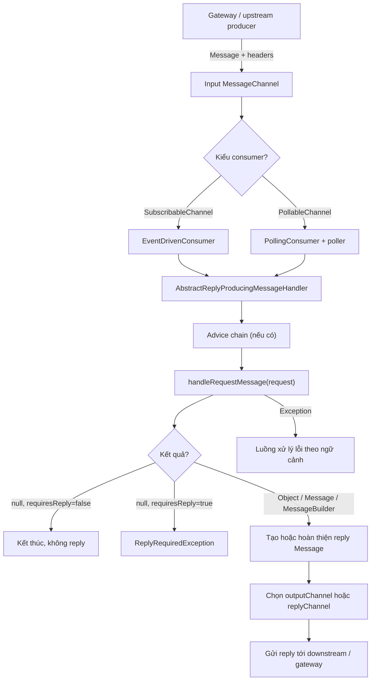

# AbstractReplyProducingMessageEndpoint: cơ chế tạo và gửi reply trong Spring Integration

## 1. Vị trí của chủ đề trong runtime

Trong Spring Integration, một **message endpoint** kết nối `MessageChannel` với logic xử lý. Consumer lấy hoặc nhận message từ channel; `MessageHandler` thực hiện xử lý; một số handler có thể phát sinh message trả lời (reply). Bài này tập trung vào chu trình request–reply, cách framework định tuyến reply, xử lý lỗi và tác động của thread, transaction, retry trong runtime.

**Làm rõ tên gọi:** `AbstractReplyProducingMessageEndpoint` là tên **chủ đề** trong học phần, không phải tên lớp trừu tượng được công bố trong API Spring Integration. Lớp tương ứng là **`org.springframework.integration.handler.AbstractReplyProducingMessageHandler`**. Tách bạch hai khái niệm:

- **Consumer/endpoint:** `EventDrivenConsumer` hoặc `PollingConsumer` kết nối input channel với handler và quản lý việc subscribe/poll, start/stop.
- **Reply-producing handler:** nhận một `Message<?>`, gọi logic nghiệp vụ, tạo và gửi reply nếu có. Lớp cơ sở `AbstractReplyProducingMessageHandler` là nơi các handler chuyên biệt kế thừa hành vi này.

Chuỗi kế thừa cần nhớ:

```text
AbstractMessageHandler
  └── AbstractMessageProducingHandler
        └── AbstractReplyProducingMessageHandler
              ├── ServiceActivatingHandler
              ├── MessageTransformingHandler
              ├── BridgeHandler
              └── nhiều outbound gateway/handler khác
```

`AbstractReplyProducingMessageHandler` là **abstract class**, không nên tạo instance trực tiếp. Phần lớn ứng dụng dùng `@ServiceActivator` hoặc Java DSL `.handle(...)`; chỉ kế thừa lớp này khi cần viết một handler tái sử dụng với cơ chế xử lý riêng.

### Mục tiêu sau bài học

1. Phân biệt channel, endpoint/consumer, handler và reply channel trong quá trình thực thi.
2. Dự đoán chính xác trường hợp tạo reply, không tạo reply, hoặc ném lỗi.
3. Cấu hình `requiresReply`, `outputChannel`, advice, async và header propagation có chủ đích.
4. Chẩn đoán các tình huống gateway timeout, lệch transaction/thread, retry lặp thao tác và mất correlation.

## 2. Luồng thực thi từ request đến reply



Theo thứ tự thực thi:

1. Consumer nhận message: subscribe trực tiếp với `SubscribableChannel` hoặc poll từ `PollableChannel`. Việc chạy trên thread nào phụ thuộc channel, poller và executor, **không** phụ thuộc tên lớp handler.
2. `handleMessage(Message<?>)` dẫn tới phương thức `handleMessageInternal(...)` của lớp cơ sở. Đây là phần điều phối chung, được khai báo `final` để các subclass không thay đổi trình tự cơ bản.
3. Framework áp dụng `adviceChain` (nếu cấu hình) quanh lời gọi xử lý request và gọi phương thức mở rộng `handleRequestMessage(Message<?>)`.
4. Nếu trả `null`, luồng kết thúc im lặng khi `requiresReply=false`; ngược lại ném `ReplyRequiredException`.
5. Nếu trả về giá trị, framework chuyển kết quả thành reply message rồi tìm đích gửi. Giá trị có thể là payload Java thuần, `Message<?>` hoặc `MessageBuilder`.
6. Gửi reply có thể chặn, ném exception, hoặc được hoàn tất bất đồng bộ tùy loại channel và kết quả xử lý. Handler không tự tạo một poller, executor hay transaction mới.

**Phân biệt hai kiểu "không có dữ liệu":** `null` là tín hiệu không tạo reply; chuỗi rỗng `""`, `Optional.empty()`, danh sách rỗng hoặc payload khác vẫn là **một giá trị trả về**, không mặc định đồng nghĩa với không reply. Không dùng `null` tùy tiện nếu phía gateway luôn cần phản hồi.

## 3. Các điểm mở rộng và cấu hình quan trọng

| Thành phần | Vai trò ở runtime | Cần lưu ý |
|---|---|---|
| `handleRequestMessage(Message<?>)` | Phương thức `protected abstract` để subclass xử lý request | Trả `Object`, `Message`, `MessageBuilder` hoặc `null`; không tự gửi reply lần nữa nếu đã return cho framework. |
| `handleMessageInternal(Message<?>)` | Điều phối lời gọi và kết quả xử lý | `final`; subclass không override phương thức này. |
| `setRequiresReply(boolean)` | Áp đặt hợp đồng phải có reply | Mặc định `false`; `true` + kết quả `null` → `ReplyRequiredException`. |
| `setAdviceChain(List<Advice>)` | Bọc phần xử lý request bằng advice | Phù hợp retry, circuit breaker, tracing tại handler; không mặc nhiên bao trùm tất cả downstream. |
| `setOutputChannel(...)` / `setOutputChannelName(...)` | Chỉ định đích reply tĩnh | Có độ ưu tiên cao hơn `replyChannel` header của request. |
| `setSendTimeout(long)` | Giới hạn thời gian gửi tới channel có khả năng chặn | Khác với **thời gian gateway chờ reply**; `DirectChannel` không dùng timeout này để giới hạn thời gian logic nghiệp vụ. |
| `setAsync(boolean)` | Xử lý reply kiểu `CompletableFuture` hoặc reactive `Publisher` theo cơ chế async | Không phải công tắc tạo thread cho mọi handler. |
| `setNotPropagatedHeaders(...)` | Chặn sao chép các header khớp pattern từ request | Không xóa header đã được đặt rõ ràng trong `Message` trả về; kiểm tra cả yêu cầu bảo toàn correlation. |

### Quy tắc chọn kênh reply

Khi handler trả một kết quả khác `null`, đích reply thường được chọn theo thứ tự:

1. `outputChannel` cấu hình trực tiếp trên handler/endpoint, nếu có.
2. `replyChannel` trong **request message** (có thể là `MessageChannel` hoặc tên channel dạng `String` cần được resolve).
3. Nếu request không có `replyChannel` và kết quả là một `Message`, có thể sử dụng `replyChannel` từ **reply message** đó.

Nếu không có đích hợp lệ để gửi reply, hoặc tên channel không resolve được, việc phát reply thất bại (ví dụ `DestinationResolutionException`). Một `outputChannel` không đúng thường là nguyên nhân gateway chờ hết hạn dù nghiệp vụ đã trả kết quả.

```text
Có outputChannel = "audit.out":
  request.replyChannel = temporaryGatewayReplyChannel
  handler trả "OK"
  => reply được gửi tới audit.out, không tự quay về gateway

Không cấu hình outputChannel:
  request.replyChannel = temporaryGatewayReplyChannel
  handler trả "OK"
  => reply quay về temporaryGatewayReplyChannel
```

Muốn chủ đích **bỏ** kết quả ở cuối flow, có thể đưa output vào `nullChannel`. Cần phân biệt điều đó với vô ý mất đường trả lời. Trong request–reply thật sự, không trỏ reply sang `nullChannel` nếu caller vẫn đang chờ.

### Headers, message ID và correlation

- Khi method trả **payload thuần**, Spring Integration tạo một reply `Message` và thông thường sao chép các header thích hợp từ request.
- Khi trả một `Message<?>` hoàn chỉnh, handler kiểu service activator vẫn có thể bổ sung các request header còn thiếu vào reply. Để loại header không mong muốn, sử dụng `HeaderFilter` tại một bước rõ ràng hoặc cấu hình propagation thích hợp.
- Các header như `replyChannel` và `errorChannel` mang ý nghĩa điều phối; xóa chúng sai thời điểm sẽ phá request–reply hoặc xử lý lỗi. `correlationId` và `sequenceNumber` có thể được các pattern splitter/aggregator sử dụng, nhưng lớp handler này **không mặc nhiên phát sinh correlationId mới cho từng request**.
- Reply là một message mới nên đừng giả định `id` của reply luôn trùng `id` của request. Muốn liên hệ giao dịch nghiệp vụ, nên truyền một header như `orderId`/`traceId` và kiểm tra nó ở cả hai phía.

## 4. Ví dụ thực hành: gateway gọi service activator

Ví dụ với Spring Boot và `spring-boot-starter-integration`. Các class dưới đây có thể đặt cùng package; bổ sung imports tương ứng khi triển khai. `@IntegrationComponentScan` đăng ký giao diện gateway; `@EnableIntegration` bật cấu hình Spring Integration khi ứng dụng không tự cấu hình sẵn.

```java
@SpringBootApplication
@EnableIntegration
@IntegrationComponentScan
public class StockApplication {
    public static void main(String[] args) {
        SpringApplication.run(StockApplication.class, args);
    }
}

@MessagingGateway
interface StockGateway {
    @Gateway(requestChannel = "stock.requests")
    String lookup(String sku);
}

@Component
class StockService {
    @ServiceActivator(inputChannel = "stock.requests", requiresReply = "true")
    public String lookup(String sku) {
        if (sku == null || sku.isBlank()) {
            return null; // Vi phạm requiresReply => ReplyRequiredException.
        }
        return "available:" + sku;
    }
}
```

**Lần gọi `stockGateway.lookup("SKU-42")` diễn ra như sau:**

1. Gateway tạo request có payload `"SKU-42"` và gắn một reply channel tạm vào header.
2. `stock.requests` được consumer của service activator nhận; handler gọi `StockService.lookup`.
3. Chuỗi `"available:SKU-42"` được bọc thành reply `Message`; do không khai báo `outputChannel`, handler dùng reply channel từ request.
4. Gateway nhận reply và trả payload thành `String` cho caller.

Với SKU trống, service trả `null`; `requiresReply="true"` khiến lỗi xuất hiện gần nguồn gốc hơn so với chỉ đợi gateway timeout. Lưu ý: nếu có thành phần trước handler chủ động lọc hoặc làm rơi request, cấu hình `requiresReply` tại **handler này** không thể phát hiện message chưa hề tới nó.

### Tự viết handler bằng lớp cơ sở

Khi cần xử lý `Message<?>` trực tiếp, có thể mở rộng `AbstractReplyProducingMessageHandler`:

```java
import org.springframework.integration.handler.AbstractReplyProducingMessageHandler;
import org.springframework.integration.dsl.IntegrationFlow;
import org.springframework.messaging.Message;
import org.springframework.messaging.support.MessageBuilder;
import org.springframework.context.annotation.Bean;
import org.springframework.context.annotation.Configuration;

final class StockHandler extends AbstractReplyProducingMessageHandler {
    @Override
    protected Object handleRequestMessage(Message<?> request) {
        String sku = (String) request.getPayload();

        if (sku.isBlank()) {
            return null;
        }

        return MessageBuilder.withPayload("available:" + sku)
                .setHeader("stockSource", "cache")
                .build();
    }
}

@Configuration
class StockFlowConfig {
    @Bean
    StockHandler stockHandler() {
        StockHandler handler = new StockHandler();
        handler.setRequiresReply(true);
        return handler;
    }

    @Bean
    IntegrationFlow stockFlow(StockHandler handler) {
        return IntegrationFlow.from("stock.requests")
                .handle(handler)
                .get();
    }
}
```

Đây là **phương án thay thế** cho `StockService` ở ví dụ trước; chỉ đăng ký một consumer xử lý request trong bài thực hành. Trên một channel có nhiều subscriber theo kiểu cạnh tranh, request có thể đến một handler khác và kết quả trở nên khó dự đoán.

Trong subclass, ta chỉ cài `handleRequestMessage` và trả đối tượng. Phần tạo reply message, sao chép header phù hợp và gửi vào reply channel do lớp cơ sở xử lý. Không gọi thêm `send` thủ công trong method rồi lại return một reply, vì như vậy dễ phát sinh phản hồi trùng.

## 5. Reply đồng bộ, async và ảnh hưởng của thread

**`DirectChannel`:** consumer thường gọi handler ngay trên thread gửi. Nếu handler chậm, lời gọi `send()`/gateway tương ứng có thể chậm; exception có thể lan theo stack đồng bộ. Transaction gắn với thread có thể đi qua các bước sử dụng `DirectChannel`.

**`ExecutorChannel`:** dispatcher chuyển phần xử lý sang executor. Caller gửi message có thể hoàn tất trước khi business handler chạy xong. Thread-local transaction và context không tự đi qua ranh giới này; exception downstream thường phải được xử lý ở nơi chạy async, ví dụ qua `errorChannel`/error flow phù hợp.

**`QueueChannel` + poller:** queue giữ message để polling consumer chủ động `receive()` theo lịch và giới hạn số message mỗi lượt. Poller là bộ phận của endpoint, không phải tính năng của `AbstractReplyProducingMessageHandler`. Thời gian message chờ trong queue cũng được cộng vào latency mà gateway cảm nhận.

**Trả `CompletableFuture`/`Publisher`:** với cấu hình `async=true` phù hợp, handler có thể gửi reply khi kết quả bất đồng bộ hoàn tất; giá trị future/publisher không bị coi như payload thông thường. Nếu dùng async mà không có đích reply/cơ chế lỗi thích hợp, gateway có thể timeout trước khi future hoàn tất. Async reply không tự khắc phục CPU nghẽn hoặc thread pool cạn tài nguyên. Một số cấu hình reactive có thể tự bật async, nên kiểm tra phiên bản và loại output channel.

| Tình huống | Ranh giới thực thi | Tác động |
|---|---|---|
| `DirectChannel` → handler → `DirectChannel` | Cùng thread ở các bước đồng bộ | Exception lan trực tiếp; transaction theo thread có thể được giữ. |
| `ExecutorChannel` → handler | Dispatch qua executor | Không mặc nhiên dùng chung transaction/context của sender. |
| `QueueChannel` → polling consumer | Message đợi, poller xử lý sau | Có độ trễ queue và giới hạn năng lực poller. |
| Handler trả `CompletableFuture` với async enabled | Phản hồi khi future hoàn thành | Cần timeout và error routing của caller phù hợp. |

**Hai timeout khác nhau:** `sendTimeout` của handler giới hạn chờ **gửi reply vào channel có thể chặn** (ví dụ `QueueChannel` đã đầy); `replyTimeout` của gateway giới hạn chờ **nhận reply**. Tăng một trong hai không tự giải quyết việc xử lý chậm, mất route hoặc deadlock.

## 6. Advice, retry, transaction và error handling

### Advice bọc đoạn xử lý nào?

`setAdviceChain(...)` cấu hình các AOP advice quanh thao tác `handleRequestMessage`. Với service activator, có thể khai báo:

```java
@ServiceActivator(inputChannel = "stock.requests",
                  requiresReply = "true",
                  adviceChain = "retryAdvice")
public String lookup(String sku) {
    return remoteStockClient.lookup(sku);
}

@Bean
RequestHandlerRetryAdvice retryAdvice() {
    return new RequestHandlerRetryAdvice();
}
```

Ví dụ này giả định có `remoteStockClient` và thêm imports tương ứng. `RequestHandlerRetryAdvice` áp dụng retry khi xử lý thất bại; cấu hình số lần, backoff và recovery callback theo chính sách hệ thống. **Retry lặp lại lời gọi nghiệp vụ**, vì vậy thao tác cập nhật dữ liệu hoặc gửi giao dịch phải idempotent hoặc có khóa chống trùng. Không giả định advice này rollback được side effect đã commit ở lần thử trước.

Phạm vi advice tại handler khác với advice/transaction của toàn integration flow. Khi cần retry lại cả quá trình gửi qua một nguồn có redelivery (JMS/Kafka/queue), phải xem xét semantic của inbound adapter, acknowledgment, transaction và stateful retry; không chỉ cài retry tại handler rồi coi là an toàn.

### Đường đi của exception

| Biểu hiện | Nguyên nhân tiêu biểu | Cách kiểm tra |
|---|---|---|
| `ReplyRequiredException` | Handler trả `null` trong khi `requiresReply=true` | Xem branch xử lý và contract trả lời. |
| `DestinationResolutionException` | Header `replyChannel` dạng tên không resolve được | Kiểm tra tên bean channel, header và output channel tĩnh. |
| `MessageDeliveryException` | Reply channel không nhận được message hoặc gửi quá thời gian giới hạn | Kiểm tra subscriber, capacity queue và `sendTimeout`. |
| Gateway timeout, handler có log thành công | Reply bị route sang channel khác, bị mất hoặc hoàn tất muộn | Trace từ request ID/correlation tới channel reply; so sánh với `replyTimeout`. |
| Một message gây xử lý nhiều lần | Retry, redelivery, hoặc nhiều nguồn gửi lặp | Ghi idempotency key, số lần thử và nguồn redelivery. |

Trong flow **đồng bộ**, exception có thể truyền ngược tới caller. Trong flow **bất đồng bộ**, nơi bắt exception phụ thuộc executor, poller hoặc inbound adapter; `errorChannel` được dùng khi có error flow phù hợp. Một header `errorChannel` không có nghĩa **mọi** exception trên mọi thread đều tự được chuyển tới đó. Luôn xác định ranh giới thread và thành phần sở hữu error handling.

Với transaction, quy tắc vận hành là: transaction gắn theo thread. Nếu logic cần đồng nhất DB write + phát message, hãy xác định transaction bắt đầu ở đâu, commit trước hay sau khi reply được gửi, và xử lý trường hợp caller timeout nhưng nghiệp vụ đã commit. Việc chuyển qua `ExecutorChannel` hoặc `QueueChannel` tạo ranh giới cần cấu hình transaction/acknowledgment riêng.

## 7. Chẩn đoán runtime: đi theo dấu message

Khi hệ thống có lỗi request–reply, dùng checklist theo **hành trình của đúng một request**:

1. **Tại caller/gateway:** ghi nghiệp vụ ID, thời điểm gửi, `requestChannel`, timeout và dự kiến kiểu reply.
2. **Tại input channel/consumer:** xác nhận message thực sự được nhận; đọc loại channel (direct, executor hay pollable), số subscriber, trạng thái endpoint đang chạy.
3. **Tại handler:** xác nhận `handleRequestMessage` được gọi, input/payload hợp lệ, advice/retry có chạy và kết quả có phải `null` không.
4. **Tại reply routing:** ghi đích `outputChannel` hoặc `replyChannel` đã resolve; kiểm tra header sau biến đổi, channel có subscriber và có bị full không.
5. **Tại gateway:** xem reply đến sau hạn, bị gửi tới một gateway khác hay không bao giờ được tạo. Đối chiếu log và metrics có cùng business correlation ID.

Các metric về số message nhận/gửi, thời lượng xử lý và channel/handler observation có thể thu qua Spring Integration management/Micrometer khi cấu hình tương ứng. Đừng chỉ nhìn CPU hoặc thời gian method: backlog trong `QueueChannel`, executor queue, polling interval, network I/O và retry backoff đều góp phần vào tổng thời gian chờ.

### Các lỗi thiết kế dễ gặp

- **Cấu hình output channel tĩnh không phù hợp với gateway**: reply rẽ sang nhánh khác. Giải pháp: giữ route theo `replyChannel` của request khi muốn trả trực tiếp; hoặc có bridge rõ ràng.
- **Trả `null` trong RPC nhưng không yêu cầu reply**: gateway timeout khó hiểu. Giải pháp: bật `requiresReply` và có contract rõ cho "không tìm thấy".
- **Dùng executor rồi giả định cùng transaction**: lỗi downstream xảy ra sau khi upstream commit. Giải pháp: thiết kế transaction tại từng ranh giới và cơ chế bù/redelivery thích hợp.
- **Retry phương thức không idempotent**: có thể ghi DB hoặc gửi lệnh nhiều lần. Giải pháp: idempotency key, unique constraint hoặc deduplication nghiệp vụ.
- **Gỡ header tùy tiện**: mất `replyChannel`, `errorChannel`, `correlationId`. Giải pháp: giữ header cần cho flow và lọc có chủ đích tại biên hệ thống.
- **Dùng `sendTimeout` để chữa gateway timeout**: hai timeout áp dụng cho hai thao tác khác nhau. Giải pháp: đo từng chặng và sửa nút thắt đúng nơi.

## 8. Bài tập tự kiểm tra

**Bài 1 — Không có reply.** Một `@MessagingGateway` gọi service activator, service trả `null`. Dự đoán khác biệt giữa `requiresReply=false` và `requiresReply=true`.  
**Đáp án:** Với `false`, handler kết thúc không gửi reply, gateway có thể chờ đến timeout tùy cấu hình; với `true`, handler ném `ReplyRequiredException` tại thời điểm xử lý.

**Bài 2 — Reply đi đâu?** Request mang `replyChannel=temporaryGatewayChannel` nhưng handler đặt `outputChannel=archiveChannel`.  
**Đáp án:** Reply đi tới `archiveChannel`. Gateway không tự nhận reply trừ khi có flow khác gửi nó về channel mà gateway đang đợi.

**Bài 3 — Transaction bị tách.** Một flow xử lý DB transaction rồi chuyển tới `ExecutorChannel`. Consumer đằng sau lỗi. Upstream có chắc rollback không?  
**Đáp án:** Không. Thread của executor thường khác thread của sender nên transaction gắn với sender không tự truyền qua. Cần chiến lược transaction và xử lý lỗi theo đúng ranh giới.

**Bài 4 — Cần mở rộng framework.** Muốn tạo handler đọc payload, trả `Message<?>` có header `stockSource` và giữ cơ chế reply chuẩn, nên override phương thức nào?  
**Đáp án:** Override `handleRequestMessage(Message<?>)` trong subclass `AbstractReplyProducingMessageHandler`; không override `handleMessageInternal` (`final`), và không tự gửi reply trùng.

**Bài 5 — Đo hiệu năng.** Business method chỉ chạy 20 ms nhưng gateway mất 3 giây.  
**Gợi ý điều tra:** Chờ ở queue/poller/executor, retry/backoff, channel gửi reply bị chặn, network hoặc reply đến muộn; đo timestamp từng chặng, không quy toàn bộ latency cho method.

## Tài liệu tham khảo chính thức

- [AbstractReplyProducingMessageHandler API (Spring Integration 6.5.x)](https://docs.spring.io/spring-integration/docs/6.5.x/api/org/springframework/integration/handler/AbstractReplyProducingMessageHandler.html)
- [AbstractMessageProducingHandler API (Spring Integration 6.5.x)](https://docs.spring.io/spring-integration/docs/6.5.x/api/org/springframework/integration/handler/AbstractMessageProducingHandler.html)
- [Service Activator — Request/Reply, Header Propagation](https://docs.spring.io/spring-integration/reference/service-activator.html)
- [Message Endpoints — Event-driven và Polling Consumers](https://docs.spring.io/spring-integration/reference/endpoint.html)
- [Message Channels — ExecutorChannel](https://docs.spring.io/spring-integration/reference/channel/configuration.html)
- [Transaction Boundaries](https://docs.spring.io/spring-integration/reference/transactions.html)
- [Request Handler Advice và Retry](https://docs.spring.io/spring-integration/reference/handler-advice/classes.html)
