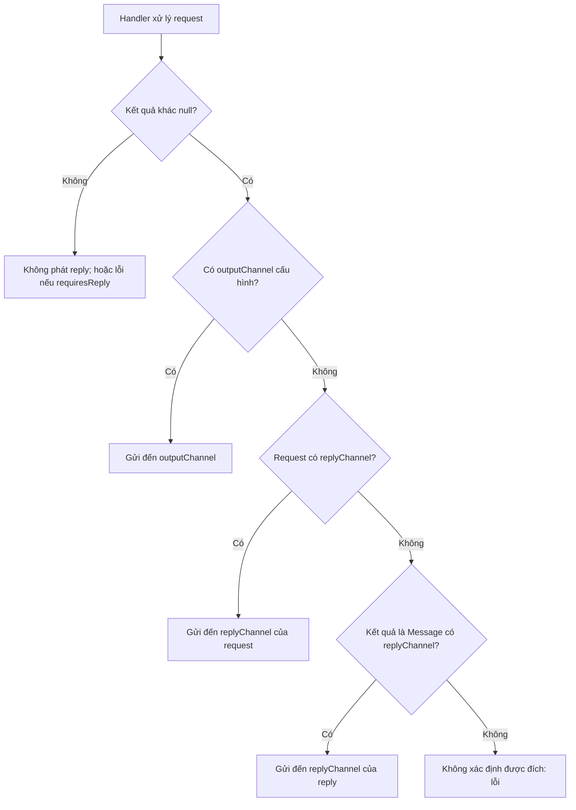
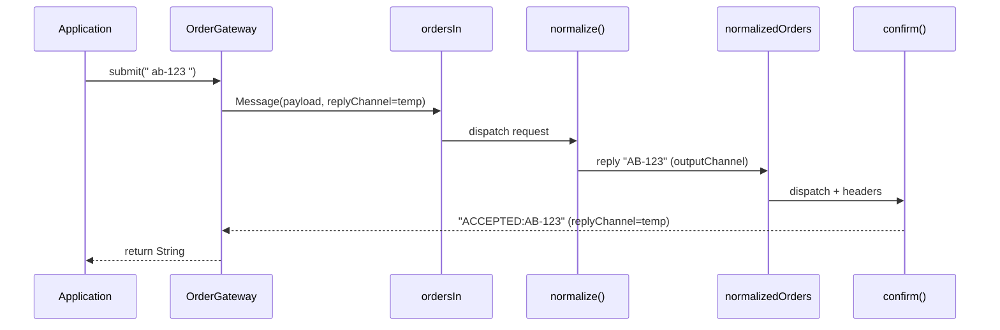

# Reply message và output channel trong Spring Integration

## 1. Mục tiêu và bối cảnh runtime

Trong mô-đun `SPRING_INTEGRATION_RUNTIME`, ta cần hiểu cách Spring Integration chạy và điều phối message flow qua **channel, endpoint, consumer, poller và executor**, cũng như ảnh hưởng của cơ chế đó đến transaction, retry, lỗi, correlation và hiệu năng. Bài này tập trung vào một quyết định diễn ra sau khi **message handler xử lý xong đầu vào**: kết quả có trở thành **reply message** hay không, và nếu có thì framework gửi nó đến **channel nào**.

Sau bài học, bạn có thể:

- Phân biệt giá trị trả về của phương thức xử lý, reply `Message<?>`, `outputChannel` của endpoint và header `replyChannel` của request.
- Giải thích đúng thứ tự ưu tiên khi Spring Integration chọn nơi gửi reply.
- Cấu hình chuỗi handler có bước trung gian và điểm cuối trả kết quả về messaging gateway.
- Dự đoán hành vi khi handler trả `null`/`void`, khi channel đích không tồn tại, hoặc khi gateway hết thời gian chờ.
- Truy vết một reply qua `DirectChannel`, `ExecutorChannel` hoặc luồng có poller mà không nhầm lẫn reply với `correlationId` hay `errorChannel`.

**Tình huống xuyên suốt:** một ứng dụng gọi `OrderGateway.submit(" ab-123 ")`. Bước đầu chuẩn hóa mã đơn, bước sau xác nhận đơn. Ứng dụng muốn nhận chuỗi `ACCEPTED:AB-123` từ gateway, mặc dù các handler nằm trong message flow và không gọi trực tiếp phương thức của caller.

## 2. Bốn khái niệm dễ nhầm

| Khái niệm | Nơi xuất hiện | Vai trò tại runtime |
|---|---|---|
| **Giá trị trả về** (`String`, DTO, `Message<?>`...) | Phương thức service/handler | Dữ liệu được handler tạo sau khi xử lý request. Có giá trị trả về **chưa có nghĩa** đã gửi thành công một reply. |
| **Reply message** | Do endpoint tạo hoặc sử dụng từ kết quả handler | `Message<?>` được chuyển tiếp, gồm `payload` và `headers`; nếu handler trả một payload thường, framework có thể gói payload thành message. |
| **`outputChannel`** | Cấu hình endpoint/handler (ví dụ `@ServiceActivator(outputChannel = "next")`) | Đích cố định do flow định nghĩa để gửi kết quả của endpoint, thường là bước kế tiếp. |
| **Header `replyChannel`** | `headers` của request, ví dụ `MessageHeaders.REPLY_CHANNEL` | *Return address*: địa chỉ để bên xử lý gửi trả kết quả cho bên đã yêu cầu. Gateway thường cung cấp địa chỉ này. |

Một `MessageHandler` cơ bản có phương thức `handleMessage(Message<?>)` trả về `void`, nhưng nhiều handler của Spring Integration, chẳng hạn **service activator**, **transformer** và một số **outbound gateway**, là *reply-producing handler*: chúng xử lý message rồi có thể phát sinh message mới để gửi tiếp. Vì vậy, đừng suy luận rằng `handleMessage()` phải có kiểu trả về mới có reply. Cần xem **hợp đồng của endpoint cụ thể** và cách nó phát kết quả.

`inputChannel` cho biết handler **nhận từ đâu**. `outputChannel` cho biết **kết quả được gửi đi đâu**. Header `replyChannel` cho biết **request mong nhận câu trả lời ở đâu**. Hai đích gửi sau cùng có thể khác nhau và không được coi là đồng nghĩa.

## 3. Spring Integration chọn channel nhận reply như thế nào?

Với một reply-producing endpoint thông dụng như **Service Activator**, sau khi phương thức trả về một kết quả khác `null`, việc chọn đích được thực hiện theo thứ tự sau:

1. Nếu endpoint có **`outputChannel` được cấu hình**, gửi reply đến channel đó.
2. Nếu không có `outputChannel`, thử **`replyChannel` trong header của request gốc**. Header có thể chứa đối tượng `MessageChannel` hoặc tên channel kiểu `String` để framework phân giải.
3. Nếu request không mang `replyChannel` và **kết quả chính là một `Message<?>`**, framework còn có thể xem `replyChannel` trong message kết quả.
4. Nếu vẫn không có đích hợp lệ, việc gửi reply **không thể hoàn tất** và flow báo lỗi. Một tên channel không phân giải được có thể gây `DestinationResolutionException`.

Thứ tự này là quy tắc cho các endpoint reply-producing được mô tả ở đây; với **router, filter, outbound channel adapter** hoặc các endpoint có hợp đồng riêng, cần đọc ngữ nghĩa của loại endpoint đó trước khi suy rộng.



Lưu ý hai điều:

- **`outputChannel` thắng `replyChannel` của request**. Một handler trung gian có thể nhận request từ gateway nhưng vẫn gửi kết quả cho handler kế tiếp, thay vì trả sớm cho gateway.
- **Đây là chọn địa chỉ gửi, không phải chọn luồng chạy.** `DirectChannel` thường gọi consumer trên cùng thread; `ExecutorChannel` chuyển giao công việc sang executor; `QueueChannel` đợi poller/consumer nhận. Đích reply và thời điểm reply hoàn thành là hai vấn đề độc lập.

### Ba trường hợp nhanh

| Cấu hình/kết quả | Đích thực tế | Hệ quả |
|---|---|---|
| Handler A: `outputChannel = "stageB"`; request có `replyChannel = temp` | `stageB` | Handler B tiếp tục xử lý; gateway **chưa** nhận kết quả của A. |
| Handler B: không cấu hình `outputChannel`; request có `replyChannel = temp` | `temp` | Reply quay về gateway đang đợi. |
| Handler B: trả `null`; `requiresReply = false` | Không gửi | Gateway có thể không nhận reply và phải xử lý tình huống không có kết quả. |

## 4. Luồng request–reply hoàn chỉnh bằng annotation

Ví dụ sau dùng **Spring Integration Java annotations**. Đặt các kiểu `FlowConfig`, `OrderGateway`, `OrderHandlers` thành những file Java riêng trong cùng package, và có dependency `spring-integration-core` cùng các thành phần Spring cần thiết. `@EnableIntegration` bật hạ tầng Integration; `@IntegrationComponentScan` đăng ký interface gateway; `@MessageEndpoint` giúp Spring quét lớp xử lý.

**`FlowConfig.java` — khai báo channel:**

```java
package example.integration;

import org.springframework.context.annotation.Bean;
import org.springframework.context.annotation.ComponentScan;
import org.springframework.context.annotation.Configuration;
import org.springframework.integration.annotation.IntegrationComponentScan;
import org.springframework.integration.channel.DirectChannel;
import org.springframework.integration.config.EnableIntegration;
import org.springframework.messaging.MessageChannel;

@Configuration
@EnableIntegration
@ComponentScan(basePackageClasses = OrderHandlers.class)
@IntegrationComponentScan(basePackageClasses = OrderGateway.class)
public class FlowConfig {

    @Bean
    public MessageChannel ordersIn() {
        return new DirectChannel();
    }

    @Bean
    public MessageChannel normalizedOrders() {
        return new DirectChannel();
    }
}
```

**`OrderGateway.java` — lời gọi từ ứng dụng vào message flow:**

```java
package example.integration;

import org.springframework.integration.annotation.Gateway;
import org.springframework.integration.annotation.MessagingGateway;

@MessagingGateway
public interface OrderGateway {

    @Gateway(requestChannel = "ordersIn", replyTimeout = 3000)
    String submit(String orderCode);
}
```

**`OrderHandlers.java` — bước trung gian và bước trả lời cuối:**

```java
package example.integration;

import java.util.Locale;
import org.springframework.integration.annotation.MessageEndpoint;
import org.springframework.integration.annotation.ServiceActivator;

@MessageEndpoint
public class OrderHandlers {

    @ServiceActivator(
        inputChannel = "ordersIn",
        outputChannel = "normalizedOrders",
        requiresReply = "true"
    )
    public String normalize(String orderCode) {
        return orderCode.trim().toUpperCase(Locale.ROOT);
    }

    @ServiceActivator(
        inputChannel = "normalizedOrders",
        requiresReply = "true"
    )
    public String confirm(String normalizedOrder) {
        return "ACCEPTED:" + normalizedOrder;
    }
}
```

Gọi từ một bean ứng dụng đã được Spring quản lý:

```java
String response = orderGateway.submit(" ab-123 ");
// response == "ACCEPTED:AB-123"
```

**Diễn biến runtime:**



1. Gateway tạo message request và thường gắn một **temporary reply channel** vào header `replyChannel` để chờ kết quả của lần gọi đó.
2. `normalize()` trả về `"AB-123"`. Endpoint tạo reply message, giữ các header cần thiết và vì có `outputChannel = "normalizedOrders"` nên gửi sang bước tiếp theo.
3. `confirm()` trả về `"ACCEPTED:AB-123"`. Endpoint này **không có** `outputChannel`; nó sử dụng `replyChannel` đã được truyền dọc theo request để đưa kết quả về gateway.
4. Gateway nhận reply và trả payload theo kiểu khai báo của phương thức `submit()`.

**Thử sửa để thấy rõ ưu tiên:** nếu đặt `outputChannel = "auditOnly"` ở `confirm()` thì kết quả sẽ được gửi tới `auditOnly`; nó **không tự động** quay về temporary reply channel của gateway. Nếu `auditOnly` không có consumer thích hợp, luồng có thể lỗi; nếu có consumer nhưng không trả lại reply, lời gọi gateway có thể chờ đến timeout. Khi muốn tiếp tục rồi cuối cùng quay về gateway, hãy thêm handler/bridge thích hợp ở cuối nhánh.

## 5. Payload, message và header khi tạo reply

Một service activator có thể trả về **payload** (`String`, DTO...) hoặc **`Message<?>` hoàn chỉnh**:

```java
@ServiceActivator(inputChannel = "calculateIn")
public String calculate(String request) {
    return "result:" + request;
}

// Hoặc, khi cần chủ động đặt header của reply:
@ServiceActivator(inputChannel = "calculateIn")
public Message<String> calculateWithHeader(String request) {
    return MessageBuilder.withPayload("result:" + request)
            .setHeader("resultType", "computed")
            .build();
}
```

*Hai phương thức trên minh họa hai cách thay thế nhau; không đăng ký đồng thời cả hai làm consumer cùng `calculateIn` trong một ví dụ request–reply đơn giản.* Đoạn thứ hai cần `org.springframework.messaging.Message` và `org.springframework.messaging.support.MessageBuilder`.

Với **service activator** dựa trên phương thức POJO, khi trả payload thông thường, framework tạo reply message và **sao chép các request header phù hợp**. Khi trả sẵn `Message<?>`, service activator cũng bổ sung các request header còn thiếu vào reply. Vì vậy:

- Header `replyChannel` và `errorChannel` thường đi tiếp qua các service activator; đây là điều cho phép handler cuối gửi câu trả lời về đúng gateway.
- Nếu cố xóa một header chỉ bằng cách tạo một `Message<?>` mới không chứa nó, header có thể **được bổ sung lại**. Muốn lọc header trong flow, dùng `HeaderFilter` hoặc một bước biến đổi có chính sách header rõ ràng.
- Không được giả định mọi transformer, adapter hay bước serialize/deserialize đều giữ header như service activator. Đặc biệt, header chứa **đối tượng** `MessageChannel` không phải lúc nào cũng có thể truyền qua broker hoặc lưu trữ lâu dài.

`replyChannel` là **địa chỉ trả lời**; `correlationId` (nếu có) là **dấu liên kết các message** trong kịch bản cần correlation như aggregator/splitter. Một reply đi đúng `replyChannel` không đồng nghĩa mọi bài toán correlation đều được giải quyết. Khi nhiều request có thể cùng tồn tại, hãy bảo toàn các header nghiệp vụ/correlation cần thiết và kiểm tra cách adapter hay gateway ánh xạ chúng.

## 6. Khi nào không có reply?

### Handler trả `null` hoặc `void`

Nếu phương thức của service activator trả `null` hoặc có kiểu `void`, theo mặc định nó **không phát reply message**. Điều này đúng cho xử lý một chiều như ghi audit log, gửi thông báo hoặc thực hiện thao tác không cần phản hồi. Tuy nhiên, nếu đầu vào do một gateway đồng bộ gửi và phương thức gateway đang chờ giá trị, không có reply sẽ khiến hợp đồng request–reply không được thỏa mãn.

Với endpoint buộc phải trả kết quả, đặt `requiresReply = "true"` ở `@ServiceActivator`. Khi phương thức trả `null`, Spring Integration phát sinh `ReplyRequiredException`, giúp biến tình trạng "im lặng" thành lỗi có thể chẩn đoán. Tùy đường đi đồng bộ/bất đồng bộ và cấu hình error flow, lỗi được truyền cho caller hoặc gửi qua cơ chế xử lý lỗi liên quan.

### Muốn chủ động bỏ kết quả

Spring Integration cung cấp `nullChannel` để **nhận rồi bỏ message**. Ví dụ một service activator trả giá trị nhưng bạn muốn kết thúc nhánh tại đó:

```java
@ServiceActivator(inputChannel = "auditIn", outputChannel = "nullChannel")
public String writeAudit(String event) {
    // Ghi audit rồi trả một giá trị mà flow không cần sử dụng.
    return "AUDITED:" + event;
}
```

Đây là ý đồ *discard* rõ ràng. Nếu gateway đang đợi chính message này, gửi sang `nullChannel` đồng nghĩa gateway **không nhận được reply**; chỉ dùng khi contract cho phép xử lý một chiều hoặc có nhánh khác đảm nhiệm phản hồi.

### Có reply nhưng không có đích gửi

Một handler trả giá trị nhưng không cấu hình `outputChannel`, request cũng không có `replyChannel` và message trả về không mang return address phù hợp thì **không có destination**. Đây là lỗi cấu hình/thiết kế khác với trường hợp `null`: đã có dữ liệu nhưng không biết chuyển đi đâu. Tương tự, nếu header `replyChannel` chứa tên channel sai hoặc không thể phân giải, quá trình gửi reply thất bại.

## 7. Threading, poller và timeout tác động ra sao?

**Channel quyết định cách chuyển giao message; nó không thay đổi nguyên tắc chọn đích reply.** Tuy nhiên, channel ảnh hưởng lớn đến thời điểm caller nhận được kết quả.

| Cấu trúc flow | Điều thường diễn ra | Cần chú ý |
|---|---|---|
| `Gateway → DirectChannel → Handler → replyChannel` | Handler chạy đồng bộ trên thread gửi; reply có thể sẵn sàng trước khi lệnh gửi hoàn tất. | Handler chậm sẽ giữ thread caller; `replyTimeout` không phải cơ chế ngắt handler đang chạy trên cùng thread. |
| `Gateway → ExecutorChannel → Handler → replyChannel` | Message được giao cho executor; gateway chờ reply trong khi handler chạy trên thread khác. | Quá hạn có thể khiến gateway trả về mà reply đến muộn; cần quy định cách ghi nhận, bỏ hoặc xử lý kết quả đến sau. |
| `Gateway → QueueChannel → Polling consumer → replyChannel` | Request nằm trong hàng đợi đến khi poller lấy để xử lý. | Chu kỳ poller, backlog và năng lực consumer cộng vào độ trễ; cần bảo toàn return address qua thời gian chờ. |

Ba loại timeout thường bị nhầm:

- **`requestTimeout` của gateway:** giới hạn thời gian gửi request khi kênh gửi có thể chặn (ví dụ queue đã đầy).
- **`replyTimeout` của gateway:** giới hạn việc **chờ nhận reply** sau khi request đã gửi/chuyển giao. Nếu toàn bộ xử lý chạy đồng bộ và chưa trả quyền điều khiển về gateway, cấu hình này không thể ép handler dừng giữa chừng.
- **`sendTimeout` của reply-producing endpoint:** thời gian chờ khi **gửi reply sang channel đích** có khả năng chặn; không phải thời gian chạy business logic hay thời gian gateway chờ đáp án.

Giá trị mặc định và hành vi biên có thể khác nhau giữa các phiên bản, kiểu gateway và kiểu adapter. Khi vận hành, hãy đặt timeout một cách tường minh theo SLA và kiểm tra đúng phiên bản dự án.

**Qua broker, lưu trữ hoặc khởi động lại:** temporary reply channel của gateway thường là một đối tượng nội bộ, có vòng đời ngắn. Không nên mặc định serialize nguyên đối tượng `MessageChannel` qua JMS/AMQP hoặc giữ lâu trong message store. Spring Integration có cơ chế `HeaderChannelRegistry`/header channel-to-string để biểu diễn địa chỉ channel bằng chuỗi có thể tra cứu lại, nhưng cần cấu hình vòng đời registry, thời gian hết hạn và mô hình trả lời xuyên tiến trình phù hợp. Một reply đến sau khi caller đã timeout hoặc tiến trình cũ đã dừng **không có bảo đảm** vẫn đến được caller ban đầu.

## 8. Chẩn đoán một reply bị thất lạc

Giả sử `submit()` chờ hết thời gian, hoặc log cho thấy handler đã trả giá trị nhưng ứng dụng không nhận kết quả. Hãy lần theo luồng theo đúng thứ tự:

1. **Kiểm tra handler có thực sự trả kết quả hay không.** `null`, `void`, filter loại message, ngoại lệ trước khi return và `requiresReply` là các trường hợp cần phân biệt.
2. **Đọc `outputChannel` của endpoint đang phát kết quả.** Nếu nó được chỉ định, reply đi theo channel đó trước; đừng chỉ nhìn header `replyChannel` rồi kết luận reply quay về gateway.
3. **Kiểm tra header `replyChannel` ngay trước handler cuối.** Header có tồn tại, là đối tượng channel hay tên channel? Có bị rơi ở bước transform, header filter, chuyển đổi qua broker hoặc khôi phục từ store không?
4. **Kiểm tra channel đích và consumer.** Tên channel có được đăng ký không? Có subscriber với `DirectChannel` không? Queue có bị đầy hoặc backlog không? Poller có chạy không?
5. **Kiểm tra ranh giới thread và timeout.** Truy vết thời điểm gateway gửi, handler bắt đầu/kết thúc, reply được gửi, gateway hết hạn; đối chiếu với executor queue và poller delay.
6. **Xem error flow và log tương ứng.** Tìm `ReplyRequiredException`, `DestinationResolutionException`, lỗi phân phối message, lỗi business hoặc `ErrorMessage` tại `errorChannel` nếu có cấu hình xử lý lỗi bất đồng bộ.

Có thể quan sát bằng **channel interceptor/wire tap**, log tại cửa vào và ra của handler, metrics cho channel/handler, cùng một mã correlation nghiệp vụ an toàn để nối log xuyên thread. Tránh log toàn bộ payload nhạy cảm hoặc nhầm `replyChannel` là giá trị correlation để đối soát nghiệp vụ.

### Bảng triệu chứng nhanh

| Triệu chứng | Khả năng thường gặp | Hướng kiểm tra |
|---|---|---|
| Handler A trả đúng, gateway vẫn không có kết quả | A có `outputChannel` đến bước B, nhưng B không phát reply. | Xem bước cuối và return address còn được truyền tới B không. |
| Lỗi `ReplyRequiredException` | Handler có `requiresReply = "true"` nhưng trả `null`. | Kiểm tra nhánh xử lý nghiệp vụ nào không tạo kết quả. |
| `DestinationResolutionException` | Tên `replyChannel` không thể phân giải, hoặc đích trả lời không hợp lệ. | So sánh tên channel, bean registry và header runtime. |
| Reply đến sau khi caller đã hết hạn | Executor/poller chậm, backlog, hoặc timeout quá ngắn. | So timestamp gateway, queue, handler; xác định chính sách late reply. |
| Reply sai hoặc thiếu thông tin correlation | Adapter/transformer làm mất header hay ánh xạ không đúng. | Xem header tại từng ranh giới và quy tắc sao chép/lọc header. |

## 9. Bài thực hành có kiểm chứng

Từ ví dụ `OrderGateway` ở mục 4, thực hiện lần lượt các thay đổi nhỏ rồi quan sát kết quả và log:

1. Gọi `submit(" ab-123 ")` và xác nhận nhận `ACCEPTED:AB-123`.
2. Tạm đặt `outputChannel = "normalizedOrders"` ở bước `normalize()` như ví dụ; kiểm tra reply đầu tiên thực sự được chuyển cho `confirm()` và gateway chỉ nhận kết quả cuối.
3. Thay `confirm()` bằng phương thức trả `null` trong khi `requiresReply = "true"`; xác định exception và đường đi của lỗi.
4. Khôi phục reply; thêm ranh giới `ExecutorChannel` ở bước trung gian, tạo xử lý chậm có kiểm soát và đặt `replyTimeout` hữu hạn. Đối chiếu **thời gian xử lý thực** với **thời gian gateway chờ**.
5. Thử đổi đích cuối sang `nullChannel` trong một test dành riêng cho nhánh một chiều; giải thích vì sao không thể mong `submit()` vẫn nhận `ACCEPTED:AB-123`.

Khi đánh giá bài thực hành, đừng chỉ kiểm tra output payload. Hãy ghi lại **channel đã nhận reply**, **header `replyChannel` ở bước cuối**, **thread thực thi**, và **thời điểm gateway kết thúc**. Đây là bốn dấu vết quan trọng để lý giải đúng hành vi runtime.

## 10. Ghi nhớ khi thiết kế message flow

- Dùng **`outputChannel`** để nối các bước có chủ đích trong topology của flow.
- Để **handler cuối** của một request–reply flow dùng `replyChannel` từ request khi cần trả về gateway; giữ return address đi xuyên qua các bước trung gian.
- Dùng **`requiresReply`** khi hợp đồng bắt buộc phải có kết quả; `null`/`void` thích hợp với thao tác một chiều.
- Dùng **`nullChannel`** khi muốn bỏ reply một cách tường minh và caller không chờ giá trị đó.
- Kiểm tra header propagation, channel thực tế, executor/poller, timeout và error flow cùng nhau khi chẩn đoán lỗi. Một phương thức đã return thành công **chưa chứng minh** rằng reply đến được nơi nhận.

### Tài liệu tham khảo chính thức

- [Spring Integration Reference — Service Activator](https://docs.spring.io/spring-integration/reference/service-activator.html): thứ tự chọn reply destination, `requiresReply`, `nullChannel`, cách tạo reply và header.
- [Spring Integration Reference — Messaging Gateways](https://docs.spring.io/spring-integration/reference/gateway.html): temporary reply channel, request/reply timeout và hành vi khi reply đến muộn.
- [Spring Integration Reference — Annotation Support](https://docs.spring.io/spring-integration/reference/configuration/annotations.html): `@ServiceActivator`, `@MessagingGateway`, `@IntegrationComponentScan`.
- [Spring Integration Reference — Content Enricher](https://docs.spring.io/spring-integration/reference/content-enrichment.html): `HeaderChannelRegistry` và chuyển header channel thành chuỗi cho trường hợp cần lưu/truyền message.
