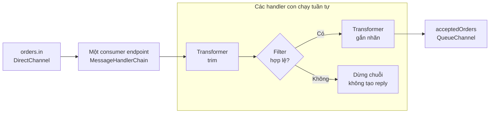

# MessageHandlerChain và chuỗi handler trong một endpoint

## 1. Bối cảnh: vì sao cần `MessageHandlerChain`?

Trong Spring Integration, **message** mang payload và headers; **channel** chuyển message; **consumer endpoint** nhận message từ channel rồi gọi một **message handler** để xử lý. Một `IntegrationFlow` thông thường gồm nhiều endpoint nối tiếp nhau: transformer chuẩn hóa dữ liệu, filter kiểm tra điều kiện, service activator gọi nghiệp vụ, rồi chuyển kết quả sang channel khác.

Khi các bước này luôn đi cùng nhau, chạy tuần tự và không cần channel hoặc cấu hình endpoint riêng ở giữa, Spring Integration cung cấp **`MessageHandlerChain`** (`org.springframework.integration.handler.MessageHandlerChain`). Chain là một *message handler tổng hợp*: nhìn từ bên ngoài, **một consumer endpoint** gọi một handler; bên trong, handler đó điều phối các handler con theo thứ tự khai báo.

Ví dụ, khi nhận mã đơn hàng, ứng dụng phải thực hiện ba bước liên tiếp: xóa khoảng trắng, kiểm tra định dạng, bổ sung nhãn xác nhận. Dùng chain giúp biểu diễn ba bước như một đơn vị xử lý duy nhất, trong khi vẫn tách được logic của từng bước.

> **Phạm vi bài học:** cách chain hoạt động tại runtime, cách viết Java DSL, quy tắc trả lời/chặn message, ảnh hưởng của channel–poller–executor, vòng đời, lỗi, transaction, retry và những dấu hiệu cần tách chain thành nhiều endpoint.

## 2. Cấu trúc và đường đi của message



Diễn tiến đối với một message được chấp nhận:

1. Producer gửi message đến `orders.in`. Trong ví dụ này, đây là `DirectChannel` nên consumer được gọi ngay trong luồng đang gửi.
2. Consumer endpoint chuyển message vào `MessageHandlerChain`.
3. Handler đầu tiên xử lý; nếu tạo reply, chain đưa reply đó đến handler tiếp theo qua cơ chế chuyển tiếp **nội bộ, đồng bộ**. Handler sau nhận kết quả của handler trước, gồm payload và các headers còn được bảo toàn.
4. Handler cuối tạo reply để endpoint chuyển ra channel đầu ra (hoặc cơ chế reply channel của flow, tùy cấu hình).

Chain không biến nhiều handler thành một hàm duy nhất: từng handler vẫn có trách nhiệm và quy tắc xử lý message riêng. Nó cũng **không tự sinh thread, queue hay giao dịch mới** cho mỗi bước. Trong cấu hình đồng bộ thông thường, các bước được gọi lần lượt trên cùng một call stack.

### Reply là điều kiện quan trọng

`MessageHandlerChain` cần kết quả của mỗi bước để kích hoạt bước tiếp theo. Vì vậy:

- **Bước giữa** nên là handler có khả năng tạo reply, chẳng hạn transformer hoặc service activator trả giá trị. Nếu một bước giữa tiêu thụ message mà không trả kết quả, chuỗi không thể tiếp tục theo đường tuần tự dự kiến.
- **Bước cuối** có thể trả reply để gửi ra ngoài hoặc là handler chỉ thực hiện side effect, nếu mục đích flow kết thúc ở đó.
- **Filter** trả `false` sẽ chặn message. Mặc định, một filter có thể loại message mà không phát sinh exception; có thể cấu hình nhánh discard hoặc chế độ ném exception nếu nghiệp vụ cần.
- **Handler trả `null`** có thể làm flow không có reply; ở handler có `requiresReply`, tình huống thiếu reply có thể phát sinh lỗi. Không đồng nhất `null` với hành vi reject của filter.

Đừng hiểu `MessageHandlerChain` là nơi chứa một danh sách tác vụ tùy ý: chuỗi reply và ngữ nghĩa của từng handler quyết định liệu bước sau có thực sự chạy hay không.

## 3. Ví dụ Java DSL: chuẩn hóa, lọc và chuyển kết quả

Giả sử Spring Integration đã được bật trong ứng dụng. Flow dưới đây nhận chuỗi mã đơn hàng ở `orders.in`, chỉ chấp nhận dạng `ORD-` kèm bốn chữ số, rồi đẩy chuỗi đã gắn nhãn sang `acceptedOrders`.

```java
import java.util.Locale;

import org.springframework.context.annotation.Bean;
import org.springframework.context.annotation.Configuration;
import org.springframework.integration.channel.QueueChannel;
import org.springframework.integration.dsl.IntegrationFlow;

@Configuration
public class OrderFlowConfig {

    @Bean
    QueueChannel acceptedOrders() {
        // QueueChannel phục vụ việc đọc kết quả trong ví dụ; dữ liệu ở đây nằm trong bộ nhớ.
        return new QueueChannel(100);
    }

    @Bean
    IntegrationFlow orderFlow() {
        return IntegrationFlow.from("orders.in")
            .chain(c -> c
                .transform(String.class, String::trim)
                .filter(String.class, code -> code.matches("ORD-\\d{4}"))
                .transform(String.class, code ->
                    "VALID:" + code.toUpperCase(Locale.ROOT)))
            .channel("acceptedOrders")
            .get();
    }
}
```

`IntegrationFlow.from("orders.in")` sử dụng channel đầu vào có tên đó; nếu chưa có bean cùng tên, DSL có thể đăng ký channel thích hợp cho cấu hình flow. `chain(...)` tạo một endpoint chứa ba handler con, còn `channel("acceptedOrders")` chỉ định nơi nhận reply cuối cùng. Trong ví dụ, `QueueChannel` được khai báo riêng để có thể lấy kết quả bằng `receive`.

Có thể kiểm tra hành vi khi ứng dụng đã khởi động:

```java
MessageChannel input = context.getBean("orders.in", MessageChannel.class);
PollableChannel output = context.getBean("acceptedOrders", PollableChannel.class);

input.send(new GenericMessage<>("  ORD-2026  "));
Message<?> result = output.receive(1_000);
// result != null; result.getPayload().equals("VALID:ORD-2026")

input.send(new GenericMessage<>("  INVALID  "));
Message<?> rejected = output.receive(100);
// rejected == null nếu không còn message khác trong queue
```

Đoạn kiểm tra dùng các kiểu `MessageChannel`, `PollableChannel`, `Message<?>` từ `org.springframework.messaging` và `GenericMessage` từ `org.springframework.messaging.support`; `context` là `ApplicationContext` đang chạy. Với input kiểu `DirectChannel`, `send(...)` có thể trả thành công vì message đã được giao cho endpoint **ngay cả khi filter sau đó loại message**. Muốn biết đơn hàng được chấp nhận, hãy kiểm tra reply hoặc sự kiện nghiệp vụ tương ứng; không dùng giá trị boolean của `send` làm kết quả xác thực dữ liệu.

### Cách viết nếu không dùng chain

```java
IntegrationFlow.from("orders.in")
    .transform(String.class, String::trim)
    .filter(String.class, code -> code.matches("ORD-\\d{4}"))
    .transform(String.class, code -> "VALID:" + code)
    .channel("acceptedOrders")
    .get();
```

Hai đoạn có đường xử lý nghiệp vụ tương tự, nhưng bản không có `chain` khai báo **các consumer endpoint riêng** cho từng bước, với liên kết channel giữa các endpoint (DSL có thể tự tạo channel trung gian). Bản có `chain` gộp các handler con sau một consumer endpoint. Điều này ảnh hưởng đến cách gắn cấu hình endpoint, quan sát runtime và chọn ranh giới đồng bộ/bất đồng bộ.

## 4. `MessageHandlerChain` khác chuỗi endpoint độc lập ở đâu?

| Tiêu chí | Các handler trong một `MessageHandlerChain` | Các endpoint độc lập trong flow |
| --- | --- | --- |
| Đơn vị nhận message từ channel | Một consumer endpoint ở đầu chain | Mỗi bước là một consumer endpoint |
| Thứ tự | Lần lượt theo thứ tự handler con | Theo topology của các channel/endpoint |
| Channel giữa các bước | Chuyển tiếp nội bộ, không cần khai báo channel ứng dụng riêng | Có thể chỉ định `DirectChannel`, `QueueChannel`, `ExecutorChannel`... cho từng ranh giới |
| Poller/executor giữa các bước | Không cấu hình poller hoặc executor riêng cho từng handler con | Có thể thiết kế ranh giới bất đồng bộ hoặc pollable cho từng bước |
| Theo dõi và vòng đời | Điều khiển/định danh chủ yếu ở mức endpoint bao chain | Dễ định danh, giám sát, bật/tắt từng endpoint |
| Retry/transaction | Dễ áp chính sách bao toàn đoạn; phải xét side effect của các bước trước | Dễ chọn chính sách khác nhau theo từng endpoint |
| Mức độ phù hợp | Một đoạn xử lý ngắn, tuyến tính, đồng bộ | Các bước có yêu cầu vận hành, tải hoặc phục hồi khác nhau |

Ví dụ, nếu transformer chỉ chuẩn hóa dữ liệu rồi filter kiểm tra sơ bộ, chain thường gọn. Nếu bước gọi API ngoài cần retry độc lập, bước sau cần queue bền vững hoặc một bộ xử lý phải scale riêng, các endpoint tách rời cho phép điều khiển rõ hơn.

## 5. Thread, poller và executor: ai thực sự điều phối chain?

**Chain không quyết định thread thực thi**; cách message đến consumer endpoint mới quyết định điều đó.

| Cấu hình phía trước chain | Ai kích hoạt chain? | Hệ quả runtime |
| --- | --- | --- |
| `DirectChannel` | Thread gọi `send` | Các bước đồng bộ giữ thread của producer cho đến khi hoàn tất hoặc phát sinh lỗi. |
| `PollableChannel` với polling consumer | Poller lấy message theo lịch và gọi endpoint | Tốc độ đọc phụ thuộc lịch poll, `maxMessagesPerPoll` và cấu hình task executor của poller nếu có. |
| `ExecutorChannel` | Task executor phân phối message đến consumer | Có ranh giới thread trước chain; các bước **bên trong** chain vẫn tuần tự trên thread đã nhận tác vụ nếu handler không tự chuyển giao bất đồng bộ. |

Ví dụ, với một consumer poll từ queue, thêm ba handler vào chain **không tạo ra ba poller**. Chỉ endpoint bao chain cần poller. Tương tự, đặt `ExecutorChannel` *trước* chain tạo một ranh giới bất đồng bộ, chứ không khiến ba handler con tự chạy song song.

Một chain mất khoảng `15 ms + 40 ms + 5 ms = 60 ms` cho ba bước đồng bộ sẽ giữ thread xử lý khoảng 60 ms cho mỗi message (chưa tính overhead). Nếu chỉ có một thread xử lý, thông lượng lý thuyết khó vượt khoảng `1 / 0,060 ≈ 16,7 message/giây`; thực tế còn phụ thuộc I/O, contention và số consumer. Tăng số worker có thể cải thiện thông lượng khi các bước cho phép xử lý đồng thời, nhưng chain không cung cấp sự song song đó tự thân.

**Dấu hiệu cần cân nhắc tách endpoint:** một handler chờ HTTP/database lâu, các bước cần mức concurrency khác nhau, cần queue để giảm áp lực ngược (*backpressure*), hoặc cần khởi động/dừng một thành phần riêng. Đặt ranh giới channel có chủ đích trước/sau bước đó, rồi kiểm tra thứ tự message và khả năng mất message ở ranh giới bất đồng bộ.

## 6. Lỗi, transaction, retry và correlation

### Lỗi đi đâu?

Trong chuỗi đồng bộ, exception chưa được xử lý ở handler con thường lan ngược lên `MessageHandlerChain`, consumer endpoint và bên gọi. Nhưng cách lỗi xuất hiện **phụ thuộc điểm khởi phát message**:

- Producer gọi trực tiếp qua `DirectChannel` thường có thể nhận exception ngay tại `send`/gateway call.
- Với poller hoặc executor, lỗi có thể được cơ chế xử lý lỗi của task/poller chuyển thành `ErrorMessage` đến error channel đã cấu hình. Không mặc định rằng mọi exception của mọi `DirectChannel` đều được gửi vào `errorChannel` toàn cục.
- Filter loại message theo điều kiện thường là một nhánh nghiệp vụ bình thường, khác với handler ném exception; nếu cần audit hoặc phản hồi từ chối, cấu hình discard hoặc exception rõ ràng.

Khi chẩn đoán, tìm handler gây lỗi và `failedMessage` trong `MessagingException` (nếu có), đồng thời đối chiếu message ID, correlation ID và thời điểm nhận message tại endpoint. Không chỉ nhìn vào vị trí chain như một hộp đen.

### Transaction có trải qua toàn bộ chain không?

Nếu endpoint được gọi trong một transaction đang hoạt động và các handler tiếp tục **cùng thread**, thao tác hỗ trợ cùng transaction manager có thể tham gia transaction đó. Ví dụ, polling consumer mở transaction rồi xử lý chain đồng bộ: exception không được nuốt có thể khiến transaction rollback theo chính sách cấu hình. **Chain tự nó không tạo transaction** và không biến lời gọi HTTP hay tác vụ ngoài database thành thao tác có thể rollback. Ranh giới `ExecutorChannel` hoặc tác vụ bất đồng bộ thường cắt việc truyền transaction theo thread.

### Retry sẽ chạy lại phần nào?

Nếu advice/retry được đặt ở **mức endpoint/chain**, một lần retry có thể chạy lại **toàn bộ chuỗi**. Giả sử handler thứ nhất đã gửi email, handler thứ hai lỗi: retry toàn chain có thể gửi email lần nữa. Vì thế, cần quy tắc idempotency, transaction thích hợp, hoặc tách endpoint để retry chỉ đúng bước có thể lặp lại. Nếu phải chuyển message lỗi sang hàng chờ phục hồi, thiết kế rõ nơi retry kết thúc và nơi nhận message thất bại.

### Headers và correlation

Chain chuyển tiếp `Message<?>`, nên message có headers như `id`, `timestamp`, `replyChannel`, `errorChannel` hoặc các header nghiệp vụ/correlation liên quan. Transformer trả về **payload** thường được framework đóng gói thành reply message và hỗ trợ truyền các header phù hợp; handler tự tạo `Message<?>` mới phải chú ý giữ lại những header cần thiết. **Chain không tự cấp correlation ID nghiệp vụ**. Nếu flow có splitter/aggregator, hãy quan sát `correlationId`, `sequenceNumber`, `sequenceSize` và state của message group; các thành phần stateful phức tạp thường dễ vận hành hơn khi được đặt ở endpoint rõ ràng, ngoài chain tuyến tính đơn giản.

## 7. Vòng đời và khả năng quan sát runtime

Về mặt cấu hình, một endpoint bao chain có trạng thái chạy/dừng. Khi quản lý `IntegrationFlow` theo vòng đời ứng dụng hoặc đăng ký flow động qua `IntegrationFlowContext`, thường điều khiển flow/endpoint đó như một đơn vị. Không nên giả định có thể dừng riêng transformer thứ hai trong chain mà không ảnh hưởng đến các bước khác. Việc dừng endpoint cũng không có nghĩa mọi xử lý đang chạy sẽ lập tức bị hủy; cách drain message và hoàn thành tác vụ còn tùy channel, poller và adapter.

Để vận hành và chẩn đoán:

1. **Đặt tên/id có ý nghĩa** cho flow hoặc endpoint bao chain, cùng tên channel đầu vào/đầu ra, để dễ đối chiếu trên log và integration graph.
2. **Đo latency từ đầu đến cuối** và, nếu cần, đo riêng handler chậm bằng timer hoặc log có correlation ID. Metric của endpoint ngoài chain không nhất thiết giải thích được bước nào đang chiếm thời gian.
3. **Theo dõi producer, poller/executor và queue**: nếu `QueueChannel` tăng độ sâu hoặc worker pool bão hòa, cần xác định nút thắt phía trước/trong/sau chain.
4. **Đối chiếu tỷ lệ filter reject và lỗi**: hai hiện tượng có thể đều dẫn đến không thấy output, nhưng cách xử lý khác nhau.
5. **Kiểm tra message headers tại các ranh giới có ý nghĩa**. Với flow có correlation, mất header có thể làm kết quả không tập hợp được dù các bước xử lý payload có vẻ đúng.

Một `QueueChannel` in-memory như ví dụ ở phần 3 chỉ phù hợp minh họa hoặc bài toán chấp nhận mất dữ liệu khi dừng tiến trình; nó không tự cung cấp độ bền như message broker hoặc persistent message store. Khi yêu cầu phục hồi qua restart, cần thiết kế message store/broker và chính sách xác nhận xử lý riêng, không dựa vào chain để giải quyết độ bền.

## 8. Những nhầm lẫn thường gặp

| Hiện tượng | Nguyên nhân cần kiểm tra | Cách kiểm chứng hoặc sửa |
| --- | --- | --- |
| `send` thành công nhưng không có output | Filter loại message; handler không tạo reply; output được gửi sang channel khác | Thử input hợp lệ, kiểm tra filter/discard, cấu hình `outputChannel` và `replyChannel`. |
| Message dừng ở giữa chain | Handler ở giữa chỉ làm side effect, trả `null` hoặc ném exception | Đảm bảo các bước cần nối tiếp có reply; chuyển handler một chiều xuống cuối chuỗi hoặc tách endpoint. |
| Thông lượng thấp dù có nhiều handler | Chain tuần tự; producer/poller/executor thiếu concurrency hoặc có I/O chậm | Đo thời gian từng handler và tình trạng thread; chọn ranh giới async có chủ đích. |
| Retry gây tác vụ lặp | Retry bao toàn chain nên bước trước lỗi cũng chạy lại | Thêm idempotency hoặc chỉ retry endpoint thích hợp. |
| Không thấy exception ở bên gửi | Có ranh giới executor/poller hoặc logic đã xử lý lỗi ở nơi khác | Theo dõi error channel/task executor và đối chiếu message ID. |
| Metadata/correlation bị mất | Handler tự dựng message mới mà bỏ header cần thiết | Giữ/copy headers phù hợp khi tạo reply; thử message có correlation ID. |
| Không quản lý được từng bước riêng | Các handler nằm trong cùng một endpoint bao chain | Tách thành các endpoint có id nếu cần lifecycle/monitor/retry riêng. |

## 9. Bài thực hành và câu hỏi tự kiểm tra

**Thực hành:** dùng flow ở phần 3 và lần lượt gửi `" ORD-2026 "`, `"ERR-2026"`, `"ORD-9"`. Sau mỗi lần, quan sát `acceptedOrders` và giải thích vì sao message được phát ra hoặc bị loại. Tiếp theo, thêm một handler có lời gọi chậm vào trước bước cuối; đo thời gian `send` khi input là `DirectChannel`. Chuyển ranh giới **trước chain** sang `ExecutorChannel`, đo lại thời gian producer và thời điểm output xuất hiện. Cuối cùng, tạo lỗi ở bước cuối, thử retry bao chain với một bước đầu có side effect giả lập, rồi ghi nhận bước nào bị gọi lại. Khi thử nghiệm, không dùng side effect thật như gửi email hoặc trừ tiền.

Tự trả lời các câu sau trước khi chuyển sang chủ đề kế tiếp:

1. Vì sao ba handler trong `MessageHandlerChain` thường chỉ tương ứng một consumer endpoint nhưng vẫn có ba lượt xử lý nghiệp vụ?
2. Bước giữa không trả reply sẽ ảnh hưởng gì đến các bước sau?
3. Tại sao gắn `ExecutorChannel` trước chain không tự làm các handler bên trong chạy song song?
4. Khi một handler sau gây lỗi, retry toàn chain có rủi ro gì đối với handler trước?
5. Khi nào nên tách chain để có channel, poller, transaction hoặc cơ chế quan sát riêng?

`MessageHandlerChain` hữu ích nhất khi các bước tạo thành **một đoạn xử lý tuyến tính, ngắn và đồng bộ**. Chọn chain theo ranh giới vận hành thực tế: mỗi khi một bước cần lịch polling, thread pool, retry, trạng thái hoặc mức đảm bảo giao message riêng, hãy cân nhắc biểu diễn nó thành endpoint độc lập.
