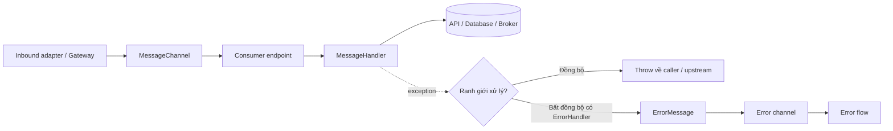
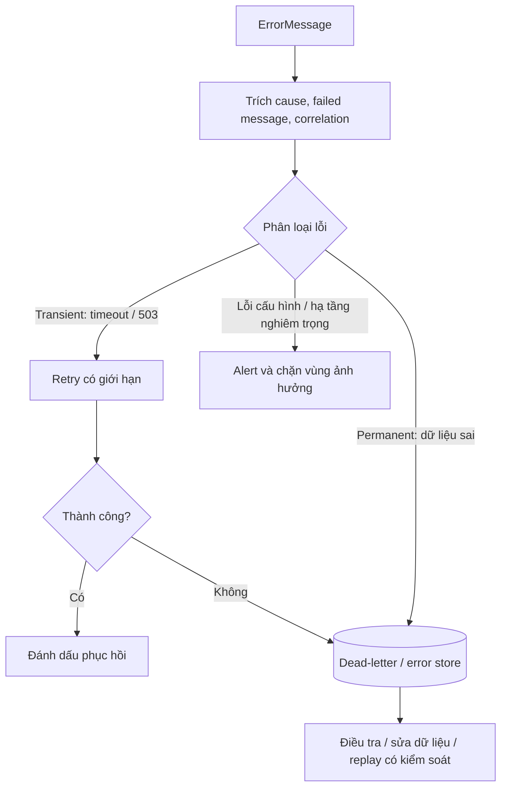

# Handler throw exception và error flow trong Spring Integration

## Mục tiêu học tập

Trong một hệ thống tích hợp, `MessageHandler` thường là nơi gọi API, ghi cơ sở dữ liệu, chuyển đổi dữ liệu hoặc gửi thông điệp sang hệ thống khác. Các thao tác này có thể thất bại. Điều quan trọng không chỉ là **handler ném exception nào**, mà còn là **handler đang được gọi ở thread nào, ranh giới xử lý nằm ở đâu và ai có trách nhiệm nhận lỗi**.

Sau bài này, bạn có thể:

- Phân biệt lỗi truyền ngược về người gửi với lỗi được đóng gói thành `ErrorMessage` và phát vào error channel.
- Giải thích ảnh hưởng của `DirectChannel`, `ExecutorChannel`, poller và gateway đối với đường đi của exception.
- Xây dựng error flow có khả năng phân loại lỗi, giữ correlation, log có ngữ cảnh và chuyển lỗi cần xử lý tiếp sang vùng lưu trữ hoặc hàng đợi thích hợp.
- Quyết định khi nào nên retry, khi nào phải rollback, khi nào cần dừng retry và đưa thông điệp vào luồng xử lý lỗi.
- Chẩn đoán tình huống handler đã thất bại nhưng caller vẫn thấy `send()` thành công, error channel không nhận được gì hoặc request bị timeout.

Phạm vi là **runtime của Spring Integration**: message flow, channel, endpoint, consumer, poller, executor, transaction, retry và trạng thái xử lý thực tế. Đây là phần chuyên sâu của chương **Message handler**, tập trung vào đề bài **Handler throw exception và error flow**.

## 1. Exception xảy ra ở đâu trong message flow?

Một luồng đơn giản có thể gồm inbound adapter hoặc gateway, channel, consumer endpoint, `MessageHandler` và downstream system:



Trong Spring Integration, một endpoint tiêu thụ message có thể gọi handler trực tiếp trong thread của sender hoặc trong thread do executor/poller cung cấp. Nếu handler ném lỗi, khả năng **truyền exception** và **phát `ErrorMessage`** phụ thuộc vào cách message đi đến endpoint.

Không nên đánh đồng ba sự kiện:

1. `MessageChannel.send(message)` hoàn tất: channel đã nhận hoặc chuyển giao message theo hợp đồng của channel.
2. Handler thực thi hoàn tất: nghiệp vụ trong handler có thể thành công hoặc ném lỗi sau đó.
3. Nghiệp vụ được xác nhận bền vững: giao dịch được commit, broker được ack, hoặc trạng thái đã được ghi nhận. Điều này còn phụ thuộc adapter, transaction và cơ chế xác nhận của từng tài nguyên.

Đặc biệt, một lời gọi `send()` thành công vào `ExecutorChannel` **không chứng minh** handler ở thread khác đã thành công.

## 2. Ranh giới đồng bộ và bất đồng bộ quyết định đường đi của lỗi

| Cách gọi handler | Thread thực thi handler | Khi handler ném exception | Điều nên kiểm tra |
| --- | --- | --- | --- |
| `DirectChannel` và chuỗi handler đồng bộ | Thường là thread đang gọi `send()` | Exception thường truyền ngược qua call stack về sender; có thể được bọc thành `MessagingException` | `try/catch` của caller, transaction đang mở, cấu hình gateway nếu có |
| `PublishSubscribeChannel` không cấu hình executor | Thường trong thread của publisher | Exception của subscriber có thể truyền về publisher; kết quả phụ thuộc chiến lược dispatch và cấu hình `ignoreFailures` | Có bao nhiêu subscriber và cấu hình dispatch |
| `ExecutorChannel` | Thread trong `TaskExecutor` | Sender không còn cùng call stack để nhận lỗi; cơ chế xử lý lỗi của dispatcher/executor có thể xuất bản `ErrorMessage` | `ErrorHandler`, header `errorChannel`, error channel mặc định, khả năng executor nhận task |
| `PublishSubscribeChannel` có executor | Thread do executor điều phối | Lỗi của subscriber bất đồng bộ được xử lý tại phía executor, thường qua error handler | Executor, các subscriber, đường đi của `ErrorMessage` |
| Endpoint lấy message qua poller (`QueueChannel`, inbound polling adapter...) | Thread của scheduler/poller | Lỗi diễn ra trong một lượt poll; thường được chuyển cho error handler của poller, mặc định có thể xuất bản `ErrorMessage` | Cấu hình poller, transaction, error handler, nguồn message và cơ chế ack |
| Gateway request/reply | Phụ thuộc flow sau gateway | Gateway có chính sách timeout và xử lý lỗi riêng; error channel cấu hình cho gateway có thể tham gia chuyển lỗi thành reply/exception | `errorChannel` của gateway, `replyChannel`, timeout và kiểu trả về |

Từ “thường” ở đây có chủ ý: channel/endpoint có thể được tùy biến. Muốn xác định đường đi thực tế, hãy bắt đầu ở **endpoint nào gọi handler** và **ai sở hữu thread đó**.

### 2.1. `DirectChannel`: lỗi đi ngược call stack

Giả sử `orders.input` là `DirectChannel` và handler ném `IllegalArgumentException`:

```java
@Bean
IntegrationFlow directOrdersFlow() {
    return IntegrationFlow.from("orders.input")
            .handle((Message<?> message) -> {
                throw new IllegalArgumentException("Missing orderId");
            })
            .get();
}
```

Khi caller gọi `ordersInput.send(message)`, handler chạy trong cùng nhánh gọi đồng bộ. Exception có thể đi ngược lên `send()` (thường dưới dạng `MessageHandlingException` hoặc `MessagingException` khác chứa nguyên nhân gốc):

```java
try {
    ordersInput.send(request);
} catch (MessagingException exception) {
    // Xem exception.getCause() và exception.getFailedMessage().
    // Quyết định rollback, trả lỗi cho caller hoặc xử lý tại biên nghiệp vụ.
}
```

Chỉ thêm header `errorChannel` vào message **không tự động** biến mọi exception đồng bộ thành `ErrorMessage`. Phải có thành phần thực sự bắt exception và gửi thông điệp lỗi, chẳng hạn error handler ở biên bất đồng bộ, gateway được cấu hình phù hợp hoặc recovery advice.

### 2.2. `ExecutorChannel`: caller và handler không cùng thread

```text
Thread HTTP request             Thread si-worker-1
-------------------             ------------------
send(message)
    |
    +--> ExecutorChannel ------> handle(message)
    |                                |
send() trả về                     throw exception
                                     |
                                ErrorHandler
                                     |
                                 ErrorMessage
                                     |
                                error channel
```

Sau khi executor nhận task, lỗi xảy ra ở handler không thể “bay ngược” về stack frame của `send()` đã kết thúc. Trong cấu hình Spring Integration thông dụng, `MessagePublishingErrorHandler` ở biên bất đồng bộ đóng gói lỗi và gửi đến error channel. Tuy nhiên, việc executor từ chối task ngay lúc submit (`RejectedExecutionException`) là **lỗi ở thời điểm dispatch**, có thể biểu hiện khác với lỗi xử lý phát sinh sau khi task được chấp nhận.

### 2.3. Poller: lỗi thuộc lượt poll và tài nguyên đang được quản lý

Poller lấy message từ nguồn rồi gọi flow. Nếu handler ném exception, poller có thể chuyển lỗi đến error handler, trong khi transaction của lượt poll quyết định rollback/commit tùy cấu hình. Cần xem riêng việc **message được lấy ra khỏi nguồn** và việc **nghiệp vụ đã commit**; các nguồn khác nhau (DB, JMS, file, queue trong bộ nhớ) không có cùng bảo đảm phát lại.

Khi thay `DirectChannel` bằng `QueueChannel` cộng polling consumer, bạn đã tạo thêm một ranh giới thread và có thể thay đổi cả cách thấy lỗi, transaction và độ trễ xử lý. Đây là một thay đổi hành vi runtime, không chỉ là thay đổi cấu trúc DSL.

## 3. `MessagingException` và `ErrorMessage` khác nhau thế nào?

### 3.1. Exception được ném

Các lớp thường gặp:

- `MessagingException`: nhóm exception mang ngữ cảnh xử lý message; `getFailedMessage()` có thể cho biết message liên quan đến lỗi.
- `MessageHandlingException`: lỗi trong lúc handler xử lý message; thường có nguyên nhân (`cause`) là exception nghiệp vụ.
- `MessageDeliveryException` hoặc `MessageDispatchingException`: lỗi khi chuyển phát/dispatch message, ví dụ không tìm được consumer phù hợp hoặc dispatch thất bại.
- Exception nghiệp vụ như `IllegalArgumentException`, `IOException` (được bọc khi cần), `DataAccessException` hoặc lỗi HTTP client: bản chất lỗi cần phân loại từ chuỗi `cause`, không chỉ dựa vào lớp wrapper ngoài cùng.

Không có một loại exception duy nhất cho tất cả handler: adapter và handler có thể bọc lỗi trước khi Spring Integration xử lý tiếp.

### 3.2. Thông điệp lỗi được gửi vào channel

`ErrorMessage` là một `Message<Throwable>`; **payload của nó là đối tượng `Throwable`**, không phải payload gốc của message nghiệp vụ. Một số thuộc tính cần quan sát:

| Dữ liệu | Cách truy cập | Ý nghĩa |
| --- | --- | --- |
| Lỗi | `errorMessage.getPayload()` | Exception đã được bắt; xem tiếp `getCause()` để tìm lỗi nguồn |
| Message ban đầu | `errorMessage.getOriginalMessage()` | Ngữ cảnh nguồn nếu cơ chế tạo `ErrorMessage` có cung cấp |
| Message thất bại | `((MessagingException) error).getFailedMessage()` | Message mà exception gắn vào, nếu exception thuộc nhóm `MessagingException` |
| Header của error message | `errorMessage.getHeaders()` | Metadata của chính `ErrorMessage`; không mặc định đồng nhất với headers nghiệp vụ |
| Header nghiệp vụ | `original.getHeaders()` hoặc `failed.getHeaders()` | `correlationId`, `replyChannel`, `errorChannel`, trace ID, tenant ID... nếu được mang theo |

`getOriginalMessage()` và `getFailedMessage()` **có thể là `null`** hoặc trỏ đến message ở những điểm khác nhau trong flow. Ví dụ một transformer đã tạo message mới trước khi lỗi phát sinh. Vì vậy nên thu thập ngữ cảnh ở biên vào, truyền correlation qua các bước và xử lý trường hợp thiếu dữ liệu.

### 3.3. Error channel được chọn như thế nào?

Trong mô hình error publishing thông dụng, handler tìm điểm đến theo ưu tiên:

1. Header `errorChannel` trên message đang được xử lý, nếu được cung cấp và phân giải được đến một channel thích hợp (có thể là đối tượng `MessageChannel` hoặc tên channel).
2. Error channel mặc định của ứng dụng, thường là bean có tên `errorChannel`.

Spring Integration thường đăng ký `errorChannel` mặc định cùng cơ chế logging error. Việc thấy stack trace trên log **không đồng nghĩa** với việc đã có recovery hoặc lưu lỗi để phát lại. Nếu ứng dụng cần xử lý lỗi như một phần hợp đồng nghiệp vụ, hãy xây dựng consumer/error flow rõ ràng và kiểm tra lỗi khi dispatch sang error channel (chẳng hạn channel không phân giải được hoặc không có subscriber phù hợp).

## 4. Ví dụ đầy đủ: handler bất đồng bộ và error flow riêng

Ví dụ Spring Integration 6.x / Spring Framework 6.x sau mô tả một handler chạy trên executor. Mỗi yêu cầu mang header `errorChannel = workErrors` để định tuyến lỗi về một flow riêng. Ở đây ta dùng `System.err` cho mục đích học; ứng dụng thật nên dùng logger có cấu trúc, cùng cơ chế lưu lỗi đáng tin cậy.

```java
import org.springframework.beans.factory.annotation.Qualifier;
import org.springframework.context.annotation.Bean;
import org.springframework.context.annotation.Configuration;
import org.springframework.core.task.TaskExecutor;
import org.springframework.integration.channel.DirectChannel;
import org.springframework.integration.config.EnableIntegration;
import org.springframework.integration.dsl.IntegrationFlow;
import org.springframework.integration.dsl.MessageChannels;
import org.springframework.messaging.Message;
import org.springframework.messaging.MessageChannel;
import org.springframework.messaging.MessagingException;
import org.springframework.messaging.support.ErrorMessage;
import org.springframework.scheduling.concurrent.ThreadPoolTaskExecutor;

@Configuration
@EnableIntegration
class WorkIntegrationConfiguration {

    @Bean("workInput")
    MessageChannel workInput() {
        return new DirectChannel();
    }

    @Bean("workErrors")
    MessageChannel workErrors() {
        return new DirectChannel();
    }

    @Bean("workerExecutor")
    ThreadPoolTaskExecutor workerExecutor() {
        ThreadPoolTaskExecutor pool = new ThreadPoolTaskExecutor();
        pool.setCorePoolSize(2);
        pool.setMaxPoolSize(4);
        pool.setQueueCapacity(50);
        pool.setThreadNamePrefix("si-worker-");
        pool.initialize();
        return pool;
    }

    @Bean
    IntegrationFlow workFlow(
            @Qualifier("workInput") MessageChannel input,
            @Qualifier("workerExecutor") TaskExecutor executor) {
        return IntegrationFlow.from(input)
                .channel(MessageChannels.executor(executor))
                .handle((Message<?> message) -> {
                    // Mô phỏng API/DB không xử lý được yêu cầu.
                    throw new IllegalStateException("Downstream unavailable");
                })
                .get();
    }

    @Bean
    IntegrationFlow workErrorFlow(
            @Qualifier("workErrors") MessageChannel errors) {
        return IntegrationFlow.from(errors)
                .handle((Message<?> message) -> {
                    ErrorMessage error = (ErrorMessage) message;
                    Throwable cause = error.getPayload();

                    Message<?> original = error.getOriginalMessage();
                    if (original == null && cause instanceof MessagingException ex) {
                        original = ex.getFailedMessage();
                    }

                    Object correlationId = original == null
                            ? "unknown"
                            : original.getHeaders().get("correlationId");

                    // Demo: production nên log có cấu trúc và lưu error record.
                    System.err.printf("correlation=%s, error=%s%n",
                            correlationId, cause.toString());
                })
                .get();
    }
}
```

Một producer có thể gửi message theo cách sau:

```java
import org.springframework.messaging.Message;
import org.springframework.messaging.MessageChannel;
import org.springframework.messaging.MessageHeaders;
import org.springframework.messaging.support.MessageBuilder;

void submit(MessageChannel workInput) {
    Message<String> request = MessageBuilder.withPayload("order-42")
            .setHeader("correlationId", "trace-order-42")
            .setHeader(MessageHeaders.ERROR_CHANNEL, "workErrors")
            .build();

    workInput.send(request); // Dispatcher đã nhận task; handler có thể lỗi sau đó.
}
```

**Đọc luồng chạy:**

1. Producer gửi message vào `workInput` (`DirectChannel`).
2. Flow chuyển message sang `ExecutorChannel` được cấu hình bằng `workerExecutor`.
3. Handler chạy trên `si-worker-*`, ném `IllegalStateException`.
4. Cơ chế error handling tại biên executor xuất bản `ErrorMessage`, ưu tiên `workErrors` vì message có header tương ứng.
5. Consumer của `workErrors` kiểm tra exception, lấy thông tin message/correlation nếu có và ghi nhận lỗi.

Header `correlationId` ở ví dụ chỉ là tên trường minh họa. Trong flow có sử dụng cơ chế correlation/sequence của Spring Integration, bạn có thể đọc header tương ứng qua `IntegrationMessageHeaderAccessor` thay vì tự tạo quy ước mới.

**Thử đổi một chi tiết:** bỏ `.channel(MessageChannels.executor(executor))` để handler chạy đồng bộ sau `workInput`. Khi đó handler sẽ ném exception ngược về thread của producer; không nên mong `workErrors` tự động nhận cùng một `ErrorMessage` như trường hợp bất đồng bộ.

> Lưu ý về vận hành: ví dụ này chỉ chứng minh đường truyền lỗi. Nếu lỗi phải tồn tại qua việc restart ứng dụng hoặc cần xử lý lại có bảo đảm, chỉ ghi log hoặc đẩy vào channel trong bộ nhớ là chưa đủ. Cần một nơi lưu lỗi bền vững (ví dụ bảng DB hoặc broker hỗ trợ dead-letter) và cơ chế idempotency.

## 5. Thiết kế một error flow có chủ đích

Error flow thực chất cũng là message flow: có channel, subscriber, handler, có thể có router, transformer và outbound adapter. Nó cần một hợp đồng rõ ràng: lỗi nào xử lý xong, lỗi nào được retry, lỗi nào phải chuyển để điều tra hoặc phát lại.



Một thứ tự xử lý thực tế:

1. **Chuẩn hóa thông tin:** lưu exception class, root cause, timestamp, message ID, correlation ID, tên flow/endpoint, destination, số lần thử và thông tin nguồn cần thiết. Lọc dữ liệu nhạy cảm trước khi ghi log.
2. **Phân loại:** lỗi tạm thời (timeout, rate limit, mất kết nối), lỗi vĩnh viễn (schema sai, thiếu trường bắt buộc), lỗi phần mềm/cấu hình và lỗi không xác định.
3. **Áp dụng chính sách:** retry có giới hạn/backoff nếu thao tác an toàn; đưa lỗi không thể khôi phục vào error store hoặc dead-letter queue; gửi cảnh báo khi vượt ngưỡng.
4. **Giữ khả năng đối chiếu:** dùng correlation ID và định danh nghiệp vụ ổn định để tra lại đường đi của một message qua nhiều endpoint.
5. **Quy định điều kiện kết thúc:** xử lý lỗi thành công nghĩa là đã ghi nhận/khôi phục theo hợp đồng; không mặc nhiên nghĩa là nghiệp vụ ban đầu thành công.

### Vì sao không nên để mọi lỗi vào một handler chung?

Một handler lỗi chỉ in stack trace sẽ khó phân biệt: message hỏng cần sửa dữ liệu, API tạm thời lỗi cần retry, và bug phát sinh trên toàn hệ thống cần cảnh báo khẩn. Với flow lớn, có thể route theo exception type/endpoint và giữ một nhánh fallback cho lỗi chưa biết. Đừng route chỉ theo chuỗi message của exception vì nội dung chuỗi thường thay đổi theo phiên bản thư viện hoặc môi trường.

### `errorChannel` toàn cục và error channel theo nghiệp vụ

| Phương án | Phù hợp khi | Rủi ro cần quản lý |
| --- | --- | --- |
| `errorChannel` mặc định | Thu thập lỗi kỹ thuật chưa có tuyến xử lý chuyên biệt; fallback cho toàn ứng dụng | Khó đặt cùng chính sách retry, mức ưu tiên và bảo mật cho tất cả lỗi |
| Header `errorChannel` trên message | Một producer hoặc yêu cầu cần policy riêng; cần giữ ngữ cảnh đến lúc worker xử lý | Header có thể bị mất/thay khi tạo message mới; đích có thể không tồn tại |
| Error channel riêng cho adapter, gateway, poller | Nguồn vào có chế độ ack, timeout và xử lý lỗi riêng | Cần hiểu tương tác với transaction/ack của chính nguồn đó |

Không chỉ định nghĩa tên channel; cần đăng ký consumer xử lý được thông điệp lỗi và xác minh message thực tế đi tới đó. Nếu error channel là `DirectChannel`, consumer của error flow chạy đồng bộ trên thread đang publish lỗi. Nếu error flow chậm hoặc ném lỗi tiếp, nó có thể kéo dài hoặc làm phức tạp tiến trình xử lý lỗi của thread đó. Có thể tách error flow sang executor/broker khi có lý do rõ ràng và kiểm soát được sức chứa.

## 6. Retry, recovery và error channel tương tác ra sao?

Retry và error flow giải quyết hai giai đoạn khác nhau:

- **Retry tại handler**: lặp lại thao tác có thể khôi phục trước khi coi message thất bại cuối cùng. Spring Integration cung cấp `RequestHandlerRetryAdvice` để áp dụng retry quanh lời gọi handler, thường cấu hình bằng Spring Retry và policy backoff.
- **Recovery khi hết lượt retry**: có thể trả kết quả thay thế, ném lỗi cuối cùng ra ngoài hoặc dùng recovery callback (ví dụ hướng gửi lỗi sang error channel). Chiến lược recovery quyết định flow sau đó quan sát lỗi dưới dạng exception hay `ErrorMessage`.
- **Retry ở broker/poller**: nguồn vào cũng có thể giao lại message sau rollback, negative acknowledgement hoặc visibility timeout; đây là tầng khác với retry bên trong handler. Nếu bật cả hai, tổng số lần gọi downstream có thể lớn hơn dự kiến.

Ví dụ: handler gọi hệ thống thanh toán, chính sách tối đa 3 lần trong một lượt xử lý; khi thất bại sau 3 lần, publish một `ErrorMessage` có `orderId`, `correlationId`, attempt count và lưu bản ghi xử lý lỗi. Tuy nhiên, nếu broker sau đó giao lại message 4 lần, tổng số request downstream có thể lên đến 12 lần. Hệ thống thanh toán phải có idempotency key và bạn cần xác định rõ tầng nào sở hữu retry.

Chính sách retry nên trả lời:

| Câu hỏi | Gợi ý áp dụng |
| --- | --- |
| Lỗi có thật sự tạm thời? | Retry timeout/503/429 theo chính sách; không tự động retry lỗi kiểm tra dữ liệu |
| Thao tác có idempotent? | Dùng business key/idempotency key khi có side effect |
| Giới hạn là bao nhiêu? | Max attempts, tổng thời gian, backoff có jitter, tránh retry storm |
| Khi hết lượt retry thì sao? | Rethrow để biên transaction/broker quyết định, hoặc gửi error store/DLQ qua recovery có chủ đích |
| Ai xác nhận message nguồn? | Xem cơ chế commit/ack thực tế; đừng suy ra từ việc error flow đã ghi log |

Đặc biệt với request/reply gateway, nếu recovery advice nuốt exception rồi trả `null` nhưng không tạo reply hợp lệ, caller có thể chờ đến timeout. Hãy định nghĩa rõ lỗi được trả về như thế nào trong giao thức request/reply.

## 7. Transaction và rollback khi handler ném exception

Transaction trong runtime có phạm vi theo thread và tài nguyên tham gia. Exception chỉ có tác dụng rollback khi nó **đi qua biên transaction thích hợp** và quy tắc rollback áp dụng.

### 7.1. Flow đồng bộ trong cùng transaction

```text
Service @Transactional
    -> DirectChannel
        -> Handler ghi DB
        -> Handler ném RuntimeException
    <- exception truyền ngược
Transaction interceptor đánh dấu rollback (nếu policy áp dụng)
```

Nếu toàn bộ lời gọi vẫn trên cùng thread/transaction, exception đi ngược ra khỏi phạm vi transactional có thể kích hoạt rollback. Nhưng nếu error handler bắt lỗi và trả về bình thường ngay trong phạm vi đó, transaction manager có thể không còn thấy exception để tự rollback. Khi đó phải quyết định rollback theo policy, không dựa vào việc đã log lỗi.

### 7.2. Flow qua executor

`ExecutorChannel` chuyển việc sang thread khác. Thread worker thông thường **không thừa hưởng transaction gắn với thread của caller**. Vì thế transaction ở HTTP service bao quanh `send()` không tự động bao quanh đoạn handler chạy sau đó. Nếu handler cần transaction, hãy mở transaction tại endpoint/handler hoặc dùng cơ chế transaction phù hợp ở phía worker.

### 7.3. Poller và nguồn message

Poller có thể chạy trong transaction của riêng lần poll. Khi handler lỗi, outcome của nguồn phụ thuộc vào việc message nguồn và downstream resources có tham gia transaction hay không. Với nguồn không hỗ trợ rollback/ack, việc `ErrorMessage` được gửi đi không tự phục hồi message đã đọc. Với nguồn hỗ trợ redelivery, cần xét duplicate delivery và idempotency.

**Quy tắc thực hành:** viết ra ba mốc cho mỗi flow: “message được nhận từ đâu?”, “transaction bắt đầu/kết thúc ở thread nào?” và “ai chịu trách nhiệm ack hoặc phát lại khi handler lỗi?”. Đây là cách phát hiện các giả định sai về exactly-once.

## 8. Correlation và truy vết lỗi trong production

Khi một message đi qua transformer, splitter, aggregator, router hoặc executor, một lỗi thường chỉ hữu ích nếu có thể truy về yêu cầu nghiệp vụ gốc. Nên chuẩn hóa các trường:

| Trường | Mục đích | Ví dụ |
| --- | --- | --- |
| `businessKey` | Dùng để xác định thực thể nghiệp vụ và chống xử lý trùng | `order-42` |
| `correlationId` | Ghép các message/nhánh xử lý của cùng yêu cầu | `trace-order-42` |
| `messageId` | Phân biệt một instance của Spring `Message` | UUID của message |
| `endpointId` | Chỉ vị trí handler ném lỗi | `reserveInventory.handler` |
| `attempt` | Xác định số lần thực thi khi retry/redelivery | `3` |
| `exceptionType` / `rootCause` | Phân loại lỗi và tổng hợp chỉ số | `SocketTimeoutException` |
| `occurredAt` | Đối chiếu log/trace/metric | Timestamp UTC |

Spring Integration có các message header tiêu chuẩn, và một số pattern (splitter/aggregator) dùng correlation/sequence headers. Cần phân biệt **message ID** (có thể đổi khi tạo message mới) với **business key/correlation ID** mà hệ thống chủ động giữ xuyên suốt flow.

Nếu sử dụng Micrometer/Observation/tracing, gắn endpoint, channel và correlation vào trace/span theo chính sách quan sát được cấu hình. Không nên đưa toàn bộ payload hoặc token/PII vào log, metric tag hay error store. Đối với message đã thất bại, lưu metadata đủ để tra cứu và một tham chiếu an toàn đến payload khi cần replay.

## 9. Chẩn đoán theo triệu chứng

| Triệu chứng | Nguyên nhân có thể | Kiểm tra đầu tiên |
| --- | --- | --- |
| `send()` trả về bình thường nhưng tác vụ thất bại | Handler chạy phía sau `ExecutorChannel` hoặc poller | Thread name, executor, log/error flow ở phía consumer |
| Handler đã throw nhưng `errorChannel` không nhận được message | Flow hoàn toàn đồng bộ; không có thành phần publish lỗi | Sơ đồ channel/endpoint và vị trí `ErrorHandler` |
| Chỉ thấy lỗi trong log mặc định | Error channel mặc định có logging subscriber nhưng chưa có recovery theo nghiệp vụ | Có handler/error flow riêng, DLQ hoặc error store chưa? |
| Gateway đợi rồi timeout | Async flow không tạo reply; recovery nuốt exception; reply channel bị mất | Gateway timeout, `replyChannel`, policy recovery, message headers |
| Message được xử lý lặp | Retry của handler cộng redelivery của adapter/broker | Số lần thử của từng tầng, transaction, idempotency key |
| Lỗi có message nhưng không có `correlationId` | Header không được sao chép hoặc logic tạo message mới làm mất ngữ cảnh | `originalMessage`, `failedMessage`, transformer và message builder |
| Error flow bị nghẽn | Error handler làm I/O chậm, channel đồng bộ hoặc executor hết tài nguyên | Queue depth, active threads, lag, error throughput |
| Lỗi chuyển thành lỗi dispatch khác | Error channel sai tên/không có consumer; error flow tự throw | Bean/channel name, subscriber, exception thứ cấp |

Để điều tra hiệu năng và thread, quan sát tối thiểu số message vào/ra, số lỗi theo endpoint, thời gian xử lý, số task active/queued/rejected của executor, tốc độ poll, số lần retry và kích thước DLQ/error store. Dùng log thread name + correlation ID để nối các bước xảy ra ở những thread khác nhau.

### Trình tự điều tra một incident

1. Chọn một `businessKey` lỗi và tìm `correlationId`.
2. Xác định handler và endpoint ném lỗi, ghi lại exception gốc cùng wrapper.
3. Vẽ lại các channel đã đi qua, đánh dấu `DirectChannel`, `ExecutorChannel`, `QueueChannel`, gateway và poller.
4. Tìm ranh giới transaction và chính sách ack/redelivery; đối chiếu số lần thử ở handler và nguồn message.
5. Kiểm tra `errorChannel` header, consumer thực tế, DLQ/error store, cùng lỗi thứ cấp khi error flow chạy.
6. Kết luận liệu yêu cầu đã thành công, còn pending, cần phát lại hay phải sửa dữ liệu; kiểm chứng bằng trạng thái nghiệp vụ bền vững.

## 10. Thực hành có hướng dẫn

**Bài A — So sánh đồng bộ và bất đồng bộ.** Tạo một flow có handler luôn throw `IllegalStateException`. Trước tiên nối bằng `DirectChannel`, gửi bằng `MessageChannel.send()` và quan sát exception của caller. Sau đó thêm `ExecutorChannel`, cấu hình một consumer cho `workErrors`, gửi message có header `errorChannel` và ghi nhận thread name, thứ tự sự kiện, loại `ErrorMessage`, `originalMessage` và `failedMessage`.

Kết quả mong đợi: bản đồng bộ truyền lỗi trong call stack của producer; bản bất đồng bộ xử lý lỗi phía worker và có thể phát `ErrorMessage`. Ghi lại trường hợp thông tin message gốc không xuất hiện để tránh giả định rằng luôn đủ correlation.

**Bài B — Retry có giới hạn.** Thay handler bằng fake downstream thất bại hai lần rồi thành công ở lần ba; cấu hình `RequestHandlerRetryAdvice` có giới hạn attempts và backoff. Ghi số lần thực thi thực tế. Tiếp theo cho downstream luôn thất bại; kiểm tra outcome khi đã hết retry và xác nhận policy đã chọn: ném exception về biên, hoặc dùng recovery callback xuất bản lỗi.

Kết quả mong đợi: retry thành công không cần một bản ghi lỗi cuối cùng; retry hết lượt tạo ra tín hiệu thất bại rõ ràng. Nếu thêm broker redelivery, xác minh tổng số lần gọi để tránh nhân số lần retry ngoài ý muốn.

**Bài C — Điều tra luồng lỗi trong transaction.** Dùng một handler ghi DB rồi throw, lần lượt chạy với `DirectChannel`, `ExecutorChannel` và một consumer qua poller. Ghi lại thread ID, thời điểm transaction bắt đầu/kết thúc, bản ghi DB được commit/rollback, trạng thái nguồn và đường đi của `ErrorMessage`.

Kết quả mong đợi: việc bắt được exception hay thấy `ErrorMessage` không tự xác định transaction outcome; phải kiểm tra biên transactional và tài nguyên đã tham gia.

**Bài D — Vận hành error flow.** Thiết kế error record chứa business key, correlation ID, endpoint, exception class, attempt, timestamp, trạng thái và tham chiếu payload. Thêm cơ chế deduplication khi replay cùng business key, alert cho lỗi hệ thống và dashboard thống kê lỗi theo endpoint. Kiểm tra cả trường hợp error store hoặc chính error flow không sẵn sàng.

## 11. Câu hỏi tự kiểm tra

1. Vì sao thêm header `errorChannel` không đủ để một `DirectChannel` tự phát `ErrorMessage` mỗi lần handler throw?
2. Một HTTP request gọi `send()` thành công vào `ExecutorChannel`; điều đó chứng minh được gì về kết quả nghiệp vụ?
3. Khi `ErrorMessage.getOriginalMessage()` trả `null`, bạn tìm message/ngữ cảnh lỗi từ đâu tiếp theo?
4. Vì sao retry tại handler kết hợp redelivery từ broker có thể tạo nhiều lần side effect hơn dự kiến?
5. Vì sao catch exception rồi ghi log có thể thay đổi quyết định rollback của transaction đồng bộ?
6. Gateway request/reply có thể timeout như thế nào nếu recovery đã nuốt exception nhưng không tạo reply?

**Ghi nhớ:** `throw exception` mô tả sự cố tại handler; `error flow` mô tả cách sự cố được quan sát và xử lý sau đó. Muốn thiết kế đúng, luôn xác định **thread, channel, error handler, transaction, retry và correlation** trước khi quyết định lỗi sẽ đi đâu và message có thể được xử lý lại hay không.
