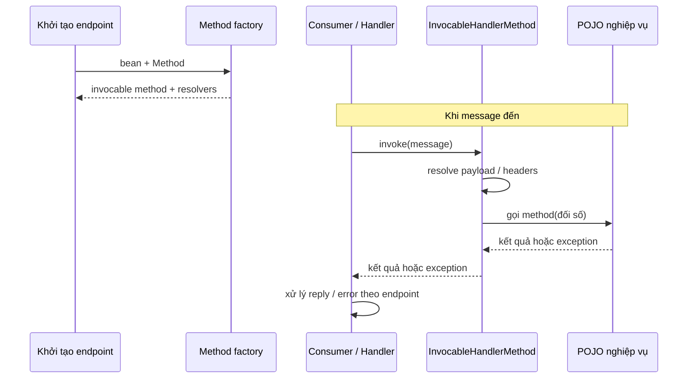

# MessageHandlerMethodFactory và method invocation trong Spring Integration

## Mục tiêu bài học

Trong một ứng dụng Spring Integration, message đi qua `MessageChannel` rồi đến một consumer endpoint. Endpoint có thể gọi một phương thức Java thuần (POJO) dù phương thức đó không biết gì về hạ tầng messaging. Cơ chế **method invocation** chịu trách nhiệm chọn phương thức, trích xuất payload/header, chuyển kiểu, gọi phương thức và giao kết quả lại cho endpoint.

Sau bài này, bạn có thể:

- Giải thích vai trò của `MessageHandlerMethodFactory`, `InvocableHandlerMethod` và các bộ giải tham số (`HandlerMethodArgumentResolver`).
- Phân biệt việc **chuẩn bị phương thức** với việc **gọi phương thức cho từng message**, cũng như phân biệt invocation với việc chuyển reply vào channel.
- Viết service activator nhận `@Payload`, `@Header`, `@Headers` hoặc toàn bộ `Message<?>`.
- Chủ động lựa chọn, cấu hình và kiểm tra cơ chế chuyển kiểu, validation, SpEL, xử lý lỗi và khả năng chạy đồng thời.
- Chẩn đoán lỗi tại ranh giới giữa channel, endpoint, message handler và POJO.

Phạm vi: đây là một chủ đề thuộc chương **Handler adapter** của module **SPRING_INTEGRATION_RUNTIME**. Trọng tâm là cách runtime nối lời gọi phương thức Java với message flow; poller, executor, transaction, retry và correlation được bàn tới tại nơi chúng ảnh hưởng trực tiếp đến invocation.

## 1. Vì sao cần method invocation?

Giả sử dịch vụ nghiệp vụ chỉ có phương thức:

```java
public String quote(String sku, String region) {
    return region + ":" + sku;
}
```

Message từ phía trước lại có dạng:

```text
payload = "P100"
headers = {
  region: "VN",
  correlationId: "req-17",
  ...
}
```

Nếu tự viết consumer, lập trình viên phải lấy message, đọc header, chuyển kiểu, tìm phương thức thích hợp, gọi nó, dựng message trả lời rồi gửi vào channel. Spring Integration tách các việc này:

1. **Channel/consumer endpoint** quyết định *khi nào* có message để xử lý.
2. **Message handler và bộ gọi phương thức** quyết định *phương thức nào* cần gọi với *đối số nào*.
3. **POJO nghiệp vụ** chỉ cần khai báo các tham số cần thiết và trả về kết quả.
4. **Cơ chế reply của endpoint** xử lý kết quả trả về, chọn output/reply channel và chuyển message tiếp theo.

Một factory tạo đối tượng có khả năng gọi phương thức không đồng nghĩa với một endpoint đang chạy. Factory không tự subscribe channel, tạo poller, đổi thread, retry hoặc commit transaction.

### Sơ đồ đường đi của message


Với `DirectChannel`, phần lớn các bước trên thường diễn ra trong thread gọi `send()`. Với `ExecutorChannel`, công việc xử lý được chuyển sang executor. Với `QueueChannel`, poller lấy message rồi gọi handler trong thread poller. Đây là lựa chọn của channel/consumer, không phải của `MessageHandlerMethodFactory`.

## 2. Các lớp và trách nhiệm

| Thành phần | Gói / nguồn | Trách nhiệm |
|---|---|---|
| `MessageHandlerMethodFactory` | `org.springframework.messaging.handler.annotation.support` (Spring Messaging) | Hợp đồng tạo `InvocableHandlerMethod` từ bean và `java.lang.reflect.Method`. |
| `DefaultMessageHandlerMethodFactory` | Cùng gói, Spring Messaging | Cấu hình tập bộ giải tham số, converter, conversion service và validator phổ biến. |
| `IntegrationMessageHandlerMethodFactory` | `org.springframework.integration.handler.support` (Spring Integration 6.0+) | Mở rộng factory mặc định cho cách gọi phương thức của Spring Integration. |
| `InvocableHandlerMethod` | `org.springframework.messaging.handler.invocation` | Nhận message, lấy đối số từ các resolver rồi thực sự gọi phương thức. |
| `IntegrationInvocableHandlerMethod` | `org.springframework.integration.handler.support` (6.0+) | Biến thể invocable method phục vụ các yêu cầu của Spring Integration. |
| `HandlerMethodArgumentResolver` | `org.springframework.messaging.handler.invocation` | Xác định có hỗ trợ một tham số không và trả về giá trị tham số cho message hiện tại. |
| `MessagingMethodInvokerHelper` | `org.springframework.integration.handler.support` | Helper nội bộ trong nhánh POJO invocation, phối hợp lựa chọn/gọi phương thức với payload và headers. |

Tên các lớp gần giống nhau nhưng tầng trách nhiệm khác nhau:

- **Factory** chuẩn bị khả năng invocation: biết bean, `Method` và resolver.
- **Invocable handler method** gọi method trong ngữ cảnh một `Message<?>` cụ thể; kết quả là giá trị Java trả về.
- **Spring Integration handler/endpoint** quyết định có yêu cầu reply hay không, bọc giá trị kết quả thành message khi cần và gửi theo tuyến của flow.

Cách hình dung tối giản về giao diện factory:

```java
public interface MessageHandlerMethodFactory {
    InvocableHandlerMethod createInvocableHandlerMethod(
            Object bean, java.lang.reflect.Method method);
}
```

Đừng nhầm loại `org.springframework.messaging.handler.invocation.InvocableHandlerMethod` đồng bộ đang bàn với biến thể `...invocation.reactive.InvocableHandlerMethod`: API và kiểu kết quả invocation của chúng khác nhau.

### Hai giai đoạn của lời gọi

**Giai đoạn cấu hình/khởi tạo:** Spring xác định bean và phương thức đích, chuẩn bị resolver/converter và xây dựng invocable method (chi tiết nội bộ phụ thuộc kiểu endpoint và phiên bản). Việc khởi tạo factory thủ công yêu cầu gọi `afterPropertiesSet()` sau khi đặt thuộc tính.

**Giai đoạn nhận message:** Mỗi message tới được chuyển cho invocation; các giá trị tham số được giải theo payload và headers của message đó. Phương thức chạy, trả kết quả hoặc ném exception. Giá trị trả về được endpoint xử lý sau đó.



## 3. Cơ chế giải tham số

Một phương thức không nhất thiết phải nhận `Message<?>`. Spring có thể kết hợp nhiều nguồn dữ liệu:

```java
public String handle(
        @Payload String sku,
        @Header("region") String region,
        @Header(name = "priority", required = false) Integer priority,
        @Headers Map<String, Object> allHeaders) {
    return region + ":" + sku;
}
```

| Kiểu tham số | Giá trị lấy từ đâu? | Lưu ý thực tế |
|---|---|---|
| `String sku` hoặc `@Payload String sku` | Payload của message | Kiểu của payload phải phù hợp hoặc có thể chuyển đổi. `@Payload` làm chủ đích rõ hơn. |
| `@Header("region") String region` | Header tên `region` | Mặc định yêu cầu header hiện diện; có thể đặt `required = false`. |
| `@Headers Map<String, Object> headers` | Tập headers | Phục vụ các trường hợp cần đọc nhiều metadata, tránh sửa trực tiếp cấu trúc headers. |
| `Message<?> message` | Toàn bộ message | Có payload, headers và metadata; khiến nghiệp vụ phụ thuộc Spring Messaging hơn. |
| `@Payload("payload.customerId") ...` | Biểu thức trên message | Truy cập thuộc tính lồng nhau; cần lưu ý đường đi invocation có thể sử dụng SpEL. |
| Tham số có kiểu cần conversion | Resolver kết hợp converter/service | Converter không thể tự tạo ra mọi kiểu tùy ý; cần cấu hình đúng và kiểm tra dữ liệu đầu vào. |

Các resolver được xét theo khả năng hỗ trợ và thứ tự cấu hình. Khi không có resolver phù hợp, runtime không thể dựng mảng đối số nên invocation thất bại *trước khi* chạy thân phương thức. Nếu resolver hỗ trợ nhưng không chuyển được payload/header sang kiểu Java yêu cầu, lỗi xảy ra trong bước giải tham số.

Ví dụ, message mang `payload = "abc"` mà method yêu cầu `@Payload Integer count` thì không thể giả định chuyển đổi sẽ thành công. Nếu method yêu cầu `@Header("tenantId")` nhưng header không có, nên kiểm tra hợp đồng message đầu vào trước khi tìm lỗi ở business logic.

### Chọn phương thức khi bean có nhiều method

Khi người dùng chỉ định rõ method, ví dụ Java DSL `.handle(shippingHandler, "calculate")`, điểm đến dễ xác định. Khi framework phải chọn giữa các overload hoặc nhiều phương thức đủ điều kiện, khả năng khớp kiểu payload, các annotation và cấu hình endpoint ảnh hưởng đến lựa chọn.

- Ưu tiên chữ ký rõ ràng, không phụ thuộc vào chuyển đổi ngầm giữa nhiều overload gần giống nhau.
- Nếu muốn chọn theo từng loại payload, kiểm tra từng loại đầu vào và trường hợp không khớp.
- Spring Integration hỗ trợ `@org.springframework.integration.annotation.Default` cho một phương thức dự phòng trong những tình huống chọn handler theo loại payload thích hợp; đó không phải cơ chế bắt mọi exception phát sinh trong method.

Đừng mặc định rằng mọi nhánh chọn phương thức đều chạy qua *cùng* một invocable object; phụ thuộc cách khai báo endpoint, annotation, Java DSL và phiên bản framework.

## 4. Ví dụ hoàn chỉnh: message → POJO → reply

Ví dụ dưới đây sử dụng Spring Integration Java configuration với channel đồng bộ ở đầu vào và queue ở đầu ra. Có thể chạy với Spring Framework/Spring Integration tương thích, đã có dependency `spring-integration-core` và cơ sở Spring context.

```java
import org.springframework.context.annotation.AnnotationConfigApplicationContext;
import org.springframework.context.annotation.Bean;
import org.springframework.context.annotation.Configuration;
import org.springframework.integration.annotation.ServiceActivator;
import org.springframework.integration.channel.DirectChannel;
import org.springframework.integration.channel.QueueChannel;
import org.springframework.integration.config.EnableIntegration;
import org.springframework.messaging.Message;
import org.springframework.messaging.MessageChannel;
import org.springframework.messaging.PollableChannel;
import org.springframework.messaging.handler.annotation.Header;
import org.springframework.messaging.handler.annotation.Payload;
import org.springframework.messaging.support.MessageBuilder;

@Configuration
@EnableIntegration
public class ShippingFlowConfig {

    @Bean
    public MessageChannel shippingRequests() {
        return new DirectChannel();
    }

    @Bean
    public PollableChannel shippingReplies() {
        return new QueueChannel();
    }

    @Bean
    public ShippingHandler shippingHandler() {
        return new ShippingHandler();
    }

    public static class ShippingHandler {
        @ServiceActivator(
                inputChannel = "shippingRequests",
                outputChannel = "shippingReplies")
        public String calculate(
                @Payload String sku,
                @Header("region") String region) {
            return region + ":" + sku;
        }
    }

    public static void main(String[] args) {
        try (var context =
                new AnnotationConfigApplicationContext(ShippingFlowConfig.class)) {

            MessageChannel input =
                    context.getBean("shippingRequests", MessageChannel.class);
            PollableChannel output =
                    context.getBean("shippingReplies", PollableChannel.class);

            input.send(MessageBuilder.withPayload("P100")
                    .setHeader("region", "VN")
                    .setHeader("correlationId", "req-17")
                    .build());

            Message<?> reply = output.receive(1_000);
            System.out.println(reply == null ? "timeout" : reply.getPayload());
            // Kết quả mong đợi: VN:P100
        }
    }
}
```

Diễn biến của ví dụ:

1. `input.send(...)` gửi message chứa payload `P100` và header `region=VN`.
2. `DirectChannel` đưa message tới consumer endpoint của `@ServiceActivator` ngay trong chuỗi gọi đồng bộ.
3. Runtime ánh xạ payload vào `sku`, header `region` vào `region`.
4. POJO `calculate("P100", "VN")` trả `"VN:P100"`.
5. Service activator chuyển giá trị khác `null` thành reply và gửi đến `shippingReplies`.
6. `QueueChannel.receive(...)` lấy kết quả ra cho chương trình.

Header `correlationId` minh họa metadata phục vụ truy vết; nó không tự khiến hai message độc lập được aggregate hay ghép phản hồi. Trong luồng thực, cần bảo đảm các thành phần giữ/chuyển header và áp dụng correlation strategy khi sử dụng aggregator, gateway hoặc request/reply phức tạp.

Nếu method trả `void` hoặc `null`, service activator thường kết thúc mà không tạo reply. Khi endpoint được cấu hình `requiresReply = true`, việc không có reply sẽ gây lỗi `ReplyRequiredException`. Nếu không chỉ định output channel, cơ chế request/reply có thể sử dụng header `replyChannel` của message khi phù hợp.

### Gọi trực tiếp qua factory để thấy ranh giới API

Đây là ví dụ cấp API, không tạo consumer endpoint hay message flow. Nó cho thấy chính xác factory tạo gì, sau đó `invoke(message)` trả về gì:

```java
import java.lang.reflect.Method;
import org.springframework.integration.handler.support.IntegrationMessageHandlerMethodFactory;
import org.springframework.messaging.handler.annotation.Header;
import org.springframework.messaging.handler.annotation.Payload;
import org.springframework.messaging.handler.invocation.InvocableHandlerMethod;
import org.springframework.messaging.support.MessageBuilder;

public class ManualInvocation {

    public static class Target {
        public String format(
                @Payload String sku,
                @Header("region") String region) {
            return region + ":" + sku;
        }
    }

    public static void main(String[] args) throws Exception {
        Target target = new Target();
        Method method =
                Target.class.getMethod("format", String.class, String.class);

        IntegrationMessageHandlerMethodFactory factory =
                new IntegrationMessageHandlerMethodFactory();
        factory.afterPropertiesSet();

        InvocableHandlerMethod invocable =
                factory.createInvocableHandlerMethod(target, method);

        Object result = invocable.invoke(
                MessageBuilder.withPayload("P100")
                        .setHeader("region", "VN")
                        .build());

        System.out.println(result); // VN:P100
    }
}
```

Ở đây, `result` chỉ là `Object` trả từ Java method. **Không có tự động gửi reply**, vì ví dụ không hề tạo Spring Integration service activator hay output channel. Tương tự, gọi `factory.createInvocableHandlerMethod(...)` cho từng message làm tăng chi phí chuẩn bị không cần thiết; invocable method được thiết kế để có thể tái sử dụng.

## 5. Tùy biến factory, conversion và validation

`DefaultMessageHandlerMethodFactory` hỗ trợ các điểm mở rộng phổ biến:

- `setMessageConverter(...)`: điều chỉnh chuyển đổi nội dung message sang kiểu mà tham số cần.
- `setConversionService(...)`: hỗ trợ chuyển kiểu, chẳng hạn giá trị header hoặc payload từ String sang kiểu đích.
- `setValidator(...)`: dùng validator cho tham số `@Payload` khi có áp dụng validation tương ứng.
- `setCustomArgumentResolvers(...)`: bổ sung resolver cho chữ ký đặc thù.
- `setArgumentResolvers(...)`: thay *toàn bộ* danh sách resolver mặc định, nên cần thận trọng.

`IntegrationMessageHandlerMethodFactory` mở rộng lớp mặc định nhằm đáp ứng các yêu cầu tham số và cách invocation của Spring Integration. Trong các phiên bản 6.x, package hỗ trợ còn có các resolver liên quan `Collection`, `Map` và biểu thức payload; vì thế không nên coi factory chuẩn của Spring Messaging luôn tương đương factory tích hợp.

Ví dụ về thứ tự cấu hình khi **tự khởi tạo** factory (mang tính minh họa; để Spring quản lý bean thì vòng đời khởi tạo do container thực hiện):

```java
IntegrationMessageHandlerMethodFactory factory =
        new IntegrationMessageHandlerMethodFactory();

factory.setConversionService(myConversionService);
// Chỉ khi ứng dụng thực sự cần bộ chuyển đổi tùy biến:
// factory.setMessageConverter(myMessageConverter);
// factory.setValidator(myValidator);
// factory.setCustomArgumentResolvers(myResolvers);

factory.afterPropertiesSet();
```

Điểm quan trọng là *một factory tồn tại dưới dạng bean* không có nghĩa mọi endpoint sẽ tự động nhận đúng bean đó. Muốn tùy biến invocation cho một loại endpoint cụ thể, cần xem API cấu hình mà endpoint/adapter tương ứng cung cấp ở phiên bản đang dùng. Tránh thay danh sách resolvers toàn cục khi chỉ một kiểu tham số cần xử lý đặc biệt.

### Khi nào nên dùng custom resolver?

Giả sử handler muốn nhận đối tượng `TenantContext` từ header `tenantId` mà không lặp lại logic tra cứu tenant ở mọi method. Một `HandlerMethodArgumentResolver` có thể (1) nhận diện tham số `TenantContext`, (2) đọc header, (3) truy vấn registry và (4) trả đối tượng đích. Cần kiểm tra trường hợp header thiếu, tenant không tồn tại, bảo mật và thread safety.

Nếu chỉ cần đọc một header rồi gọi service khác, cách đơn giản `@Header("tenantId") String tenantId` thường dễ kiểm soát hơn. Bộ giải tham số phức tạp có thể giấu truy vấn I/O và khiến thời gian invocation tăng khó nhận biết.

### Method invocation và SpEL

Từ Spring Integration 5.0, khi khả thi, lời gọi POJO thường dùng `InvocableHandlerMethod` thay cho SpEL diễn giải. Một số dạng tham số, nhất là biểu thức truy cập thuộc tính lồng nhau như `@Payload("payload.customer.id")`, có thể đi theo nhánh SpEL; framework có cơ chế fallback trong các tình huống không xử lý được bằng invocable method.

Có thể yêu cầu dùng SpEL theo phương thức:

```java
import org.springframework.integration.annotation.ServiceActivator;
import org.springframework.integration.annotation.UseSpelInvoker;
import org.springframework.messaging.handler.annotation.Payload;

@UseSpelInvoker
@ServiceActivator(inputChannel = "requests")
public String process(@Payload String value) {
    return value.trim();
}
```

Chỉ dùng `@UseSpelInvoker` nếu thực sự cần tương thích một cách xử lý biểu thức/chữ ký đặc biệt hoặc đã đo được lợi ích; không suy diễn rằng SpEL luôn nhanh hơn hoặc mọi đường đi đều được compile. Sự khác biệt hiệu năng thực tế còn phụ thuộc logic nghiệp vụ và thiết lập `compilerMode`.

## 6. Tương tác với thread, transaction, retry và lifecycle

Method factory **không** quyết định thời điểm message được tiêu thụ hay số thread. Tuy nhiên, môi trường chạy của invocation ảnh hưởng trực tiếp tới correctness:

| Môi trường nhận message | Thread thực thi method | Điều cần chú ý |
|---|---|---|
| `DirectChannel` | Thường là thread của producer gửi message | Lỗi và độ trễ của method ảnh hưởng trực tiếp đến lời gọi `send()`; transaction đồng bộ có thể cùng thread. |
| `ExecutorChannel` | Worker của `TaskExecutor` | Có ranh giới async; thread-local context/transaction của producer không tự động truyền sang worker. |
| `QueueChannel` + poller | Thread chạy poller | Bị chi phối bởi lịch polling, `maxMessagesPerPoll`, concurrency và xử lý transaction của poller. |
| Handler xử lý dữ liệu chậm hoặc gọi I/O | Thread được consumer cấp | Cần giới hạn độ đồng thời và kiểm soát timeout, queue/backpressure. |

Transaction chỉ có tác dụng trong phạm vi transaction boundary được cấu hình; bản thân lời gọi POJO không tự mở transaction. Khi cần transaction cho xử lý poller, gateway hay handler, dùng transaction management đúng lớp và chú ý các ranh giới chuyển thread.

Retry cũng không phải tính năng của `MessageHandlerMethodFactory`. Có thể bổ sung bằng advice phù hợp ở handler (ví dụ `RequestHandlerRetryAdvice`), hoặc cơ chế retry của thành phần nguồn/broker. Phải quyết định hành vi khi lỗi lặp lại: idempotency, dead-letter/error flow, số lần thử và thời gian chờ.

Khi quản lý `IntegrationFlow` động, start/stop endpoint điều khiển việc tiêu thụ message. Đối tượng invocable method được chuẩn bị trước đó không phải là dấu hiệu endpoint đang `running`. Nếu channel/endpoint đang dừng, sẽ không có invocation mới theo đường đi tương ứng; những invocation đang chạy có thể kết thúc theo semantics của thành phần và executor liên quan.

## 7. Lỗi thường gặp và phương pháp chẩn đoán

Phân tách lỗi theo *thời điểm* sẽ tiết kiệm thời gian hơn chỉ đọc stack trace cuối cùng:

| Triệu chứng | Nơi cần kiểm tra | Hướng xử lý |
|---|---|---|
| Không thấy method được gọi | Channel, subscription, endpoint lifecycle, poller | Kiểm tra đúng input channel, có consumer, poller đang chạy và message thực sự tới nơi. |
| Không chọn được method / overload mơ hồ | Cấu hình handler và chữ ký Java | Chỉ định method tường minh hoặc làm các chữ ký không mơ hồ. |
| `MethodArgumentResolutionException` hoặc lỗi giải argument | Resolver, `@Payload`, `@Header` | Kiểm tra kiểu payload, header thiếu và annotation ứng với tham số. |
| `MessageConversionException` hoặc lỗi conversion tương tự | `MessageConverter` / `ConversionService` | So sánh kiểu dữ liệu thực tế với kiểu method chờ; cấu hình converter tương thích. |
| Validation thất bại | `@Payload`, `@Validated`/`@Valid` và validator | Kiểm tra ràng buộc đầu vào và validator đã cấu hình; lưu ý validator mặc định có thể không thực hiện validation hữu ích. |
| Method chạy nhưng không thấy reply | Giá trị trả về, `requiresReply`, output/reply channel | Kiểm tra kết quả `null/void`, tuyến reply, timeout nhận và lỗi khi gửi reply. |
| Cùng một input chỉ lỗi khi tải cao | Trạng thái chia sẻ trong bean, executor, queue, I/O | Kiểm tra thread safety của service, giới hạn concurrency và thời gian xử lý. |
| Lỗi chỉ xuất hiện sau khi đổi sang async | Transaction/thread context, error channel, correlation | Đặt transaction boundary phù hợp; quan sát error flow và cơ chế ghép phản hồi. |

**Phân biệt hai nhóm lỗi:**

- **Trước/khi gọi method:** tham số không giải được, không chuyển kiểu được hoặc reflection không gọi được. Business method có thể chưa bắt đầu.
- **Bên trong method:** business code ném exception, hoặc tác vụ I/O/transaction lỗi. Exception có thể được endpoint bọc thành một `MessagingException` hoặc được xử lý theo cấu hình endpoint và transport.

Ở đường đi đồng bộ qua `DirectChannel`, exception thường truyền ngược về caller. Với đường đi async, lỗi có thể được phát dưới dạng `ErrorMessage` tới `errorChannel` nếu cơ chế xử lý lỗi của endpoint/consumer được cấu hình và hỗ trợ; không nên mặc định caller của `send()` sẽ bắt được lỗi phát sinh ở thread khác.

Khi ghi log chẩn đoán, ưu tiên endpoint ID, payload type, tên method, message ID, correlation ID và exception chain. Tránh log toàn bộ payload nếu chứa dữ liệu nhạy cảm. Phân biệt `correlationId` nghiệp vụ với ID của message; không nên dựa vào thứ tự xử lý để ghép phản hồi khi có executor hoặc poller chạy song song.

### Kịch bản tự kiểm tra

Dùng ví dụ `ShippingFlowConfig` ở trên và thay đổi đầu vào để quan sát:

1. **Đường đi đúng:** gửi `P100` cùng `region=VN`; nhận reply `VN:P100`.
2. **Thiếu header:** bỏ `region`. Xem lỗi argument resolution xảy ra trước khi `calculate` chạy như thế nào.
3. **Không có reply:** đổi `calculate` sang trả `null`. Quan sát `receive(1_000)` không có message mới; nếu cấu hình `requiresReply=true`, đối chiếu exception.
4. **Chuyển sang async:** đổi input channel sang `ExecutorChannel` với executor được quản lý. Ghi tên thread trong handler và caller, xác định vị trí bắt exception cũng như transaction boundary.
5. **Tăng concurrency:** tạo handler dùng biến mutable chia sẻ rồi gửi nhiều message song song; quan sát race condition và sửa bằng thiết kế stateless hoặc đồng bộ hóa phù hợp.

Trong ứng dụng thực tế, nên có kiểm thử integration gửi message thật qua channel và xác nhận payload, header, tuyến reply, exception và concurrency; chỉ unit test trực tiếp POJO sẽ bỏ qua nhiều lỗi ở tầng adapter/invocation.

## 8. Nguyên tắc thiết kế

- Viết POJO xử lý nghiệp vụ với chữ ký nhỏ, rõ kiểu; thêm `Message<?>` khi thực sự cần toàn bộ metadata.
- Chốt hợp đồng payload/header giữa các bước trước khi thêm custom converter hoặc resolver.
- Tách rành mạch việc **giải tham số và gọi method** khỏi việc **chuyển reply, retry, transaction và error routing**.
- Giữ handler stateless hoặc thread-safe nếu channel/executor cho phép chạy đồng thời.
- Tái sử dụng factory và invocable method đã cấu hình; tránh khởi tạo lặp lại cho từng message.
- Khi tối ưu hiệu năng, đo riêng thời gian đợi channel/queue, giải tham số/conversion, business method, và gửi reply. Invocation thường không phải điểm nghẽn nếu method chủ yếu chờ I/O.

## Tài liệu tham khảo

- [Spring Messaging — `MessageHandlerMethodFactory`](https://docs.spring.io/spring-framework/docs/6.2.x/javadoc-api/org/springframework/messaging/handler/annotation/support/MessageHandlerMethodFactory.html)
- [Spring Messaging — `DefaultMessageHandlerMethodFactory`](https://docs.spring.io/spring-framework/docs/6.2.x/javadoc-api/org/springframework/messaging/handler/annotation/support/DefaultMessageHandlerMethodFactory.html)
- [Spring Integration — `IntegrationMessageHandlerMethodFactory`](https://docs.spring.io/spring-integration/docs/6.5.x/api/org/springframework/integration/handler/support/IntegrationMessageHandlerMethodFactory.html)
- [Spring Integration — `MessagingMethodInvokerHelper`](https://docs.spring.io/spring-integration/docs/6.5.x/api/org/springframework/integration/handler/support/MessagingMethodInvokerHelper.html)
- [Spring Integration Reference — Overview, POJO method invocation](https://docs.spring.io/spring-integration/reference/overview.html)
- [Spring Integration Reference — Service Activator](https://docs.spring.io/spring-integration/reference/service-activator.html)

**Ghi nhớ:** `MessageHandlerMethodFactory` chuẩn bị cách gọi một Java method từ `Message<?>`; endpoint và channel mới quyết định message đến lúc nào, chạy trên thread nào, có reply hay không và lỗi đi về đâu.

