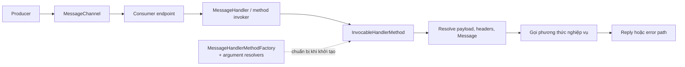
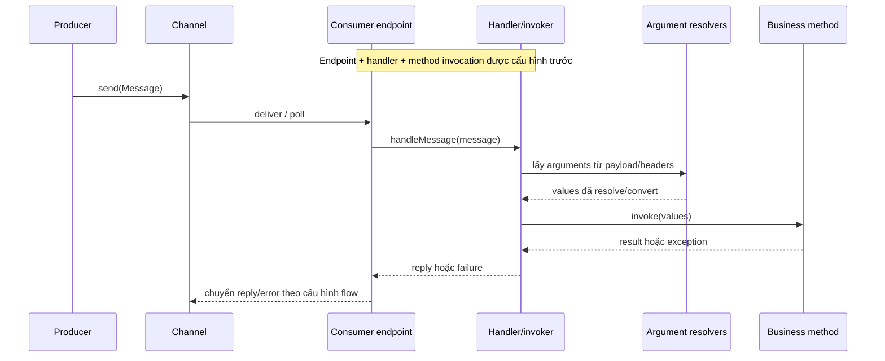

# MessageHandlerMethodFactoryResolver: cơ chế phân giải lời gọi handler

## 1. Chủ đề này nằm ở đâu trong Spring Integration Runtime?

Trong **Spring Integration Runtime**, một message đi qua `MessageChannel`, được `ConsumerEndpoint` nhận và chuyển cho `MessageHandler`. Khi handler là phương thức Java trên một POJO — chẳng hạn phương thức đánh dấu `@ServiceActivator` — framework cần xác định **phương thức sẽ gọi** và **giá trị truyền vào từng tham số** trước khi thực thi nghiệp vụ.

Tên bài **`MessageHandlerMethodFactoryResolver`** được dùng để nghiên cứu cơ chế đó. Cần phân biệt rõ: trong API công khai của Spring Framework/Spring Integration 6.x, **không có một kiểu chuẩn được tài liệu hóa với tên chính xác `MessageHandlerMethodFactoryResolver`**. Những thành phần thực tế cần tra cứu là:

- `MessageHandlerMethodFactory`: giao diện tạo `InvocableHandlerMethod` cho một bean và một `Method` đã được xác định.
- `DefaultMessageHandlerMethodFactory`: triển khai mặc định ở Spring Messaging; chuẩn bị các `HandlerMethodArgumentResolver`.
- `IntegrationMessageHandlerMethodFactory`: triển khai mở rộng cho Spring Integration, có từ phiên bản 6.0.
- `HandlerMethodArgumentResolver`: chiến lược lấy và chuyển đổi một tham số từ `Message<?>`.
- `MessagingMethodInvokerHelper`: thành phần hỗ trợ gọi phương thức trên đối tượng đích bằng payload và headers trong Spring Integration.

Nếu một codebase riêng định nghĩa class tên `MessageHandlerMethodFactoryResolver`, phải xem hợp đồng và cách nó được gọi trong **codebase đó**; không thể mặc định class ấy là API của framework.

**Mục tiêu bài học:** hiểu ranh giới giữa tìm phương thức, tạo bộ gọi, resolve arguments và chạy endpoint; có thể dựng một flow nhỏ để kiểm tra payload/header, lý giải lỗi conversion, đồng thời chẩn đoán retry, transaction, thread và correlation từ góc nhìn runtime.

## 2. Mô hình trách nhiệm

| Thành phần | Chịu trách nhiệm | Không chịu trách nhiệm |
|---|---|---|
| `MessageChannel` (`DirectChannel`, `ExecutorChannel`, `QueueChannel`, …) | Truyền hoặc lưu message, tác động cách consumer nhận và thread thực thi | Quyết định cách ánh xạ `@Header` vào tham số Java |
| Consumer endpoint (`EventDrivenConsumer`, `PollingConsumer`, …) | Đăng ký nhận/poll message, quản lý lifecycle của điểm tiêu thụ | Tự chuyển JSON thành đối tượng nghiệp vụ |
| `MessageHandler` / POJO method invoker | Thực hiện hành động xử lý message, có thể tạo reply | Tự quyết định scheduler cho toàn bộ flow |
| `MessageHandlerMethodFactory` | Tạo `InvocableHandlerMethod` có cấu hình argument resolvers phù hợp | Route message sang channel nào, mở transaction, thực hiện retry |
| `HandlerMethodArgumentResolver` | Xác định có hỗ trợ một tham số hay không và lấy giá trị tương ứng | Chọn consumer endpoint hoặc đảm bảo exactly-once |
| `MessageConverter`, `ConversionService`, `Validator` | Hỗ trợ chuyển kiểu và kiểm tra dữ liệu khi được cấu hình | Tự bảo đảm toàn bộ message flow an toàn trước dữ liệu lỗi |

**Hai thời điểm quan trọng:**

1. **Khi cấu hình/khởi tạo:** Spring Integration phân tích cấu hình annotation/DSL, kết nối endpoint với handler và chuẩn bị đường gọi tới phương thức đích. Factory tạo `InvocableHandlerMethod` cho bean/method và thiết lập resolvers; chi tiết chọn phương thức và cache tùy kiểu handler, phiên bản.
2. **Khi có message:** consumer chuyển message đến handler; các resolver chọn nguồn giá trị cho tham số, áp dụng conversion/validation nếu cần, rồi phương thức nghiệp vụ được gọi. Giá trị trả về (nếu có) được xử lý theo quy tắc reply của handler/endpoint.

`MessageHandlerMethodFactory` **không** có nhiệm vụ tự lựa chọn tất cả các phương thức overload. Việc tìm/chọn phương thức đích liên quan cấu hình handler và `MessagingMethodInvokerHelper`; factory nhận bean và `Method` để tạo công cụ gọi tương ứng.



Sơ đồ mang tính khái niệm: nhiều handler có tối ưu và nhánh thực thi khác nhau, đặc biệt khi Spring Integration phải dùng SpEL cho kiểu biểu thức/phương thức nhất định.

## 3. Các API và mối liên hệ

### 3.1. Giao diện `MessageHandlerMethodFactory`

Chữ ký trọng tâm:

```java
// org.springframework.messaging.handler.annotation.support.MessageHandlerMethodFactory
InvocableHandlerMethod createInvocableHandlerMethod(Object bean, Method method);
```

Factory nhận **instance bean** và **reflection Method**. Kết quả là đối tượng biết cách lấy đối số từ `Message<?>` và gọi method; nó không phải một `MessageHandler` độc lập được tự động subscribe vào channel.

### 3.2. `DefaultMessageHandlerMethodFactory` và `IntegrationMessageHandlerMethodFactory`

`DefaultMessageHandlerMethodFactory` thuộc Spring Messaging, có các điểm cấu hình hữu ích:

- `setMessageConverter(MessageConverter)`: chuyển payload thành kiểu mà method yêu cầu.
- `setConversionService(ConversionService)`: điều chỉnh chuyển kiểu payload hoặc header khi resolver hỗ trợ.
- `setValidator(Validator)`: cung cấp kiểm tra ràng buộc cho payload có đánh dấu validation.
- `setCustomArgumentResolvers(List<HandlerMethodArgumentResolver>)`: nối thêm custom resolver **sau** các resolver cho kiểu dữ liệu thông thường.
- `setArgumentResolvers(List<HandlerMethodArgumentResolver>)`: thay **toàn bộ** danh sách resolver, phù hợp trường hợp nâng cao nhưng dễ làm mất hành vi mặc định nếu bỏ sót.

`IntegrationMessageHandlerMethodFactory` (`org.springframework.integration.handler.support`) kế thừa lớp trên, thêm xử lý phù hợp Spring Integration, chẳng hạn các kiểu tham số liên quan đến payload expression, map/collection. Có constructor `IntegrationMessageHandlerMethodFactory()` và `IntegrationMessageHandlerMethodFactory(boolean listCapable)`; ý nghĩa xử lý danh sách phụ thuộc ngữ cảnh handler, không nên bật chỉ vì dữ liệu nghiệp vụ tình cờ là `List`.

Không được nhầm factory này với `ConsumerEndpointFactoryBean`, vốn phục vụ việc tạo consumer endpoint từ cấu hình input channel/handler.

### 3.3. Resolver nào xử lý tham số?

Ví dụ method nghiệp vụ:

```java
public String accept(
        @Payload String orderId,
        @Header("tenantId") String tenantId,
        @Headers Map<String, Object> headers) {
    return tenantId + ":" + orderId;
}
```

| Kiểu khai báo | Nguồn giá trị mong đợi | Điểm cần kiểm tra |
|---|---|---|
| `@Payload String orderId` | `message.getPayload()` | Payload có đúng kiểu hoặc convert được không? |
| `@Header("tenantId") String tenantId` | Header `tenantId` | Header có tồn tại, có đúng kiểu không? |
| `@Headers Map<String, Object> headers` | Tập message headers | Dùng để đọc metadata, hạn chế ghi log thông tin nhạy cảm |
| `Message<Order> message` | Toàn bộ `Message<?>` | Giữ cả payload lẫn headers, lưu ý generic type |
| `@Payload(expression = "...")` | Giá trị được đánh giá qua biểu thức | Cần kiểm tra cú pháp SpEL, property path và cách gọi phù hợp phiên bản |
| Collection/map trong aggregator | Có thể là tập message/payload/group metadata | Phải xét đúng loại handler, resolver và tính năng `listCapable` |

Một số resolver cụ thể được tài liệu hóa gồm `PayloadMethodArgumentResolver`, `HeaderMethodArgumentResolver`, `HeadersMethodArgumentResolver` (Spring Messaging), và `PayloadExpressionArgumentResolver`, `PayloadsArgumentResolver`, `CollectionArgumentResolver`, `MapArgumentResolver` (Spring Integration). **Không có một resolver duy nhất xử lý mọi tham số**.

## 4. Ví dụ thực hành: POJO service activator

Ví dụ dùng Spring Integration 6.x, Java 17 trở lên, với dependency `spring-integration-core`. Các import được viết đầy đủ để phân biệt lớp thuộc Spring Messaging và Spring Integration.

```java
import org.springframework.context.annotation.Bean;
import org.springframework.context.annotation.Configuration;
import org.springframework.integration.annotation.ServiceActivator;
import org.springframework.integration.channel.DirectChannel;
import org.springframework.integration.channel.QueueChannel;
import org.springframework.integration.config.EnableIntegration;
import org.springframework.messaging.MessageChannel;
import org.springframework.messaging.PollableChannel;
import org.springframework.messaging.handler.annotation.Header;
import org.springframework.messaging.handler.annotation.Payload;
import org.springframework.stereotype.Component;

@Configuration
@EnableIntegration
class OrderFlowConfig {

    @Bean(name = "orders.input")
    MessageChannel orderInput() {
        return new DirectChannel();
    }

    @Bean(name = "orders.output")
    PollableChannel orderOutput() {
        return new QueueChannel();
    }
}

@Component
class OrderService {

    @ServiceActivator(
        inputChannel = "orders.input",
        outputChannel = "orders.output"
    )
    public String handle(
            @Payload String orderId,
            @Header(name = "tenantId", required = false) String tenantId) {

        if (orderId.isBlank()) {
            throw new IllegalArgumentException("orderId must not be blank");
        }

        String tenant = tenantId == null ? "public" : tenantId;
        return "accepted:" + tenant + ":" + orderId;
    }
}
```

Điều kiện: `OrderFlowConfig` và `OrderService` phải nằm trong phạm vi component scan của ứng dụng. Nếu dùng Spring Boot, cần cấu hình thành phần Spring Integration phù hợp và tránh khai báo infrastructure lặp không cần thiết.

Gửi một message và đọc kết quả trong một đoạn mã có `ApplicationContext context`:

```java
import org.springframework.messaging.Message;
import org.springframework.messaging.MessageChannel;
import org.springframework.messaging.PollableChannel;
import org.springframework.messaging.support.MessageBuilder;

MessageChannel input =
        context.getBean("orders.input", MessageChannel.class);
PollableChannel output =
        context.getBean("orders.output", PollableChannel.class);

Message<String> request = MessageBuilder.withPayload("A-101")
        .setHeader("tenantId", "shop-7")
        .build();

boolean sent = input.send(request);
Message<?> reply = output.receive(1_000);

System.out.println(sent);                 // true nếu gửi thành công
System.out.println(reply.getPayload());   // accepted:shop-7:A-101
```

Giải thích từng bước:

1. Producer tạo `Message<String>` với payload `"A-101"` và header `tenantId`.
2. `DirectChannel` gọi subscriber ngay trên thread gửi nếu không có thành phần làm lệch luồng thực thi.
3. `ServiceActivatingHandler` phối hợp gọi method `OrderService.handle`; cơ chế ánh xạ đối số lấy `orderId` từ payload và `tenantId` từ headers.
4. Method trả về chuỗi. Vì khai báo `outputChannel`, reply được gửi đến `orders.output`.
5. `QueueChannel` lưu reply để `receive(1_000)` lấy ra. Tham số timeout tính bằng mili giây; nếu không có reply, kết quả có thể là `null`, nên trong code ứng dụng cần kiểm tra trước khi đọc payload.

Nếu bỏ header `tenantId`, method nhận `null` do `required = false` và trả về prefix `public`. Nếu dùng `@Header("tenantId")` mặc định yêu cầu header, message thiếu header sẽ lỗi trong giai đoạn resolve tham số, trước khi chạy phần thân method.

**Lưu ý lifecycle:** ví dụ này có một consumer trên `DirectChannel`. Thay `DirectChannel` bằng `ExecutorChannel` khiến handler có thể chạy trên thread của executor; thay bằng `QueueChannel` làm **input** thì cần poller/consumer tương ứng để lấy message. Factory/argument resolver không quyết định việc đó.

## 5. Tách riêng factory để quan sát việc gọi method

Đây là phép thử **cấp API**, giúp thấy rõ factory và resolver mà không cần dựng toàn bộ integration flow:

```java
import java.lang.reflect.Method;

import org.springframework.integration.handler.support.IntegrationMessageHandlerMethodFactory;
import org.springframework.messaging.handler.annotation.Header;
import org.springframework.messaging.handler.annotation.Payload;
import org.springframework.messaging.handler.invocation.InvocableHandlerMethod;
import org.springframework.messaging.support.MessageBuilder;

public class HandlerFactoryProbe {

    public static class Handler {
        public String handle(@Payload String payload,
                             @Header("tenantId") String tenantId) {
            return tenantId + "/" + payload;
        }
    }

    public static void main(String[] args) throws Exception {
        Handler target = new Handler();
        Method method = Handler.class.getMethod(
                "handle", String.class, String.class);

        IntegrationMessageHandlerMethodFactory factory =
                new IntegrationMessageHandlerMethodFactory();
        factory.afterPropertiesSet(); // khởi tạo các argument resolvers

        InvocableHandlerMethod invocable =
                factory.createInvocableHandlerMethod(target, method);

        Object result = invocable.invoke(
                MessageBuilder.withPayload("PO-9")
                        .setHeader("tenantId", "acme")
                        .build());

        System.out.println(result); // acme/PO-9
    }
}
```

Đọc đoạn mã theo hai tầng:

- **Tầng chuẩn bị:** xác định `Method` từ reflection, cấu hình factory, gọi `afterPropertiesSet()`, tạo `InvocableHandlerMethod`.
- **Tầng xử lý:** gọi `invoke(message)`; bộ resolver tìm đối số từ message rồi chạy method.

Ở đây `getMethod(...)` đã xác định method rõ ràng. Không nên hiểu `createInvocableHandlerMethod(...)` là một bộ lọc tự tìm tất cả method hợp lệ trên bean. Trong ứng dụng có DI, Spring gọi callback khởi tạo thay cho thao tác thủ công bên trên; bài thử chỉ dựng factory ngoài container.

## 6. Customize resolution, conversion và validation

### 6.1. Khi nào tùy biến?

Ví dụ một hệ thống gắn mã khách hàng ở header `x-customer-id` nhưng muốn handler nhận đối tượng `CustomerContext`. Có hai hướng:

- Dùng `@Header("x-customer-id") String id` rồi gọi service lookup trong code nghiệp vụ: đơn giản, dễ quan sát và dễ kiểm thử.
- Viết custom `HandlerMethodArgumentResolver` cho `CustomerContext` nếu nhiều endpoint cần cùng quy tắc ánh xạ; sau đó cấu hình vào factory **thực sự được handler sử dụng**.

Factory cho phép đăng ký custom resolver:

```java
IntegrationMessageHandlerMethodFactory factory =
        new IntegrationMessageHandlerMethodFactory();

factory.setCustomArgumentResolvers(
        java.util.List.of(new CustomerContextArgumentResolver()));
factory.afterPropertiesSet();
```

`CustomerContextArgumentResolver` trong ví dụ chỉ là **class do ứng dụng tự triển khai**; muốn dùng được phải viết `supportsParameter(MethodParameter)` và `resolveArgument(MethodParameter, Message<?>)` theo hợp đồng `HandlerMethodArgumentResolver` của phiên bản Spring Messaging. Việc tạo một factory tùy biến bằng `new` **không tự làm mọi `@ServiceActivator` đang chạy chuyển sang factory đó**. Cách wiring phải theo điểm mở rộng thực tế của phiên bản và loại handler.

Khi custom resolver đụng một kiểu đã được built-in resolver nhận trước, `setCustomArgumentResolvers` không nhất thiết ghi đè thứ tự chọn. Khi đó cần xem thứ tự danh sách và cân nhắc `setArgumentResolvers` với đầy đủ resolvers thiết yếu.

### 6.2. Conversion không giống domain mapping

Nếu payload là `String` chứa JSON nhưng method yêu cầu `OrderCommand`, resolver chỉ làm việc khi có `MessageConverter` tương thích. Spring Integration không mặc nhiên biết mọi JSON schema, content-type và định dạng business object của ứng dụng.

Một hướng dễ kiểm soát là đặt transformer/chuyển đổi rõ ràng trước handler:

```text
Bytes/JSON -> MessageConverter hoặc Transformer -> OrderCommand -> @ServiceActivator
```

Cần phân biệt:

- `MessageConverter` quyết định cách đổi payload message.
- `ConversionService` hỗ trợ chuyển các giá trị đơn giản (ví dụ header dạng chuỗi sang số) theo quy tắc conversion đã đăng ký.
- `@Payload` và `@Header` thể hiện vị trí lấy dữ liệu; chúng không tự thay thế serializer hoặc schema validation.

### 6.3. Validation cần được bật đúng nơi

`@Valid`/`@Validated` chỉ có ý nghĩa khi pipeline có validator phù hợp. Theo Javadoc, `DefaultMessageHandlerMethodFactory` mặc định không thực thi validation nghiệp vụ nếu chưa cấu hình `Validator`. Đồng thời cần bảo đảm bean factory đang dùng chính validator đó. Một lỗi về dữ liệu nghiệp vụ không nên bị che bởi retry vô hạn của consumer.

## 7. Overload, SpEL và phiên bản

Spring Integration có thể cho phép chọn method dựa trên payload hoặc annotation, tùy cấu hình. Một số lời gọi POJO dùng `InvocableHandlerMethod`; một số trường hợp, chẳng hạn biểu thức dereference phức tạp trên parameter, vẫn có thể đi qua SpEL. Vì thế:

- Hạn chế nhiều overload cùng tên với kiểu payload dễ chuyển đổi lẫn nhau (`String`, `Object`, DTO gần giống nhau).
- Ưu tiên tên method, kiểu tham số và annotation tường minh trong các flow quan trọng.
- Nếu dùng `@Payload(expression = "payload.foo")`, hãy thử đúng payload type và xác minh method thực tế được chọn.
- Xem tài liệu đúng phiên bản: `IntegrationMessageHandlerMethodFactory` có từ Spring Integration **6.0**; không sao chép cấu hình API 6.x vào 5.x rồi kỳ vọng compile.
- Không gán `MessageHandlerMethodFactoryResolver` làm import Java nếu dự án không tự có class này.

Từ Spring Integration 5.0, framework ưu tiên gọi POJO bằng `InvocableHandlerMethod` khi có thể, với một số trường hợp dự phòng dùng SpEL. Chi tiết có thể biến động theo phiên bản và kiểu handler.

## 8. Đặt resolution vào bức tranh runtime rộng hơn



### Channel, thread và transaction

Với `DirectChannel`, lời gọi tới handler diễn ra đồng bộ trên thread gửi trong trường hợp thông thường; transaction đang gắn với thread có thể bao trùm các bước đồng bộ. Với `ExecutorChannel`, message được đưa sang executor, tạo ranh giới thread và thường không tự truyền thread-bound transaction. Với `QueueChannel` cùng `PollingConsumer`, thời điểm lấy message phụ thuộc poller và transaction của tác vụ polling.

Resolver chỉ chuẩn bị arguments. Nó **không mở transaction**, **không quyết định commit/rollback**, **không sắp lịch poller** và **không chuyển `ThreadLocal`**. Nếu hệ thống gặp lỗi transaction mất hiệu lực, phải lần theo channel, executor, poller và transaction advice của endpoint trước.

### Retry và error channel

Nếu `@Header` bắt buộc không tồn tại, conversion thất bại, method ném exception hoặc validation lỗi, xử lý message có thể thất bại. Cách lỗi biểu hiện tùy consumer:

- Đường đồng bộ có thể ném exception về caller đang gửi message.
- Đường bất đồng bộ hoặc polling có thể publish `ErrorMessage` tới một error channel hoặc xử lý bởi error handler/advice được cấu hình.
- Retry chỉ xảy ra khi flow có cơ chế retry tương ứng; argument resolver không tự retry.
- Đưa message lỗi vào dead-letter store hoặc recoverer là quyết định của flow, không thuộc factory.

Đối với lỗi dữ liệu cố định (thiếu header, payload sai schema), retry nhiều lần thường không giúp gì. Với lỗi hạ tầng tạm thời, retry kèm backoff và idempotency có thể cần thiết.

### Message store và correlation

`MessageStore` thường phục vụ queue/group/aggregation hoặc thành phần tương ứng, không phải nơi factory lưu tham số method. Header như `correlationId`, `sequenceNumber`, `sequenceSize` giúp splitter/aggregator liên kết các message; chúng không tự xuất hiện trong mọi message. Nếu handler cần header:

```java
public void consume(
        @Payload String payload,
        @Header(name = "correlationId", required = false) Object correlationId) {
    // Nếu null: message đến mà không có header correlationId.
}
```

Việc đọc một correlation header không đồng nghĩa framework đã bảo đảm message được xử lý duy nhất một lần. Phải kiểm tra nguồn header, cách nhóm message, message store, timeout/release strategy và chiến lược chống xử lý trùng.

## 9. Chẩn đoán các sự cố thường gặp

| Triệu chứng | Nguyên nhân có khả năng | Cách khoanh vùng |
|---|---|---|
| `No suitable resolver` hoặc không resolve được method parameter | Kiểu tham số không nằm trong resolver hỗ trợ; annotation thiếu hoặc resolver chưa được cấu hình | Kiểm tra chữ ký method, annotation, danh sách resolver của factory **đang được dùng** |
| Thiếu header bắt buộc | Producer không set header hoặc interceptor đã thay đổi headers | Ghi nhận tên header và các điểm transform/split; thử `required = false` nếu phù hợp nghiệp vụ |
| `MessageConversionException` hoặc type mismatch | Payload/header không chuyển được sang kiểu method yêu cầu | Quan sát class thực tế, `contentType`, converter, conversion service |
| Handler không được gọi | Endpoint chưa start, channel sai tên, chưa có subscriber, poller chưa chạy | Kiểm tra bean endpoint, `SmartLifecycle`, kết nối channel, trạng thái poller |
| Reply không đến | Method trả `void`/`null`, output channel sai, downstream chưa đọc, timeout | Kiểm tra return value và cấu hình reply/output channel; inspect queue |
| Thread khác với kỳ vọng | Có `ExecutorChannel`, task executor hoặc poller | Log tên thread ở producer, channel interceptor và handler |
| Retry lặp mãi vì cùng một message | Lỗi dữ liệu cố định bị áp retry như lỗi tạm thời | Phân loại exception; đặt recovery/DLQ phù hợp |
| Kết quả lúc đúng lúc sai với overload | Method selection phụ thuộc kiểu payload hoặc conversion | Giảm overload, dùng chữ ký/annotation rõ ràng, test các payload type |

Một quy trình tìm lỗi ngắn, thực tế:

1. Ghi `messageId`, tên channel, payload type, các header cần thiết tại **điểm vào**; ẩn/mask thông tin nhạy cảm.
2. Xác định endpoint có đang chạy và subscribe/poll đúng channel hay không.
3. Nếu đã tới handler, kiểm tra method thực sự được chọn, từng parameter, resolver, conversion và validation.
4. Đọc **root cause** trong stack trace thay vì chỉ lớp exception bọc ngoài.
5. Đối chiếu thread, timeout, transaction, retry advice, error channel và message store nếu lỗi chỉ xuất hiện dưới tải hoặc theo lịch poll.

## 10. Bài tập tự kiểm tra

1. Chạy ví dụ `OrderService` với và không có `tenantId`. Giải thích tại sao `required = false` thay đổi kết quả.
2. Đổi payload từ `"A-101"` sang một đối tượng `OrderCommand` trong khi method vẫn nhận `String`. Quan sát khả năng chuyển kiểu, sau đó thêm transformer phù hợp.
3. Đổi `orders.input` sang `ExecutorChannel` và cấu hình executor. Log tên thread trước `send` và trong `handle`; phân tích ranh giới transaction.
4. Giữ `QueueChannel` làm **input**, thêm poller, rồi thay đổi chu kỳ polling để quan sát độ trễ.
5. Tạo lỗi header bắt buộc và lỗi method nghiệp vụ; phân biệt nơi exception xuất hiện trong flow đồng bộ và bất đồng bộ.
6. Dùng bài thử `HandlerFactoryProbe` để hiểu vì sao `MessageHandlerMethodFactory` nhận một `Method` đã xác định, rồi giải thích thành phần nào quyết định method trong service activator thực tế.

## 11. Ghi nhớ để vận hành

Khi đọc tên **MessageHandlerMethodFactoryResolver** trong sơ đồ hoặc code, hãy xác định người viết đang nói đến **factory tạo bộ gọi method**, **resolver ánh xạ tham số**, hay một **class tùy biến**. Chúng là ba trách nhiệm khác nhau.

Trong Spring Integration, khả năng gọi một POJO bằng payload và headers là một mắt xích nhỏ của runtime. Một bài chẩn đoán chính xác luôn đặt mắt xích đó giữa **channel → endpoint → handler → method invocation**, rồi kiểm tra thread, lifecycle, reply, error, transaction và correlation ở đúng thành phần sở hữu trách nhiệm.

### Tài liệu đối chiếu

- [Spring Integration 6.5.x: `IntegrationMessageHandlerMethodFactory` API](https://www.springframework.org/spring-integration/docs/6.5.x/api/org/springframework/integration/handler/support/IntegrationMessageHandlerMethodFactory.html).
- [Spring Integration 6.5.x: các lớp `handler.support`](https://www.springframework.org/spring-integration/docs/6.5.x/api/org/springframework/integration/handler/support/package-summary.html).
- [Spring Integration Reference: Overview](https://docs.spring.io/spring-integration/reference/overview.html), nhất là cách POJO handler và `InvocableHandlerMethod` vận hành.
- [Spring Integration Reference: Service Activator](https://docs.spring.io/spring-integration/reference/service-activator.html).
- [Spring Framework 6.2.x: `DefaultMessageHandlerMethodFactory` Javadoc](https://docs.spring.io/spring-framework/docs/6.2.x/javadoc-api/org/springframework/messaging/handler/annotation/support/DefaultMessageHandlerMethodFactory.html).
