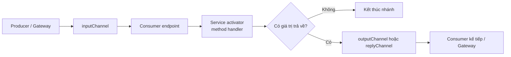

# @ServiceActivator và method handler trong Spring Integration

## 1. Mục tiêu và bối cảnh runtime

Trong Spring Integration, **message** mang `payload` và `headers` đi qua các `MessageChannel`. Một channel chỉ giải quyết việc chuyển giao message; để thực thi nghiệp vụ, flow cần một **endpoint** nhận message và gọi mã xử lý. `@ServiceActivator` là cách khai báo phổ biến để gắn một phương thức Java thông thường (POJO method) vào endpoint đó.

Sau bài học, bạn có thể:

- Giải thích vì sao `@ServiceActivator` là điểm nối giữa message flow và method nghiệp vụ.
- Viết method handler nhận payload, cả `Message<?>` hoặc các header được chỉ định.
- Phân biệt xử lý một chiều với request–reply; chọn `inputChannel`, `outputChannel` và `requiresReply` đúng mục đích.
- Hiểu ảnh hưởng của `DirectChannel`, `ExecutorChannel`, `QueueChannel` và poller đến thread thực thi handler.
- Chẩn đoán lỗi không có reply, sai kiểu payload, lỗi đích gửi, exception từ handler và các vấn đề runtime thường gặp.

Phạm vi ở đây là **Spring Integration Runtime**, đặc biệt là cơ chế *handler adapter*: framework lo phần nhận/giải nghĩa message và gọi method; method nghiệp vụ tập trung vào dữ liệu cần xử lý. Các khái niệm transaction, retry, message store, lifecycle và correlation được liên hệ ở nơi chúng ảnh hưởng trực tiếp đến handler.

## 2. Service activator đứng ở đâu trong message flow?

`@ServiceActivator` đánh dấu một method thuộc Spring-managed bean là nơi xử lý message từ một input channel. Khi có message đến, framework tạo/cấu hình một endpoint, nhận message và chuyển lời gọi qua cơ chế method invocation tương ứng. Với service method thông thường, bộ xử lý dựa trên `ServiceActivatingHandler` và thành phần gọi method; ứng dụng không phải tự viết `MessageHandler` để bóc payload và header.



Ba đối tượng dễ nhầm lẫn:

| Thành phần | Nhiệm vụ |
| --- | --- |
| `MessageChannel` | Vận chuyển message và quyết định cách chuyển giao (cùng thread, qua executor, hàng đợi...). |
| Consumer endpoint | Đăng ký nhận hoặc poll message; điều phối lời gọi tới handler và quản lý vòng đời. |
| Method handler | Thực thi quy tắc nghiệp vụ; đọc payload/header và có thể trả kết quả. |

`@ServiceActivator` **không tự tạo thread riêng** và cũng **không tự bảo đảm transaction, retry hay lưu message bền vững**. Những tính chất này phụ thuộc channel, poller, advice, transaction manager và cấu hình flow bao quanh endpoint.

## 3. Khai báo method với `@ServiceActivator`

Ví dụ tối giản:

```java
import org.springframework.integration.annotation.MessageEndpoint;
import org.springframework.integration.annotation.ServiceActivator;

@MessageEndpoint
public class PriceHandler {

    @ServiceActivator(inputChannel = "priceRequests",
                      outputChannel = "priceResults")
    public long calculate(long basePrice) {
        return Math.round(basePrice * 1.1);
    }
}
```

Giải thích:

1. `@MessageEndpoint` là một stereotype để Spring component scanning đăng ký bean (có thể thay bằng `@Component`).
2. `@ServiceActivator` chỉ định method sẽ được gọi khi endpoint nhận message từ `priceRequests`.
3. Đối số `long basePrice` được framework ánh xạ từ **payload** (giả sử kiểu dữ liệu tương thích).
4. Giá trị `long` được đóng gói thành reply message và gửi tới `priceResults`.

Các thuộc tính thường dùng:

| Thuộc tính | Ý nghĩa và lưu ý |
| --- | --- |
| `inputChannel` | Tên channel đầu vào; với channel có subscriber, endpoint đăng ký nhận trực tiếp; với channel pollable cần poller. |
| `outputChannel` | Channel đích cho reply, được ưu tiên hơn header `replyChannel` của request. |
| `requiresReply` | Chuỗi cấu hình như `"true"`; nếu method trả `null` khi bật, framework ném `ReplyRequiredException`. |
| `poller` | Lịch poll khi nhận từ `PollableChannel`, ví dụ `QueueChannel`. |
| `adviceChain` | Danh sách bean advice bao quanh lời gọi handler, có thể dùng cho retry/cross-cutting behavior. |
| `autoStartup`, `phase` | Tham số vòng đời endpoint theo cơ chế `SmartLifecycle`. |
| `sendTimeout` | Giới hạn chờ gửi reply tới output channel khi thao tác gửi có thể bị chặn. |
| `async` | Chế độ xử lý kết quả bất đồng bộ (cần đối chiếu kiểu trả về và cấu hình phiên bản đang dùng). |

Tên channel phải khớp cấu hình flow. Framework có thể đăng ký ngầm một `DirectChannel` khi tên `inputChannel` chưa có bean tương ứng, nhưng trong flow quan trọng nên khai báo rõ channel để tránh nhận nhầm ngữ nghĩa threading, buffering hoặc độ bền dữ liệu.

### Method cần thuộc một Spring-managed bean

Đặt annotation lên method của đối tượng tự tạo bằng `new` nhưng không đăng ký với Spring sẽ **không** khiến endpoint tự xuất hiện. Cần cho Spring quản lý bean thông qua `@Component`, `@MessageEndpoint`, `@Bean` hay cơ chế đăng ký tương đương; đồng thời bật Spring Integration annotation infrastructure.

Khi dùng cấu hình Java thuần, `@EnableIntegration` bật hạ tầng xử lý annotation. Với interface `@MessagingGateway`, `@IntegrationComponentScan` hỗ trợ tìm và đăng ký interface mà `@ComponentScan` tiêu chuẩn không quét như class.

## 4. Cơ chế ánh xạ tham số method

Một handler thường nên nhận **payload có kiểu rõ ràng** để tách business logic khỏi chi tiết message transport. Khi cần metadata, hãy khai báo tường minh tham số header.

| Chữ ký method | Dữ liệu được nhận | Dùng khi |
| --- | --- | --- |
| `handle(Order order)` | Payload kiểu `Order` | Nghiệp vụ chủ yếu xử lý dữ liệu. |
| `handle(Message<Order> message)` | Toàn bộ message gồm payload và headers | Cần truy cập nhiều metadata hoặc điều khiển protocol. |
| `handle(@Payload Order order, @Header("traceId") String traceId)` | Payload và một header | Cần correlation/tracing hoặc tenant metadata. |
| `handle(@Headers Map<String, Object> headers)` | Tập header | Phân tích/định tuyến theo nhiều header. |
| `handle()` | Không có đối số | Chỉ cần biết có message đến, ví dụ trigger hoặc đếm sự kiện. |

Ví dụ:

```java
import java.util.Map;
import org.springframework.integration.annotation.MessageEndpoint;
import org.springframework.integration.annotation.ServiceActivator;
import org.springframework.messaging.handler.annotation.Header;
import org.springframework.messaging.handler.annotation.Headers;
import org.springframework.messaging.handler.annotation.Payload;

@MessageEndpoint
public class AuditHandler {

    @ServiceActivator(inputChannel = "auditRequests")
    public void audit(
            @Payload Order order,
            @Header(value = "traceId", required = false) String traceId,
            @Headers Map<String, Object> headers) {
        // Xử lý ghi nhận sự kiện theo quy tắc ứng dụng.
        // Không log toàn bộ headers nếu có dữ liệu nhạy cảm.
        System.out.println("Order=" + order.code() + ", traceId=" + traceId);
    }
}
```

`@Header(required = false)` phù hợp với header không bắt buộc; header bắt buộc nhưng bị thiếu có thể gây lỗi resolve argument. Nếu payload không đúng kiểu method mong đợi và không có cơ chế conversion phù hợp, việc gọi method cũng thất bại. Vì vậy producer, channel và consumer cần thống nhất *message contract*.

Không nên tạo nhiều method handler overload có kiểu dữ liệu mơ hồ và kỳ vọng framework luôn chọn đúng. Với method đã đặt `@ServiceActivator`, khai báo một chữ ký cụ thể sẽ dễ đọc, dễ kiểm thử và dễ chẩn đoán hơn. Trong một số kiểu cấu hình dùng reference tới POJO mà không chỉ rõ method, framework có thể lựa chọn method theo kiểu payload hoặc fallback `Message<?>`; đó là một cơ chế lựa chọn khác, không nên lẫn với việc chỉ định trực tiếp một annotated method.

## 5. Quy tắc trả kết quả và route reply

Service activator có thể chạy **một chiều** (fire-and-forget theo nghĩa ở cấp method) hoặc **request–reply**:

- Trả `void` hoặc `null`: mặc định endpoint không phát reply; flow có thể kết thúc tại đây.
- Trả một đối tượng thông thường: framework dùng đối tượng làm payload của reply message.
- Trả `Message<?>`: caller kiểm soát payload và header đã khai báo, sau đó Spring Integration còn áp dụng quy tắc hợp nhất header của service activator.

Khi một reply khác `null` được tạo, nơi gửi được xác định theo thứ tự quan trọng:

1. `outputChannel` khai báo trên endpoint, nếu có.
2. Header `replyChannel` của request ban đầu.
3. Trong một số trường hợp khi request không có `replyChannel` mà kết quả là `Message<?>`, framework xét `replyChannel` trên message trả về.

Nếu handler trả kết quả nhưng không xác định được đích nhận, flow có thể lỗi khi resolve destination. Một gateway chờ reply cũng có thể hết thời gian chờ nếu nhánh xử lý kết thúc mà không sinh reply.

Ví dụ hai phong cách:

```java
// Tạo reply để gửi sang bước tiếp theo một cách tường minh.
@ServiceActivator(inputChannel = "validateIn",
                  outputChannel = "persistIn",
                  requiresReply = "true")
public ValidatedOrder validate(Order order) {
    return new ValidatedOrder(order.code(), order.quantity());
}

// Xử lý một chiều; kết quả void không tạo reply.
@ServiceActivator(inputChannel = "auditIn")
public void writeAudit(AuditEvent event) {
    auditRepository.save(event);
}
```

Hai phương thức trên minh họa API; `ValidatedOrder`, `AuditEvent` và `auditRepository` là kiểu/bean nghiệp vụ do ứng dụng định nghĩa.

Nếu cần cố ý bỏ kết quả nhưng method vẫn trả về object, có thể đặt `outputChannel = "nullChannel"` (channel đặc biệt được Spring Integration cung cấp). Khi một hành động **bắt buộc** phải có phản hồi, nên dùng `requiresReply = "true"` để lỗi `null` xuất hiện ngay tại handler, thay vì khiến hệ thống phía trước chờ đến timeout.

### Lưu ý khi trả cả `Message<?>`

Ở service activator, các header của request có thể được **sao chép vào reply nếu reply chưa chứa chúng**. Vì vậy cố ý không set một header trong `Message<?>` trả về không đồng nghĩa với việc header gốc bị loại bỏ. Dùng `HeaderFilter` trong flow khi cần xóa header, hoặc dùng transformer nếu mục đích chính là biến đổi message với quyền kiểm soát toàn bộ header.

Đối với correlation, `correlationId` (hoặc header do ứng dụng tự đặt) hữu ích cho log và phối hợp xử lý, nhưng `@ServiceActivator` **không tự gom nhiều message thành một nhóm**. Việc ghép nhóm/chờ đủ message thuộc trách nhiệm của các endpoint như aggregator và cơ chế message store nếu có.

## 6. Ví dụ hoàn chỉnh: Gateway → channel → method handler → reply

Giả sử hệ thống nhận đơn hàng qua một interface Java, kiểm tra số lượng và trả kết quả. Ví dụ dùng Java 17+ (do dùng `record`), Spring Integration Core và Spring Context, các class đặt trong cùng package `demo.integration`; mỗi public type ở một file riêng.

**`IntegrationConfiguration.java` — hạ tầng và channel**

```java
package demo.integration;

import org.springframework.context.annotation.Bean;
import org.springframework.context.annotation.ComponentScan;
import org.springframework.context.annotation.Configuration;
import org.springframework.integration.annotation.IntegrationComponentScan;
import org.springframework.integration.channel.DirectChannel;
import org.springframework.integration.config.EnableIntegration;
import org.springframework.messaging.MessageChannel;

@Configuration
@EnableIntegration
@ComponentScan(basePackageClasses = OrderHandler.class)
@IntegrationComponentScan(basePackageClasses = OrderGateway.class)
public class IntegrationConfiguration {

    @Bean
    public MessageChannel ordersIn() {
        return new DirectChannel();
    }
}
```

**`Order.java` và `Receipt.java` — model thông điệp**

```java
package demo.integration;

public record Order(String code, int quantity) {}
```

```java
package demo.integration;

public record Receipt(String code, String decision) {}
```

**`OrderHandler.java` — nghiệp vụ phía consumer**

```java
package demo.integration;

import org.springframework.integration.annotation.MessageEndpoint;
import org.springframework.integration.annotation.ServiceActivator;

@MessageEndpoint
public class OrderHandler {

    @ServiceActivator(inputChannel = "ordersIn", requiresReply = "true")
    public Receipt confirm(Order order) {
        if (order.quantity() <= 0) {
            throw new IllegalArgumentException("quantity must be positive");
        }
        return new Receipt(order.code(), "ACCEPTED");
    }
}
```

**`OrderGateway.java` — interface phía producer**

```java
package demo.integration;

import org.springframework.integration.annotation.MessagingGateway;

@MessagingGateway(defaultRequestChannel = "ordersIn")
public interface OrderGateway {
    Receipt submit(Order order);
}
```

**`Demo.java` — gọi thử trong context Java thuần**

```java
package demo.integration;

import org.springframework.context.annotation.AnnotationConfigApplicationContext;

public class Demo {
    public static void main(String[] args) {
        try (var context =
                     new AnnotationConfigApplicationContext(IntegrationConfiguration.class)) {
            OrderGateway gateway = context.getBean(OrderGateway.class);
            Receipt receipt = gateway.submit(new Order("SO-42", 3));
            System.out.println(receipt);
            // Receipt[code=SO-42, decision=ACCEPTED]
        }
    }
}
```

**Diễn tiến thực tế:**

1. `OrderGateway.submit(...)` tạo request message chứa `Order` và thông tin reply đích do gateway quản lý.
2. Message đi vào `ordersIn`. `DirectChannel` chuyển message đồng bộ tới consumer endpoint.
3. Adapter rút payload `Order` và gọi `OrderHandler.confirm(Order)` trên thread hiện tại.
4. Method trả `Receipt`; do không có `outputChannel` cố định, service activator gửi reply về `replyChannel` của request.
5. Gateway nhận reply và trả `Receipt` cho caller; caller không cần thao tác với `Message<?>`.

Trong nhánh lỗi, `quantity <= 0` dẫn tới exception từ handler; với `DirectChannel` đồng bộ, caller gateway thường thấy lỗi truyền ngược qua chuỗi gọi (có thể được bọc trong exception của messaging). Không nên mặc định lỗi sẽ được biến thành một reply nghiệp vụ thành công.

## 7. Đồng bộ, executor và poller thay đổi cách handler chạy

Annotation method không quyết định thread. **Loại input channel** là yếu tố chính:

| Input channel | Ai kích hoạt handler? | Hệ quả |
| --- | --- | --- |
| `DirectChannel` | Thread của producer/upstream | Lời gọi đồng bộ; handler chậm làm producer chậm; exception thường đi ngược về caller. |
| `ExecutorChannel` | Worker thread của `TaskExecutor` | Tạo ranh giới bất đồng bộ; cần theo dõi queue, pool, saturation và đường xử lý lỗi. |
| `QueueChannel` (`PollableChannel`) | Poller định kỳ lấy message | Có buffering; cần cấu hình poller, thông lượng và chính sách lưu trữ. |

Ví dụ poller:

```java
import org.springframework.integration.annotation.Poller;
import org.springframework.integration.annotation.ServiceActivator;

@ServiceActivator(
        inputChannel = "queuedOrders",
        poller = @Poller(fixedDelay = "1000", maxMessagesPerPoll = "5"))
public void consume(Order order) {
    process(order);
}
```

Ví dụ trên giả định `queuedOrders` đã được khai báo là `QueueChannel` hoặc một `PollableChannel` tương thích. Poller kiểm tra hàng đợi theo lịch, lấy tối đa số message được cấu hình trong một lượt poll. Đặt poller cho flow dùng `DirectChannel` là sai mô hình; ngược lại, pollable input mà không có poller/default poller phù hợp sẽ không hoạt động như mong muốn.

`QueueChannel` mặc định dùng bộ nhớ và **không phải** durable queue xuyên restart. Nếu yêu cầu khôi phục message, cần xem xét `MessageStore` bền vững và cấu hình channel tương ứng. Việc chuyển từ `DirectChannel` sang `ExecutorChannel` hoặc pollable channel còn thay đổi ranh giới exception, transaction và ngữ cảnh thread (ví dụ MDC/tracing context).

### `async` của service activator không giống `ExecutorChannel`

Với handler trả `CompletableFuture<?>`, việc cấu hình chế độ async có thể khiến reply được phát khi future hoàn thành, giải phóng thread gọi handler sớm hơn. Điều này khác với cách `ExecutorChannel` chuyển **lời gọi handler** sang worker thread ngay từ đầu. Nếu không bật chế độ async phù hợp, future có thể được xem là payload reply thay vì chờ giá trị hoàn thành. Luôn kiểm tra phiên bản Spring Integration và contract của caller trước khi dùng async handler.

## 8. Transaction, retry và lỗi tại method handler

Handler thường gọi database, HTTP API, message broker hoặc service ngoài. Các thao tác này có thể thất bại; runtime không tự tạo bảo đảm exactly-once chỉ vì có `@ServiceActivator`.

**Transaction:** Nếu handler chạy trong transaction từ poller hoặc từ lời gọi upstream đồng bộ, cần hiểu phạm vi transaction thực sự bao trùm bước nào. Khi tách thread qua executor, transaction gắn với thread cũ thông thường không tự đi theo; cần cấu hình transaction cho nhánh mới nếu cần. Với database, cân nhắc idempotency và ranh giới commit.

**Retry:** Có thể gắn advice theo endpoint hoặc đặt retry trong tầng service. Retry thực thi lại method, vì vậy side effect như trừ tiền, gửi email, ghi bản ghi có thể bị lặp nếu không có idempotency key. Phân biệt lỗi tạm thời có thể retry với lỗi dữ liệu đầu vào cần loại bỏ hoặc chuyển dead-letter flow.

**Error handling:**

- Với flow đồng bộ qua `DirectChannel`, exception từ method thường lan ngược qua sender/gateway.
- Với flow chuyển thread hoặc xử lý bởi poller, lỗi thường được đưa vào đường xử lý lỗi do framework cấu hình, có thể thành `ErrorMessage` trên `errorChannel`. Cách xử lý chính xác phụ thuộc endpoint, error handler và cấu hình channel.
- `requiresReply` chỉ kiểm tra việc thiếu reply; không phải cơ chế bắt và chuyển mọi exception thành business response.

Khi thiết kế error flow, nên ghi được **message gốc**, nguyên nhân lỗi, `traceId`/`correlationId` và số lần thử; tránh log payload hoặc header bí mật. Quyết định retry, gửi dead-letter, cảnh báo hay trả lỗi phải dựa trên yêu cầu nghiệp vụ.

## 9. Vòng đời và kiểm soát endpoint

Method được đánh dấu `@ServiceActivator` trở thành một phần của cấu hình endpoint trong ApplicationContext. Endpoint chịu cơ chế lifecycle, có thể tham gia `SmartLifecycle` (auto-start, stop, phase). Điều này quan trọng khi muốn tạm dừng consumer nhưng vẫn giữ producer/channel, hoặc bảo đảm một số thành phần khởi động theo thứ tự.

Nếu ứng dụng dùng `IntegrationFlowContext` để đăng ký flow động, lifecycle còn gắn với đối tượng flow được đăng ký; việc khai báo một annotated method tĩnh **không đồng nghĩa** với một flow có thể tùy ý đăng ký/hủy bằng `IntegrationFlowContext`. Cần quản lý đúng lifecycle của endpoint/flow mình thực sự tạo.

Khi troubleshooting, nên xác minh endpoint đã được đăng ký, đang chạy, đúng `inputChannel` và có subscription/poller thích hợp, trước khi cho rằng bản thân method có lỗi.

## 10. Các lỗi phổ biến và cách chẩn đoán

| Triệu chứng | Nguyên nhân có thể | Cách kiểm tra |
| --- | --- | --- |
| Method không bao giờ chạy | Bean chưa được Spring quản lý; annotation infrastructure chưa hoạt động; sai tên channel; endpoint chưa start | Kiểm tra component scan, `@EnableIntegration`, bean endpoint và channel được cấu hình. |
| Gateway chờ rồi timeout | Method trả `void`/`null`; reply gửi sai channel; nhánh async chưa hoàn thành | Truy dấu `replyChannel`, `outputChannel`, kiểu trả về và timeout gateway. |
| `ReplyRequiredException` | `requiresReply = "true"` nhưng method trả `null` | Kiểm tra điều kiện trả `null`; bảo đảm method tạo reply hoặc đổi contract. |
| Lỗi chuyển đổi/resolve tham số | Payload khác kiểu; header bắt buộc thiếu; conversion không phù hợp | Log an toàn kiểu payload, tên header và chữ ký handler; kiểm tra converter. |
| Kết quả đi sai flow | `outputChannel` cố định ưu tiên `replyChannel`; sai tên channel | Vẽ lại đường reply; kiểm tra channel đích và subscribers. |
| Producer chậm theo handler | `DirectChannel` gọi đồng bộ; nghiệp vụ I/O lâu | Đo latency method, cân nhắc executor/poller khi phù hợp hợp đồng reply. |
| Nhiều consumer nhưng không phải ai cũng nhận message | `DirectChannel` phân phối cho subscriber theo chiến lược dispatcher, không broadcast | Dùng `PublishSubscribeChannel` nếu yêu cầu phát đến tất cả subscriber. |
| Message tồn đọng | Poller chạy thưa, handler chậm, worker pool bão hòa hoặc queue đầy | Đo backlog, throughput, số message mỗi poll và giới hạn executor. |
| Cùng thao tác bị thực thi lại | Retry, redelivery hoặc producer gửi lặp | Áp dụng idempotency key, quan sát lần retry và transaction boundary. |
| Header tưởng đã xóa nhưng vẫn xuất hiện | Service activator hợp nhất lại header từ request | Dùng `HeaderFilter` hoặc transformer cho thao tác loại bỏ header. |

Một quy trình chẩn đoán ngắn:

1. Xác nhận **message có thực sự vào input channel** hay chưa.
2. Xác nhận **consumer endpoint tồn tại và đang hoạt động**, với poller nếu channel là pollable.
3. Xem **thread xử lý, kiểu payload và header** đi tới method.
4. Kiểm tra **kết quả trả về và destination** của reply.
5. Nếu thất bại, lần theo **exception/error channel**, transaction, retry và message store tương ứng.

Nên sử dụng metrics về số message xử lý, độ trễ handler, lỗi, độ dài hàng đợi và các trace/correlation ID. Đếm số lần method chạy không đủ chứng minh số lần nghiệp vụ được commit thành công.

## 11. Chọn service activator hay endpoint khác?

| Nhu cầu chính | Thành phần phù hợp |
| --- | --- |
| Gọi một method nghiệp vụ trên message | `@ServiceActivator` hoặc `IntegrationFlow.handle(...)` |
| Chỉ biến đổi payload/headers thành biểu diễn khác | `@Transformer` / transformer endpoint |
| Chọn nhánh đi tiếp theo điều kiện | `@Router` / router |
| Cho qua hoặc chặn message theo predicate | `@Filter` / filter |
| Tách một message thành nhiều message | `@Splitter` / splitter |
| Gom nhiều message theo correlation và release strategy | `@Aggregator` / aggregator |

`@ServiceActivator` rất linh hoạt, nhưng tránh dồn routing, filtering, aggregation, retry và error handling vào một method khổng lồ. Những trách nhiệm này có endpoint chuyên biệt để dễ kiểm soát runtime, quan sát và kiểm thử.

## 12. Tự kiểm tra sau bài học

1. Một gateway gửi request vào `DirectChannel` và method trả `Receipt` nhưng không cấu hình `outputChannel`. Reply trở về đâu, và vì sao?
2. Vì sao method trả `null` có thể khiến gateway timeout dù phía consumer không ném exception? `requiresReply = "true"` thay đổi hành vi nào?
3. Nếu đổi input từ `DirectChannel` sang `QueueChannel`, cấu hình bổ sung bắt buộc là gì và thread chạy handler thay đổi ra sao?
4. Vì sao không nên giả định transaction ở thread gửi sẽ tiếp tục sang method nhận bằng `ExecutorChannel`?
5. Handler trả `Message<?>` nhưng không đặt một header của request. Header đó có chắc chắn biến mất khỏi reply không?
6. Khi nhận thấy một business operation chạy hai lần, bạn sẽ kiểm tra retry, redelivery và idempotency theo thứ tự nào?

**Bài thực hành gợi ý:** chạy ví dụ `OrderGateway` ở mục 6 với đơn hàng hợp lệ, sau đó thử quantity bằng 0. Tiếp theo, viết handler đọc header `traceId`, thay `DirectChannel` bằng một channel bất đồng bộ và so sánh thread, thời gian trả lời, cách lỗi được quan sát. Cuối cùng, thử một `QueueChannel` có poller để hiểu vì sao throughput phụ thuộc tốc độ poll và thời gian method xử lý.

## Tài liệu tham khảo

- [Spring Integration Reference — Service Activator](https://docs.spring.io/spring-integration/reference/service-activator.html)
- [Spring Integration Reference — Annotation Support](https://docs.spring.io/spring-integration/reference/configuration/annotations.html)
- [Spring Integration Reference — Messaging Gateways](https://docs.spring.io/spring-integration/reference/gateway.html)
- [Spring Integration API — `@ServiceActivator`](https://docs.spring.io/spring-integration/docs/6.5.0/api/org/springframework/integration/annotation/ServiceActivator.html)
