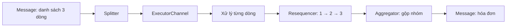

# @Aggregator, @Resequencer và method endpoint trong Spring Integration

## 1. Bài toán: nhiều message đi vào, một kết quả đi ra

Trong Spring Integration, một **message flow** thường gồm các `MessageChannel` nối những **endpoint** có nhiệm vụ nhận, biến đổi hoặc chuyển tiếp `Message<?>`. Nếu một yêu cầu được chia thành nhiều phần và xử lý song song, các kết quả có thể hoàn thành không theo thứ tự ban đầu. Lúc này cần phân biệt hai thao tác:

- **Aggregator** gom những message thuộc cùng một nhóm, đợi đủ điều kiện rồi tạo **một message kết quả**.
- **Resequencer** gom tạm những message thuộc cùng một chuỗi, sắp chúng theo `SEQUENCE_NUMBER` và phát ra **từng message ban đầu** theo đúng thứ tự.

Hai thành phần đều có trạng thái, cần correlation và cơ chế release. Chúng khác nhau về **hình dạng đầu ra**, nên không thể dùng thay thế tùy tiện.

> **Lưu ý về tên đề bài:** Spring Integration có annotation `@Aggregator` nhưng **không có annotation `@Resequencer`**. Resequencer được khai báo bằng Java DSL `.resequence()` hoặc phần tử XML `<int:resequencer>`. Vì vậy, không nên viết `@Resequencer` như một annotation Java có thể biên dịch.

Ví dụ: một đơn hàng có ba dòng cần kiểm tra giá. Xử lý song song có thể trả kết quả dòng số 3, rồi số 1, rồi số 2. Nếu cần dựng hóa đơn theo thứ tự dòng hàng, flow có thể resequence trước khi aggregate.



Trong module `SPRING_INTEGRATION_RUNTIME`, điều quan trọng là quan sát **lúc nào message đi qua channel**, **endpoint nào giữ state**, **thread nào chạy handler** và **ai quyết định một nhóm được phát đi**.

## 2. Method endpoint và handler adapter thực sự làm gì?

**Method endpoint** là một phương thức Java được Spring Integration biến thành điểm xử lý message, thường thông qua các annotation như `@ServiceActivator`, `@Transformer`, `@Splitter` và `@Aggregator`. Bean có thể được đánh dấu bằng `@MessageEndpoint`; annotation này là một stereotype để Spring phát hiện qua component scanning.

Ví dụ method endpoint thông thường:

```java
@MessageEndpoint
public class PaymentEndpoint {

    @ServiceActivator(
        inputChannel = "paymentRequests",
        outputChannel = "paymentResults")
    public PaymentResult authorize(
            PaymentRequest request,
            @Header("tenantId") String tenantId) {

        return paymentService.authorize(tenantId, request);
    }
}
```

Ở đây, mã nghiệp vụ không cần tự gọi `channel.receive()` hay ép kiểu `Message<?>`. Hạ tầng sẽ:

1. Tạo endpoint và `MessageHandler` tương ứng với annotation.
2. Đăng ký consumer trên `paymentRequests`.
3. Khi có message, chọn và gọi phương thức đích; ánh xạ `payload` thành `PaymentRequest` và header `tenantId` vào tham số được đánh dấu `@Header`.
4. Đóng gói giá trị trả về thành reply message và gửi đến `paymentResults`; nếu không có output channel cấu hình, một số endpoint có thể dùng header `replyChannel`.

Việc gọi method, chuyển đổi tham số và xử lý reply là phần việc của các **message handler / adapter** trong framework. Với `@Aggregator`, lời gọi method có điểm khác biệt thiết yếu: framework **không gọi method cho từng message đến**, mà trước hết gom message thành `MessageGroup`; chỉ khi nhóm được release mới gọi method tổng hợp.

| Thành phần | Nhận đầu vào | Hành vi | Đầu ra điển hình |
| --- | --- | --- | --- |
| `@ServiceActivator` | Một message | Gọi nghiệp vụ trên một payload/header | Không có reply hoặc một reply |
| `@Transformer` | Một message | Chuyển đổi dữ liệu | Một message đã biến đổi |
| `@Splitter` | Một message chứa tập hợp | Tách ra các phần, thường gắn sequence headers | Nhiều message |
| `@Aggregator` | Nhiều message cùng nhóm qua thời gian | Correlate → store → release → gọi method gộp | Một message cho mỗi lần release |
| `.resequence()` | Nhiều message cùng chuỗi qua thời gian | Correlate → store → phát theo số thứ tự | Nhiều message, giữ nguyên payload |

**Method signature quan trọng:** với `@Aggregator`, method có thể nhận `List<T>` của các payload trong nhóm (hoặc dạng message phù hợp). Đừng nhầm `List<T>` này với payload của **một** message đơn lẻ đi vào một `@ServiceActivator`.

## 3. Vòng đời một nhóm: correlation, store, release, output

Một aggregator hoặc resequencer cần trả lời bốn câu hỏi:

1. **Correlation:** message này thuộc nhóm nào?
2. **Store:** nhóm đang có những message nào và còn đợi message gì?
3. **Release:** khi nào nhóm đủ điều kiện xử lý/phát đi?
4. **Expiry:** nếu nhóm không bao giờ đủ thì timeout, discard hoặc partial result thế nào?

Khi không cấu hình chiến lược riêng, aggregator thường dùng ba header sequence do splitter tạo:

| Header | Ý nghĩa | Ví dụ |
| --- | --- | --- |
| `correlationId` / `IntegrationMessageHeaderAccessor.CORRELATION_ID` | Khóa gom các message thuộc một lượt xử lý | `batch-42` |
| `sequenceNumber` / `SEQUENCE_NUMBER` | Vị trí của message trong chuỗi | `2` |
| `sequenceSize` / `SEQUENCE_SIZE` | Tổng số message dự kiến | `3` |

Ví dụ ba message có cùng `correlationId=batch-42`, `sequenceSize=3` nhưng đến theo thứ tự `3, 1, 2`:

```text
Thời điểm     Message đến       State đang giữ              Kết quả
t1            #3                {3}                         Chưa release
t2            #1                {3, 1}                      Chưa release
t3            #2                {3, 1, 2}                   Đủ nhóm
Aggregator    —                 [1, 2, 3] (nếu đã sắp)     1 message gộp
Resequencer   —                 [1, 2, 3]                  3 message phát theo thứ tự
```

**Chú ý về thứ tự:** aggregator chỉ chịu trách nhiệm gộp nhóm; không nên mặc định rằng mọi cách khai báo aggregator đều bảo đảm danh sách payload đã được sắp theo một tiêu chí nghiệp vụ. Nếu thứ tự có ý nghĩa, hãy dựa trên `sequenceNumber` rõ ràng hoặc dùng resequencer trước bước gộp.

Một nguồn message có sẵn correlation nhưng thiếu `sequenceSize` phù hợp có thể khiến chính sách release mặc định không hoàn tất. Với `PublishSubscribeChannel` hoặc recipient-list router, cần bật `applySequence` khi muốn downstream gom theo chuỗi; splitter mặc định cung cấp thông tin sequence cho trường hợp thông thường.

## 4. `@Aggregator`: viết phương thức gộp dữ liệu

Ví dụ sau biến những chuỗi đã xử lý thành một chuỗi kết quả. Method `combine` chạy **một lần khi nhóm được release**, dù từng phần có thể đã đi qua những thread khác nhau.

```java
import java.util.List;
import org.springframework.integration.annotation.Aggregator;
import org.springframework.integration.annotation.MessageEndpoint;
import org.springframework.integration.annotation.ServiceActivator;

@MessageEndpoint
public class BatchResultEndpoint {

    @Aggregator(
        inputChannel = "partsToAggregate",
        outputChannel = "batchResults")
    public String combine(List<String> parts) {
        return String.join(" | ", parts);
    }

    @ServiceActivator(inputChannel = "batchResults")
    public void consume(String result) {
        System.out.println("Completed batch: " + result); // Minh họa
    }
}
```

Spring phát hiện bean, tạo aggregator handler và đăng ký consumer của `partsToAggregate`. Khi nhóm đủ, phần xử lý nhóm sẽ cung cấp các payload cho `combine`. Giá trị `String` trả về thành payload của message gửi tiếp trên `batchResults`.

Nếu bỏ `outputChannel`, hãy xét luồng reply cụ thể: message đầu vào có `replyChannel` hay không, endpoint có yêu cầu reply hay không, và có consumer nào đón được reply. Một message đã gộp cũng có thể giữ/mất các header khác nhau theo quy tắc merge header; không giả định mọi header của mọi phần đều còn nguyên.

### Tùy biến correlation và release bằng method

Ngoài `@Aggregator`, framework hỗ trợ các phương thức chiến lược `@CorrelationStrategy` và `@ReleaseStrategy`. Chúng giúp nhóm theo khóa nghiệp vụ và đợi điều kiện riêng khi sequence headers mặc định không phù hợp.

```java
import java.math.BigDecimal;
import java.util.List;
import org.springframework.integration.annotation.Aggregator;
import org.springframework.integration.annotation.CorrelationStrategy;
import org.springframework.integration.annotation.MessageEndpoint;
import org.springframework.integration.annotation.ReleaseStrategy;
import org.springframework.messaging.Message;

@MessageEndpoint
public class InvoiceEndpoint {

    @CorrelationStrategy
    public String byOrder(LineCalculated line) {
        return line.orderId();
    }

    @ReleaseStrategy
    public boolean hasEveryLine(List<Message<?>> group) {
        if (group.isEmpty()) {
            return false;
        }
        Object expected = group.get(0).getHeaders().get("expectedLines");
        return expected instanceof Integer count && group.size() == count;
    }

    @Aggregator(
        inputChannel = "lineCalculations",
        outputChannel = "invoices")
    public Invoice createInvoice(List<LineCalculated> lines) {
        String orderId = lines.get(0).orderId();
        BigDecimal total = lines.stream()
                .map(LineCalculated::amount)
                .reduce(BigDecimal.ZERO, BigDecimal::add);
        return new Invoice(orderId, total);
    }

    public record LineCalculated(String orderId, BigDecimal amount) {}
    public record Invoice(String orderId, BigDecimal total) {}
}
```

Trong ví dụ, **nguồn gửi phải gắn header `expectedLines` kiểu `Integer`** và đảm bảo một message tương ứng với một dòng duy nhất. Nếu thiếu header, release strategy trả `false` và nhóm sẽ tiếp tục đợi; cần cấu hình xử lý timeout. Nếu có message trùng, điều kiện đếm số lượng có thể sai: trong thực tế hãy kiểm tra **định danh dòng duy nhất**, dùng idempotent receiver hoặc chiến lược chống duplicate phù hợp.

Nên chọn kiểu khóa correlation tránh trộn những lần xử lý khác nhau của cùng đơn hàng: chỉ `orderId` có thể chưa đủ nếu cùng đơn được chạy lại, sửa đổi hoặc đồng thời xử lý nhiều phiên bản. Có thể dùng khóa ghép `orderId + revision + attemptId` theo yêu cầu nghiệp vụ.

Khi logic không cần tùy biến, ưu tiên chiến lược correlation/release mặc định. Với điều kiện phức tạp hoặc cần `MessageGroupStore`, timeout và locking cụ thể, Java DSL hoặc cấu hình `AggregatingMessageHandler` thường cho phép kiểm soát rõ hơn annotation đơn giản.

## 5. Resequencer: không có `@Resequencer`, dùng Java DSL

Resequencer **không tổng hợp payload**. Nó giữ các message có cùng correlation key rồi phát lại theo `sequenceNumber`. Ví dụ, nếu ba kết quả lần lượt đến `3, 1, 2`, resequencer sẽ đưa ra `1, 2, 3`; downstream vẫn nhận **ba** message.

Java DSL dùng `.resequence()`:

```java
@Bean
public IntegrationFlow restoreOrder() {
    return IntegrationFlow.from("processedParts")
            .resequence()
            .channel("orderedParts")
            .get();
}
```

Nếu dùng XML (trong dự án cấu hình theo namespace), cách tương đương về mặt ý tưởng là:

```xml
<int:resequencer
    input-channel="processedParts"
    output-channel="orderedParts"/>
```

Cả hai đều cần nhận message có correlation/sequence hợp lệ. Không có annotation `@Resequencer` để gắn lên một phương thức POJO, vì bản thân resequencer không cần logic xử lý payload tùy biến.

**Chiến lược release của resequencer:** mặc định có thể đợi đến khi toàn bộ chuỗi hoàn chỉnh. Với `releasePartialSequences`, cấu hình có thể cho phép phát **tiền tố liên tục** đã có theo đúng thứ tự mà không chờ đủ cả chuỗi. Ví dụ nhận `1, 2, 4` thì có thể phát `1, 2` và giữ `4` để chờ `3`. Các khoảng trống lớn hoặc nhiều nhóm chưa hoàn thành làm tăng số message phải lưu và chi phí tìm chuỗi liên tục.

Resequencer hữu ích khi dữ liệu cần được xử lý theo thứ tự dòng, phiên bản hoặc bước trong một chuỗi ngắn. Nó **không** phải bộ sắp xếp tổng quát cho toàn bộ hệ thống; ordering chỉ có ý nghĩa **bên trong cùng correlation group**. Các bước bất đồng bộ đặt **sau** resequencer có thể lại làm thay đổi thứ tự quan sát ở downstream.

## 6. Ví dụ hoàn chỉnh: splitter → executor → resequencer → method aggregator

Ví dụ minh họa cách các endpoint phối hợp ở runtime. Đầu vào `batchInput` nhận payload `List<String>` như `["a", "b", "c"]`. Splitter tạo ba message kèm sequence headers. ExecutorChannel đưa từng message tới pool xử lý; tốc độ của các thread có thể khác nhau. Resequencer khôi phục thứ tự rồi method `@Aggregator` tạo kết quả `A | B | C`.

```java
import java.util.Locale;
import org.springframework.context.annotation.Bean;
import org.springframework.context.annotation.Configuration;
import org.springframework.core.task.TaskExecutor;
import org.springframework.integration.config.EnableIntegration;
import org.springframework.integration.dsl.MessageChannels;
import org.springframework.integration.dsl.IntegrationFlow;
import org.springframework.scheduling.concurrent.ThreadPoolTaskExecutor;

@Configuration
@EnableIntegration
public class BatchFlowConfiguration {

    @Bean
    public TaskExecutor workerExecutor() {
        ThreadPoolTaskExecutor pool = new ThreadPoolTaskExecutor();
        pool.setCorePoolSize(4);
        pool.setMaxPoolSize(8);
        pool.setQueueCapacity(100);
        pool.setThreadNamePrefix("batch-worker-");
        pool.initialize();
        return pool;
    }

    @Bean
    public IntegrationFlow parallelBatchFlow(TaskExecutor workerExecutor) {
        return IntegrationFlow.from("batchInput")
                .split()
                .channel(MessageChannels.executor(workerExecutor))
                .transform(String.class, s -> s.toUpperCase(Locale.ROOT))
                .resequence()
                .channel("partsToAggregate")
                .get();
    }
}
```

Ghép `BatchFlowConfiguration` với `BatchResultEndpoint` ở phần 4 trong phạm vi component scanning. Ví dụ gửi dữ liệu:

```java
import java.util.List;
import org.springframework.messaging.MessageChannel;
import org.springframework.messaging.support.MessageBuilder;

// "batchInput" là channel được khai báo bởi IntegrationFlow.
MessageChannel batchInput = applicationContext.getBean(
        "batchInput", MessageChannel.class);

batchInput.send(MessageBuilder
        .withPayload(List.of("a", "b", "c"))
        .build());

// Method consume(...) của BatchResultEndpoint nhận: "A | B | C".
```

Tất cả các ví dụ dùng API Spring Integration Java DSL hiện đại và Java 17+. Các đoạn mã biểu diễn các lớp/phần cấu hình cần đặt trong ứng dụng Spring có dependency `spring-integration-core`, và bean `BatchResultEndpoint` phải được quét vào application context.

**Điểm đáng quan sát khi chạy:**

- `DirectChannel` phía trước splitter/consumer thông thường xử lý trên thread gửi. `ExecutorChannel` chuyển sang thread do `TaskExecutor` cấp; thread thực thi transformer có thể khác thread gọi `send`.
- Resequencer và aggregator đều có **state riêng**: resequencer giữ các message chờ thứ tự, aggregator giữ message chờ gộp. Nếu nghiệp vụ chỉ cần kết quả tổng hợp không phụ thuộc thứ tự, có thể bỏ resequencer để giảm thời gian chờ và trạng thái cần lưu.
- Sau khi `batchInput.send(...)` trả về, không đồng nghĩa toàn bộ xử lý song song đã xong. Muốn lấy kết quả đồng bộ, cần thiết kế reply path/gateway và timeout tương ứng.
- Ví dụ trên dùng message store mặc định trong bộ nhớ; không được xem như bảo đảm phục hồi nhóm khi tiến trình dừng bất ngờ.

### Khi nào dùng DSL `.aggregate()` thay cho `@Aggregator`?

Nếu chỉ cần gom payload mặc định, có thể viết toàn bộ bằng DSL:

```java
@Bean
public IntegrationFlow defaultAggregateFlow(TaskExecutor workerExecutor) {
    return IntegrationFlow.from("anotherBatchInput")
            .split()
            .channel(MessageChannels.executor(workerExecutor))
            .resequence()
            .aggregate()
            .channel("anotherBatchOutput")
            .get();
}
```

Khác với method `combine`, `.aggregate()` mặc định tạo payload kiểu `List` các payload của nhóm. Dùng `@Aggregator` khi muốn thể hiện nghiệp vụ gộp bằng phương thức Java; dùng DSL khi cần cấu hình fluent correlation/release/store/timeout ngay trong định nghĩa flow. **Không cấu hình hai aggregator kế tiếp** trừ khi cố ý có hai tầng gộp độc lập.

## 7. Threading, poller, transaction và retry

### Method endpoint chạy trên thread nào?

Annotation `@Aggregator` **không tự tạo thread riêng**. Thread phụ thuộc vào kiểu channel và cách message đến:

| Cách kết nối | Thread/nhịp thực thi điển hình | Hệ quả |
| --- | --- | --- |
| `DirectChannel` | Consumer chạy đồng bộ theo thread gửi | Độ trễ handler ảnh hưởng trực tiếp bên gửi |
| `ExecutorChannel` | Handler chạy trên thread pool | Có thể xử lý song song, thứ tự hoàn thành thay đổi |
| `QueueChannel` + poller | Consumer được poller gọi theo chu kỳ | Tốc độ tiêu thụ tùy lịch poll, `maxMessagesPerPoll` và executor |
| Timeout/scheduled expiry | Có thể có tác vụ từ `TaskScheduler` | Release hoặc discard có thể xảy ra ngoài thread nhận message |

Ví dụ một method endpoint tiêu thụ queue bằng poller:

```java
@ServiceActivator(
    inputChannel = "queuedWork",
    poller = @Poller(fixedDelay = "500", maxMessagesPerPoll = "10"))
public void handleQueuedWork(WorkItem work) {
    process(work);
}
```

Ở ví dụ này cần import `org.springframework.integration.annotation.Poller`; `queuedWork` phải là pollable channel thích hợp. **Poller là cơ chế lấy message từ channel**, khác với **group timeout** của aggregator/resequencer. Việc đặt poller không khiến nhóm thiếu phần tự động hoàn tất.

### Transaction và lỗi khi chạy bất đồng bộ

Transaction trên thread gửi **không tự lan qua** `ExecutorChannel` sang thread worker. Tương tự, một transaction quanh từng lần nhận message không mặc nhiên bao trùm cả vòng đời một `MessageGroup` có thể tồn tại nhiều giây hoặc nhiều giờ.

- Nếu cần bền vững, chọn `MessageGroupStore` phù hợp (ví dụ persistent store/JDBC), xây dựng transaction boundary ở thành phần đọc/ghi liên quan và kiểm tra hành vi khi khởi động lại.
- Retry một bước xử lý có thể khiến cùng message đến aggregator nhiều lần; cần xác định chính sách deduplication và idempotency. Không xem `MessageStore` mặc định là cơ chế exactly-once cho toàn bộ hệ thống.
- Với xử lý đồng bộ, lỗi có thể đi ngược về bên gọi. Với luồng bất đồng bộ, lỗi thường theo cơ chế error channel/`ErrorMessage` hoặc cơ chế error handler tương ứng. Cần gắn trace theo correlation key để nhận diện lỗi thuộc nhóm nào.
- Release strategy hoặc hàm aggregate ném exception có thể làm nhóm không hoàn tất hoặc bị xử lý lại tùy cấu hình. Thiết kế operation gộp an toàn trước retry, tránh side effect không kiểm soát trong method `@Aggregator`.

Khi nhiều application instance dùng **chung persistent MessageGroupStore**, cần xem xét phối hợp lock giữa các instance (chẳng hạn `LockRegistry` phù hợp), kiểm soát nhiều consumer và bảo đảm chiến lược correlation/release nhất quán. Chỉ đưa store vào database không tự giải quyết mọi tranh chấp đồng thời.

## 8. Timeout, message store và message đến muộn

Vì aggregator/resequencer giữ state, tình huống “đợi mãi phần còn thiếu” là rủi ro vận hành thực tế. Các lựa chọn thường gặp:

| Cơ chế | Câu hỏi cần quyết định |
| --- | --- |
| `MessageGroupStore` | Lưu nhóm ở memory hay persistent? Có cần survive restart? |
| `groupTimeout` / timeout expression | Nhóm đợi đến bao lâu trước khi xử lý quá hạn? |
| Partial result | Khi timeout có chấp nhận kết quả chưa đủ không? |
| Discard channel / error handling | Message bị loại hoặc nhóm hết hạn được theo dõi ở đâu? |
| Group expiry/cleanup | Khi nào xóa state đã release và các dấu vết dùng để nhận diện message đến muộn? |
| Group lock | Có nhiều thread/instance cùng cập nhật một group không? |

Ví dụ nghiệp vụ có ba kết quả nhưng chỉ đến `#1` và `#3`: nếu cứ chờ `#2`, cả nhóm bị treo. Nếu phát partial, downstream phải biết dữ liệu chưa đầy đủ và không coi đó là kết quả cuối cùng. Nếu discard, phải có cách giám sát, retry/replay hợp lệ hoặc thông báo nghiệp vụ.

Cần phân biệt **message đến muộn** với **message trùng**. Một nhóm đã đóng có thể cần giữ metadata để phát hiện phần đến trễ; xóa nhóm ngay sau release có thể khiến message cũ tạo một nhóm mới với cùng khóa. Cách quản lý group hết hạn ảnh hưởng trực tiếp đến tính đúng đắn khi replay.

Lập kế hoạch capacity theo **số nhóm đang mở × số message trung bình mỗi nhóm × kích thước message**, cộng chi phí index/locking và lịch cleanup. Resequencer có nhiều khoảng trống sequence là nguồn tăng memory và độ trễ đặc biệt rõ.

## 9. Quan sát và chẩn đoán runtime

Khi nghi ngờ mất thứ tự, gộp nhầm hoặc “không thấy output”, hãy lần theo từng bước:

1. **Trước channel đầu vào:** xác nhận message đã được gửi thành công và payload đúng kiểu; log `id`, `correlationId`, `sequenceNumber`, `sequenceSize` ở mức phù hợp.
2. **Tại splitter/executor:** so sánh thứ tự phát với thứ tự xử lý; log thread name để thấy ranh giới bất đồng bộ.
3. **Tại aggregator/resequencer:** quan sát group key, số message đang giữ, release condition, tuổi nhóm, timeout và duplicate; xác minh custom strategy không trả `false` mãi.
4. **Tại output channel:** xác nhận có subscriber và reply path đúng. Với output là `QueueChannel` có giới hạn, việc gửi có thể bị chặn hoặc timeout nếu downstream không tiêu thụ.
5. **Tại error channel/monitoring:** đối chiếu exception với khóa correlation, điểm phát sinh và retry đã diễn ra.

Các chỉ số vận hành nên có: số nhóm đang mở, tuổi nhóm lâu nhất, kích thước `MessageGroupStore`, số group timeout/discard, số message đến muộn, thời gian từ phần đầu đến release, độ sâu queue, executor active/queue/rejections, throughput và tỷ lệ lỗi.

Một bảng kiểm nhanh khi debug:

| Triệu chứng | Nguyên nhân thường gặp | Hướng kiểm tra |
| --- | --- | --- |
| Không bao giờ thấy kết quả gộp | Thiếu `sequenceSize`, thiếu phần, release strategy sai | Trace từng header và số phần trong group |
| Hai đơn hàng bị trộn | Khóa correlation quá rộng hoặc không duy nhất | Thêm phiên bản/lượt xử lý vào key |
| Output sai thứ tự | Executor chạy song song; không resequence, hoặc có async downstream | Kiểm tra vị trí `.resequence()` và sequence headers |
| Bộ nhớ/store tăng liên tục | Nhóm thiếu phần, timeout/cleanup không phù hợp | Theo dõi tuổi nhóm, cấu hình expiry |
| Xử lý trùng sau retry | Message được giao lại, side effect không idempotent | Kiểm tra message ID/dedup và transaction boundary |
| Bị chặn ở output | Channel không có consumer, queue đầy, send timeout | Kiểm tra subscription, capacity và lỗi gửi |

### Thử nghiệm thủ công nên làm

1. Gửi một list ba phần để xác minh split → resequence → aggregate ra đúng một kết quả.
2. Cố ý làm phần thứ ba chạy nhanh hơn phần thứ nhất; xác minh output sau resequencer vẫn đúng thứ tự.
3. Tạo ba message cùng correlation key với số thứ tự `2, 1, 3`; xác minh grouping dựa trên header chứ không dựa vào thời điểm đến.
4. Bỏ hẳn phần số 2, quan sát timeout và partial/discard theo cấu hình đã chọn.
5. Gửi lại một message sau khi nhóm hoàn tất, kiểm tra chính sách duplicate/late arrival.
6. Chạy hai nhóm song song với correlation key khác nhau, bảo đảm không trộn dữ liệu và đo kích thước store khi tải tăng.

## 10. Chọn thiết kế theo yêu cầu

- **Chỉ chuyển đổi từng phần:** `@Transformer` hoặc `@ServiceActivator`; không cần group state.
- **Gom kết quả của một nhóm:** `@Aggregator` hoặc `.aggregate()`, kết hợp correlation/release rõ ràng.
- **Giữ từng message nhưng phục hồi thứ tự trong nhóm:** `.resequence()`.
- **Vừa cần xử lý song song, vừa cần kết quả tổng hợp theo thứ tự:** `split → executor → resequence → aggregate`, hoặc aggregate có xử lý sắp xếp tường minh nếu phù hợp.
- **Nhóm có thể tồn tại lâu hoặc cần phục hồi sau restart:** thiết kế persistent store, timeout, locking và chính sách retry/duplicate ngay từ đầu.

Điểm cốt lõi của runtime: **method endpoint chỉ là bề mặt gọi code nghiệp vụ**; thứ tự, điều phối, thread, trạng thái và độ tin cậy nằm ở **channel, consumer endpoint, strategy, message store, scheduler và executor**. Khi hiểu rõ ranh giới này, việc lựa chọn annotation hay DSL sẽ dựa trên hành vi mong muốn thay vì tên API.

## Tài liệu tham khảo

- [Spring Integration — Annotation Support](https://docs.spring.io/spring-integration/reference/configuration/annotations.html)
- [Spring Integration — Aggregator](https://docs.spring.io/spring-integration/reference/aggregator.html)
- [Spring Integration — Resequencer](https://docs.spring.io/spring-integration/reference/resequencer.html)
- [Spring Integration — Java DSL: Aggregators and Resequencers](https://docs.spring.io/spring-integration/reference/dsl/java-aggregators.html)

