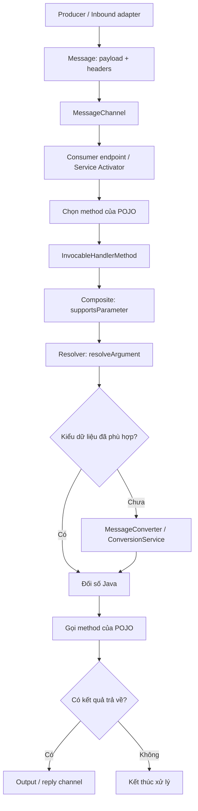

# MessageHandlerMethodArgumentResolver: giải quyết tham số cho phương thức xử lý message

## 1. Khái niệm và tên API cần phân biệt

Trong Spring Integration, một message đi qua **channel** đến **endpoint**; endpoint có thể gọi một phương thức Java thông thường (POJO) để xử lý payload, headers và trả về kết quả. Trước khi gọi phương thức, runtime cần xác định từng tham số Java sẽ nhận giá trị nào từ `Message<?>`. Công việc này do nhóm **method argument resolver** thực hiện.

> **Lưu ý về tên gọi:** `MessageHandlerMethodArgumentResolver` là tên chủ đề mô tả cơ chế, **không phải tên một class/interface public** trong API Spring Integration 6.5. Những tên cần tra cứu/`import` chính xác là `HandlerMethodArgumentResolver`, `MessageMethodArgumentResolver`, `PayloadMethodArgumentResolver` và `IntegrationMessageHandlerMethodFactory`. Đừng thử import `MessageHandlerMethodArgumentResolver` như một class có sẵn.

Các thành phần giữ vai trò khác nhau:

| Thành phần | Package | Nhiệm vụ |
| --- | --- | --- |
| `HandlerMethodArgumentResolver` | `org.springframework.messaging.handler.invocation` | Hợp đồng chọn và lấy giá trị cho **một** tham số phương thức. |
| `HandlerMethodArgumentResolverComposite` | `org.springframework.messaging.handler.invocation` | Giữ danh sách resolver, chọn resolver hỗ trợ tham số. |
| `MessageMethodArgumentResolver` | `org.springframework.messaging.handler.annotation.support` | Giải tham số kiểu `Message<?>`; có thể chuyển đổi payload theo generic type. |
| `PayloadMethodArgumentResolver` | `org.springframework.messaging.handler.annotation.support` | Giải tham số payload, có xét `@Payload`, chuyển đổi và validation theo cấu hình. |
| `HeaderMethodArgumentResolver` / `HeadersMethodArgumentResolver` | `org.springframework.messaging.handler.annotation.support` | Giải tham số `@Header` hoặc `@Headers`. |
| `IntegrationMessageHandlerMethodFactory` | `org.springframework.integration.handler.support` | Factory dành cho Spring Integration (từ 6.0), mở rộng `DefaultMessageHandlerMethodFactory` để tạo phương thức có resolver phù hợp. |
| `InvocableHandlerMethod` / `IntegrationInvocableHandlerMethod` | Spring Messaging / Spring Integration | Gọi phương thức đích sau khi lấy được các đối số. |

**Phạm vi trong module runtime:** resolver giải quyết *chữ ký phương thức* tại thời điểm gọi handler. Nó **không** tạo message, chọn channel, điều phối thread, tự chạy poller, mở transaction hay lập lịch retry. Những việc đó thuộc channel, consumer endpoint, executor, transaction interceptor và advice của flow.

## 2. Resolver nằm ở đâu trong đường đi của message?



Sơ đồ minh họa nhánh xử lý thông thường của phương thức POJO; một số endpoint dùng handler chuyên biệt và không đi qua toàn bộ cơ chế này. Trình tự quan trọng:

1. Producer gửi `Message<?>` vào một `MessageChannel`.
2. Consumer endpoint nhận message. Với `DirectChannel`, việc gọi handler thường diễn ra ngay trên thread gửi; với `ExecutorChannel` hoặc pollable channel, thread thực thi phụ thuộc executor/poller.
3. Nếu endpoint gọi một POJO, runtime lựa chọn method thích hợp (hoặc dùng method đã cấu hình rõ ràng), rồi chuẩn bị đối số cho từng tham số.
4. Composite hỏi các resolver theo thứ tự: `supportsParameter(MethodParameter)` có nhận tham số này không? Resolver được chọn gọi `resolveArgument(MethodParameter, Message<?>)`.
5. Resolver có thể lấy message nguyên vẹn, đọc header, lấy payload, chạy biểu thức hoặc dùng converter để khớp kiểu Java. Khi có đủ đối số, method mới được gọi.
6. Nếu handler có kết quả, endpoint chịu trách nhiệm chuyển kết quả sang output/reply channel theo cấu hình. Nếu quá trình giải tham số hay gọi method thất bại, ngoại lệ đi qua cơ chế lỗi của endpoint/channel hiện tại.

Hai phương thức lõi của SPI:

```java
public interface HandlerMethodArgumentResolver {
    boolean supportsParameter(MethodParameter parameter);

    Object resolveArgument(MethodParameter parameter, Message<?> message)
            throws Exception;
}
```

`supportsParameter` nhận thông tin *khai báo* của tham số, còn `resolveArgument` nhận **message cụ thể của lần xử lý**. Resolver cần kiểm tra kiểu và xử lý giá trị thiếu rõ ràng; không nên phụ thuộc vào state có thể thay đổi giữa các message.

## 3. Runtime gán những tham số phổ biến như thế nào?

Giả sử message có payload `Order("ORD-42", 125_000)` và headers `traceId=t-123`, `priority=5`:

| Chữ ký method | Giá trị được giải | Lưu ý |
| --- | --- | --- |
| `handle(Order order)` | Payload kiểu `Order` | Kiểu payload được suy từ tham số POJO; phù hợp với cách dùng Service Activator thông thường. |
| `handle(@Payload Order order)` | Payload kiểu `Order` | Khai báo ý định lấy payload rõ ràng; có thể áp dụng chuyển đổi/validation nếu được cấu hình. |
| `handle(Message<Order> message)` | Toàn bộ `Message` | Có cả `getPayload()` và `getHeaders()`; generic payload cần tương thích hoặc có converter phù hợp. |
| `handle(@Header("traceId") String traceId)` | Giá trị header `traceId` | Thiếu header bắt buộc có thể gây lỗi giải tham số. |
| `handle(@Header(value = "traceId", required = false) String traceId)` | Header hoặc `null` | Dùng khi metadata có thể vắng mặt và logic xử lý được điều đó. |
| `handle(@Headers Map<String, Object> headers)` | Bản đồ headers | Đừng giả định có thể sửa map để thay đổi message gốc. |
| `handle(@Payload(expression = "payload.id") String id)` | Trường `id` của payload qua SpEL | Resolver biểu thức của Spring Integration đánh giá trong ngữ cảnh message; kiểm tra biểu thức và kiểu kết quả. |

Tham số `Message<T>` và `T` không có nghĩa giống nhau: cái đầu yêu cầu *bao message*, cái sau yêu cầu *payload*. Khi chỉ cần dữ liệu nghiệp vụ, sử dụng kiểu POJO hoặc `@Payload` giúp handler ít phụ thuộc vào Spring Messaging. Khi cần tương quan, phân phối reply hoặc metadata, dùng `@Header` hoặc `Message<?>`.

Với handler có nhiều tham số cùng có thể bị hiểu là payload, nên dùng annotation để loại bỏ sự mơ hồ. Một `@Header` có tên xác định cũng dễ kiểm tra hơn so với suy luận từ tên tham số Java. Các resolver bổ sung của Spring Integration còn hỗ trợ một số kiểu collection, map và biểu thức; không nên mặc định rằng mọi collection sẽ tự động là toàn bộ payload nếu không kiểm tra chữ ký và flow.

## 4. Ví dụ end-to-end: Service Activator nhận payload và header

Ví dụ sau dùng Spring Integration Java DSL và Java 17+, mô phỏng yêu cầu thanh toán. Nhờ `.handle(service, "process")`, endpoint chỉ định rõ phương thức cần gọi; argument resolvers ánh xạ payload và trace header vào hai tham số.

```java
import org.springframework.messaging.handler.annotation.Header;
import org.springframework.messaging.handler.annotation.Payload;
import org.springframework.stereotype.Component;

record Payment(String paymentId, long amount) {}
record PaymentReceipt(String paymentId, String status, String traceId) {}

@Component
class PaymentService {
    public PaymentReceipt process(
            @Payload Payment payment,
            @Header(value = "traceId", required = false) String traceId) {

        if (payment.amount() <= 0) {
            throw new IllegalArgumentException("amount must be positive");
        }
        return new PaymentReceipt(payment.paymentId(), "ACCEPTED", traceId);
    }
}
```

```java
import org.springframework.context.annotation.Bean;
import org.springframework.context.annotation.Configuration;
import org.springframework.integration.annotation.EnableIntegration;
import org.springframework.integration.channel.QueueChannel;
import org.springframework.integration.dsl.IntegrationFlow;
import org.springframework.messaging.PollableChannel;

@Configuration
@EnableIntegration
class PaymentFlowConfiguration {
    @Bean
    PollableChannel paymentResults() {
        return new QueueChannel();
    }

    @Bean
    IntegrationFlow paymentFlow(PaymentService paymentService) {
        return IntegrationFlow.from("paymentInput")
                .handle(paymentService, "process")
                .channel("paymentResults")
                .get();
    }
}
```

Gửi message và lấy kết quả từ `QueueChannel` (ví dụ đặt trong một kiểm thử có sẵn `ApplicationContext`):

```java
import org.springframework.context.ApplicationContext;
import org.springframework.messaging.Message;
import org.springframework.messaging.MessageChannel;
import org.springframework.messaging.PollableChannel;
import org.springframework.messaging.support.MessageBuilder;

void exercise(ApplicationContext context) {
    MessageChannel input = context.getBean("paymentInput", MessageChannel.class);
    PollableChannel output = context.getBean("paymentResults", PollableChannel.class);

    input.send(MessageBuilder.withPayload(new Payment("PAY-42", 125_000))
            .setHeader("traceId", "t-123")
            .build());

    Message<?> received = output.receive(1_000);
    if (received == null) {
        throw new IllegalStateException("No payment receipt received");
    }
    PaymentReceipt receipt = (PaymentReceipt) received.getPayload();
    // paymentId=PAY-42, status=ACCEPTED, traceId=t-123
}
```

Phân tích lần gửi này: payload đã là `Payment`, nên không cần chuyển đổi kiểu; `@Header` trích `"t-123"`; `PaymentService.process(...)` tạo `PaymentReceipt`; Service Activator đóng gói kết quả thành reply message và flow đưa vào `paymentResults`. Hành vi `send()` ở đây đồng bộ trên `DirectChannel` đầu vào được tạo theo DSL, còn bước `receive()` chủ động lấy phần tử từ queue đầu ra. Nếu `amount <= 0`, exception phát sinh trong method, không phải do argument resolver.

**Biến thể với annotation:** có thể đánh dấu method bằng `@ServiceActivator(inputChannel = "paymentInput", outputChannel = "paymentResults")` và để annotation tạo endpoint. Khi đó **không đồng thời** khai báo `.handle(paymentService, "process")` cho cùng luồng, vì có thể tạo hai consumer cùng xử lý một message.

## 5. Chuyển đổi dữ liệu: đừng nhầm resolve với convert

Resolver quyết định **tham số lấy từ đâu**. Converter quyết định **giá trị ấy có thể đổi sang kiểu đích như thế nào**. Hai bước liên quan nhưng không đồng nhất.

Giả sử upstream nhận JSON dạng `byte[]` với header `contentType=application/json`, còn handler cần `Payment`. Nếu đã cấu hình `MessageConverter` phù hợp (ví dụ Jackson converter) và cấu trúc JSON tương thích, runtime có thể chuyển `byte[]` thành `Payment`. Nếu payload đã là `Payment`, nhiều trường hợp không cần chuyển đổi. Ngược lại, một message chứa chuỗi bất kỳ mà handler đòi `Payment` vẫn có thể lỗi dù method và channel đều hợp lệ.

Spring Integration cung cấp `ConfigurableCompositeMessageConverter` cho quá trình gọi phương thức, với các converter mặc định tùy dependency; Jackson converter chỉ có khi điều kiện classpath phù hợp. `contentType` là một tín hiệu cho converter, không phải bảo đảm mọi chuỗi/byte đều giải mã được.

Khi cần thay đổi converter chuyên biệt cho argument resolution, tài liệu Spring Integration nêu bean mang tên `integrationArgumentResolverMessageConverter` (hằng `IntegrationContextUtils.ARGUMENT_RESOLVER_MESSAGE_CONVERTER_BEAN_NAME`). Cần phân biệt converter của đường đi này với converter trong HTTP/JMS/AMQP adapter: adapter có thể đã chuyển đổi message trước khi message đến Service Activator.

Để xác định lỗi, kiểm tra theo thứ tự: payload thực tế là gì, method mong đợi kiểu nào, header `contentType` có đúng không, converter có được đăng ký ở đúng vị trí không, và việc chuyển đổi thất bại trước hay sau khi handler bắt đầu chạy.

## 6. Khi nào cần tự viết `HandlerMethodArgumentResolver`?

Chỉ nên viết resolver tùy chỉnh khi nhiều handler dùng cùng một quy tắc binding mà `@Header`, `@Payload`, `Message<?>` hoặc converter không thể biểu đạt rõ. Ví dụ, ứng dụng muốn mọi method khai báo tham số `TraceContext` nhận một đối tượng được dựng từ header `traceId`.

```java
import org.springframework.core.MethodParameter;
import org.springframework.messaging.Message;
import org.springframework.messaging.handler.invocation.HandlerMethodArgumentResolver;

record TraceContext(String traceId) {}

final class TraceContextResolver implements HandlerMethodArgumentResolver {
    @Override
    public boolean supportsParameter(MethodParameter parameter) {
        return parameter.getParameterType() == TraceContext.class;
    }

    @Override
    public Object resolveArgument(MethodParameter parameter, Message<?> message) {
        Object value = message.getHeaders().get("traceId");
        if (!(value instanceof String id) || id.isBlank()) {
            throw new IllegalArgumentException("Missing or invalid traceId header");
        }
        return new TraceContext(id);
    }
}
```

Đây là một ví dụ **tự gọi factory** để minh họa cách đăng ký và sử dụng resolver (Spring Integration 6.x):

```java
import java.lang.reflect.Method;
import java.util.List;
import org.springframework.integration.handler.support.IntegrationMessageHandlerMethodFactory;
import org.springframework.messaging.support.MessageBuilder;

class TraceHandler {
    public String consume(TraceContext trace) {
        return "handled: " + trace.traceId();
    }
}

void invokeWithCustomResolver() throws Exception {
    var factory = new IntegrationMessageHandlerMethodFactory();
    factory.setCustomArgumentResolvers(List.of(new TraceContextResolver()));
    factory.afterPropertiesSet();

    TraceHandler bean = new TraceHandler();
    Method method = TraceHandler.class.getMethod("consume", TraceContext.class);
    var invocable = factory.createInvocableHandlerMethod(bean, method);

    Object result = invocable.invoke(MessageBuilder.withPayload("demo")
            .setHeader("traceId", "trace-42")
            .build());
    // result: "handled: trace-42"
}
```

`setCustomArgumentResolvers` bổ sung resolver vào **factory đang được sử dụng**. Tạo một factory trong code như ví dụ trên không tự thay thế factory do tất cả `@ServiceActivator`/flow trong ứng dụng quản lý. Khi tích hợp thật, phải nối factory/resolver tùy chỉnh vào đúng cơ chế tạo invocable handler của endpoint đang dùng; kiểm tra API và cách cấu hình theo phiên bản. Trước khi chọn cách này, thử dùng `@Header("traceId") String traceId` và tạo `TraceContext` trong service — thường đơn giản và dễ bảo trì hơn.

Các nguyên tắc quan trọng khi tự viết resolver:

- `supportsParameter` phải nhận diện tham số đủ hẹp; tránh nhận mọi `Object` hoặc mọi kiểu `String` và vô tình chiếm nhiệm vụ resolver mặc định.
- Không lưu `Message<?>` hoặc giá trị tham số của lần xử lý hiện tại vào trường mutable của resolver singleton; nhiều message có thể được xử lý đồng thời.
- Xử lý null, header sai kiểu và thông báo lỗi có ngữ cảnh, nhưng không đưa thông tin nhạy cảm vào log.
- Nếu cần chuyển đổi chuyên dụng cho payload, ưu tiên `Converter`/`MessageConverter` thay vì xây dựng một argument resolver chỉ làm nhiệm vụ convert.

## 7. Lỗi, thread và transaction tại runtime

| Hiện tượng | Nơi thường phát sinh | Hướng chẩn đoán |
| --- | --- | --- |
| `No suitable resolver` hoặc không bind được tham số | Factory/resolver composite | Kiểm tra chữ ký method, annotation và resolver có được đăng ký vào factory thực sự gọi method không. |
| Thiếu header bắt buộc | `HeaderMethodArgumentResolver` | Xem header thực tế tại thời điểm vào endpoint, tên header và `required`. |
| `MessageConversionException` hoặc lỗi kiểu | Message converter / payload resolver | Đối chiếu `payload.getClass()`, kiểu đích, `contentType` và converter được sử dụng. |
| Handler ném lỗi nghiệp vụ | Phương thức POJO | Phân biệt lỗi trong thân method với lỗi chuẩn bị đối số; xem cause bên trong `MessagingException` nếu có wrapper. |
| Cùng handler chạy ở các thread khác nhau | Channel/consumer/executor | Kiểm tra `DirectChannel`, `ExecutorChannel`, poller và các thread boundary; resolver không tự tạo thread. |
| Message bị xử lý lặp | Retry advice, nguồn nhận hoặc redelivery | Xem retry policy, ack và transaction boundary; bản thân resolver không retry. |
| Reply không tới nơi nhận | Output/reply channel | Kiểm tra handler có trả về `null`/`void`, `outputChannel`, `replyChannel`, thời gian chờ và subscriber của channel. |

Một số khác biệt runtime cần nắm:

- **`DirectChannel`:** chuỗi xử lý thông thường cùng call stack/thread với bên gửi. Lỗi bind tham số có thể truyền ngược đến `send()`; transaction của caller có thể bao phủ việc xử lý nếu được cấu hình thích hợp.
- **`ExecutorChannel`:** dispatch sang executor tạo ranh giới thread. Lỗi ở consumer không nhất thiết xuất hiện trực tiếp trong call `send()`; cần quan sát error handling cho tác vụ bất đồng bộ.
- **`QueueChannel` + poller:** endpoint xử lý trên thread poller sau khi lấy message khỏi hàng đợi. Retry, nhận lại và transaction chịu ảnh hưởng poller, advice, message store và nguồn message; không thể suy ra chỉ từ resolver.
- **Correlation:** `correlationId`, `sequenceNumber`, `sequenceSize`, `replyChannel` và `errorChannel` là message headers do các thành phần liên quan quản lý. Resolver chỉ đọc chúng khi method yêu cầu; thêm/xóa chúng phải được thiết kế ở bước message transformation/enrichment phù hợp.

Khi đo hiệu năng, tách thời gian xử lý method, conversion, chờ queue, lấy message của poller và dispatch của executor. Nếu bottleneck là JSON deserialization ở resolver/converter, tăng số thread chưa chắc giải quyết được nguyên nhân; cần đo kích thước payload, tần suất convert và chi phí cấp phát đối tượng. Nếu bottleneck là queue hoặc I/O trong handler, thay đổi resolver sẽ không giúp ích.

## 8. Bài tập thực hành và câu hỏi tự kiểm tra

**Bài tập 1 — Bind đúng header:** sửa ví dụ `PaymentService` để `traceId` bắt buộc (`@Header("traceId")`), gửi message thiếu header và quan sát lỗi trước khi thân method chạy. Sau đó đổi lại `required = false` và xử lý trường hợp `null`.

**Bài tập 2 — Phân biệt `Message<T>` và `T`:** thay `process(@Payload Payment payment, ...)` bằng method nhận `Message<Payment>`, đọc cùng payload và `traceId` qua `getHeaders()`. So sánh mức độ gắn kết với hạ tầng messaging.

**Bài tập 3 — Thử chuyển đổi:** gửi JSON hợp lệ và không hợp lệ với `contentType=application/json` tới method nhận `Payment`. Xác định converter cần có, kiểu payload trước khi gửi và lỗi xảy ra ở đâu. Không giả định Jackson tự hoạt động nếu chưa cấu hình dependency/converter.

**Bài tập 4 — Ranh giới thread:** so sánh flow dùng `DirectChannel` với flow có `ExecutorChannel` hoặc queue + poller; ghi log tên thread khi gửi, khi vào handler và khi có exception. Giải thích vì sao resolver không quyết định thread chạy.

**Bài tập 5 — Resolver tùy chỉnh:** mở rộng `TraceContextResolver` để nhận thêm một header tùy chọn `tenantId`. Viết kiểm tra cho message thiếu `traceId`, `traceId` sai kiểu, và hai message xử lý song song mà không chia sẻ state.

Câu hỏi gợi nhớ:

1. `HandlerMethodArgumentResolver` khác `MessageConverter` ở điểm nào?
2. Tại sao `Message<Payment>` và `@Payload Payment` cần các resolver khác nhau?
3. Vì sao tự tạo `IntegrationMessageHandlerMethodFactory` không đồng nghĩa mọi endpoint trong application sẽ dùng nó?
4. Lỗi thiếu header ở `DirectChannel` và `ExecutorChannel` có thể được quan sát khác nhau như thế nào?
5. Khi payload JSON không convert được, nên kiểm tra tầng nào trước khi tăng kích thước executor?

## 9. Nguồn tham khảo chính thức

- Spring Integration, *Message Endpoints — Content Type Conversion*: https://docs.spring.io/spring-integration/reference/endpoint.html
- Spring Integration, *Service Activator*: https://docs.spring.io/spring-integration/reference/6.5/service-activator.html
- Spring Integration 6.5 API, `IntegrationMessageHandlerMethodFactory`: https://docs.spring.io/spring-integration/docs/6.5.0/api/org/springframework/integration/handler/support/IntegrationMessageHandlerMethodFactory.html
- Spring Framework 6.2 API, `HandlerMethodArgumentResolver`: https://docs.spring.io/spring-framework/docs/6.2.x-SNAPSHOT/javadoc-api/org/springframework/messaging/handler/invocation/HandlerMethodArgumentResolver.html
- Spring Framework 6.2 API, `MessageMethodArgumentResolver`: https://docs.spring.io/spring-framework/docs/6.2.16/javadoc-api/org/springframework/messaging/handler/annotation/support/MessageMethodArgumentResolver.html
- Spring Framework, `DefaultMessageHandlerMethodFactory` (cách dựng và đăng ký resolver): https://docs.spring.io/spring-framework/docs/current/javadoc-api/org/springframework/messaging/handler/annotation/support/DefaultMessageHandlerMethodFactory.html
