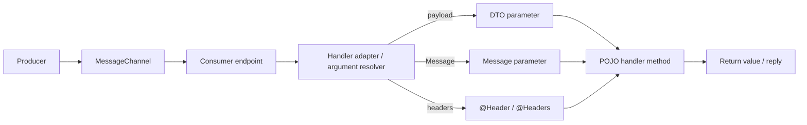
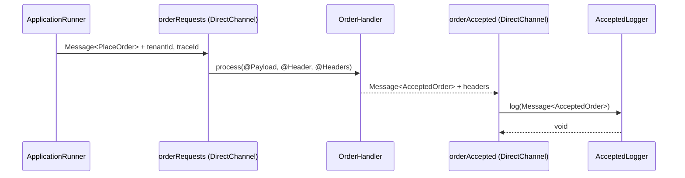

# Payload, Message và header argument

Trong **Spring Integration runtime**, channel vận chuyển `Message<?>`, còn endpoint nhận message rồi gọi mã nghiệp vụ. Khi endpoint được nối với một **POJO handler**, framework cần quyết định truyền gì vào từng tham số Java: chỉ payload, toàn bộ `Message`, hay một hoặc nhiều header. Công việc này thường được gọi là **argument resolution/binding** của handler adapter.

Bài thuộc chương **Handler adapter**, tập trung vào cách khai báo và đọc tham số của method dùng với `@ServiceActivator`; các quy tắc tương tự cũng xuất hiện ở nhiều endpoint dựa trên method như transformer, filter và router. Hiểu đúng argument binding giúp triển khai message flow qua channel, consumer, poller và executor mà không nhầm metadata với dữ liệu nghiệp vụ; đồng thời giúp chẩn đoán lỗi thiếu header, sai kiểu payload, correlation và sự khác nhau giữa lỗi gọi method với lỗi điều phối runtime.

## 1. Từ Message đến lời gọi phương thức

Một Spring Integration message bao gồm hai phần chính:

```java
// Khái niệm: chữ ký rút gọn của Spring Messaging
public interface Message<T> {
    T getPayload();
    MessageHeaders getHeaders();
}
```

- **Payload**: dữ liệu nghiệp vụ, ví dụ `PlaceOrder`, JSON text hoặc `byte[]`.
- **Headers**: metadata dạng key–value, ví dụ `tenantId`, `traceId`, `correlationId`, `replyChannel` hoặc `errorChannel`. Các header chuẩn `id` và `timestamp` thường do framework tạo.
- **Message**: đối tượng bao trùm cả payload lẫn headers; channel thực tế chuyển `Message<?>`, cho dù method handler chỉ nhận một DTO.



Chính endpoint quyết định *khi nào* handler được gọi. Ví dụ, `DirectChannel` dispatch thường trên thread gửi; `QueueChannel` cần một polling consumer hoặc mã chủ động gọi `receive()`. Việc ánh xạ tham số diễn ra **sau khi endpoint đã nhận được message**, và không tự thay đổi quy tắc delivery, transaction hay retry của channel.

## 2. Ba cách viết tham số handler

Giả sử producer gửi message có payload `PlaceOrder("O-42", 150000)` và headers `tenantId="acme"`, `traceId="t-9"`.

| Chữ ký method | Dữ liệu được đưa vào | Khi nào phù hợp |
| --- | --- | --- |
| `handle(@Payload PlaceOrder order)` | Chỉ payload kiểu `PlaceOrder` | Logic nghiệp vụ chỉ quan tâm nội dung |
| `handle(Message<PlaceOrder> message)` | Cả payload và toàn bộ headers | Logic cần tự đọc hoặc chuyển tiếp metadata |
| `handle(@Payload PlaceOrder order, @Header("tenantId") String tenant)` | Payload cộng với một header đã chọn | Cần một vài metadata rõ tên, dễ kiểm thử |
| `handle(@Payload PlaceOrder order, @Headers Map<String, Object> headers)` | Payload cộng với tập header | Quan sát hoặc xử lý linh hoạt nhiều header |

Ví dụ các **chữ ký độc lập** (không đăng ký tất cả làm consumer của cùng một channel trong một ứng dụng mẫu):

```java
import java.util.Map;
import org.springframework.messaging.Message;
import org.springframework.messaging.handler.annotation.Header;
import org.springframework.messaging.handler.annotation.Headers;
import org.springframework.messaging.handler.annotation.Payload;

record PlaceOrder(String orderId, long totalCents) {}

// 1. Chỉ dữ liệu nghiệp vụ
void handlePayload(@Payload PlaceOrder order) {
    System.out.println(order.orderId());
}

// 2. Nhìn thấy cả payload và metadata
void handleMessage(Message<PlaceOrder> message) {
    PlaceOrder order = message.getPayload();
    Object traceId = message.getHeaders().get("traceId");
    System.out.println(order.orderId() + " / " + traceId);
}

// 3. Chỉ chọn các header cần thiết
void handleArguments(
        @Payload PlaceOrder order,
        @Header("tenantId") String tenantId,
        @Header(name = "traceId", required = false) String traceId,
        @Headers Map<String, Object> allHeaders) {
    System.out.println(order.orderId() + " from " + tenantId);
}
```

Đây là các chữ ký minh họa cho **phần thân method**; để chúng được framework gọi trong luồng thật, phải gắn với một endpoint, chẳng hạn `@ServiceActivator(inputChannel = "...")`, hoặc cấu hình handler trong IntegrationFlow DSL.

## 3. `@Payload`: lấy đúng dữ liệu nghiệp vụ

`@Payload` đến từ `org.springframework.messaging.handler.annotation.Payload`. Trong trường hợp thông thường, annotation cho biết tham số nào nhận **payload** của message đầu vào:

```java
@ServiceActivator(inputChannel = "ordersInput")
public void process(@Payload PlaceOrder order) {
    validate(order);
    save(order);
}
```

*Ví dụ trên giả định các method `validate`/`save` thuộc service nghiệp vụ và có channel `ordersInput` trong cấu hình.*

Nếu một method chỉ có **một tham số kiểu payload**, Spring Integration thường có thể suy ra binding ngay cả khi không ghi `@Payload`:

```java
@ServiceActivator(inputChannel = "ordersInput")
public void process(PlaceOrder order) {
    // Tham số này được ánh xạ từ payload khi method không mơ hồ.
}
```

Tuy vậy, ghi rõ `@Payload` có lợi khi method đồng thời nhận các header, khi review chữ ký, hoặc khi thay đổi method theo thời gian. Không nên mặc định rằng mọi kiểu tham số đều tương thích với payload hiện có:

- Payload là `PlaceOrder` và parameter là `PlaceOrder`: thông thường bind trực tiếp.
- Payload là `String` chứa JSON, còn parameter là `PlaceOrder`: phải có cơ chế chuyển đổi thích hợp; chỉ đổi kiểu tham số không đảm bảo tự parse JSON.
- Payload là DTO nhưng method lại yêu cầu một kiểu không chuyển đổi được: việc chọn/invoke method có thể thất bại **trước khi code nghiệp vụ chạy**.
- Payload bên trong một `Message` hợp lệ thường không phải `null`; `@Payload(required = false)` không nên được dùng như cách mặc định để gửi “message có payload null”.

Trong các luồng tích hợp phức tạp, hãy xác định rõ bước nào chịu trách nhiệm deserialize/chuyển đổi payload và bước nào chịu trách nhiệm xử lý nghiệp vụ. Cấu hình converter, content type và loại endpoint có thể làm thay đổi cách chuyển đổi kiểu.

## 4. `Message<T>`: giữ toàn bộ ngữ cảnh

Khi cần cả payload và header, method có thể nhận trực tiếp `Message<T>`:

```java
import org.springframework.integration.annotation.ServiceActivator;
import org.springframework.messaging.Message;
import org.springframework.messaging.MessageHeaders;

@ServiceActivator(inputChannel = "ordersInput")
public void audit(Message<PlaceOrder> message) {
    PlaceOrder payload = message.getPayload();
    MessageHeaders headers = message.getHeaders();

    System.out.println("Order: " + payload.orderId());
    System.out.println("Message id: " + headers.getId());
    System.out.println("Trace: " + headers.get("traceId"));
}
```

Phương án này đặc biệt rõ ràng cho audit, kiểm tra correlation, truy vết lỗi hoặc gateway cần chuyển tiếp message. Đổi lại, service phải biết đến `Message` của Spring Messaging. Nếu nghiệp vụ chỉ nhận `PlaceOrder` và `tenantId`, chữ ký dùng `@Payload` + `@Header` thường làm phụ thuộc rõ và gọn hơn.

Một `Message` không nên bị xem như object có thể sửa headers tùy ý. `MessageHeaders` được thiết kế bất biến ở lớp API. Muốn thêm/sửa header, hãy tạo **message mới**:

```java
import org.springframework.messaging.Message;
import org.springframework.messaging.support.MessageBuilder;

Message<PlaceOrder> enriched = MessageBuilder
        .fromMessage(incomingMessage)
        .setHeader("processingStage", "validated")
        .build();
```

`incomingMessage` ở đây là một `Message<PlaceOrder>` đã nhận trước đó. Cách dựng từ message cũ giữ payload và các header thích hợp, đồng thời tạo một message mới theo quy tắc của builder. Cần phân biệt “message wrapper bất biến” với “payload bất biến”: nếu payload là một Java object có thể mutate, framework không tự sao chép sâu object đó.

## 5. `@Header`: lấy một metadata theo tên

`@Header` đến từ `org.springframework.messaging.handler.annotation.Header`. Nó tìm một key trong `MessageHeaders` và bind giá trị vào tham số:

```java
@ServiceActivator(inputChannel = "ordersInput")
public void process(
        @Payload PlaceOrder order,
        @Header("tenantId") String tenantId,
        @Header(name = "traceId", required = false) String traceId,
        @Header(name = "attempt", defaultValue = "0") Integer attempt) {

    System.out.printf(
            "order=%s tenant=%s trace=%s attempt=%d%n",
            order.orderId(), tenantId, traceId, attempt);
}
```

| Cách khai báo | Ý nghĩa | Lưu ý |
| --- | --- | --- |
| `@Header("tenantId") String tenant` | Header bắt buộc, tên `tenantId` | Thiếu header thường gây lỗi resolution trước khi handler thực thi |
| `@Header(name = "traceId", required = false) String trace` | Header tùy chọn | Có thể nhận `null`; cần xử lý an toàn |
| `@Header(name = "attempt", defaultValue = "0") Integer n` | Có mặc định khi header không có | Chuyển chuỗi mặc định sang kiểu tham số nếu conversion hỗ trợ |
| `@Header("correlationId") UUID correlation` | Đọc một correlation key | Kiểu dữ liệu thực tế phải tương thích hoặc chuyển đổi được |

Header name có phân biệt chữ hoa/thường ở cấp tên key. `tenantId` không đương nhiên là `tenantID`. Giá trị header có thể là `String`, `UUID`, `Integer`, `MessageChannel` hoặc kiểu Java khác; nếu khai báo kiểu không khớp và không có converter phù hợp, bind sẽ lỗi.

**Cẩn thận với primitive:** một `@Header(required = false) int attempt` thiếu giá trị không thể nhận `null`. Hãy dùng kiểu wrapper (`Integer`), hoặc khai báo default phù hợp. Với header định danh tenant hay correlation quan trọng, nên kiểm tra sự tồn tại và tính hợp lệ ngay ranh giới nhận message.

## 6. `@Headers`: lấy cả tập metadata

`@Headers` đến từ `org.springframework.messaging.handler.annotation.Headers`; thường dùng với `Map<String, Object>`:

```java
@ServiceActivator(inputChannel = "ordersInput")
public void inspect(
        @Payload PlaceOrder order,
        @Headers Map<String, Object> metadata) {
    Object messageId = metadata.get("id");
    Object tenantId = metadata.get("tenantId");
    System.out.println(messageId + " -> " + tenantId);
}
```

Phân biệt hai annotation rất dễ nhầm:

- `@Header("tenantId")`: chỉ lấy **một** giá trị theo tên.
- `@Headers`: lấy **tập các header**; không nhận một tham số tên header.

Đừng sửa `metadata` trực tiếp để kỳ vọng thông điệp đang lưu thông tự đổi. Khi cần một phiên bản bổ sung header, dùng `MessageBuilder` hoặc transformer/enricher có chủ đích. Với trường hợp cần gần như toàn bộ metadata **và** payload, `Message<T>` thường là lựa chọn tự nhiên hơn `@Payload` kết hợp một tập Map lớn.

Một số header là **header hạ tầng**: `MessageHeaders.ID`, `MessageHeaders.TIMESTAMP`, `MessageHeaders.REPLY_CHANNEL`, `MessageHeaders.ERROR_CHANNEL`. Không nên coi chúng là thuộc tính nghiệp vụ thông thường hoặc tự sửa khi chưa hiểu hành vi routing/error handling. Các key riêng như `traceId` và `tenantId` cũng có thể đến từ nguồn bên ngoài, nên được xác thực trước khi dùng để quyết định quyền truy cập.

## 7. Ví dụ tích hợp: kết hợp Payload, Header và Message

Ví dụ sau minh họa một flow chạy trong ứng dụng **Spring Boot có `spring-boot-starter-integration`** (Java 17 trở lên). Producer gửi `PlaceOrder` kèm header. `@ServiceActivator` ánh xạ các tham số, trả về `Message<AcceptedOrder>`, rồi consumer thứ hai nhận **toàn bộ message** để ghi log.



```java
import java.util.Map;
import org.springframework.beans.factory.annotation.Qualifier;
import org.springframework.boot.ApplicationRunner;
import org.springframework.context.annotation.Bean;
import org.springframework.context.annotation.Configuration;
import org.springframework.integration.annotation.EnableIntegration;
import org.springframework.integration.annotation.ServiceActivator;
import org.springframework.integration.channel.DirectChannel;
import org.springframework.messaging.Message;
import org.springframework.messaging.MessageChannel;
import org.springframework.messaging.MessageHeaders;
import org.springframework.messaging.handler.annotation.Header;
import org.springframework.messaging.handler.annotation.Headers;
import org.springframework.messaging.handler.annotation.Payload;
import org.springframework.messaging.support.MessageBuilder;
import org.springframework.stereotype.Component;

record PlaceOrder(String orderId, long totalCents) {}
record AcceptedOrder(String orderId, String tenantId) {}

@Configuration
@EnableIntegration
class OrderFlowConfig {
    @Bean
    DirectChannel orderRequests() {
        return new DirectChannel();
    }

    @Bean
    DirectChannel orderAccepted() {
        return new DirectChannel();
    }

    @Bean
    ApplicationRunner demo(@Qualifier("orderRequests") MessageChannel requests) {
        return args -> {
            Message<PlaceOrder> request = MessageBuilder
                    .withPayload(new PlaceOrder("O-42", 150_000))
                    .setHeader("tenantId", "acme")
                    .setHeader("traceId", "t-9")
                    .build();
            requests.send(request);
        };
    }
}

@Component
class OrderHandler {
    @ServiceActivator(
            inputChannel = "orderRequests",
            outputChannel = "orderAccepted")
    public Message<AcceptedOrder> process(
            @Payload PlaceOrder order,
            @Header("tenantId") String tenantId,
            @Header(name = "traceId", required = false) String traceId,
            @Headers Map<String, Object> allHeaders) {

        if (order.totalCents() <= 0) {
            throw new IllegalArgumentException("totalCents must be positive");
        }

        System.out.println("Request id: " + allHeaders.get(MessageHeaders.ID));

        MessageBuilder<AcceptedOrder> reply = MessageBuilder
                .withPayload(new AcceptedOrder(order.orderId(), tenantId))
                .setHeader("tenantId", tenantId);

        if (traceId != null) {
            reply.setHeader("traceId", traceId);
        }
        return reply.build();
    }
}

@Component
class AcceptedLogger {
    @ServiceActivator(inputChannel = "orderAccepted")
    public void log(Message<AcceptedOrder> message) {
        System.out.println("Accepted: " + message.getPayload());
        System.out.println("Trace: " + message.getHeaders().get("traceId"));
    }
}
```

**Cách đọc luồng chạy:**

1. `ApplicationRunner` tạo một `Message<PlaceOrder>`, đặt `tenantId` và `traceId`, rồi gửi vào `orderRequests`.
2. `DirectChannel` dispatch đến endpoint của `OrderHandler`. Adapter đưa payload vào `order`, header `tenantId` vào `tenantId`, header tùy chọn vào `traceId` và tập header vào `allHeaders`.
3. Handler kiểm tra giá trị, tạo message trả về với payload kiểu `AcceptedOrder`, sao chép có chủ đích hai header nghiệp vụ cần giữ.
4. Endpoint chuyển reply đến `orderAccepted`; `AcceptedLogger` đọc payload và metadata từ `Message<AcceptedOrder>`.

Với `DirectChannel` trong cấu hình này, lời gọi handler thường chạy trên **cùng thread của producer**; exception từ handler có thể truyền ngược về lời gọi `send()` (thường qua exception wrapping của messaging). `send()` trả về thành công chỉ phản ánh thao tác dispatch theo semantics channel, không phải một cam kết về transaction nghiệp vụ hay khả năng xử lý lại sau crash.

Ví dụ chủ động tạo `Message<AcceptedOrder>` để kiểm soát header được truyền đi. Với một số adapter/endpoint, khi method trả **chỉ một payload**, framework có thể mang một số request headers vào reply theo chính sách propagation của handler. **Không nên dựa vào suy đoán rằng mọi header đều được giữ hoặc bị bỏ**: kiểm tra loại endpoint, danh sách header bị loại, cấu hình liên quan và test message đầu ra.

## 8. Argument binding trong poller và executor

Ba kiểu tham số vừa học **không phụ thuộc bản thân channel là push hay poll**. Ví dụ khác, một `QueueChannel` có polling consumer:

```java
@ServiceActivator(
    inputChannel = "queuedOrders",
    poller = @Poller(fixedDelay = "250", maxMessagesPerPoll = "10"))
public void processQueued(
        @Payload PlaceOrder order,
        @Header("tenantId") String tenantId) {
    // Method vẫn nhận payload và header.
    // Endpoint chủ động poll channel rồi mới invoke method.
}
```

*Đoạn code minh họa cho một flow riêng: cần định nghĩa `queuedOrders` là channel có thể polling (như `QueueChannel`), và import `@Poller`.*

Khác biệt quan trọng nằm ở thời điểm và luồng thực thi:

| Ngữ cảnh | Ai kích hoạt handler? | Hệ quả runtime |
| --- | --- | --- |
| `DirectChannel` + service activator | Producer dispatch khi gửi message | Handler có thể chạy đồng bộ trong call stack của producer |
| `ExecutorChannel` + service activator | Task được giao cho executor | Binding giống nhau; thread, thứ tự hoàn tất và vị trí xử lý lỗi có thể khác |
| `QueueChannel` + polling service activator | `PollingConsumer` theo lịch poll | Message nằm chờ đến khi có lượt poll; lỗi handler xảy ra sau thao tác nhận |

Việc nhận được `@Header("correlationId")` **không bảo đảm** message cùng correlation key được chạy liên tiếp hay trên cùng thread. Correlation chỉ là metadata; bảo đảm thứ tự hoặc gộp nhóm cần thiết kế bằng aggregator, resequencer, partitioning hoặc đồng bộ phù hợp.

## 9. Trả kết quả, header propagation và correlation

Method handler có thể trả:

- `void`: thường là bước xử lý cuối không tạo reply cho endpoint đang xét.
- **Payload object** (`AcceptedOrder`, `String`, DTO...): framework tạo/điều phối message trả về theo đặc tính endpoint.
- **`Message<?>`**: cho phép method xác định payload và các header quan trọng của reply.

Khi cần gửi reply, kiểm tra `outputChannel` hoặc `replyChannel` theo cấu hình. Nếu không có consumer nhận đầu ra, lỗi delivery vẫn có thể phát sinh dù quá trình bind tham số và xử lý nghiệp vụ đã thành công.

Một số tình huống thực tế:

| Nhu cầu | Cách làm gợi ý |
| --- | --- |
| Giữ `tenantId` trên reply | Đưa vào header reply rõ ràng, kiểm thử propagation |
| Truy vết request/reply | Truyền `traceId` hoặc correlation key nhất quán |
| Tạo nhóm nhiều message | Dùng `correlationId` kết hợp aggregator/message group store nếu bài toán yêu cầu |
| Chuyển message sang channel khác | Cấu hình output/reply channel hoặc router rõ ràng |
| Tránh lộ metadata nhạy cảm | Chỉ đưa headers cần thiết qua ranh giới hệ thống |

Không nhầm **`MessageHeaders.ID`** (định danh của message cụ thể) với **business correlation ID** (định danh chung cho chuỗi sự kiện). Khi tạo reply mới, ID message có thể khác ID request; sự liên hệ nghiệp vụ cần một header hoặc cơ chế trace được thiết kế riêng.

## 10. Lỗi thường gặp và cách chẩn đoán

Handler adapter thường phát hiện lỗi trước khi business method thực sự chạy. Vì vậy, khi “không vào được method”, hãy kiểm tra dữ liệu đầu vào và chữ ký trước khi nghi ngờ thuật toán bên trong.

| Triệu chứng | Nguyên nhân thường gặp | Kiểm tra/khắc phục |
| --- | --- | --- |
| Method không được gọi; báo thiếu `tenantId` | `@Header` mặc định bắt buộc, nhưng producer không đặt header | Kiểm tra header khi gửi, tên key, hoặc dùng `required = false` nếu thật sự tùy chọn |
| Lỗi chuyển kiểu khi bind payload | Payload thực tế là String/Map, method đòi DTO | Kiểm tra converter, bước deserialize, `contentType` và kiểu payload trước handler |
| `ClassCastException` hoặc lỗi kiểu header | Header có kiểu khác khai báo | Log kiểu runtime, sửa type hoặc converter; tránh ép kiểu tùy tiện |
| Gửi thành công nhưng reply mất `traceId` | Header propagation khác kỳ vọng hoặc reply tự dựng thiếu header | Kiểm tra message đầu ra, cấu hình propagation và code tạo reply |
| Lỗi xuất hiện trên thread poller/executor | Endpoint chạy bất đồng bộ với producer | Kiểm tra error channel, advice, log của consumer thay vì chỉ bắt exception ở sender |
| Message cùng `correlationId` xử lý lệch thứ tự | Nhiều consumer hoặc executor hoạt động song song | Kiểm tra yêu cầu ordering, partition/serialization và retry |
| Handler hoàn tất nhưng downstream không nhận | Sai `outputChannel`, channel thiếu subscriber, hoặc routing/reply channel không phù hợp | Kiểm tra topology và lỗi dispatch sau khi method trả về |

Để chẩn đoán một lỗi bind, nên log **tên kiểu payload**, **danh sách key header** (tránh log toàn bộ dữ liệu nhạy cảm), tên endpoint và ID/correlation của message. Với message đang ở `QueueChannel`, theo dõi cả backlog, trạng thái poller và receive timeout để phân biệt “chưa được nhận” với “đã nhận nhưng bind thất bại”.

### 10.1. Lỗi có được retry hay rollback không?

**Không tự động chỉ vì method có `@Payload` hoặc `@Header`.** Argument resolver không quyết định delivery guarantee. Khi thiếu header, sai kiểu hoặc method ném exception:

1. Trong flow đồng bộ kiểu `DirectChannel`, exception có thể đi ngược về phía gửi.
2. Trong flow polling/executor, exception thường phải được quan sát và xử lý trong bối cảnh consumer (error handler, advice, error channel tùy cấu hình).
3. Nếu `QueueChannel` in-memory đã dequeue message, lỗi bind không mặc nhiên đưa message lại vào queue.
4. Retry, transaction interceptor, message store bền vững và idempotency quyết định khả năng xử lý lại; **rollback database đơn thuần** không đảm bảo khôi phục message từ queue trong RAM.

Nên phân biệt **lỗi không hợp lệ vĩnh viễn** (thiếu header bắt buộc, payload sai schema) với **lỗi tạm thời** (API 503, deadlock DB). Retry vô hạn lỗi bind cố định có thể biến một message hỏng thành sự cố vận hành kéo dài.

## 11. Thực hành và câu hỏi kiểm chứng

**Bài 1 — Ba kiểu chữ ký.** Tạo một `DirectChannel` và ba flow độc lập, lần lượt nhận `@Payload PlaceOrder`, `Message<PlaceOrder>`, rồi `@Payload PlaceOrder` cùng `@Header("tenantId")`. Gửi cùng payload và header; xác nhận mỗi method thấy chính xác các dữ liệu được bind.

**Bài 2 — Required và optional header.** Gửi message không có `tenantId`. Quan sát lỗi trước khi logic nghiệp vụ được gọi. Sau đó chuyển sang header tùy chọn hoặc đặt default có chủ đích và so sánh kết quả. Tại sao header tenant đôi khi không được phép có default?

**Bài 3 — Reply/correlation.** Trả về `AcceptedOrder` trước, sau đó trả về `Message<AcceptedOrder>` có `traceId` và `tenantId`. Đặt subscriber trên output channel để kiểm tra headers thực tế. Phân biệt `id` của hai message với `traceId` dùng để nối dấu luồng.

**Bài 4 — Thread và lỗi.** Chuyển đầu vào từ `DirectChannel` sang `QueueChannel` có poller, giữ nguyên chữ ký handler. Cố ý gửi message thiếu header bắt buộc. Ghi lại thread, lỗi nhận được ở producer/poller, backlog trước–sau và error flow được cấu hình. Giải thích vì sao đổi loại channel không làm đổi quy tắc ánh xạ tham số nhưng lại đổi nơi quan sát lỗi.

## 12. Tự kiểm tra nhanh

1. Khi method chỉ dùng DTO nghiệp vụ, kiểu tham số nào đơn giản nhất? → `@Payload SomeDto` (hoặc tham số DTO được nhận diện rõ ràng).
2. Khi cần đọc đồng thời payload, `id`, `replyChannel` và `traceId`? → `Message<SomeDto>`.
3. Muốn dùng đúng một header `tenantId`? → `@Header("tenantId")`.
4. Muốn kiểm tra linh hoạt nhiều header? → `@Headers Map<String, Object>`.
5. `@Header(required = false)` có tự đảm bảo kiểu primitive nhận được giá trị an toàn? → Không; phải xử lý giá trị thiếu hoặc khai báo default/type wrapper phù hợp.
6. Nhận thành công qua handler adapter có đồng nghĩa đã commit database, đã ack broker hay xử lý đúng một lần? → Không; đây là các thuộc tính của toàn bộ message flow và cấu hình runtime.

Điểm cốt lõi: **`@Payload` chọn dữ liệu, `@Header` chọn một metadata, `@Headers` chọn tập metadata, còn `Message<T>` giữ toàn bộ ngữ cảnh**. Các chữ ký này giúp viết handler đúng trách nhiệm; để flow vận hành tin cậy vẫn phải cấu hình và quan sát đầy đủ channel, endpoint, poller/executor, error flow, transaction, retry và message store.
