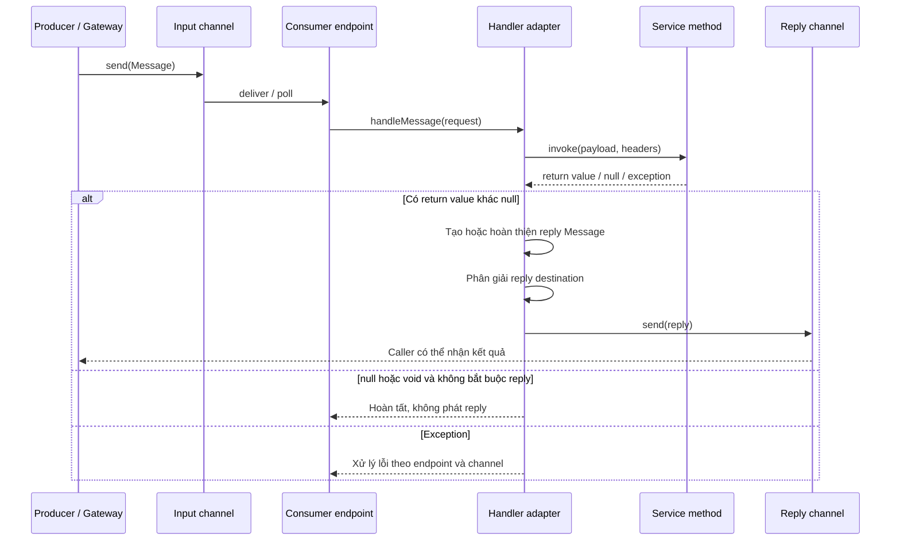
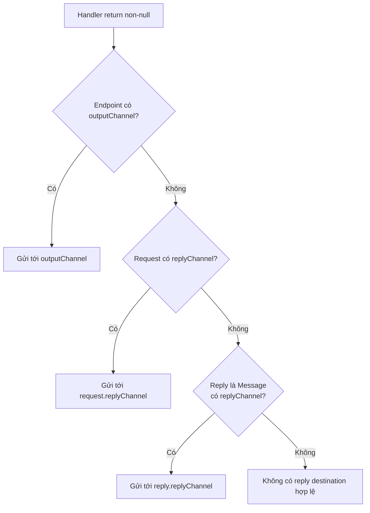
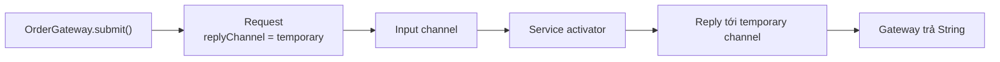

# Return value và reply channel trong Handler adapter

## 1. Vị trí trong Spring Integration Runtime

Trong **Spring Integration Runtime**, một `MessageChannel` đưa message tới consumer endpoint; endpoint gọi `MessageHandler`, có thể là adapter gọi một phương thức POJO. Khi method có giá trị trả về, framework phải quyết định **có sinh reply message hay không, sinh như thế nào và gửi đến đâu**.

Đó là chủ đề **Return value và reply channel** của chương **Handler adapter** trong `SPRING_INTEGRATION_RUNTIME`. Quy tắc này liên quan đến cách điều phối flow qua channel, endpoint, consumer, poller và executor; từ đó quyết định hành vi khi transaction, retry, error handling, message store, correlation hoặc threading thay đổi.

Sau bài học, người đọc có thể:

1. Phân biệt *return value*, *reply message* và *reply channel*.
2. Biết method trả payload, trả `Message<?>`, trả `null` hoặc `void` dẫn đến điều gì.
3. Hiểu thứ tự ưu tiên `outputChannel` và header `replyChannel` để tự thiết kế request-reply.
4. Giải thích `requiresReply`, `nullChannel`, timeout, lỗi định tuyến, header propagation.
5. Chẩn đoán được flow “handler chạy xong nhưng caller không nhận reply”.

Phạm vi trình bày chủ yếu là **service activator và các reply-producing handler thông thường** trong Spring Integration 6.x. Một số endpoint chuyên dụng như splitter, aggregator, reactive handler, remote gateway có thêm quy tắc riêng.

## 2. Ba khái niệm phải tách biệt

| Thành phần | Ví dụ | Nghĩa |
|---|---|---|
| **Return value** của Java method | `return "APPROVED";` | Đầu ra nghiệp vụ ở cấp phương thức |
| **Reply message** | `Message<String>` chứa `APPROVED` và headers | Thông điệp thực tế được gửi ra khỏi handler |
| **Reply channel** | Bean `orders.replies` hoặc header `replyChannel` | Địa chỉ nhận reply, không phải nội dung reply |

Với một message đầu vào, đường xử lý khái quát như sau:



**Có return value hợp lệ chưa đủ để khẳng định caller đã nhận được kết quả.** Reply còn phải có destination hợp lệ và phải được channel/downstream tiếp nhận thành công.

## 3. Handler adapter xử lý return value như thế nào?

### 3.1. Trả về payload không null

```java
@ServiceActivator(inputChannel = "orders.in", outputChannel = "orders.out")
public String approve(String orderId) {
    return "APPROVED:" + orderId;
}
```

Khi method trả về `String` khác `null`, Spring Integration tạo reply `Message<?>` với payload là giá trị đó. Một DTO hoặc giá trị Java khác cũng có thể trở thành payload. Với service activator, các header của request nhìn chung được propagate sang reply theo quy tắc không ghi đè header đã tồn tại và không sao chép header bị cấu hình chặn.

### 3.2. Trả về một `Message<?>` đầy đủ

```java
@ServiceActivator(inputChannel = "orders.in", outputChannel = "orders.out")
public Message<String> approve(Message<String> request) {
    return MessageBuilder
            .withPayload("APPROVED:" + request.getPayload())
            .setHeader("decision", "approved")
            .build();
}
```

Method chủ động tạo `Message` có payload và headers. **Riêng service activator**, framework vẫn sao chép những request header **chưa tồn tại** trong reply, tùy chính sách propagation. Nếu request mang `tenantId` nhưng reply builder không đặt `tenantId`, header này thường xuất hiện lại ở reply. Header `decision` đã được tạo trên reply sẽ giữ giá trị của reply.

Không thể “xóa” header từ reply chỉ bằng cách không copy nó trong builder. Nếu muốn loại header ở ranh giới flow, dùng `HeaderFilter` hoặc cấu hình `notPropagatedHeaders` thích hợp. **Transformer** trả về `Message<?>` hoàn chỉnh có semantics khác: mã ứng dụng chịu trách nhiệm đối với toàn bộ message và những header muốn giữ.

`id` và `timestamp` là header readonly của message builder mặc định, thường thay đổi khi tạo message mới. Muốn truy vết nghiệp vụ xuyên nhiều message, thiết kế `correlationId` hay `traceId` rõ ràng; không dựa trên việc giữ nguyên message ID.

### 3.3. Trả về `null` hoặc `void`

```java
@ServiceActivator(inputChannel = "audit.events")
public void audit(String event) {
    // Chỉ ghi audit, không có phản hồi nghiệp vụ.
}
```

Mặc định, service activator trả `void` hoặc `null` sẽ **không phát reply**. Điều này phù hợp với xử lý one-way. Nếu caller dùng gateway đồng bộ cần một kết quả, việc không có reply có thể gây timeout hoặc đợi rất lâu tùy timeout configuration.

Khi **bắt buộc** method có kết quả, đặt `requiresReply`:

```java
@ServiceActivator(
        inputChannel = "orders.validate",
        outputChannel = "orders.validated",
        requiresReply = "true"
)
public String validate(String orderId) {
    return orderId.isBlank() ? null : "VALID:" + orderId;
}
```

`@ServiceActivator.requiresReply` là thuộc tính dạng **String**, vì thế dùng `"true"`. Nếu method trả `null` trong chế độ bắt buộc, framework ném `ReplyRequiredException`. Cờ này không tự tạo giá trị mặc định và cũng không tự bảo đảm reply gửi thành công.

### 3.4. Exception và one-way khác nhau

Nếu service method ném exception, handler chưa hoàn thành thành công. Với `DirectChannel` đồng bộ, exception thường lan ngược về sender/gateway. Nếu ở `ExecutorChannel` hoặc polling flow, lỗi có thể đi theo `ErrorMessage`, `errorChannel`, error handler hay advice tùy cấu hình.

Không đánh đồng **throw exception** với **trả về `Message<Throwable>`**; gateway có quy tắc riêng khi nhận payload kiểu `Throwable`/`ErrorMessage`. Tương tự, header `errorChannel` là kênh xử lý lỗi, không phải reply thành công.

## 4. Thứ tự chọn reply channel

Đối với service activator thông thường **đã tạo reply khác null**, routing cơ bản theo thứ tự:

1. **`outputChannel` định nghĩa ở endpoint** được ưu tiên.
2. Không có `outputChannel`: kiểm tra `replyChannel` trong **request headers**.
3. Không có `replyChannel` trong request và return value là **`Message<?>`**: có thể kiểm tra `replyChannel` của **reply Message**.
4. Không có đích hợp lệ: gửi reply thất bại, có thể gặp `DestinationResolutionException`.

Lưu ý: các cơ chế nâng cao như **routing slip** có thể ảnh hưởng destination trong các flow được thiết kế sử dụng chúng. Thứ tự trên áp dụng cho trường hợp reply thông thường không có routing slip đang điều khiển đường đi.



### 4.1. Kiểu dữ liệu của header `replyChannel`

`MessageHeaders.REPLY_CHANNEL` có thể chứa:

- **`MessageChannel` instance**: gửi trực tiếp tới channel được chỉ định.
- **`String` tên channel**: framework cố resolve tên thành channel bean/registry entry.

Nếu tên channel không resolve được, thường gặp `DestinationResolutionException`. Không nhầm header `replyChannel` với payload hoặc `correlationId`.

### 4.2. `outputChannel` có thể “cướp” reply từ gateway

Giả sử gateway đặt temporary reply channel vào request header, nhưng service activator có `outputChannel = "audit.results"`. Handler sẽ gửi reply về **`audit.results`** trước, thay vì địa chỉ gateway đang chờ. Nếu không có một flow chuyển lại từ `audit.results` về gateway, caller sẽ không nhận được kết quả.

Điều này không có nghĩa handler gọi sai. **Wiring của toàn flow** cần bảo đảm return address được tôn trọng hoặc có đường quay trở lại gateway.

### 4.3. `nullChannel` để hủy reply một cách có chủ đích

Spring Integration cung cấp channel đặc biệt có tên `nullChannel`. Khi handler trả về kết quả mà muốn kết thúc flow, cấu hình `outputChannel = "nullChannel"` để hủy message.

| Trường hợp | Kết quả |
|---|---|
| Method `void` hoặc `return null` (mặc định) | Không tạo reply |
| Method trả `"OK"`, endpoint gửi tới `nullChannel` | Có reply, nhưng bị hủy |
| Method trả `"OK"`, endpoint có `outputChannel` | Reply đến channel tường minh |
| Method trả `"OK"`, không có output nhưng request có `replyChannel` | Reply theo request return address |
| Method trả `null` và `requiresReply="true"` | `ReplyRequiredException` |
| Có reply nhưng không tìm được destination | Lỗi định tuyến, khác `ReplyRequiredException` |

## 5. Ví dụ thực hành hai chiến lược định tuyến

Ví dụ dùng Spring Integration 6.x, Java 17+, dependency `spring-integration-core`. Ta tạo hai `DirectChannel` để gửi request và hai `QueueChannel` để đọc reply:

- Nhánh **fixed**: có output channel cấu hình sẵn.
- Nhánh **dynamic**: không có output channel, dùng request header `replyChannel`.

### 5.1. Java config và service methods

```java
import org.springframework.context.annotation.Bean;
import org.springframework.context.annotation.Configuration;
import org.springframework.integration.annotation.ServiceActivator;
import org.springframework.integration.channel.DirectChannel;
import org.springframework.integration.channel.QueueChannel;
import org.springframework.integration.config.EnableIntegration;
import org.springframework.messaging.Message;
import org.springframework.messaging.handler.annotation.Header;
import org.springframework.messaging.handler.annotation.Payload;
import org.springframework.messaging.support.MessageBuilder;

@Configuration
@EnableIntegration
class ReplyRoutingConfig {

    @Bean("orders.fixed.in")
    DirectChannel fixedInput() {
        return new DirectChannel();
    }

    @Bean("orders.dynamic.in")
    DirectChannel dynamicInput() {
        return new DirectChannel();
    }

    @Bean("orders.fixed.out")
    QueueChannel fixedOutput() {
        return new QueueChannel();
    }

    @Bean("orders.header.out")
    QueueChannel headerOutput() {
        return new QueueChannel();
    }

    @Bean
    OrderReplyHandlers orderReplyHandlers() {
        return new OrderReplyHandlers();
    }
}

class OrderReplyHandlers {

    @ServiceActivator(
            inputChannel = "orders.fixed.in",
            outputChannel = "orders.fixed.out",
            requiresReply = "true")
    public String fixed(
            @Payload String orderId,
            @Header(name = "tenantId", required = false) String tenantId) {

        String tenant = tenantId == null ? "public" : tenantId;
        return "ACK:" + tenant + ":" + orderId;
    }

    @ServiceActivator(
            inputChannel = "orders.dynamic.in",
            requiresReply = "true")
    public Message<String> dynamic(Message<String> request) {

        return MessageBuilder
                .withPayload("DYN:" + request.getPayload())
                .setHeader("processedBy", "dynamicHandler")
                .build();
    }
}
```

`fixed()` chỉ trả payload; reply destination là `orders.fixed.out`. `dynamic()` trả `Message` có thêm header; vì không định nghĩa output trên endpoint nên destination tùy request header. Chúng có handler và channel riêng, không tranh nhau xử lý cùng một input.

### 5.2. Chạy thử và đọc reply

```java
import org.springframework.context.annotation.AnnotationConfigApplicationContext;
import org.springframework.integration.channel.QueueChannel;
import org.springframework.messaging.Message;
import org.springframework.messaging.MessageChannel;
import org.springframework.messaging.MessageHeaders;
import org.springframework.messaging.support.MessageBuilder;

public class ReplyRoutingDemo {

    public static void main(String[] args) {
        try (var context =
                new AnnotationConfigApplicationContext(ReplyRoutingConfig.class)) {

            MessageChannel fixedIn =
                    context.getBean("orders.fixed.in", MessageChannel.class);
            MessageChannel dynamicIn =
                    context.getBean("orders.dynamic.in", MessageChannel.class);

            QueueChannel fixedOut =
                    context.getBean("orders.fixed.out", QueueChannel.class);
            QueueChannel headerOut =
                    context.getBean("orders.header.out", QueueChannel.class);

            Message<String> request = MessageBuilder.withPayload("A-101")
                    .setHeader("tenantId", "shop-7")
                    .setHeader(MessageHeaders.REPLY_CHANNEL, headerOut)
                    .build();

            // Output cấu hình tường minh thắng request.replyChannel.
            fixedIn.send(request);
            Message<?> fixedReply = fixedOut.receive(1_000);
            System.out.println(fixedReply.getPayload());
            // ACK:shop-7:A-101

            System.out.println(headerOut.receive(0) == null);
            // true: headerOut vẫn chưa có reply

            // Không có endpoint output -> dùng request.replyChannel.
            dynamicIn.send(request);
            Message<?> dynamicReply = headerOut.receive(1_000);
            System.out.println(dynamicReply.getPayload());
            // DYN:A-101

            System.out.println(dynamicReply.getHeaders().get("processedBy"));
            // dynamicHandler
            System.out.println(dynamicReply.getHeaders().get("tenantId"));
            // shop-7: request header được propagate
        }
    }
}
```

Trong mã ứng dụng thực tế, **kiểm tra `receive(timeout) != null`** trước khi gọi `getPayload()`. Kết quả demo giả định input được xử lý thành công.

`DirectChannel` chuyển message đến subscriber cùng thread khi không có thành phần bất đồng bộ chen giữa. `QueueChannel` ở đây là **nơi chứa reply** để test đọc ra. Nếu dùng `QueueChannel` làm **input**, cần thiết lập polling consumer/poller phù hợp.

### 5.3. Reply tự mang `replyChannel` khi request không có

Trường hợp cuối của thứ tự ưu tiên được minh họa bằng một method khác:

```java
@ServiceActivator(inputChannel = "orders.last.in")
public Message<String> last(String orderId) {
    return MessageBuilder.withPayload("DONE:" + orderId)
            .setHeader(MessageHeaders.REPLY_CHANNEL, "orders.last.out")
            .build();
}
```

Khi không có `outputChannel`, request không có `replyChannel`, và tên `orders.last.out` resolve thành một channel hợp lệ, reply có thể được gửi đến đó. Muốn chạy ví dụ riêng cần khai báo các channel tương ứng. Cách này phù hợp khi **định tuyến thực sự là một phần nghiệp vụ**; đa số flow dùng endpoint output hoặc request return address rõ ràng hơn.

## 6. Gateway biến reply thành return value của caller

Trong ứng dụng thực tế, caller thường muốn gọi một giao diện Java thay vì trực tiếp tạo `Message` và gọi `receive()`:

```java
import org.springframework.integration.annotation.Gateway;
import org.springframework.integration.annotation.MessagingGateway;

@MessagingGateway(defaultRequestChannel = "orders.dynamic.in")
public interface OrderGateway {

    @Gateway(replyTimeout = 3_000)
    String submit(String orderId);
}
```

Cấu hình phát hiện gateway interface theo annotation, thường dùng `@IntegrationComponentScan`. Giả sử flow của gateway chạy qua `orders.dynamic.in` và nhận một reply có payload `"DYN:A-101"`, lời gọi `submit("A-101")` sẽ nhận chuỗi đó.

**Cách hoạt động:** gateway request-reply thường tạo **temporary point-to-point reply channel**, ghi vào header `replyChannel` của request rồi chờ kết quả. Nếu cuối flow không có output channel tường minh, service activator dùng header đó để gửi reply về đúng caller.



Nếu cuối flow đã cấu hình output channel tới một destination cố định mà **không có đường quay lại** temporary channel, gateway sẽ không nhận được reply. Một output channel trung gian vẫn có thể là thiết kế đúng nếu các bước downstream cuối cùng trả kết quả về gateway.

### 6.1. Hai loại timeout khác nhau

| Timeout | Đối tượng | Khi nào hữu ích |
|---|---|---|
| `requestTimeout` | Gateway gửi request | Channel có thể block lúc gửi, ví dụ `QueueChannel` bounded đầy |
| `replyTimeout` | Gateway chờ kết quả | Flow async, poller, timeout mạng hoặc nhánh không trả reply |
| `sendTimeout` của reply-producing handler | Gửi reply đến output destination | Output channel bị giới hạn capacity và không thể nhận ngay |
| Poller interval | Tốc độ thăm dò input | Ảnh hưởng độ trễ bắt đầu xử lý và backlog |

`@Gateway(replyTimeout = 3_000)` là **3.000 ms** trong ví dụ; nên cấu hình rõ giới hạn phù hợp với SLO thay vì lệ thuộc vào mặc định của từng loại gateway/phiên bản.

**Đặc biệt:** trong một flow **hoàn toàn đồng bộ** với `DirectChannel`, service method chạy ngay trên thread caller. Nếu service method bị kẹt, `replyTimeout` không tự ngắt lời gọi đồng bộ đó: timer chờ reply chỉ có ý nghĩa sau khi quyền điều khiển quay lại gateway. Với `ExecutorChannel` hoặc poller tạo ranh giới thread, caller có thể timeout trước khi handler gửi reply.

Khi reply đến **sau timeout**, caller đã có thể bỏ cuộc hoặc retry. Timeout **không phải cancellation hay rollback** của công việc phía sau. Vì vậy phải xét xử lý trùng và idempotency, không chỉ tăng timeout.

### 6.2. Gateway one-way và `nullChannel`

Gateway method trả `void` thường đại diện lệnh một chiều. Với Spring Integration từ 5.4, khi chưa có header `replyChannel` tường minh, gateway dạng `void` có thể đặt `replyChannel` tới `nullChannel` để loại bỏ kết quả downstream nếu xuất hiện.

Khác với `void`, một gateway trả `String` cần reply theo hợp đồng. Không nên sửa method gateway thành `void` chỉ để tránh lỗi timeout khi nghiệp vụ thực sự cần biết kết quả.

## 7. Header propagation, correlation và tính đúng đắn của reply

### 7.1. Metadata nào cần theo dõi?

| Header | Mục đích | Rủi ro khi dùng sai |
|---|---|---|
| `replyChannel` | Địa chỉ nhận reply | Bị output cố định ghi đè; để lộ return address cũ sang nhánh khác |
| `errorChannel` | Đường thông báo lỗi theo cơ chế phù hợp | Nhầm với success reply |
| `correlationId` | Liên kết các message của cùng workflow/nhóm | Mất nhóm khi header bị xóa, hoặc dùng business key không duy nhất |
| `sequenceNumber`, `sequenceSize` | Hỗ trợ xử lý split/aggregate | Nhóm không release đúng do sequence không phù hợp |
| `id`, `timestamp` | Định danh và thời điểm tạo từng message | Không nên làm khóa nghiệp vụ xuyên các lần transform |
| `tenantId`, `traceId` (tự định nghĩa) | Context ứng dụng/observability | Propagation không kiểm soát gây rò rỉ thông tin |

`replyChannel` **không phải correlation ID**. Khi gateway dùng temporary reply channel, nó giải quyết routing reply về caller cụ thể; khi dùng aggregator, vẫn cần correlation strategy, message group, release strategy và có thể cần `MessageStore`.

Nếu nhiều caller cùng gọi `receive()` trên **một `QueueChannel` chia sẻ**, caller A có thể nhận reply của caller B. Không dựa vào thứ tự FIFO của queue để xác định kết quả thuộc request nào dưới concurrent load. Một gateway có temporary reply channel mỗi request, hoặc một cơ chế correlation/demultiplex rõ ràng, phù hợp hơn.

### 7.2. Không xóa header bằng cách “không copy”

Với service activator trả `Message<?>`, framework có thể tự bổ sung các request header thiếu trong reply. Do đó:

- Muốn **thay** header, đặt giá trị tường minh trên reply message khi hợp đồng cho phép.
- Muốn **bỏ** header ở một ranh giới, đặt `HeaderFilter` trong flow hoặc chính sách `notPropagatedHeaders`.
- Muốn **giữ** return address cho gateway, không vô tình xóa `replyChannel` trước khi thành phần phát reply cuối cùng sử dụng nó.
- Muốn **ẩn metadata nhạy cảm**, giới hạn propagation và log các field cần thiết thay vì dump toàn bộ message.

Không áp dụng chặn header trên diện rộng nếu flow còn cần `correlationId`, `replyChannel` hay các header mang thông tin giao thức.

## 8. Thread, transaction, retry và lifecycle tác động ra sao?

### 8.1. Ranh giới thread

- **`DirectChannel`:** subscriber được gọi đồng bộ trên thread gửi; handler hoàn thành và thông thường reply cũng được gửi ngay trong call stack.
- **`ExecutorChannel`:** message được bàn giao vào executor; có ranh giới thread nên phải tính thời điểm reply đến, queue executor, pool saturation, rejection và timeout.
- **`QueueChannel` + `PollingConsumer`:** input message có thể nằm chờ trong queue/message store; poller quyết định thời điểm bắt đầu và worker có thể là thread riêng.
- **`PublishSubscribeChannel`:** nhiều subscriber có thể nhận cùng message; nếu nhiều nhánh đều phát reply thì phải thiết kế rõ chuyện một request tương ứng bao nhiêu kết quả.

Lấy tên thread trong log tại producer, handler và reply consumer giúp xác nhận bước hand-off. Header `replyChannel` không chuyển `ThreadLocal`/transaction context giữa thread.

### 8.2. Transaction không đồng nghĩa caller đã nhận reply

Một transaction có thể hoàn tất trước khi gateway biết kết quả, hoặc gặp lỗi lúc gửi reply sau khi cập nhật dữ liệu. Tính chất commit/rollback phụ thuộc transaction advice, channel, poller, data source và việc có chuyển thread hay không.

Ví dụ: method lưu trạng thái `PAID` thành công, nhưng reply output queue đầy nên `send` thất bại. Nếu caller retry vì timeout, method có thể được gọi lần nữa. Để tránh side effect trùng:

1. Dùng business key hoặc idempotency key, ví dụ `orderId`, cùng trạng thái xử lý có thể kiểm tra lại.
2. Xác định rõ transaction boundary có bao trùm xử lý và gửi reply hay không; không giả định XA/atomicity giữa DB và mọi transport.
3. Tách lỗi nghiệp vụ cố định (payload sai, thiếu channel) khỏi lỗi hạ tầng tạm thời khi cấu hình retry/backoff.
4. Với cam kết delivery cao, xem xét outbox/inbox, retry và recovery phù hợp. `replyChannel` một mình không bảo đảm exactly-once.

### 8.3. Lỗi và error channel

Với đường đồng bộ, exception có thể trả về producer. Với polling/bất đồng bộ, error handler có thể publish `ErrorMessage` tới `errorChannel` hoặc xử lý theo advice. Gateway có semantics để nhận/lan truyền lỗi downstream về caller, nhưng không đồng nghĩa mọi lỗi đều trở thành reply thành công.

Một số failure thường gặp:

- Handler không trả reply (`null`, `void`) và caller chờ.
- Không xác định được reply destination hoặc tên channel sai.
- Reply destination có subscription/capacity không phù hợp.
- Gateway timeout trước khi reply đến.
- Poller đang stop hoặc executor backlog lớn.
- Handler ném exception và nhánh error flow không có recovery trả lời caller.

`requiresReply` chỉ kiểm tra **kết quả method có null hay không**. Nó không thay thế các bước xử lý trên.

### 8.4. Message store, queue và quan sát trạng thái

`MessageStore` có thể lưu message trong persistent queue hay lưu các message group cho aggregator, nhưng không mặc định là kho lưu reply của mọi handler. Khi điều tra reply bị mất, kiểm tra riêng:

- Endpoint có start không? `SmartLifecycle` phase và auto-startup có đúng?
- Input channel có subscriber hoặc polling consumer hay không?
- Poller có chạy đều? Message backlog có tăng không?
- Executor có bị queue dồn, thread thiếu, hoặc reject tác vụ?
- Handler đã trả `null`, giá trị khác null hay exception?
- Destination nào thực sự nhận reply? Có subscriber hoặc consumer nhận reply không?
- Gateway đã timeout trước khi reply tới hay chưa?

**Hiệu năng cần đo theo từng đoạn**: thời gian nằm trong input queue, thời gian thực thi handler, thời gian gửi reply, thời gian reply chờ được consume. Một chỉ số thời gian gọi gateway không đủ để quy trách nhiệm cho handler.

## 9. Chẩn đoán triệu chứng thường gặp

| Triệu chứng | Nguyên nhân dễ gặp | Bước điều tra đầu tiên |
|---|---|---|
| Handler log xong nhưng gateway timeout | Reply đi tới `outputChannel` không quay về gateway | Trace destination của output và temporary reply channel |
| Method trả `null` nhưng không thấy exception | `requiresReply` mặc định false | Kiểm tra return type, cấu hình `requiresReply` và nghiệp vụ one-way |
| `ReplyRequiredException` | `requiresReply=true`, method trả null | Kiểm tra nhánh code không tạo kết quả |
| `DestinationResolutionException` | Header replyChannel sai, không có output hợp lệ | Kiểm tra bean name/channel resolver và thứ tự ưu tiên |
| Reply có header lạ “tái xuất hiện” | Service activator propagate request header còn thiếu | Kiểm tra `HeaderFilter` và `notPropagatedHeaders` |
| Reply xuất hiện trên queue nhưng caller khác nhận | Shared reply queue có nhiều consumer | Dùng per-request return address hoặc explicit correlation |
| Reply gửi không được khi load cao | Bounded output queue đầy; downstream không tiêu thụ | Kiểm tra capacity, `sendTimeout`, tốc độ consumer |
| Chỉ lỗi khi có executor/poller | Thread switch, backlog, transaction boundary, timeout | Log thread, lịch poller, executor metrics |
| Xử lý bị lặp sau timeout | Caller/retry gửi lại request khi side effect đã commit | Idempotency key và trạng thái xử lý |
| Aggregator không trả kết quả | Nhóm chưa được release hoặc correlation không đúng | Kiểm tra message group, release strategy, `MessageStore` |

**Quy trình debug nhanh:**

1. Ghi `messageId`, correlation/tracing ID, thời điểm và tên channel khi request vào.
2. Xác định endpoint chạy, có subscriber/poller, handler thực tế đã được gọi.
3. Log **kiểu return value**, null/void/exception và `requiresReply`.
4. Xác định destination thắng ưu tiên: output endpoint → request reply header → reply Message header.
5. Theo dõi send reply, kết quả gửi, queue depth, error path và header propagation.
6. So timestamps, thread names, gateway timeout và mức backlog trước khi kết luận “mất reply”.

## 10. Bài tập ứng dụng

1. **Ưu tiên channel:** chạy ví dụ mục 5. Xác nhận fixed reply vào `orders.fixed.out` dù request có header trỏ `orders.header.out`; dynamic reply đi vào header channel.
2. **Return null:** sửa `fixed()` để trả `null` cho input rỗng. Quan sát hành vi với `requiresReply="true"` và khi bỏ flag.
3. **Sai tên channel:** bỏ endpoint output, gửi request có `replyChannel = "missing.channel"`. Giải thích lỗi và cách sửa bằng channel bean hợp lệ.
4. **Shared QueueChannel:** chạy hai producer cùng dùng một reply queue; thảo luận nguy cơ nhận reply của nhau và lý do gateway tạo temporary reply channel.
5. **Timeout với executor:** đưa một khâu qua `ExecutorChannel`, cố tình xử lý chậm hơn gateway `replyTimeout`; đo thời điểm caller timeout và handler hoàn tất, giải thích late reply.
6. **Transaction và retry:** mô phỏng cập nhật database xong nhưng reply gửi thất bại; đề xuất cách dùng idempotency key để tránh side effect trùng.
7. **Header propagation:** method trả `Message<String>` chỉ đặt `decision`; request có `tenantId` và `traceId`. Kiểm tra hai header có sang reply; thêm `HeaderFilter` để kiểm soát.

## 11. Checklist thiết kế luồng reply

- **Luồng một chiều:** method `void` hoặc không phát reply; caller không chờ kết quả.
- **Luồng cần phản hồi:** trả giá trị khác null, cân nhắc `requiresReply=true` và quản lý lỗi.
- **Pipeline có downstream cố định:** dùng `outputChannel` hoặc bước chuyển tiếp tiếp theo.
- **Request-reply nhiều caller:** tận dụng temporary `replyChannel` của gateway, hoặc có chiến lược correlation rõ ràng.
- **Muốn hủy kết quả:** gửi tới `nullChannel` có chủ đích.
- **Async/polling:** đo latency, chọn `replyTimeout` và kiểm soát backlog, late reply.
- **Có transaction/retry:** dùng idempotency và hiểu rõ nơi commit, nơi gửi reply.
- **Cần observability:** log channel, message/correlation ID, payload type và thời gian theo từng chặng mà không để lộ dữ liệu nhạy cảm.

**Kết luận:** Return value chỉ là đầu ra của handler method. Để hoàn thành request-reply, Spring Integration còn phải tạo reply message, chọn đúng reply channel và gửi thành công trong điều kiện runtime thực tế.

## 12. Tài liệu chính thức

- [Spring Integration 6.5 — Service Activator](https://docs.spring.io/spring-integration/reference/6.5/service-activator.html): return value, `outputChannel`, `replyChannel`, `nullChannel` và `requiresReply`.
- [Spring Integration 6.5 — `ServiceActivator` Javadoc](https://docs.spring.io/spring-integration/docs/6.5.0/api/org/springframework/integration/annotation/ServiceActivator.html): các thuộc tính `outputChannel`, `requiresReply` và `sendTimeout`.
- [Spring Integration Reference — Message](https://docs.spring.io/spring-integration/reference/message.html): header propagation, message headers và `MessageBuilder`.
- [Spring Integration Reference — Messaging Gateways](https://docs.spring.io/spring-integration/reference/gateway.html): temporary reply channel, cách chờ reply và tác động timeout.
- [Spring Integration 6.2.6 — `Gateway` Javadoc](https://docs.spring.io/spring-integration/docs/6.2.6/api/org/springframework/integration/annotation/Gateway.html): `replyTimeout`/`requestTimeout`.
